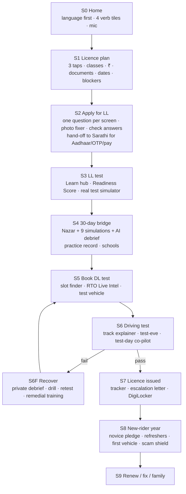
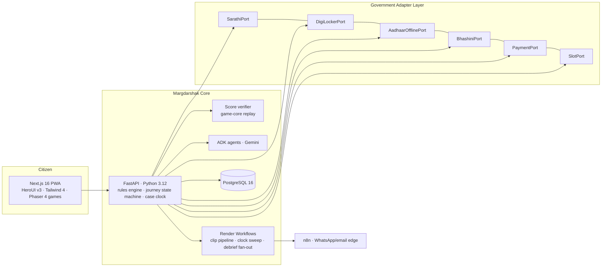

# Margdarshak (मार्गदर्शक): The Master Idea
> *Learner se licence tak, bina agent ke.* From learner's licence to licence, without an agent.
> Team **Chanakya** · @Nestiq Private Limited · HackCache '26 · PS1 "Making mParivahan & Driving Licence Services Accessible to Everyone" · v1.0 · 23 Oct 2026

Read this file first. It explains the whole product in one go. Every detail lives in the bible (`MAP.md` shows where), and every claim's evidence lives in `RESEARCH.md`.

---

## 1. The story in 60 seconds
Kabir is 19 and studies in Jammu. He wants a bike licence now and a car licence later. When he opens parivahan.gov.in, he sees about 120 links: "SLD Maker", "Homologation", press coverage from 2019. Roughly one link in ten is for him, and none of them says "start here".

The learner's licence form takes about 16 screens, 6 captchas and 4 OTPs, and asks for his date of birth six times. If the session times out, the official FAQ tells him to apply again.

After that, the system goes silent for 30 days. Then there are no slots. Then comes a driving test whose rules nobody publishes, and Delhi's automated tracks fail about half of applicants. An agent offers to "set" everything for ₹4,000. The government fee for one class is ₹700, plus ₹200 for the card.

Even if Kabir passes, nobody has taught him to see the bus pulling out, the truck's blind spot or the child behind the auto. In India, 70.9% of road accidents in 2023 involved a driver who held a valid licence.

**Margdarshak** is the guide Kabir never had:
1. Three taps show his whole plan: classes, steps, fees, documents and the earliest date he can hold a licence.
2. One guided road carries him from the learner's licence to the licence in his hand.
3. The empty 30 days become short simulations of real Indian roads. After each one, an AI coach tells him how he did, where he fell short, and what he could have done.

He gets his licence himself, on the first try, without an agent. He also comes out able to read Indian roads.

## 2. What it is, in one paragraph
Margdarshak is a **reimagined, government-adoptable mParivahan**. It is a citizen front end organised around one person's next step, not around the Ministry's departments.

It covers **every licence class, end to end**: plan → apply → learner's test → the 30-day bridge → booking the driving test → the driving test → failing and recovering → licence issued → the first year as a new driver → renewing, fixing and family.

It has three layers:
- **The journey (the body):** the steps above, carried in one guided road.
- **The learning and simulation layer (the heart):** Nazar hazard perception plus nine mini-games, a Test Readiness Score, and AI debriefs.
- **The plug-and-play government layer:** adapters for Sarathi, DigiLocker, Bhashini and payments, state rule packs stored as data, multi-tenancy per state, and a UX4G theme. MoRTH, NIC or a State Transport Department can adopt it without replacing Sarathi.

We build it as a complete product running on mock adapters. It is **not affiliated** with MoRTH or NIC.

## 3. Why it wins (the council's verdict)
- **Every PS1 box is ticked**: all 17 boxes, mapped in `docs/01-product/FEATURES.md`.
- **The journey is the body; Nazar plus the game debrief is the heart.** Most teams build the organiser's "Licence Saathi" journey app. That makes 27 Parivahan redesigns in Build What Moves India's top 250, and none reached the final 10. Our hook is the skill India never tests, proved with real people during the hackathon.
- **The secret:** today the agent is the only one who owns the licence journey. Everything an agent legitimately sells is software. India tests knowledge and vehicle control, but never anticipation.
- **The moat:**
  - a calibrated Indian hazard-clip bank
  - versioned state rule packs with sources
  - per-RTO data on where applications stall and why people fail
  - a network of driving schools and parents
  - trust (no Aadhaar collected, no APKs, sources cited)
- **Government-ready:**
  - plug-and-play adapters
  - UX4G/GIGW design
  - deployable on MeghRaj
  - open source (Apache-2.0)
  - the state owns its data

---

## 4. Who it's for
| Persona | Who | What they need |
|---|---|---|
| **Kabir** (primary) | 19, Jammu, bike now and car later, Hinglish, overconfident, fears failing in front of friends | Certainty, no humiliation, skill he can show off |
| **Tanvi** | 19, her Aadhaar address is in Kathua but she lives in Jammu (migrant), no vehicle | Blockers caught early, a vehicle for the test |
| **Mohan-ji** | 52, Kabir's father: renewal, a car re-test, Form 1A | Family mode, voice in Hindi, big text |
| **Helper** | Elder sibling or cyber-café operator | Apply on someone's behalf, with consent, safely |
| **Driving school** | Owner near the RTO | Students, hazard-training tools (Kerala now requires them), learner progress |
| **RTO / Transport Commissioner** | The government | Fewer counter queries and re-tests, visibility of where applications stall |
| **Rahul** (edge) | 17 | Only a ≤50 cc licence. Rules-only experience: no AI, no tracking, no streaks |

**Job to be done:** *"When I turn 18 and need a licence, help me get it myself, on the first try, without paying an agent or being humiliated, and come out actually able to read Indian roads, so my family and friends see I do things right."*

---

## 5. The whole product, as one flow

**Always on:**
- a home screen that knows your stage
- the voice guide
- WhatsApp and email updates
- Helper mode
- Lite and offline mode
- WCAG 2.1 AA accessibility
- English and Hindi in full, plus Dogri voice input

### S0 · Home: one question instead of 120 links
- **Language first**, each language shown in its own script.
- **One headline:** "Get your driving licence, step by step."
- **Four tiles:** Get my first licence · Practise for the test · Renew or fix my licence · Check my application.
- **A mic button:** "Or just tell us what you need."
- **A calm trust line:** "Govt fee ₹700 for one class + ₹200 card · Never pay agents · Not affiliated with MoRTH/NIC."
- **Everything else** (vehicles, permits, dealers) sits under "All services", grouped by *who you are*.

### S1 · Licence plan in 3 taps, before any login
**Inputs:** age or date of birth · vehicle pictures (scooter without gears, motorcycle, car, auto, truck/bus) · state.

**Output, the "Your licence plan" card:**
- the classes you're eligible for
- the steps
- the most RTO visits you'll need
- the earliest date you can hold a licence
- the fee breakdown, from the rule pack
- the documents to bring
- warnings

The **smart class planner** points out that a bike and a car can go on one learner's licence. That saves a second application and another 30 days.

The **blocker check** runs every edge case before you start:
- your Aadhaar shows only your year of birth
- your Aadhaar address isn't where you live
- the father's name line on your Aadhaar is blank
- you'll turn 40 mid-journey (Form 1A)
- you're 16–17 (only ≤50 cc)
- transport classes under 20
- your state has no online learner's test

You can send the plan to WhatsApp.

### S2 · Apply for the learner's licence, without errors
1. One question per screen, each with a "why we ask" line. Answers auto-save, and you can resume on any device.
2. **Photo and signature fixer.** The phone camera guides the shot, then the photo is cropped, resized and given a white background *on the device*.
3. **Check your answers** before paying, because Sarathi locks edits after payment.
4. **Fee breakdown**, plus a screen telling you what to do if the payment is stuck.
5. **Hand-off to Sarathi** for Aadhaar authentication, OTP, payment and submission. Margdarshak never touches Aadhaar or OTPs.
   - Today that means a prefilled hand-off and a "copy-pack" of your answers.
   - After a state adopts us, it's an adapter.

### S3 · Learner's test: understand it, don't memorise it
- **Learn hub:**
  - bite-size lessons
  - questions that change wording each time, so memorising doesn't work
  - spaced repetition (FSRS)
  - a confidence rating on every answer
- **Test Readiness Score**, shown as "78 = knowledge 84 − calibration 6". At 85 the app nudges you to book; you can always "book anyway".
- **Real test simulator** in your state's format, with a guided first run.
- **AI tutor** that explains *your* wrong answers. **Road Sign Snap:** point the camera at a real sign and add it to your deck.

### S4 · The 30-day bridge, our signature
Today the system is silent for these 30 days. We fill them:
- **Nazar hazard perception:** real Indian road clips in Kerala's announced format (10 clips × 10 marks, pass at 60). Tap when a hazard starts. You get back "you saw the bus 1.4 s late ≈ 16 m at 40 km/h".
- **Nine simulations** built from India's accident data (below), each followed by an **AI debrief**.
- A day-by-day plan ("Driving test unlocks in 12 days"), driving-school booking, and a **Practice Record** of hours, scores and supervisor sign-offs, checkable by QR (it shows what was counted; it never says "verified").
- **Friend squads** (co-op only) and a Nazar Score share card. It's a flex that rewards anticipation, never speed.

### S5 · Book the driving test
- **Slot finder:** a map and calendar of RTOs and accredited centres, plus "notify me if an earlier slot opens". No scraping and no booking bots.
- **RTO Live Intel:** structured crowd reports per RTO, such as when slots really open, which documents the counter asked for, what was checked on the track, and how long the wait was. Nobody is named, and reports are moderated.
- **Vehicle for the test:** a checklist (RC, insurance, PUC, L-plate) and a listing of schools that hire out vehicles.
- **LL-expiry clock:** counts back from day 180 and warns before your licence expires.

### S6 · Driving test, demystified
- An **animated track explainer** covering the figure-8, reverse parking, gradient start, what's checked, and the top reasons people fail.
- The evening before: what to bring and how to get there.
- **Test-day co-pilot:** which counter to go to, a papers check, a "show at counter" QR, and a 2-minute calm-down.
- **Track Test Twin** simulation to rehearse beforehand.

### S6F · Fail and recover, privately
- A **private, face-saving debrief**: no red, no public loss.
- A drill, plus a retest booked from the same screen.
- A referral to remedial training, which is now legally required after a fail.
- An LL-expiry check.
- A **test-record request** (an RTI template), to see why you failed.

### S7 · Licence issued
- A parcel-style tracker: Approved → Printed → Dispatched.
- An escalation letter if approval stalls. It contains facts only, and the user sends it.
- The DigiLocker copy, as soon as the licence is approved.

### S8 · The new-rider year (the riskiest months)
- A voluntary novice pledge, phone-free riding guidance, a monthly hazard refresher, and first night and highway missions.
- **First vehicle:**
  - ABS/CBS and Bharat NCAP ratings
  - an ISI helmet
  - third-party insurance and the ₹15 lakh personal-accident cover
  - PUC, and an RC check
- A challan check, plus a **fake e-challan / APK scam shield**: rules decide the verdict, and AI only explains it.
- A **Golden-hour card**: call 112, basic first aid, and your rights under the Good Samaritan law.

### S9 · Renew, fix, family (surface level)
- **Renewal reminders.** There has been no grace period since 2019, and renewing more than a year late means a retest.
- Add a class, change your address, get a duplicate, get an IDP. These appear only once you hold a licence.
- **Family:** manage a parent's renewal, and see awareness of the minor-riding law (s.199A).

---

## 6. The learning and simulation layer (the heart)
**What we teach:** the learner's-licence syllabus **plus what actually kills on Indian roads**, from MoRTH data:
- over-speeding (68–70%) and braking distance
- helmets (54,568 deaths without one, and only about 45% are fastened properly)
- truck blind spots (18,556 two-wheeler riders killed by heavy vehicles)
- night (42% of accidents)
- uncontrolled and T-junctions (37,782 deaths)
- highways (59% of deaths)
- hills, fog, animals, and first aid

There are 22 modules in total; see `docs/09-learning-games/CURRICULUM.md`.

**The ten games** (one Game SDK, deterministic scoring, server replay as anti-cheat):
| Game | What you do | What it trains |
|---|---|---|
| **Nazar** | Tap when a hazard develops in real Indian clips | Anticipation; the skill linked to crash risk |
| **Stopping Distance** | Pick a speed, see the metres to stop (dry and wet) | Speed choice, following distance |
| **Blind Spot** | Place your bike around a truck or bus; find the safe zones | Heavy-vehicle blind spots |
| **Junction Scan** | Cross uncontrolled and T-junctions; scan before going | Junction crashes |
| **Track Test Twin** | Top-down figure-8, reverse park, gradient start | Passing the RTO track |
| **Helmet Fit** | The camera checks fit and strap, on the device | Helmet use that actually protects |
| **Golden Hour** | First-aid decisions at a crash scene (medical review pending) | Bystander action |
| **Night & Glare** | Dipping lights, spotting unlit hazards | Night crashes |
| **Hill Road** | Uphill priority, hairpins, fog (J&K) | Hill-road crashes |
| **LL Test Simulator** | The real format for your state | Passing the learner's test |

**The AI debrief, after every session.** Code computes the facts: timings, misses, false alarms, scores. The Gemini DebriefAgent then narrates **how you did · where you fell short · what you could have done · your next drill**, in Hindi or English. It can only choose finding, rule and drill IDs from allowlists, it writes no digits of its own (code inserts every number), and a validator rejects anything invented. If AI is unavailable, the user is under 18, or validation fails, a template card shows instead.

**The gamification that's proven:**
- XP only for learning, with diminishing returns after 45 minutes a day
- ranks gated by mastery
- FSRS mastery per topic
- confidence calibration (a "Calibrated" badge)
- weekly streaks that can be repaired and stay silent when broken
- co-op squads
- nine road-sign-shaped badges
- share cards
- the Practice Record

**What we never do:**
- fear or gore (it backfires on confident young men)
- speed leaderboards
- fake urgency
- loot boxes
- cash prizes (Online Gaming Act 2025)
- any of the 13 CCPA dark patterns, which are banned by lint

---

## 7. AI, only where it genuinely helps (Google ADK + Gemini)
| Agent | Does | Why AI | Guardrail |
|---|---|---|---|
| **VoiceGuideAgent** (ADK live + Gemini Live) | Takes you anywhere in the app and fills fields by voice. Example: "Mere papa 52 saal ke hain, unko car ka licence chahiye" | Low literacy, Hinglish, hands-free | Never submits, pays or books; answers cite rule IDs; Dogri speech is transcribed by Sarvam |
| **DebriefAgent** | Coaches you after each game | Feedback tailored to your mistakes | Allowlisted IDs; code supplies the numbers; validator; fallback |
| **CoachAgent** | Writes your weekly plan | Motivation in your language | Same as above |
| **TutorAgent** | Explains your wrong answers | Specific to you | Draws only on reviewed content |
| **ScreenDecoderAgent** | Explains a Sarathi screenshot: what it means and what to do next | Sarathi's errors are cryptic | Uses a verified error catalogue; may answer "unknown" |
| **ClipWindowProposer** (offline) | Proposes hazard windows in clips | Building the clip bank quickly | Two humans set the final windows |
| **SignSnap** | Recognises road signs | Learning on your commute | Checked against the sign catalogue |

**No AI on purpose:**
- the plan, classes and fees
- the blocker check
- the timeline
- the photo fixer
- the glossary
- vehicle advice
- scam verdicts

Rules are exact, and AI would invent things. **Under-18 users get no AI**, because Gemini's terms require 18+ and DPDP has rules for children. Real users run on the paid tier. Aadhaar numbers, OTPs and face images never reach a model.

---

## 8. Automation with n8n (sponsor: n8n Pro)
n8n is the **messaging and schedule edge**, never the business logic. It runs 15 workflows:
- **Daily and scheduled:**
  - the daily case-clock trigger, which calls Render Workflows
  - the test-eve "what to bring" WhatsApp message
  - the weekly parent and coach cards
  - the analytics digest
  - a weekly check for changes in rule sources
- **Event-driven alerts:**
  - milestone alerts: day 30 unlocked, LL expiring
  - crowd-reported slot alerts
  - fail follow-up
  - incident alerts
- **Review and approval queues:**
  - school lead routing
  - the two-approval clip review queue
  - RTO Live Intel moderation
  - escalation letters, with the user's approval
- **Field work:** the field-test export to Google Sheets

Approvals go through WhatsApp or our own page, which resumes a Wait node; Telegram and Gmail "send and wait" are unreliable. SMS waits for TRAI DLT registration. Details are in `docs/05-ops/N8N_WORKFLOWS.md`.

---

## 9. Architecture: plug-and-play for government adoption

- **Hexagonal core.** Every government integration is a *port* with a **mock** adapter (used in the hackathon) and a **real** adapter, used once a state adopts us. Both pass the same contract tests.
- **Real paths verified in research:**
  - DigiLocker requester APIs (OAuth with PKCE, issued licence documents) via NeGD onboarding.
  - API Setu, which needs the publisher's approval.
  - Sarathi stays the system of record. NIC stopped private data sharing from 1 Oct 2026, so adoption goes through the state.
  - Bhashini ULCA.
  - Payments go to the state's own gateway. We never collect government fees.
  - Aadhaar: Margdarshak never touches it. The AadhaarOffline port is mock-only; eKYC and offline verification run through the state, which already holds AUA status.
- **State rule packs as data:** classes, fees, test formats, timelines and languages. Each rule carries a source, date and confidence, and a maker-checker in the Rule-pack Studio approves changes.
- **Multi-tenant per state**, with a **UX4G skin** so a state can white-label it. **Deploy anywhere:** Render for the hackathon, Docker and Helm on **MeghRaj** or a MeitY-empanelled Indian cloud for adoption. **Apache-2.0** code and a **CC-BY** clip bank.
- **The pitch to government:** *configure it, don't replace Sarathi.* Margdarshak is the citizen front end and decision layer; NIC's system stays the record.

**Stack:**
- **Web and games:** Next.js 16, React 19, TypeScript, Tailwind 4, HeroUI v3, Motion, Rive, Phaser 4, MediaPipe, ts-fsrs, next-intl, Serwist.
- **Backend and data:** FastAPI, Pydantic 2, SQLAlchemy 2, Alembic, PostgreSQL 16, Redis.
- **AI:** Google ADK 2.x (Python), Gemini, Sarvam.
- **Jobs, automation and storage:** Render Workflows, n8n, Cloudflare R2.
- **Engineering:** GitHub Actions, OpenTelemetry.

Versions are pinned in `TECH_STACK.md`.

---

## 10. Design: best-in-class, calm and Indian
- **Inspiration:**
  - sarvam.ai: warm off-white, indigo, glowing colour, soft cards, fluid motion
  - the team's own **Vakyam**: a free-font rebuild of Sarvam's look (Fraunces, Figtree, Mukta) on HeroUI v3, with an amber → green → red meaning system
  - Lexington themes
  - **UX4G** (India's government design system) and GOV.UK patterns: step-by-step, one question per page, check your answers
- **Principles:**
  - a calm guide
  - show the whole road, highlight the next step
  - your own script first
  - amber = now, green = done, red only for real danger
  - delight without fear
  - government-grade by default
- **Craft details:**
  - "dawn roads" illustrations with a kolam line motif
  - a Rive voice orb with 8 states
  - scores count up, then name the skill
  - failure shown privately with no red
  - 48 px touch targets
  - Lite mode under 300 KB
- **Accessibility:** WCAG 2.1 AA, and all 46 colour pairs pass contrast checks.

---

## 11. Legal and trust: how we stay clean
- **Never collected:** Aadhaar numbers, OTPs or biometrics. Those steps hand off to Sarathi.
- **No impersonation:** no emblem, no "official", and a "not affiliated" footer on every page.
- **DPDP:**
  - purpose-bound consent records
  - under-18 users treated as children: no AI, no telemetry, no streaks
  - export, delete and a grievance officer
- **CERT-In:** incidents reported within 6 hours, and 180-day logs kept in India once in production.
- **Government standards:** GIGW 3.0, UX4G and WCAG; an STQC pre-audit pack for any state hosting.
- **Online Gaming Act 2025:** no stakes and no prizes.
- **CCPA dark-pattern rules:** enforced by lint.
- **RTO Live Intel:** structured reports only, nobody named, moderated (intermediary duties).
- **Clips:** filmed by the team as passengers, faces and plates blurred, released under CC-BY.
- **Wording we never use:** "first", "official", "DPDP-compliant", "integrated with Sarathi", "lives saved".

Thirty edge cases (EC-01..EC-30) each have a rule, a screen state and a test; see `docs/06-security-compliance/EDGE_CASES.md`.

---

## 12. Ecosystem and business
- **Driving schools (first buyer):**
  - free listing
  - **Pro tier**: learner progress, hazard-training logs for RTO inspections (Kerala now requires these), practice sign-off, parent updates, test-vehicle hire, remedial-training referrals
- **States (B2G):**
  - the adoption kit: adapters, tenancy, UX4G skin, MeghRaj deployment, security-audit pack
  - a **state console** with Palantir-style decision views: where applications stall, fail reasons per RTO, demand forecast, slot utilisation
- **Insurers (roadmap):** an opt-in safe-novice signal.
- **Citizens:** always free.

---

## 13. Proof we will generate (real people, pre-registered)
1. **Journey test:** 5–8 first-time applicants try the real portal's sequence and then Margdarshak. We measure time, errors, blockers caught, a usability score (SUS), and whether they'd still pay an agent.
2. **Nazar study:** 40+ licence holders. Result: "X% would fail Kerala's hazard test, and their learner's-quiz scores didn't predict it (r = Y)."
3. **Before and after:**
   - first-screen choices: about 120 → 4
   - learner's-licence screens: about 16 → about 6
   - fields typed vs autofilled
   - page weight on 3G

**The claim we make:** "trains a skill that predicts crashes". We never say "lives saved".

## 14. How we build it (phases; the team manages the time)
- **P0 Foundations:** monorepo, CI, design tokens, rule packs, mocked adapters.
- **P1 Journey core:** plan, blockers, application, hand-off, stage-aware home, case clock.
- **P2 Learning and games core:** Game SDK, score verifier, learner's-test simulator, Nazar plus the clip pipeline, Stopping Distance, Blind Spot, gamification engine, readiness.
- **P3 AI layer:** debrief with validator, live voice guide, tutor, decoder, evals.
- **P4 Driving test and after:** slots, Live Intel, track explainer, co-pilot, recovery, tracker, new-rider year, renew/family.
- **P5 Ecosystem:** school portal, state console, rule-pack studio, multi-tenancy.
- **P6 Hardening:** accessibility, security, performance, legal review, field studies, demo and submission.
- **P7 Adoption:** DigiLocker onboarding, a state pilot.

Full plan, dependencies and backlog: `docs/08-project/IMPLEMENTATION_PLAN.md`, `BACKLOG.md`.

## 15. The 5-minute demo (summary)
| Time | What judges see |
|---|---|
| 0:00 | The real parivahan homepage: "Find where to apply, 10 seconds." Then a first-timer who paid an agent. |
| 0:40 | Three taps → the plan card → sent to WhatsApp. |
| 1:30 | Voice: "papa 52 saal…" → Form 1A + Helper mode. |
| 2:15 | Apply: autofill, a bad selfie fixed, check answers, fee. |
| 3:00 | Readiness 62 → 86, then the test simulator. |
| 3:45 | Switch to "LL day 31" → Nazar ("1.4 s late ≈ 16 m"), then the AI debrief. The validator visibly blocks an invented "₹0 fee". |
| 4:30 | Before/after numbers, the field results, and a QR for judges to play. *"Learner se licence tak, bina agent ke."* |

## 16. Where to go next
- `MAP.md`: every document, and the reading order for each role.
- `MARGDARSHAK-BIBLE.pdf`: every document in one PDF.
- `RESEARCH.md`: how we researched, the evidence, and our inspirations.
- `docs/00-overview/PROJECT_BRIEF.md`: every ID and decision.
- `docs/02-design/`: UI/UX in full.
- `docs/09-learning-games/`: the games and the debrief.
- `docs/10-government/`: the adoption kit.
- `docs/08-project/IMPLEMENTATION_PLAN.md`: how we build it.
