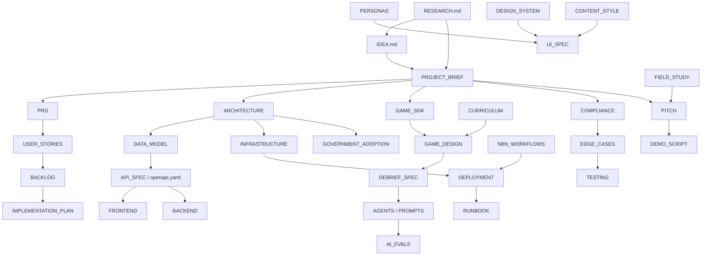

# MAP: how to find anything in Margdarshak
> Project: Margdarshak · Team Chanakya · Status: v1.0 · Last updated: 2026-10-23
> The first three files to read are [IDEA.md](IDEA.md) (the whole idea), [RESEARCH.md](RESEARCH.md) (how we got here, with evidence) and [PROJECT_BRIEF](docs/00-overview/PROJECT_BRIEF.md) (every ID and decision).

## 1. Directory tree
```
margdarshak/
├── IDEA.md / IDEA.pdf           The master idea, end to end, in one read
├── RESEARCH.md / RESEARCH.pdf   How we researched, every problem and how we tackle it, inspirations, 975 sources
├── MAP.md                       This file
├── README.md                    Front door
├── CLAUDE.md / AGENTS.md        Rules and commands for AI coding agents
├── CONTRIBUTING.md · SECURITY.md · CHANGELOG.md · CODE_OF_CONDUCT.md · LICENSE (Apache-2.0)
├── .env.example                 Every environment variable, grouped and commented
├── package.json · pnpm-workspace.yaml · tsconfig.base.json · biome.json · .node-version · .gitignore · .gitattributes
├── .github/workflows/           ci.yml · evals.yml · security.yml · deploy.yml (actionlint-clean)
├── api/openapi.yaml             OpenAPI 3.1 contract: 84 paths, 127 schemas (validated)
├── ai/prompts/                  7 versioned system prompts (debrief, coach, tutor, voice guide, screen decoder, clip windows, sign snap)
├── ai/evals/                    debrief_150, voice_nav_30, decoder_30, tutor_30 (JSONL) + README
├── apps/web · apps/console      (empty) Next.js 16 citizen PWA · portals (school, state console, rule studio)
├── services/api                 FastAPI service skeleton: pyproject.toml (pinned)
├── services/score-verifier      (empty) Node replay of game sessions
├── services/workflows           (empty) Render Workflows tasks
├── packages/game-core           Game SDK + deterministic scoring (README = package API)
├── packages/ui                  tokens.css · tokens.json (design tokens, contrast-checked)
├── packages/rules · rulepacks/  (empty) rule-pack schemas · state rule packs (data)
├── infra/                       render.yaml · docker/ (api, web, score-verifier, compose) · helm/README.md
├── n8n/                         README + 4 exported workflows (W01, W04, W08, W09)
├── scripts/                     gh_import_backlog.mjs (307 tickets) · check_contrast.mjs · evals/gen_debrief_150.mjs
├── field-kit/                   Superseded field kit + nazar_stats.mjs (current protocol: docs/08-project/FIELD_STUDY.md)
└── docs/
    ├── BIBLE-BRIEF.md           Instructions used to generate these docs
    ├── 00-overview/   PROJECT_BRIEF · VISION · PITCH · DEMO_SCRIPT
    ├── 01-product/    PRD · PERSONAS · USER_JOURNEYS · USER_STORIES (~220) · FEATURES (PS1 checklist) · ROADMAP · METRICS · COMPETITIVE_ANALYSIS
    ├── 02-design/     DESIGN_SYSTEM · UI_SPEC (index) · UI_SPEC_JOURNEY (~80 screens) · UI_SPEC_LEARN_GAMES · ACCESSIBILITY · LOCALIZATION · CONTENT_STYLE
    ├── 03-engineering/ ARCHITECTURE · TECH_STACK · DATA_MODEL · API_SPEC · INTEGRATIONS · FRONTEND · BACKEND · CODING_STANDARDS · GIT_WORKFLOW · TESTING · PERFORMANCE · ENVIRONMENT_SETUP · adr/ADR-0000..0010
    ├── 04-ai/         MODELS · AGENTS · VOICE · PROMPTS · AI_EVALS · RESPONSIBLE_AI · DATA_PIPELINE
    ├── 05-ops/        CICD · INFRASTRUCTURE · DEPLOYMENT · OBSERVABILITY · RUNBOOK · COST · N8N_WORKFLOWS
    ├── 06-security-compliance/ SECURITY_ARCHITECTURE · THREAT_MODEL · PRIVACY · COMPLIANCE · LEGAL_MEMOS · EDGE_CASES · RISK_REGISTER · STQC_PREAUDIT_PACK
    ├── 07-business/   BUSINESS_MODEL · GTM · FINANCIALS · IMPACT
    ├── 08-project/    IMPLEMENTATION_PLAN · BACKLOG (307 tickets) · TEAM · GLOSSARY · FIELD_STUDY
    ├── 09-learning-games/ CURRICULUM · GAME_DESIGN · GAME_SDK · GAMIFICATION_ENGINE · NAZAR · DEBRIEF_SPEC
    └── 10-government/ GOVERNMENT_ADOPTION · PALANTIR_METHOD
```
Research archive (outside this repo, in `G:\HACKATHON_PROJECTS\HACKCACHE26\`):
- `research/`: hackathon recon, domain research, ps1-current-state, ps1-deep 00–08.
- `war-room/`: council logs, grand council, verification files.
- `biblehackathon.pdf` and `ideas.pdf`.

## 2. Where do I find…?
| Question | Document |
|---|---|
| What are we building, in one read? | [IDEA.md](IDEA.md) |
| Why this idea, and what's the evidence? | [RESEARCH.md](RESEARCH.md) |
| Every ID, decision and resolved conflict | [PROJECT_BRIEF](docs/00-overview/PROJECT_BRIEF.md) (§15) |
| What exactly does each feature do, and when is it done? | [PRD](docs/01-product/PRD.md) · [FEATURES](docs/01-product/FEATURES.md) |
| Does it tick every PS1 box? | [FEATURES](docs/01-product/FEATURES.md) (PS1 checklist mapping) |
| Who are the users? | [PERSONAS](docs/01-product/PERSONAS.md) · [USER_JOURNEYS](docs/01-product/USER_JOURNEYS.md) |
| What does each screen look like? | [UI_SPEC](docs/02-design/UI_SPEC.md) → the two parts |
| Colours, fonts, motion, components | [DESIGN_SYSTEM](docs/02-design/DESIGN_SYSTEM.md) · `packages/ui/tokens.css` |
| What do we say on screen (and never say)? | [CONTENT_STYLE](docs/02-design/CONTENT_STYLE.md) |
| How do the games work and how are they scored? | [GAME_DESIGN](docs/09-learning-games/GAME_DESIGN.md) · [GAME_SDK](docs/09-learning-games/GAME_SDK.md) |
| What do we teach, and why? | [CURRICULUM](docs/09-learning-games/CURRICULUM.md) |
| How does the AI debrief work without making things up? | [DEBRIEF_SPEC](docs/09-learning-games/DEBRIEF_SPEC.md) · [AGENTS](docs/04-ai/AGENTS.md) · [PROMPTS](docs/04-ai/PROMPTS.md) |
| How does the voice guide work? | [VOICE](docs/04-ai/VOICE.md) |
| XP, readiness, streaks, badges | [GAMIFICATION_ENGINE](docs/09-learning-games/GAMIFICATION_ENGINE.md) |
| Nazar clip bank and study | [NAZAR](docs/09-learning-games/NAZAR.md) · [FIELD_STUDY](docs/08-project/FIELD_STUDY.md) |
| System architecture and the government adapters | [ARCHITECTURE](docs/03-engineering/ARCHITECTURE.md) · [INTEGRATIONS](docs/03-engineering/INTEGRATIONS.md) |
| Database schema / ontology | [DATA_MODEL](docs/03-engineering/DATA_MODEL.md) |
| Endpoints | [API_SPEC](docs/03-engineering/API_SPEC.md) · [openapi.yaml](api/openapi.yaml) |
| How do I set up and run it? | [ENVIRONMENT_SETUP](docs/03-engineering/ENVIRONMENT_SETUP.md) |
| How is it tested? | [TESTING](docs/03-engineering/TESTING.md) · [AI_EVALS](docs/04-ai/AI_EVALS.md) |
| How is it deployed and what does it cost? | [DEPLOYMENT](docs/05-ops/DEPLOYMENT.md) · [COST](docs/05-ops/COST.md) |
| What do the n8n workflows do? | [N8N_WORKFLOWS](docs/05-ops/N8N_WORKFLOWS.md) · `n8n/` |
| What if something breaks on demo day? | [RUNBOOK](docs/05-ops/RUNBOOK.md) · [DEMO_SCRIPT](docs/00-overview/DEMO_SCRIPT.md) |
| Is it legal? Aadhaar, DPDP, minors, gaming, impersonation | [COMPLIANCE](docs/06-security-compliance/COMPLIANCE.md) · [LEGAL_MEMOS](docs/06-security-compliance/LEGAL_MEMOS.md) · [PRIVACY](docs/06-security-compliance/PRIVACY.md) |
| Edge cases EC-01..EC-30 | [EDGE_CASES](docs/06-security-compliance/EDGE_CASES.md) |
| What can go wrong? | [RISK_REGISTER](docs/06-security-compliance/RISK_REGISTER.md) · [THREAT_MODEL](docs/06-security-compliance/THREAT_MODEL.md) |
| How can a state adopt it? | [GOVERNMENT_ADOPTION](docs/10-government/GOVERNMENT_ADOPTION.md) · [STQC_PREAUDIT_PACK](docs/06-security-compliance/STQC_PREAUDIT_PACK.md) |
| How we model the domain (Palantir-style) | [PALANTIR_METHOD](docs/10-government/PALANTIR_METHOD.md) |
| Who pays, and how we grow | [BUSINESS_MODEL](docs/07-business/BUSINESS_MODEL.md) · [GTM](docs/07-business/GTM.md) · [FINANCIALS](docs/07-business/FINANCIALS.md) |
| What do we say to each judge? | [PITCH](docs/00-overview/PITCH.md) (128 Q&As) |
| What do we build, in what order? | [IMPLEMENTATION_PLAN](docs/08-project/IMPLEMENTATION_PLAN.md) · [BACKLOG](docs/08-project/BACKLOG.md) |
| Who owns what? | [TEAM](docs/08-project/TEAM.md) |
| What does MCWOG, Form 1A or PSGA mean? | [GLOSSARY](docs/08-project/GLOSSARY.md) |

## 3. How the documents depend on each other


## 4. Reading orders
| Reader | Order |
|---|---|
| **Every teammate (day one)** | IDEA → PROJECT_BRIEF → RESEARCH §0 → IMPLEMENTATION_PLAN → your module docs (TEAM) |
| **Frontend + game engineer** | DESIGN_SYSTEM → UI_SPEC (both parts) → CONTENT_STYLE → FRONTEND → GAME_SDK → GAME_DESIGN → NAZAR → ACCESSIBILITY → LOCALIZATION |
| **Backend + AI engineer** | ARCHITECTURE → DATA_MODEL → API_SPEC → BACKEND → INTEGRATIONS → AGENTS → PROMPTS → DEBRIEF_SPEC → AI_EVALS → N8N_WORKFLOWS → INFRASTRUCTURE |
| **Product/design lead** | PRD → PERSONAS → USER_JOURNEYS → FEATURES → UI_SPEC → METRICS → PITCH → DEMO_SCRIPT → FIELD_STUDY |
| **Legal and trust review** | COMPLIANCE → LEGAL_MEMOS → PRIVACY → EDGE_CASES → RESPONSIBLE_AI → THREAT_MODEL → RISK_REGISTER |
| **Judge (10 minutes)** | README → IDEA §1–3 → PITCH (3-minute script) → FIELD_STUDY results → ARCHITECTURE §1 → RESPONSIBLE_AI |
| **Government officer** | IDEA §9 → GOVERNMENT_ADOPTION → PALANTIR_METHOD → STQC_PREAUDIT_PACK → INTEGRATIONS → COMPLIANCE |
| **AI coding agent** | CLAUDE.md → PROJECT_BRIEF → the MD-xxx ticket → the docs that ticket links |

## 5. Open before building (owners and dates are inside the docs)
- **Before the build starts:**
  - Confirm the hackathon start and submission time (DEC-001). No commits or participant data before the confirmed start.
  - Pin model IDs and library versions at H0.
- **Facts to verify:**
  - At ARTO Jammu: the J&K learner's-test format, the ₹1,050 slot-booking amount, the track type and the out-of-district Aadhaar rule.
  - On demo morning: whether the Kerala hazard-perception test has been stayed.
  - Legal and statute texts: CMVR, Aadhaar Act sections, GIGW 3.0.
- **Reviews and searches:**
  - Native-speaker review of the Hindi strings and Dogri utterances; medical review of Golden Hour.
  - Trademark search for "Margdarshak".
