<div align="center">


<br/>

**Plan → Apply → Learn → Test → Licence**

A reimagined, government-adoptable mParivahan. It turns India's driving-licence process into
**one guided road**: you see your exact plan before you apply, you are carried through every step,
and short simulations with an AI coach train the road skills India's test never checks.

<br/>

**[Live demo → margadarshak.duckdns.org](https://margadarshak.duckdns.org)**

<br/>

[](#the-problem-statement-ps1)
[](#the-problem-statement-ps1)
[](#every-ps1-box-and-where-to-see-it)
[](LICENSE)

[](https://nextjs.org/)
[](https://react.dev/)
[](https://www.typescriptlang.org/)
[](https://go.dev/)
[](https://www.postgresql.org/)
[](https://ai.google.dev/)
[](https://phaser.io/)
[](https://threejs.org/)
[](https://n8n.io/)

</div>

---

> **Not affiliated with MoRTH, NIC, Sarathi/Parivahan or any State Transport Department.**
> This build runs on simulated government adapters and synthetic data. Margdarshak never asks for
> an Aadhaar number, OTP, biometric or fee payment: those steps hand off to the government's own systems.

> **Code computes every number; AI only explains.** Fees come from versioned state rule packs in
> paise, dates from the rules, scores from a deterministic engine that the server replays. The
> language model narrates and may only pick IDs from allow-lists. If it fails, a reviewed template answers instead.

Built by **Team Chanakya** for **HackCache '26**
(CachedInfo × GCET Jammu), PS1: *Making mParivahan & Driving Licence Services Accessible to Everyone*.

---

## Table of contents

- [The story in 60 seconds](#the-story-in-60-seconds) · [The problem statement (PS1)](#the-problem-statement-ps1) · [Every PS1 box](#every-ps1-box-and-where-to-see-it)
- [Our research](#our-research) · [Why this is different](#why-this-is-different)
- [Product walkthrough](#product-walkthrough) · [Try the live demo](#try-the-live-demo)
- [System architecture](#system-architecture) · [AI, used carefully](#ai-used-carefully) · [Government plug-and-play](#government-plug-and-play)
- [Repository structure](#repository-structure) · [Technology stack](#technology-stack)
- [Getting started](#getting-started) · [Testing](#testing) · [Deployment](#deployment)
- [Accessibility and languages](#accessibility-and-languages) · [Privacy and security](#privacy-and-security)
- [Status and roadmap](#status-and-roadmap) · [Documentation](#documentation) · [License](#license)

---

## The story in 60 seconds

Kabir is 19 and studies in Jammu. He wants a bike licence now and a car licence later. When he opens
parivahan.gov.in he sees about **120 links**: "SLD Maker", "Homologation", press coverage from 2019.
Roughly one link in ten is for him, and none says "start here".

The learner's licence form takes about **16 screens, 6 captchas and 4 OTPs**, and asks for his date of
birth six times. If the session times out, the FAQ tells him to apply again. Then the system goes
silent for 30 days. Then there are no slots. Then comes a driving test whose rules nobody publishes.
An agent offers to "set" everything for INR 4,000. The government fee for one class is INR 700, plus INR 200 for the card. <!-- copy-ok: research citation, not UI copy -->

Even if Kabir passes, nobody has taught him to see the bus pulling out, the truck's blind spot or the
child behind the auto. **A licensed driver was at the wheel in 70.9% of India's 2023 road accidents.**

**Margdarshak is the guide Kabir never had:**

1. **Three taps show his whole plan:** classes, steps, fees, documents and the earliest date he can hold a licence.
2. **One guided road** carries him from the learner's licence to the licence in his hand.
3. **The empty 30 days become practice:** short simulations of real Indian roads, each followed by an AI coach that says how he did, where he fell short, and what he could have done.

---

## The problem statement (PS1)

> **PS1 · Making mParivahan & Driving Licence Services Accessible to Everyone**
>
> Help citizens **understand the requirements**, **complete applications**, **learn road-safety rules**,
> **prepare for tests**, **navigate the online learner's licence test** and **understand the steps to a
> permanent licence**, through simplified UX, guided applications (including appointments and required
> documents), interactive learning, a beginner-friendly test experience, multilingual access,
> AI-powered assistance, inclusive design and process transparency. Cover the journey
> *LL application → LL test prep → DL application → understanding the driving test*. Clearly explain
> the problem, your design decisions and how your solution improves the experience. Simulated data is
> fine; integration is not mandatory.
>
> **Evaluation focus:** usability, accessibility, clarity, application-flow improvements, learning
> effectiveness, technical execution and real-world usefulness.

### Every PS1 box, and where to see it

| # | What PS1 asks | What Margdarshak built | See it |
|---|---|---|---|
| 1 | Understand the requirements | Licence plan in 3 taps: classes, steps, sourced fee lines, documents, blockers, earliest date | `/plan` |
| 2 | Complete applications | One question per screen, photo and signature fixer, check-your-answers, copy-pack for Sarathi | `/apply` |
| 3 | Learn road-safety rules | Lessons with spaced review, **Nazar** hazard perception, Blind Spot and Stopping Distance simulations | `/learn` |
| 4 | Prepare for tests | Test Readiness Score (knowledge − over-confidence), state-format mock test, track explainer | `/learn/readiness` |
| 5 | Navigate the online LL test | LL simulator with a guided first run in your state's real format (questions, pass mark, timer) | `/learn/practise/ll-sim` |
| 6 | Steps to a permanent licence | Tracker from LL to card, day-25 nudge, slot booking, fail → retest plan | `/licence`, `/dl/*` |
| 7 | Simplified UX | ~120 links → 4 tiles; ~16 screens → ~6; fee shown up front | Home |
| 8 | Guided LL/DL incl. appointments and documents | Guided LL, DL slot map and calendar, "what to bring" on test eve, document checklist | `/apply/documents`, `/dl/slot` |
| 9 | Interactive learning | 3D Nazar clips, Phaser simulations, quizzes with sign illustrations, short lessons | `/learn/practise` |
| 10 | Beginner-friendly test experience | Mock tests, clear instructions, confidence rating, four-part debrief, progress and weekly goal | `/learn/review` |
| 11 | Multilingual access | Full English + Hindi UI; voice in Hindi, English and Dogri | `हि / EN` switch, voice guide |
| 12 | AI-powered assistance | Live voice guide, question-wise game coach, screen decoder, scam checker, prep buddy | Mic on Home, `/services/decode` |
| 13 | Inclusive design | Lite mode for 3G, screen-reader support, helper (cyber café) mode, picture-based class choice, 48 px targets | Settings |
| 14 | Process transparency | Every fee and rule carries its source and date; blockers explained; public rule changelog | Plan card |
| 15 | The full journey | LL application → LL test prep → DL application → driving test, as one guided road | The whole app |
| 16 | Explain problem, design decisions, improvement | This README, [PROJECT_BRIEF](docs/00-overview/PROJECT_BRIEF.md), [design docs](docs/02-design) | You are here |
| 17 | Simulated data is fine | Mock adapters with "simulated" chips; non-affiliation footer on every page; open adapter spec | Footer, `api/adapters.openapi.yaml` |

Full mapping with feature IDs and user stories: [`docs/01-product/FEATURES.md` §4](docs/01-product/FEATURES.md).

---

## Our research

We did not start from the organiser's default idea (a guided form + mock test + chatbot). We researched
the hackathon, the current system, the road-safety evidence and what other countries do, then let the
evidence pick the product. Every number below is sourced in the project docs.

### How we researched

- **An AI war-room council** ranked all seven problem statements and red-teamed every idea. Hazard perception on real Indian roads survived the red team; the journey became the body and Nazar plus the game debrief became the heart.
- **Recon tracks and deep dives** on the hackathon (judges, criteria, the organiser's prompt packs), the Sarathi flow screen by screen, state rules, the law (Aadhaar Act, DPDP, CMVR) and the science of learner drivers.
- **Verification passes:** every claim that goes on stage is checked again; anything we could not confirm is labelled as such in the product (rule rows carry `confidence` and `verified` flags).

### What we found

| Finding | Evidence | What we built |
|---|---|---|
| **The forms went online; the journey didn't** | parivahan.gov.in shows ~120 links, ~1 in 10 relevant to a first licence. An LL takes ~16 screens, ~6 captchas, 4+ OTPs, and date of birth typed ~6 times. Nothing is saved; edits lock after payment. | 4 verb tiles, one question per screen, answers saved, a copy-pack so the citizen types each fact once |
| **Nobody owns the timeline** | LL validity (6 months), the 30-day wait, slot scarcity, the 7-day retest gap and remedial training collide. Typical time to a licence is 2.5–4 months; the worst case is 6–12+ months. | A plan with the earliest date, a tracker, nudges and a retest plan |
| **Opacity is the agent's business model** | Agents charge INR 2,000–20,000 against a government fee of INR 700 for one class + INR 200 for the smart card. | Sourced fee lines from state rule packs; a scam checker | <!-- copy-ok: research citation, not UI copy -->
| **What kills is never taught** | 1,72,890 deaths in 2023; over-speeding cited in 68–70%; two-wheelers 44.8%; 54,568 died without a helmet; a licensed driver in 70.9% of accidents. | A curriculum built around what kills: hazards, blind spots, stopping distance |
| **The first months are the most dangerous** | Crash and near-crash rates are about 8× higher in a new driver's first 3 months, and nothing follows up. | A new-rider year with refreshers and family mode |
| **India never tests anticipation** | India tests knowledge and vehicle control. Kerala's hazard-perception test becomes mandatory from December 2026. | **Nazar**: tap-when-you-see-it hazard perception, scored by a deterministic engine |

### What the world taught us

- **UK (DVSA):** hazard-perception testing with scoring windows. We borrowed the windowed scoring and the "false alarms are penalised" rule.
- **NSW, Australia:** logbooks and graduated licensing. We borrowed the practice record and the new-driver year.
- **Estonia, Singapore (Myinfo):** once-only data. We borrowed "type each fact once" and the copy-pack.
- **GOV.UK design patterns:** one question per page, check-your-answers, plain words. Our forms follow them.
- **Duolingo / Zutobi:** short sessions, streaks and spaced review, without dark patterns or prizes.
- **Bertrand et al. (Delhi licence study)** and **Horswill's hazard-perception research:** why agents thrive and why anticipation is trainable.

### What we will not claim

No field data had been collected when this was written. The pre-registered studies (a journey test with
first-time applicants and a Nazar study with licence holders) are designed in
[`docs/08-project/FIELD_STUDY.md`](docs/08-project/FIELD_STUDY.md). A copy lint blocks impersonation and
over-claiming words on every screen, so the product never presents itself as a government service.

---

## Why this is different

| | The default PS1 app | **Margdarshak** |
|---|---|---|
| Scope | A guided LL form + a timed quiz + a chatbot | Every licence class, end to end: plan → apply → LL test → the 30-day bridge → DL slot → driving test → fail and recover → licence → the first year |
| Numbers | Typed into prompts or hard-coded | Computed by code from versioned, sourced **state rule packs** (36 states and UTs) |
| Learning | Question bank | **Nazar** 3D hazard perception + Blind Spot + Stopping Distance + spaced review, all server-replayed |
| Feedback | Right / wrong | A four-part debrief: how you did, where you fell short, what to do next, why the numbers are what they are |
| AI | A chatbot that may invent fees | Agents that narrate only, choose from allow-lists, and fall back to templates; a live voice guide that confirms before acting |
| Government fit | A lookalike portal | A reference front end plus an **open adapter spec** over Sarathi, DigiLocker and Bhashini; multi-tenant per state; deployable on MeghRaj |
| Trust | Collects whatever it needs | Never collects Aadhaar, OTPs or biometrics; text is redacted on the device first |

---

## Product walkthrough

Every screenshot below is from the running app (desktop 1440 × 900 and phone 390 × 844).

### 1 · Home: one headline, four verbs, a voice

The home screen replaces ~120 links with four plain verbs, shows the real government fee up front with
its source, and offers a voice guide. The licence card on the right is the goal you are working towards.

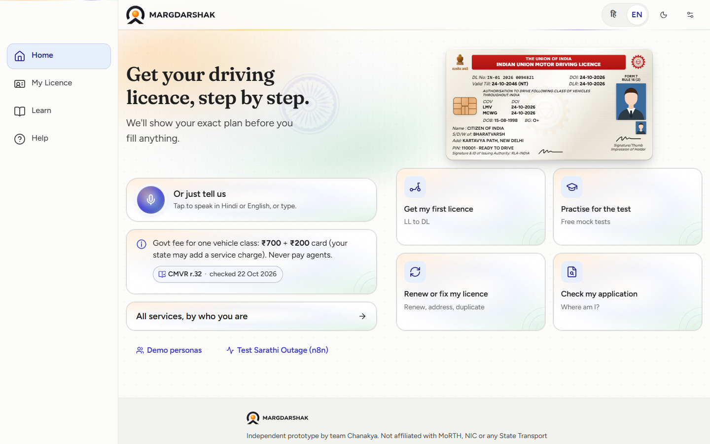

<table>
<tr>
<td width="33%">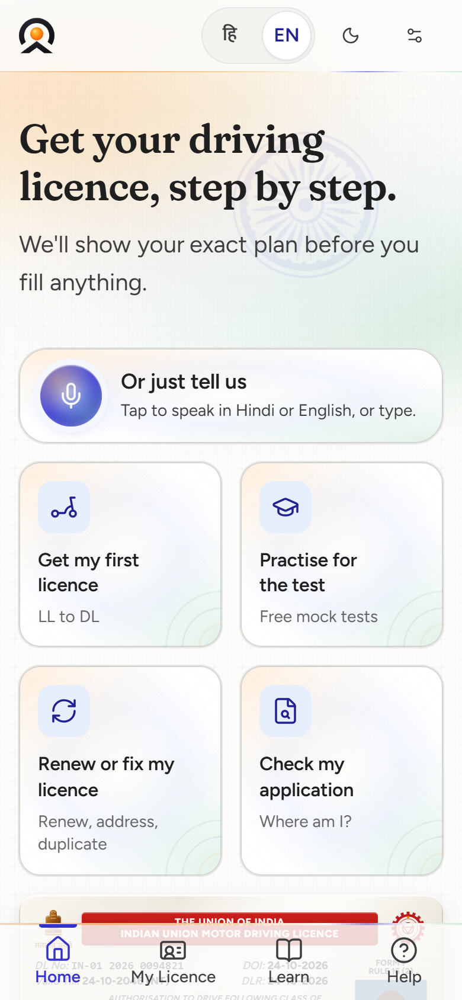</td>
<td width="33%">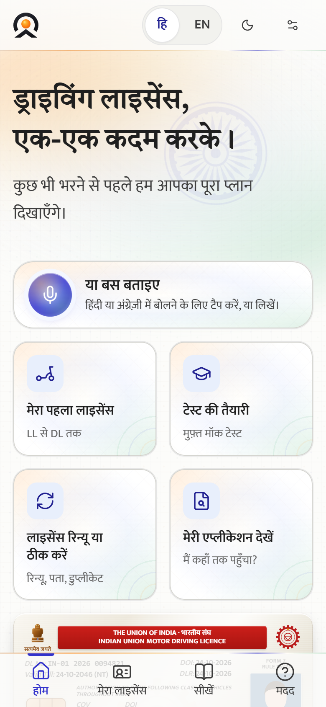</td>
<td width="33%">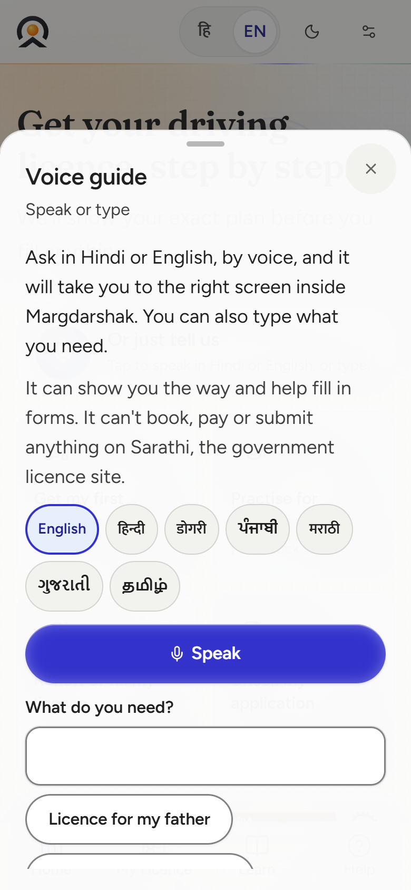</td>
</tr>
<tr>
<td align="center">Phone</td>
<td align="center">Hindi, in full</td>
<td align="center">Voice guide: speak or type</td>
</tr>
</table>

- **Voice guide:** a live Gemini voice agent (ADK for Go, `Runner.RunLive`) that can take you to any screen and fill answers, always asking "Is this right?" before it changes anything. When live voice is unavailable, a plain sheet routes typed or recorded requests to the same intents. Dogri is supported as voice input.
- **Implementation:** [`stage-home.tsx`](apps/web/src/components/home), [`voice-sheet.tsx`](apps/web/src/components/home/voice-sheet.tsx), [`LiveVoiceSheet.tsx`](apps/web/src/features/voice/LiveVoiceSheet.tsx).

### 2 · Plan: your whole licence in three taps

<table>
<tr>
<td width="34%">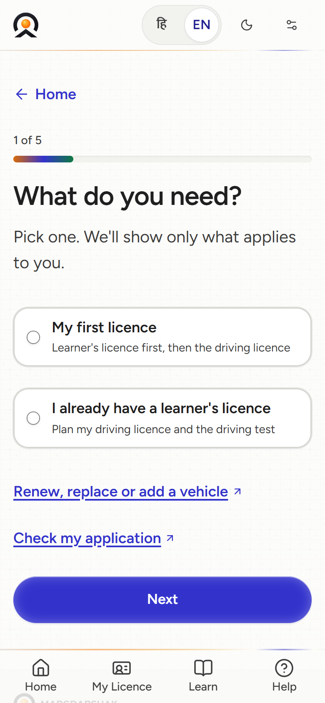</td>
<td>

Pick what you need, your state and the vehicle. The plan card then shows the classes, the steps in
order, every fee line with its source and date, the documents, blockers (an address in another district,
an expired LL) and the **earliest date you can hold the licence**, all computed by the rules engine.

- Rules: [`services/api/internal/rules`](services/api/internal/rules) (Go) with a TypeScript mirror in [`packages/rules`](packages/rules), conformance-tested on the same [golden cases](tests/golden).
- Data: [`rulepacks/`](rulepacks), one versioned pack per state, each rule with its source, check date and confidence.

</td>
</tr>
</table>

### 3 · Apply, then hand off to Sarathi

The guided application asks one question per screen, fixes the photo and signature to Sarathi's size on
the phone, and ends with a copy-pack: every detail written the way the state transport site asks for it.
Payment, Aadhaar eKYC and submission stay on the government's own pages.

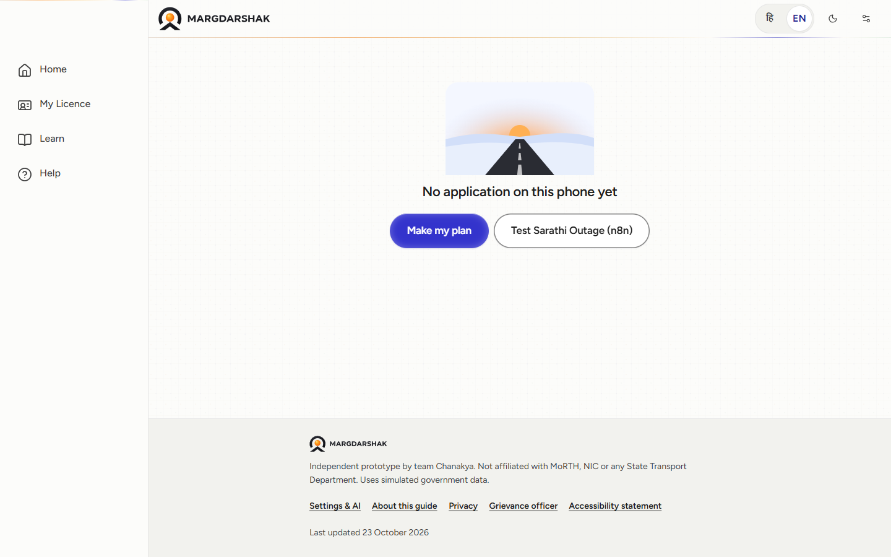

- **Sarathi outage watchdog:** an n8n workflow checks the Sarathi website every 5 minutes. If it is down, the app keeps the application on the phone, prepares Form 1A and the photo checks, and sends it later. A judge can trigger a pretend outage from this page.
- **Implementation:** [`apps/web/src/components/apply`](apps/web/src/components/apply), [`n8n/workflows/W15-sarathi-outage-watchdog.json`](n8n/workflows/W15-sarathi-outage-watchdog.json).

### 4 · Learn: questions, readiness, and an AI coach

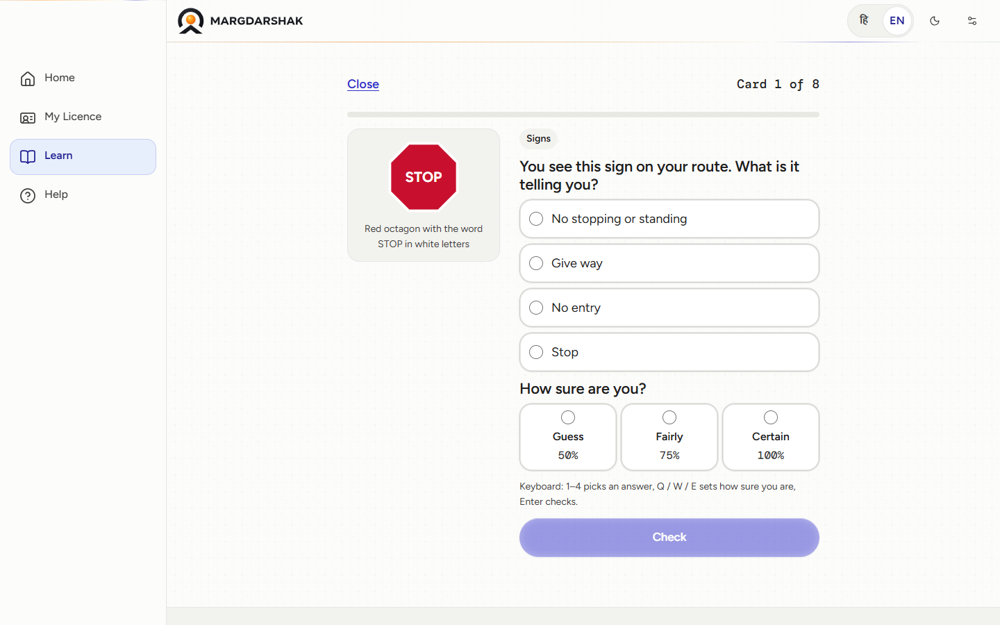

Each question asks for an answer **and** how sure you are (50 / 75 / 100%). Feedback comes only after
both, so confidence cannot be adjusted after seeing the answer. Over-confidence costs readiness points.
Keyboard: `1–4` choose, `Q / W / E` set confidence, `Enter` checks. After each answer, the question-wise
AI coach explains *why*, in plain words, grounded on the reviewed explanation.

<table>
<tr>
<td width="60%">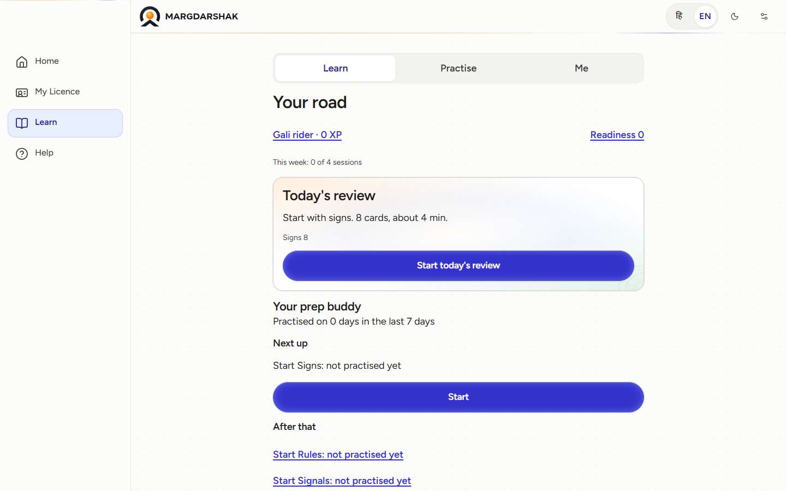</td>
<td width="40%">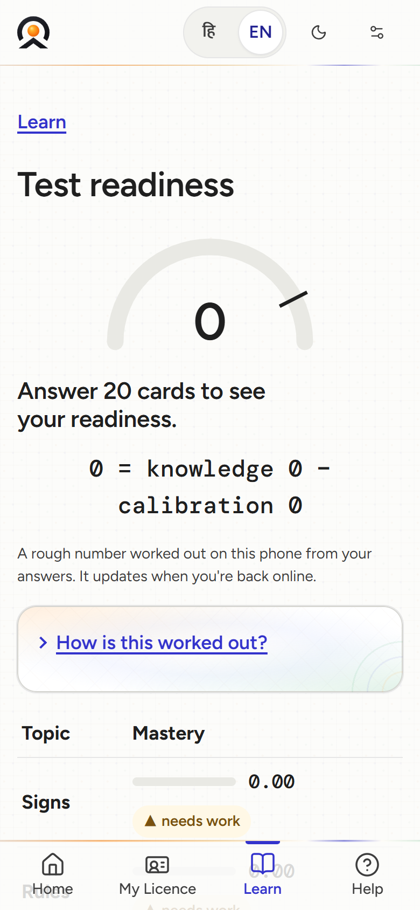</td>
</tr>
<tr>
<td align="center">Learn hub: today's review and the prep buddy</td>
<td align="center">Test Readiness Score</td>
</tr>
</table>

- **Implementation:** [`question-card.tsx`](apps/web/src/features/learn/question/question-card.tsx), [`QuestionCoach.tsx`](apps/web/src/features/ai/QuestionCoach.tsx), readiness maths in [`packages/gamification`](packages/gamification).

### 5 · Nazar: hazard perception on Indian roads

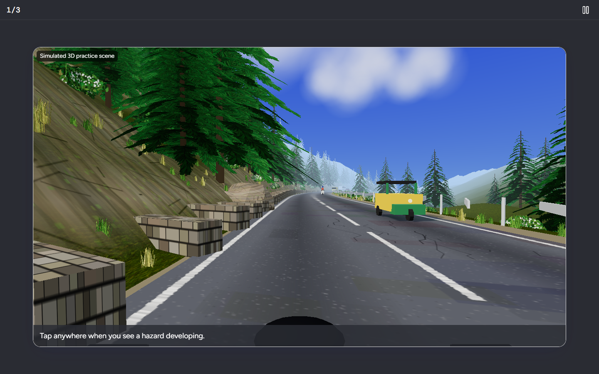

Watch a simulated Indian road and **tap the moment you see a hazard developing**. Taps are scored against
windows (earlier is better, false alarms are penalised), a debrief replays your taps against the
windows, and the **server replays the session to produce the score that counts**. Every AI-generated
or simulated clip is labelled on screen.

- **Implementation:** [`NazarPlayer.tsx`](apps/web/src/features/nazar/NazarPlayer.tsx), the WebGL scene in [`scene3d/`](apps/web/src/features/nazar/scene3d), scoring in [`packages/game-core`](packages/game-core), server replay in [`services/score-verifier`](services/score-verifier).

### 6 · Simulations: Blind Spot and Stopping Distance

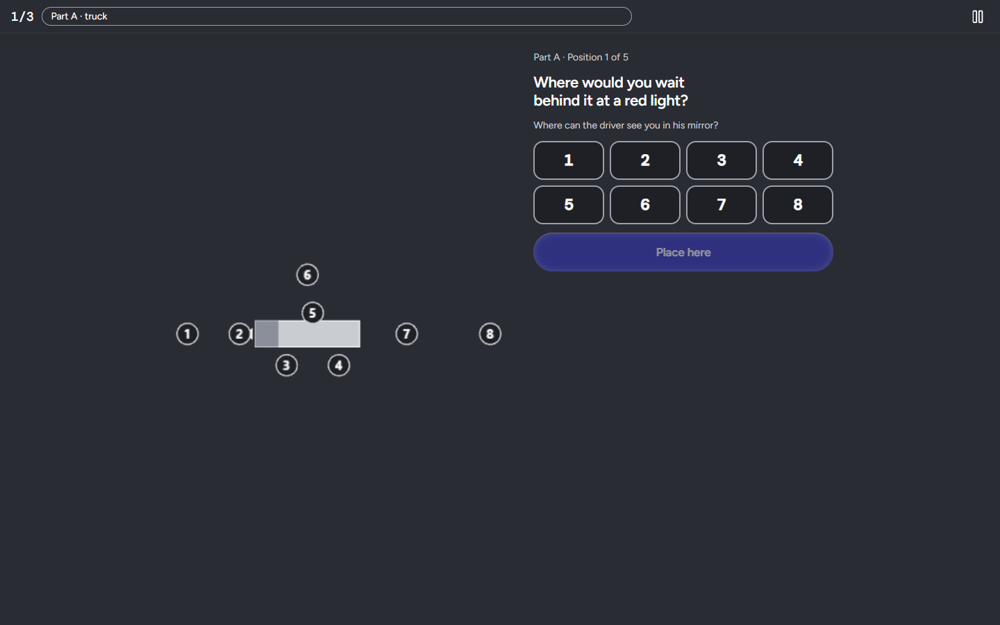

<table>
<tr>
<td width="50%">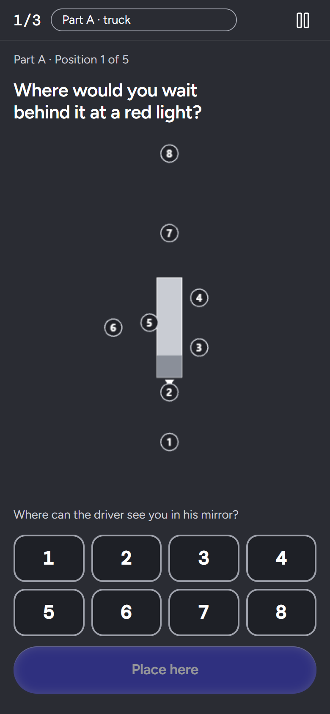</td>
<td width="50%">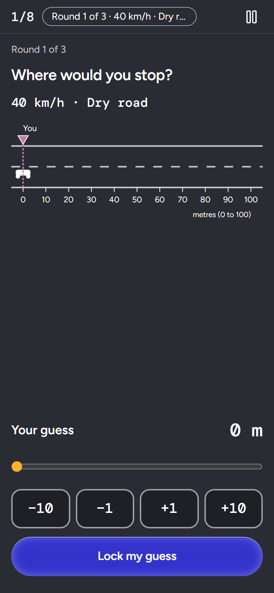</td>
</tr>
<tr>
<td align="center">Blind Spot: where can the truck driver see you?</td>
<td align="center">Stopping Distance: guess, brake, see the gap</td>
</tr>
</table>

Games run on a fixed 60 Hz step so the server can replay them exactly. No speed or stunt content, no
stakes or prizes. Phone and laptop layouts keep the picture and every control on screen at once.

- **Implementation:** [`blind-spot/`](apps/web/src/features/blind-spot), [`stopping-distance/`](apps/web/src/features/stopping-distance), Phaser mount in [`phaser/`](apps/web/src/features/phaser), game host in [`games/host/GameStage.tsx`](apps/web/src/features/games/host/GameStage.tsx).

### 7 · Services: for every kind of licence holder

<table>
<tr>
<td width="60%">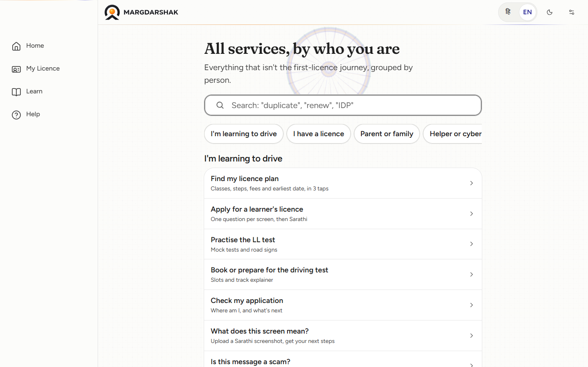</td>
<td width="40%">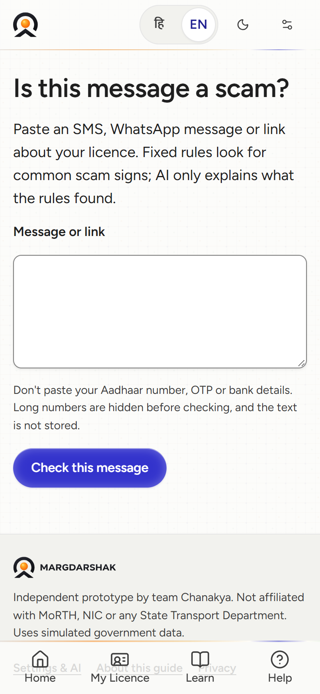</td>
</tr>
<tr>
<td align="center">All services, by who you are</td>
<td align="center">"Is this message a scam?"</td>
</tr>
</table>

Renew, change address, duplicate licence, family mode, a **screen decoder** (photo of a confusing
government screen → what it means and what to do), a **scam checker** for fake "licence agent" messages,
and Road Sign Snap.

---

## Try the live demo

**[margadarshak.duckdns.org](https://margadarshak.duckdns.org)** runs the full stack: Go API, PostgreSQL,
score verifier and the web app, on synthetic data.

A five-minute tour:

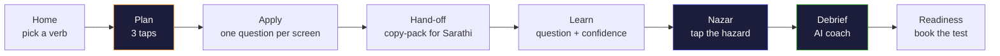

- **Demo personas** (Home → "Demo personas"): jump straight into Kabir on LL day 12, Kabir on day 31 (DL test bookable), Tanvi (migrant, address in another district), Mohan-ji (52, helped by family), Ayesha (new rider) or a cyber-café helper.
- **Sarathi outage:** Home → "Test Sarathi Outage (n8n)".

---

## System architecture

A hexagonal core: every government integration is a **port** with a mock adapter (used here) and a real
adapter, and both pass the same contract tests.

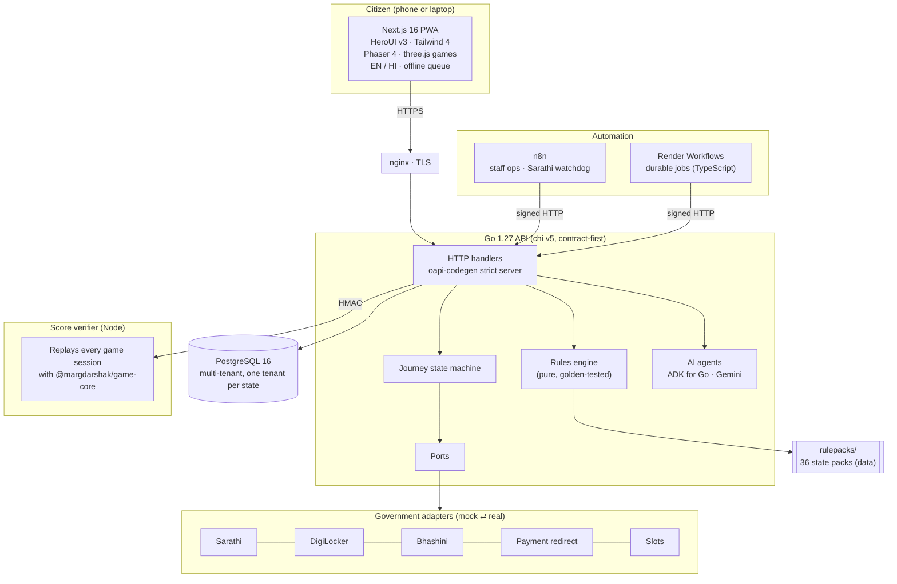

| Layer | What it does | Where |
|---|---|---|
| Citizen app | Journey screens, games, voice, offline queue, service worker | [`apps/web`](apps/web) |
| API | Contract-first REST (RFC 9457 errors), auth, tenants, rules, journey, AI agents | [`services/api`](services/api), [`api/openapi.yaml`](api/openapi.yaml) |
| Score verifier | Server replay of every game session; learning and gamification maths | [`services/score-verifier`](services/score-verifier) |
| Shared packages | Game SDK and scoring, rules mirror, design tokens, API client, gamification, content | [`packages/`](packages) |
| Durable jobs | Idempotent tasks (`caseId:type:dueOn`) that call the Go API | [`services/workflows`](services/workflows) |
| Automation | Staff schedules, approvals and notifications; never decides, never messages citizens | [`n8n/`](n8n) |

Details: [ARCHITECTURE](docs/03-engineering/ARCHITECTURE.md) · [DATA_MODEL](docs/03-engineering/DATA_MODEL.md) · [API_SPEC](docs/03-engineering/API_SPEC.md).

---

## AI, used carefully

| Agent | What it does | Guardrail |
|---|---|---|
| Voice guide | Live speech in Hindi, English and Dogri; navigates and fills answers | Confirms every jump and form value; can't book, pay or submit |
| Game coach | Explains each answer or game moment in plain words | Grounded on the reviewed explanation; template fallback |
| Debrief | Four-part debrief after every game | Numbers come from the engine; the model only words them |
| Screen decoder | Explains a confusing government screen from a photo | Chooses from an allow-list of known screens |
| Scam checker | Flags fake agent / payment messages | Never says "safe"; explains the warning signs |
| Prep buddy | A weekly plan from your practice | Built from your own answers on the device |

Prompts live in [`ai/prompts`](ai/prompts) and are evaluated against JSONL sets in [`ai/evals`](ai/evals).
**AI for everyone:** every AI feature is available to every user; a learner aged 16–17 uses Margdarshak on a
parent's phone, inside the parent's account, in family mode, with parental consent. No behavioural
tracking or targeted ads on a child's data.

---

## Government plug-and-play

- **Adapters, not scraping:** Sarathi, DigiLocker, Aadhaar-offline (mock only), Bhashini, payment redirect, slots and notifications sit behind ports with mock and real implementations. The adapter contract is published as [`api/adapters.openapi.yaml`](api/adapters.openapi.yaml).
- **Rules as data:** each state's rules are a versioned [rule pack](rulepacks) (CC-BY), with sources, check dates and confidence. Changing a rule needs a golden test.
- **Multi-tenant:** one tenant per state, with its own rule pack, features, hosts and grievance officer, and a UX4G-ready theme.
- **Deploy anywhere:** containers for Render in the hackathon; Docker and Helm for MeghRaj or a MeitY-empanelled Indian cloud for adoption.

---

## Repository structure

```
margadarshak/
├── .github/                  CI workflow, CONTRIBUTING, SECURITY, CODE_OF_CONDUCT
├── apps/
│   └── web/                  Next.js 16 citizen PWA (journey, learn, games, voice, services)
├── services/
│   ├── api/                  Go 1.27 API: cmd/{api,seed}, internal/{rules,journey,adapters,...}, migrations/
│   ├── score-verifier/       Node service that replays game sessions (server score wins)
│   └── workflows/            Render Workflows tasks (TypeScript) that call the Go API
├── packages/
│   ├── game-core/            Game SDK contract + deterministic scoring
│   ├── rules/                TypeScript mirror of the Go rules engine
│   ├── gamification/         Readiness, XP, streaks, spaced review
│   ├── content/              Question banks, lessons, catalogues
│   ├── clip-pipeline/        Nazar clip bank maths
│   ├── ui/                   Design tokens and shared components
│   └── api-client/           Generated from api/openapi.yaml
├── api/                      OpenAPI 3.1 contract + adapter spec
├── rulepacks/                36 state and UT rule packs (data, CC-BY)
├── content/                  Curriculum and generated game-item index
├── ai/                       Agent prompts and eval sets
├── n8n/                      Exported n8n workflows (staff ops, Sarathi watchdog)
├── infra/                    render.yaml, Dockerfiles, Helm outline
├── tests/                    Golden cases (shared by Go and TS) and Playwright e2e
├── scripts/                  Copy lints, contrast check, generators
├── field-kit/                Nazar field-study statistics script
└── docs/                     Product, design, engineering, AI, ops, security, business, project docs
```

---

## Technology stack

| Area | Choices |
|---|---|
| Web | Next.js 16.4, React 19.3, TypeScript 6, HeroUI v3, Tailwind CSS 4, next-intl, Motion, GSAP, Serwist (PWA) |
| Games | Phaser 4.2, three.js 0.186, fixed-step 60 Hz loop, deterministic scoring in `game-core` |
| API | Go 1.27, chi v5, oapi-codegen strict server, pgx v5, sqlc, goose, `log/slog` with PII redaction, OpenTelemetry |
| Data | PostgreSQL 16 (embedded Postgres for tests, no Docker needed) |
| AI | ADK for Go (`google.golang.org/adk`), Go Gemini SDK (`google.golang.org/genai`, Live API), Sarvam for Dogri speech |
| Compute | Node 22 score verifier, Zod at every boundary |
| Automation | n8n, Render Workflows (`@renderinc/sdk`) |
| Quality | Vitest, Playwright, axe, Biome, golangci-lint, govulncheck, custom copy and dark-pattern lints |

---

## Getting started

**Prerequisites:** Node 22, pnpm 11, Go 1.27. Docker is not required.

```bash
git clone https://github.com/Sruj08/margadarshak.git && cd margadarshak
cp .env.example .env               # fill in values; see docs/03-engineering/ENVIRONMENT_SETUP.md
pnpm install
(cd services/api && go mod download)
```

Run it:

```bash
pnpm dev                           # web on http://localhost:3000
pnpm api:dev                       # Go API on :8000 with an embedded PostgreSQL
pnpm api:seed                      # demo personas (synthetic data)
```

The web app also works on its own: without an API URL it falls back to on-device mock adapters, so every
screen and game can be explored offline.

Key environment variables (full list in [`.env.example`](.env.example)):

| Variable | Purpose |
|---|---|
| `GEMINI_API_KEY`, `GEMINI_MODEL` | AI agents; empty means template answers only |
| `GEMINI_MODEL_LIVE` | Live voice guide model |
| `NEXT_PUBLIC_API_BASE_URL` | Where the web app finds the API (empty = on-device mock mode) |
| `NEXT_PUBLIC_N8N_SARATHI_WATCHDOG_URL` | n8n webhook for the Sarathi outage watchdog |

---

## Testing

| What | Command |
|---|---|
| Go: vet + unit + golden + adapter contracts | `cd services/api && go vet ./... && go test ./...` |
| TypeScript unit tests | `pnpm test` |
| Web typecheck | `pnpm --filter @margdarshak/web typecheck` |
| Rules mirror (TypeScript) | `pnpm --filter @margdarshak/rules test` |
| Score verifier | `pnpm --filter @margdarshak/score-verifier test` |
| End-to-end (Playwright) | `pnpm test:e2e` |
| Lints | `pnpm lint` (Biome, banned wording, fee literals, dark patterns, i18n parity) |
| AI evals | `cd services/api && go test -tags evals ./internal/adapters/ai/evals/...` |

Every rule change needs a golden test, and every edge case (EC-xx) has a test named after it.

---

## Deployment

- **Live demo:** a single VM behind nginx with Let's Encrypt TLS. systemd runs the Go API, the Next.js server and the score verifier; PostgreSQL 16 runs in a container. `/v1/` and `/mock/` go to the API, `/internal/` is closed to the internet, everything else goes to the web app.
- **Render:** a full blueprint in [`infra/render.yaml`](infra/render.yaml) (web, API, score verifier, workflows, Postgres, Key Value).
- **Adoption:** Docker images in [`infra/docker`](infra/docker) and a Helm outline for MeghRaj or a MeitY-empanelled Indian cloud.

Runbook: [`docs/05-ops/DEPLOYMENT.md`](docs/05-ops/DEPLOYMENT.md) · [`RUNBOOK.md`](docs/05-ops/RUNBOOK.md).

---

## Accessibility and languages

- **English and Hindi, in full**, with Hindi as the default locale; Dogri as voice input. Every string lives in [`apps/web/messages`](apps/web/messages) and a parity check fails the build if a key is missing in either language.
- **Plain language:** no internal or bureaucratic jargon on citizen screens.
- **Phones first:** tested at 360 × 640 up to 1920 × 1080; 48 px touch targets; safe-area aware.
- **Inclusive:** screen-reader labels, keyboard shortcuts, reduced motion, light and dark themes, a Lite mode for slow networks and older phones, and a helper mode for cyber cafés with auto sign-out.

---

## Privacy and security

- **Never collected:** Aadhaar numbers, VIDs, OTPs, biometrics or face images. Those steps hand off to Sarathi or the state.
- **Redaction first:** anything typed into the voice guide is checked on the phone, and Aadhaar- or phone-like numbers are removed before anything is sent.
- **Encrypted contacts**, per-tenant keys, PII-redacting logs, signed (HMAC) service-to-service calls, CSRF protection and strict security headers.
- **Server score wins:** games are replayed on the server; a score that does not match is not counted.
- Report a vulnerability: [`SECURITY.md`](.github/SECURITY.md).

---

## Status and roadmap

- **Built and verified:** foundations, the journey core, and learning and games. Evidence: [P0_P1_VERIFICATION](docs/08-project/P0_P1_VERIFICATION.md), [P2_VERIFICATION](docs/08-project/P2_VERIFICATION.md).
- **Open items:** [`docs/08-project/WHATS_LEFT.md`](docs/08-project/WHATS_LEFT.md) (the human-rated Nazar clip bank, the pre-registered field studies, credentials for real adapters).
- **Next:** a J&K pilot with an RTO and driving schools, DigiLocker requester onboarding, and Bhashini for more Indian languages. See [ROADMAP](docs/01-product/ROADMAP.md).

---

## Documentation

Everything is indexed in [`docs/README.md`](docs/README.md). Good starting points:

- [PROJECT_BRIEF](docs/00-overview/PROJECT_BRIEF.md): every ID, decision and resolved conflict
- [FEATURES](docs/01-product/FEATURES.md): features and the PS1 checklist
- [DESIGN_SYSTEM](docs/02-design/DESIGN_SYSTEM.md) and [CONTENT_STYLE](docs/02-design/CONTENT_STYLE.md)
- [NAZAR](docs/09-learning-games/NAZAR.md) and [GAME_DESIGN](docs/09-learning-games/GAME_DESIGN.md)
- [GOVERNMENT_ADOPTION](docs/10-government/GOVERNMENT_ADOPTION.md)

Contributing: [`CONTRIBUTING.md`](.github/CONTRIBUTING.md) · [`CODE_OF_CONDUCT.md`](.github/CODE_OF_CONDUCT.md) · [`CHANGELOG.md`](docs/CHANGELOG.md).

---

## License

- **Code:** Apache-2.0, see [LICENSE](LICENSE).
- **Rule packs and the Nazar clip bank:** CC-BY 4.0.
- **Brand:** "Margdarshak" is a team trademark candidate.

<div align="center">
<br/>
Built by <b>Team Chanakya</b>
</div>
