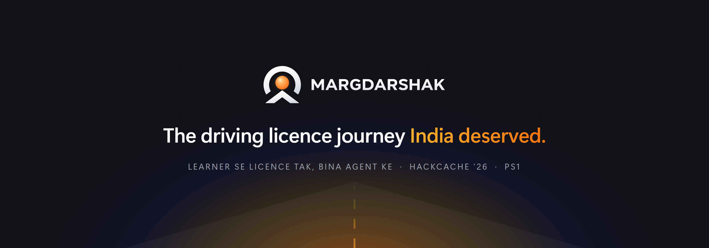
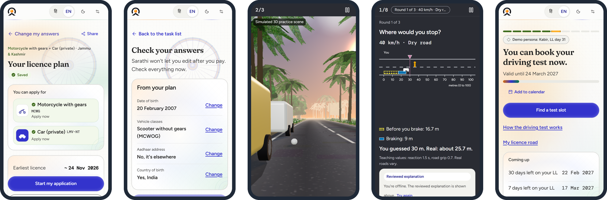
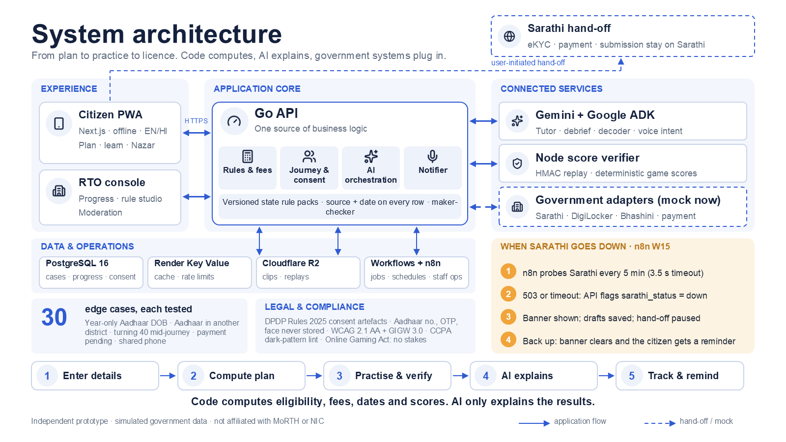

<p align="center">
  
</p>

<p align="center">
  <a href="https://margadarshak.duckdns.org/"></a>
  <a href="https://www.youtube.com/watch?v=Uq6do7Wf54c"></a>
  
  
</p>

<p align="center">
  <b>Margdarshak</b> (मार्गदर्शक, <i>"the one who shows the way"</i>) is a reimagined, government-adoptable mParivahan:<br>
  one AI-guided front end that takes every Indian from <i>"I want a licence"</i> to <i>licence in hand</i>, without an agent.
</p>

<br>

## Watch the demo

<p align="center">
  <a href="https://www.youtube.com/watch?v=Uq6do7Wf54c">
    
  </a>
  <br>
  <sub>▶ Click to watch the full walkthrough on YouTube</sub>
</p>

<br>

## The problem

The forms went online. The journey never did.

| | Today | With Margdarshak |
|---|---|---|
| **First screen** | ~120 links on parivahan.gov.in, none says *start here* | 4 plain choices and a mic |
| **Fee and documents** | Shown only after you find the right portal and press *Calculate fee* | Before any form, in 3 taps, every rupee sourced |
| **Applying for an LL** | ~16 screens, ~6 captchas, 4+ OTPs, nothing saved | One question per screen, auto-saved, resume anywhere |
| **Mistakes** | No edits after payment, fix it at the RTO | *Check your answers* before you pay; blockers caught first |
| **The 30 days before the test** | Silent | Training, reminders and a home screen that knows your day |
| **Agents** | ₹2,000–20,000 against ₹700 + ₹200 card in government fees | Not needed |

> *"The website says 'No slot available for 30 days'. What do I do? My learner's permit expires in April. Koi jugaad hai?"*
> <br><sub>A learner on r/pune, March 2026. The jugaad is usually an agent.</sub>

<br>

## See it

<p align="center">
  
</p>
<p align="center">
  <sub>Licence plan in 3 taps &nbsp;·&nbsp; Check before you pay &nbsp;·&nbsp; Nazar hazard practice &nbsp;·&nbsp; Stopping Distance &nbsp;·&nbsp; Day 31: book your test</sub>
</p>

<br>

## What it does

### One stage-aware home for every service
The home screen shows one headline, four verb tiles (*Get my first licence*, *Practise for the test*, *Renew or fix my licence*, *Check my application*) and a mic. *All services* is grouped by who you are, not by department. A journey state machine (S0 Home to S9 Renew/Fix/Family) picks the single next action for your stage, so nobody has to know which portal, which form or which order.

- **Licence plan in 3 taps, no login.** Age, vehicle, state. You get eligible classes, steps, maximum RTO visits, the earliest licence date, an itemised fee breakdown, documents and warnings. Share it on WhatsApp.
- **Smart class planner.** Several classes on one learner's licence, with the saving shown.
- **Blocker check.** Year-only Aadhaar DOB, address mismatch, turning 40 mid-journey, minors: each flagged with the fix, its source and a confidence level.
- **Guided application.** One question per screen with *why we ask*, auto-save, resume on any device, and *check your answers* before payment.
- **On-device photo and signature fixer.** Crop, resize, whiten, size check. Images never leave the phone.
- **Form 1 and Form 1A, done right.** A plain-language self-declaration preview, and Form 1A guidance for 40+ and transport applicants.
- **Sarathi screen decoder.** Upload an error screenshot; get its meaning and next step from a verified error catalogue.
- **Scam checker.** Paste an SMS or link. Fixed rules flag fake domains, APK files, OTP requests and UPI traps. Rules decide; AI only explains.
- **Parcel-style tracker and case clock.** LL-expiry countdown, day-30 unlock, test-eve checklist, approval chase and renewal reminders, run as durable, idempotent jobs.
- **Slot finder, test-day co-pilot, fail-and-recover flow,** an approval tracker with escalation letter, an RTI template and a grievance route.

Every irreversible step (Aadhaar eKYC, OTP, payment, submission, booking) is handed to Sarathi or the state gateway. **Margdarshak never submits, pays or books for you.**

### Learn and train: the skill the test never checks
- **Nazar hazard perception.** Simulated 3D Indian road scenes, scored in the format Kerala has announced from 1 Dec 2026 (10 clips × 10 marks, pass 60, five-band scoring). Tap early, score more; pattern-clicking scores zero.
- **Simulation games with an AI debrief.** Stopping Distance, Blind Spot (truck and bus), and more on the way. No speed or stunt content; false alarms are penalised.
- **LL test simulator in your state's format,** spaced repetition (FSRS), question variants so memorising fails, Road Sign Snap, and a **Test Readiness Score = knowledge − calibration penalty**.
- **Gamified, never manipulative.** XP for learning only, repairable streaks, ranks from *Gali* to *Ghat*, co-op squads with consent. No stakes, prizes or dark patterns.

### A multilingual voice guide
Speak or type in Hindi or English; Dogri speech-in is supported. Built on Google ADK for Go and Gemini. It navigates the app, reads rule cards aloud, carries a rule-ID source chip on every answer, and states its limits out loud: it never takes an Aadhaar number, OTP or captcha.

### Who it serves
| | |
|---|---|
| **16–17 years** | The legal 50 cc route, inside a parent's account with verifiable parental consent |
| **First-time applicants** | Plan, apply, learn, test, licence |
| **Licence holders** | Renewal with no-grace-period warnings, add a class, address change, duplicate card, IDP, challan check |
| **40+ and senior drivers** | Automatic Form 1A guidance, renewal reminders, large-text and voice-first mode |
| **Parents and family** | Family mode with consent and *clear this device* |
| **Helpers, schools, officers** | Consented Helper mode, a driving-school portal and a state/RTO console |

<br>

## Architecture

<p align="center">
  
</p>

**Code computes. AI explains.** Every fee, date and score comes from versioned, sourced state rule packs. The LLM only narrates, may only pick IDs from allowlists generated from those packs, and a validator checks every output. A Node verifier replays each game session server-side with the same deterministic scoring core, so the server score always wins.

**Resilient when government sites go down.** n8n workflow W15 probes Sarathi every 5 minutes. On a 503 or timeout the API flags it, every screen shows a banner, drafts stay saved, the hand-off pauses, and the citizen is reminded when it's back.

**Built for government adoption.** Hexagonal architecture with an open adapter specification (Sarathi, DigiLocker, Aadhaar offline, Bhashini, payment, notification, slot). Mock and real adapters pass the same contract tests. Each state is a tenant with its own rule pack, theme and languages, a rule-pack studio with maker-checker approval, and an RTO console that shows where applications stall.

<details>
<summary><b>Tech stack</b></summary>
<br>

| Layer | Stack |
|---|---|
| **Web** | Next.js 16 · React 19 · TypeScript · Tailwind 4 · HeroUI · Serwist PWA · Phaser 4 · MediaPipe |
| **API** | Go 1.27 · chi · oapi-codegen (contract-first) · pgx + sqlc · PostgreSQL 16 |
| **AI** | Google ADK for Go · Gemini · Sarvam Saaras (speech-in) |
| **Jobs** | Render Workflows · n8n |
| **Data** | PostgreSQL 16 · Render Key Value · Cloudflare R2 |
| **Ops** | OpenTelemetry · GitHub Actions |

</details>

<br>

## Trust, privacy and compliance

- **Never collected:** Aadhaar number, VID, OTP, biometrics or face images. Never stored, logged or sent to a model. The Aadhaar offline adapter is mock-only.
- **Privacy by design on DPDP principles:** purpose-bound consent artefacts, export, delete, a grievance officer and PII-redacted logs.
- **A compliance register** mapped to the DPDP Act and Rules, Aadhaar Act, IT Act and Intermediary Rules, CERT-In directions, GIGW / WCAG / RPwD, the Online Gaming Act 2025, CCPA dark-pattern guidelines, the Motor Vehicles Act and CMVR, with nine written legal memos.
- **Accessible:** WCAG 2.1 AA with contrast checked in CI, GIGW 3.0 alignment, screen-reader support, no-audio game modes, reduced motion, 48 px touch targets, Lite mode under 300 KB.
- **30 edge cases**, each with a rule row or screen state and a test.
- **No scraping, no booking bots.** A copy linter blocks banned claims.

<br>

## Run it locally

```bash
git clone https://github.com/sruj08/margadarshak.git && cd margadarshak
cp .env.example .env                                   # see docs/03-engineering/ENVIRONMENT_SETUP.md
pnpm install && (cd services/api && go mod download)   # Node 22 + pnpm, Go 1.27
pnpm dev                                               # web + api + score verifier
```

<details>
<summary><b>Tests</b></summary>
<br>

```bash
(cd services/api && go vet ./... && go test ./...)   # Go unit, golden rules, adapter contracts (embedded Postgres 16)
pnpm test                                            # TS unit, rules mirror, game determinism
pnpm test:e2e                                        # Playwright end-to-end
```

Verified on 24 Oct 2026: 308 Go tests, 287 mock end-to-end and 21 full-stack end-to-end tests passed, 0 failed. Evidence in [P0_P1_VERIFICATION](docs/08-project/P0_P1_VERIFICATION.md) and [P2_VERIFICATION](docs/08-project/P2_VERIFICATION.md).

</details>

<details>
<summary><b>Repository map</b></summary>
<br>

| Path | What |
|---|---|
| `apps/web` | Citizen PWA (Next.js 16) |
| `apps/console` | Schools, RTO/state console, rule studio |
| `services/api` | Go API: rules, journey, consent, AI agents, adapters |
| `services/score-verifier` | Server-side game replay |
| `services/workflows` | Render Workflows tasks |
| `packages/game-core` | Game SDK and deterministic scoring |
| `rulepacks/` | State rule packs, each row with source, date and confidence |
| `n8n/` | Exported workflows, including the Sarathi outage watchdog |
| `docs/` | Product, design, engineering, AI, ops, security, business, government adoption |

Start at [MAP.md](MAP.md). The whole idea in one read: [IDEA.md](IDEA.md). Evidence: [RESEARCH.md](RESEARCH.md).

</details>

<br>

## The outcome

Citizens finish with fewer visits, no agent fees and fewer rejections. Families manage a parent's licence without the portal maze. States get fewer counter queries and re-tests, and finally see where services break.

<br>

<p align="center">
  <picture>
    <source media="(prefers-color-scheme: dark)" srcset="apps/web/public/brand/margdarshak-mark-dark.svg">
    
  </picture>
  <br><br>
  <b>Team Chanakya</b><br>
  Srujan Satav &nbsp;·&nbsp; Harshad Dhavane &nbsp;·&nbsp; Mridul Bansal
  <br><br>
  <sub>Built for HackCache '26 (CachedInfo × GCET Jammu).<br>
  Independent prototype. Not affiliated with MoRTH, NIC, Sarathi/Parivahan or any State Transport Department. Government systems are simulated and labelled.<br>
  Code: Apache-2.0 · Rule packs: CC-BY 4.0</sub>
</p>
