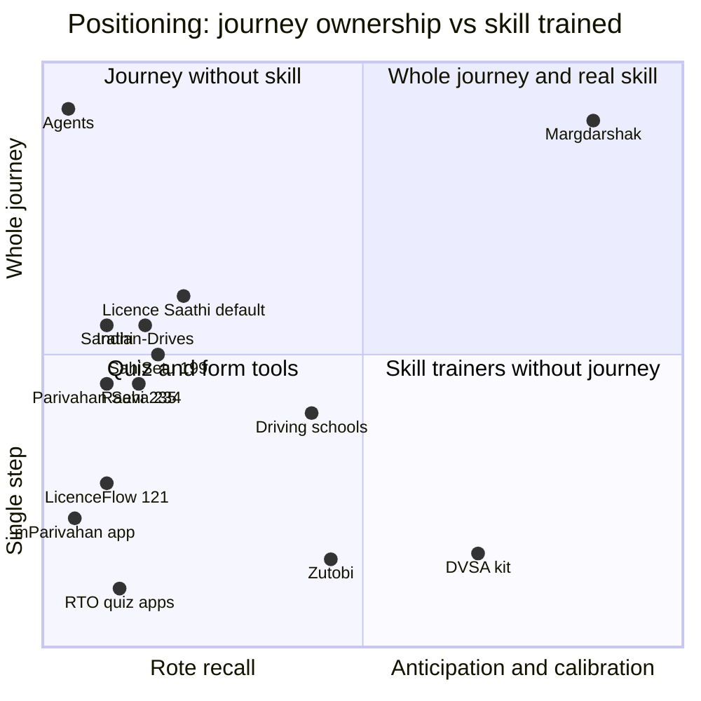

# Competitive Analysis
> Project: Margdarshak · Owner: Product lead · Status: Draft v0.1 · Last updated: 2026-10-23
> Related: [PRD](PRD.md) · [FEATURES](FEATURES.md) · [ROADMAP](ROADMAP.md) · [Business model](../07-business/BUSINESS_MODEL.md) · [GTM](../07-business/GTM.md) · Sources: [E-competition](../../../research/E-competition.md) · [G-inspiration-library](../../../research/G-inspiration-library.md) · [ps1-product-lock §5, Part C](../../../war-room/ps1-product-lock.md) · [01-abroad](../../../research/ps1-deep/01-abroad.md) · [team report benchmarks](../../../research/ps1-deep/team-saarthi-report.md) · [03-user-pain](../../../research/ps1-current-state/03-user-pain.md) · [03-lifecycle §C](../../../research/ps1-deep/03-lifecycle.md)

---

## 0. Evidence rules for this file

- Facts about competitors come from the research files above, with their links. **Funding and user numbers are "unknown" unless a source gives them.** We did not invent any.
- BWMI ("Build What Moves India") entries are described from their **live-site one-liners captured on 2026-10-22** ([G-inspiration-library appendix](../../../research/G-inspiration-library.md)). We did not test those apps, so their feature cells are "claimed" or "?".
- GitHub repos were read at README level on 2026-10-22 ([ps1-product-lock Part C](../../../war-room/ps1-product-lock.md)).
- Novelty is stated the council's way: **"we found none on <date>"**, never "doesn't exist" or "first" (D-19).
- Legend for matrices: **●** does it (verified or primary-source), **◐** partly / claimed, **○** doesn't, **?** unknown.

---

## 1. The landscape in one paragraph

India's licence journey has **one owner today: the agent** ([PROJECT_BRIEF §3](../00-overview/PROJECT_BRIEF.md)). The government stack (Sarathi, mParivahan, DigiLocker) digitised the forms but not the journey. Quiz apps own LL test prep with rote banks that don't match the real test (P:94 mismatch complaints). Fake "apply online" apps have 1M+ installs. Driving schools sell packages that often include RTO formalities, which makes them look like agents. In hackathons, the space is **saturated with form redesigns**: 26 Parivahan/DL entries in the BWMI top 250, **none in the final 10** ([G §1.5](../../../research/G-inspiration-library.md)), and the HackCache organiser shipped a default PS1 app, "Licence Saathi", to every team ([E §2](../../../research/E-competition.md)). Globally, the UK, NSW and the Netherlands show what training-centred licensing looks like (hazard perception, logbooks, animated scenario questions). **None of the Indian products we found on 22–23 Oct 2026 owns the post-LL timeline with durable reminders, replanning and escalation, trains hazard anticipation, or was tested with applicants** ([ps1-product-lock §5](../../../war-room/ps1-product-lock.md)).

---

## 2. Competitor table

### 2.1 Government incumbents (India)
| Product | Owner | What it does | Users / funding | Price to citizen | Weaknesses (evidence) |
|---|---|---|---|---|---|
| **Sarathi / parivahan.gov.in** | MoRTH, built by NIC ([transport.py.gov.in](https://transport.py.gov.in/node/102)) | System of record for LL/DL: applications, slots, fees, online LL test with face authentication, status | Government; user numbers not retrieved | Government fee (₹700 for one class + ₹200 card, CMVR r.32) | ~120 homepage links, ~1 in 10 relevant; ~16 LL screens, ~6 captchas, 4+ OTPs; no save ("apply again"); edits locked after payment; desktop-first (1366×768); face-auth failures ×20 (Q13); "Reload Detected" (Q14); payment failures 15/33 complaints; outages (Telangana ~4,000 apps, Jun 2026); approval limbo (Q80–Q83); criteria unpublished |
| **NextGen mParivahan app** | MoRTH/NIC ([Play](https://play.google.com/store/apps/details?id=com.nic.mparivahan)) | Virtual DL/RC, some services | Government; unknown | Free | Does not do LL/DL applications (OBS E6 in `01-sarathi-screens`); 1★ reviews on LL flows (Q10, Q21, Q24); mobile update loops (Q92) |
| **DigiLocker** | NeGD/MeitY | Holds the DL issued by Sarathi (DRVLC); requester OAuth + PKCE API ([spec v1.12](https://cf-media.api-setu.in/resources/Requester-APISpecification-V1_12.pdf)) | Government; unknown | Free | App slow to open at police checks (Q86, Q87). **Not a competitor**: the one verified private-reachable DL data path, so a **partner** (F-56) |
| **UMANG** | MeitY | Aggregator of government services | Government; unknown | Free | Generic; the RaktKhoj team won BWMI by upgrading a government asset **from inside UMANG** ([G §1.4](../../../research/G-inspiration-library.md)), so UMANG is a **distribution partner** in Phase 5 |
| **State portals** (e.g. Telangana) | State Transport Departments | Some state-specific services | Unknown | Free | "there are 2 portals sarathi and telangana portal as well. Firstly confirm which one is correct" (Q52) |

### 2.2 The organiser's default app (HackCache '26)
| Product | What it does | Weaknesses vs Margdarshak |
|---|---|---|
| **"Licence Saathi"** (organiser "Build it with AI" pack, PS1) | Persona Ramesh, 19, first motorcycle licence. 12 screens: journey map (6 stages), "Can I apply?", document checklist, simulated LL application (fee, receipt), Learn (≥ 18 SVG signs, flashcards, Listen), mock test (practice + timed **15Q/9-pass/30s**, readiness meter over last 3, ≥ 40 bilingual Qs), test day (3-Q mock), permanent-licence countdown + simulated RTO slot booking, driving-test steps + 5 fail reasons, application timeline, keyword FAQ chat (≥ 25 Q&As), Settings. Add-ons: AI chat, PWA offline, Tamil ([E §2](../../../research/E-competition.md)) | **Pre-LL and quiz-centred.** Uses a format (15Q/9) that is **unverified** (the J&K format is 10/6 per Kashmir Life). No hazard perception, calibration, server-scored simulations, durable case clock, fail recovery, approval escalation, blocker rows with sources, helper consent, school or government side. Expected to be ~80% of PS1 entries, so its features (Hindi/English, read-aloud, PWA, timed mock, chatbot) earn **no** differentiation ([E §2 "What will not differentiate"](../../../research/E-competition.md)) |

**Crowding estimate (HUNCH, E §1, §4):** ~150–250 paid teams; PS1 ≈ 10–12% → roughly 15–30 PS1 submissions; ≥ 70% of all submissions likely vibe-coded from the organiser prompt with near-identical React + Tailwind UIs.

### 2.3 BWMI "Build What Moves India" Parivahan/DL entries (top 250; 26 in the category, none finalists)
Source: [G-inspiration-library, PS1 appendix](../../../research/G-inspiration-library.md); one-liners from each live site's meta on 2026-10-22.

| # | Project | Team | One-liner (as captured) | Focus | Notes for us |
|---|---|---|---|---|---|
| **199** | **SahiSetu** | Kshitij Kumar | "A demo prototype for driving-licence readiness, document checks, and clear application recovery guidance." ([app](https://sahi-setu.vercel.app/)) | Readiness, documents, recovery | **Closest prior.** Pre-LL emphasis; not a finalist; no evidence of hazard training, durable clock or user tests ([ps1-product-lock §5](../../../war-room/ps1-product-lock.md)) |
| **121** | **LicenceFlow** | Sambhav Jain | "A clearer, mobile-ready Madhya Pradesh Learner…" ([app](https://licenceflow-mp-demo.eruditespartan108.chatgpt.site/)) | MP LL form redesign | Single-state, single-step form redesign |
| **235** | **Raahi – Driving Licenses Without Pain** | Anirudh Iyer | "Apply, track and manage your licenses. Take the learner's rules test securely in your browser—without separate software or an RTO visit." ([app](https://parivahan-revamp.vercel.app/)) | Apply + track + browser LL test | A "secure" browser LL test implies proctoring that a private front end cannot certify; Margdarshak's simulator is practice only (F-22) |
| **234** | **Parivahan Seva** | Shourya Rajinder Kharbanda | "Parivahan Seva — the zero-form driving licence journey: Aadhaar e-KYC, online learner…" ([app](https://parivahan-seva-peach.vercel.app)) | Zero-form journey with Aadhaar eKYC | Private Aadhaar eKYC needs Central Govt approval (G1); Margdarshak hands that step to Sarathi (D-07) |
| 015 | Raahi — Transport Services Without the Maze | Ankit Mishra | "A bilingual, independent transport-service prototype…, using synthetic data only." ([app](https://raahi-parivahan.raahi-bwmi.workers.dev/en)) | Transport services IA | Broad IA redesign |
| 059 | Drivesaathi | Riya Jain & Prathmesh Namdeo | site unreachable | ? | — |
| 065 | Parivahan 2.O – India Mobility Os | Ameya Kasture & Prathmesh Garule | "A citizen-first mobility service experience for India." | Portal redesign | — |
| 085 | Parivahan Sarathi | Arkadeep Nag | unknown | ? | — |
| 108 | Parivahan Seva | Ritankar Bhunia & Ananjan Mitra | "Vehicles, licences and fines — one place. Pay traffic fines, renew driving licence, check RC status and more." | One-stop portal | Breadth over depth |
| 158, 202 | (names close to the government "Sarathi"; #202 unreachable) | — | "An independent redesign concept for the Parivahan Sewa learner…" (#158) | LL redesign | Name collision is why we cut the earlier working name (D-01) |
| 194 | Parivahan Sewa Reimagined | Amar Sinha | unknown | ? | — |
| 223 | Parivahan Reimagined | Reshma Baskaran | "Citizen journeys for driving-licence renewal, vehicle ownership transfer and eChallan services." | Renewal, RC, challan | Post-licence services |
| 238 | MySarathi | Karan Pillai | "AI-powered concept redesign… FASTag, camera OCR, vehicle registries… challan clarity and dispute copilot" | Challan/vehicle AI | Different job |
| 248 | SARATHI IMPROVISED | Aditi Patil | unknown | ? | — |
| 009, 177, 184 | Challan sakshi, Challan Nyay, Challan Lens | various | e-challan help/contest | Challans | Adjacent (our F-15 links out only) |
| 117, 217, 224, 198 | Sarathi One, TransferShield, MoveMyVehicle, Vehicle Life | various | Used-vehicle checks, ownership transfer, interstate migration, vehicle life | Vehicles (Vahan side) | Adjacent |
| 068, 152, 192, 037 | FASTag Unified, SmartRoute, MSRTC Journey Planner, United Transit Interface | various | FASTag, bus journeys, transit | Mobility | Adjacent |

**Lesson from BWMI (G §1.4–1.5):** generic portal redesigns don't win. RaktKhoj won by (1) a time-critical problem, (2) upgrading an existing government asset from inside UMANG, (3) designing both sides of a market, (4) one question at a time, (5) a data-backed fork, (6) WhatsApp as the channel, (7) an emotional close. Margdarshak maps these as: Nazar + LL-expiry clock (1); a card inside mParivahan/UMANG (2); applicant + school + RTO sides (3); plan in 3 taps (4); Kerala HPT + "X% of licence holders below 60/100" (5); WhatsApp case clock (6); "Khud" (7).

### 2.4 Open-source projects (GitHub)
| Repo | Date | What it claims | Gap | Link |
|---|---|---|---|---|
| `Ayushsharma1908/Indian-Drives` | Aug 2026 | "Guided LL/DL journeys, RTO assistance, tracking, AI-powered support" | No evidence (README level) of durable reminders, replanning, escalation, hazard training or user tests | [repo](https://github.com/Ayushsharma1908/Indian-Drives) |
| `k21243377-gif/sarathi-saathi` | Aug 2026 | Explains RTOs and vehicle categories before applying | Information only | [repo](https://github.com/k21243377-gif/sarathi-saathi) |
| `azamjonbro/Prava-Tezkor` ★29 | — | Uzbek DL test prep | Different country; quiz | [E §3](../../../research/E-competition.md) |
| `anaswaraharidas/GovApp-UX-Audit` ★1 | — | mParivahan UX audit | Audit, not product | [repo](https://github.com/anaswaraharidas/GovApp-UX-Audit) |
| `0x6773/mparivahan-apk-scam` | — | Analysis of the fake mParivahan APK scam | Evidence for F-33, not a competitor | [repo](https://github.com/0x6773/mparivahan-apk-scam) |

GitHub saturation counts (2026-10-22, `gh api search/repositories`): "driving license test" 296 (182 since 2025-01-01), "learner licence" 58, "RTO mock test" 12, "mparivahan" 50, "parivahan" 381, "traffic sign recognition" 5,417, "learner licence reminder" 0, "learner license expiry" 0, "driving licence journey" 3 ([E §3](../../../research/E-competition.md), [ps1-product-lock Part C](../../../war-room/ps1-product-lock.md)).

### 2.5 Commercial apps and services (India)
| Product | What it does | Users / funding | Price | Weaknesses |
|---|---|---|---|---|
| **RTO exam quiz apps** (e.g. "RTO Exam" by pavansgroup, Hindi/Marathi versions) | Memorise the LL question bank | Reported as 10M+ installs in the product lock [unverified: owner PL; check Play listing by 2026-10-31] | Free, ad-supported | Rote recall; "20/20 in app, 11/20 in actual exam" (Q34); missing topics and wrong timers (Q35); wrong answers (Q36); P:94 real-vs-app mismatch hits; translation errors |
| **Fake "apply online" apps** ("Driving Licence Apply Online", "Driving Licence Apply Info") | Ads around links; don't issue anything | 1M+ installs each ([Q109](https://play.google.com/store/apps/details?id=com.redrossing.applyonlinenow.drivinglicenceapplyonline&reviewId=d93bba0c-02b3-4ed0-ab3b-2d5ef61d2901), [Q110](https://play.google.com/store/apps/details?id=com.rtoexam.drivinglicence.applyonline&reviewId=5471f9f4-d893-4d44-bd9a-0c0552e6bab6)) | Free, ads | Misleading; erode trust in every non-government app, so our non-affiliation and no-APK rules matter |
| **RTO-info apps** (CarDekho/CarInfo-style) | Vehicle/RTO information | `HUNCH:` well-known, not re-verified ([E §3](../../../research/E-competition.md)) | Free | Vehicle-centred, not licence-journey-centred |
| **DL verification APIs** (Signzy, Surepass) | B2B DL lookup by number + DOB | Upstream source undisclosed ([07 A1](../../../research/ps1-deep/07-govt-plug-and-play.md)) | B2B pricing (not retrieved) | Not citizen-facing; we avoid resellers for a government product |

### 2.6 Human competitors (the real incumbents)
| Competitor | What they sell | Price | Strength | Weakness | Our answer |
|---|---|---|---|---|---|
| **Agents / dalals / "setting"** | Right class, form filling, scrutiny push, slot, test vehicle, track coaching, the pass itself, delivery chase ([03-user-pain "What agents actually do"](../../../research/ps1-current-state/03-user-pain.md)) | ₹2,000–20,000 (18 price points, e.g. ₹2,000 "setting" in Pune, ₹7,000 after 3 fails in Ahmedabad, ₹8–20k for out-of-state Aadhaar in Gurgaon) | Owns the whole journey; sells certainty, dignity and time ([05 Ψ1](../../../research/ps1-deep/05-psychology.md)) | Price; wrong-class errors (Q11); the corrupt core (proxy tests, bought passes); agents who take money and fail to deliver (Q108) | Do legally what agents legitimately do (points 1, 3, 4, 5, 8, 9); refuse the corrupt core; show government fee vs quote; "Khud" identity |
| **Cyber-café / CSC operators** | Form filling | Small fees (not retrieved) | Proximity, trust, desktop | Errors; documents left behind (Q107) | Helper mode with consent and "clear this device" (F-17); a partner, not an enemy (PI-4) |
| **Driving schools** | Lessons; often "packages" with LL/DL formalities ([Q101](https://www.reddit.com/r/mumbai/comments/1qz4yci/nri_trying_to_get_indian_dl_legally_no_bribes_no/)) | Local car ₹4,000–8,000 [MK]; Maruti Suzuki Driving School ₹5,500 / ₹7,500 / ₹9,000 + 18% GST (official page, varies by city); 2W ₹1,500–4,000 [MK] ([03-lifecycle §C](../../../research/ps1-deep/03-lifecycle.md)) | Vehicles, instructors, local RTO knowledge; Kerala HPT mandate makes them the trainer | Trust deficit (Q106, Q111); no HPT tools; pass-rate exposure | **First buyer** (D-23): school Pro with HPT logs, referrals, leads (F-40) |
| **Accredited Driver Training Centres (ADTC), IDTRs** | Accredited course (LMV 29 h in 4 weeks) whose graduates skip the RTO test (MV Act s.12, 2019; rules from 1 Jul 2021) | Not retrieved | Test exemption | 1–2 acres of land and simulators: out of reach for most schools; number operating unknown | Listed on the slot map with the exemption explained (F-10) |

### 2.7 Global benchmarks
| Product / system | Country | What it does well | Price / scale | What we take / how we differ |
|---|---|---|---|---|
| **UK hazard perception test** | UK (DVSA) | 14 clips, up to 5 points per hazard by how early you click; pattern-clicking scores 0; pass 44/75 ([gov.uk](https://www.gov.uk/theory-test/hazard-perception-test)); associated with ~11.3% fewer non-low-speed crashes in the year after ([01-abroad](../../../research/ps1-deep/01-abroad.md)) | National test | Our 5-band scoring and pattern-click rule; Indian clips; Kerala's 10 × 10 format |
| **DVSA Theory Test Kit app** | UK | All DVSA revision questions, CGI hazard clips (20 or 36; listings differ), Highway Code, timed mock, progress, offline | £4.99 ([TSO](https://tsoshop.co.uk/article/649710/Transport/Driver-And-Vehicle-Standards-Agency/Car-Drivers/The-Official-DVSA-Theory-Test-Kit-app)) | Readiness gauge, offline mocks; we use **real filmed** Indian clips and calibration |
| **Zutobi** | US/UK/AU/SE/DE/FR | Duolingo-style micro-lessons, points, levels, leaderboards, friend competition, an explanation for every answer ([zutobi.com](https://zutobi.com/)) | ~$4.99/week or $9.99/month per a reviewer [S, 01-abroad #26] | Explanations and micro-lessons; we reject speed leaderboards and subscriptions for learners (free citizen app); funding unknown |
| **GOV.UK "Learn to drive a car: step by step"** | UK | 7 numbered steps on every page; step-by-step and check-answers patterns ([design system](https://design-system.service.gov.uk/patterns/step-by-step-navigation/)) | Government | Our tracker (F-08) and check answers (F-05), mobile-first |
| **NSW Driver Knowledge Test + digital logbook** | Australia | Self-paced course and test from home, unlimited retakes for one fee, 9 languages; 120 supervised hours logged in one app | Government | Practice Record (F-28) without GPS tracking |
| **Singapore Myinfo / LifeSG** | Singapore | Consent-based prefill of verified data ("Tell Us Once"); services by life event | Government; LifeSG 1.5M+ users ([G](../../../research/G-inspiration-library.md)) | DigiLocker adapter (consented prefill) in Phase 4 |
| **Dubai RTA Smart Test System** | UAE | AI/computer-vision scored driving test with replay and a 3D map of errors | Government | The transparency we propose for automated tracks (console and roadmap) |
| **Netherlands CBR theory exam (2025)** | Netherlands | Animated hazard clips replace photos | Government | Scenario-based learning (F-24) |
| **RAPT (NHTSA evaluation)** | US | Hazard-anticipation training; trained young men 23.7–24% lower crash rate (non-randomised) | Research | Evidence base for the heart; we claim readiness and anticipation, not crash reduction |

---

## 3. Feature comparison matrix

| Capability | Sarathi | mParivahan | Licence Saathi (organiser) | SahiSetu #199 | Raahi #235 | Parivahan Seva #234 | LicenceFlow #121 | Indian-Drives (GitHub) | RTO quiz apps | Zutobi | DVSA kit | Agents | Schools | **Margdarshak** |
|---|---|---|---|---|---|---|---|---|---|---|---|---|---|---|
| Plan before any form (class, fee, dates) | ○ | ○ | ◐ ("Can I apply?") | ◐ (readiness) | ? | ? | ? | ◐ | ○ | ○ | ○ | ● | ◐ | ● F-02 |
| Blocker rows with fix + source + confidence | ○ | ○ | ◐ ("stuck here" boxes) | ◐ (document checks) | ? | ? | ? | ? | ○ | ○ | ○ | ◐ | ○ | ● F-04 |
| Guided LL application with resume | ◐ (no resume) | ○ | ◐ (simulated) | ? | ◐ (claimed) | ◐ (claimed "zero-form") | ◐ (claimed) | ◐ | ○ | ○ | ○ | ● | ◐ | ● F-05 |
| Never asks for Aadhaar/OTP; eKYC on Sarathi | n/a | n/a | ? | ? | ? | ○ (claims eKYC) | ? | ? | n/a | n/a | n/a | ○ (holds documents) | ? | ● D-07 |
| Durable case clock (LL expiry, day 30, test eve, stall) | ○ | ○ | ◐ (countdown) | ? | ◐ (tracking) | ? | ? | ◐ (tracking) | ○ | ○ | ○ | ◐ | ◐ | ● F-09 |
| Honest slot help (no bots) + Live Intel | ◐ (calendar) | ○ | ◐ (simulated booking) | ? | ? | ? | ? | ? | ○ | ○ | ○ | ● (via "setting") | ◐ (hoarding) | ● F-10, F-11 |
| Fail recovery (private debrief, retest plan, RTI template) | ○ | ○ | ◐ (5 fail reasons) | ◐ (recovery guidance) | ? | ? | ? | ? | ○ | ○ | ○ | ● (at a price) | ◐ | ● F-13 |
| Approval escalation letter | ○ | ○ | ○ | ? | ? | ? | ? | ? | ○ | ○ | ○ | ● | ○ | ● F-14 |
| Hazard perception on real local clips | ○ | ○ | ○ | ○ (none claimed) | ○ | ○ | ○ | ○ | ○ | ◐ (varies by market) | ● (CGI) | ○ | ○ (Kerala mandate, no tool) | ● F-23 |
| Calibrated readiness (knowledge − calibration) | ○ | ○ | ◐ (readiness meter) | ◐ | ? | ? | ? | ? | ○ | ◐ | ◐ (gauge) | ○ | ○ | ● F-21 |
| Server-scored simulations (stopping, blind spot, junction, track) | ○ | ○ | ○ | ○ | ○ | ○ | ○ | ○ | ○ | ○ | ○ | ○ | ◐ (real vehicle) | ● F-24 |
| AI debrief with number provenance + evals | ○ | ○ | ◐ (chat add-on) | ? | ? | ? | ? | ◐ ("AI support") | ○ | ○ | ○ | ○ | ○ | ● F-25 |
| Voice: Hindi/English + Dogri voice-in | ○ | ○ | ◐ (Listen, mic add-on) | ? | ◐ (bilingual) | ? | ? | ? | ◐ (Hindi text) | ○ | ○ | ● (human) | ● (human) | ● F-30 |
| Helper mode with recorded consent | ○ | ○ | ○ | ? | ? | ? | ? | ? | ○ | ○ | ○ | ○ | ○ | ● F-17 |
| Lite < 300 KB, offline mocks | ○ | ○ | ◐ (PWA add-on) | ? | ? | ? | ◐ ("mobile-ready") | ? | ◐ | ○ | ● (offline) | n/a | n/a | ● F-51 |
| School portal (HPT logs, referrals) | ○ | ○ | ○ | ○ | ○ | ○ | ○ | ○ | ○ | ○ | ○ | ○ | n/a | ● F-40 |
| Government console (k ≥ 5 aggregates) | ◐ (dashboards for officials) | ○ | ○ | ○ | ○ | ○ | ○ | ○ | ○ | ○ | ○ | ○ | ○ | ● F-41 |
| Versioned rule packs, maker-checker, public changelog | ◐ (state configs, not public) | ○ | ○ | ? | ? | ? | ? | ? | ○ | ○ | ● (DVSA content) | ○ | ○ | ● F-42 |
| Open adapter spec for government hosting | n/a (is the system) | n/a | ○ | ? | ? | ? | ? | ? | ○ | ○ | ○ | ○ | ○ | ● F-56 |
| Tested with real applicants, pre-registered | ○ | ○ | ○ | ? (none found) | ? | ? | ? | ? (none found) | ○ | ? | ? | n/a | n/a | ● F-57 |

---

## 4. Positioning map

Qualitative placement by the team (not measured). X = what the product trains; Y = how much of the journey it owns.

**Reading the map.** Everyone in India clusters on the left (recall and forms). The only player in the top half with real coverage is the agent, at the far left (zero learning; a bought licence goes to people who can't drive: 69% failed an independent test in the Delhi experiment, [NBER w12274](https://www.nber.org/papers/w12274)). Skill trainers abroad (DVSA kit, Zutobi) sit bottom right. **Margdarshak's position is top right: own the journey like an agent, legally, and train anticipation like the UK HPT.**

### 4.1 Positioning statement
For **first-time Indian licence applicants (18–24) and their families** who are told an agent is the only way, **Margdarshak** is the **licence-journey companion** that tells you your exact plan before you apply, carries you to licence in hand, and trains the hazard anticipation India's test never checks. Unlike **Sarathi** (forms without a journey), **quiz apps** (recall without transfer) and **agents** (certainty without skill, at 3–30× the fee), Margdarshak is **free for citizens, honest about what it can't do, and built for government to host**.

---

## 5. Our moat (Thiel's four, plus Buffett's durability test)

| Moat type | Asset | Why it compounds | Status in R0 | How long to copy |
|---|---|---|---|---|
| **Proprietary technology / data** | **Calibrated Indian hazard-clip bank**: blurred clips of real Indian roads (autos cutting in, cattle, door openings, wrong-side riders, children behind buses), each with two-rater hazard windows (median |Δonset| ≤ 0.5 s target) and **difficulty fitted on thousands of takers** | Every session refines per-clip difficulty and hazard-type coverage; the bank becomes the reference for any state adopting an HPT | First ~12–20 clips, two raters, field study n ≥ 40 | Filming + blur pipeline + raters: weeks. **Fitted difficulty on thousands of takers: months of real usage**, which a copycat can't buy |
| **Proprietary data** | **Per-RTO "where it stalls / why people fail" data** (self-reported reason codes, structured Live Intel at k ≥ 5) | More users → more offices above k → more useful intel → more users | Seeded, labelled "sample" | Needs a user base at each RTO; cold start is the barrier |
| **Economies of scale** | **Versioned state rule packs with sources** (classes, fees, formats, timelines; maker-checker; freshness checks) | Each new state reuses the engine; each verified rule raises trust; public changelog builds credibility | J&K + Kerala packs | Per state: weeks of sourcing and verification; the trust record takes longer |
| **Network effects** | **Driving schools + parents + squads**: schools bring cohorts and need HPT logs; parents sponsor the legal path; squads recruit friends | Two-sided: learners attract schools (leads), schools bring learners (cohorts) | Demo school, squads, family card | Requires simultaneous school and learner adoption |
| **Brand / trust** | **Honest by design**: non-affiliated, no Aadhaar/OTP collection, sources on every rule, code-computed numbers with evals, "we don't know for your RTO yet" | In a market full of fake apps and agents, verifiability is the brand ([05 Ψ8](../../../research/ps1-deep/05-psychology.md)) | Built in from day 1 (D-01, D-07, D-09, D-10) | A single overclaim destroys it; copycats that claim "official" or eKYC take on legal risk |
| **Switching costs (government side)** | **Open adapter spec + contract tests + audit-ready pack** | Once a state's rule pack, adapters and console run on it, replacing it means redoing the integration | Spec + mocks + contract tests | Building the spec is quick; **winning the state's trust and an audit is slow** |

**Buffett durability test.** In 10 years, will people still need to (a) get a licence without being fleeced and (b) learn to anticipate hazards on Indian roads? Yes on both. Will the agent's information advantage still exist if a state hosts Margdarshak? Much less, which is the point.

---

## 6. Why they can't copy us fast

| Competitor | What they'd have to do | Why it's slow or unlikely |
|---|---|---|
| **Sarathi / NIC** | Build a stateful journey, a hazard trainer, a clip bank, school tools | They are the system of record, not a product studio; our pitch is to be **their** front end ("configure, don't replace", [07 C6](../../../research/ps1-deep/07-govt-plug-and-play.md)), so copying = adopting |
| **Organiser default / BWMI clones** | Add hazard perception with real clips, server replay, two-rater windows, calibration, a durable clock, evals, field evidence | Each piece is a separate competence (video pipeline, signal-detection scoring, durable workflows, LLM provenance). Most are prompt-generated front ends without a backend ([E §1](../../../research/E-competition.md)) |
| **RTO quiz apps** | Replace ad-driven recall with variants, calibration and hazard clips | Their model is ad impressions on a static bank; variants and server scoring cost money and reduce "20/20" vanity scores |
| **Zutobi / DVSA-style trainers entering India** | Film and calibrate Indian clips, build state rule packs, handle Hindi/Dogri, the Sarathi hand-off, the Indian legal constraints (Aadhaar, DPDP children, Online Gaming Act) | Market-specific content and law; low willingness to pay among learners (our citizen app is free) |
| **Agents** | Become transparent | Their margin is the information gap |
| **Driving schools** | Build software | They are our customer: we sell them the tool (F-40) |

---

## 7. Threats and how we respond

| Threat | Likelihood | Response |
|---|---|---|
| A state or NIC launches its own hazard trainer | Medium (Kerala needs tools from 1 Dec 2026) | Offer the CC-BY clip bank and open-source core to them (PI-3); being adopted is the goal |
| A well-funded edtech copies the Nazar mechanic | Low–medium | Calibration data, school network and government trust take time; Apache-2.0 means we win on execution and trust, not secrecy |
| Fake apps impersonate Margdarshak | Medium | Own domain only; no APK; non-affiliation and scam-checker education; trademark search (Q-09) |
| Kerala HPT stayed (R-10) | Low–medium (no stay found as of 23 Oct; HC refused stays on earlier reforms) | `kl_hpt_status`; the skill argument (anticipation predicts crashes) stands without the mandate |
| Judges see "the 27th Parivahan redesign" (R-02) | High if we lead with forms | Lead with Nazar and the field number; journey second (D-03) |

---

## 8. Open items
| Item | Owner | Due |
|---|---|---|
| Verify RTO quiz app install counts on the Play listing | PL | 2026-10-31 |
| Hands-on test of SahiSetu #199, Raahi #235, Parivahan Seva #234 and LicenceFlow #121 (screens, features, claims) | C | After submission (2026-10-28) |
| Read Indian-Drives source beyond README | TL | 2026-10-31 |
| Zutobi current pricing and India availability | PL | 2026-11-15 |
| School pricing benchmarks in Kerala (to set Pro price) | PL | 2026-11-15 |
