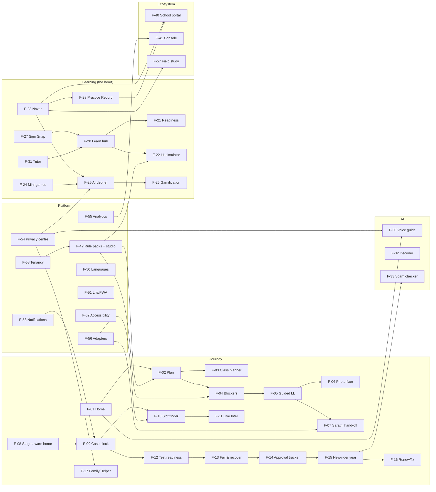

# Features
> Project: Margdarshak · Owner: Product lead · Status: Draft v0.1 · Last updated: 2026-10-23
> Related: [PROJECT_BRIEF §5.1](../00-overview/PROJECT_BRIEF.md) · [PRD](PRD.md) · [USER_STORIES](USER_STORIES.md) · [ROADMAP](ROADMAP.md) · [METRICS](METRICS.md) · [PS1 checklist](../../../research/ps1-deep/00-ps1-checklist.md) · [Deployment / flags](../05-ops/DEPLOYMENT.md)

---

## 0. Legend

- **MoSCoW** is the product priority from PROJECT_BRIEF §5.1 (never changed here).
- **Phase** (see [ROADMAP](ROADMAP.md)):
  - **P1** Hackathon build, deep slices (D-04: Deep-A, Deep-B, Deep-C).
  - **P2** Hackathon build, thin breadth + evidence + submission. *P1–P2 = "Hackathon build".*
  - **P3** Pilot (Nov 2026–Mar 2027). **P4** State adoption (Apr 2027–Mar 2028). **P5** National (2028+). *P3+ = "Production".*
- **R0 depth:** **D** deep, **T** thin (works end to end on mocks, no dead buttons), **R** roadmap (not built; a labelled disabled state at most).
- **Owner roles** (team of 3 plus leads, per [ps1-product-lock §18](../../../war-room/ps1-product-lock.md)): **A** Rules & Case owner · **B** Nazar & Games owner · **C** UI, Design & Field owner · **TL** Tech lead (backend, AI, platform; may be the same person as A) · **PL** Product lead. Every module has a named owner who can explain it (D-24); names are filled in TEAM.md.
- **Personas:** P-01 Kabir · P-02 Tanvi · P-03 Mohan-ji · P-04 Helper · P-05 School owner · P-06 RTO/Transport Commissioner · P-07 Rahul (minor).

---

## 1. Feature matrix

| ID | Feature | Stage | Personas | MoSCoW | R0 depth | First phase | Full by | Depends on | Flags | Owner | Stories |
|---|---|---|---|---|---|---|---|---|---|---|---|
| F-01 | Home: language first, 4 verb tiles, mic, trust line, "All services" by who you are | S0 | P-01, P-02, P-03, P-04, P-07 | Must | D (Deep-C) | P1 | P2 | F-50, F-02, F-30, F-08 | `ff_mic_entry` | C | US-001–US-006 |
| F-02 | Licence Plan in 3 taps (no login, send to WhatsApp) | S1 | P-01, P-02, P-03, P-07 | Must | D (Deep-A) | P1 | P1 | F-42, F-53, API-01–04 | `ff_plan_whatsapp` | A | US-003, US-010–US-014, US-025 |
| F-03 | Smart class planner (several classes on one LL) | S1 | P-01 | Must | D (Deep-A) | P1 | P1 | F-02, F-42 | — | A | US-012, US-015 |
| F-04 | Blocker check (edge cases as rule rows with fix, source, confidence) | S1–S2 | P-01, P-02, P-03, P-07 | Must | D (Deep-A) | P1 | P1 | F-42, API-13 | — | A | US-016–US-024, US-297 |
| F-05 | Guided LL application (one question/screen, autosave/resume, check answers, payment-pending) | S2 | P-01, P-02, P-03, P-04 | Must | D (Deep-A) | P1 | P1 | F-06, F-07, F-54, API-10–12 | `ff_offline_drafts` | C | US-030–US-032, US-037–US-039 |
| F-06 | Photo and signature fixer (on device) | S2 | P-02, P-03, P-04 | Must | D (Deep-A) | P1 | P1 | MediaPipe face detector, API-20 | — | C | US-033, US-034 |
| F-07 | Sarathi hand-off: Mode A copy-pack; Mode B adapter | S2, S5 | P-01, P-02, P-04, P-06 | Must | D (Mode A) / R (Mode B live) | P1 | P4 (Mode B) | F-56, API-16 | `ff_sarathi_mode_b` (off) | A | US-035, US-036, US-041, US-276 |
| F-08 | Stage-aware home + parcel-style tracker (journey state machine) | All | P-01, P-02, P-03 | Must | D (Deep-C) | P1 | P1 | API-11, API-14, API-15 | `ff_persona_switcher` (demo) | TL | US-007–US-009, US-042, US-149, US-166, US-172 |
| F-09 | Case clock (Render Workflows timers, n8n daily trigger, backend notifier delivers) | S2–S7 | P-01, P-02, P-03 | Must | D (Deep-C) | P1 | P2 | F-53, Render Workflows, n8n W01, API-65 | `ff_case_clock` | TL | US-070, US-140, US-143, US-161, US-224–US-226 |
| F-10 | Slot finder (map + calendar, honest watcher; mock SlotAdapter) | S5 | P-01, P-02, P-03 | Must | T | P2 | P4 (real SlotAdapter) | F-11, F-56, API-25–27 | `ff_slot_watch` | A | US-141, US-142, US-144 |
| F-11 | RTO Live Intel (structured, k ≥ 5, moderated, no names) | S5–S6 | P-01, P-02, P-06 | Should | T (seeded, labelled) | P2 | P3 | n8n W9, API-28–29 | `ff_live_intel` | A | US-145–US-148 |
| F-12 | Driving-test readiness (track explainer, test-eve, co-pilot, vehicle checklist + listing) | S6 | P-01, P-02, P-03 | Must | T | P2 | P3 | F-09, F-24 (Track Twin), Rive | — | C | US-081, US-160–US-164 |
| F-13 | Fail and recover (private debrief, retest plan, remedial referral, LL-expiry check, RTI template) | S6F | P-01, P-03 | Must | T (content) / D (state) | P2 | P3 | F-08, F-09, F-40, API-45 | — | A | US-167–US-172, US-237 |
| F-14 | Approval tracker + escalation letter (user approves and sends) | S7 | P-01, P-02 | Should | T | P2 | P3 | backend letter flow + notifier, API-45, API-72 | `ff_escalation_letter` | A | US-180–US-184 |
| F-15 | New-rider year (pledge, refresher, missions, first-vehicle checklist, scam shield, golden-hour card, riding lock) | S8 | P-01, P-03 | Should | T | P2 | P3 | F-23, F-33 | `ff_riding_lock`, `ff_golden_hour_reviewed` (off) | B | US-083, US-190–US-197 |
| F-16 | Renew / fix (renewal reminders, add class, address, duplicate, IDP) | S9 | P-03, P-02 | Should (surface) | T | P2 | P3 | F-42, F-07 | — | A | US-024, US-200–US-204 |
| F-17 | Family and Helper mode (consented helper, clear device, s.199A card) | Cross | P-03, P-04, P-01 | Should (surface) | T | P2 | P3 | F-54 (consent), E-29 | `ff_helper_mode`, `ff_shared_device` | C | US-025, US-040, US-205–US-209 |
| F-20 | Learn hub (LL syllabus + 22 safety modules; variants; FSRS) | S3–S4 | P-01, P-02, P-03, P-07 | Must | D (LL) / T (modules) | P1 | P3 | ts-fsrs 5.x, API-30–32 | — | B | US-050–US-052 |
| F-21 | Test Readiness Score (knowledge − calibration; advisory 85 gate) | S3–S6 | P-01 | Must | D (Deep-A) | P1 | P1 | F-20, API-33 | — | B | US-053–US-055 |
| F-22 | LL Test Simulator (state format from config, guided first run) | S3 | P-01, P-03, P-07 | Must | D (Deep-B) | P1 | P1 | F-42, F-51 | — | B | US-039, US-056, US-057, US-060 |
| F-23 | **Nazar** hazard perception (Kerala's announced format) + clip pipeline | S4 | P-01, P-02, P-05 | Must (hero) | D (Deep-B) | P1 | P1 | Render Workflows, R2, M-06, M-09, F-25, F-57 | `ff_nazar_mock`, `ff_nazar_learn`, `kl_hpt_status` (rule-pack enum) | B | US-071–US-076, US-086, US-089–US-091, US-233, US-316 |
| F-24 | Simulation mini-games (8) | S4 | P-01, P-03 | Must (4 deep), Should (rest) | D: Stopping Distance, Blind Spot, Junction Scan, Track Test Twin (figure-8) · T: Helmet Fit, Golden Hour · R: Night & Glare, Hill Road | P1 | P3 | Phaser 4, game-core, MediaPipe | `ff_game_stopping`, `ff_game_blindspot`, `ff_game_junction`, `ff_game_tracktwin`, `ff_game_helmet`, `ff_game_goldenhour`, `ff_game_night` (off), `ff_game_hill` (off) | B | US-077–US-085, US-092 |
| F-25 | AI Debrief (code computes, Gemini narrates; record-then-score commentary) | S3–S8 | P-01 | Must | D (Deep-B) | P1 | P1 | ADK 2.12, M-02, M-03, validator, F-24 | `ff_ai_debrief`, `ff_commentary` | TL | US-073, US-086, US-100–US-103, US-112 |
| F-26 | Gamification engine (XP, ranks, streaks, squads, 9 badges, share cards, dark-pattern lint) | S3–S8 | P-01 | Must | D (XP, badges, card) / T (streaks, squads) / R (duels) | P1 | P3 | F-23, F-24, API-38–39 | `ff_squads`, `ff_share_cards`, `ff_percentile` (off until ≥ 200 mocks), `ff_duels` (off) | B | US-092, US-120–US-129, US-185, US-197 |
| F-27 | Road Sign Snap | S3 | P-01 | Could | R | P3 | P3 | M-07, sign catalogue | `ff_sign_snap` (off) | B | US-059 |
| F-28 | Practice Record (signed, QR, never "verified") | S4–S7 | P-01, P-05 | Should | T | P2 | P3 | F-23, F-40, API-46–47 | `ff_practice_record` | B | US-087, US-088, US-234 |
| F-30 | Voice Guide (ADK live, Gemini Live HI/EN, Saaras Dogri; never submits/pays/books) | Cross | P-03, P-01 | Must | D (one scripted Hindi flow) / T (Dogri) | P1 | P3 | M-01, M-08, API-40 | `ff_voice_live`, `ff_dogri_voice` | TL | US-005, US-104–US-108, US-114 |
| F-31 | Personal tutor (explains your wrong answers from reviewed content) | S3–S4 | P-01 | Should | T | P2 | P3 | M-04, API-41 | `ff_tutor` | TL | US-058, US-106 |
| F-32 | Sarathi screen/status decoder | S2–S7 | P-01, P-02 | Should | T | P2 | P3 | M-05, error catalogue, API-42 | `ff_decoder` | TL | US-109, US-110 |
| F-33 | Scam checker (rules decide, AI explains) | S8 | P-03 | Should | T | P2 | P3 | allowlists, API-43 | `ff_scam_checker` | A | US-111, US-194 |
| F-40 | Driving-school portal (listing; Pro: progress, HPT logs, sign-off, parent updates, vehicle listing, referrals) | Eco | P-05 | Should | T | P2 | P3 | F-23, F-28, F-53 (parent card via notifier), n8n W07, API-50–52 | `ff_school_portal`, `ff_school_pro` | PL | US-230–US-240 |
| F-41 | State / RTO console (stall points, fail reasons, demand, utilisation, deflection; k ≥ 5) | Eco | P-06 | Should | T (sample aggregates) | P2 | P4 | F-55, F-56, API-53 | `ff_console` | TL | US-250–US-257 |
| F-42 | Rule-pack studio (versioned, maker-checker, source/date/confidence) | Eco | P-06 | Must | T (studio UI) over D rule packs | P1 (packs) | P4 (state-operated) | API-54, n8n W15 | `ff_rule_studio` | A | US-225, US-260–US-267 |
| F-50 | Languages (EN + HI full; Dogri voice-in; tenant translations) | Cross | All | Must | D (Deep-C) | P1 | P4 (state languages) | next-intl, M-08 | `ff_lang_<code>` per tenant | C | US-001, US-061, US-107, US-290, US-291 |
| F-51 | Lite mode / offline PWA (< 300 KB, offline mocks, cached clips) | Cross | P-07, P-02, P-03 | Must | D (Deep-C) | P1 | P1 | Serwist | `ff_lite_auto` | C | US-060, US-292, US-293 |
| F-52 | Accessibility (WCAG 2.1 AA / GIGW 3.0 / UX4G) | Cross | All | Must | D (Deep-C) | P1 | P4 (audit) | axe, design tokens | — | C | US-023, US-076, US-077, US-294–US-297 |
| F-53 | Notifications (WhatsApp templates, email, web push; SMS after DLT) | Cross | P-01, P-02, P-03 | Must | D (Deep-C) | P1 | P3 (approved templates), P4 (SMS) | backend notifier (`NotificationPort`), Meta WhatsApp Cloud API, email provider | `ff_whatsapp_channel`, `ff_email_channel`, `ff_webpush_channel`, `ff_sms_channel` (off) | TL | US-014, US-220–US-223, US-227, US-228 |
| F-54 | Privacy centre (consent artefacts, export, delete, grievance; minor gating) | Cross | All | Must | D (Deep-C) | P1 | P3 (DPIA) | E-15, API-60–62 | `ff_age_verify_digilocker` (off in R0) | PL | US-108, US-113, US-270–US-276, US-278 |
| F-55 | Privacy-preserving analytics (no PII, aggregated) | Cross | All | Must | D (Deep-C) | P1 | P1 | API-63 | — | TL | US-255, US-277 |
| F-56 | Government adapter layer (7 adapters, mock + real, same contract tests) | Platform | P-06 | Must | D (mocks + OpenAPI + contract tests) | P1 | P4 (first real adapter) | — | `adapter_mode.<adapter>` per tenant | TL | US-036, US-041, US-300, US-301, US-304–US-306 |
| F-57 | Field-study module (lab replica, Nazar study, pre-registration) | Evidence | — | Must | D (Deep-B) | P1 | P2 | F-23, API-70–71, Workflows | `ff_lab_replica` (field build only), `ff_public_stats` | C (journey test), B (Nazar study) | US-310–US-316 |
| F-58 | Multi-tenancy per state + white-label theming (UX4G skin) | Platform | P-06 | Should | T (JK + KL tenants) | P2 | P4 | E-31, F-42 | `tenant.theme` | TL | US-262, US-291, US-302, US-303 |

**Count.** 42 features: Must 29, Should 12 (incl. surface-level F-16, F-17), Could 1 (F-27). R0: 25 built deep (fully or in their deep part, e.g. F-24's four games and F-07 Mode A), 16 thin (F-13's state transitions are deep, its content thin; F-42's studio is thin over deep rule packs), 1 roadmap-only (F-27), plus roadmap sub-parts (F-07 Mode B live, F-24 Night & Glare and Hill Road, F-26 duels).

### 1.1 Cut or roadmap (council, not features)
| Item | Status | Reason |
|---|---|---|
| "Your route, your risks" | Roadmap (one static NH44 card at most) | Needs iRAD access and precise location; false reassurance (council §1 row 7) |
| Live commentary coaching | Replaced by record-then-score (F-25) | Cost and risk; ADK Live experimental (D-12) |
| Face match against the Aadhaar photo | Cut | Private entities can't do Aadhaar face authentication (G1) |
| "10+ languages" claim | Cut | Claim only what ships (D-21) |
| The banned former working name | Cut | BWMI #158/#202 conflict and confusion with Sarathi |
| "Official" / "integrated with Sarathi" wording | Cut | Impersonation (D-01, D-19) |
| Test-vehicle rental marketplace | Cut to checklist + listing | Insurance, payment and liability |
| Insurer discount on the Practice Record | One roadmap line | Not validated (D-23) |
| SMS | Roadmap until TRAI DLT | D-16 |

---

## 2. Dependency graph

### 2.1 Build order (critical path for R0)
1. **H0–H6:** F-42 rule packs (`fees.json`, `rules/JK.json`, `rules/KL.json`) → F-02/F-03/F-04 (API-01–03, API-13); clip filming and the F-23 pipeline skeleton (clip pipeline and field study first, D-03).
2. **H6–H18:** F-23 mock + learn modes, server replay (API-35); F-05/F-06/F-07 guided flow; F-08 state machine; F-54 age gate + consent; F-55 analytics schema.
3. **H18–H30:** F-25 debrief + validator + evals; F-24 four deep games; F-21/F-22; F-09 sweeper Workflow + n8n W01 trigger; F-53 notifier (WhatsApp test number, test-eve TimelineEvent).
4. **H30–H40:** thin breadth (F-10–F-17, F-40–F-42 UIs, F-31–F-33); F-57 study live; F-51 budget; F-52 axe pass.
5. **H40–end:** zero-dead-button crawl, evals in CI, rehearsal, video. Exact hours are managed in HACKATHON_PLAN.

---

## 3. Feature flags

Flags live in the tenant config (E-31) and an env overlay; evaluation is server-side with a client mirror for UI. Every flag has an owner and a default per environment. **Kill switches** (marked ⛔) must be flippable without a deploy.

| Flag | Feature | Default: hackathon (R0) | Default: pilot (R1) | Default: state (R2) | Owner | Notes |
|---|---|---|---|---|---|---|
| `ff_mic_entry` | F-01 / F-30 | on (18+) | on (18+) | on | TL | Hidden for minors regardless |
| `ff_plan_whatsapp` | F-02 | on (test number) | on | on | TL | Requires per-message opt-in |
| `ff_offline_drafts` | F-05 | on | on | on | C | IndexedDB queue |
| `ff_sarathi_mode_b` | F-07 | off | off | on per tenant after contract tests | TL | Never on with a mock adapter in production |
| `ff_persona_switcher` | F-08 | on (demo route only) | off | off | C | Shows each stage on synthetic cases |
| `ff_case_clock` ⛔ | F-09 | on | on | on | TL | Kill switch stops all outbound reminders |
| `ff_slot_watch` | F-10 | on | on | on | A | Alerts only from moderated reports |
| `ff_live_intel` ⛔ | F-11 | on (seeded, "sample data") | on | tenant choice | A | Kill switch hides all intel within 1 min |
| `ff_escalation_letter` | F-14 | on | on | tenant choice | A | Human approval always required |
| `ff_riding_lock` | F-15 | on | on | on | B | Uses device motion only if permitted |
| `ff_golden_hour_reviewed` | F-15, F-24 | off ("draft") | on after medical review | on | B | Rah-Veer amounts only after re-verification |
| `ff_helper_mode` | F-17 | on | on | on | C | — |
| `ff_shared_device` | F-17 | auto (café profile) | auto | auto | C | 10-min idle logout |
| `ff_nazar_mock` | F-23 | on (18+) | on | on | B | — |
| `ff_nazar_learn` | F-23 | on (18+) | on | on | B | Static hazard lesson for minors |
| `kl_hpt_status` (rule-pack enum) | F-23, F-40 | `announced` | per news/MVD | per MVD | B | `announced` · `in_force` · `stayed` · `postponed` (EC-28) |
| `ff_game_stopping` / `_blindspot` / `_junction` / `_tracktwin` | F-24 | on | on | on | B | Deep four |
| `ff_game_helmet` / `_goldenhour` | F-24 | on (thin; golden hour "draft") | on | on | B | — |
| `ff_game_night` / `_hill` | F-24 | off (storyboard only) | on (P3) | on | B | Hill Road J&K tenant first |
| `ff_ai_debrief` ⛔ | F-25 | on (18+) | on | on | TL | Off → templates everywhere |
| `ff_commentary` | F-25 | on (one clip, 18+) | on | on | TL | Audio discarded after transcription |
| `ff_squads` | F-26 | on (18+) | on | on | B | Never for under-18 |
| `ff_share_cards` | F-26 | on | on | on | B | Own domain only |
| `ff_percentile` | F-26 | off (until ≥ 200 verified mocks) | auto | auto | B | Never fake a percentile |
| `ff_duels` | F-26 | off | on | on | B | — |
| `ff_sign_snap` | F-27 | off | on (P3) | on | B | 18+ |
| `ff_practice_record` | F-28 | on | on | on | B | — |
| `ff_voice_live` ⛔ | F-30 | on (one scripted flow), fallback recorded | on | on | TL | Not on the critical demo path |
| `ff_dogri_voice` | F-30 | on (thin) | on | on | TL | Voice-in only |
| `ff_tutor` / `ff_decoder` | F-31, F-32 | on (18+) | on | on | TL | — |
| `ff_scam_checker` | F-33 | on | on | on | A | Never outputs "safe" |
| `ff_school_portal` / `ff_school_pro` | F-40 | on / on (demo school) | on / beta | on / on | PL | "Sponsored" label enforced |
| `ff_console` | F-41 | on (sample aggregates) | beta (pilot RTO) | on | TL | k ≥ 5 always |
| `ff_rule_studio` | F-42 | on (demo officers) | on | on (state-operated) | A | Maker ≠ checker |
| `ff_lang_hi` / `ff_lang_<code>` | F-50 | hi on; others off | per tenant at 100% coverage | per tenant | C | — |
| `ff_lite_auto` | F-51 | on | on | on | C | Triggered by effectiveType or Save-Data |
| `ff_whatsapp_channel` ⛔ / `ff_email_channel` / `ff_webpush_channel` | F-53 | on (test number) / on / on | on (approved templates) | on | TL | — |
| `ff_sms_channel` | F-53 | **off** | off | on after TRAI DLT | TL | Code paths blocked while off |
| `ff_age_verify_digilocker` | F-54 | off (self-declared + attestation) | off → on when DigiLocker real | on | PL | Gates AI and history in production |
| `adapter_mode.<sarathi|digilocker|aadhaar_offline|bhashini|payment|notification|slot>` | F-56 | `mock` | `mock` / `real` (DigiLocker first) | `real` per MoU | TL | "simulated" chip whenever `mock` |
| `ff_lab_replica` | F-57 | on (field build only, noindex) | off | off | C | Never deployed at a public indexable URL |
| `ff_public_stats` | F-57 | on | on | on | B | API-71 |
| `tenant.theme` | F-58 | JK default theme | per tenant | per tenant | C | State logo only under state hosting |

---

## 4. PS1 checkbox mapping (every box ticked)

Source boxes: [`research/ps1-deep/00-ps1-checklist.md`](../../../research/ps1-deep/00-ps1-checklist.md) (from the organisers' PS1 text). "Demo proof" names the place a judge sees it in the ≤ 5-minute video or the live URL.

| # | PS1 box (wording) | Ticked | Features | Key stories | Demo proof |
|---|---|---|---|---|---|
| 1 | Help users **understand the requirements** | ✅ | F-02, F-03, F-04, F-16 | US-010, US-012, US-016–US-021 | Plan card in 3 taps with blockers and sources |
| 2 | **Complete applications** | ✅ | F-05, F-06, F-07, F-17 | US-030–US-035 | 6-screen guided LL with photo fix, check answers, copy-pack |
| 3 | **Learn road safety rules** | ✅ | F-20, F-23, F-24, F-15 | US-050, US-071, US-078–US-083 | Survival modules + Nazar + Stopping Distance / Blind Spot |
| 4 | **Prepare for tests** | ✅ | F-21, F-22, F-23, F-12, F-24 (Track Twin) | US-054, US-056, US-071, US-081, US-160 | Readiness 62 → 86, Kerala-format mock, track explainer |
| 5 | **Navigate the online learner's licence test** | ✅ | F-22, F-05 (device pre-check) | US-039, US-056, US-057 | Simulator guided first run in the state's format |
| 6 | **Understand the steps to a permanent licence** | ✅ | F-08, F-09, F-10, F-12, F-13, F-14 | US-008, US-070, US-140, US-160–US-169, US-180 | Tracker from LL to card; day-25 nudge; fail → retest plan |
| 7 | **Simplified UX**: navigation, forms, document requirements, fees, each stage easier | ✅ | F-01, F-02, F-05, F-08 | US-002, US-003, US-007, US-030 | ~120 links → 4 tiles; ~16 → ~6 screens; fee up front |
| 8 | **Guided applications** for LL and DL, incl. **appointments** and **required documents** | ✅ | F-05, F-07, F-10, F-12 | US-030–US-035, US-141, US-161 | Guided LL; DL slot map + calendar; test-eve "what to bring" |
| 9 | **Interactive learning**: signs, rules, driving concepts via quizzes, illustrations, simulations, short lessons | ✅ | F-20, F-23, F-24, F-26, F-27 | US-050–US-052, US-071–US-085 | Nazar clips + four simulations + FSRS lessons |
| 10 | **Beginner-friendly test experience**: mock tests, clear instructions, feedback, progress indicators | ✅ | F-21, F-22, F-25, F-26 | US-054, US-057, US-100, US-122 | Readiness parts, guided first run, four-part debrief, weekly goal |
| 11 | **Multilingual accessibility**: regional languages | ✅ | F-50, F-30 | US-001, US-061, US-107, US-290 | EN + HI in full; Dogri voice-in (claimed exactly, D-21) |
| 12 | **AI-powered assistance**: conversational guide explaining procedures, FAQs, next steps in simple language | ✅ | F-30, F-31, F-32, F-25 | US-104–US-110 | "Mere papa 52 saal ke hain…" → Form 1A + Helper mode; decoder; tutor |
| 13 | **Inclusive design**: low digital literacy, disabilities, limited internet, older devices | ✅ | F-51, F-52, F-17, F-01 (pictures, voice) | US-292–US-297, US-206, US-011 | Lite < 300 KB on 3G; TalkBack; Helper mode; picture class choice |
| 14 | **Process transparency**: eligibility, status, fees, appointments, next steps, common mistakes | ✅ | F-02, F-04, F-08, F-11, F-14, F-42 (changelog) | US-012, US-016–US-024, US-145, US-180, US-265 | Sourced fee lines, blocker rows, Live Intel (k ≥ 5), public rule changelog |
| 15 | Journey **LL application → LL test prep → DL application → understanding the driving test** | ✅ | F-02→F-05→F-20/F-22→F-23/F-24→F-10→F-12 | EP-02 → EP-09 | The 4-stop strip LL → hazard (Kerala 1 Dec) → track → DL in the demo |
| 16 | "Clearly explain the problem, your design decisions, and how your solution improves the experience" | ✅ | F-57 (evidence), all docs | US-310–US-316 | Before/after slide (choices ~120 → 4; screens ~16 → ~6), journey test J1–J4, Nazar H1–H4 |
| 17 | Use simulated data where necessary; integration not mandatory | ✅ | F-56 (mock adapters + "simulated" chips), F-01 footer | US-036, US-300, US-301, US-306 | Every mock value chipped; footer on every page; adapter OpenAPI |
| E | Evaluation focus: usability, accessibility, clarity, application-flow improvements, learning effectiveness, technical execution, real-world usefulness | ✅ | F-57 (SUS, time, errors), F-52, F-02, F-05, F-21/F-23 (learning), F-56/F-09 (execution), F-40/F-41 (usefulness) | — | SUS + time + errors (usability); axe + TalkBack (a11y); plan card (clarity); 16 → 6 (flow); fresh-clip gain H3 (learning); Workflows run page + p95 (execution); school + console (usefulness) |

**Result: 17 of 17 boxes and the evaluation focus are covered.** Box 15 is the spine of the demo; boxes 3, 4, 9 and 10 are where Margdarshak differs from the organiser's default app (which stops at a timed quiz; see [COMPETITIVE_ANALYSIS](COMPETITIVE_ANALYSIS.md)).

---

## 5. Feature to edge-case index
| EC | Features | EC | Features |
|---|---|---|---|
| EC-01 | F-04 | EC-16 | F-16 |
| EC-02 | F-04 | EC-17 | F-17, F-04 |
| EC-03 | F-04 | EC-18 | F-23, F-24, F-52 |
| EC-04 | F-04, F-09 | EC-19 | F-51, F-23, F-06 |
| EC-05 | F-02, F-04, F-54, F-25 | EC-20 | F-30, F-54, F-32 |
| EC-06 | F-04, F-03 | EC-21 | F-03, F-16 |
| EC-07 | F-09, F-13 | EC-22 | F-08 |
| EC-08 | F-13 | EC-23 | F-14 |
| EC-09 | F-05 | EC-24 | F-11 |
| EC-10 | F-02, F-04, F-22 | EC-25 | F-17 |
| EC-11 | F-05, F-07 | EC-26 | F-54 |
| EC-12 | F-04, F-16 | EC-27 | F-09, F-42 |
| EC-13 | F-04, F-52 | EC-28 | F-23, F-40, F-42 |
| EC-14 | F-17 | EC-29 | F-25, F-30, F-31 |
| EC-15 | F-08, F-09 | EC-30 | F-53 |

---

## 6. What "done" means per depth (for reviewers)
| Depth | Definition of done |
|---|---|
| **Deep** | Production-grade code path: auth/age gate, migrations, OpenAPI entry, error/empty/offline states, analytics events from the taxonomy, a11y checked, unit + integration + e2e tests, PRD acceptance criteria green, shown in the demo |
| **Thin** | Works end to end on mocks with real routing and state; honest labels ("simulated", "sample data", "draft", "verify at your RTO"); at least one e2e path; no lorem ipsum; no dead buttons |
| **Roadmap** | Not built; may appear as a disabled tile with "coming" and a reason; never claimed in the pitch as working |
