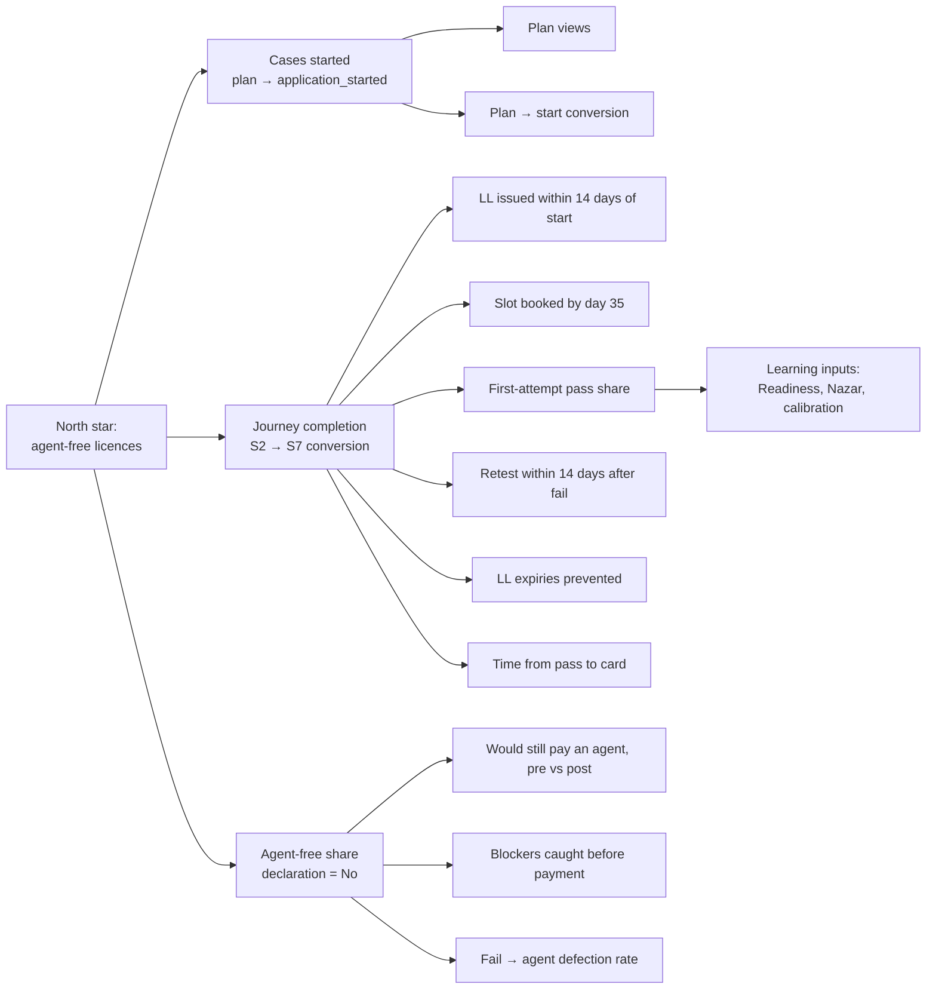
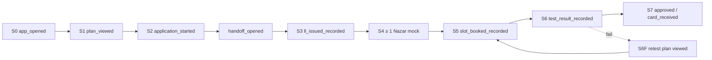

# Metrics
> Project: Margdarshak · Owner: Product lead (definitions) · Tech lead (instrumentation) · Status: Draft v0.1 · Last updated: 2026-10-23
> Related: [PRD §3](PRD.md#3-success-metrics-summary) · [FEATURES](FEATURES.md) · [USER_JOURNEYS](USER_JOURNEYS.md) · [ROADMAP](ROADMAP.md) · [Privacy](../06-security-compliance/PRIVACY.md) · [Observability](../05-ops/OBSERVABILITY.md) · [AI evals](../04-ai/AI_EVALS.md) · [Field kit](../../../field-kit/NAZAR-FIELD-KIT.md)

---

## 0. Principles for measurement

1. **No PII in analytics, ever** (F-55). Events carry no name, phone, email, DOB, Aadhaar, LL/DL/application number, IP, precise location, free text or transcript. The schema is enforced at API-63; unknown properties are rejected, not dropped silently.
2. **A child's data is never used for behavioural tracking, profiling or targeted ads** (D-13 revised, DPDP s.9(3)). A learner under 18 uses Margdarshak in family mode, inside the parent's account; their events follow the same allowlisted schema and count only in k ≥ 5 aggregates.
3. **Skill, not engagement.** We measure hazard-response accuracy, calibration and readiness, not DAU for its own sake ([05 Ψ10](../../../research/ps1-deep/05-psychology.md)). Streaks end at DL test day by design; lifetime DAU is not a goal.
4. **Honest numbers.** Self-reported outcomes are labelled "self-reported". Percentiles appear only after ≥ 200 verified mocks. Every public figure carries n and a 95% CI. We never claim "lives saved" (D-22).
5. **Pre-registration.** Field-study hypotheses H1–H4 and J1–J4 are committed after the confirmed start and before any data ([field kit §3, §11.6](../../../field-kit/NAZAR-FIELD-KIT.md)).
6. **Aggregates for others.** Anything shown to schools, government or the public uses k ≥ 5 suppression with complementary suppression.

---

## 1. North star: agent-free licences

### 1.1 Definition
> **Agent-free licences (AFL)** = the number of licence classes that reach **S7 (licence issued)** in a period, on cases where the applicant answered **"No"** to *"Did you use an agent at any step?"* (US-185).

| Element | Specification |
|---|---|
| Unit | One class issued on one case (MCWG and LMV-NT on one case count as 2) |
| Numerator events | `test_result_recorded{result=pass}` followed by `approved_recorded` or `card_received_recorded`, plus `agent_declaration{answer=no}` |
| Period | Weekly and monthly, by tenant |
| Source in R0/R1 | User-recorded events (self-reported) |
| Source in R2 | Adapter-confirmed issuance (Mode B or DigiLocker presence check, no number stored) + self-declaration |
| Caveat label | "Self-declared; not a government statistic" |
| Excludes | Cases whose agent answer is "Yes" or "Prefer not to say"; test/demo cohorts |

### 1.2 Why this north star
- It captures both halves of the product: **the journey worked** (a licence was issued) and **the agent was not needed** (the legal certainty beat the agent's offer, [05 Ψ1](../../../research/ps1-deep/05-psychology.md)).
- It moves with the PRD goals G1–G4 and is hard to game with engagement tricks.
- It pairs with a **safety guardrail** so we never optimise speed of licensing over skill (Cochrane: driver education led to earlier licensing without crash reduction, [05 Ψ9](../../../research/ps1-deep/05-psychology.md)): **AFL is reported only alongside the Road Readiness distribution of the same cohort** (§4.4).

### 1.3 Targets
| Phase | Target | Status |
|---|---|---|
| P1–P2 Hackathon | Demonstrated end to end on synthetic cases; real AFL = 0 is expected (48 h is shorter than the 30-day LL wait) | Planned |
| P3 Pilot (J&K) | ≥ 200 AFL in the pilot cohort by Mar 2027 | Hypothesis; owner Product lead |
| P4 State | ≥ 10,000 AFL per year in one adopting state | Hypothesis; owner Product lead |
| P5 National | Reported per state on a public dashboard | Hypothesis |

### 1.4 Driver tree

---

## 2. AARRR funnel

Targets are for **P3 pilot** unless stated; hackathon values are measured on the field-study cohort and demo traffic only.

| Stage | Metric | Event(s) | Definition | P3 target | Guardrail |
|---|---|---|---|---|---|
| **Acquisition** | New anonymous sessions by entry | `app_opened{entry}` | Daily-rotating `sid`s first seen, by entry (direct, WhatsApp plan link, share card, school QR, CSC) | 60% from share links + schools + CSCs combined | Share-card opens ≠ installs; no APKs |
| | Share-card K-factor | `share_card_created`, `share_card_opened`, `app_opened{entry=share_card}` | New sessions from share links ÷ cards created | ≥ 0.3 | Cards never show PII |
| **Activation** | Plan completion | `plan_started` → `plan_viewed` | Share of plan starts that reach the card | ≥ 85% | Median time to card ≤ 60 s |
| | "Aha" = plan + first learning act within 24 h | `plan_viewed` + (`question_answered` or `game_session_completed`) | Share of plan viewers | ≥ 35% | — |
| | Application start | `application_started` ÷ `plan_viewed` | — | ≥ 40% | — |
| **Retention** | Bridge engagement | `game_session_completed` in S4 | Learners in S4 with ≥ 4 sessions/week in ≥ 3 of 4 weeks | ≥ 40% | ≤ 1 nudge/day; streak silent on break |
| | Spaced return | `review_session_completed` | Share of S3–S4 learners completing due reviews on ≥ 3 separate days per week | ≥ 30% | XP diminishes after 45 min/day |
| | Post-licence refresher | `refresher_completed` | Share of S8 users completing ≥ 1 refresher/month in months 1–3 | ≥ 20% (opt-in) | No streaks after DL |
| **Referral** | Squad formation | `squad_created`, `squad_joined` | Share of learners in a squad | ≥ 25% | A minor's profile only with the parent's consent |
| | Family/helper pull | `family_case_added`, `helper_link_created` | Cases created via family or helper | ≥ 10% of cases | Consent artefacts present |
| **Revenue** (Eco) | School Pro conversion | `school_pro_started` (server) | Listed schools converting to Pro | ≥ 10% of listed schools in Kerala pilot | Price hypothesis ₹499–999/month [unverified] |
| | Lead acceptance | `school_lead_accepted` | Leads accepted within 4 h | ≥ 70% | "Sponsored" labels |
| | Government licence | Contract signed | — | 1 MoU in P4 | — |

### 2.1 Journey funnel (S0 → S7)

| Step conversion | P3 target | Why |
|---|---|---|
| plan_viewed → application_started | ≥ 40% | Plan answers before asking; some users only research |
| application_started → handoff_opened | ≥ 75% | 6 screens, autosave |
| handoff_opened → ll_issued_recorded (≤ 21 days) | ≥ 60% | Depends on Sarathi; self-report prompt |
| ll_issued → slot_booked by LL day 35 | ≥ 60% | Day-25 nudge (F-09) |
| slot_booked → test_result_recorded | ≥ 80% | Test-eve and co-pilot |
| First-attempt pass (self-reported) | ≥ 60% [hypothesis; compare against tenant baseline when known] | Readiness + Track Twin |
| fail → retest booked ≤ 14 days | ≥ 70% | Retest plan on the fail screen |
| pass → card_received ≤ 30 days | ≥ 70% | Tracker + letter |

---

## 3. Journey efficiency metrics (before/after, D-22)

These are the hackathon evidence slide numbers. Before = the current portal or the unbranded Sarathi replica (`/lab/sarathi-sequence`); after = Margdarshak.

| ID | Metric | Before | After target | How measured | Owner |
|---|---|---|---|---|---|
| BA-1 | Choices on the first screen | ~120 links ([team report](../../../research/ps1-deep/team-saarthi-report.md)) | 4 tiles | Count | C |
| BA-2 | Screens to start an LL application (Aadhaar path) | ~16 | ~6 | e2e screen counter | C |
| BA-3 | Times DOB is typed | ~6 | 1 | e2e | C |
| BA-4 | Fields typed vs autofilled/reused | Measured on replica | ≥ 50% fewer typed | Lab logs | C |
| BA-5 | Time to find the J&K LL start page on the real site (Task 0) | Median measured live | n/a (real-site number) | [Field kit §11.4](../../../field-kit/NAZAR-FIELD-KIT.md) | C |
| BA-6 | KB transferred on first load (3G profile) | Measured on parivahan.gov.in | < 300 KB (Lite) | Lighthouse / DevTools | C |
| J1 | Median time to complete the LL task | Replica | ≥ 40% lower (paired Wilcoxon, one-sided) | `journey_sessions.csv` | C |
| J2 | Full success (class + path + all planted blockers before submit) | Replica ≤ 3/8 (prediction) | ≥ 6/8 (exact McNemar, one-sided) | Same | C |
| J3 | SUS (benchmark 68, [MeasuringU](https://measuringu.com/sus/)) | ≤ 55 (prediction) | ≥ 75; paired difference with 95% CI | Same | C |
| J4 | "Would still pay an agent" (and max ₹) | Pre-question | Falls pre → post (McNemar); median max ₹ falls | Same | C |

**Reporting rule:** every participant row is shown; with n ≤ 8, no claims beyond "in this sample". If the replica beats Margdarshak on any measure, that goes on the slide too ([field kit §11.8](../../../field-kit/NAZAR-FIELD-KIT.md)).

---

## 4. Learning metrics

### 4.1 Test Readiness Score (F-21)
| Item | Definition |
|---|---|
| Formula | `Readiness = 100 × Σ_t w_t · M_t − CalPenalty` ([08 §4.4](../../../research/ps1-deep/08-game-ai-n8n.md)) |
| Topic mastery | `M_t = coverage_t × mean_{c ∈ seen_t} R_c(now)`; `R_c` = FSRS retrievability (ts-fsrs 5.x); cards with < 2 reviews capped at R = 0.6 |
| Coverage | Concepts seen ≥ 2 times with ≥ 1 "Good" ÷ all concepts in the topic |
| Weights | Equal across the 4 LL topics (government topic mix unknown), labelled |
| Calibration penalty | `CalPenalty = min(10, 40 × max(0, OC − 0.05))`, OC = mean stated confidence − accuracy over the last 40 answers |
| Display | "78 = knowledge 84 − calibration 6" |
| Gate | Advisory 85 + every topic ≥ 0.7 + last 2 mocks ≥ pass mark + 10 points; "Book anyway" always visible |
| Validation metric | Correlation between last Readiness before the real LL test and self-reported LL result (P3) |
| Target | Learners with Readiness ≥ 85 before their LL test: self-reported LL pass ≥ 90% [hypothesis] |

### 4.2 Calibration
| Metric | Definition | Target |
|---|---|---|
| Brier score | `B = (1/N) Σ (p_i − o_i)²`, p ∈ {0.5, 0.75, 1.0} | Median B falls ≥ 0.03 from week 1 to week 4 of S3–S4 [hypothesis] |
| Overconfidence events | Wrong answers at 100% confidence per 100 answers | Falls week over week |
| 100%-bin accuracy | Accuracy when stated 100% | Rises toward ≥ 0.90 |
| Nazar self-prediction gap | |predicted clips passed − actual| before each mock | Falls across mocks |
| "Calibrated" badge share | B ≤ 0.18 over ≥ 40 items and |stated − actual| ≤ 0.10 in the 100% bin | Reported, not targeted |

### 4.3 Nazar (F-23)
| Metric | Definition | Target / hypothesis |
|---|---|---|
| Nazar Score (0–100) | Mean of the last 3 mock sessions on unseen clips with trust ≥ 0.6 | Reported |
| % below 60/100 (licence holders) | Share of field-study licence holders scoring < 60 in Kerala format, Wilson 95% CI | **H1:** ≥ 30% |
| r(LL mock, Nazar) | Pearson r between the 15-question LL mock and the Nazar score, Fisher-z 95% CI | **H2:** |r| < 0.3 |
| Fresh-clip gain | Mean per-clip score on 5 fresh clips after feedback vs matched-difficulty baseline; one-sided Wilcoxon | **H3:** positive |
| Inter-rater agreement | Median |Δonset| across published clips | **H4:** ≤ 0.5 s |
| Seconds late → metres | Median `late_s` converted at the clip's logged speed | Reported on the slide |
| Test-retest r | Between two mocks ≥ 1 day apart (if ≥ 8 retakes) | ≥ 0.6 [hypothesis] |
| Pattern-click rate | Clips zeroed by the pattern rule ÷ clips played | < 5% after the first session |
| Clip difficulty fit | Empirical difficulty (mean band) per clip after ≥ 50 takers | Feeds the moat (calibrated clip bank) |
| Decay | Nazar Score change at 30/60/90 days after DL, with vs without monthly refreshers | Refresher users decay less [hypothesis] |

### 4.4 Road Readiness (separate from LL readiness)
Mean of survival-skill nodes M1, M3, M4, M6, M8, M19 (+ M14 for J&K) and the Nazar Score. Shown on the Practice Record, never as a gate. **Reported alongside AFL for the same cohort** (north-star guardrail).

### 4.5 Learning-system health
| Metric | Definition | Threshold |
|---|---|---|
| FSRS adherence | Due reviews completed within 24 h of due | ≥ 50% |
| Variant leakage | Share of answers given in < 2 s with 100% confidence on first sight of a variant | Investigate if > 10% |
| Debrief usefulness | `debrief_viewed` → next drill started within 24 h | ≥ 30% |
| Commentary hit rate | Hazards named ÷ annotated hazards per commentary clip | Reported |

---

## 5. Impact metrics

| ID | Metric | Formula | Label | P3 target |
|---|---|---|---|---|
| IM-1 | Agent spend avoided | Σ over AFL cases of max(0, declared agent quote − government fee for that plan) | Self-declared quotes; indicative | Reported, no target |
| IM-2 | RTO visits avoided | Σ (baseline visits for the path − visits recorded) with baseline from the plan card's "max RTO visits" vs self-reported extra visits | Self-reported | ≥ 1 avoided visit per 3 cases [hypothesis] |
| IM-3 | Wrong-class applications prevented | Cases whose class choice changed after the plan card (`plan_class_added`/vehicle change before start) | Measured | Reported |
| IM-4 | Blockers caught before payment | `blocker_shown` with severity ≥ high on cases that later reach `handoff_opened` | Measured | Reported |
| IM-5 | LL expiries prevented | Cases with a collision warning (EC-07) that booked/passed before expiry ÷ cases warned | Measured + self-reported | ≥ 70% |
| IM-6 | Retest cycle time | Median days from `test_failed` to the next `test_result_recorded` | Self-reported | ≤ 14 days |
| IM-7 | Pass-to-card time | Median days from pass to `card_received_recorded` | Self-reported | Reported; letters sent when stalled |
| IM-8 | Counter queries deflected | Voice/tutor intents answered with a rule chip, by topic (console) | Measured | Reported to the pilot RTO |
| IM-9 | Scam exposures intercepted | `scam_check_result{verdict_code=do_not_open}` | Measured | Reported |
| IM-10 | Hazard-skill uplift at licensing | Road Readiness and Nazar Score of the AFL cohort at S7 vs at S4 entry | Measured | Positive median change |
| IM-11 | Practice hours logged for HPT | Minutes of Nazar practice exported by schools | Measured | Reported per school |

**Never reported:** crashes prevented, lives saved, "safe drivers produced". Hazard-perception test scores predict crashes in the literature (Horswill et al. 2015, doi:10.1016/j.aap.2015.05.019), but we measure no crash outcomes.

### 5.1 Guardrail metrics (must stay green)
| Guardrail | Threshold | Alert |
|---|---|---|
| Invented numbers in AI output (eval set) | 0 per CI run | Block merge |
| Validator rejections in production | < 5% of debriefs | n8n W12 alert above 10% |
| AI fallback rate | < 20% | Alert above 20% |
| Nudges per user per day | ≤ 1 | Hard limit in code |
| Notifications in quiet hours (22:00–07:00 IST) | 0 | Hard limit |
| Family-mode (minor) events joined to a profile, segment or ad audience | 0 | Ingress tags family-mode events; daily audit query |
| Rupee literals in UI strings/prompts | 0 | CI grep |
| Wording-ban hits | 0 | CI lint |
| Live Intel fields shown with n < 5 | 0 | Query test |
| Share cards from trust < 0.6 sessions | 0 | Server check |
| Lite first-load size | < 300 KB | CI budget |
| STOP → opt-out latency | ≤ 1 min | Synthetic test |

---

## 6. Field-study metrics (hackathon evidence)
| Study | n | Metrics | Freeze | Output |
|---|---|---|---|---|
| Nazar study | ≥ 40 licence holders, 18+ | H1–H4, seconds late → metres, test-retest | Sat 24 Oct 2026, 18:00 IST | `analysis/nazar_stats.mjs` output; API-71 counters |
| Journey test | 5–8 first-time or prospective applicants, 18+, synthetic identities | J1–J4, BA-1..BA-6, errors, backtracks, help requests | Same | `journey_sessions.csv`; slide line "k₁/N → k₂/N fully right · median X → Y min · SUS a → b · would still pay an agent p/N → q/N" |

Honesty footnote (on the slide): *"Convenience sample of N, 18+, Jammu/Punjab colleges; our clips and windows, pre-registered at <hash>; not Kerala's clips; no crash outcomes measured."*

---

## 7. Analytics event taxonomy

### 7.1 Envelope (every event)
| Field | Type | Example | Notes |
|---|---|---|---|
| `event` | string, `object_action` snake_case | `plan_viewed` | Must exist in the registry |
| `v` | int | 1 | Schema version per event |
| `ts` | ISO-8601, **set by the server at ingress** | 2026-10-24T10:21:07+05:30 | Client time ignored (EC-15) |
| `tenant` | enum | `JK`, `KL` | — |
| `sid` | opaque string | `s_7f3c…` | Random per device per day; not derived from device IDs; rotates at 00:00 IST |
| `aid` | opaque string or null | `a_19be…` | Pseudonymous account ID **only** for logged-in adults, salted hash; never joined to E-14 contacts in analytics storage |
| `app_version` | semver | 0.1.0 | — |
| `locale` | enum | `en`, `hi` | — |
| `lite` | bool | true | Lite mode active |
| `stage` | enum | `S4` | S0–S9, S6F |
| `age_band` | enum | `16-17`, `18-24`, `25-39`, `40-59`, `60+` | `16-17` = a learner in family mode; aggregate only (k ≥ 5), never profiled |
| `cohort` | enum | `public`, `field_test`, `demo`, `pilot` | Demo and field-test traffic excluded from product KPIs |
| `net` | enum | `4g`, `3g`, `2g`, `offline_sync` | From `navigator.connection` when available |

### 7.2 Forbidden in any event (enforced by schema)
Name · phone · email · DOB or exact age · Aadhaar number (or anything matching the 12-digit pattern) · OTP · LL/DL/application/receipt numbers · IP address (dropped at ingress) · full user-agent string (only a coarse device class) · GPS or precise location (district and public office IDs only) · free text of any kind · voice audio or transcripts · images · raw game tap coordinates (game telemetry lives in E-17 under its own retention, not in analytics) · school learner names · examiner or official names.

### 7.3 Numeric properties are bucketed
To reduce fingerprinting, durations, counts and scores in analytics use buckets: `duration_bucket` {<10s, 10–30s, 30–60s, 1–3m, 3–10m, >10m}; `gap_bucket` {<1h, 1–24h, 1–7d, >7d}; `days_bucket` {0–7, 8–14, 15–30, 31–60, >60}; `score_bucket` {0–39, 40–59, 60–74, 75–84, 85–100}. Exact game scores are stored in E-16 (server), not in analytics.

### 7.4 Event registry

#### S0 Home and entry
| Event | Properties | Trigger | Feature |
|---|---|---|---|
| `app_opened` | `entry` {direct, whatsapp_plan, share_card, school_qr, helper_qr, email}, `first_visit` bool | First render of a session | F-01 |
| `language_selected` | `lang` {en, hi} | Language tapped | F-50 |
| `disclaimer_acknowledged` | — | First-launch notice dismissed | F-01 |
| `home_tile_tapped` | `tile` {first_licence, practise, renew_fix, check_application} | Tile tap | F-01 |
| `home_primary_action_tapped` | `action_id` | Stage-aware primary button | F-08 |
| `all_services_opened` | — | Page view | F-01 |
| `service_external_opened` | `service_id` | External link to the government site | F-01 |
| `lite_mode_changed` | `on` bool, `trigger` {auto, manual} | Toggle or auto-switch | F-51 |
| `offline_state_changed` | `online` bool | Connectivity change | F-51 |
| `web_vitals` | `lcp_bucket`, `inp_bucket`, `cls_bucket` | Once per page load (sampled 10%) | NFR-P2 |

#### S1 Plan and blockers
| Event | Properties | Trigger | Feature |
|---|---|---|---|
| `plan_started` | — | First plan question shown | F-02 |
| `plan_vehicle_selected` | `vehicle_type` {scooter_no_gear, bike_gear, car, auto_erickshaw, truck_bus} | Picture tapped | F-02 |
| `plan_state_selected` | `state` | State chosen | F-02 |
| `plan_viewed` | `classes_count`, `blockers_count`, `min_confidence` {high, medium, low}, `rulepack_version` | Plan card rendered | F-02 |
| `plan_class_added` | `class_code`, `eligible` bool | Class planner add | F-03 |
| `plan_whatsapp_sent` | — | After opt-in send succeeds (server) | F-02, F-53 |
| `plan_link_copied` | — | Copy link | F-02 |
| `blocker_shown` | `rule_id`, `severity` {info, warn, high} | Blocker row rendered | F-04 |
| `blocker_fix_opened` | `rule_id` | "How to fix" tapped | F-04 |
| `source_chip_opened` | `rule_id`, `confidence` | Source chip tapped | F-02, F-42 |
| `family_card_shared` | `format` {image, link} | "Show papa" shared | F-02, F-17 |

#### S2 Apply and hand-off
| Event | Properties | Trigger | Feature |
|---|---|---|---|
| `application_started` | `path` {aadhaar, non_aadhaar} | First guided screen | F-05 |
| `application_step_completed` | `step_id`, `step_index`, `duration_bucket` | Next tapped | F-05 |
| `application_resumed` | `device_switch` bool, `gap_bucket` | Draft reopened | F-05 |
| `autosave_failed` | `reason` {offline_queued, server_error} | API-12 error | F-05 |
| `check_answers_viewed` | — | Summary shown | F-05 |
| `answer_changed` | `step_id` | "Change" used | F-05 |
| `photo_check_run` | `result` {pass, fixed, fail}, `fixes` [crop, whiten, compress] | Fixer completes | F-06 |
| `signature_check_run` | `result` | Fixer completes | F-06 |
| `device_check_run` | `result` {pass, warn, fail}, `failed_checks` [] | Pre-check completes | F-05 |
| `handoff_opened` | `mode` {A, B} | Copy-pack opened | F-07 |
| `copy_field_copied` | `field_id` | Copy button | F-07 |
| `sarathi_opened` | `screen_id` | Link to government site | F-07 |
| `payment_pending_reported` | — | User reports EC-09 | F-05 |
| `outage_banner_shown` | `source` {status_adapter} | Banner rendered | F-05, F-07 |

#### Case lifecycle (server-emitted on API-15)
| Event | Properties | Trigger | Feature |
|---|---|---|---|
| `case_created` | `entry` {plan, ll_held, add_class, renewal, family} | API-10 | F-08 |
| `stage_changed` | `from`, `to`, `class_code` | State-machine transition | F-08 |
| `ll_issued_recorded` | `days_bucket` (since application) | `ll_issued` | F-08 |
| `slot_booked_recorded` | `lead_days_bucket`, `office_type` | `slot_booked` | F-08 |
| `test_result_recorded` | `class_code`, `result` {pass, fail, absent}, `reason_code` | `test_passed` / `test_failed` | F-08, F-13 |
| `approved_recorded` | `days_bucket` (since pass) | `approved` | F-14 |
| `card_received_recorded` | `days_bucket` (since pass) | `card_received` | F-14 |
| `agent_declaration` | `answer` {no, yes, prefer_not} | US-185 answer | North star |
| `collision_warning_shown` | `kind` {ll_expiry_vs_slot, ll_expiry_vs_retest} | EC-07 | F-09 |
| `plan_changed_notice` | `rulepack_from`, `rulepack_to` | EC-27 | F-09, F-42 |

#### S3 Learn and LL test
| Event | Properties | Trigger | Feature |
|---|---|---|---|
| `module_opened` | `module_id` | Module view | F-20 |
| `question_answered` | `concept_id`, `variant_id`, `correct` bool, `confidence` {0.5, 0.75, 1.0}, `latency_bucket` | Answer submitted | F-20, F-21 |
| `review_session_completed` | `cards_due_bucket`, `cards_done_bucket` | Queue finished | F-20 |
| `readiness_viewed` | `score_bucket`, `cal_penalty_bucket` | Readiness screen | F-21 |
| `book_anyway_tapped` | `score_bucket` | Link tapped | F-21 |
| `simulator_started` | `format_id`, `first_run` bool | Start | F-22 |
| `simulator_completed` | `score_bucket`, `passed` bool | End | F-22 |
| `coachmarks_skipped` | — | Skip | F-22 |
| `sign_snap_result` | `match` {confirmed, pick_list, none} | Snap done | F-27 |

#### S4 Nazar and games
| Event | Properties | Trigger | Feature |
|---|---|---|---|
| `game_session_started` | `game_id`, `mode` {mock, practice, learn}, `difficulty` | Start | F-23, F-24 |
| `game_session_completed` | `game_id`, `mode`, `score_bucket` (server), `trust_bucket` {<0.6, 0.6–0.8, >0.8}, `duration_bucket` | Server replay done | F-23, F-24 |
| `nazar_mock_completed` | `score_bucket`, `below_60` bool, `unseen_clips` bool | Mock replay done | F-23 |
| `nazar_clip_voided` | `reason` {stall, hidden} | Clip voided | F-23 |
| `nazar_pattern_click` | — | Pattern rule fired | F-23 |
| `nazar_prediction_answered` | `correct` bool | Learn-mode prediction | F-23 |
| `nazar_alt_mode_used` | `mode` {audio_described, still_frame} | Accessible alternative | F-23, F-52 |
| `clips_downloaded` | `count_bucket` | Offline download | F-51 |
| `commentary_recorded` | `lang` {hi, en, doi}, `duration_bucket` | Recording submitted | F-25 |
| `integrity_flagged` | `kind` {replay_mismatch, input_rate, tab_hidden, media_gap} | Server flag | F-26 |

#### AI
| Event | Properties | Trigger | Feature |
|---|---|---|---|
| `debrief_viewed` | `agent` {M-02}, `source` {ai, template}, `latency_bucket` | Debrief rendered | F-25 |
| `debrief_validator_rejected` | `agent`, `reason` {digit, unknown_id, schema} | Validator rejects | F-25 |
| `ai_fallback_used` | `agent`, `cause` {timeout, rate_limit, validator} | Template used | F-25, F-30, F-31 |
| `voice_session_started` | `lang` {hi, en, doi} | Mic opened | F-30 |
| `voice_action` | `action` {navigate, fill_field, read_screen, explain_rule, open_help} | Action executed | F-30 |
| `voice_refusal` | `requested` {book, pay, submit, other} | Out-of-scope request refused | F-30 |
| `pii_redacted` | `kind` {aadhaar_like, otp_like, phone_like} | Client redaction fired (count only) | F-30, F-54 |
| `tutor_explained` | `concept_id`, `source` {ai, reviewed_text} | Explanation shown | F-31 |
| `decoder_result` | `match` {known, unknown}, `catalogue_id` | Decode done | F-32 |
| `scam_check_result` | `verdict_code` {do_not_open, allowlisted_still_check, unknown_check_yourself} | Check done | F-33 |
| `coach_plan_sent` | — (server) | Weekly plan | F-25 |

#### Gamification
| Event | Properties | Trigger | Feature |
|---|---|---|---|
| `xp_awarded` | `amount_bucket`, `multiplier` {1, 0.5, 0.2} | Server award | F-26 |
| `rank_changed` | `rank` {gali, mohalla, shehar, highway, ghat} | Rank up | F-26 |
| `streak_week_closed` | `met` bool, `freeze_used` bool, `repaired` bool | Week end | F-26 |
| `squad_created` / `squad_joined` / `squad_left` | `size_bucket` | Squad change | F-26 |
| `badge_awarded` | `badge_id` | Award | F-26 |
| `share_card_created` | `badge_id` or null | Card generated | F-26 |
| `share_card_opened` | `referrer` {whatsapp, instagram, other} | Card link opened | F-26 |
| `duel_completed` | — | Duel end | F-26 |

#### S5 Slots and Live Intel
| Event | Properties | Trigger | Feature |
|---|---|---|---|
| `office_list_viewed` | `district` | List shown | F-10 |
| `slot_watch_created` | `office_id` | Watch set | F-10 |
| `slot_alert_sent` | `office_id` (server) | Alert from moderated report | F-10 |
| `intel_viewed` | `office_id`, `fields_shown_count` | Intel page | F-11 |
| `intel_report_submitted` | `office_id`, `fields` [] | Report sent | F-11 |
| `intel_report_moderated` | `decision` {auto_published, approved, rejected} (server) | Moderation | F-11 |
| `setting_offer_reported` | `office_id` | EC-24 aggregate field | F-11 |

#### S6, S6F, S7
| Event | Properties | Trigger | Feature |
|---|---|---|---|
| `track_explainer_viewed` | `track_type` {manual, adtt} | View | F-12 |
| `testeve_checklist_opened` | `source` {whatsapp, app} | Open | F-12 |
| `copilot_opened` | — | Open on test day | F-12 |
| `calmdown_used` | `completed` bool | Routine | F-12 |
| `vehicle_listing_viewed` | — | View | F-12 |
| `fail_debrief_viewed` | `reason_code` | View | F-13 |
| `retest_plan_viewed` | `ll_expiry_risk` bool | View | F-13 |
| `remedial_referral_sent` | — | Consent to send to a school | F-13, F-40 |
| `rti_template_generated` | — | Generated | F-13 |
| `tracker_viewed` | `stage` | View | F-14 |
| `no_sms_guide_viewed` | — | EC-23 | F-14 |
| `letter_drafted` / `letter_approved` | — | backend letter flow | F-14 |
| `digilocker_pointer_opened` | — | Open | F-14 |

#### S8, S9, family and helper
| Event | Properties | Trigger | Feature |
|---|---|---|---|
| `pledge_taken` | — | Pledge | F-15 |
| `refresher_completed` | `month_index` | Monthly refresher | F-15 |
| `mission_opened` | `mission_id` {first_night, first_highway} | Open | F-15 |
| `riding_lock_shown` | — | Speed > 10 km/h (no location stored) | F-15 |
| `golden_hour_opened` | `offline` bool | Open | F-15 |
| `renew_flow_opened` | `service` {renewal, add_class, address, duplicate, idp} | Open | F-16 |
| `renewal_reminder_scheduled` | `offset` {t365, t60, t7} (server) | Scheduled | F-16 |
| `family_case_added` | — | Family case | F-17 |
| `helper_link_created` | `scope` {plan, ll_application, renewal}, `duration_days` | Consent granted | F-17 |
| `helper_link_revoked` | `by` {applicant, expiry} | Revoked | F-17 |
| `device_cleared` | `trigger` {manual, idle_timeout} | Wipe | F-17 |

#### Notifications and privacy (server-emitted)
| Event | Properties | Trigger | Feature |
|---|---|---|---|
| `notification_optin_changed` | `channel` {whatsapp, email, webpush}, `on` bool | Toggle | F-53 |
| `notification_sent` | `template_id`, `channel`, `milestone_id` | notifier ack | F-53 |
| `notification_delivered` / `notification_clicked` | `template_id`, `channel` | Receipt / click | F-53 |
| `notification_suppressed` | `reason` {daily_cap, quiet_hours, no_consent} | Guardrail fired | F-53 |
| `optout_stop_received` | `channel` | EC-30 | F-53 |
| `consent_granted` / `consent_revoked` | `purpose` | Consent change | F-54 |
| `export_requested` | — | API-61 | F-54 |
| `account_deleted` | `stage` | API-62 (aggregate counter only after deletion) | F-54 |

#### Ecosystem (server-emitted)
| Event | Properties | Trigger | Feature |
|---|---|---|---|
| `school_listing_viewed` | `school_id`, `sponsored` bool | View | F-40 |
| `school_lead_created` / `school_lead_accepted` | `response_bucket` | n8n W7 | F-40 |
| `school_pro_started` / `school_pro_cancelled` | — | Subscription change | F-40 |
| `hpt_log_exported` | `students_bucket` | Export | F-40 |
| `signoff_recorded` | — | Sign-off | F-40, F-28 |
| `console_view_opened` | `view` {stalls, fail_reasons, demand, utilisation, deflection} | Open | F-41 |
| `console_export` | `view` | Export (also audit-logged) | F-41 |
| `rule_draft_created` / `rule_approved` / `rule_rejected` | `rule_id` | Studio | F-42 |
| `rulepack_published` | `version` | Publish | F-42 |
| `rule_source_changed` | `rule_id` | n8n W15 | F-42 |

#### Field study (separate dataset, consented, anonymous)
| Event | Properties | Trigger | Feature |
|---|---|---|---|
| `study_consent_given` | `study` {nazar, journey} | Consent | F-57 |
| `lab_trial_started` / `lab_trial_completed` | `system` {sarathi_lab, margdarshak}, `case` {X, Y} | Lab session | F-57 |
| `study_withdrawn` | `study` | Deletion by anonymous ID | F-57 |

### 7.5 Storage, retention and access
| Data | Store | Retention | Access |
|---|---|---|---|
| Analytics events | Postgres `analytics.events` (hackathon); columnar store in India (production) | 13 months, then aggregated | Product + Tech leads; dashboards only show aggregates |
| Field-study data | Separate schema, pseudonymous participant codes | Study close + 12 months | Field lead, Nazar lead |
| Game telemetry (E-17) | Separate tables, bounded fields | 12 months, then aggregated difficulty stats | Nazar lead |
| Aggregates for schools/console/public | Materialised views with k ≥ 5 | Indefinite (no personal data) | Role-based |

---

## 8. Dashboards

| Dashboard | Audience | Panels | Refresh | Tool (R0 → R1) |
|---|---|---|---|---|
| **Judge stats** (API-71, public) | Judges, public | N, % below 60/100 with CI, r with CI, median |Δonset|, sessions today | Live / nightly Workflow | Next.js page → same |
| **Product daily digest** | Team | Funnel S0→S7, activation, plan → start, debrief source mix, fallback rate, cost/day, guardrails | Daily 21:00 IST (n8n W13) | Slack + Google Sheet → Metabase on India-hosted DB |
| **Learning** | Nazar lead | Readiness distribution, Brier trend, Nazar Score trend, fresh-clip gain, clip difficulty fit, pattern-click rate | Daily | Notebook (`nazar_stats.mjs`) → Metabase |
| **Journey ops** | Rules owner | Blockers by rule ID, collision warnings, retest cycle time, pass-to-card, letters | Daily | Metabase |
| **Messaging** | Tech lead | Sent/delivered/clicked by template, suppressed (cap, quiet hours), STOP latency, outbox backlog age; n8n executions vs Pro budget (~10k/month, staff workflows only) | Hourly | notifier/outbox + n8n + Metabase |
| **AI quality** | Tech lead | Eval pass rate per agent, validator rejects, latency p95, tokens and ₹/day | Per CI run + daily | CI artefact + Metabase |
| **School Pro** | P-05 | Consenting students: readiness parts, Nazar trend, HPT minutes, ready-to-book list | Live | In-app (F-40) |
| **State console** | P-06 | Stalls, fail reasons, demand forecast, deflection (k ≥ 5) | Daily | In-app (F-41) |

---

## 9. Experimentation policy
- **Allowed:** A/B tests on copy clarity, layout and onboarding order, with a pre-written hypothesis and a primary metric from this file; holdouts on reminder timing (not on whether safety-critical reminders like LL expiry are sent).
- **Not allowed:** experiments that withhold LL-expiry or test-eve reminders, add urgency, change fees shown, hide "Book anyway", or vary gamification rewards in slot-machine patterns (CCPA guidelines; [05 §5](../../../research/ps1-deep/05-psychology.md)).
- **Minors:** a minor's profile always gets the default arm; no experiments on a child's data (s.9(3), behavioural monitoring).
- **Analysis:** two-sided tests unless pre-registered otherwise; report effect sizes with CIs; stop rules decided in advance.
