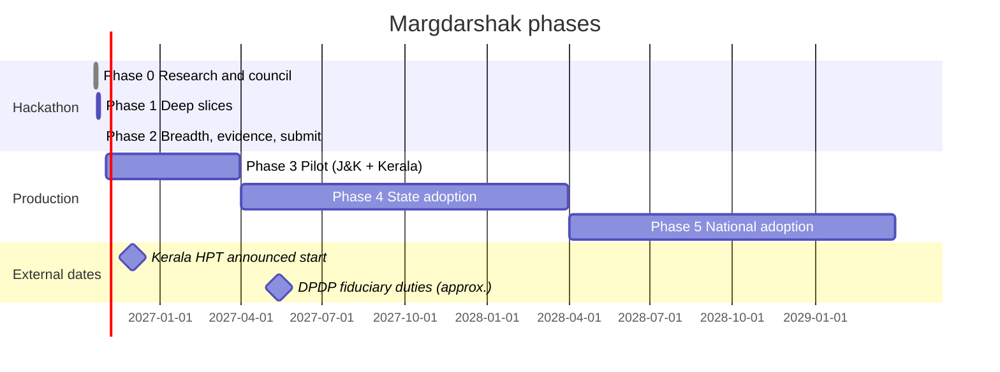

# Roadmap
> Project: Margdarshak · Owner: Product lead · Status: Draft v0.1 · Last updated: 2026-10-23
> Related: [PROJECT_BRIEF](../00-overview/PROJECT_BRIEF.md) · [PRD §5, §14](PRD.md) · [FEATURES](FEATURES.md) · [METRICS](METRICS.md) · [COMPETITIVE_ANALYSIS](COMPETITIVE_ANALYSIS.md) · [GTM](../07-business/GTM.md) · [Government adoption](../10-government/) · [07-govt-plug-and-play](../../../research/ps1-deep/07-govt-plug-and-play.md) · [03-lifecycle §C](../../../research/ps1-deep/03-lifecycle.md)

---

## 0. Shape of the roadmap

| Phase | Name | Window | Mode | One-line goal |
|---|---|---|---|---|
| **0** | Research and council | 20–23 Oct 2026 (before the confirmed start) | Desk + field prep, **no code, no participant data** | Know the problem, the law and the judges; lock the spec |
| **1** | Hackathon build: deep slices | Confirmed start → ~H30 | Build | Deep-A, Deep-B, Deep-C working; clip pipeline and field study first (D-03) |
| **2** | Hackathon build: breadth, evidence, submission | ~H30 → deadline | Build + field | Every stage works on mocks, no dead buttons; field numbers; video, deck, repo, live URL |
| **3** | Pilot | Nov 2026 – Mar 2027 | Production (pilot) | Real users in one J&K district + Kerala schools; first government conversations |
| **4** | State adoption | Apr 2027 – Mar 2028 | Production (state) | One state hosts Margdarshak with at least one real adapter |
| **5** | National adoption | Apr 2028 onward | Production (multi-state) | A reference front end MoRTH/NIC can offer every state; a card inside mParivahan/UMANG |

**Hackathon build = Phase 1–2. Production = Phase 3+.** The two are kept separate in every table below.

Dates for Phases 1–2 depend on the **disputed start time** (Fri 00:00 vs Fri 21:30 IST) and deadline (Sat 23:59 vs Sun 21:30); see PRD Q-01. No commits or participant data before the confirmed start (PROJECT_BRIEF §14, R-14).

---

## Phase 0 · Research and council (done, 20–23 Oct 2026)

| Output | Where |
|---|---|
| Organiser, sponsor, judge and competition recon | `research/A–G` |
| Current journey: 82 Sarathi pages across 5 states, rules and fees, 111 user quotes | `research/ps1-current-state/` |
| Deep dives: abroad, accident curriculum, lifecycle, AI/ADK, psychology, design language, government plug-and-play, games/AI/n8n | `research/ps1-deep/01–08` |
| Council pick (Nazar, 22 Oct) → product lock (Khud) → **Margdarshak** verification (25 directives, 23 Oct) | `war-room/` |
| Field kit: recruitment, consent, filming, HYPOTHESES draft, journey test protocol | `field-kit/NAZAR-FIELD-KIT.md` |
| Project brief and this bible | `margdarshak/docs/` |

**Exit:** PROJECT_BRIEF v1.0 locked; 25 directives accepted; recruitment messages sent; raters and filming lined up. ✅

---

## Phase 1 · Hackathon build: deep slices (confirmed start → ~H30)

**Order matters (D-03):** clip pipeline and field study first, then the journey slices.

| Milestone | ID | Exit criterion | Owner |
|---|---|---|---|
| Repo + CI skeleton, HYPOTHESES.md committed after the confirmed start, before any data | MS-1.1 | Commit hash recorded for the slide | PL |
| Clips filmed (passenger or mount only), ≥ 12 usable after blur by **Fri 12:00** (else backup trigger: 6 clips) | MS-1.2 | Clip count + blur audit log | B |
| Clip-ingest Render Workflow: transcode → blur → propose → two raters → agreement → publish, with a visible retry | MS-1.3 | Run page screenshot with retry | B, TL |
| Rule packs `fees.json`, `rules/JK.json`, `rules/KL.json` with source/verified_on/confidence; API-01–03, API-13 | MS-1.4 | Plan card for 6 fixture personas incl. EC-01..EC-06 | A |
| **Deep-A**: plan → blockers → 6-screen guided LL → photo fixer → check answers → copy-pack | MS-1.5 | e2e green; ≤ 6 screens; no Aadhaar/OTP fields | A, C |
| **Deep-B**: Nazar mock + learn, server replay, AI debrief + validator + template, 4 deep games, LL simulator; evals ≥ 30 cases | MS-1.6 | `adk eval` 0 invented numbers; replay overwrites tampered scores | B, TL |
| **Deep-C**: stage-aware home with persona switcher, case clock (journey sweeper Workflow + n8n Schedule), WhatsApp test number + email via the backend notifier, age gate, consent, analytics schema, adapters + contract tests | MS-1.7 | Day-25 message delivered to a test phone from a scheduled run | TL, C |
| Nazar field study opens (Fri 19:00 link drop per field kit) | MS-1.8 | First 10 consented sessions | B |

**Kill/shrink rules:** < 12 clips by Fri 12:00 → 6-clip mock, journey test carries the evidence. Voice guide never on the critical demo path; pre-recorded fallback.

---

## Phase 2 · Hackathon build: breadth, evidence, submission (~H30 → deadline)

| Milestone | ID | Exit criterion | Owner |
|---|---|---|---|
| Thin breadth for S5–S9 and Eco (F-10–F-17, F-31–F-33, F-40–F-42, F-58) | MS-2.1 | Zero-dead-button crawl passes | C, A |
| Journey test, 5–8 participants (Sat), counterbalanced | MS-2.2 | `journey_sessions.csv` complete | C |
| Nazar study n ≥ 40; data freeze **Sat 24 Oct 18:00 IST**; `nazar_stats.py` run | MS-2.3 | H1–H4 results with CIs; API-71 live | B |
| Lite < 300 KB, axe 0 serious/critical, TalkBack pass on Deep-A | MS-2.4 | CI budget + manual log | C |
| p95 numbers captured; instance pre-warmed; README "Render Singapore, synthetic data" | MS-2.5 | Perf table in the deck | TL |
| Video ≤ 5 min (Nazar hook → plan card → journey → evidence → closing QR "take the 3-minute test"), deck, repo, live URL submitted | MS-2.6 | Submission receipt | PL |
| Re-verify before stage: Kerala HPT status, Rah-Veer/cashless amounts, transport LMV-prerequisite, Aadhaar 2025 rule text, GIGW 5.3.1 primary text, trademark (D-25) | MS-2.7 | Checklist with dates | PL |

**Release R0 criteria:** see [PRD §14](PRD.md#14-release-criteria).

---

## Phase 3 · Pilot (Nov 2026 – Mar 2027)

### 3.1 30 / 60 / 90 days after the event
| Window | Focus | Milestones |
|---|---|---|
| **Day 0–30 (Nov 2026)** | Legal and platform hardening; first real users | MS-3.1 Gemini **paid tier** for every real user (D-13); MS-3.2 DPIA + privacy notice "built to DPDP Rules"; grievance officer named; MS-3.3 India copy of logs (CERT-In 180 days); NTP to NIC/NPL; MS-3.4 WhatsApp Business templates submitted and approved; MS-3.5 IP India trademark search for "Margdarshak" (Q-09); MS-3.6 DigiLocker requester onboarding started through @Nestiq Private Limited (NeGD Partner SOP: org email domain, authorised representative, verification); MS-3.7 publish the adapter OpenAPI and contract tests (Apache-2.0) |
| **Day 31–60 (Dec 2026)** | **Kerala HPT goes live (announced 1 Dec)**; J&K forward deployment | MS-3.8 Kerala school beta: 5 schools on Pro trial, HPT logs exported (EC-28 flag ready); MS-3.9 3–5 days forward-deployed at ARTO Jammu ([07 §C2](../../../research/ps1-deep/07-govt-plug-and-play.md)): observed process map, top 10 failure modes with counts; MS-3.10 Live Intel with real reports, moderation SLA ≤ 24 h |
| **Day 61–90 (Jan 2027)** | Evidence and government conversations | MS-3.11 Pilot cohort ≥ 500 adult learners in Jammu district; MS-3.12 first AFL counts; MS-3.13 console beta reviewed by the pilot ARTO; MS-3.14 written proposal to J&K Transport Department and Kerala MVD |

### 3.2 Months 4–5 (Feb–Mar 2027)
- MS-3.15 Night & Glare and Hill Road (J&K) games shipped; Road Sign Snap (18+).
- MS-3.16 External VAPT scoped; OWASP ASVS L2 self-assessment complete; SBOM published.
- MS-3.17 Pilot report: AFL, IM-1..IM-11, Nazar decay with/without refreshers, school Pro conversion.

### 3.3 Pilots
| Pilot | Partner | Scope | What we ask for | What we give | Success criteria | Status |
|---|---|---|---|---|---|---|
| **PI-1 J&K district pilot** | J&K Transport Department; ARTO Jammu (first), then RTO Jammu | Citizen app for Jammu district; Hindi/English + Dogri voice; ARTO counter QR; console beta | Permission to put a QR at the counter; 1 officer as reviewer; confirmation of track type, documents, PSGA timelines; rule-pack sign-off | Free use; stall-point and fail-reason views; rule-pack studio; counter-query deflection report | ≥ 500 adult learners; ≥ 200 AFL by Mar 2027 [hypothesis]; officer-rated usefulness ≥ 4/5 | Not yet approached; proposal Jan 2027 (owner PL) |
| **PI-2 Kerala HPT schools** | 5–10 driving schools in one Kerala district; owners' associations as channel | Nazar open-source core + school Pro: HPT logs, readiness, referrals | Students, feedback, inspection feedback | Free Pro for 3 months; open-source hazard tool (matches "open-source computer-based tools" in the circular as reported) | ≥ 5 schools active; ≥ 1 RTO inspection accepts the export [target]; ≥ 10% convert to paid | Interviews by 2026-11-15 (owner PL) |
| **PI-3 Kerala MVD content partnership** | Kerala Motor Vehicles Department | Offer the CC-BY clip bank, Kerala-format practice and difficulty data | Feedback on format; permission to describe practice as aligned with the announced format | Clips, calibration data, school tool | MVD acknowledges or references the tool [aspirational] | After PI-2 traction (owner PL) |
| **PI-4 CSC helpers** | CSC operators in Jammu (CSCs run LL tests in J&K per [02-rules-process](../../../research/ps1-current-state/02-rules-process.md)) | Helper mode with consent; shared-device mode | 5 operators testing for 4 weeks | Faster, correct applications; consent records | Time per customer down; zero data left on PCs (audit) | Recruit Dec 2026 (owner C) |
| **PI-5 College cohort** | GCET Jammu and 2 other colleges | Learners 18–24; squads; field-study replication | Distribution via student bodies | Free; research collaboration (pre-registered) | Replicate H1–H3 with n ≥ 200 | Ask after the event (owner B) |

### 3.4 Phase 3 exit (release R1)
See [PRD §14 R1](PRD.md#r1-pilot-phase-3-exit). Kill criteria: if by Mar 2027 plan → start < 20% **and** "would still pay an agent" doesn't fall in the pilot exit survey, revisit the journey frame and narrow to Nazar + schools.

---

## Phase 4 · State adoption (Apr 2027 – Mar 2028)

| Milestone | ID | Exit criterion |
|---|---|---|
| MoU with one State Transport Department (J&K or Kerala) covering data-processor terms under DPDP, Sarathi as system of record, rule-pack sign-off and hosting | MS-4.1 | Signed MoU |
| DPDP fiduciary duties in force (about **13 May 2027**, [verification G7](../../../war-room/margdarshak-verification.md)): verifiable parental consent flow designed (or minors stay rules-only) | MS-4.2 | DPIA v2; consent flows reviewed |
| Hosting on NIC cloud or a MeitY-empanelled Indian cloud; `JobRunner` second implementation replacing Render Workflows where required | MS-4.3 | Production in India; RPO ≤ 15 min, RTO ≤ 4 h |
| Security audit by NIC/STQC/CERT-In-empanelled auditor; safe-to-host certificate (GIGW 3.0 guideline 5.3.1, SECONDARY) | MS-4.4 | Certificate issued ("audit-ready" until then) |
| First **real adapter** passing the contract suite in the state's environment: DigiLocker requester (DRVLC pull with consent) first; Sarathi read/status via NIC MoU second | MS-4.5 | `adapter_mode.digilocker = real` in production |
| Mode B hand-off (F-07) for LL application in the adopting state | MS-4.6 | `ff_sarathi_mode_b` on for the tenant |
| Bhashini onboarding for state languages (Malayalam for Kerala; Kashmiri/Urdu for J&K as reviewed translations) | MS-4.7 | 100% reviewed key coverage per language |
| TRAI DLT registration; SMS channel enabled | MS-4.8 | `ff_sms_channel = on` |
| Listing under the state's account (Play Store / UMANG card), with the state's own branding under its hosting | MS-4.9 | Published listing |
| Console on adapter data: slot utilisation, examiner variance flags (pseudonymous, audit roles only) | MS-4.10 | Console reviewed by the Transport Commissioner's office |

**Commercial model (D-23):** a government licence for the front end and adapter layer; driving-school Pro as the first private buyer; free citizen app. Procurement route via GeM or tender is [unverified: HUNCH in verification G14; owner PL; confirm with the state by Phase 4 start].

**Phase 4 exit (release R2):** see [PRD §14 R2](PRD.md#r2-state-adoption-phase-4-exit).

---

## Phase 5 · National adoption (Apr 2028 onward)

| Milestone | ID | Description |
|---|---|---|
| Reference front end offered by MoRTH/NIC to states | MS-5.1 | Margdarshak as an open, Apache-2.0 reference citizen front end + adapter spec that NIC can host for any state |
| Card inside mParivahan/UMANG | MS-5.2 | The RaktKhoj pattern ([G-inspiration-library §1.4](../../../research/G-inspiration-library.md)): upgrade an existing government asset from inside it rather than replace it |
| Multi-state rule packs | MS-5.3 | ≥ 10 state packs maintained by states through the studio, with public changelogs |
| Open hazard-clip bank as a digital public good | MS-5.4 | CC-BY 4.0 Indian clip bank with fitted difficulty per clip, used by states that adopt an HPT |
| National evidence | MS-5.5 | Pre-registered multi-state study of hazard-skill uplift and AFL; independent academic partner |
| Novice-year programme | MS-5.6 | Voluntary pledge + refreshers offered by states to new licence holders |
| Insurer line (single roadmap item) | MS-5.7 | Only if validated: a non-gaming benefit tied to training completion, never to a game result (Online Gaming Act 2025) |

---

## 6. Partnerships map

| Partner type | Who | Phase | Why they care | What we need from them |
|---|---|---|---|---|
| State government | J&K Transport Department; Transport Commissioner J&K | 3–4 | PSGA timeline push (Kashmir Reader, Aug 2025); fewer counter queries; tout reduction | Pilot permission, rule sign-off, adapter access |
| State government | Kerala Motor Vehicles Department | 3–4 | HPT from 1 Dec 2026; school inspections since 1 Oct 2026 | Format feedback, school channel |
| Central | MoRTH, NIC | 4–5 | Sarathi owner; private data sharing stopped 1 Oct 2026, so a front end that runs inside NIC fits | Hosting, Sarathi adapter |
| Central | NeGD (DigiLocker), API Setu | 3–4 | Requester onboarding | Client ID, scopes (DRVLC) |
| Central | Bhashini (MeitY) | 4 | Government-preferred speech/translation | Onboarding, quotas |
| Ecosystem | Driving schools and associations (Kerala first) | 3+ | Compliance tool, leads, pass rates | Students, feedback, payment (Pro) |
| Ecosystem | ADTCs, IDTRs (incl. Maruti-run IDTRs) | 4 | Curriculum tools, rehearsal | Listing, curriculum mapping |
| Ecosystem | CSC operators | 3+ | Correct, faster applications | Helper-mode testing |
| Academia | GCET Jammu and partner colleges | 3+ | Research, student distribution | Ethics review, cohorts |
| Sponsors | Render, n8n | 1–3 | Workflows showcase; n8n for schedules and staff operations | Credits, technical support |

---

## 7. Milestone summary (one table)

| Date (target) | Milestone | Phase |
|---|---|---|
| Confirmed start | HYPOTHESES.md committed; repo created | 1 |
| Fri 23 Oct 2026, 12:00 | ≥ 12 blurred clips or backup trigger | 1 |
| ~H30 | Deep-A, Deep-B, Deep-C green | 1 |
| Sat 24 Oct 2026, 18:00 | Field data freeze | 2 |
| Deadline (Q-01) | Submission: repo, URL, video, deck | 2 |
| 2026-11-15 | Kerala school interviews; ₹ price validation | 3 |
| 2026-11-30 | Paid Gemini, DPIA, templates approved, trademark search | 3 |
| 2026-12-01 | Kerala HPT announced start; school beta live | 3 |
| Dec 2026 | ARTO Jammu forward deployment | 3 |
| Jan 2027 | Proposals to J&K Transport and Kerala MVD | 3 |
| Mar 2027 | Pilot report; R1 exit | 3 |
| ~13 May 2027 | DPDP fiduciary duties in force | 4 |
| Q3 2027 | MoU; India hosting; first real adapter | 4 |
| Q1 2028 | Safe-to-host certificate; Mode B live; R2 exit | 4 |
| 2028+ | Reference front end via NIC; mParivahan/UMANG card | 5 |

## 8. Risks to the roadmap (linked to RISK_REGISTER)
| Risk | Phase | Mitigation |
|---|---|---|
| R-10 Kerala HPT stayed | 3 | `kl_hpt_status`; copy switches to "hazard practice"; school value stays (practice logs) |
| R-13 Gemini terms (18+, "likely accessed by" minors) | 3 | Paid tier; server AI gate; legal review of Vertex AI enterprise terms for production |
| R-09 Wrong rule or fee shown | 3–5 | Maker-checker, freshness checks, public changelog, "verify at your RTO" |
| R-02 Seen as another Parivahan redesign | 1–3 | Lead with Nazar evidence and the school buyer; adapter spec as the government story |
| Government access never opens | 4 | Mode A works without integration; DigiLocker is the one verified private-reachable path ([07 TL;DR](../../../research/ps1-deep/07-govt-plug-and-play.md)) |
| Procurement takes longer than a year | 4–5 | School revenue and grants carry the team; open-source keeps the option alive |
