# User Journeys
> Project: Margdarshak · Owner: Product lead · Status: Draft v0.1 · Last updated: 2026-10-23
> Related: [PERSONAS](PERSONAS.md) · [PRD](PRD.md) · [USER_STORIES](USER_STORIES.md) · [FEATURES](FEATURES.md) · [METRICS](METRICS.md) · [00-JOURNEY-MAP](../../../research/ps1-current-state/00-JOURNEY-MAP.md) · [03-user-pain](../../../research/ps1-current-state/03-user-pain.md) · [05-psychology §4](../../../research/ps1-deep/05-psychology.md)

---

## 0. How to read this file

- **Stages** (PROJECT_BRIEF §5): S0 Home · S1 Licence plan · S2 Apply for LL · S3 LL test · S4 30-day bridge · S5 Book DL test · S6 Driving test · S6F Fail and recover · S7 Licence issued · S8 New-rider year · S9 Renew / fix / family.
- For each persona: a **current-state** journey (what happens today, with evidence) and a **future-state** journey (with Margdarshak), each as a **Mermaid flowchart** and a **Mermaid `journey` emotional curve** (score 1 = distress, 5 = confident and calm), followed by a stage table and the **moments of truth** (MoT: the points where the user decides whether to trust us, an agent, or quit).
- Current-state facts carry their quote numbers (**Q#**, from `03-user-pain.md`) or file references. Future-state steps carry feature and story IDs.
- **Emotional design rule** ([05 §4](../../../research/ps1-deep/05-psychology.md)): lower fear of the *process* (research, LL form/test, slot and test day) and raise humility about the *road* (30-day wait, skill rising, pass, first months). Today the system does the reverse.
- What we cannot change (Sarathi steps, slot supply, examiner behaviour) stays in the future state, marked **(Sarathi)** or **(RTO)**. Margdarshak makes those steps predictable; it does not pretend to remove them (D-02, D-07, D-08).

### 0.1 The shared current-state spine (all applicants)
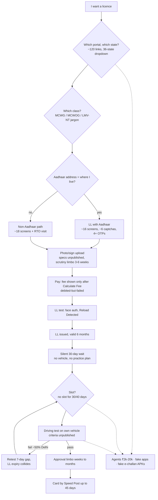
Source: [00-JOURNEY-MAP §1](../../../research/ps1-current-state/00-JOURNEY-MAP.md).

### 0.2 The shared future-state spine
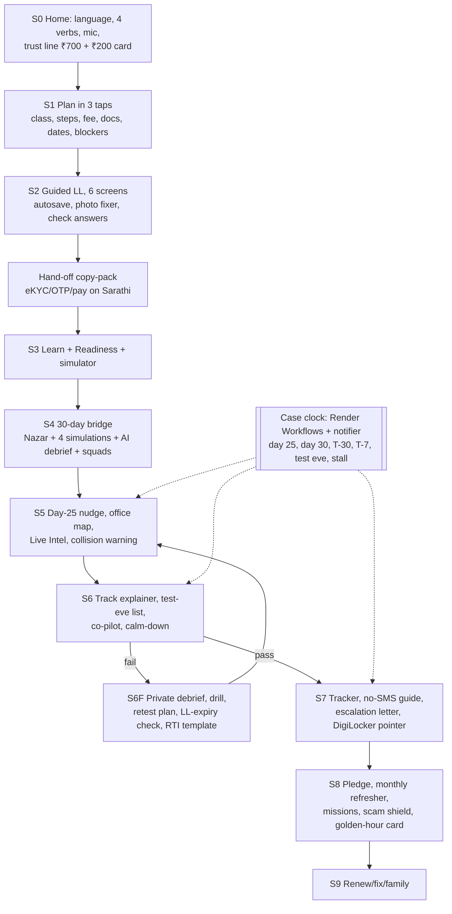

---

## P-01 Kabir

### Current state
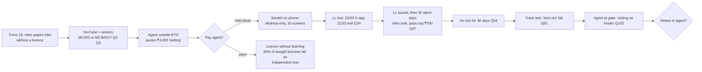
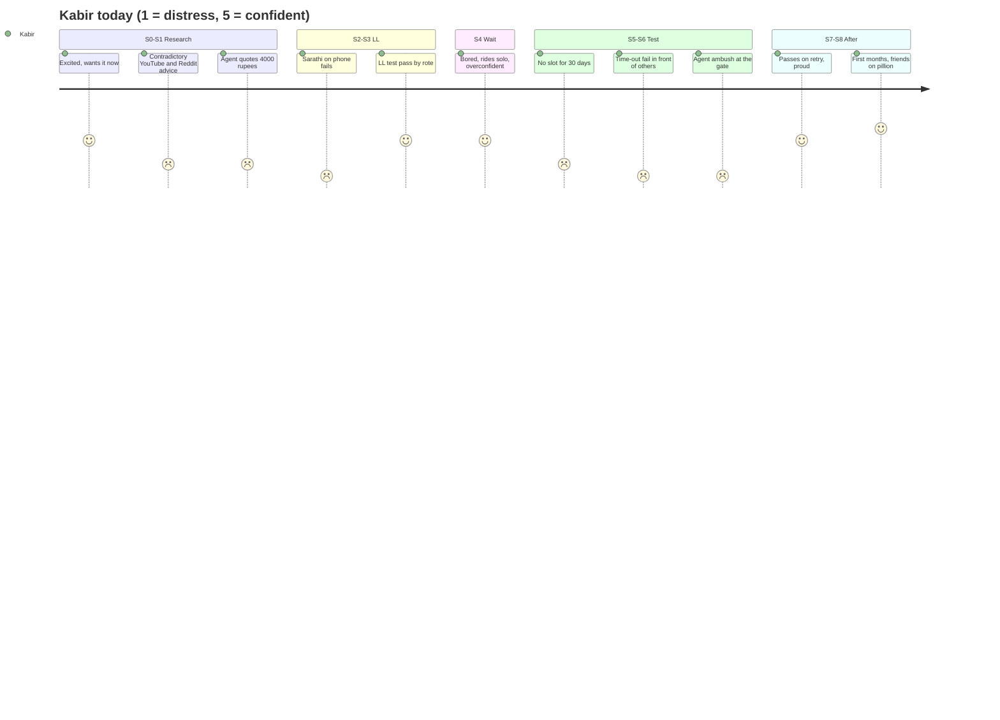
*Note the inversion:* confidence is highest in S4 and S8, exactly when road risk is highest (crash/near-crash ~8× in the first 3 months, [05 Ψ2](../../../research/ps1-deep/05-psychology.md)); distress is highest at process steps.

### Future state
```mermaid
flowchart LR
  a[Home in Hinglish/Hindi<br/>F-01] --> b[Plan in 3 taps: MCWG,<br/>₹700 + ₹200 card, 31 days F-02]
  b --> c[Adds car: one LL,<br/>+₹450 F-03 US-015]
  c --> d[Guided 6 screens + photo fix<br/>F-05 F-06]
  d --> e[Copy-pack to Sarathi<br/>eKYC/OTP/pay there F-07]
  e --> f[Readiness 62 → 86<br/>knowledge − calibration F-21]
  f --> g[LL issued: countdown,<br/>legal-practice card F-08]
  g --> h[Nazar: 1.4 s late ≈ 16 m<br/>F-23 F-25]
  h --> i[Squad co-op + share card<br/>F-26]
  i --> j[Day 25 WhatsApp: book now<br/>F-09]
  j --> k[Track explainer + test-eve list<br/>F-12]
  k --> l{Result}
  l -- pass --> m[Khud Licence self-declared<br/>F-26 US-185]
  l -- fail --> n[Private debrief + retest plan<br/>F-13]
  n --> j
  m --> o[Pledge + monthly refresher<br/>F-15]
```
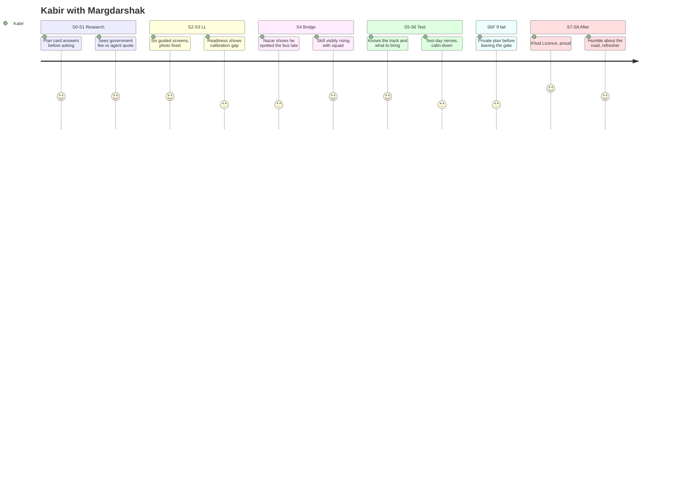

### Stage table
| Stage | Today (evidence) | With Margdarshak | Features / stories |
|---|---|---|---|
| S0 | ~120 links; opens a desktop-only page on his phone | Four verbs, Hinglish/Hindi, trust line | F-01 · US-001–US-003 |
| S1 | "every guy applies for with gear option" (Q4) | Picture → class; class planner; "Show papa" card | F-02, F-03 · US-010–US-015, US-025 |
| S2 | 16 screens, captchas, OTPs | 6 guided screens, autosave, copy-pack | F-05–F-07 · US-030–US-035 |
| S3 | Rote bank; app 20/20, real 11/20 (Q34) | Variants, FSRS, confidence, simulator in J&K format | F-20–F-22 · US-050–US-057 |
| S4 | Silence; solo riding (Q47) | Day plan, Nazar, 4 simulations, debrief, squads | F-23–F-26 · US-070–US-086, US-120–US-129 |
| S5 | "No slot for 30 days… koi jugaad hai?" (Q54) | Day-25 nudge, office map, collision warning, Live Intel | F-09–F-11 · US-140–US-149 |
| S6 | "apka time out hogya" (Q61) | Track explainer, Track Twin, co-pilot | F-12, F-24 · US-081, US-160–US-164 |
| S6F | 3 fails (Q76); agent at the gate (Q102) | Private debrief, drill, retest plan, RTI template | F-13 · US-167–US-171 |
| S7 | Passed, no SMS (Q82) | Tracker, no-SMS guide, letter | F-14 · US-180–US-184 |
| S8 | Highest-risk months, no follow-up | Pledge, refresher, missions, riding lock | F-15 · US-190–US-197 |
| S9 | Car class later = whole cycle again | "Add a class" case type | F-16 · US-202 |

### Moments of truth
| MoT | Stage | What decides it | Our design | Failure signal |
|---|---|---|---|---|
| MoT-K1 "Is this legit?" | S0 | Calm, verifiable, not pretending to be government | Non-affiliation notice, sourced fee line, no APK | Bounce within 10 s on home |
| MoT-K2 Agent vs khud | S1 | Certainty about class, cost and dates for *his* case | Plan card with sources; government fee vs his agent quote | "Would still pay an agent" stays yes (J4) |
| MoT-K3 "Does practice transfer?" | S3 | Mock ≈ real format; explanations | Format from config with source; variants | Q34-type review; drop after first real LL test |
| MoT-K4 The late-tap reveal | S4 | Seeing "1.4 s late ≈ 16 m" without being lectured | Code-computed facts; no gore; replay band | Session abandonment after first mock |
| MoT-K5 The gate after a fail | S6F | A plan exists before he walks out | Private debrief + retest plan on the same screen | Agent purchase self-reported |
| MoT-K6 Pass | S7 | Pride he can claim honestly | Khud badge (self-declared), share card | Badge claimed with agent use (honour-framed) |

### Edge cases on this journey
EC-07 (LL expiry vs slot), EC-08 (repeat fails), EC-15 (clock tampering for "unlock"), EC-18 (spam taps), EC-20 (types OTP into the voice guide), EC-21 (car class at 19), EC-22 (joins with an LL already).

---

## P-02 Tanvi

### Current state
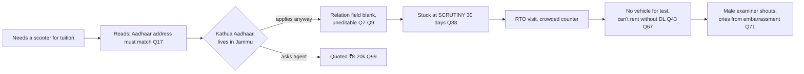
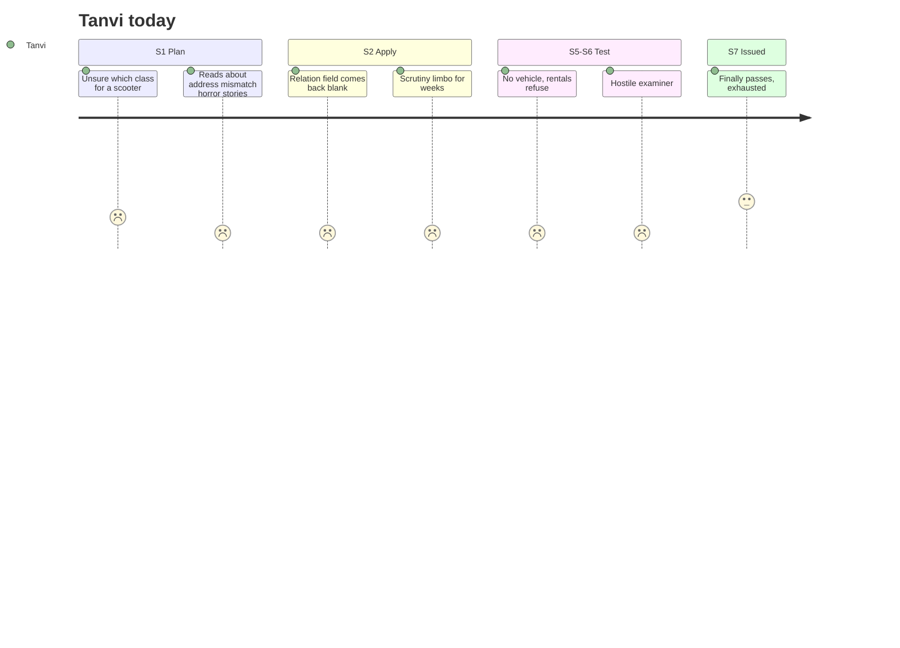

### Future state
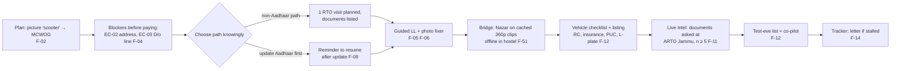
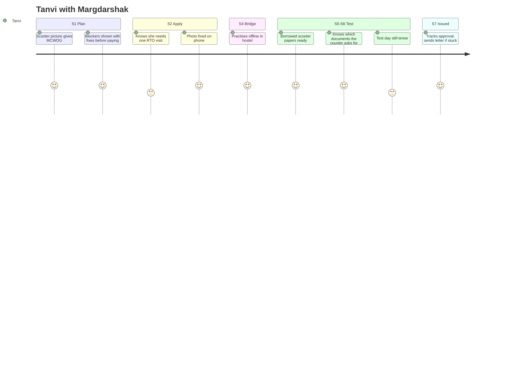

### Stage table
| Stage | Today | With Margdarshak | Features / stories |
|---|---|---|---|
| S1 | "what licence should I get???" (Q2); migrant agent quotes ₹8–20k (Q99) | Picture class; EC-02/EC-03 rule rows with trade-offs | F-02, F-04 · US-011, US-017, US-018 |
| S2 | Blank relation field (Q7–Q9); scrutiny 30 days (Q88) | Chosen path; check answers; copy-pack; outage-safe drafts | F-05, F-07 · US-030–US-038 |
| S4 | Can't rent to practise (Q43) | Offline Nazar; legal-practice card; school listing | F-23, F-51, F-40 · US-070, US-293 |
| S5 | Unknown counter requirements | Live Intel (k ≥ 5, no names) | F-11 · US-145 |
| S6 | No scooter; rental expensive (Q67); hostile examiner (Q71) | Vehicle checklist + listing; rights card; calm-down; grievance routes | F-12, F-04 · US-163, US-164, US-023 |
| S7 | "pending from the RTO side" (Q83) | Tracker; facts-only letter she approves | F-14 · US-180–US-182 |
| S9 | Address change later = scrutiny again | Address-change guide | F-16 · US-203 |

### Moments of truth
| MoT | Stage | Design | Failure signal |
|---|---|---|---|
| MoT-T1 "Will my Aadhaar block me?" | S1 | Honest options with confidence; "ask at the counter" when J&K behaviour is unknown | She abandons at the blocker row |
| MoT-T2 Payment | S2 | Check answers before Sarathi; payment-pending guide | Payment-pending reported without follow-through |
| MoT-T3 Vehicle | S6 | Checklist + listing without prices or bookings | Test postponed for "no vehicle" |
| MoT-T4 Dignity at the RTO | S6 | Co-pilot, rights card, grievance links | Reports of humiliation in exit survey |

### Edge cases on this journey
EC-02, EC-03, EC-09, EC-11, EC-13 (if applicable), EC-19, EC-23, EC-24, EC-26 (deletes account after passing).

---

## P-03 Mohan-ji

### Current state
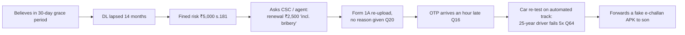
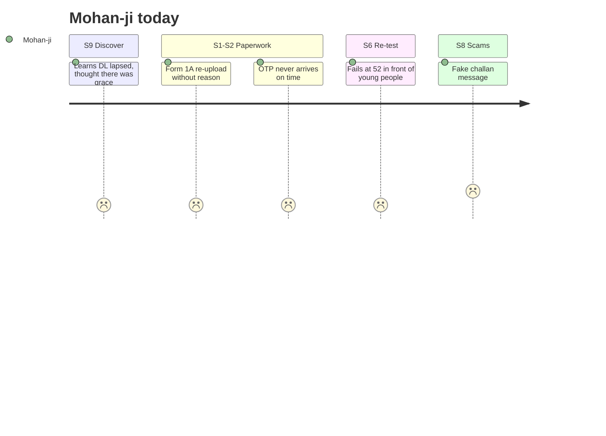

### Future state
```mermaid
flowchart LR
  a[Kabir adds Papa in family mode<br/>F-17 US-205] --> b[Voice in Hindi/Dogri:<br/>'renew my licence' F-30]
  b --> c[Rule row: >1 year late →<br/>test again; Form 1A at 40+ F-16 F-04]
  c --> d[Implementation intention:<br/>doctor on Tue 10 am]
  d --> e[Helper fills, Papa approves<br/>consent recorded F-17]
  e --> f[Copy-pack to Sarathi renewal F-07]
  f --> g[Track Twin + explainer:<br/>layout familiarisation F-24 F-12]
  g --> h[Test-eve list with big text F-12]
  h --> i[Scam checker: APK → do not open<br/>F-33]
  i --> j[Renewal reminders T-365/T-60/T-7<br/>F-16]
```
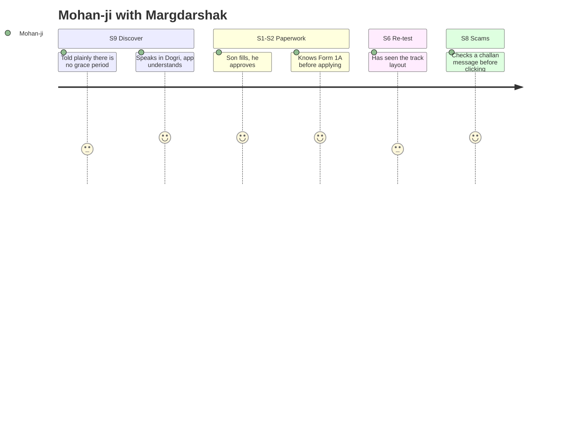

### Stage table
| Stage | Today | With Margdarshak | Features / stories |
|---|---|---|---|
| S9 | Grace-period myth; lapsed DL | No-grace rule row; retest if > 1 year; reminders | F-16 · US-200, US-201 |
| S1 | Form 1A found late (Q20) | Form 1A blocker at plan time | F-04 · US-019 |
| S2 | OTP delays (Q16); can't do "the online" | Helper/family mode with consent; voice guide | F-17, F-30 · US-040, US-104, US-205 |
| S6 | Experienced drivers fail tracks (Q64) | Track Twin; explainer; co-pilot | F-24, F-12 · US-081, US-160–US-162 |
| S8 | APK scams (~570 Kerala cases) | Rules-decided scam checker | F-33 · US-111, US-194 |

### Moments of truth
| MoT | Stage | Design | Failure signal |
|---|---|---|---|
| MoT-M1 The "you need a test again" news | S9 | Plain words, source chip, no blame | He calls the agent instead (self-reported) |
| MoT-M2 Voice understands him | S0/S9 | Dogri voice-in, Hindi response, rule chips | Voice abandoned after one try |
| MoT-M3 The scam message | S8 | Rules verdict, never "safe" | Clicks an APK link (reported) |
| MoT-M4 Approving his son's help | S2 | One-tap consent with plain scope and duration | Refuses consent; helper uses his phone directly |

### Edge cases on this journey
EC-04, EC-14, EC-16, EC-20, EC-25, EC-29 (voice falls back to taps).

---

## P-04 Helper

### Current state
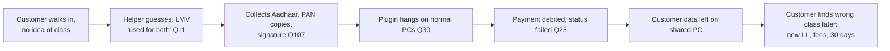
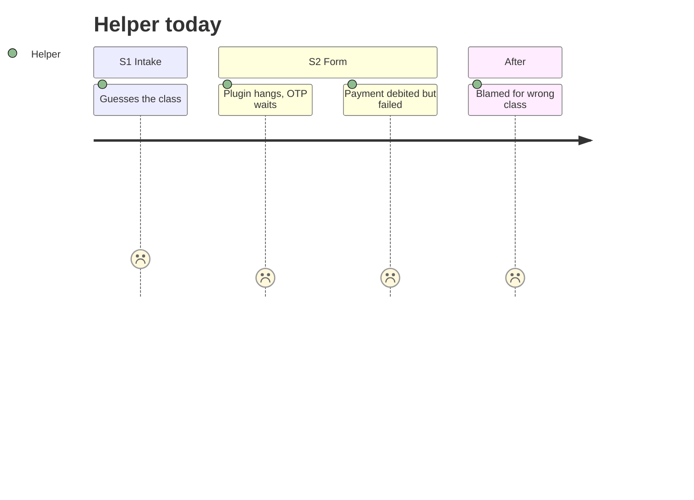

### Future state
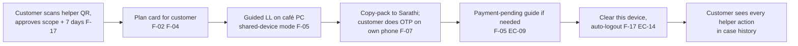
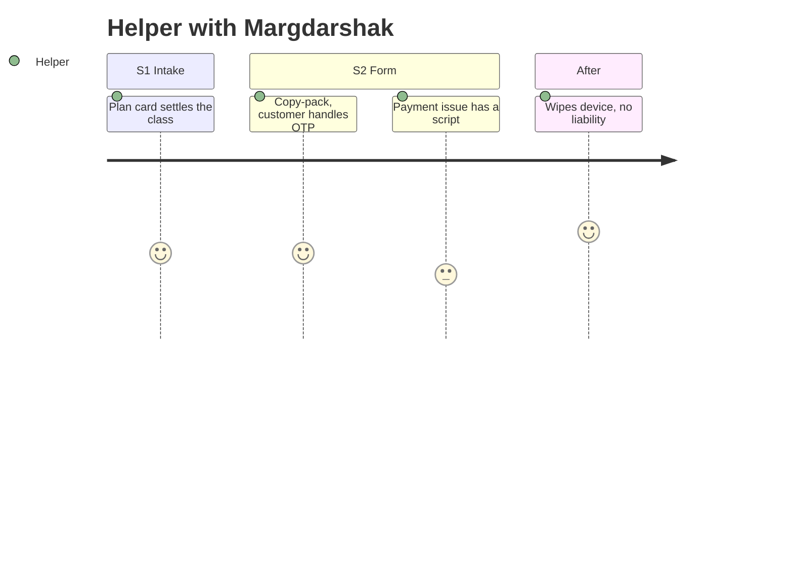

### Moments of truth
| MoT | Design | Failure signal |
|---|---|---|
| MoT-H1 Customer consent | QR + plain scope; revocable (EC-25) | Helper bypasses links and uses own account for customers (helper link count > 10 flags review) |
| MoT-H2 Speed | Copy-pack; one question per screen | Time per customer not lower than before (pilot interview) |
| MoT-H3 Clean exit | "Clear this device" | Data found after logout (security test) |

### Edge cases on this journey
EC-09, EC-11, EC-14, EC-20 (customer reads an OTP aloud near the voice guide), EC-25.

---

## P-05 Driving-school owner
The school owner's "journey" runs alongside the learner's stages S1–S6F. Stages below are the learner's.

### Current state
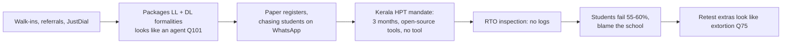
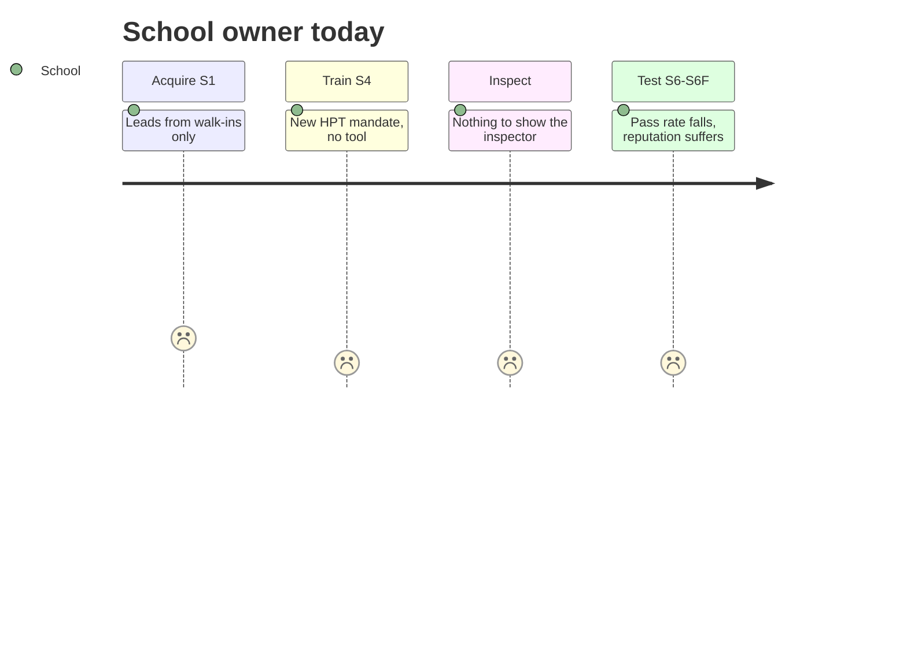

### Future state
```mermaid
flowchart LR
  a[Listing + lead routing<br/>accept on WhatsApp F-40 W7] --> b[Learner links to school,<br/>consents to share progress]
  b --> c[Pro dashboard: readiness parts,<br/>Nazar trend, weak modules]
  c --> d[Students do Nazar sessions;<br/>HPT log accrues F-23]
  d --> e[Export HPT log for inspection<br/>F-40 US-233]
  e --> f[Day-30 'ready to book' list]
  f --> g[Remedial referrals after fails<br/>F-13 US-237]
  g --> h[Practice sign-off into<br/>Practice Record F-28]
```
```mermaid
journey
  title School owner with Margdarshak
  section Acquire S1
    Leads from learners mid-journey: 4: School
  section Train S4
    Hazard practice tool ready: 4: School
  section Inspect
    Exports training log: 5: School
  section Test S6-S6F
    Knows who is ready, gets referrals: 4: School
```

### Moments of truth
| MoT | Design | Failure signal |
|---|---|---|
| MoT-S1 Inspection | Exportable log with honest header "not a government certification" | Inspector rejects format (pilot) |
| MoT-S2 Price | Free listing; Pro hypothesis ₹499–999/month [unverified] | No conversions after 30-day trial |
| MoT-S3 HPT stayed (EC-28) | Copy switches to "hazard practice"; logs stay useful | Churn after a stay |

### Edge cases on this journey
EC-08 (remedial referral), EC-25 (learner revokes sharing), EC-28.

---

## P-06 RTO officer / Transport Commissioner
The officer sees the learner journey in aggregate. Stages below are where officer work concentrates.

### Current state
```mermaid
flowchart LR
  a[S2 Counter queries:<br/>which class, which docs] --> b[S2 Scrutiny backlog<br/>3-6 weeks, escalations Q89]
  b --> c[S5 Slot caps,<br/>school hoarding Q56-Q57]
  c --> d[S6 High fail rates,<br/>retests clog slots]
  d --> e[S7 Approval stalls,<br/>'officer not available' Q83]
  e --> f[Touts, enforcement scandals,<br/>Navbharat 560 exams]
  f --> g[No view of where it breaks]
```
```mermaid
journey
  title RTO officer today
  section S2 Counter
    Same questions all day: 2: Officer
    Scrutiny backlog and complaints: 1: Officer
  section S5-S6 Tests
    Retests take capacity: 2: Officer
  section S7 Approval
    Escalations land on the desk: 1: Officer
  section Policy
    No data on where cases stall: 2: Officer
```

### Future state
```mermaid
flowchart LR
  a[Rule pack drafted, maker-checker<br/>approved F-42] --> b[Citizens arrive with right class,<br/>docs, Form 1A F-02 F-04]
  b --> c[Console: where it stalls,<br/>median days per stage F-41]
  c --> d[Fail reasons per office<br/>self-reported, k ≥ 5]
  d --> e[Demand forecast from cases<br/>reaching day 30]
  e --> f[Capacity or rule decision]
  f --> a
  g[Adapters: DigiLocker first,<br/>Sarathi read/status later F-56] -.-> c
```
```mermaid
journey
  title RTO officer with Margdarshak
  section S2 Counter
    Fewer wrong-class applications: 4: Officer
  section S5-S6 Tests
    Sees eligible-soon demand: 4: Officer
  section S7 Approval
    Stall points visible early: 4: Officer
  section Policy
    Publishes a rule once, every screen updates: 5: Officer
```

### Moments of truth
| MoT | Design | Failure signal |
|---|---|---|
| MoT-O1 "Is this claiming to be us?" | Non-affiliation footer, no emblem, honest mocks | Takedown request or warning letter |
| MoT-O2 "Can we audit and host it?" | Apache-2.0, containers, OpenAPI, audit-ready pack, India hosting path | Procurement stalls on security |
| MoT-O3 "Does it name my staff?" | No names; pseudonymous examiner variance only for audit roles | Union or staff objection |
| MoT-O4 First rule change | Maker-checker, impact preview, changelog | Citizens see stale rules after publish |

### Edge cases on this journey
EC-11 (outage banner reduces counter traffic), EC-24 (setting offers routed to ACB/CPGRAMS), EC-27 (rule change mid-case).

---

## P-07 Rahul (minor)

### Current state
```mermaid
flowchart LR
  a[17, wants to ride family Activa] --> b[Scans docs, pays, queues 30 min<br/>'we changed the age to 18' Q1]
  b --> c[Rides anyway]
  c --> d[s.199A risk for parents:<br/>3 years, ₹25,000, RC cancelled,<br/>no DL until 25]
```
```mermaid
journey
  title Rahul today
  section S1 Plan
    Spends effort on a class he cannot get: 1: Rahul
  section Riding
    Rides illegally, family exposed: 3: Rahul
```

### Future state
```mermaid
flowchart LR
  a[Plan without account:<br/>age 17 → ≤50 cc only F-02] --> b['Your Activa is above 50 cc'<br/>plain words EC-05]
  b --> c[18th-birthday plan date]
  c --> d[Static lessons offline,<br/>no telemetry F-20 F-51]
  d --> e[Parent card: s.199A facts,<br/>no shaming F-17 EC-17]
```
```mermaid
journey
  title Rahul with Margdarshak
  section S1 Plan
    Honest answer in one screen: 3: Rahul
    Knows the date he can apply: 4: Rahul
  section Prepare
    Learns signs and rules offline: 4: Rahul
```

### Moments of truth
| MoT | Design | Failure signal |
|---|---|---|
| MoT-R1 The "not yet" answer | Show what he *can* do and when | Rahul lies about DOB to reach adult features (honour + server checks; production DigiLocker verification) |
| MoT-R2 Parent conversation | Factual s.199A card | Parent shares the card (opt-in share) |

### Edge cases on this journey
EC-05, EC-17, EC-19.

---

## 9. Cross-persona moments of truth (ranked)

| Rank | Moment | Personas | Stage | Why it matters | Metric (see [METRICS](METRICS.md)) |
|---|---|---|---|---|---|
| 1 | The plan card (answer before you ask) | P-01, P-02, P-03, P-04, P-07 | S1 | Replaces the agent's first sale: certainty about class, cost, dates | `plan_viewed` → `application_started` conversion; J2 |
| 2 | The blocker row before paying | P-02, P-03 | S1–S2 | Avoids the most expensive failure (wrong path, scrutiny limbo) | Blockers caught per case; J2 blockers found |
| 3 | The late-tap reveal ("1.4 s late ≈ 16 m") | P-01 | S4 | The heart: humility about the road without fear imagery | Fresh-clip gain (H3); sessions per learner |
| 4 | The fail screen | P-01, P-03 | S6F | Where agents win today (Q102) | Retest booked within 14 days; agent self-report |
| 5 | The day-25 nudge | P-01, P-02 | S5 | Prevents LL-expiry collisions (R:47 expiry posts) | LL expiries prevented; on-time reminders |
| 6 | "Passed but nothing happened" | P-01, P-02 | S7 | Prevents ₹5,000 fines and agent "speed-ups" | Time-to-card; letters approved |
| 7 | First rule change in the studio | P-06 | Eco | Adoption proof | Time from approval to citizen screens ≤ 5 min |

## 10. Journey-level edge-case index
| Journey | Edge cases |
|---|---|
| P-01 Kabir | EC-07, EC-08, EC-15, EC-18, EC-20, EC-21, EC-22, EC-29, EC-30 |
| P-02 Tanvi | EC-02, EC-03, EC-09, EC-11, EC-13, EC-19, EC-23, EC-24, EC-26 |
| P-03 Mohan-ji | EC-01, EC-04, EC-14, EC-16, EC-20, EC-25, EC-29 |
| P-04 Helper | EC-09, EC-11, EC-14, EC-20, EC-25 |
| P-05 School | EC-08, EC-25, EC-28 |
| P-06 Officer | EC-11, EC-24, EC-27 |
| P-07 Rahul | EC-05, EC-17, EC-19 |
| Not persona-specific | EC-06 (transport under 20), EC-10 (no online LL test), EC-12 (moving/foreign/NRI/IDP) |
