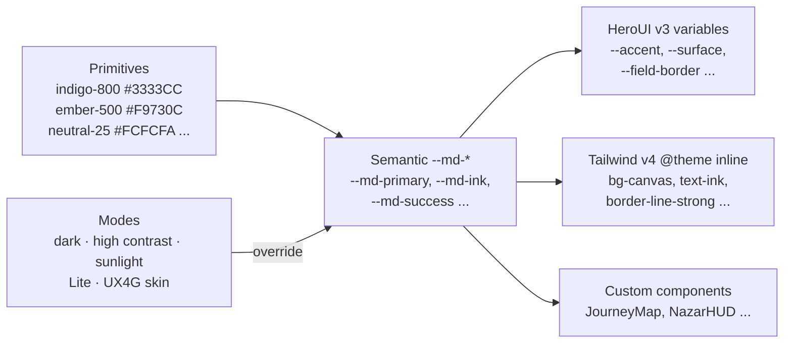

# Design System
> Project: Margdarshak · Team: Chanakya (@Nestiq Private Limited) · Owner: Design lead · Status: Draft v0.1 · Last updated: 2026-10-23
> Related: [Project brief](../00-overview/PROJECT_BRIEF.md) · [Accessibility](ACCESSIBILITY.md) · [Localization](LOCALIZATION.md) · [Content style](CONTENT_STYLE.md) · [UI spec](UI_SPEC.md) · [Frontend](../03-engineering/FRONTEND.md) · [Architecture](../03-engineering/ARCHITECTURE.md)
> Code: [`packages/ui/tokens.json`](../../packages/ui/tokens.json) (DTCG source of truth) · [`packages/ui/tokens.css`](../../packages/ui/tokens.css) (CSS variables + Tailwind v4 `@theme`) · [`scripts/check_contrast.py`](../../scripts/check_contrast.py) (computes every ratio quoted here; runs in CI)
> Inputs: `research/ps1-deep/06-design-language.md` (Sarvam CSS read, Vakyam source, Lexington, UX4G, GOV.UK, SGDS, Duolingo, Zutobi), `05-psychology.md`, `08-game-ai-n8n.md`, `war-room/margdarshak-verification.md` (D-01..D-25), Vakyam source at `G:\HACKATHON_PROJECTS\IQOO_VAKYAM\landing\src\styles\` (read-only), HeroUI v3.2.6 component list and theme variables (read 2026-10-23 via the HeroUI docs scripts).

---

## 0. What this document is

Margdarshak is a mobile-first PWA that turns India's licence journey (S0 Home → S9 Renew) into one guided road. Its UI must do three jobs at once:

1. **Calm a frightened applicant.** The fear is about the process and about shame, not the road (`05-psychology.md` §0, §1.6).
2. **Coach an overconfident rider.** The game layer rewards anticipation and calibration, never speed (D-11).
3. **Be adoptable by government.** Every token maps to UX4G 3.0, so a state can switch on the "UX4G skin" without redesigning anything (§13, F-58).

The design language is called **"Dawn on the highway."** It is a sibling of the team's Vakyam product, which already rebuilt Sarvam's editorial calm in open fonts. It uses:
- a warm off-white canvas;
- indigo as the working accent;
- ember, amber and periwinkle delivered as blurred light (the sunrise you drive towards);
- slate for the road.

| Layer | Hackathon build (Phase 1–2) | Production (Phase 3+) |
|---|---|---|
| Tokens | `tokens.json` + hand-written `tokens.css`; contrast CI | Style Dictionary 4 build → CSS, Tailwind preset, Flutter (UX4G Fluttercore) and Android XML from one source; npm `@margdarshak/tokens` |
| Components | HeroUI v3.2.6 + ~30 custom components in `packages/ui` | Storybook docs site (ZeroIndex-style IA), framework-agnostic web-component layer for state portals (SGDS lesson) |
| Themes | Light, dark, high contrast, Sunlight, Lite, UX4G skin | Per-tenant themes from `Tenant` (E-31) config, reviewed by the maker-checker in the rule-pack studio (F-42) |
| Motion | Motion (Framer) + 3 Rive files + 3 dotLottie files | Full Rive mascot set; motion audit in the STQC pre-audit pack |
| Figma | One library file mirroring tokens | Library rebuilt on the UX4G 3.0 Figma kit via Theme Craft 2.0 |

---

## 1. Design principles (Ive seat: "simplicity is the ultimate sophistication, but only after you understand the complexity")

| # | Principle | What it means on screen | How we test it |
|---|---|---|---|
| P1 | **Calm guide, not a portal** | One headline and one primary action per screen. Colour arrives as light. Hairlines before shadows. No marquee, no carousel, no auto-advancing banner (the government homepage's scrolling marquee fails WCAG 2.2.2: `team-saarthi-report.md` l.71) | Count of primary buttons per screen = 1 (Playwright assertion); no `animation-iteration-count: infinite` in reading views (stylelint) |
| P2 | **Show the whole road** | The user always sees the stage, the next step, the date and the fee (GOV.UK step-by-step). No "Proceed" without saying what happens next. | Every journey screen renders `JourneyMap` or `StageHeader` with stage + next step + date |
| P3 | **Your language, your script, from screen 0** | The language picker is the opening screen, each name in its own script. Layouts tolerate +40% text length and Nastaliq line heights. | Pseudo-locale `en-XA` (+40%) and `ur` RTL screenshots in CI; no clipped text |
| P4 | **Amber is "now", green is "done", red is "only for real danger"** | Vakyam's low-strain rule. Red never sells urgency; it appears only for real deadlines (LL expiry), errors and danger (golden hour). | Token lint: `--md-danger` allowed only in `ErrorSummary`, `FieldError`, `StatusBanner[tone=danger]`, `CaseClock[critical]`, `GoldenHourCard` |
| P5 | **Earned delight, never fear** | Game moments reward anticipation and accuracy. No gore, no scare banners, no fake timers, no loss-aversion nags. Fear appeals raised fear (r = .64) but did not change driving (r = .03), and death imagery made confident young men *more* willing to take risks (`05` §1.3). | Content lint bans (CONTENT_STYLE §8); illustration review checklist §7.6 |
| P6 | **Honest by construction** | Every rule shows `source` + `verified_on`. Simulated government steps carry a "Simulated" chip. AI surfaces say "AI can't book, pay or submit". Numbers come from code, never from a model (D-09, D-10). | `SourceChip` required prop on `RuleRow`; `SimulatedChip` required on all mock adapter screens |
| P7 | **Thumb, ear and 2G first** | 48 px targets, a bottom-reachable primary action, voice on every screen, Lite mode under 300 KB. Works on a ₹8,000 Android in an RTO yard in the sun. | Lighthouse CI on Moto G Power emulation; Sunlight mode check; Lite bundle budget gate |
| P8 | **Government-grade by default** | Tokens are UX4G-mapped. The target is WCAG 2.1 AA plus the 2.2 additions. No emblem, no "government" look-alike chrome, a non-affiliation footer everywhere (D-01). | `ACCESSIBILITY.md` test plan; branding lint (no emblem assets in repo) |

**Anti-principles (what we refuse):**
- a dashboard of 120 links;
- "Proceed" buttons with no outcome;
- red banners as a sales tactic;
- celebrations longer than 1.2 s;
- leaderboards ranked by speed;
- mascots on transaction screens;
- any screen that looks like a government site we are not.

---

## 2. Brand foundations

| Element | Rule |
|---|---|
| Name | **Margdarshak** (मार्गदर्शक). Always one word, capital M. Never "Saarthi" or "Sarathi" as our name (D-01). "Sarathi" appears only when referring to the government portal. |
| Tagline | *Learner se licence tak, bina agent ke.* (From learner's licence to licence, without an agent.) |
| Wordmark | Fraunces 600, `"SOFT" 50, "WONK" 0`, tracking −1%, in `--md-ink`. The Hindi lockup "मार्गदर्शक" is set in Tiro Devanagari Hindi. A small **dawn dot** (8 px circle, `--md-glow-dawn` at full opacity) sits above the "a" of "Marg" as the only brand mark. |
| App icon | A rounded square in `--md-road` with a dawn arc (ember → amber → periwinkle) rising over a 2-lane road vanishing point. **No** Ashoka emblem, tricolour ribbon, Parivahan logo or "gov" lettering (D-01, G10). |
| Mascot | **Diya**: a small lamp with headlights (§7.5). It appears only in Learn, game debriefs and empty states. |
| Non-affiliation | The footer on every page and the disclaimer on first launch use exactly the CONTENT_STYLE §5.1 strings (MC-001, MC-002). |
| Domain | The PWA domain must not contain "parivahan", "sarathi" or "gov" (G10). |

---

## 3. Colour

### 3.1 Architecture

- Components **never** reference primitives or raw hex. Stylelint rule `color-no-hex` applies in `apps/**` and `packages/ui/components/**`, and `declaration-property-value-allowed-list` allows `var(--md-*)` only.
- Every Margdarshak variable is prefixed `--md-*`. The reason: HeroUI v3 already owns `--surface`, `--success`, `--danger`, `--focus` and `--border`. Vakyam overwrote those names directly; we alias them instead (`tokens.css` §5), so a HeroUI upgrade cannot silently change our colours.

### 3.2 Light theme (default)
All ratios were **computed** by `scripts/check_contrast.py` (WCAG 2.x relative luminance), not estimated. The pass bars are 4.5:1 for text, and 3:1 for large text and UI boundaries. The IDs refer to `tokens.json` `$extensions.contrastPairs`.

| Token | Hex | Role | Computed ratio |
|---|---|---|---|
| `--md-bg` | `#FCFCFA` | Page canvas (warm off-white, never pure white) | — |
| `--md-surface` | `#FFFFFF` | Cards | — |
| `--md-surface-2` | `#F2F2EE` | Wells, inputs at rest, Readiness dial track | — |
| `--md-surface-3` | `#E9E9E4` | Pressed/selected rows | — |
| `--md-overlay` | `#FFFFFF` | Sheets, popovers, modals | — |
| `--md-scrim` | `rgb(20 20 20 / .48)` | Modal backdrop | — |
| `--md-ink` | `#1F1F1F` | Body and headings | **16.05** on bg (L-01) · 16.48 on surface · 14.69 on surface-2 · 13.53 on surface-3 |
| `--md-ink-2` | `#3D3D3D` | Secondary text | **10.57** (L-05) · 9.68 on surface-2 |
| `--md-ink-3` | `#666666` | Captions and meta, ≥ 14 px only, never instructions | **5.59** (L-07) · 5.74 surface · 5.12 surface-2 · **4.71** surface-3 (lowest legal pairing) |
| `--md-ink-disabled` | `#8C8C8C` | Disabled labels (exempt under 1.4.3; we still keep 3:1) | 3.27 (L-11) |
| `--md-primary` | `#3333CC` | Links, text actions | **8.22** (L-12) · 7.53 on surface-2 |
| `--md-primary-fill` / `--md-on-primary` | `#3333CC` / `#FFFFFF` | Primary button | **8.45** (L-14) |
| `--md-primary-fill-hover` | `#2B2BB3` | Hover (Margdarshak addition between Sarvam 800 and 900) | 10.00 (L-15) |
| `--md-primary-fill-pressed` | `#212191` | Pressed | 12.42 (L-16) |
| `--md-primary-soft` + `--md-primary-ink` | `#E8EFFC` + `#212191` | Selected chip, info banner, karaoke word highlight | **10.75** (L-17) |
| `--md-focus` | `#556ADC` | 3 px focus ring, 2 px offset | **4.56** vs bg · 4.69 vs surface (L-18/19); needs ≥ 3 |
| `--md-ember` | `#F9730C` | Glow, orb core, illustration | 2.73 ❌ → **decorative only** (DEC-01, expected fail) |
| `--md-ember-ink` | `#A5460F` | Ember-coloured text/icons | **5.87** (L-20) · 5.30 on `--md-ember-soft #FEEDE6` |
| `--md-amber` | `#FEB12B` | "Now" fill: current step dot, progress fill | 1.77 vs bg ❌ (DEC-02) → always under an ink label: ink on amber **9.06** (L-22) |
| `--md-amber-ring` | `#B07A12` | Ring around the current-step dot (UI) | 3.63 (L-23) |
| `--md-warning-ink` on `--md-warning-soft` | `#7A5210` on `#FFF8E6` | Caution banners (EC-07 LL expiry at T-30) | **6.52** (L-24) · left rule `#B07A12` 3.63 |
| `--md-success` | `#3D6B1C` | "Done" text/icons | **6.16** (L-27) · 5.85 on `#F2F8EB` · white on it 6.33 |
| `--md-danger` | `#A21913` | Errors, real danger, LL expiring ≤ 7 days | **7.61** (L-30) · 6.59 on `#FDE7E2` · white on it 7.82 |
| `--md-info` | `#4250D5` | Info icons and text | **6.12** (L-34) · 5.62 on `#EEF2FD` |
| `--md-border-strong` | `#808080` | Input outlines, radio/checkbox rings: the 1.4.11 boundary | **3.84** bg · 3.95 surface · **3.52** surface-2 (L-36..38) |
| `--md-border` | `#D4D4CF` | Card outlines (decorative; cards are not controls) | 1.45 |
| `--md-hairline` | `#E6E6E6` | Dividers only, never the sole boundary of a control | 1.22 |
| `--md-road` / `--md-road-2` | `#2A2C33` / `#1E2026` | Game canvas, HUD, test-day QR card, dark chips | white on road **13.94** (L-39) |
| `--md-on-road-2` / `-3` | `#C9CBD3` / `#9EA1AB` | HUD secondary / meta | 8.61 / 5.40 |
| `--md-nazar` | `#FFB053` | Nazar hazard tap ring | **7.69** on road (L-42) |
| `--md-nazar-hit` | `#A8D68A` | Correct-window marker in the debrief | 8.40 on road (L-43) |

> **Change from 06-design-language:** 06 set `--border-strong #8C8C8C`. Our computation puts it at **exactly 3.00:1 on surface-2**, which passes only by rounding. We moved it to **`#808080`** (3.52 on surface-2). The `#8C8C8C` value survives as `--md-ink-disabled`.

### 3.3 Dark theme
| Token | Hex | Computed ratio (on bg `#0C0C0F` unless stated) |
|---|---|---|
| `--md-bg` / `--md-surface` / `--md-surface-2` / `--md-surface-3` | `#0C0C0F` / `#16161B` / `#1B1B20` / `#24242A` | — |
| `--md-ink` | `#F2F2F4` | **17.47** (D-01) · 13.80 on surface-3 |
| `--md-ink-2` | `#C9C9CF` | **11.85** |
| `--md-ink-3` | `#9A9AA3` | **7.00** · 6.46 surface · 6.15 surface-2 · 5.53 surface-3 |
| `--md-ink-disabled` | `#6B6B75` | 3.71 |
| `--md-primary` (text) | `#B4C3FF` | **11.34** · 9.73 on `--md-primary-soft #181B38` |
| `--md-primary-fill` + `--md-on-primary` | `#8FA3F2` + `#0C0C0F` | **8.08** · hover `#A3B4F6` 9.69 · pressed `#B4C3FF` 11.34 |
| `--md-focus` | `#8FA3F2` | **8.08** · 7.46 on surface |
| `--md-ember` / `--md-ember-ink` | `#FF7F24` / `#FFB07A` | 7.73 / **10.92** · ember-ink on `#26150C` 9.83 |
| `--md-amber` | `#FFB86B` | bg-coloured label on it 11.46 |
| `--md-warning-ink` | `#FFD27A` | **13.72** · 11.48 on `#261F0E` |
| `--md-success` | `#A8D68A` | **11.77** · 10.16 on `#142012` |
| `--md-danger` | `#FF9A8A` (fill: bg-coloured label) | **9.53** · 8.49 on `#2A1410` |
| `--md-info` | `#A7C0F1` | **10.65** · 9.88 on `#12142A` |
| `--md-border-strong` | `#6B6B75` | **3.71** · 3.42 surface · 3.26 surface-2 |
| `--md-border` / `--md-hairline` | `#2C2C33` / `#222228` | decorative |
| `--md-road` | `#1E2026` | ink on it 14.56 · Nazar ring 8.98 |

Dark-mode rules:
- Shadows become 1 px `rgb(255 255 255 / .06)` rings.
- The glow opacity drops from .40 to .18.
- Illustrations use their night variants (§7.4).
- The theme follows `prefers-color-scheme` until the user chooses a theme in Settings. The theme change eases over 300 ms instead of flashing (Vakyam `a11y.css`).

### 3.4 Modes
| Mode | Trigger | What changes | Computed check |
|---|---|---|---|
| **High contrast** | `prefers-contrast: more` or Settings → "High contrast" (`data-contrast="more"`) | ink-2 → `#2A2A2A`, ink-3 → `#474747`, border-strong → `#6E6E6E`, hairline → `#BDBDBD`; glows off. Dark: ink-3 `#C2C2C8`, border `#8A8A94` | ink-3 **9.05** (AAA ≥ 7), border 4.96 (HC-01..06) |
| **Sunlight** | Auto-suggested on the test-day co-pilot (F-12) and when ambient light is high (Ambient Light Sensor where available; otherwise a toggle) · `data-mode="sunlight"` | Pure white, `#000` ink, primary `#1A1AA6`, 2 px black outlines replace shadows, body text 20 px, no glows | ink 21.00, primary 12.05, ink-3 10.86, outline 7.00 (SUN-01..06) |
| **Lite** | Auto when `navigator.connection.effectiveType` is `2g`/`slow-2g`, or `saveData`, or device memory ≤ 2 GB; user toggle in header (F-51) | No shadows, blur, glows, Rive or Lottie runtime; CSS-only motion; Naskh instead of Nastaliq; 360p clips | First load < 300 KB (CI budget) |
| **Forced colours** | Windows High Contrast | System colours; focus uses `Highlight`; all state shown by glyph + text (never colour alone) | Manual NVDA + HCM pass |
| **UX4G skin** | Tenant config `theme.skin = "ux4g"` | §13 | UX-01..16 |

### 3.5 Status semantics (colour is never alone)
| Status | Glyph (shape) | Colour token | Word | Example |
|---|---|---|---|---|
| Done | ✓ in a filled circle | `--md-success` | "Done" / "हो गया" | LL issued step |
| Now | ● filled amber dot inside a `--md-amber-ring` ring | `--md-amber` + ink label | "Now" / "अभी" | Current journey step |
| Later | ○ hollow ring | `--md-border-strong` | "Later" / "बाद में" | Future steps |
| Caution | ▲ triangle | `--md-warning-ink` on `--md-warning-soft` | "Check" / "ध्यान दें" | Form 1A needed at 40+ (EC-04) |
| Danger / error | ⬣ octagon (echoes the STOP sign) | `--md-danger` | "Fix this" / "इसे ठीक करें" | Validation error, LL expiring ≤ 7 days |
| Info | ⓘ circle-i | `--md-info` | — | "Why we ask" |
| Simulated | ◇ dashed diamond | `--md-ink-2` on `--md-surface-2`, dashed `--md-border-strong` | "Simulated" / "नकली डेटा (सिमुलेशन)" | Mock Sarathi/DigiLocker screens (D-07, D-08) |
| Sample data | dotted underline | `--md-ink-3` | "Sample data" | Seeded RTO Live Intel rows (D-14) |

### 3.6 Topic hues (Learn hub, Enlightr pattern)
Tile grounds only, always with `--md-ink` on top.

| Topic | Light | Dark | Ink on tile (computed) |
|---|---|---|---|
| Signs | `#E8EFFC` | `#181B38` | 14.27 / 14.99 |
| Rules | `#E3F1D8` | `#142012` | 14.00 / 15.09 |
| Survival skills | `#FEEDE6` | `#26150C` | 14.50 / 15.72 |
| Night & highway | `#D2DFF9` | `#12142A` | 12.29 / 16.20 |
| First aid | `#F9D5E1` | `#2A1420` | 12.27 / 15.40 |

### 3.7 Light as colour (gradients)
```css
--md-glow-dawn:  radial-gradient(60% 80% at 50% 0%, rgb(255 176 83 / .40), transparent 70%),
                 radial-gradient(50% 70% at 85% 10%, rgb(249 115 12 / .20), transparent 70%),
                 radial-gradient(60% 60% at 10% 30%, rgb(165 187 252 / .33), transparent 70%);
--md-glow-night: radial-gradient(70% 80% at 78% 45%, #3A3AD6, #1C1C8F 45%, #0D0D52); /* night module, game intro */
```

Rules:
1. Text never sits on the hot spot of a glow. Glows go behind `--md-bg`-coloured content, or behind a card.
2. At most one glow per viewport.
3. No glows on transaction screens (S2 forms, Check answers, hand-off). Only the home hero, Learn, Nazar intro, score reveal and licence issued may have one.
4. Sunlight, Lite, high contrast and the UX4G skin set glow opacity to 0.
5. The `--md-glow-night` panel carries white text only at ≥ 24 px. White on `#1C1C8F` measures [computed at H0 by adding the pair to tokens.json; owner: Design lead, 2026-10-24].

### 3.8 Data-visualisation colour (state console F-41, school portal F-40, field-study slide)
| Slot | Light | Dark | Use |
|---|---|---|---|
| Series 1 | `#3333CC` | `#B4C3FF` | Primary measure |
| Series 2 | `#A5460F` | `#FFB07A` | Comparison |
| Series 3 | `#3D6B1C` | `#A8D68A` | Positive outcome |
| Series 4 | `#7A5210` | `#FFD27A` | Caution band |
| Series 5 | `#666666` | `#9A9AA3` | Baseline / other |
| Highlight | `--md-amber` fill + ink label | same | "Your RTO" |

Rules:
- At most 5 series.
- Direct labels instead of legends.
- Hatch patterns for the colour-blind-safe mode.
- Run the `dataviz` skill validator before shipping any chart [owner: Design lead, at H0].

---

## 4. Typography

### 4.1 Why these faces
Sarvam's quality comes from Matter, a soft humanist grotesk, paired with Season Mix, a hybrid display serif, tuned with uneven variable weights (425/525/625). Both are commercial Displaay faces and cannot ship (`06` A1). Vakyam proved the open substitute: Figtree + Fraunces + Mukta + DM Mono. We keep that pairing for continuity and extend it per script. All faces are on **Google Fonts** and are loaded through `next/font/google`, which self-hosts the files, so no runtime request goes to Google.

### 4.2 Script matrix
| Script / languages | UI & body (Google Fonts name, weights) | Display | Fallback (UX4G/Noto) | Line height (body) | Notes |
|---|---|---|---|---|---|
| **Latin** (en) | **Figtree** (variable 300–900; we use 400/600/700) | **Fraunces** (variable; `opsz` 9–144, `SOFT` 50, `WONK` 0; we use 500/600) | Noto Sans / Noto Sans Display | 1.556 (28/18) | Alternative display: Instrument Serif (400) for a slimmer editorial feel; not loaded by default |
| **Devanagari**: Hindi (hi), **Dogri (doi)**, Marathi (mr), Nepali (ne), Konkani (kok), Maithili (mai) | **Mukta** (200–800, 7 static weights; we load 400/600/700) | **Tiro Devanagari Hindi** (400, hero lines only); otherwise Mukta 700 | Noto Sans Devanagari (variable 100–900) | **1.65** | Mukta was designed with Latin alongside, so mixed Hinglish lines keep one rhythm. Never letter-space; never all-caps eyebrows. Nukta forms (ज़, फ़) and conjuncts (क्ष, ज्ञ, द्ध) are in the test set |
| **Gurmukhi**: Punjabi (pa) | **Mukta Mahee** (200–800; 400/600/700) | Mukta Mahee 700 | Noto Sans Gurmukhi | 1.65 | Same family as Mukta, so metrics match when a Punjabi user sees Hindi fee rows |
| **Perso-Arabic Nastaliq**: Urdu (ur), Kashmiri (ks) | **Noto Nastaliq Urdu** (variable 400–700) | **Gulzar** (400) | Noto Naskh Arabic (Lite mode) | **2.1** (headings 2.0) | RTL (`dir="rtl"`). Nastaliq's steep baseline needs tall line boxes; Lite swaps to Naskh (smaller files, line height 1.8). Urdu is one of the languages named in the J&K Official Languages Act 2020 [verify text, owner: Content lead, 2026-10-25] |
| **Tamil** (ta) | **Mukta Malar** (200–800) | Mukta Malar 700 | Noto Sans Tamil | 1.7 | Tamil strings run longest (+40% budget, P3) |
| **Gujarati** (gu) | **Mukta Vaani** (200–800) | Mukta Vaani 700 | Noto Sans Gujarati | 1.65 | Gujarat has 4 AI tracks with a 94% car fail rate (brief §2): high-value future locale |
| **Bengali / Assamese** (bn, as) | **Hind Siliguri** (300–700) | Hind Siliguri 700 | Noto Sans Bengali | 1.65 | Rule-pack-ready only |
| **Telugu, Kannada, Malayalam, Odia** | **Noto Sans Telugu / Kannada / Malayalam / Oriya** | Noto Serif of each script | — | 1.75 | Rule-pack-ready only |
| **Numerals** (scores, timers, fees, dates) | **DM Mono** (400/500) for scores and timers; Figtree/Mukta with `font-variant-numeric: tabular-nums lining-nums` for fees | — | ui-monospace | — | Latin digits by default (as on MoRTH forms); Devanagari digits are a user toggle (LOCALIZATION §7) |

**Evaluated alternative:** the **Anek** family (Anek Devanagari, Anek Gurmukhi, Anek Tamil, Anek Gujarati, Anek Bangla …; variable width and weight, by Ek Type) gives one design voice across nine Indic scripts. We stay with Mukta for Vakyam continuity and Latin pairing. We will reconsider Anek if a tenant needs Odia or Malayalam display weights [decision owner: Design lead, review at Phase 3].

### 4.3 Loading strategy (Next.js 16, `next/font/google`)
- Fonts are declared once in `apps/web/app/fonts.ts`, each with a `variable` (e.g. `--font-figtree`). `tokens.css` builds every stack from these variables, with quoted family names as the fallback.
- **Preload only the active script.** `Figtree` and `DM Mono` always preload (latin subset). `Mukta` (subsets `devanagari`, `latin`; weights 400/600/700) preloads only when the locale is `hi` or `doi`. Every other script uses `preload: false` and loads only when a `lang` subtree needs it, for example the language picker showing "اردو".
- `display: "swap"` for body faces. `display: "optional"` for Fraunces and Tiro, so the display face never causes layout shift on 2G.
- **Language picker trick:** each language name renders from a tiny pre-subset glyph sprite (`/fonts/picker/*.woff2`, ~2–4 KB per name, built at H0 with `pyftsubset`). Showing 10 scripts on screen 0 then costs about 30 KB, not 2 MB.
- **Budgets** (measure at H0; owner: Frontend lead):
  - Latin ≤ 45 KB (Figtree variable latin + DM Mono 500);
  - Devanagari add-on ≤ 90 KB (Mukta 400/600/700 subset);
  - Nastaliq ≤ 180 KB (Lite uses Naskh ≤ 60 KB);
  - Lite mode loads **one** weight per script (400) and uses synthetic-free bold-by-colour.
- The font licences are all SIL OFL 1.1 [verify per family on fonts.google.com at H0; owner: Frontend lead].

### 4.4 Type scale
The scale is Minor Third (1.2), as in SGDS. It is mobile-first, and **body is 18 px**, the project's inclusion floor (D-21).

| Token | Size / line height (Latin) | Indic LH | Nastaliq LH | Weight | Use |
|---|---|---|---|---|---|
| `display` | 40 / 44, Fraunces, opsz auto, −1% tracking | 1.35 | 2.0 | 500 | Home hero, score-reveal headline, licence issued |
| `h1` | 32 / 38 | 1.4 | 2.0 | 600 | Screen title (one per screen) |
| `h2` | 26 / 32 | 1.45 | 2.0 | 600 | Section |
| `h3` | 22 / 28 | 1.5 | 2.05 | 600 | Card title, question text on question pages |
| `body-lg` | 20 / 30 | 1.7 | 2.1 | 400 | Question hint, Sunlight body |
| `body` | **18 / 28** | 1.65 | 2.1 | 400 | All running text |
| `label` | 16 / 24 | 1.6 | 2.0 | 600 | Buttons, field labels, chips |
| `caption` | 14 / 20 | 1.6 | 2.0 | 500 | Meta only: source chip date, timestamps. Never instructions |
| `score` | 56 / 56, DM Mono, tabular | — | — | 500 | Nazar score, Readiness Score |
| `fee` | 18 / 28, tabular lining | 1.65 | 2.1 | 600 | Fee breakdown amounts |

Rules:
1. **Weights skip a step:** pair 400 with 600, never 400 with 500 (SGDS).
2. **No letter-spacing and no `text-transform: uppercase` on Indic or Perso-Arabic text.** `tokens.css` §8 enforces this with `!important` under `:lang()`.
3. **Measure:** 40–60 characters per line. Reading screens max out at 680 px.
4. **`text-wrap: balance`** on headings and **`pretty`** on paragraphs.
5. **Mixed-script lines** (e.g. "LL टेस्ट ₹50"): set `lang` on the container, never per word, so Mukta renders the Latin and the rhythm stays even.
6. **Font scaling:** `html { font-size: 100% }`. Every size is in rem. Layouts are tested at **200% text size** (Android "Largest" font + browser zoom) and **400% zoom at 320 CSS px** (WCAG 1.4.10).
7. **Test strings** (in Storybook `Typography/Scripts` and in the CI screenshot matrix):
   - EN: "Your learner's licence expires on 14 March 2027. Book your driving test by 10 February."
   - HI: "आपका लर्नर लाइसेंस 14 मार्च 2027 को समाप्त होगा। ड्राइविंग टेस्ट 10 फ़रवरी तक बुक करें।"
   - DOI (native review pending): "तुंदा लर्नर लाइसेंस 14 मार्च 2027 गी खत्म होग।" [owner: Dogri reviewer, 2026-10-24]
   - UR: "آپ کا لرنر لائسنس 14 مارچ 2027 کو ختم ہو جائے گا۔"
   - TA (long): "உங்கள் கற்றல் உரிமம் 14 மார்ச் 2027 அன்று காலாவதியாகும்." [native review pending]
   - Conjunct stress: "क्षेत्रीय परिवहन कार्यालय · द्वितीय · श्रृंखला · ज़िम्मेदारी"

---

## 5. Space, radius, elevation, grid

### 5.1 Spacing (base 4, UX4G)
`4 · 8 · 12 · 16 · 20 · 24 · 32 · 40 · 48 · 64 · 80`. Tailwind's `--spacing: 0.25rem` already equals base 4, so `p-4` = 16 px everywhere.

| Use | Value |
|---|---|
| Mobile side gutter | 16 (`--md-gutter`) |
| Card padding | 20 |
| Gap between stacked fields | 24 |
| Gap between sections | 40 |
| Bottom safe area | `env(safe-area-inset-bottom)` + 64 (tab bar) + 16 |
| Space reserved for the docked voice orb | 88 (72 orb + 16) above the tab bar; content gets `padding-bottom` so the orb never hides focus (WCAG 2.4.11) |

### 5.2 Grid
| Breakpoint | Width | Columns | Gutter | Max content |
|---|---|---|---|---|
| `sm` (base) | 360–599 | 4 | 16 | full width |
| `md` | 600–1023 | 8 | 24 | 680 reading / full for lists |
| `lg` | ≥ 1024 | 12 | 24 | 680 reading · 1200 console/dashboard |
| `xl` | ≥ 1440 | 12 | 32 | 1200 |

The design floor is **320 CSS px** (reflow at 400% zoom). Kiosk and CSC desktop (P-04 Helper) use `lg`. The RTO console (F-41) uses a 12-column dashboard.

### 5.3 Touch targets and controls
| Element | Size |
|---|---|
| Any interactive target | **≥ 48 × 48 px**, with ≥ 8 px between targets. This exceeds WCAG 2.2's 24 px (2.5.8) and the 44 px of AAA 2.5.5. |
| Primary button | 56 px tall, full width on mobile, pill radius |
| Text input | 56 px tall, 1.5 px `--md-border-strong` outline, radius 8 |
| Radio/checkbox | 24 px glyph inside a 48 px row; the whole row is the hit area |
| Verb tile (F-01) | min 120 px tall, 2 × 2 grid on mobile |
| Nazar tap surface | the full video frame |

### 5.4 Radius (1:1 with UX4G)
| Token | px | UX4G | Use |
|---|---|---|---|
| `none` | 0 | none | Full-bleed video |
| `xs` | 2 | xs | Focus ring corner on text links |
| `sm` | 4 | sm | Small badges, table cells |
| `md` | 8 | md | Inputs, select triggers |
| `lg` | 12 | lg | Chips, small cards, toasts |
| `xl` | 16 | xl | Cards (Sarvam `--radius-card`) |
| `2xl` | 24 | 2xl | Sheets, hero cards, voice sheet |
| `full` | 999 | full | Buttons, pills, orb, avatars |

**Concentric rule** (Vakyam): inner radius = outer radius − padding. A 24-radius sheet with 12 padding holds 12-radius chips.

### 5.5 Elevation (hairline first)
| Level | Light | Dark | Use |
|---|---|---|---|
| `e0` | `0 0 0 1px var(--md-hairline)` | same | Default card |
| `e1` | `0 1px 2px rgb(33 33 90/.05), 0 14px 36px -12px rgb(33 33 145/.16)` | 1 px `rgb(255 255 255/.06)` ring | Hover/pressed card, debrief card |
| `e2` | `0 0 40px rgb(0 0 0/.06), 0 0 0 1px hairline` | ring | Sheets, popovers, dropdowns |
| `e3` | `0 28px 64px -28px rgb(33 33 145/.2)` | ring + deep shadow | Modals, score reveal |

Lite mode replaces all of these with a 1 px `--md-border` ring. Sunlight mode uses a 2 px black ring.

---

## 6. Iconography

| Set | Spec | Rules |
|---|---|---|
| **Lucide** (`lucide-react`, ISC licence; re-pin at H0) | 24 px grid, **1.75 px stroke**, round caps and joins; sizes 20 / 24 / 32 | Every icon in navigation and actions has a visible text label. Icon-only buttons are allowed only for universally known controls (close, play/pause, mic) and carry an `aria-label`. Import per icon (tree-shaken); never the whole set. |
| **Indian road signs** (custom SVG) | Drawn from **IRC:67** in true sign colours; viewBox 0 0 100 100; each ≤ 3 KB | The **only** place full-saturation red, blue and yellow are allowed, because signs must match the exam. Always on a neutral `--md-surface` tile with a 1 px `--md-border`. Each has `<title>` (name) and `<desc>` (meaning) in the active language. Source and edition noted per file [IRC:67 edition to confirm; owner: Content lead, 2026-10-25]. |
| **Vehicle pictograms** (custom) | 64 px, duotone `--md-ink` + `--md-primary-soft`; chunky 2.5 px strokes | Scooter (gearless), motorcycle (geared), ≤ 50 cc moped, car, e-rickshaw/e-cart, auto (3W transport), tractor, LMV-transport (taxi), truck (HGMV), bus (HPMV), adapted vehicle. Always labelled in the user's script. These are the class choice in F-02 (picture first, legal class name second). |
| **Document pictograms** | 48 px line icons for Aadhaar card, school certificate, passport, ration card, electricity bill, Form 1, Form 1A, photo, signature | Each shows a generic layout, never a real government card design or emblem. Captioned "Example". |
| **Status glyphs** | ✓ ● ○ ▲ ⬣ ⓘ ◇ (§3.5) | Shape + colour + word, always |

**RTL mirroring** (ur, ks):
- Mirror: back/forward chevrons, progress direction, list bullets, the "send" icon, and the journey line direction.
- Do **not** mirror: play/pause, clock, mic, checkmarks, road signs, vehicle pictograms (a left-hand-drive car stays as drawn), or charts with time on the x-axis.

---

## 7. Illustration: "dawn roads"

### 7.1 The idea
Flat, geometric scenes of **Indian roads at dawn**. They use the indigo, ember and periwinkle palette, soft radial glows and **no outlines**. The road is always going somewhere: towards light, towards the next step.

### 7.2 Palette and construction
| Element | Light | Night variant |
|---|---|---|
| Sky | `--md-mist #F4F7FF` → periwinkle `#A5BBFC` at 30% | `#0D0D52` → `#1C1C8F` |
| Sun/glow | ember `#F9730C` core, amber `#FFB053` halo, blurred | moon: `#B4C3FF` disc |
| Road | `--md-road #2A2C33`, lane dashes `#FFFFFF` at 70% | `#141519`, dashes `#C9CBD3` |
| Land/buildings | indigo-100 `#E8EFFC`, indigo-200 `#D2DFF9` | `#181B38`, `#12142A` |
| People/vehicles | `--md-ink`, `--md-primary`, `--md-ember-ink` flats | `#F2F2F4`, `#8FA3F2`, `#FFB07A` |

Construction rules:
- 8 px base grid; shapes from circles, rounded rectangles and 2-point perspective road wedges.
- At most 6 colours per scene.
- No gradients except the single sky glow.
- No strokes.
- Shadows are flat 12% ink ellipses.

### 7.3 Content truth
- **Indian road reality**: auto-rickshaws, cattle on the road edge, unmarked speed breakers, trucks with "Horn OK Please", tempo travellers, a dhaba, hill roads with parapet stones (J&K, NH44), a CSC kiosk, an RTO counter queue. **Never** generic Western suburbs, school buses in US yellow, or right-hand-side traffic.
- **People:**
  - shown in silhouette or with simplified faces (dot eyes, no mouth detail);
  - diverse in region, gender, age, dress and body type;
  - a 52-year-old father in Helper mode (P-03);
  - a woman riding a scooter (P-02);
  - a 17-year-old with a guardian (P-07);
  - a wheelchair user at the RTO counter;
  - a deaf applicant signing (EC-13).
- **Safety truth** in every scene:
  - helmets are ISI-style full-face or open-face and correctly strapped;
  - **no** triple-riding;
  - **no** phone in hand while riding;
  - L-plates on learner vehicles;
  - pillion riders also wear helmets.

### 7.4 Scene library (hackathon set: 8 scenes, SVG, each ≤ 12 KB gzipped)
| ID | Scene | Used on |
|---|---|---|
| IL-01 | Dawn road vanishing towards sunrise, scooter in the foreground | Home hero, empty "no application yet" |
| IL-02 | RTO counter, calm queue, token display | Test-day co-pilot (F-12), hand-off |
| IL-03 | Father and son at a phone, papers on the table | Helper/family mode (F-17), "Show papa" card |
| IL-04 | Track test figure-8 top-down (isometric-lite) | Track explainer (Rive, §8.4) |
| IL-05 | Night highway, truck with mirrors highlighted | Night & Glare, Blind Spot intro |
| IL-06 | Hill road with parapet stones and a bend mirror | Hill Road (J&K) |
| IL-07 | Licence card arriving, dawn burst (licence shown generic, no emblem) | S7 Licence issued |
| IL-08 | Offline: road with a "network" tower asleep | Offline / Sarathi-down states |

### 7.5 Diya, the mascot (optional, low-key)
- **What it is:** a small clay diya with two headlights. It is a light that guides you, matching the dawn palette, and it is not a pushy owl.
- **Where it may appear:** only in Learn, game debriefs and empty states. Never on transaction screens (S2 forms, Check answers, hand-off, payment-pending), in the exam simulator or in golden hour.
- **States:** six Rive states: `idle`, `cheer`, `think`, `point`, `calm-breath` (the 2-minute calm-down on test day, a 4-7-8-style breathing guide with no audio required), `proud`.
- **Lite and static fallback:** a 2 KB SVG per state.
- **Behaviour rules:** Diya never frowns, cries or looks "desperate". Duolingo's loss-aversion character is explicitly rejected (`06` A7, CCPA).

### 7.6 Kolam line motif
- A 1 px kolam (rangoli dot-and-loop) line from Vakyam's `KolamDivider`, used as section dividers and as the "completed" ornament on the journey map.
- Always `--md-border` or `--md-primary` at 40%. Never animated in reading views.

### 7.7 Illustration review checklist (block release if any is "no")
- [ ] Indian traffic side (left-hand traffic), Indian vehicles and context.
- [ ] Helmets correct; no triple-riding; no phone use while riding; L-plates where learners.
- [ ] No crash, injury, blood, ambulance siren drama or skull imagery (no-fear rule, P5).
- [ ] No national emblem, tricolour ribbon, Parivahan or NIC branding, or real government card designs.
- [ ] Faces simplified; diversity across the set.
- [ ] Works in night variant and in high contrast (key shapes ≥ 3:1 against neighbours).
- [ ] `role="img"` + `aria-label`, or `aria-hidden="true"` if decorative.

### 7.8 Nazar clips (real footage, not illustration)
- **Source:** real dash-cam footage of Indian roads, filmed by a passenger or from a fixed mount, **never by the rider** (`verification` §3.3).
- **Colour grade:** neutral.
- **Privacy:** faces and plates blurred (M-09); blur audited 100% before publish.
- **No crash ever shown:** each clip cuts *before* impact.
- **Overlay:** UI sits on a `--md-road` frame.
- **Photosensitivity:** every clip passes the flash check in ACCESSIBILITY §6 before publish.

---

## 8. Motion system

### 8.1 Principles
1. **Motion explains where you are on the road.** It shows a step completing, a sheet arriving from where it was triggered, and the score filling the dial. It never decorates.
2. **Fast and interruptible.** UI changes take ≤ 240 ms. Anything longer can be skipped with a tap.
3. **Nothing loops in a reading view.** The only loops are the idle orb breathing (4 s, stops after 3 cycles in Lite and in reduced-motion) and the listening rings while the mic is actually on.
4. **Rewards are short and earned.** ≤ 1.2 s, skippable, only after a learning act.
5. **The exam simulator has zero decorative motion**, to match the real test.
6. **Reduced motion means opacity-only.** No spatial movement, no parallax, no springs (`useReducedMotion()` + CSS).

### 8.2 Tokens
| Token | Value | Use |
|---|---|---|
| `--md-ease-standard` | `cubic-bezier(.2, 0, 0, 1)` | UI state changes (Sarvam/Vakyam `--ease-cw`) |
| `--md-ease-out-expo` | `cubic-bezier(.16, 1, .3, 1)` | Entrances, sheets, toasts (Sarvam's most used) |
| `--md-ease-reveal` | `cubic-bezier(.25, 1, .5, 1)` | Text and section reveal (Vakyam) |
| `--md-ease-nav` | `cubic-bezier(.22, 1, .36, 1)` | Route transitions (Vakyam) |
| `--md-ease-exit` | `cubic-bezier(.4, 0, 1, 1)` | Leaving elements (exit faster than enter) |
| `--md-ease-spring-reward` | `cubic-bezier(.34, 1.56, .64, 1)` | **Game rewards only** (score pop, badge). Lint-banned elsewhere |
| Durations | `instant 80 · fast 160 · base 240 · slow 400 · reveal 700 · reward-max 1200` ms | — |
| Spring (Motion) | `{ type: "spring", stiffness: 120, damping: 20 }` for the Readiness dial; `{ stiffness: 400, damping: 30 }` for press feedback | — |
| Shift | 16 px shared-axis slide | Page transitions |

### 8.3 Choreography by moment
| Moment | Motion | Duration / easing | Reduced motion |
|---|---|---|---|
| Route change (forward in journey) | Shared-axis: outgoing fades + slides −16 px x, incoming fades + slides from +16 px | 240 / nav | Cross-fade 160 |
| Route change (back) | Mirror of forward | 240 / nav | Cross-fade |
| Sheet open (voice sheet, consent sheet) | Rises from the bottom; scrim fades to .48 | 400 / out-expo | Fade 160 |
| Button press | Scale .97 (Vakyam), release spring | 100 / ease-out | None (colour change only) |
| Journey step completes | Dot fills (amber → green), check draws, line grows to the next dot, next dot pulses once | 160 + 240 + 400 / standard | Instant fill + text "Done" |
| Plan card appears (F-02) | Rows stagger in, 40 ms apart, max 6 rows | 240 each / reveal | All rows appear at once |
| Fee total | Number tweens from 0 only on first reveal; never on edits | 400 / out-expo | Static |
| Validation error | Error summary slides down 8 px + focus moves; **no shake** (shaking reads as scolding) | 160 / standard | Appear |
| Readiness dial | Arc fills with spring; at 85, the lock icon opens | spring 120/20 | Static final state |
| Nazar tap | Amber ring ripple from the tap point (scale .2 → 1, opacity .9 → 0) | 160 / out-expo | Static ring 300 ms |
| Score reveal | 300 ms dim → score counts up (DM Mono) → window strip draws | ≤ 1200 total / spring-reward | Final score shown, no count |
| Badge unlock | dotLottie (§8.5) | ≤ 1200 | Static badge + text |
| Streak tick | Road-dot fills | 240 | Instant |
| Licence issued | dotLottie confetti of tiny road signs | ≤ 1200 | Static IL-07 |
| Toast | Slides up 8 px + fade; auto-dismiss only for non-essential info (≥ 6 s, pauses on hover/focus) | 240 / out-expo | Fade |
| Skeleton | Shimmer **off** by default (HeroUI `--skeleton-animation: shimmer` is overridden to `none`); static `--md-surface-2` blocks | — | — |

### 8.4 Implementation rules: Motion (Framer Motion)
- **Package:** `motion` (import from `motion/react`). Vakyam pins `^14.3.0`; re-pin at H0.
- **Bundle:**
  - wrap the app in `<LazyMotion features={domAnimation} strict>` and use `m.*` components, so the full feature bundle (~30 KB+) never loads;
  - `domMax` (layout animations) loads only on routes that need it (JourneyMap, Debrief stack).
- **`<MotionConfig reducedMotion="user">`** at the root, plus our own `data-motion="reduced"` user toggle feeding the same context.
- **Animate only `transform` and `opacity`** (compositor). Never width, height, top or left. Layout animations use Motion's FLIP (`layout` prop), on ≤ 12 elements at once.
- **No Motion on transaction-critical paths in Lite mode:** Lite renders plain elements, with CSS transitions only.
- **Exit animations** use `AnimatePresence mode="popLayout"`, so focus never lands on a leaving element.
- **Interruptibility:** every gesture-driven sheet (voice sheet, debrief stack) uses Motion's drag with velocity hand-off. A drag can be cancelled mid-flight. A drag is never the only way to act: buttons exist too (WCAG 2.5.7).

### 8.5 Rive (state machines) and Lottie (one-off celebrations)
**Rive** is used where the animation must react to input (amplitude, a checkpoint index, a state). Package: `@rive-app/react-canvas-lite` [re-pin at H0; owner: Frontend lead].

| Asset | State machine inputs | Budget | Lite / reduced-motion fallback |
|---|---|---|---|
| `voice-orb.riv` | `state` (enum: idle, listening, thinking, speaking, acting, didnt_catch, offline, handoff), `level` (0–1 mic/TTS amplitude) | ≤ 40 KB | CSS concentric rings (Vakyam `ConcentricPulse`, transform + opacity only) |
| `track-explainer.riv` | `track` (enum: figure8, reverse_park, gradient_start, h_track), `checkpoint` (number), `playing` (bool) | ≤ 60 KB | Static step-by-step SVG frames with captions |
| `diya.riv` | `state` (idle, cheer, think, point, calm_breath, proud) | ≤ 30 KB | Static SVG per state |

Rive rules:
- Lazy-load the runtime (dynamic import) only on routes that use it.
- Pause when the tab is hidden (`visibilitychange`) or the canvas is offscreen (IntersectionObserver).
- Cap at 30 fps on low-end devices (`deviceMemory ≤ 4`).
- Never flash: luminance change < 10% between frames.

**Lottie** is used only for celebrations: `@lottiefiles/dotlottie-react` with `.lottie` files [re-pin at H0].

| Asset | Trigger | Budget |
|---|---|---|
| `badge-unlock.lottie` | A badge earned (Khud Licence, Night-ready, Truck-aware, Golden-hour hero …) | ≤ 60 KB |
| `licence-issued.lottie` | S7: user marks the card received / DigiLocker pointer confirmed | ≤ 60 KB |
| `readiness-85.lottie` | Readiness crosses 85 (advisory gate opens) | ≤ 40 KB |

Lottie rules:
- Lazy-loaded and played once.
- A tap skips the animation.
- `prefers-reduced-motion` shows the end frame.
- Never in Lite.
- Never for an ordinary day (Duolingo: "special animations are reserved for milestone days only").

### 8.6 Photosensitivity and vestibular safety
- No content flashes more than **3 times in any 1 s** (WCAG 2.3.1), including game glare (Night & Glare caps flashes below 3 per second and offers a safe-luminance option: `08` l.307).
- No full-screen red flashes (the red flash threshold).
- No parallax, zoom-in "warp" transitions or auto-rotating 3D.
- The detailed test procedure is in ACCESSIBILITY §6.

---

## 9. Sound and haptics (game layer only)

| Rule | Detail |
|---|---|
| Defaults | Sound **off** in transactions and in the exam simulator. On in Learn and Nazar, but it respects the device's silent mode where the platform exposes it, and starts muted until the user taps "Sound on" once (autoplay policy). One global toggle in Settings plus a per-game toggle. |
| Never required | Every audio cue has a visual cue and, on Android, a haptic. Every game is fully playable with no audio (`08` §1, a11yModes `no_audio`). |
| Palette | Soft marimba and tabla-tick timbres, all < 300 ms (except the licence flourish ≤ 1.2 s), mastered to −18 LUFS integrated, peaks ≤ −3 dBFS. OGG/Opus 48 kHz mono ≤ 8 KB each; AAC fallback for older iOS. CC0 or commissioned; source logged in `assets/sound/LICENSES.md`. |
| No fear sounds | No buzzer, siren, crash, horn blast or heartbeat. A wrong answer is a soft low "tok". |
| Voice input | No haptics or sounds while the mic is open (they add microphone noise). The orb's start/stop earcons play only *before* opening and *after* closing the mic. |

| Event | Sound | Haptic (`navigator.vibrate`, Android Chrome) |
|---|---|---|
| Correct answer | Rising 2-note marimba (C5→G5) | `[12]` |
| Wrong answer | Soft low "tok" | `[8, 40, 8]` |
| Hazard spotted early (Nazar) | Bright chime, pitch rises with earliness (3 steps) | `[18]` |
| Hazard tapped late / missed | Muted thud | none (don't punish) |
| False-alarm tap | none | none (shown only in the debrief) |
| Streak tick (weekly) | 3-note arpeggio | `[10, 30, 10]` |
| Readiness crosses 85 | 4-note resolve + Diya cheer | `[15, 40, 25]` |
| Licence issued | Short shehnai-like flourish (≤ 1.2 s) | `[20, 60, 20, 60, 40]` |
| Voice orb open / close | Two soft clicks (up / down) | none |

**iOS:** Safari has no Vibration API, so iOS gets sound and visual feedback only. Native haptics would come with a Capacitor wrapper in Phase 3+.

---

## 10. Voice UI (the orb)

- **Placement:** a 72 px orb docked bottom-centre above the tab bar. It expands to a 50%-height sheet with live captions.
- **Build:** Rive (`voice-orb.riv`), with a CSS ring fallback.
- **Scope (F-30):** the voice guide navigates and fills fields inside Margdarshak. It **never** submits, pays or books on Sarathi.

| State | Visual | Caption (EN · HI) | A11y |
|---|---|---|---|
| Idle | Still periwinkle→ember sphere, slow 4 s breathing (scale 1→1.03), stops after 3 cycles | "Ask by speaking · बोलकर पूछिए" + 3 prompt chips: "Licence for papa", "What's the fee?", "When can I take the test?" | `button`, name "Start voice guide · आवाज़ से पूछें" |
| Listening | Orb brightens; ember core scales with `level`; 3 concentric rings pulse; live transcript fills word by word in `--md-ink-2` | "Listening… · सुन रहा हूँ…" + privacy chip "Mic on · not stored" | Transcript region `aria-live="polite"`; 48 px Stop button; tap orb to end |
| Thinking | Conic gradient rotates (1.6 s/rev), 3 orbiting dots, no spinner; after 2 s shows the step ("Checking rules for Jammu & Kashmir…") | "Checking the rules · नियम देख रहा हूँ" | `aria-busy="true"` |
| Speaking | Surface ripples with TTS amplitude; karaoke caption, current word on `--md-primary-soft`; `SourceChip` under the answer (rule ID + date) | ≤ 2 sentences + one action button | Captions always on; pause/replay |
| Acting (navigate / fill) | Orb shrinks to a corner; a BorderBeam (Vakyam) traces the field being filled | "Filled your name. OK? · आपका नाम भर दिया। ठीक है?" + Yes / Change | Focus moves to the filled field; waits for confirmation |
| Didn't catch | Orb dims once, no shake | "Say it again, or type it · फिर से बोलिए, या लिख दीजिए" + keyboard button | Text input always visible |
| Offline / no mic | Grey ring, mic-off glyph | "Voice needs internet. Typing works offline." | — |
| Under 18 (P-07) | Orb hidden; the search field remains | — (no AI for under-18s, D-13) | — |
| AI unavailable (EC-29) | Grey ring, keyboard glyph | "Voice is resting right now. Search works." | — |

---

## 11. Component inventory

### 11.1 Stack
- **HeroUI v3.2.6** (72 components; React Aria Components underneath; Tailwind v4; compound API such as `Card.Header`; `onPress`, not `onClick`; no provider).
- **`tailwind-variants`** for our variant APIs.
- Custom components live in `packages/ui/components/*`, each with a Storybook story covering every state in §11.4.

### 11.2 HeroUI v3 → Margdarshak mapping
| HeroUI v3 | Margdarshak use | Customisation (beyond tokens) |
|---|---|---|
| `Button`, `ButtonGroup`, `CloseButton` | All actions. Variants used: `primary` (1 per screen), `secondary`, `tertiary` (cancel/skip), `danger` (delete account only), `ghost` (inline). | Height 56 (primary) / 48 (others); pill radius; `--md-inset-button`; press scale .97; loading state keeps label + spinner and announces "Working" |
| `Link` | Inline links, source chips | Underline always (not colour only); external links get ↗ + "opens in new tab" SR text |
| `Card` (`Card.Header/Title/Description/Content/Footer`) | Plan card, stage cards, debrief cards, slot cards | `e0` default, `e1` on press; radius 16 |
| `Surface` | Wells, Readiness dial track | `--md-surface-2` |
| `Accordion`, `Disclosure`, `DisclosureGroup` | "Why we ask", journey-map step details, FAQ, fee breakdown expand | Trigger row 48 px; chevron rotates (reduced-motion: instant) |
| `Alert` | `StatusBanner` base (info, caution, success, danger) | Left 4 px rule in tone border colour + glyph + title |
| `AlertDialog` | Destructive confirms: delete account (API-62), clear this device, revoke helper | Plain-language consequence + "Keep" as the default focus |
| `Modal`, `Drawer` | Voice sheet (Drawer bottom), consent sheet, photo fixer | Drag-to-dismiss **plus** a Close button; focus trap; returns focus |
| `Popover`, `Tooltip` | Term definitions (glossary), source-chip details | Tooltip delay 600 ms (HeroUI default 1500 is too slow); tooltips never hold essential info; on touch, tap opens a Popover |
| `Toast` | "Saved", "Copied", "Sent to WhatsApp" | ≥ 6 s, pause on focus, `role="status"`; never for errors that need action |
| `Form`, `Fieldset`, `Label`, `Description`, `FieldError`, `ErrorMessage` | Question pages, consent, Live Intel report | Error text in `--md-danger` + ⬣; `aria-describedby` hint + error |
| `TextField`, `Input`, `InputGroup`, `TextArea` | Name, address, PIN code | 56 px; `--field-border` overridden to `--md-border-strong` (HeroUI default is transparent and fails 1.4.11) |
| `NumberField` | Age, hours of practice | `inputmode="numeric"`; accepts Devanagari digits and normalises them |
| `DateField`, `DatePicker`, `Calendar`, `RangeCalendar` | DOB (DateField segments, **no picker** for DOB), LL issue date, slot calendar | DOB entered once and reused (WCAG 3.3.7; Sarathi asks it about 6 times); calendar in the user's locale |
| `TimeField` | Slot time (Live Intel: "slots opened at") | 12-hour with am/pm in the active language |
| `InputOTP` | **Not used in Margdarshak flows.** OTPs happen on Sarathi or the state gateway (D-07). Allowed only for the optional email magic-link fallback code. | — |
| `RadioGroup`, `Checkbox`, `CheckboxGroup` | Question answers, document checklist, consent purposes | Full-row hit area; 24 px glyph; ring `--md-border-strong` |
| `Select`, `ComboBox`, `Autocomplete`, `ListBox` | State, RTO (ComboBox with search in Hindi + English + transliteration) | Results announce count; no auto-submit on change (Sarathi's `onchange` submit is the anti-pattern) |
| `SearchField` | All services search, Learn search | Search on submit; code-mix synonyms (LOCALIZATION §9) |
| `Switch`, `ToggleButton`, `ToggleButtonGroup` | Settings: Lite, Sunlight, high contrast, sound, Devanagari digits | Label states the effect ("Lite mode: on, saves data") |
| `Tabs` | Bottom tab bar (Home · My Licence · Learn · Help) is **custom** (§11.3); Tabs used inside screens (Signs / Rules / Survival) | Glass segmented look from Vakyam `glass-tabs` (no blur in Lite) |
| `ProgressBar`, `ProgressCircle`, `Meter` | Upload progress (ProgressBar); Readiness dial is custom; topic mastery (Meter) | Meter has a text value ("84 of 100") |
| `Skeleton`, `Spinner` | Loading | Shimmer off; Spinner only after 400 ms |
| `Table` | Fee breakdown (desktop), console tables (F-41), Practice Record | Mobile: stacked rows; caption required |
| `Badge`, `Chip`, `TagGroup` | Source chip, Simulated chip, skill tags in Nazar | Chip radius 12; never colour-only |
| `Avatar`, `AvatarGroup` | Squad members (initials only; no photos) | — |
| `Breadcrumbs` | Help and rule pages (Newport-style docs) | Not on journey screens (the JourneyMap replaces them) |
| `Pagination` | Console lists | — |
| `Separator` | Dividers (`--md-hairline`) | — |
| `ScrollShadow` | Horizontal chip rows | — |
| `Kbd` | Desktop shortcuts in the console | — |
| `Toolbar` | Photo fixer controls, Nazar pause/replay | Arrow-key roving focus |
| `Dropdown` | Overflow menus (console only) | — |
| `Typography` | Not used; our `Text` component applies the scale tokens | — |
| `Slider` | Stopping Distance guess slider (F-24) | 48 px thumb; arrow-key steps; value shown as text |
| `ColorArea`, `ColorField`, `ColorPicker`, `ColorSlider`, `ColorSwatch`, `ColorSwatchPicker` | Tenant theme editor in the rule-pack studio only (F-42, F-58) | Validates contrast live with the same algorithm as `check_contrast.py` |

### 11.3 Custom components
| ID | Component | Features | Anatomy | Variants | Key a11y |
|---|---|---|---|---|---|
| C-01 | `LanguagePicker` | F-01, F-50 | Grid of language tiles, each name in its own script + English name under it; "Use voice" | `screen0`, `settings` | Each tile has `lang` set; `radiogroup`; RTL tile for اردو |
| C-02 | `VerbTile` | F-01 | Pictogram, verb label (≤ 4 words), one-line hint | `default`, `stage-highlight` (the one matching the user's stage) | Whole tile is one `link`; 48 px+ |
| C-03 | `TrustLine` | F-01, D-05/06 | ⓘ + computed fee sentence from `fees.json` + "Never pay agents" + SourceChip | — | The fee is computed, never a literal string (CONTENT_STYLE MC-010) |
| C-04 | `NonAffiliationFooter` | D-01 | MC-001 text + accessibility statement link + grievance officer + "Last updated" | `full`, `compact` (game screens) | `contentinfo` landmark |
| C-05 | `StageHeader` | F-08 | Stage name, next step, date, mini progress (n of 10) | — | `h1` is the stage name |
| C-06 | `JourneyMap` | F-08, P2 | Numbered steps (GOV.UK step-by-step), "and/or" sub-steps as `h3`, fee after link text, status glyphs | `full`, `sidebar` (desktop), `strip` (4-stop LL → hazard → track → DL, D-03) | `ol` semantics; status as text; expandable steps are Disclosures |
| C-07 | `LicencePlanCard` | F-02, F-03 | Eligible classes, steps, max RTO visits, earliest licence date, FeeBreakdown, documents, warnings (BlockerRows), "Send to WhatsApp", "Show papa" | `compact`, `full`, `share-image` (1080 × 1350) | Each section is a heading; totals in a `table` with caption |
| C-08 | `FeeBreakdown` | F-02, F-05 | Line items from `FeeQuote` (E-07), total, "state charges may apply", SourceChip "CMVR r.32, checked {date}" | `inline`, `table` | Tabular numerals; currency read correctly by SR ("seven hundred rupees") |
| C-09 | `BlockerRow` | F-04 | ▲/⬣ glyph, plain title, fix, SourceChip, confidence chip (High / Medium / "Verify at your RTO") | `caution`, `danger`, `info` | Confidence spelled out, not just coloured |
| C-10 | `SourceChip` | P6 | Rule ID / law + date checked + ↗ | `rule`, `law`, `ai-answer` | Link text includes the source name |
| C-11 | `SimulatedChip` | D-07, D-08 | ◇ "Simulated" + tooltip "In production this step runs on Sarathi" | — | Text, not icon only |
| C-12 | `QuestionPage` | F-05 | Back link, StageHeader (mini), one question (`h1` = the question, or label-as-heading), hint, "Why we ask" Disclosure, field(s), Continue, autosave note | `single`, `multi-field` (address) | GOV.UK question-page pattern; error summary at top |
| C-13 | `CheckAnswers` | F-05 | Summary list with "Change" per row, fee, "edits lock after payment on Sarathi" banner, primary "Continue to Sarathi" | — | Each Change link has hidden context ("Change date of birth") |
| C-14 | `ErrorSummary` | All forms | ⬣ title "There's a problem", list of links to fields | — | Receives focus on submit; `role="alert"` |
| C-15 | `StatusBanner` | All | Glyph, title, body, one action | `info`, `caution`, `success`, `danger`, `offline`, `simulated` | `role="status"` (or `alert` for danger) |
| C-16 | `HandoffCard` | F-07 | What happens on Sarathi, copy-pack (copy buttons per field), "Open Sarathi" (external), SimulatedChip in demo | `modeA-copypack`, `modeB-adapter` | Copy confirms via Toast + SR "Copied name" |
| C-17 | `PaymentPending` | F-05, EC-09 | Calm status, "Don't pay again", what happens next, check status, help | — | Polite live region on status refresh |
| C-18 | `PhotoFixerFrame` | F-06 | Camera viewfinder with face oval, light meter, live tips, before/after, size check | `photo`, `signature` | Tips are text + voice; works without camera (upload) |
| C-19 | `DocumentChecklist` | F-05, F-12 | Check rows with pictogram, "what counts", on-device check result (E-06) | `apply`, `test-eve` | Checkbox rows; progress "3 of 5 ready" |
| C-20 | `CaseClock` | F-09 | Countdown ring (days), date, consequence, action | `calm` (> 30 d), `caution` (8–30 d), `critical` (≤ 7 d, red allowed: a real deadline) | Days as text; server time is the source of truth (EC-15) |
| C-21 | `ParcelTracker` | F-08, F-14 | Approved → Printed → Dispatched → Received steps, last updated, escalation | — | `ol`; current step `aria-current="step"` |
| C-22 | `SlotCard` + `OfficeMap` | F-10, F-11 | Office name, distance, next slot (adapter), "Notify me", Live Intel fields (k ≥ 5), SampleData chip | `slot`, `intel` | The map is never the only path; list view first |
| C-23 | `TestDayQR` | F-12 | QR (application ref the user typed), counter steps, papers check, calm-down entry | — | On `--md-road`; works offline; Sunlight suggested |
| C-24 | `ReadinessDial` | F-21 | 0–100 arc on surface-2, primary fill, amber tip, labels at 60 "Getting there" and 85 "Ready to book", trend arrow, formula line "78 = knowledge 84 − calibration 6", "Book anyway" always visible | — | `meter` role with `aria-valuetext` "78 out of 100, getting there" |
| C-25 | `NazarPlayer` + `NazarHUD` | F-23 | Video (preloaded MP4; scoring on `video.currentTime`), clip counter "3/10", skill chip, Pause (48 px), tap layer, spam-tap void notice | `practice`, `kerala-format` (10 × 10, pass 60), `screen-reader-alt` (still-frame "which is the hazard?") | No countdown timer; alt mode labelled "different skill" |
| C-26 | `ScoreReveal` | F-23, F-25 | Dim, score count-up, 5-band window strip "Spotted 1.4 s early", one teaching line, Next / Watch again | `clip`, `set` | Score read once via live region; never the word "FAILED" |
| C-27 | `DebriefCard` + stack | F-25 | Skill icon + name; "What happened"; "What to look for" (still frame with cue circled); "Try this" (1 drill); SourceChip; AI chip | `insight`, `wrong-answer` (warning-soft, never red), `praise` | Swipe **and** Next/Previous buttons; numbers from code only |
| C-28 | `StreakRoad` | F-26 | 7 road-dots per week; missed = "pothole" with a "Fill it" action (1 review lesson) | `week`, `month` | Status text "4 of 7 days this week" |
| C-29 | `Badge` (road-sign shapes) | F-26 | Octagon/triangle/circle badge, name, date, "self-declared" tag where relevant | — | Shape + name; "Khud Licence: self-declared" |
| C-30 | `SquadCard` | F-26 | Squad name, member initials, shared co-op score | — | No ranking by speed |
| C-31 | `HelperBanner` | F-17 | "Helping {name} · consent recorded {time}" + "End help" + "Clear this device" | `active`, `ending` | Persistent; `region` landmark |
| C-32 | `ConsentSheet` | F-54 | Purpose, data used, retention, withdraw path, per-purpose toggles (all off by default), "Agree" | per purpose | No pre-ticked boxes; equal-weight Agree/Not now |
| C-33 | `AgeGate` | D-13 | DOB once → bands (under 16 / 16–17 / 18+) → features shown | — | Explains why ("AI is for 18+ under our AI provider's terms") |
| C-34 | `AIChip` + `AIDisclosure` | D-09 | "AI" chip + "AI can't book, pay or submit. Facts come from verified rules." | `inline`, `card-footer` | Text, not icon only |
| C-35 | `ScamResult` | F-33 | Verdict from rules: "Matches a known scam pattern" / "Not on our list of real sites" / "On the government list: {domain}"; AI explanation below | — | Never the word "safe" (D-19) |
| C-36 | `GoldenHourCard` | F-15, D-12 | One-tap 112, "You are protected (s.134A)" card, 4 cited do/don't steps, "not medical training" | — | Works offline; no AI; no motion |
| C-37 | `RidingLock` | D-11 row 11 | Full-screen overlay "Pull over to use Margdarshak" when speed > 10 km/h | — | Single button "I'm a passenger" (self-declared) |
| C-38 | `LiteToggle` | F-51 | Header switch + data saved | — | Label states the effect |
| C-39 | `VoiceOrb` + `VoiceSheet` | F-30 | §10 | §10 states | §10 |
| C-40 | `PracticeRecord` | F-28 | Sessions, hours, Nazar score, modules, sign-offs (attributed), QR to verify app events only | `screen`, `pdf` | Never "verified"/"certified" wording |
| C-41 | `LetterDraft` | F-13, F-14 | Facts-only draft (RTI s.6 template / escalation), edit, copy, "You send it" | — | User approves; no auto-send |
| C-42 | `EmptyState` | All | Illustration or Diya, one line, one button | per screen (CONTENT_STYLE §5.20) | Illustration `aria-hidden` |

### 11.4 State matrix (every component's story must show the states it supports)
| State | Visual rule | Copy rule | A11y rule |
|---|---|---|---|
| Default | Tokens only | — | — |
| Hover (pointer only, `@media (hover: hover)`) | primary → `--md-primary-fill-hover`; cards → `e1` | — | Never the only cue |
| Pressed | Scale .97 + `--md-primary-fill-pressed` | — | `data-pressed` from React Aria |
| Focus-visible | 3 px `--md-focus` ring, 2 px offset; never removed | — | Visible on every focusable element; not obscured by the orb or sticky bars (2.4.11) |
| Selected | `--md-primary-soft` ground + `--md-primary-ink` + ✓ | — | `aria-selected`/`aria-checked` |
| Disabled | `--md-ink-disabled`, no shadow; **prefer not to disable**: show the button and explain on press ("Answer the question to continue") | Reason given | `aria-disabled` (stays focusable) rather than `disabled` |
| Loading | Label stays, Spinner after 400 ms; skeletons static | "Checking…" | `aria-busy`; announce completion |
| Error | ⬣ + `--md-danger` text + ErrorSummary | What's wrong + how to fix | `aria-invalid`, `aria-describedby` |
| Empty | EmptyState (C-42) | One line + one action | — |
| Offline | `StatusBanner[offline]` + Lite badge; cached actions stay enabled | What still works | Polite live region when the connection changes |
| Simulated | SimulatedChip on the card/screen | "Simulated: in production this runs on Sarathi" | Chip text read |
| Success | ✓ + `--md-success` | What happened + what's next | `role="status"` |
| Under-18 | AI/streak/squad components not rendered; rules-only alternatives shown | "This part is for 18+" | — |

---

## 12. Core patterns (detail in UI_SPEC.md)
| Pattern | Source | Margdarshak rule |
|---|---|---|
| Step by step navigation | GOV.UK (https://design-system.service.gov.uk/patterns/step-by-step-navigation/) | `JourneyMap`. Mobile-first, the gap GOV.UK admits ("only tested on desktop": team report l.208). Not used inside the LL application transaction; there we use the "complete multiple tasks" list. |
| Question pages | GOV.UK (/patterns/question-pages/) | One question per screen with "Why we ask". Sarathi's ~16 screens become ~6 (F-05). |
| Check answers | GOV.UK (/patterns/check-answers/) | Mandatory before the hand-off, because Sarathi locks edits after payment. |
| Error summary | GOV.UK | ErrorSummary + inline errors; focus moves to the summary. |
| Answer before ask | Team report (plan card) | The plan comes before any login or personal data. |
| Live playground | Sarvam (product tabs) | The home mic *does something* on the first tap (prompt chips). |
| Numbered stage cards | Sarvam 01–05 cards | Stage cards on the "How it works" and adoption pages. |
| Voice playground with prompt chips | Lexington Flabbergasted | VoiceSheet prompt chips. |
| One flat colour per topic | Lexington Enlightr | Learn tiles (§3.6). |
| Calm structured layouts | Lexington Navy | My Licence, trackers. |
| Docs and notices layout | Lexington Newport | Help, fee tables, verified-rule pages. |
| Swiss grid | Lexington Gerstner | Government-facing adoption microsite and deck. |
| Docs IA | Lexington ZeroIndex | Open adapter spec and token docs for NIC/MoRTH. |
| Repairable weekly streak | Duolingo Earn Back (minus loss aversion) | StreakRoad potholes. |
| Explanation after every answer | Zutobi | Debrief cards and LL simulator review. |

---

## 13. UX4G mapping and the "UX4G skin" (government white-label, F-58)

### 13.1 What UX4G is (verified live in `06` A5)
UX4G 3.0 is India's government design system: by MeitY, operated by NeGD, "powered by" Digital India Corporation. It offers:
- 50+ components;
- a Figma Community kit plus the Theme Craft 2.0 plugin;
- npm/CDN packages;
- Webcore (https://web.ux4g.gov.in) and Fluttercore (https://flutter.ux4g.gov.in);
- an Accessibility Widget, a UX Handbook, a UX Self Health Check and **Audit 360** (https://audit360.ux4g.gov.in/onboarding).

The tokens page (https://www.ux4g.gov.in/foundations/tokens) defines:
- `--ux4g-font-family-base: "Noto Sans"` and `--ux4g-font-family-display: "Noto Sans Display"`;
- base-4 spacing;
- radius `0/2/4/8/12/16/24/999` as `none/xs/sm/md/lg/xl/2xl/full`;
- semantic tokens such as `--ux4g-border-color-primary-strong → primary-600`.

### 13.2 Token mapping (every Margdarshak token aliases a UX4G concept)
| Margdarshak | UX4G 3.0 | Mapping |
|---|---|---|
| `--md-r-none … --md-r-full` | `--ux4g-radius-none … full` | **1:1 values** (`tokens.css` §6 exports the `--ux4g-radius-*` aliases) |
| `--md-space-*` (base 4) | UX4G base-4 spacing | 1:1 |
| `--md-font-sans` / `--md-font-display` | `--ux4g-font-family-base` / `-display` | Default skin: Figtree/Fraunces with Noto fallback. UX4G skin: Noto Sans / Noto Sans Display |
| `--md-primary-fill` | UX4G primary (500 `#6A4EFF` / 600 `#4A2BC2`) | Default `#3333CC` (Sarvam indigo, close to UX4G violet). UX4G skin `#4A2BC2` |
| `--md-focus` | UX4G focus (primary family) | Skin: `#6A4EFF` (5.06 on white) |
| `--md-amber` / `--md-warning-ink` | UX4G secondary amber `#C47D00/#A46800`, warning `#FFAB27/#FA8C16` | Fill-only use of UX4G warning; text uses darker derivatives |
| `--md-success` | UX4G success `#1AA64A/#128937` | Skin uses derived `#0F7A31` |
| `--md-danger` | UX4G error `#F55E57/#DB372D` | Skin uses derived `#B42318` |
| `--md-info` | UX4G info `#59D8CE/#13C2C2` | Skin uses derived `#0B6E6E` |
| `--md-border-strong` | `--ux4g-border-color-*-strong` | Concept match |
| Semantic names | `primary/secondary/success/error/warning/info/neutral` | Our `primary/ember/success/danger/warning/info/ink` |

### 13.3 Our audit of UX4G's own colours (computed, pairs AUD-01..10)
| UX4G colour | On white | Verdict | Skin decision |
|---|---|---|---|
| primary-600 `#4A2BC2` | **8.69** (UX4G's page states 16.75) | Pass | Used as is |
| primary-500 `#6A4EFF` | 5.06 | Pass | Focus ring |
| secondary-500 `#C47D00` | **3.34** | Text fail → large/UI only | Not used for text |
| secondary-600 `#A46800` | 4.61 | Pass (thin margin) | Replaced for text by `#8A5A00` (5.93) |
| success-500 `#1AA64A` | 3.18 | Text fail | Not used for text |
| success-600 `#128937` | 4.51 | Passes by 0.01 | Replaced by `#0F7A31` (5.46) for margin under anti-aliasing |
| error-500 `#F55E57` | 3.17 | Text fail | Not used for text |
| error-600 `#DB372D` | 4.57 | Pass (thin) | Replaced by `#B42318` (6.57) |
| warning-500 `#FFAB27` | 1.89 | Fails even as UI (3:1) | Fill behind ink only (ink on it 8.72) |
| info-600 `#13C2C2` | 2.21 | Fails even as UI | Replaced by `#0B6E6E` (6.05) |

**Lesson for the pitch:** we verified UX4G's numbers rather than inheriting them. The derived values are marked "derived" in `tokens.json` and are **not** UX4G tokens. We will share the audit with NeGD through UX4G's feedback channel [owner: Design lead, after the event].

### 13.4 What the UX4G skin changes, and what it does not
| Changes (one attribute: `<html data-skin="ux4g">`) | Never changes |
|---|---|
| Primary/focus colours → UX4G violet family | Component structure, layout, copy, flows |
| Fonts → Noto Sans / Noto Sans Display (+ Noto script families) | Status semantics (glyph + colour + word) |
| Status inks → derived AA-safe values | Touch targets, type scale, spacing, radius |
| Glows and brand light → off | Accessibility behaviour |
| Fraunces display softness → off | Non-affiliation footer while we are not the operator |
| Header gains the tenant's **government shell slot** (state name and logo supplied by the tenant) | **Our build never ships an emblem.** The slot renders only when a government tenant hosts the product and supplies its own assets (D-01). In the hackathon the slot shows "Your state's name here" in the Storybook only. |

### 13.5 Tenant theme config (E-31 `Tenant.theme`, maker-checker in F-42)
```json
{
  "tenant": "jk-transport-demo",
  "theme": {
    "skin": "default | ux4g",
    "brandLight": true,
    "overrides": { "--md-primary-fill": "#4A2BC2" },
    "shell": { "showGovernmentHeader": false, "stateNameKey": "tenant.jk.name", "logoAsset": null },
    "languages": ["en", "hi", "doi-voice"],
    "fontsExtra": ["Noto Nastaliq Urdu"]
  },
  "contrastCheck": "required"
}
```
- Any override is checked by the same contrast algorithm before approval.
- A failing pair blocks publishing.
- `logoAsset` is accepted only from a verified government tenant [process owner: Product lead, Phase 3].

### 13.6 Handover pack for adoption (Phase 3+)
1. npm `@margdarshak/tokens`: CSS variables + Tailwind v4 preset + UX4G alias map + `tokens.json`.
2. A Figma library rebuilt on the UX4G 3.0 kit via Theme Craft 2.0.
3. A Flutter theme for UX4G Fluttercore, generated by Style Dictionary.
4. Storybook with a11y addon results.
5. The UX4G Audit 360 report and a UX Self Health Check export.
6. The contrast CI report.

**Adoption line (pitch-safe):** *"Every Margdarshak token maps to a UX4G 3.0 token, so a state can switch one theme attribute and run it as its own front end without a redesign."*

---

## 14. Governance and QA
| Gate | Tool | Fails the build when |
|---|---|---|
| Contrast | `python -I scripts/check_contrast.py` | Any pair below its minimum, or an "expected failure" starts passing (keeps the audit list honest) |
| Token use | Stylelint (`color-no-hex` in apps/components, custom rule banning `--md-ember`/`--md-amber` on `color:`, and `--md-ease-spring-reward` outside `packages/game-core`/`games/*`) | Raw hex, decorative token as text colour, spring easing outside games |
| A11y | `@axe-core/playwright`, Storybook a11y addon, Lighthouse CI a11y ≥ 97 | Any serious/critical axe violation |
| Visual regression | Playwright screenshots: 6 themes/modes × 3 locales (en, hi, en-XA pseudo) × 3 viewports (360, 600, 1280) on 12 key screens | Diff > 0.1% without approval |
| Dark patterns | Copy lint (CONTENT_STYLE §8) + UI review against the 13 CCPA dark patterns | Banned phrase; pre-ticked consent; fake timer component |
| Motion | Stylelint: no `infinite` outside `.md-orb`, `.md-listening`; no animating layout properties | — |
| Performance | Bundle budget: Lite < 300 KB first load; fonts per §4.3 | Over budget |

**Versioning:**
- Tokens follow SemVer (`0.1.0`). Renaming or removing a token is a major change. Changed values are minor if they still pass contrast, and major if they change meaning.
- `CHANGELOG.md` gets a "Design tokens" section.

---

## 15. Edge cases with a design answer (EC → component/state)
| EC | Design response |
|---|---|
| EC-01 Aadhaar shows year of birth only | `BlockerRow[caution]` "Your Aadhaar shows only the year" + age-proof document picker |
| EC-02 Address ≠ residence | `BlockerRow` + non-Aadhaar path; IL-03 style explainer |
| EC-03 Blank S/o line | `BlockerRow[caution]` + "what the RTO accepts" (verify flag) |
| EC-04 Turning 40 mid-journey | `CaseClock` gains a Form 1A caution row on the computed date |
| EC-05 Age 16–17 | `AgeGate` → ≤ 50 cc plan; vehicle pictograms grey out others with the reason; no AI/streak components |
| EC-06 Transport under 20 | Pictogram disabled-with-reason (`aria-disabled`) |
| EC-07 LL expiry vs slot | `CaseClock` caution → critical; red allowed (real deadline) |
| EC-08 3+ fails | `DebriefCard` + remedial referral `StatusBanner[info]`; never red |
| EC-09 Payment pending | `PaymentPending` (C-17) |
| EC-10 No online LL test | Plan card swaps the step to "Test at RTO" with a SourceChip |
| EC-11 Sarathi outage | `StatusBanner[offline]` "Sarathi isn't responding"; drafts saved |
| EC-12 Moving state / NRI / IDP | Plan card "Other situations" Disclosure; IDP only for DL holders |
| EC-13 Disability / deaf / colour vision | Rights card; adapted-vehicle pictogram; no-audio defaults; colour-vision notes in Learn |
| EC-14 Shared phone / café | `HelperBanner`, "Clear this device" AlertDialog, auto-logout timer with warning (WCAG 2.2.1 extend) |
| EC-15 Clock tampering | `CaseClock` reads server time; shows "Time from our server" in meta |
| EC-16 Expired DL | S9 `StatusBanner[caution]`; > 1 year late → retest path |
| EC-17 Minor riding the family scooter | Parent card in family mode, calm tone, s.199A fact + SourceChip |
| EC-18 Game edge cases | NazarPlayer preloads; spam-tap void notice; screen-reader alt mode; flash-safe clips |
| EC-19 2G / low-end | Lite mode (§3.4) |
| EC-20 Aadhaar/OTP typed into AI | Inline `StatusBanner[caution]` "We removed a number that looked like an Aadhaar or OTP. Never share these." (redacted before send) |
| EC-21..30 | Covered in CONTENT_STYLE §5 microcopy and UI_SPEC states |

---

## 16. Open items and unverified
| Item | Status | Owner | Due |
|---|---|---|---|
| White on `--md-glow-night` mid-stop contrast | Add pair to tokens.json and compute | Design lead | 2026-10-24 |
| Package pins: `motion`, `@rive-app/react-canvas-lite`, `@lottiefiles/dotlottie-react`, `lucide-react` | Re-pin at H0 | Frontend lead | H0 |
| Google Fonts licences (OFL) per family; actual subset sizes | [unverified] measure at H0 | Frontend lead | H0 |
| IRC:67 edition for the road-sign set | [unverified] | Content lead | 2026-10-25 |
| UX4G component/token licence terms for non-government use | [unverified] check UX4G terms page | Product lead | 2026-10-25 |
| Ambient Light Sensor availability on target Android Chrome | [unverified]; toggle is the fallback | Frontend lead | H0 |
| J&K Official Languages Act 2020 language list | [unverified] primary text | Content lead | 2026-10-25 |

## Sources
- Sarvam: https://www.sarvam.ai (CSS bundles read in `06` A1)
- Vakyam (read-only): `G:\HACKATHON_PROJECTS\IQOO_VAKYAM\landing\src\styles\tokens.css`, `a11y.css`, `animations.css`, `components\heroui.css`, `components\buttons.css`, `components\light.css`, `landing\src\components\effects\ConcentricPulse.tsx`, `landing\package.json`, `Vakyam\app\src\main\res\values\colors.xml`
- HeroUI v3.2.6: https://heroui.com/docs/react/components (component list and theme variables read 2026-10-23)
- UX4G: https://www.ux4g.gov.in · /foundations/tokens · /foundations/color · https://web.ux4g.gov.in · https://flutter.ux4g.gov.in · https://audit360.ux4g.gov.in/onboarding
- GOV.UK Design System: https://design-system.service.gov.uk/patterns/step-by-step-navigation/ · /question-pages/ · /check-answers/ · /complete-multiple-tasks/
- SGDS: https://www.designsystem.tech.gov.sg/foundations/typography
- Lexington Themes: https://lexingtonthemes.com/templates/flabbergasted · /enlightr · /navy · /newport · /gerstner · /zeroindex
- Duolingo: https://blog.duolingo.com/streak-milestone-design-animation · https://duolingo.deconstructoroffun.com/mechanics/streaks
- Zutobi: https://zutobi.com
- WCAG 2.x contrast formula: https://www.w3.org/TR/WCAG21/#dfn-relative-luminance
- DTCG format: https://www.designtokens.org/

---

## Appendix A: Full computed contrast table (output of `scripts/check_contrast.py`, 2026-10-23)
| ID | Theme | Foreground | Background | Ratio | Min | Result | Use |
|---|---|---|---|---|---|---|---|
| L-01 | light | `light.ink` #1F1F1F | `light.bg` #FCFCFA | **16.05** | 4.5 | pass | body text on page |
| L-02 | light | `light.ink` #1F1F1F | `light.surface` #FFFFFF | **16.48** | 4.5 | pass | body text on card |
| L-03 | light | `light.ink` #1F1F1F | `light.surface-2` #F2F2EE | **14.69** | 4.5 | pass | text in wells and inputs |
| L-04 | light | `light.ink` #1F1F1F | `light.surface-3` #E9E9E4 | **13.53** | 4.5 | pass | text on pressed/selected rows |
| L-05 | light | `light.ink-2` #3D3D3D | `light.bg` #FCFCFA | **10.57** | 4.5 | pass | secondary text |
| L-06 | light | `light.ink-2` #3D3D3D | `light.surface-2` #F2F2EE | **9.68** | 4.5 | pass | secondary text in wells |
| L-07 | light | `light.ink-3` #666666 | `light.bg` #FCFCFA | **5.59** | 4.5 | pass | captions, meta |
| L-08 | light | `light.ink-3` #666666 | `light.surface` #FFFFFF | **5.74** | 4.5 | pass | captions on card |
| L-09 | light | `light.ink-3` #666666 | `light.surface-2` #F2F2EE | **5.12** | 4.5 | pass | placeholder/hint in input |
| L-10 | light | `light.ink-3` #666666 | `light.surface-3` #E9E9E4 | **4.71** | 4.5 | pass | meta on selected row |
| L-11 | light | `light.ink-disabled` #8C8C8C | `light.bg` #FCFCFA | **3.27** | 3.0 | pass | disabled label |
| L-12 | light | `light.primary` #3333CC | `light.bg` #FCFCFA | **8.22** | 4.5 | pass | link / text action |
| L-13 | light | `light.primary` #3333CC | `light.surface-2` #F2F2EE | **7.53** | 4.5 | pass | link in well |
| L-14 | light | `light.on-primary` #FFFFFF | `light.primary-fill` #3333CC | **8.45** | 4.5 | pass | primary button label |
| L-15 | light | `light.on-primary` #FFFFFF | `light.primary-fill-hover` #2B2BB3 | **10.00** | 4.5 | pass | primary button hover |
| L-16 | light | `light.on-primary` #FFFFFF | `light.primary-fill-pressed` #212191 | **12.42** | 4.5 | pass | primary button pressed |
| L-17 | light | `light.primary-ink` #212191 | `light.primary-soft` #E8EFFC | **10.75** | 4.5 | pass | selected chip, info banner |
| L-18 | light | `light.focus` #556ADC | `light.bg` #FCFCFA | **4.56** | 3.0 | pass | focus ring vs page |
| L-19 | light | `light.focus` #556ADC | `light.surface` #FFFFFF | **4.69** | 3.0 | pass | focus ring vs card |
| L-20 | light | `light.ember-ink` #A5460F | `light.bg` #FCFCFA | **5.87** | 4.5 | pass | ember text/icon |
| L-21 | light | `light.ember-ink` #A5460F | `light.ember-soft` #FEEDE6 | **5.30** | 4.5 | pass | ember chip |
| L-22 | light | `light.on-amber` #1F1F1F | `light.amber` #FEB12B | **9.06** | 4.5 | pass | label on amber 'now' fill |
| L-23 | light | `light.amber-ring` #B07A12 | `light.bg` #FCFCFA | **3.63** | 3.0 | pass | current-step ring (UI) |
| L-24 | light | `light.warning-ink` #7A5210 | `light.warning-soft` #FFF8E6 | **6.52** | 4.5 | pass | caution banner |
| L-25 | light | `light.warning-ink` #7A5210 | `light.bg` #FCFCFA | **6.72** | 4.5 | pass | caution text |
| L-26 | light | `light.warning-border` #B07A12 | `light.bg` #FCFCFA | **3.63** | 3.0 | pass | caution banner left rule (UI) |
| L-27 | light | `light.success` #3D6B1C | `light.bg` #FCFCFA | **6.16** | 4.5 | pass | done text/icon |
| L-28 | light | `light.success` #3D6B1C | `light.success-soft` #F2F8EB | **5.85** | 4.5 | pass | done banner |
| L-29 | light | `light.on-success` #FFFFFF | `light.success` #3D6B1C | **6.33** | 4.5 | pass | success fill label |
| L-30 | light | `light.danger` #A21913 | `light.bg` #FCFCFA | **7.61** | 4.5 | pass | error text |
| L-31 | light | `light.danger` #A21913 | `light.danger-soft` #FDE7E2 | **6.59** | 4.5 | pass | error summary |
| L-32 | light | `light.on-danger` #FFFFFF | `light.danger` #A21913 | **7.82** | 4.5 | pass | destructive button label |
| L-33 | light | `light.danger` #A21913 | `light.surface-2` #F2F2EE | **6.97** | 4.5 | pass | inline error in well |
| L-34 | light | `light.info` #4250D5 | `light.bg` #FCFCFA | **6.12** | 4.5 | pass | info text/icon |
| L-35 | light | `light.info` #4250D5 | `light.info-soft` #EEF2FD | **5.62** | 4.5 | pass | info banner |
| L-36 | light | `light.border-strong` #808080 | `light.bg` #FCFCFA | **3.84** | 3.0 | pass | input outline vs page |
| L-37 | light | `light.border-strong` #808080 | `light.surface` #FFFFFF | **3.95** | 3.0 | pass | input outline vs card |
| L-38 | light | `light.border-strong` #808080 | `light.surface-2` #F2F2EE | **3.52** | 3.0 | pass | radio ring in well |
| L-39 | light | `light.on-road` #FFFFFF | `light.road` #2A2C33 | **13.94** | 4.5 | pass | game HUD text |
| L-40 | light | `light.on-road-2` #C9CBD3 | `light.road` #2A2C33 | **8.61** | 4.5 | pass | HUD secondary text |
| L-41 | light | `light.on-road-3` #9EA1AB | `light.road` #2A2C33 | **5.40** | 4.5 | pass | HUD meta |
| L-42 | light | `light.nazar` #FFB053 | `light.road` #2A2C33 | **7.69** | 3.0 | pass | Nazar tap ring (UI) |
| L-43 | light | `light.nazar-hit` #A8D68A | `light.road` #2A2C33 | **8.40** | 3.0 | pass | Nazar hit marker (UI) |
| L-44 | light | `light.ink` #1F1F1F | `topic.light.signs` #E8EFFC | **14.27** | 4.5 | pass | Learn tile: signs |
| L-45 | light | `light.ink` #1F1F1F | `topic.light.rules` #E3F1D8 | **14.00** | 4.5 | pass | Learn tile: rules |
| L-46 | light | `light.ink` #1F1F1F | `topic.light.survival` #FEEDE6 | **14.50** | 4.5 | pass | Learn tile: survival skills |
| L-47 | light | `light.ink` #1F1F1F | `topic.light.night` #D2DFF9 | **12.29** | 4.5 | pass | Learn tile: night & highway |
| L-48 | light | `light.ink` #1F1F1F | `topic.light.first-aid` #F9D5E1 | **12.27** | 4.5 | pass | Learn tile: first aid |
| L-49 | light | `light.ink-2` #3D3D3D | `topic.light.first-aid` #F9D5E1 | **8.09** | 4.5 | pass | Learn tile meta |
| D-01 | dark | `dark.ink` #F2F2F4 | `dark.bg` #0C0C0F | **17.47** | 4.5 | pass | body text on page |
| D-02 | dark | `dark.ink` #F2F2F4 | `dark.surface` #16161B | **16.13** | 4.5 | pass | body text on card |
| D-03 | dark | `dark.ink` #F2F2F4 | `dark.surface-2` #1B1B20 | **15.34** | 4.5 | pass | text in wells |
| D-04 | dark | `dark.ink` #F2F2F4 | `dark.surface-3` #24242A | **13.80** | 4.5 | pass | text on selected row |
| D-05 | dark | `dark.ink-2` #C9C9CF | `dark.bg` #0C0C0F | **11.85** | 4.5 | pass | secondary text |
| D-06 | dark | `dark.ink-2` #C9C9CF | `dark.surface-2` #1B1B20 | **10.41** | 4.5 | pass | secondary in wells |
| D-07 | dark | `dark.ink-3` #9A9AA3 | `dark.bg` #0C0C0F | **7.00** | 4.5 | pass | captions |
| D-08 | dark | `dark.ink-3` #9A9AA3 | `dark.surface` #16161B | **6.46** | 4.5 | pass | captions on card |
| D-09 | dark | `dark.ink-3` #9A9AA3 | `dark.surface-2` #1B1B20 | **6.15** | 4.5 | pass | placeholder in input |
| D-10 | dark | `dark.ink-3` #9A9AA3 | `dark.surface-3` #24242A | **5.53** | 4.5 | pass | meta on selected row |
| D-11 | dark | `dark.ink-disabled` #6B6B75 | `dark.bg` #0C0C0F | **3.71** | 3.0 | pass | disabled label |
| D-12 | dark | `dark.primary` #B4C3FF | `dark.bg` #0C0C0F | **11.34** | 4.5 | pass | link |
| D-13 | dark | `dark.primary` #B4C3FF | `dark.surface` #16161B | **10.47** | 4.5 | pass | link on card |
| D-14 | dark | `dark.primary-ink` #B4C3FF | `dark.primary-soft` #181B38 | **9.73** | 4.5 | pass | selected chip |
| D-15 | dark | `dark.on-primary` #0C0C0F | `dark.primary-fill` #8FA3F2 | **8.08** | 4.5 | pass | primary button label |
| D-16 | dark | `dark.on-primary` #0C0C0F | `dark.primary-fill-hover` #A3B4F6 | **9.69** | 4.5 | pass | primary hover |
| D-17 | dark | `dark.on-primary` #0C0C0F | `dark.primary-fill-pressed` #B4C3FF | **11.34** | 4.5 | pass | primary pressed |
| D-18 | dark | `dark.focus` #8FA3F2 | `dark.bg` #0C0C0F | **8.08** | 3.0 | pass | focus ring |
| D-19 | dark | `dark.focus` #8FA3F2 | `dark.surface` #16161B | **7.46** | 3.0 | pass | focus ring on card |
| D-20 | dark | `dark.ember-ink` #FFB07A | `dark.bg` #0C0C0F | **10.92** | 4.5 | pass | ember text |
| D-21 | dark | `dark.ember-ink` #FFB07A | `dark.ember-soft` #26150C | **9.83** | 4.5 | pass | ember chip |
| D-22 | dark | `dark.on-amber` #0C0C0F | `dark.amber` #FFB86B | **11.46** | 4.5 | pass | label on amber fill |
| D-23 | dark | `dark.amber-ring` #FFB86B | `dark.bg` #0C0C0F | **11.46** | 3.0 | pass | current-step ring |
| D-24 | dark | `dark.warning-ink` #FFD27A | `dark.bg` #0C0C0F | **13.72** | 4.5 | pass | caution text |
| D-25 | dark | `dark.warning-ink` #FFD27A | `dark.warning-soft` #261F0E | **11.48** | 4.5 | pass | caution banner |
| D-26 | dark | `dark.success` #A8D68A | `dark.bg` #0C0C0F | **11.77** | 4.5 | pass | done text |
| D-27 | dark | `dark.success` #A8D68A | `dark.success-soft` #142012 | **10.16** | 4.5 | pass | done banner |
| D-28 | dark | `dark.on-success` #0C0C0F | `dark.success` #A8D68A | **11.77** | 4.5 | pass | success fill label |
| D-29 | dark | `dark.danger` #FF9A8A | `dark.bg` #0C0C0F | **9.53** | 4.5 | pass | error text |
| D-30 | dark | `dark.danger` #FF9A8A | `dark.danger-soft` #2A1410 | **8.49** | 4.5 | pass | error summary |
| D-31 | dark | `dark.on-danger` #0C0C0F | `dark.danger` #FF9A8A | **9.53** | 4.5 | pass | destructive label |
| D-32 | dark | `dark.info` #A7C0F1 | `dark.bg` #0C0C0F | **10.65** | 4.5 | pass | info text |
| D-33 | dark | `dark.info` #A7C0F1 | `dark.info-soft` #12142A | **9.88** | 4.5 | pass | info banner |
| D-34 | dark | `dark.border-strong` #6B6B75 | `dark.bg` #0C0C0F | **3.71** | 3.0 | pass | input outline |
| D-35 | dark | `dark.border-strong` #6B6B75 | `dark.surface` #16161B | **3.42** | 3.0 | pass | input outline on card |
| D-36 | dark | `dark.border-strong` #6B6B75 | `dark.surface-2` #1B1B20 | **3.26** | 3.0 | pass | radio ring in well |
| D-37 | dark | `dark.on-road` #F2F2F4 | `dark.road` #1E2026 | **14.56** | 4.5 | pass | HUD text |
| D-38 | dark | `dark.nazar` #FFB053 | `dark.road` #1E2026 | **8.98** | 3.0 | pass | Nazar ring |
| D-39 | dark | `dark.ink` #F2F2F4 | `topic.dark.signs` #181B38 | **14.99** | 4.5 | pass | tile: signs |
| D-40 | dark | `dark.ink` #F2F2F4 | `topic.dark.rules` #142012 | **15.09** | 4.5 | pass | tile: rules |
| D-41 | dark | `dark.ink` #F2F2F4 | `topic.dark.survival` #26150C | **15.72** | 4.5 | pass | tile: survival |
| D-42 | dark | `dark.ink` #F2F2F4 | `topic.dark.night` #12142A | **16.20** | 4.5 | pass | tile: night |
| D-43 | dark | `dark.ink` #F2F2F4 | `topic.dark.first-aid` #2A1420 | **15.40** | 4.5 | pass | tile: first aid |
| HC-01 | high-contrast-light | `high-contrast.light.ink-2` #2A2A2A | `light.bg` #FCFCFA | **13.97** | 7.0 | pass | secondary text, AAA target |
| HC-02 | high-contrast-light | `high-contrast.light.ink-3` #474747 | `light.bg` #FCFCFA | **9.05** | 7.0 | pass | captions, AAA target |
| HC-03 | high-contrast-light | `high-contrast.light.ink-3` #474747 | `light.surface-2` #F2F2EE | **8.28** | 7.0 | pass | placeholder, AAA target |
| HC-04 | high-contrast-light | `high-contrast.light.border-strong` #6E6E6E | `light.bg` #FCFCFA | **4.96** | 4.5 | pass | outlines |
| HC-05 | high-contrast-dark | `high-contrast.dark.ink-3` #C2C2C8 | `dark.bg` #0C0C0F | **11.02** | 7.0 | pass | captions, AAA target |
| HC-06 | high-contrast-dark | `high-contrast.dark.border-strong` #8A8A94 | `dark.bg` #0C0C0F | **5.71** | 4.5 | pass | outlines |
| SUN-01 | sunlight | `sunlight.ink` #000000 | `sunlight.bg` #FFFFFF | **21.00** | 7.0 | pass | RTO-yard body |
| SUN-02 | sunlight | `sunlight.ink-3` #3D3D3D | `sunlight.bg` #FFFFFF | **10.86** | 7.0 | pass | RTO-yard meta |
| SUN-03 | sunlight | `sunlight.primary` #1A1AA6 | `sunlight.bg` #FFFFFF | **12.05** | 7.0 | pass | RTO-yard link |
| SUN-04 | sunlight | `sunlight.border-strong` #595959 | `sunlight.bg` #FFFFFF | **7.00** | 4.5 | pass | RTO-yard outlines |
| SUN-05 | sunlight | `sunlight.danger` #8A130E | `sunlight.bg` #FFFFFF | **9.63** | 7.0 | pass | RTO-yard error |
| SUN-06 | sunlight | `sunlight.success` #2B4F12 | `sunlight.bg` #FFFFFF | **9.42** | 7.0 | pass | RTO-yard done |
| UX-01 | ux4g-light | `ux4g-skin.light.primary` #4A2BC2 | `light.surface` #FFFFFF | **8.69** | 4.5 | pass | UX4G skin link |
| UX-02 | ux4g-light | `light.on-primary` #FFFFFF | `ux4g-skin.light.primary-fill` #4A2BC2 | **8.69** | 4.5 | pass | UX4G primary button |
| UX-03 | ux4g-light | `light.on-primary` #FFFFFF | `ux4g-skin.light.primary-fill-hover` #3D22A3 | **10.74** | 4.5 | pass | UX4G hover |
| UX-04 | ux4g-light | `light.on-primary` #FFFFFF | `ux4g-skin.light.primary-fill-pressed` #2F1A80 | **13.29** | 4.5 | pass | UX4G pressed |
| UX-05 | ux4g-light | `ux4g-skin.light.primary-ink` #3D22A3 | `ux4g-skin.light.primary-soft` #EFEBFF | **9.20** | 4.5 | pass | UX4G selected chip |
| UX-06 | ux4g-light | `ux4g-skin.light.focus` #6A4EFF | `light.surface` #FFFFFF | **5.06** | 3.0 | pass | UX4G focus ring |
| UX-07 | ux4g-light | `ux4g-skin.light.success` #0F7A31 | `light.surface` #FFFFFF | **5.46** | 4.5 | pass | UX4G success text |
| UX-08 | ux4g-light | `ux4g-skin.light.success` #0F7A31 | `ux4g-skin.light.success-soft` #E8F6EC | **4.89** | 4.5 | pass | UX4G success banner |
| UX-09 | ux4g-light | `ux4g-skin.light.danger` #B42318 | `light.surface` #FFFFFF | **6.57** | 4.5 | pass | UX4G error text |
| UX-10 | ux4g-light | `ux4g-skin.light.danger` #B42318 | `ux4g-skin.light.danger-soft` #FDECEA | **5.75** | 4.5 | pass | UX4G error summary |
| UX-11 | ux4g-light | `ux4g-skin.light.warning-ink` #8A5A00 | `light.surface` #FFFFFF | **5.93** | 4.5 | pass | UX4G caution text |
| UX-12 | ux4g-light | `ux4g-skin.light.info` #0B6E6E | `light.surface` #FFFFFF | **6.05** | 4.5 | pass | UX4G info text |
| UX-13 | ux4g-dark | `ux4g-skin.dark.primary` #C2B5FF | `dark.bg` #0C0C0F | **10.55** | 4.5 | pass | UX4G dark link |
| UX-14 | ux4g-dark | `dark.on-primary` #0C0C0F | `ux4g-skin.dark.primary-fill` #A796FF | **7.86** | 4.5 | pass | UX4G dark primary button |
| UX-15 | ux4g-dark | `ux4g-skin.dark.primary` #C2B5FF | `ux4g-skin.dark.primary-soft` #1E1838 | **9.13** | 4.5 | pass | UX4G dark chip |
| UX-16 | ux4g-dark | `ux4g-skin.dark.focus` #A796FF | `dark.bg` #0C0C0F | **7.86** | 3.0 | pass | UX4G dark focus |
| AUD-01 | audit | `ux4g.primary-600` #4A2BC2 | white | **8.69** | 4.5 | pass | UX4G states 16.75 |
| AUD-02 | audit | `ux4g.primary-500` #6A4EFF | white | **5.06** | 4.5 | pass | — |
| AUD-03 | audit | `ux4g.secondary-500` #C47D00 | white | **3.34** | 4.5 | expected fail | large/UI only |
| AUD-04 | audit | `ux4g.secondary-600` #A46800 | white | **4.61** | 4.5 | pass | thin margin |
| AUD-05 | audit | `ux4g.success-500` #1AA64A | white | **3.18** | 4.5 | expected fail | — |
| AUD-06 | audit | `ux4g.success-600` #128937 | white | **4.51** | 4.5 | pass | passes by 0.01 |
| AUD-07 | audit | `ux4g.error-500` #F55E57 | white | **3.17** | 4.5 | expected fail | — |
| AUD-08 | audit | `ux4g.error-600` #DB372D | white | **4.57** | 4.5 | pass | thin margin |
| AUD-09 | audit | `ux4g.warning-500` #FFAB27 | white | **1.89** | 3.0 | expected fail | fill only |
| AUD-10 | audit | `ux4g.info-600` #13C2C2 | white | **2.21** | 3.0 | expected fail | fill only |
| DEC-01 | decorative | `light.ember` #F9730C | `light.bg` #FCFCFA | **2.73** | 3.0 | expected fail | decorative only |
| DEC-02 | decorative | `light.amber` #FEB12B | `light.bg` #FCFCFA | **1.77** | 3.0 | expected fail | fill behind ink only |
