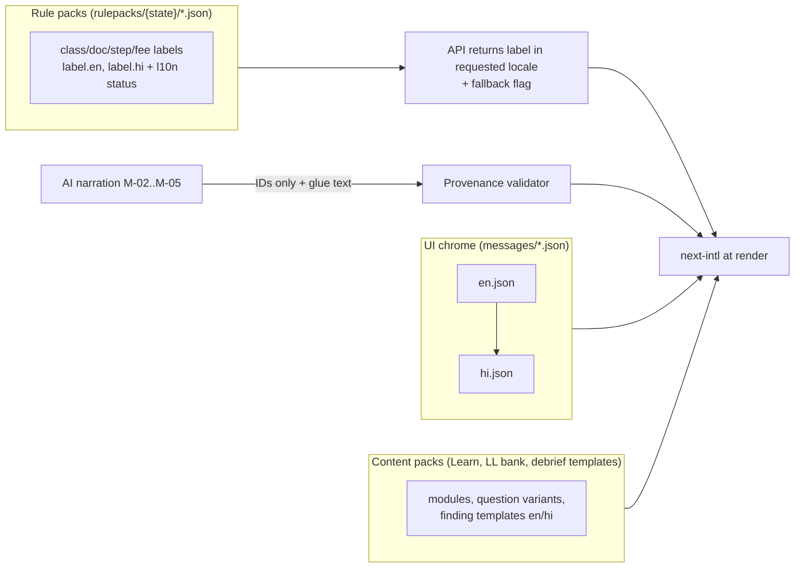
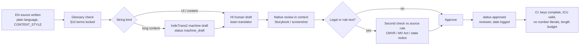

# Localization
> Project: Margdarshak · Team: Chanakya (@Nestiq Private Limited) · Owner: Content lead · Status: Draft v0.1 · Last updated: 2026-10-23
> Related: [Design system](DESIGN_SYSTEM.md) (§4 typography) · [Accessibility](ACCESSIBILITY.md) · [Content style](CONTENT_STYLE.md) · [Frontend](../03-engineering/FRONTEND.md) · [AI models](../04-ai/MODELS.md) · [Prompts](../04-ai/PROMPTS.md) · [Integrations](../03-engineering/INTEGRATIONS.md)
> Features: F-50 (languages), F-30 (voice guide), F-42 (rule-pack studio), F-53 (notifications), F-51 (Lite). Directives: D-21 (claim only EN + HI in full, plus Dogri voice-in), D-06 (no rupee literals), D-10 (number provenance), D-19 (wording).

---

## 0. Language claim (what we ship and what we say)
| Tier | Languages | What it means | What we say on stage |
|---|---|---|---|
| **Full** | **English (`en`)**, **Hindi (`hi`)** | Every UI string, rule-pack label, Learn module, LL question variant, debrief template, WhatsApp template and error state is human-written or human-reviewed | "English and Hindi in full" |
| **Voice-in** | **Dogri (`doi`, Devanagari)** | The user can *speak* Dogri to the voice guide. Speech goes to Sarvam Saaras v3 (`doi-IN`) and the transcript is shown in Devanagari. The answer comes back as **Hindi text + Hindi voice** (Bulbul `hi-IN`), because no TTS covers Dogri (`04-ai-adk-gemini.md` §0.3) | "You can speak Dogri; it answers in Hindi" |
| **Rule-pack-ready** | Urdu, Kashmiri, Punjabi, Tamil, Gujarati, Marathi, Bengali … | The i18n system, fonts (DESIGN_SYSTEM §4.2), RTL and rule-pack label slots exist. **No translated strings ship** until §11 review passes | Nothing, or "built so a state can add its language" |

- We **never** say "10+ languages" (cut by the council: brief §5.1 "Cut or roadmap").
- We never imply Bhashini is integrated. Bhashini is the production path behind a `BhashiniAdapter` (F-56), with a mock in the hackathon.

| | Hackathon build (Phase 1–2) | Production (Phase 3+) |
|---|---|---|
| UI | next-intl; `en`, `hi` message files; `doi` voice-in only | + `ur`, `ks`, `pa` for J&K tenants; other state languages per tenant |
| Translation | Team translators + IndicTrans2 drafts + native review | Professional linguists per state; Bhashini NMT drafts; the state transport department's own reviewers in F-42 |
| Voice | Saaras v3 (Dogri in), Gemini Live (Hindi/English), Bulbul `hi-IN` out | + Bhashini ASR/TTS via adapter; on-device fallbacks |

---

## 1. Language priority (with reasons)
| Rank | Language | Script | Reason | Phase |
|---|---|---|---|---|
| 1 | Hindi | Devanagari | Widest reach in North India. The government portal itself offers only Hindi beside English (`team-saarthi-report.md` l.71). Our P-01/P-03 personas use Hindi/Hinglish. | 1 (full) |
| 2 | English | Latin | Legal and form terms; urban users; judges | 1 (full) |
| 3 | Dogri | Devanagari | Jammu host region (GCET Jammu; judge Dutta values a Dogri option, `C-judges.md` l.38). Speech-in only, because no reliable Dogri TTS or legal-grade MT exists ("Nobody's automated Dogri is trustworthy for legal text": `04` l.176) | 1 (voice-in) |
| 4 | Urdu | Perso-Arabic (Nastaliq) | Named in the J&K Official Languages Act 2020 [verify text]; RTL readiness proves the system | 3 |
| 5 | Kashmiri | Perso-Arabic | J&K; Saaras lists `ks-IN` | 3 |
| 6 | Punjabi | Gurmukhi | Neighbouring state; Punjab tracks record video (`02-rules-process` l.80) | 3 |
| 7 | Gujarati | Gujarati | Gujarat's 4 AI tracks fail 94% of car applicants (brief §2) | 3 |
| 8 | Malayalam | Malayalam | Kerala hazard-perception test from Dec 2026 (D-03) | 3 |
| 9 | Tamil, Marathi, Bengali, Telugu, Kannada, Odia … | various | Tenant-driven | 3+ |

---

## 2. Locale model
| Locale code | Use | Fallback chain | Intl formatting locale |
|---|---|---|---|
| `en` | UI | — | `en-IN` |
| `hi` | UI | `en` | `hi-IN` |
| `doi` | Voice transcript and the few reviewed Dogri voice-reply prompts (if any) | `hi` → `en` | `hi-IN` (Dogri CLDR coverage in browsers is uncertain [unverified; owner: Frontend lead, H0]) |
| `ur` (Phase 3) | UI, RTL | `hi` → `en` (for untranslated rule labels: show Hindi with a "shown in Hindi" chip) | `ur-IN` |
| `en-XA` | Pseudo-locale for testing (+40% length, accents) | — | `en-IN` |
| `ar-XB` | Pseudo-RTL for testing | — | `en-IN` |

- **BCP 47 tags** are used throughout (`doi` is ISO 639-2/3 for Dogri).
- Routes are prefixed: `/en/...`, `/hi/...`.
- The chosen locale is stored in the `NEXT_LOCALE` cookie and, for signed-in users, on `Applicant.language` (E-01).
- Language detection order:
  1. URL prefix;
  2. cookie;
  3. the user's choice on screen 0 (the language picker always appears on screen 0 for new devices);
  4. `Accept-Language`, used only to *pre-select* a tile, never to skip the picker.

---

## 3. String sources (three kinds, three pipelines)


| Kind | Examples | Where | Who approves |
|---|---|---|---|
| **UI chrome** | Buttons, headings, errors, empty states, consent texts | `apps/web/messages/{locale}.json` (namespaced) | Content lead + native reviewer |
| **Rule-pack labels** (rule-pack-driven translations) | Class names (MCWG, LMV-NT), document names, step names, fee line items, blocker titles/fixes, office names | `rulepacks/{state}/{version}/*.json`; each label has `en`, `hi`, optional others, with `l10n.status` | Maker-checker in the rule-pack studio (F-42): a translator (maker) and a reviewer (checker) |
| **Content** | Learn modules (22), LL question variants, explanations, debrief finding templates, Nazar clip descriptions | `content/{module}/{locale}.json` | Content lead + subject check against the source rule (`04` l.317: "a human checks each one against the source rule") |
| **AI narration** | Debrief glue text, tutor explanation, voice answers | Generated at runtime in the user's locale | Not "approved" text: constrained by allowlisted IDs, no digits (D-09, D-10), validator, template fallback |

### 3.1 Rule-pack label schema (excerpt)
```json
{
  "id": "class.MCWG",
  "label": {
    "en": "Motorcycle with gear",
    "hi": "गियर वाली मोटरसाइकिल",
    "doi": null
  },
  "short": { "en": "Bike with gear", "hi": "गियर वाली बाइक" },
  "legal_code": "MCWG",
  "l10n": {
    "hi": { "status": "approved", "translator": "team:T2", "reviewer": "team:R1", "reviewed_on": "2026-10-24", "method": "human" },
    "doi": { "status": "missing" }
  },
  "source": "CMVR r.2 / MV Act s.10(2)",
  "verified_on": "2026-10-22",
  "confidence": "high"
}
```
- `status` takes one of: `missing | machine_draft | human_draft | reviewed | approved`.
- **Only `approved` renders to users.** Anything else falls back down the chain (§2), and the UI shows a small "Shown in Hindi" / "Shown in English" chip so the user knows why.
- `legal_code` is never translated. It is shown as-is (Latin) beside the label, because Sarathi forms use the codes.
- **Rule-pack change mid-case (EC-27):** if a label changes in a new pack version, users with an active case see the new label plus a "Rule updated on {date}" notice (CONTENT_STYLE MC-128). The old label stays in their history.

---

## 4. next-intl setup (Next.js 16 App Router)
Pin `next-intl` at H0 against the Next.js 16 release in use; the docs show a v3/v4 toggle, so pin the current major [owner: Frontend lead]. The file layout follows the next-intl routing docs (https://next-intl.dev/docs/routing/setup, fetched 2026-10-23). In Next.js 16, `middleware.ts` is renamed `proxy.ts`.

```
apps/web/
  next.config.ts                 # createNextIntlPlugin()
  messages/
    en.json  hi.json             # UI chrome, namespaced
  src/
    proxy.ts                     # next-intl middleware (Next.js 16 name)
    i18n/
      routing.ts                 # defineRouting
      navigation.ts              # createNavigation → Link, redirect, useRouter
      request.ts                 # getRequestConfig → messages, timeZone, formats
      formats.ts                 # shared number/date formats
    app/[locale]/layout.tsx      # <html lang dir>, NextIntlClientProvider
```

```ts
// src/i18n/routing.ts
import { defineRouting } from "next-intl/routing";
export const routing = defineRouting({
  locales: ["en", "hi"],          // ur, pa ... added per tenant in Phase 3
  defaultLocale: "en",
  localePrefix: "always",
  localeCookie: { name: "NEXT_LOCALE", maxAge: 60 * 60 * 24 * 365 }
});
```

```ts
// src/proxy.ts  (Next.js 16; called middleware.ts before 16)
import createMiddleware from "next-intl/middleware";
import { routing } from "./i18n/routing";
export default createMiddleware(routing);
export const config = { matcher: "/((?!api|_next|_vercel|.*\\..*).*)" };
```

```ts
// src/i18n/request.ts
import { getRequestConfig } from "next-intl/server";
import { hasLocale } from "next-intl";
import { routing } from "./routing";
import { formats } from "./formats";

export default getRequestConfig(async ({ requestLocale }) => {
  const requested = await requestLocale;
  const locale = hasLocale(routing.locales, requested) ? requested : routing.defaultLocale;
  return {
    locale,
    messages: (await import(`../../messages/${locale}.json`)).default,
    timeZone: "Asia/Kolkata",          // server is Singapore in the hackathon; always render IST
    formats,
    onError: (e) => reportMissingKey(e),     // CI fails on missing keys; prod logs + falls back
    getMessageFallback: ({ namespace, key }) => `${namespace}.${key}`   // never shown in prod: CI gate
  };
});
```
The docs also show a `next/root-params` variant (Next.js ≥ 16.3). Use whichever matches the pinned versions.

```ts
// src/i18n/formats.ts
export const formats = {
  number: {
    inr: { style: "currency", currency: "INR", maximumFractionDigits: 0 },     // ₹700
    int: { maximumFractionDigits: 0 },
    seconds1: { maximumFractionDigits: 1, minimumFractionDigits: 1 }          // 1.4
  },
  dateTime: {
    long: { day: "numeric", month: "long", year: "numeric" },                 // 14 March 2027 / 14 मार्च 2027
    short: { day: "numeric", month: "short", year: "numeric" },               // 14 Mar 2027
    time: { hour: "numeric", minute: "2-digit", hour12: true }                // 9:30 am
  }
} as const;
```

```tsx
// src/app/[locale]/layout.tsx (essentials)
import { NextIntlClientProvider, hasLocale } from "next-intl";
import { setRequestLocale } from "next-intl/server";
import { notFound } from "next/navigation";
import { routing } from "@/i18n/routing";
const RTL = new Set(["ur", "ks"]);
export default async function LocaleLayout({ children, params }:
  { children: React.ReactNode; params: Promise<{ locale: string }> }) {
  const { locale } = await params;
  if (!hasLocale(routing.locales, locale)) notFound();
  setRequestLocale(locale);
  return (
    <html lang={locale} dir={RTL.has(locale) ? "rtl" : "ltr"} className={fontVariablesFor(locale)}>
      <body><NextIntlClientProvider>{children}</NextIntlClientProvider></body>
    </html>
  );
}
```

**Type safety:** declare `AppConfig` with `Messages: typeof import("../messages/en.json")` and `Locale`, so missing keys fail `tsc`. `en.json` is the source of truth for keys.

**Message conventions:**
- Namespaces follow screens and components: `home`, `plan`, `apply`, `checkAnswers`, `handoff`, `payment`, `learn`, `nazar`, `debrief`, `streak`, `voice`, `ai`, `consent`, `privacy`, `helper`, `errors`, `empty`, `footer`, `whatsapp`.
- Keys are semantic (`plan.fee.total`), never English sentences.
- **ICU MessageFormat** handles plurals, select and rich text:
  ```json
  { "clock.daysLeft": "{days, plural, one {# day left} other {# days left}}" }
  { "clock.daysLeft": "{days, plural, one {# दिन बाकी} other {# दिन बाकी}}" }
  ```
  CLDR Hindi plural categories are `one` (0 and 1) and `other`; always provide both.
- **No rupee, day, age or metre literal in any message** (D-06). Every number is an ICU argument filled from code (`{fee_total, number, inr}`). The copy lint (CONTENT_STYLE §8) greps message files for `₹\d`, `\d+ (days|दिन)` and similar.
- Rich text uses tags (`<b>`, `<link>`), never HTML strings.
- **Translator context:** each key has a `_comment` sibling in `en.json` (stripped at build) or an entry in `messages/CONTEXT.md` with a screenshot ID. Max-length hints are given for buttons (e.g. "≤ 22 characters in EN; Hindi may be +30%").

---

## 5. Translation workflow

- **Source first.** English is written in plain language before translation. Hindi is *transcreated* to the same meaning and register, not translated word for word.
- **Machine assistance:** AI4Bharat **IndicTrans2** (open, self-hostable; all 22 scheduled languages: `04` l.172) produces drafts for long content only. A machine draft is never shown to users. Bhashini NMT is the production alternative behind `BhashiniAdapter`. Gemini is not used for translation of legal or rule text.
- **Tooling:**
  - git-tracked JSON;
  - `scripts/i18n-check` (Phase 2) verifies key parity with `en.json`, ICU syntax (`@formatjs/icu-messageformat-parser`), banned literals and length budgets;
  - Storybook locale switcher for in-context review.

  A TMS (e.g. Weblate or Crowdin) is optional in Phase 3 [decision owner: Content lead].
- **Pseudo-localisation:** `en-XA` expands strings by 40% with accented characters, to catch truncation and hard-coded strings. `ar-XB` mirrors the layout, for RTL. Both run in the CI screenshot matrix.
- **Freeze:** at demo day minus 6 hours, no new keys; only fixes.

---

## 6. Fonts and script handling (summary; full matrix in DESIGN_SYSTEM §4)
| Issue | Rule |
|---|---|
| Font per script | Figtree (Latin), Mukta (Devanagari: hi, doi), Mukta Mahee (pa), Noto Nastaliq Urdu (ur/ks), Mukta Malar (ta), Mukta Vaani (gu); Noto fallbacks; loaded via `next/font/google` with per-locale preload |
| Line height | Devanagari 1.65, Nastaliq 2.1, Tamil 1.7 (tokens.css §4) |
| Conjuncts and matras | No letter-spacing, no `text-transform`, no `overflow: hidden` on single-line labels that could clip upper matras (ि, ी, ें) or lower ones (ु, ू, ृ). Buttons use `min-height`, not a fixed `height`, with ≥ 4 px vertical padding inside |
| Unicode | Store and compare in **NFC**. Search normalises nukta (ज़ = ज + ़, matched with or without nukta), ZWJ/ZWNJ and chandrabindu/anusvara variants (ँ/ं) |
| Sorting | `Intl.Collator("hi")` for Hindi lists (RTO names); `en-IN` for English |
| Truncation | Never truncate legal labels. Elsewhere, ellipsis with the full text available on focus/tap |
| Input | Gboard/IME friendly: no `maxlength` that breaks multi-codepoint graphemes; count graphemes with `Intl.Segmenter` |
| Mixed script | `lang` on the containing element, so Hindi lines with Latin codes ("LL टेस्ट", "MCWG") render in one family (Mukta covers Latin) |

### 6.1 RTL readiness (Urdu, Kashmiri: Phase 3)
- `dir="rtl"` on `<html>` for `ur`/`ks`. CSS uses logical properties only (`margin-inline-start`, `padding-inline`, `inset-inline-end`, `text-align: start`). Stylelint plugin `stylelint-use-logical` enforces this.
- Mirror direction icons; do not mirror media controls, clocks, road signs or vehicle pictograms (DESIGN_SYSTEM §6).
- **Numbers and codes inside RTL:** wrap them in `<bdi>` so "₹700", "MCWG" and dates keep LTR order. Phone numbers use `dir="ltr"`.
- Nastaliq: line height 2.1, and no italics (there is no Nastaliq italic). Lite mode uses Naskh.
- Charts with time on the x-axis keep left-to-right time even in RTL (convention for Indian Urdu users to be validated with native users [unverified]).

---

## 7. Numbers, dates, money and units
| Item | EN (`en-IN`) | HI (`hi-IN`) | Rule |
|---|---|---|---|
| Digits | 0–9 | **0–9 by default**; Devanagari digits (०–९) via Settings → "Hindi digits" (`numberingSystem: "deva"`) | MoRTH forms and Sarathi use Latin digits; keep the default consistent with what the user will see on Sarathi |
| Grouping | Indian lakh/crore: 1,72,890 | 1,72,890 | `Intl.NumberFormat("en-IN")` |
| Money | ₹700 · ₹1,150 | ₹700 · ₹1,150 | `{style: "currency", currency: "INR", maximumFractionDigits: 0}`; always the ₹ sign, never "Rs." or "INR 700"; screen-reader label "700 rupees" / "700 रुपये"; amounts always computed from `fees.json` (D-06) |
| Fee ranges | "₹2,000–20,000" (agent quotes, from research only) | same | En dash, no spaces; source chip |
| Dates (long) | 14 March 2027 | 14 मार्च 2027 | Day-month-year, never MM/DD |
| Dates (short) | 14 Mar 2027 | 14 मार्च 2027 | — |
| Date input | Three fields: Day · Month · Year (GOV.UK pattern) | दिन · महीना · साल | DOB entered once (3.3.7); accepts Devanagari digits |
| Relative | "in 12 days", "3 days ago" | "12 दिन में", "3 दिन पहले" | `Intl.RelativeTimeFormat` with `numeric: "always"` (avoid "tomorrow" ambiguity across midnight IST) |
| Time | 9:30 am | सुबह 9:30 / 9:30 am | 12-hour; Hindi uses सुबह/दोपहर/शाम/रात day-period words where `Intl` supports `dayPeriod` [verify output at H0] |
| Time zone | IST (Asia/Kolkata) everywhere | same | Server time is the source of truth (EC-15) |
| Durations | "30 days", "6 months", "1.4 seconds" | "30 दिन", "6 महीने", "1.4 सेकंड" | Decimal separator "." in both |
| Distance | 16 m · 36 m | 16 मीटर · 36 मीटर | Metric only |
| Speed | 40 km/h | 40 km/h (किमी/घंटा in prose) | — |
| Phone | +91 98xxx xxxxx | same | `dir="ltr"`; never displayed in full in notifications |
| Percent | 60% | 60% | Pass marks come from the rule pack |
| Ordinals | 2nd attempt | दूसरा प्रयास | ICU `selectordinal` |

---

## 8. Dogri voice input (F-30, M-08)
```mermaid
sequenceDiagram
  participant U as User (speaks Dogri)
  participant W as Web app (VoiceSheet)
  participant B as Backend (ADK)
  participant S as Sarvam Saaras v3 (doi-IN)
  participant A as VoiceGuideAgent (text mode)
  participant T as Bulbul v3 (hi-IN)
  U->>W: holds mic, speaks
  W->>W: client-side PII regex on the partial transcript (EC-20, incl. Devanagari digits)
  W->>B: audio stream (WS /v1/voice, API-40)
  B->>S: STT doi-IN (streaming)
  S-->>B: Devanagari transcript + confidence
  B-->>W: transcript shown "आपने कहा: …"
  B->>A: transcript (text) + screen context
  A-->>B: action from the closed enum (navigate/fill) + rule IDs
  B->>T: Hindi answer text from templates/rules
  T-->>W: Hindi audio + captions
  W-->>U: Hindi caption + voice + SourceChip; asks to confirm any fill
```

Rules:
1. **Mode selection.** The language picker offers "डोगरी में बोलें (Speak Dogri)" as a voice option for `hi` users; it is not a separate UI locale. The orb shows a "Dogri" chip while active.
2. **Transcript is shown, never silently acted on.** Any field fill from Dogri speech asks "Theek hai?" (Hindi) with Yes / Change.
3. **Confidence threshold.** Below the threshold (set at H0 from the 10 team recordings: `04` l.400), show "Didn't catch" + keyboard. Never guess fills.
4. **Answers in Hindi.** Facts come from rule IDs and templates; the agent never translates rule text into Dogri at runtime.
5. **Code-mixing.** Dogri–Hindi–English mixing is expected ("mera DL renew karna ai"). Saaras supports code-mixing (vendor claim, `04` l.170). Intent matching uses the synonym table (§9.2), which includes Dogri forms collected from team recordings.
6. **Evaluation.** The ADK evalset includes 10 Dogri utterances (`04` l.267). The success metric is a correct `navigate` destination. A Dogri native speaker on the team labels the recordings.
7. **Privacy.** "Mic on · not stored" chip. Audio is not retained by us. Sarvam is a disclosed processor in the privacy notice (`verification.md` §3.3).
8. **Under 18.** No voice guide (D-13).
9. **Failure (EC-29).** If Saaras is unavailable: "Dogri voice is resting. You can speak Hindi or type."

---

## 9. Code-mixed Hinglish

### 9.1 Output register (what we write)
- Hindi UI copy is **everyday Hindi**: it keeps the English loanwords that users actually say and that appear on Sarathi, written in Devanagari:
  - लाइसेंस (licence), टेस्ट (test), स्लॉट (slot), ऑनलाइन (online), फ़ीस (fee), फ़ॉर्म (form), आरटीओ (RTO), अपॉइंटमेंट (appointment), स्कूटर/बाइक.
- Formal words appear only where Sarathi or a law uses them, and then with the everyday word beside them on first use: नवीनीकरण (रिन्यू), शिक्षार्थी (लर्नर).
- **No Roman-script Hinglish UI locale** in Phase 1–2. Prompt chips and examples on the voice sheet *may* show Romanised Hinglish examples ("Papa ke liye licence"), because that is how users type in WhatsApp. They are marked as examples of what to say.
- **The voice guide mirrors the user's register** (Gemini Live handles Hinglish), but every fact, number and rule comes from tools and templates (D-09, D-10).
- WhatsApp templates exist in `en` and `hi` (Meta template approval per language). A Hinglish template is a Phase 3 experiment.

### 9.2 Input handling (what we understand)
| Input | Handling |
|---|---|
| Romanised Hindi in search ("licence kaise banwaye", "gear wali bike") | Search index holds EN + HI + Roman transliterations. Query normalisation: lowercase, strip diacritics, collapse repeated vowels ("liceeence"), common misspellings (license/licence/lisence/lycence) |
| Transliteration | Index-time transliteration of HI labels to Roman, using an open IndicXlit-style model or a rules table [tool choice at H0; owner: Backend lead]; no runtime AI needed |
| Synonym table (excerpt) | `scooty, scooter, gearless, bina gear, बिना गियर` → MCWOG · `bike, motorcycle, gear wali, गियर वाली` → MCWG · `car, gaadi, four wheeler, चार पहिया` → LMV-NT · `LL, learner, kaccha licence, कच्चा लाइसेंस` → LL · `DL, pakka licence, पक्का लाइसेंस` → DL · `RTO, ARTO, transport office, आरटीओ` → Office · `slot, date, appointment, तारीख` → Slot · `challan, चालान` → Challan |
| Mixed numerals | "मेरी उम्र १९ है" / "meri age 19" → age 19 (digit normalisation before parsing) |
| PII in mixed scripts (EC-20) | Redaction regex runs **after** normalising Devanagari digits to Latin: 12-digit Aadhaar-like sequences (with spaces/hyphens), 4–8-digit OTP-like tokens after "OTP/ओटीपी/code", phone numbers |
| Voice | Gemini Live (hi/en) and Saaras (doi, code-mix) |

---

## 10. Glossary: licence terms EN → HI
**Status:** draft by the team. **Native review pending** [reviewer: Hindi native speaker on the team; due 2026-10-24]. Where Sarathi's own Hindi interface uses a term, align with it [Sarathi Hindi labels not yet checked; owner: Content lead, 2026-10-24]. **Locked** terms must be used exactly as written; everywhere else, translators may adjust register.

| # | English | Hindi (UI) | Notes |
|---|---|---|---|
| 1 | Learner's licence (LL) | लर्नर लाइसेंस (LL) | Locked. On first use per screen: "लर्नर लाइसेंस (सीखने का लाइसेंस)". Avoid only "शिक्षार्थी अनुज्ञप्ति" (too formal) |
| 2 | Driving licence (DL) | ड्राइविंग लाइसेंस (DL) | Locked |
| 3 | Licence (noun) | लाइसेंस | Spelling in EN copy: "licence" (Indian English noun) |
| 4 | Vehicle class | वाहन की श्रेणी | Show the legal code beside it (MCWG) |
| 5 | Motorcycle without gear (MCWOG) | बिना गियर वाली मोटरसाइकिल / स्कूटर (MCWOG) | Locked |
| 6 | Motorcycle with gear (MCWG) | गियर वाली मोटरसाइकिल (MCWG) | Locked |
| 7 | Moped up to 50 cc (MC 50cc) | 50 cc तक का मोपेड | For ages 16–17 with guardian consent (EC-05) |
| 8 | Light motor vehicle, non-transport (LMV-NT) | हल्का मोटर वाहन, निजी (LMV-NT) | "कार" in short labels |
| 9 | Transport vehicle | परिवहन (कमर्शियल) वाहन | — |
| 10 | E-rickshaw / e-cart | ई-रिक्शा / ई-कार्ट | — |
| 11 | Regional Transport Office (RTO) | क्षेत्रीय परिवहन कार्यालय (आरटीओ) | Short form "आरटीओ" after first use |
| 12 | Assistant RTO (ARTO) | सहायक क्षेत्रीय परिवहन कार्यालय (एआरटीओ) | — |
| 13 | Accredited driver training centre (ADTC) | मान्यता प्राप्त ड्राइवर प्रशिक्षण केंद्र | — |
| 14 | Driving school | ड्राइविंग स्कूल | — |
| 15 | Application | आवेदन | — |
| 16 | Application number | आवेदन संख्या | — |
| 17 | Apply | आवेदन करें | Button: "आवेदन शुरू करें" |
| 18 | Eligibility | पात्रता | Prefer "क्या आप आवेदन कर सकते हैं" in UI questions |
| 19 | Date of birth | जन्म तिथि | — |
| 20 | Proof of age | उम्र का प्रमाण | — |
| 21 | Proof of address | पते का प्रमाण | — |
| 22 | Self-declaration (Form 1) | स्व-घोषणा पत्र (फ़ॉर्म 1) | — |
| 23 | Medical certificate (Form 1A) | मेडिकल सर्टिफ़िकेट (फ़ॉर्म 1A) | Needed at 40+ (EC-04) |
| 24 | Fee | फ़ीस / शुल्क | UI: "फ़ीस"; formal tables: "शुल्क" |
| 25 | Government fee | सरकारी फ़ीस | Never "आधिकारिक" (D-19 "official" ban applies in Hindi too) |
| 26 | Service charge | सेवा शुल्क | "Your state may add a service charge" |
| 27 | Smart card | स्मार्ट कार्ड | — |
| 28 | Slot / appointment | स्लॉट / अपॉइंटमेंट | — |
| 29 | Book a slot | स्लॉट बुक करें | — |
| 30 | LL test (knowledge test) | LL टेस्ट (नियमों की परीक्षा) | — |
| 31 | Driving test | ड्राइविंग टेस्ट | — |
| 32 | Test track | टेस्ट ट्रैक | — |
| 33 | Figure-8 | आठ (8) के आकार का ट्रैक | — |
| 34 | Reverse parking | रिवर्स पार्किंग | — |
| 35 | Gradient start (hill start) | चढ़ाई पर गाड़ी शुरू करना | — |
| 36 | Pass / did not pass | पास / इस बार पास नहीं हुआ | Never "फ़ेल" as a label on the user (CONTENT_STYLE §5.12) |
| 37 | Retest | दोबारा टेस्ट | — |
| 38 | Remedial training | सुधार प्रशिक्षण (रेमेडियल ट्रेनिंग) | After repeated fails (EC-08) |
| 39 | Renewal | नवीनीकरण (रिन्यू) | — |
| 40 | Expiry / expires | समाप्ति / समाप्त होगा | "आपका LL 14 मार्च को समाप्त होगा" |
| 41 | Grace period | छूट अवधि | "No grace period since 2019" (EC-16) |
| 42 | Duplicate licence | डुप्लिकेट लाइसेंस | — |
| 43 | Address change | पता बदलना | — |
| 44 | International Driving Permit (IDP) | अंतरराष्ट्रीय ड्राइविंग परमिट (IDP) | Only for DL holders |
| 45 | Hazard perception | ख़तरा पहचान | Product term "Nazar" stays "नज़र" |
| 46 | Hazard perception test (Kerala) | ख़तरा पहचान टेस्ट (केरल) | Hedge "from December 2026" (D-25) |
| 47 | Road sign | सड़क संकेत | — |
| 48 | Helmet | हेलमेट | ISI-marked: "ISI मार्क वाला हेलमेट" |
| 49 | Challan | चालान | — |
| 50 | Practice Record | अभ्यास रिकॉर्ड | Never "प्रमाणित" (certified) or "सत्यापित लाइसेंस" (D-19) |
| 51 | Helper (mode) | मददगार (हेल्पर मोड) | — |
| 52 | Consent | सहमति | — |
| 53 | Withdraw consent | सहमति वापस लें | — |
| 54 | Grievance officer | शिकायत अधिकारी | — |
| 55 | Simulated (demo data) | सिमुलेशन (नकली डेटा) | On every mock government step |
| 56 | Not affiliated | संबद्ध नहीं | Footer |
| 57 | Readiness Score | तैयारी स्कोर | — |
| 58 | Streak | लगातार अभ्यास (स्ट्रीक) | — |
| 59 | Good Samaritan (s.134A) | नेक मददगार (धारा 134A) | Golden hour |
| 60 | Golden hour | गोल्डन आवर (पहला घंटा) | — |

---

## 11. Native-speaker review
| Step | Who | What | Record |
|---|---|---|---|
| 1. Draft | Translator (team member, Hindi) | Transcreate from EN; follow the glossary | `l10n.status = human_draft` |
| 2. In-context review | Native reviewer (a different person) | Review in Storybook/screenshots on a real phone: meaning, register (aap, warm, not Sanskritised), truncation, conjunct rendering, tone per CONTENT_STYLE | Checklist below, signed with reviewer ID + date |
| 3. Rule check | Content lead | For rule-pack labels, fees, blockers and legal text: compare with the source (CMVR, MV Act, state notice) | `source` cross-ref |
| 4. Approve | Reviewer | Status → `approved` | Git commit with `l10n:` prefix |
| 5. Spot audit | Second native speaker | 10% random sample per release | Audit log |
| Dogri | Dogri native speaker (team) | Labels the voice evalset recordings; reviews the few Dogri strings, if any, used as voice prompts | Evalset metadata |

**Reviewer checklist** (any "no" blocks approval):
- [ ] Meaning matches the EN source, with no added promises or fear.
- [ ] Locked glossary terms are used exactly.
- [ ] Respectful register (आप), gender-neutral where possible (avoid assuming male verb forms when addressing the user: prefer "आप … कर सकते हैं" plus neutral constructions; flag cases where Hindi grammar forces gender and use the user's chosen form if provided).
- [ ] No banned words in Hindi equivalents (आधिकारिक for "official", "पहला" as in first-ever, "सुरक्षित" as a scam verdict, "जान बचाई").
- [ ] Numbers are placeholders, not literals.
- [ ] Fits the length budget; no clipped matras at 200% text.
- [ ] Reads naturally aloud (test with TTS read-aloud).

**Sample sizes for the hackathon:** 100% of UI chrome and rule-pack labels on the three deep slices; 100% of debrief finding templates; at least 30% of Learn content, with the rest shipped in English only and labelled "Hindi coming soon".

---

## 12. Notifications (F-53) localisation
- WhatsApp templates are registered per language with Meta (approval needed per template and language; test number reaches about 5 allow-listed recipients: `B-sponsors.md` §3).
- Each template has `en` and `hi` versions with the same variables. Variables carry computed values (dates, ₹) formatted server-side with the same `formats`.
- STOP handling (EC-30) recognises "STOP", "stop", "रोकें", "बंद करो", "band karo" and "unsubscribe". Opt-out is confirmed in the user's language.
- SMS is roadmap until TRAI DLT registration (D-16); DLT templates would also be per language.

---

## 13. Testing localisation
| Test | Tool | Gate |
|---|---|---|
| Key parity, ICU validity, banned literals | `scripts/i18n-check` in CI | Missing key or literal = fail |
| Pseudo-loc screenshots (`en-XA`, `ar-XB`) | Playwright | Overflow/clipping detected = fail |
| Hindi screenshots on 12 key screens × 3 viewports | Playwright visual | Diff review |
| Conjunct rendering | Storybook "Typography/Scripts" story | Manual sign-off |
| Formatting | Unit tests on `formats` (₹, lakh grouping, dates, IST across midnight) | Fail on mismatch |
| Voice | ADK evalset (Hindi 20, Hinglish 20, English 10, Dogri 10: `04` l.267) | `tool_trajectory_avg_score` threshold per MODELS.md |
| Redaction in mixed scripts | Unit tests: Devanagari-digit Aadhaar, spaced OTP, Hinglish "otp hai 4821" | 100% redacted |

---

## 14. Edge cases
| EC | Localisation response |
|---|---|
| EC-01 Aadhaar shows year only | Date fields accept day/month separately; copy explains in both languages |
| EC-05/P-07 Under 18 | Same languages; no voice guide; read-aloud via on-device TTS |
| EC-10 No online LL test (e.g. Kerala) | Rule-pack-driven step label "RTO में टेस्ट" from the state pack |
| EC-12 Moving state | The new state's rule pack supplies labels; if a label is missing in `hi`, fall back with a chip |
| EC-20 PII typed into AI | Redaction after digit normalisation (§9.2) |
| EC-27 Rule pack changes mid-case | Label diff notice in the user's language |
| EC-28 Kerala HPT stayed/postponed | Status string from the rule pack (`hpt.status`), never hard-coded |
| EC-29 AI unavailable | Template answers exist in `en`/`hi` |
| EC-30 WhatsApp STOP | Multilingual STOP keywords (§12) |

---

## 15. Open items and unverified
| Item | Owner | Due |
|---|---|---|
| next-intl major version and `proxy.ts` behaviour on the pinned Next.js 16 | Frontend lead | H0 |
| Browser/CLDR support for `doi` formatting | Frontend lead | H0 |
| `dayPeriod` output in `hi-IN` | Frontend lead | H0 |
| Sarathi's Hindi labels, to align the glossary | Content lead | 2026-10-24 |
| J&K Official Languages Act 2020 primary text | Content lead | 2026-10-25 |
| Saaras Dogri accuracy on Jammu speakers (10 recordings) | AI lead | 2026-10-24 |
| Transliteration tool choice | Backend lead | H0 |
| Glossary native review | Hindi reviewer | 2026-10-24 |

## Sources
- next-intl routing setup: https://next-intl.dev/docs/routing/setup (fetched 2026-10-23)
- Next.js 16 proxy: https://nextjs.org/docs/app/getting-started/proxy
- Sarvam STT (Saaras v3, `doi-IN`, `ks-IN`): https://www.sarvam.ai/apis/speech-to-text.md · TTS (Bulbul v3, 11 languages, no Dogri): https://www.sarvam.ai/apis/text-to-speech.md (via `04-ai-adk-gemini.md`)
- Gemini Live languages (no Dogri/Kashmiri): https://ai.google.dev/gemini-api/docs/live-guide (via `04`)
- AI4Bharat IndicTrans2: https://admin.models.ai4bharat.org/models/ · Bhashini: https://www.unicef.org/digitalimpact/bhashini-ai-making-languages-more-accessible-digital-technology (via `04`)
- CLDR plural rules: https://www.unicode.org/cldr/charts/latest/supplemental/language_plural_rules.html
- Research: `team-saarthi-report.md` l.71, l.242, l.288; `01-sarathi-screens.md` l.281 (Sarathi's Bhashini plug-in disclaimer); `03-user-pain.md` l.413 (translation errors in the LL bank); `04` §0.3, l.170–176, l.267, l.317, l.400; `C-judges.md` l.38
