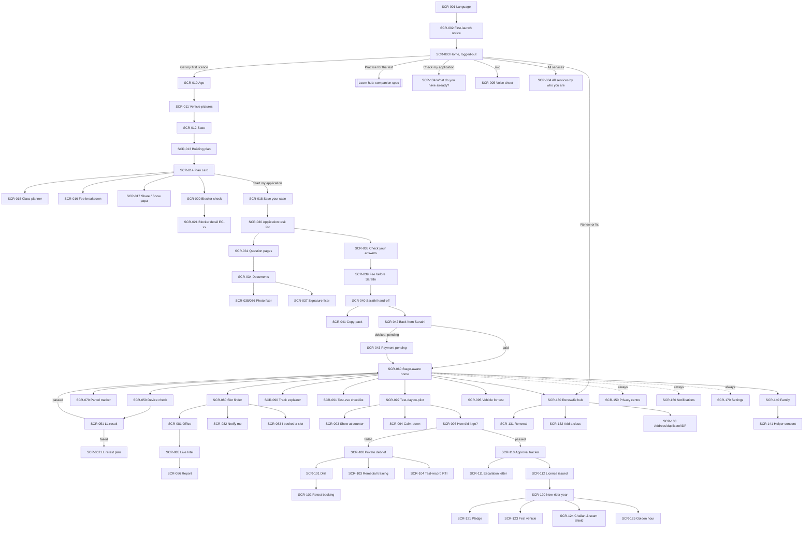
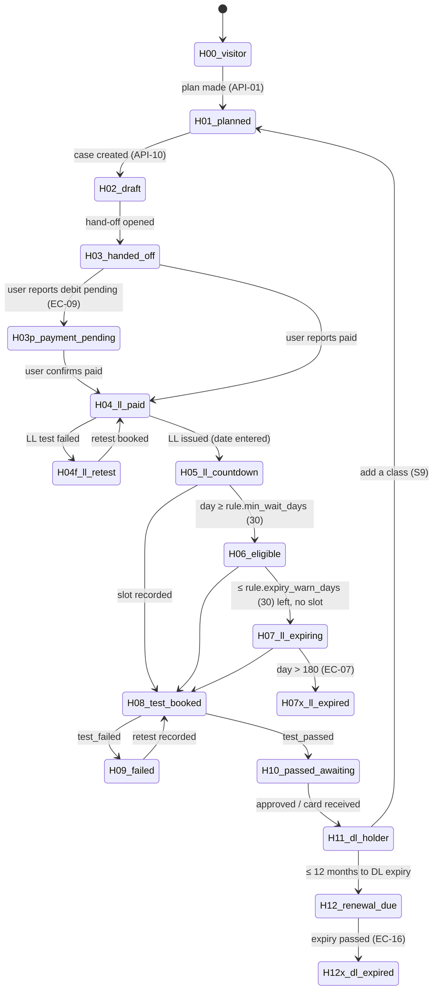

# UI Spec: the Journey (stages S0–S9 and cross-cutting surfaces)
> Project: Margdarshak · Owner: Design lead (UI/UX) · Status: Draft v0.1 · Last updated: 2026-10-23
> Related: [PROJECT_BRIEF](../00-overview/PROJECT_BRIEF.md) · [PRD](../01-product/PRD.md) · [FEATURES](../01-product/FEATURES.md) · [METRICS](../01-product/METRICS.md) · [DESIGN_SYSTEM](DESIGN_SYSTEM.md) · [ACCESSIBILITY](ACCESSIBILITY.md) · [LOCALIZATION](LOCALIZATION.md) · [FRONTEND](../03-engineering/FRONTEND.md) · [API_SPEC](../03-engineering/API_SPEC.md) · [DATA_MODEL](../03-engineering/DATA_MODEL.md) · Learn/game screens: the companion learning UI spec in `02-design/` and `09-learning-games/`
> Inputs: `research/ps1-deep/06-design-language.md` (tokens, type, motion, orb, states), `team-saarthi-report.md` (homepage teardown, plan card, stage table, renamed to Margdarshak, fee fixed), `REFINED-OVERVIEW.md`, `05-psychology.md`, `08-game-ai-n8n.md` §6, `ps1-current-state/00–03`, `war-room/margdarshak-verification.md` (D-01..D-25).

This document specifies **every journey screen**: what it is for, where it lives, how it looks at 360 px, what it is built from, what it says in English and Hindi, how it behaves in every state, how it moves, how it reads to a screen reader, what it reports to analytics, and which feature (F-xx) and edge case (EC-xx) it implements. The Learn hub, LL test simulator, Nazar and the mini-games (F-20..F-28) live in the companion learning spec. This spec covers only their **entry points** from the journey.

**Design bar.** The quality reference is Sarvam.ai and the team's own Vakyam: a warm off-white editorial canvas, a serif display line over a humanist grotesk, hairlines before shadows, and colour delivered as blurred dawn light. On top of that sit GOV.UK's discipline (one question per page, check answers, step-by-step) and UX4G 3.0 token mapping, so a State Transport Department could re-skin it with one theme file. If a screen does not answer *"what do I do next, and what does it cost me?"*, it is cut.

---

## 0. How to read this spec

### 0.1 Conventions
| Convention | Meaning |
|---|---|
| `SCR-xxx` | Screen ID. Stable; referenced by tests (Playwright `data-screen="SCR-014"`), analytics (`screen_id`) and copy keys. |
| Route | Next.js 16 App Router path **inside** the locale segment. Every route is actually `/{locale}/…` where `locale ∈ {en, hi}` (F-50). `doi` (Dogri) exists for voice input only and never as a UI locale. |
| Wireframe | ASCII at **360 × 760 CSS px** (the low-end Android baseline; 16 px gutters, 328 px content). One character ≈ 9 px. `[ … ]` = button, `( )` = radio, `[x]` = checkbox, `▸` = disclosure, `◉` = voice orb, `═` = primary button, `─` = hairline. Desktop notes follow each wireframe. |
| `[P1–2]` | Hackathon build (Phase 1–2), on mock adapters, Render Singapore, synthetic data. |
| `[P3+]` | Production (Phase 3+), after a state adopts: real adapters run by government (D-02, D-08). |
| Copy keys | `screen.element` (next-intl message IDs). EN is the source; HI is reviewed by a native speaker before ship (F-50). Placeholders in `{braces}` are always filled by code. |
| ₹ in copy | **No rupee literal exists in any UI string or prompt (D-06).** Strings carry `{fee_total}` etc. The example values shown in this doc (₹700, ₹200, ₹1,150) are what `fees.json` (CMVR r.32) renders today, and are shown so reviewers can sanity-check layout. |
| Analytics | Event names are `snake_case` verbs, sent through API-63 with `{screen_id, stage, locale, lite, tenant}` plus the listed props. No PII, ever (F-55). Events from a minor's profile (family mode) use the same allowlisted, aggregate-only taxonomy and are never used for behavioural tracking, profiling or ads (DPDP s.9(3), D-13 revised). |

### 0.2 What changed from the team report (read this before borrowing from it)
| Team report said | This spec says | Why |
|---|---|---|
| Product name "Saarthi" | **Margdarshak** (मार्गदर्शक) | D-01; confusion with the Sarathi portal |
| Trust strip "Official service of MoRTH" | "Govt fee for one vehicle class: {fee_one_class} + {fee_card} card (your state may add a service charge). Never pay agents." | D-01, D-06, D-19 impersonation risk |
| Login with Aadhaar OTP / DigiLocker eKYC autofill | Anonymous device session → optional email magic link / Google. Aadhaar eKYC, OTP and payment happen **on Sarathi** (hand-off). | D-07; private Aadhaar authentication needs Central Government approval (verification G1) |
| Face match in the LL simulator | Removed | D-07 |
| "10+ languages" | English + Hindi in full; Dogri voice input | D-21 |
| "₹700 per class" | ₹700 for **one** class + ₹200 card; a second class adds about ₹450 | D-06, CMVR r.32 |
| "Book test" unlocks at Readiness 85% | 85 is advisory; **"Book anyway" is always visible** | PROJECT_BRIEF F-21; CCPA dark-pattern rules |
| "Pay challan" as a home primary action | "Check challans on echallan.parivahan.gov.in" + scam shield. We hold no challan data. | No eChallan integration (verification G3) |

### 0.3 The four rules every screen obeys
1. **Answer before you ask.** The plan (classes, steps, fee, documents, earliest date) comes before any form field or account.
2. **One screen, one decision.** Exactly one `variant="primary"` button per screen. Everything else is `secondary`, `tertiary` or a link.
3. **Show the whole road, highlight the next step.** The stage strip or tracker is never more than one tap away.
4. **Fail early and kindly.** Every blocker (EC-xx) surfaces before the user reaches Sarathi, never after payment.

---

## 1. Global shell and system

### 1.1 App shell (every signed-in or case-holding screen)
```
┌────────────────────────────────────────┐  360 px
│ ◐ Margdarshak            हि/EN  ⚙       │  TopBar 56 px (logo mark + wordmark,
│────────────────────────────────────────│  language toggle, settings)
│ [Simulated data] chip (P1–2 only)      │  SimChip, 28 px, dismissible per session
│                                        │
│            (screen content)            │  max-width 680 px reading column
│                                        │
│                                        │
│                  ◉                     │  VoiceOrb dock 72 px, bottom-centre,
│                                        │  16 px above the tab bar (hidden <18)
│────────────────────────────────────────│
│  ⌂ Home   ▤ My Licence   ✎ Learn   ? Help│  TabBar 64 px, labels always shown
└────────────────────────────────────────┘
  Footer (end of scroll on every page):
  "Independent prototype by team Chanakya. Not affiliated with MoRTH,
   NIC or any State Transport Department. Uses simulated government
   data." · Privacy · Grievance officer · Accessibility statement ·
   Last updated {date}
```
- **TopBar**: logo mark (Diya lamp glyph, no emblem, no tricolour ribbon, no Parivahan logo; D-01), wordmark in Fraunces 500, a `ToggleButtonGroup` for हि / EN, and a settings `Button isIconOnly` with `aria-label`. When **Helper mode** is on, the TopBar is replaced by the HelperBanner (SCR-142). When **Lite mode** is on, the logo becomes a 1-colour SVG and all glows are removed.
- **TabBar** (4 tabs only, team-report decision kept): Home · My Licence (tracker, documents, plan, letters) · Learn (companion spec) · Help (voice, FAQ, screen decoder, scam checker, contacts). Built as a custom `TabBar` on top of HeroUI `Tabs` semantics but rendered as `<nav aria-label="Main">` with links (it is navigation, not a tab panel). Active tab: `--primary` icon + label 600 + 3 px top indicator. Target 64 × 64 px.
- **VoiceOrb dock** (F-30): Rive orb, 72 px, `button` "Start voice guide · आवाज़ से पूछें". Shown for every user, including a learner under 18 in family mode (D-13 revised). Hidden in the exam simulator, on the golden-hour card (no AI, D-14) and when the riding lock is active. Lite mode uses the CSS concentric-ring fallback.
- **Footer** (non-affiliation, D-01): on every page including errors and the 404. Contains the grievance officer link (IT Rules 2021, Live Intel), the accessibility statement and a page-level "last updated" date (GIGW 3.0).
- **SimChip** `[P1–2]`: `Chip variant="soft"` "Simulated data · नमूना डेटा", shown on any screen showing adapter-backed data (slots, office intel, approval status, DigiLocker mock). Removed per-adapter in `[P3+]` when the real adapter is live.

**Desktop (≥1024 px):** TabBar becomes a 240 px left rail with the same 4 items; content sits in a 680 px column (1200 px for tracker and slot map, which use a 2-pane layout); the orb docks bottom-right at 72 px with the sheet opening as a 400 px right-hand panel instead of a bottom sheet. Kiosk/CSC mode (≥1280 px touch) keeps 56 px targets.

### 1.2 Breakpoints and grid (from 06 §B4)
| Width | Columns | Gutter | Notes |
|---|---|---|---|
| 320–359 | 4 | 12 | Must still work (old Android Go); verb tiles stack 1-up |
| 360–599 | 4 | 16 | **Design baseline.** Verb tiles 2 × 2 |
| 600–1023 | 8 | 24 | Tablets, CSC counters; plan card + fee sheet side by side |
| ≥1024 | 12 | 32 | Desktop rail; 2-pane screens |
Text must survive +40% length (06 §B1.3), 200% zoom without horizontal scroll (WCAG 1.4.10) and Hindi line height 1.65.

### 1.3 Component inventory
**HeroUI v3 (`@heroui/react` 3.2.6, checked 2026-10-23 via the HeroUI component index; compound API, `onPress`, no provider):**
`Accordion`, `Alert`, `AlertDialog`, `Badge`, `Breadcrumbs` (desktop only), `Button`, `ButtonGroup`, `Calendar`, `Card` (`Card.Header/Title/Description/Content/Footer`), `Checkbox`, `CheckboxGroup`, `Chip`, `CloseButton`, `ComboBox`, `DateField`, `Description`, `Disclosure`, `DisclosureGroup`, `Drawer` (bottom sheets), `ErrorMessage`, `FieldError`, `Fieldset`, `Form`, `InputGroup`, `Label`, `Link`, `ListBox`, `Meter`, `Modal`, `NumberField`, `Popover`, `ProgressBar`, `ProgressCircle`, `RadioGroup`, `ScrollShadow`, `SearchField`, `Select`, `Separator`, `Skeleton`, `Spinner`, `Surface`, `Switch`, `Tabs`, `TagGroup`, `TextArea`, `TextField`, `Toast`, `ToggleButton`, `ToggleButtonGroup`, `Tooltip`.
Theme: HeroUI's oklch variables are overridden by the Margdarshak tokens (`--accent` ← `--primary #3333CC`, `--background` ← `--bg #FCFCFA`, etc.; mapping table in DESIGN_SYSTEM). Pin exact versions at H0.

**Custom components (`apps/web/components/journey/*`; each has a Storybook story and an axe test):**
| Component | Built on | Key props | Used in |
|---|---|---|---|
| `LanguagePicker` | `RadioGroup` (cards) | `suggested: Locale`, `available: Locale[]` | SCR-001, Settings |
| `VerbTile` | `Card` + `Link` | `icon`, `title`, `line`, `href` | SCR-003 |
| `TrustLine` | `Surface` | `fees: FeeQuote` (computed), `state?` | SCR-003, SCR-014 |
| `StepQuestion` (question-page shell) | `Form`, `Fieldset`, `Label`, `Description`, `FieldError`, `Disclosure` | `stepId`, `progress {i,n}`, `whyWeAsk`, `onAutosave` | S1, S2 |
| `PictureChoice` | `CheckboxGroup` / `RadioGroup` | `options: {id, pictogram, label}` | SCR-011 |
| `LicencePlanCard` | `Card` | `plan: PlanResult` | SCR-014 |
| `JourneyMap` (step-by-step) | `DisclosureGroup` | `steps[]`, `current`, `costs` | SCR-014, SCR-070 |
| `FeeBreakdown` | `Table`-like `dl` | `quote: FeeQuote`, `source`, `checkedOn` | SCR-016, SCR-039 |
| `BlockerRow` | `Alert` | `ec: ECId`, `severity`, `fix`, `source`, `confidence` | SCR-020 |
| `SourceChip` | `Chip` + `Link` | `ruleId`, `source`, `verifiedOn`, `confidence` | everywhere a rule shows |
| `ConfidenceBadge` | `Chip` | `high|medium|low` → "Checked / Likely / Verify at your RTO" | rule rows |
| `CheckAnswersList` | `dl` + `Link` | `rows[] {label, value, changeHref}` | SCR-038 |
| `CopyPack` | `Card` + `Button` (copy) | `fields[] {sarathiLabel, value, typeOnly}` | SCR-041 |
| `PhotoFixerFrame` | `<video>` + canvas + MediaPipe | `spec: PhotoSpec`, `mode: photo|signature` | SCR-035–037 |
| `StageHomeHeader` | `Surface` + glow | `journeyState`, `primaryAction` | SCR-060 |
| `CaseClock` | `ProgressCircle` + `Meter` | `from`, `to`, `serverNow` | Home, tracker |
| `ParcelTracker` | `ol` + `Disclosure` | `events: TimelineEvent[]` | SCR-070 |
| `SlotMap` | MapLibre GL JS + OSM tiles (`[P3+]` Bhuvan/State GIS) | `offices[]`, `selected` | SCR-080 |
| `IntelCard` | `Card` + `Meter` | `field`, `n`, `kThreshold=5` | SCR-085 |
| `QRCard` | `qrcode` (SVG) | `payload` (no PII) | SCR-093 |
| `LetterPreview` | `Surface` | `letter: Letter` | SCR-104, SCR-111 |
| `HelperBanner` | `Alert` | `subjectAlias`, `expiresAt` | SCR-142 |
| `VoiceOrb` / `VoiceSheet` | Rive + `Drawer` | `state`, `level` | everywhere (every user, D-13 revised) |
| `SimChip`, `LiteBadge`, `OfflineBanner`, `NonAffiliationFooter` | `Chip`, `Alert` | — | shell |
| `EmptyState` | `Surface` + Diya/dawn-road SVG | `illustration`, `line`, `action` | §5 |

### 1.4 Copy rules
- **Voice:** a *margdarshak*, a guide: warm, brief, certain. Second person, active voice, Class-6 reading level, ≤ 2 sentences per paragraph. Hindi is written fresh in conversational Hindi (Hindustani register, not Sanskritised officialese); common English words stay in Latin script where people say them (LL, RTO, slot, OTP, app).
- **Plain names first, codes second:** "Motorcycle with gears (MCWG)", "Car (LMV)". The code appears in a grey `caption` because the user will see it on Sarathi.
- **Numbers:** Latin digits by default (as on MoRTH forms), `font-variant-numeric: tabular-nums`. ₹ uses Indian grouping (`₹1,150`, `₹1,35,000`) via `Intl.NumberFormat('en-IN')`. Dates: `23 Oct 2026` / `23 अक्टूबर 2026`; never `23/10` alone.
- **Banned words, enforced by a copy lint in CI (D-19):** "official" (for us), "first" (as first-ever), "doesn't exist", "DPDP-compliant", "STQC-certified", "integrated with Sarathi/Aadhaar", "verified licence", "safe" as a scam verdict, "lives saved", "you would crash", "unsafe driver", "Saarthi". The lint also blocks any `₹` followed by a digit in `messages/*.json`.
- **Never fear:** red only for real, dated deadlines and real danger (06 §B1.4). No "FAILED", no countdown timers that are not legal deadlines, no confirm-shaming.
- **Sources:** every rule claim carries a `SourceChip` ("CMVR r.32 · checked 22 Oct 2026").

### 1.5 Global state patterns (each screen's state table refers to these)
| State | Pattern |
|---|---|
| **Loading** | `Skeleton` blocks matching the final layout; never a full-screen spinner. If > 2 s, a one-line caption says what is happening ("Checking rules for Jammu & Kashmir…"). `aria-busy="true"` on the region. |
| **Empty** | `EmptyState`: illustration (Diya or dawn road), one line, one button (06 §B12). |
| **Error (recoverable)** | Inline `Alert status="danger"` with ⬣ glyph, plain cause, one action ("Try again"). Form errors use the GOV.UK error-summary pattern: an `Alert` at the top listing errors as links; focus moves to it; each field has `FieldError`. |
| **Error (adapter/Sarathi down, EC-11)** | `Alert status="warning"`: "Sarathi isn't responding right now. Your answers are saved here; we'll retry." Actions: Retry · "Ping me on WhatsApp when it's back" (opt-in). |
| **Offline** | `OfflineBanner` (sticky under TopBar, `role="status"`): "You're offline. Saved answers, your plan and mock tests still work." Writes queue in IndexedDB (Serwist background sync) and show a "Will save when online" dot. |
| **Success** | Inline confirmation + next primary action. Celebrations (Lottie) only at the 3 milestone moments: LL passed, DL passed, licence issued. ≤ 1.2 s, skippable, off in Lite and reduced motion. |
| **AI unavailable (EC-29)** | The voice orb shows "Voice is resting. Type instead, it works the same." Debriefs show the template card. No screen depends on AI to function. |

### 1.6 Motion (tokens from 06 §B7)
`--ease-standard (.2,0,0,1)` for state changes; `--ease-out-expo (.16,1,.3,1)` for entrances and sheets; `--ease-spring-reward` only at milestones. Durations `80/160/240/400/700 ms`. Page transitions: 16 px shared-axis slide + fade, 240 ms (forward = from right; back = from left; RTL locales mirrored). `useReducedMotion()` → opacity-only 160 ms. Nothing loops in reading views. Lite mode: CSS only, no Rive/Lottie runtime downloaded.

### 1.7 Accessibility baseline (detail in ACCESSIBILITY.md)
WCAG 2.1 AA (targeting 2.2 for target size and focus appearance), GIGW 3.0, UX4G. 18 px body, 48 × 48 px minimum targets (56 px primary buttons), focus ring 3 px `--focus` with 2 px offset, never colour alone (glyph + colour + word), `lang` attribute per string block, skip link, landmarks (`header`, `nav`, `main`, `footer`), live regions for autosave and countdowns (polite, throttled to once per minute), no time limits outside the real-exam simulator, no drag-only gestures, captions always on in the voice sheet, `prefers-contrast: more` and Sunlight mode (pure white, black ink, no glows) for RTO yards.

### 1.8 Analytics conventions
Every event: `{event, screen_id, stage (S0..S9|X), journey_state (H-xx), locale, lite (bool), offline (bool), tenant, app_version, ts}`. Allowed extra props are enumerations or bucketed numbers only (age **band**, never DOB; state code; class codes; counts). No free text, no IDs other than an opaque `case_ref` hash rotated per 30 days. A minor's profile (family mode) → same allowlisted events, never used for profiling or ads (s.9(3)); consent "analytics" off → no events (F-54). Full taxonomy in METRICS.md; §7 here lists every event this spec fires.

---

## 2. Navigation map

### 2.1 Mermaid map


### 2.2 Route table
| Screen | Route (under `/{locale}`) | Auth | Rendering |
|---|---|---|---|
| SCR-001 Language | `/` (no locale yet) | none | static, < 30 KB |
| SCR-002 First-launch notice | `/welcome` | none | static |
| SCR-003 Home (logged-out) | `/` | none | RSC, static shell |
| SCR-004 All services | `/services` | none | static |
| SCR-005 Voice sheet | overlay `?voice=1` | none (mic consent) | client |
| SCR-010–013 Plan steps | `/plan/age`, `/plan/vehicle`, `/plan/state`, `/plan/building` | none | client, state in URL + sessionStorage |
| SCR-014 Plan card | `/plan/{planId}` | none (plan IDs are unguessable, 30-day TTL) | RSC + API-01 |
| SCR-015 Class planner | `/plan/{planId}/classes` | none | client |
| SCR-016 Fee breakdown | sheet on `/plan/{planId}?sheet=fees` | none | client |
| SCR-017 Share | sheet `?sheet=share` | none | client + API-04 |
| SCR-018 Save your case | `/start` | creates anon session | client + API-10 |
| SCR-020/021 Blockers | `/case/{caseId}/blockers`, `/case/{caseId}/blockers/{ecId}` (also `/plan/{planId}/blockers…` pre-case) | session | API-13 |
| SCR-030 Task list | `/case/{caseId}/apply` | session | API-11 |
| SCR-031 Question | `/case/{caseId}/apply/{taskId}/{questionId}` | session | API-12 autosave |
| SCR-034 Documents | `/case/{caseId}/documents` | session | — |
| SCR-035–037 Photo/signature | `/case/{caseId}/documents/photo`, `/…/signature` | session | client-only (camera) |
| SCR-038 Check answers | `/case/{caseId}/apply/check` | session | — |
| SCR-039 Fee | `/case/{caseId}/apply/fee` | session | API-03 |
| SCR-040–041 Hand-off | `/case/{caseId}/handoff`, `/case/{caseId}/handoff/pack` | session | API-16 |
| SCR-042–044 Return | `/case/{caseId}/handoff/return`, `/…/payment-pending`, `/…/application-number` | session | API-15 |
| SCR-050–052 LL test | `/case/{caseId}/ll-test/device-check`, `/…/result`, `/…/retest` | session | — |
| SCR-060 Stage-aware home | `/` (when a case exists) | session | RSC + API-11/14 |
| SCR-070 Tracker | `/case/{caseId}/tracker` (My Licence tab root) | session | API-14 |
| SCR-080–083 Slots | `/case/{caseId}/slots`, `/offices/{officeId}`, `/case/{caseId}/slots/watch`, `/case/{caseId}/slots/booked` | session (office pages public) | API-25/26/27 |
| SCR-085–086 Live Intel | `/offices/{officeId}/intel`, `/offices/{officeId}/report` | report needs session (account holder) | API-28/29 |
| SCR-090–096 Driving test | `/case/{caseId}/test/track`, `/test/eve`, `/test/day`, `/test/qr`, `/test/calm`, `/test/vehicle`, `/test/result` | session | — |
| SCR-100–105 Fail & recover | `/case/{caseId}/recover`, `/recover/drill`, `/recover/retest`, `/recover/remedial`, `/recover/rti`, `/recover/ll-check` | session | API-45 |
| SCR-110–113 Approval | `/case/{caseId}/approval`, `/approval/letter`, `/issued`, `/issued/card` | session | API-45 |
| SCR-120–125 New rider | `/rider`, `/rider/pledge`, `/rider/lock` (system), `/rider/first-vehicle`, `/rider/scam`, `/golden-hour` (public, offline-cached) | session except golden hour | — / API-43 |
| SCR-130–134 Renew/fix | `/renew`, `/renew/renewal`, `/renew/add-class`, `/renew/{service}`, `/check` | none / session | API-02 |
| SCR-140–144 Family/helper | `/family`, `/family/helper/consent`, `/family/clear-device`, `/family/minor-riding` | account | API-60 |
| SCR-150–153 Privacy | `/me/privacy`, `/me/privacy/consents/{id}`, `/me/privacy/export`, `/me/privacy/delete` | session | API-60/61/62 |
| SCR-160 Notifications | `/me/inbox`, `/me/inbox/settings` | session | — |
| SCR-170–172 Settings | `/me/settings`, `/me/settings/lite`, (offline is a state) | none | — |
| SCR-180 Sign-in | `/signin`, `/signin/check-email` | none | — |
| SCR-181–183 Help | `/help`, `/help/decode`, `/help/scam-check` | none (AI consent for decoder) | API-42/43 |
| Demo persona switcher `[P1–2]` | `/demo` (hidden; `noindex`; labelled "Demo personas") | none | — |

---

## 3. The journey state machine and stage → primary action

### 3.1 Journey states (computed server-side from E-02 Case + E-04/E-05 mirrors + E-12 events; server time is the clock, EC-15)

Overlay flags (any state): `minor` (EC-05, P-07; the learner is under 18 and the case sits in a parent's account, family mode, D-13 revised; all features stay on), `helper_session` (EC-14), `challan_check` (user flagged a challan SMS), `lite`, `offline`, `rulepack_changed` (EC-27), `sarathi_down` (EC-11).

### 3.2 Stage → primary action table (F-08)
Exactly one primary action per state. "Secondary" is at most two quiet links. The countdown and dates come from `CaseClock` (rules engine, server time).

| State | Stage | Header line (EN) | Header line (HI) | **Primary action** | Secondary | Clock |
|---|---|---|---|---|---|---|
| H-00 visitor | S0 | Get your driving licence, step by step. | ड्राइविंग लाइसेंस, एक-एक कदम करके। | Get my first licence (tile) | 3 other tiles · mic | — |
| H-01 planned | S1 | Your plan is ready: {n_steps} steps, earliest licence {date}. | आपका प्लान तैयार है: {n_steps} कदम, सबसे जल्दी लाइसेंस {date}। | Start my application | Share plan · Check blockers | — |
| H-02 draft | S2 | Step {i} of {n}: {task_name}. Saved {ago}. | कदम {i}/{n}: {task_name}। {ago} सेव हुआ। | Continue where I left off | Check answers · Fix photo | — |
| H-03 handed off | S2 | Finish on Sarathi, then tell us how it went. | Sarathi पर पूरा करें, फिर बताइए क्या हुआ। | I'm back from Sarathi | Open copy-pack | — |
| H-03p payment pending | S2 | Money debited, Sarathi not updated yet. Don't pay again. | पैसा कट गया, Sarathi में अभी अपडेट नहीं। दोबारा पैसे न दें। | Check payment status on Sarathi | What to do if it's stuck | Days since payment |
| H-04 LL paid, test due | S3 | Your LL test is next. Readiness {score}. | अगला कदम LL टेस्ट है। तैयारी {score}। | Practise 10 questions | Device check · I've taken the test | Days left in the test window (where the rule pack has one) |
| H-04f LL retest | S3 | Not this time. Retest fee {ll_test_fee}; your plan is ready. | इस बार नहीं हुआ। दोबारा टेस्ट फीस {ll_test_fee}; प्लान तैयार है। | Practise my weak topics | How to rebook on Sarathi | — |
| H-05 LL day 1–29 | S4 | Driving test unlocks in {d} days ({date}). | ड्राइविंग टेस्ट {d} दिन में खुलेगा ({date})। | Today's 5-minute practice (Nazar) | Track explainer · Find a slot early | Unlock countdown + LL valid till |
| H-06 day 30+ | S5 | You can book your driving test now. | अब आप ड्राइविंग टेस्ट बुक कर सकते हैं। | Find a test slot | Notify me · Vehicle for test | LL valid till |
| H-07 LL expiring | S5 | Your learner's licence expires in {d} days. Book your test now to avoid starting over. | आपका लर्नर लाइसेंस {d} दिन में खत्म होगा। अभी टेस्ट बुक करें, वरना शुरू से करना पड़ेगा। | Book before {date} | What if it expires? | Red `Alert` (real deadline) |
| H-07x LL expired | S2 | Your learner's licence has expired. Here's the quickest restart. | आपका लर्नर लाइसेंस खत्म हो गया। सबसे जल्दी दोबारा शुरू करने का तरीका। | Restart my LL (reuses your answers) | Why this happened | — |
| H-08 test booked (T−n) | S6 | Driving test on {date} at {office}. | ड्राइविंग टेस्ट {date} को {office} में। | Learn the track test | Vehicle checklist · Add to calendar | Days to test |
| H-08 test eve (T−1) | S6 | Tomorrow's the test. Pack these 6 things tonight. | कल टेस्ट है। आज रात ये 6 चीज़ें रख लें। | Open tonight's checklist | Route to RTO | Hours to test |
| H-08 test day (T0) | S6 | Today's the day. We'll walk you through it. | आज टेस्ट है। हम हर कदम साथ हैं। | Start test-day co-pilot | Show at counter | — |
| H-09 failed | S6F | Not this time. Most people pass on a later try. Your plan is ready. | इस बार नहीं हुआ। ज़्यादातर लोग अगली बार पास होते हैं। आपका प्लान तैयार है। | See my plan | Retest from {date} | Retest from {date} (rule pack, EC-08) |
| H-10 passed, awaiting | S7 | You passed. Now we track your approval. | आप पास हो गए! अब हम आपकी मंज़ूरी पर नज़र रखेंगे। | Track my licence | Get it in DigiLocker | Days since pass (EC-23 at 3) |
| H-11 DL holder | S8 | Licence in hand. Your new-rider year has begun. | लाइसेंस हाथ में। आपका नए राइडर वाला साल शुरू। | This week's 2-minute refresher | First-vehicle checklist · Challan & scam check | Month {m} of 12 |
| H-12 renewal due | S9 | Your licence expires on {date}. Renew from now; there's no grace period. | आपका लाइसेंस {date} को खत्म होगा। अभी से रिन्यू करें; कोई ग्रेस पीरियड नहीं है। | Plan my renewal | Do I need Form 1A? | Days to expiry |
| H-12x DL expired | S9 | Your licence expired {d} days ago. You can't legally drive until it's renewed. | आपका लाइसेंस {d} दिन पहले खत्म हुआ। रिन्यू होने तक गाड़ी चलाना कानूनन मना है। | Plan my renewal now | Over 1 year late? (retest) | Days since expiry; at 365 → retest copy |
| Overlay: challan check | S8 | Got a challan message? Check it only on echallan.parivahan.gov.in. | चालान का मैसेज आया? सिर्फ़ echallan.parivahan.gov.in पर जाँचें। | (secondary card; never replaces the state's primary) | Is this message real? | — |
| Overlay: minor (16–17) | S1 | Family mode: learning in {account_holder}'s account. | फ़ैमिली मोड: {account_holder} के अकाउंट में सीख रहे हैं। | See my ≤50 cc plan | For parents: s.199A | — |

---
## 4. Screens

Each screen uses the same block: **Purpose · Route · Implements**, a 360 px wireframe with a desktop note, **Components**, **Copy** (key strings EN + HI), **States**, **Interactions & motion**, **Accessibility**, **Analytics**, and phase notes where hackathon and production differ.

---

### S0: Front door

#### SCR-001 Language picker
- **Purpose:** the very first thing, before any headline: "your language, your script, first" (06 §B1.3). One tap, and it is remembered.
- **Route:** `/` on first visit (no `NEXT_LOCALE` cookie). **Implements:** F-01, F-50, F-52.
```
┌────────────────────────────────────────┐
│                                        │
│        (soft dawn glow, top)           │
│                                        │
│   अपनी भाषा चुनें                        │  h2, Mukta 600
│   Choose your language                 │  h2, Figtree 600
│                                        │
│  ┌──────────────────────────────────┐  │
│  │ ( ) हिन्दी                Hindi    │  │  56 px radio cards; native
│  └──────────────────────────────────┘  │  name large, English caption
│  ┌──────────────────────────────────┐  │
│  │ ( ) English                       │  │
│  └──────────────────────────────────┘  │
│  ┌──────────────────────────────────┐  │
│  │ ( ) डोगरी  Dogri · voice only       │  │  caption: "speak in Dogri,
│  └──────────────────────────────────┘  │  screens in Hindi"
│  ▸ More languages are coming            │  Disclosure (lists honestly,
│                                        │  none selectable)
│  ════════════════════════════════════  │
│  ║        जारी रखें · Continue        ║  │  primary, disabled until picked
│  ════════════════════════════════════  │
│  Footer: non-affiliation line          │
└────────────────────────────────────────┘
```
- **Desktop:** centred 480 px card on the canvas; the glow sits behind, never under text.
- **Components:** custom `LanguagePicker` over HeroUI `RadioGroup` (each `Radio` rendered as a card), `Button variant="primary"`, `Disclosure`.
- **Pre-selection:** suggested from `Accept-Language` (hi-* → हिन्दी) and, if the user later picks J&K as state, Dogri voice is offered. Never auto-continues.
- **Copy:**
| Key | EN | HI |
|---|---|---|
| `lang.title` | Choose your language | अपनी भाषा चुनें |
| `lang.dogri.caption` | Speak in Dogri; screens show Hindi | डोगरी में बोलिए; स्क्रीन हिन्दी में दिखेगी |
| `lang.more` | More languages are coming. We only list what we have fully checked. | और भाषाएँ आ रही हैं। हम वही भाषा दिखाते हैं जो पूरी तरह जाँची गई हो। |
| `lang.cta` | Continue | जारी रखें |
- **States:** loading: none (static, inlined, < 30 KB incl. subset fonts for the two names); offline: works (precached); error: n/a.
- **Interactions:** selecting a card fills the radio with a 160 ms scale 0.96→1; Continue sets `NEXT_LOCALE` (1 year), `html[lang]`, and navigates to SCR-002 with the shared-axis transition.
- **Accessibility:** `radiogroup` labelled bilingually (`aria-labelledby` both headings); each radio `lang` attribute set to its own language so screen readers switch voice; arrow keys move selection.
- **Analytics:** `language_selected {locale, suggested_locale, changed_from_suggested}`.

#### SCR-002 First-launch notice (non-affiliation, D-01, verification G10)
- **Purpose:** say who we are before anything else, calmly; set the "we never ask for Aadhaar/OTP" promise.
- **Route:** `/welcome` (once per device; re-viewable in Settings → About). **Implements:** D-01, D-07, F-54.
```
┌────────────────────────────────────────┐
│  ◐  Margdarshak                        │
│  Learner se licence tak, bina agent ke. │  display, Fraunces 500
│                                        │
│  Before you start, three promises:     │
│  ✓ We're an independent guide, not the │
│    government. We're not affiliated   │
│    with MoRTH, NIC or any State        │
│    Transport Department.              │
│  ✓ We never ask for your Aadhaar       │
│    number, OTP or bank details. Those  │
│    are typed only on Sarathi.          │
│  ✓ Fees and rules shown here come with │
│    their source and the date we        │
│    checked them.                       │
│                                        │
│  ════════════════════════════════════  │
│  ║            Got it                 ║  │
│  ════════════════════════════════════  │
│  This build uses simulated government  │
│  data. (P1–2)                          │
└────────────────────────────────────────┘
```
- **Components:** `Surface`, Lucide `check-circle` glyphs in `--success`, `Button primary`.
- **Copy (HI):** `welcome.promise1` "हम एक स्वतंत्र मार्गदर्शक हैं, सरकार नहीं। हमारा MoRTH, NIC या किसी राज्य परिवहन विभाग से कोई संबंध नहीं है।" · `welcome.promise2` "हम कभी आपका आधार नंबर, OTP या बैंक जानकारी नहीं माँगते। ये सिर्फ़ Sarathi पर भरे जाते हैं।" · `welcome.promise3` "यहाँ दिखाई गई हर फीस और नियम के साथ उसका स्रोत और जाँच की तारीख होती है।" · `welcome.cta` "समझ गया".
- **States:** static; offline-safe.
- **Accessibility:** `main` with `h1` = tagline; promises are a `ul`.
- **Analytics:** `welcome_acknowledged`.

#### SCR-003 Home, logged-out (minimal)
- **Purpose:** replace ~120 links with one headline, four verbs, a mic and one calm trust line (team-report teardown). This is the "before/after: ~120 → 4" slide.
- **Route:** `/` with no case on the device. **Implements:** F-01, F-30 entry, F-50, D-06.
```
┌────────────────────────────────────────┐
│ ◐ Margdarshak            हि/EN  ⚙       │
│   (dawn glow behind the headline)      │
│                                        │
│  Get your driving licence,             │  display 40/44 Fraunces
│  step by step.                         │
│  We'll show your exact plan before     │  body-lg, ink-2
│  you fill anything.                    │
│                                        │
│ ┌─────────────────┐┌─────────────────┐ │
│ │ 🛵              ││ ✎               │ │  VerbTile 156×132
│ │ Get my first    ││ Practise for    │ │  icon 32, title label 600,
│ │ licence         ││ the test        │ │  one line caption
│ │ LL → DL         ││ Free mock tests │ │
│ └─────────────────┘└─────────────────┘ │
│ ┌─────────────────┐┌─────────────────┐ │
│ │ ↻               ││ ⌕               │ │
│ │ Renew or fix my ││ Check my        │ │
│ │ licence         ││ application     │ │
│ │ Renew, address  ││ Where am I?     │ │
│ └─────────────────┘└─────────────────┘ │
│                                        │
│        ◉  Or just tell us              │  orb 72 px + caption
│   "Papa ke liye licence" "Fees kitni?" │  3 prompt chips
│                                        │
│ ┌────────────────────────────────────┐ │
│ │ ⓘ Govt fee for one vehicle class:  │ │  TrustLine (computed)
│ │ ₹700 + ₹200 card. Your state may   │ │
│ │ add a service charge. Never pay    │ │
│ │ agents.   CMVR r.32 · 22 Oct 2026 ↗│ │  SourceChip
│ └────────────────────────────────────┘ │
│  All services, by who you are  →        │  Link
│  Footer                                │
└────────────────────────────────────────┘
```
- **Desktop:** 2-column hero: headline + trust line left (6 cols), 2 × 2 tiles right (6 cols); orb sits centred under the tiles with the 3 chips in a row.
- **Components:** `VerbTile` × 4 (HeroUI `Card` with full-card `Link`, so the whole tile is one target), `VoiceOrb` + `TagGroup` of prompt chips (each chip opens the voice sheet with that utterance pre-sent), `TrustLine`, `SourceChip`, `Link`.
- **Copy:**
| Key | EN | HI |
|---|---|---|
| `home.h1` | Get your driving licence, step by step. | ड्राइविंग लाइसेंस, एक-एक कदम करके। |
| `home.sub` | We'll show your exact plan before you fill anything. | कुछ भी भरने से पहले हम आपका पूरा प्लान दिखाएँगे। |
| `home.tile.first` / `.line` | Get my first licence / LL → DL | मेरा पहला लाइसेंस / LL से DL तक |
| `home.tile.practise` / `.line` | Practise for the test / Free mock tests | टेस्ट की तैयारी / मुफ़्त मॉक टेस्ट |
| `home.tile.renew` / `.line` | Renew or fix my licence / Renew, address, duplicate | लाइसेंस रिन्यू या ठीक करें / रिन्यू, पता, डुप्लीकेट |
| `home.tile.check` / `.line` | Check my application / Where am I? | मेरी एप्लीकेशन देखें / मैं कहाँ तक पहुँचा? |
| `home.mic` | Or just tell us | या बस बोलकर बताइए |
| `home.chips` | "Licence for my father" · "How much are the fees?" · "When can I take the test?" | "पापा के लिए लाइसेंस" · "फीस कितनी है?" · "टेस्ट कब दे सकता हूँ?" |
| `home.trust` | Govt fee for one vehicle class: {fee_one_class} + {fee_card} card. Your state may add a service charge. Never pay agents. | एक गाड़ी-श्रेणी की सरकारी फीस: {fee_one_class} + {fee_card} कार्ड। आपका राज्य सर्विस चार्ज जोड़ सकता है। एजेंट को पैसे न दें। |
| `home.all` | All services, by who you are | सभी सेवाएँ, आप कौन हैं उसके हिसाब से |
- **States:** loading: shell is static; only `TrustLine` values hydrate from `fees.json` (bundled, so no network; skeleton never shown). Offline: identical, orb shows the offline state (06 §B10). Family mode (a learner under 18 in a parent's account): orb and chips shown as for everyone, with a small `Chip` "Family mode · {account_holder}" (D-13 revised). Error: if `fees.json` fails to parse, the trust line hides the numbers and says "See fees in your plan" (never a hard-coded fallback number).
- **Interactions & motion:** headline mask-reveal 700 ms on first paint only (not on back-nav); tiles rise 8 px with 40 ms stagger; tile press scales 0.98 with `e1` shadow. The orb breathes (4 s). Reduced motion: none of these.
- **Accessibility:** `h1` is the headline; tiles are a `ul` of links, each with an accessible name = title + line; prompt chips are buttons labelled "Ask: …"; the trust line is a `p`, not an alert.
- **Analytics:** `home_viewed {variant:"H-00"}`, `verb_tile_tapped {tile: first|practise|renew|check}`, `voice_prompt_chip_tapped {chip_id}`, `all_services_opened`, `trust_source_opened`.
- **Evidence hook (D-22):** this screen and SCR-030 are the "Phone B" of the journey test; timing starts here.

#### SCR-004 All services, by who you are
- **Purpose:** everything that is not the first-licence journey, moved off the home page and grouped by person, not by ministry (team teardown problems 3–6).
- **Route:** `/services`. **Implements:** F-01.
```
┌────────────────────────────────────────┐
│ ← All services                         │
│ ┌────────────────────────────────────┐ │
│ │ ⌕ Search: "duplicate", "IDP"…      │ │  SearchField
│ └────────────────────────────────────┘ │
│ [I'm learning][I have a licence][Parent│  ToggleButtonGroup (scroll)
│  /family][Driving school][Officer]     │
│                                        │
│ I'm learning to drive                  │  h3
│  › Find my licence plan                │  ListBox rows 56 px
│  › Practise the LL test                │
│  › Book or prepare for the driving test│
│  › Check my application                │
│ I have a licence                       │
│  › Renew my licence                    │
│  › Add a vehicle class                 │
│  › Change address · Duplicate · IDP    │
│  › Check challans (opens echallan…) ↗  │  external glyph + domain shown
│ Parent / family                        │
│  › Manage a parent's licence           │
│  › My child wants to ride (s.199A)     │
│ Driving school                          │
│  › School portal (P3+)                 │
│ Transport officer                      │
│  › State console (P3+)                 │
└────────────────────────────────────────┘
```
- **Components:** `SearchField` (client-side fuzzy over a static index, EN + HI synonyms: "dupe", "डुप्लीकेट"), `ToggleButtonGroup` as jump links, `ListBox` with `Link` items, external links show the full domain and ↗ (scam hygiene: the user always sees where they go).
- **States:** empty search → "No service called '{q}'. Try 'renew' or ask by voice." + orb button. Offline: list works; external links show "Needs internet".
- **Accessibility:** each group is a `section` with `h2`; the toggle group is `nav aria-label="Jump to group"`.
- **Analytics:** `services_search {q_len, results_count}` (no query text), `service_opened {service_id}`.

#### SCR-005 Voice guide sheet (cross-cutting, every user)
- **Purpose:** the voice entry on every screen: navigate and fill fields inside Margdarshak, answer from verified rules with a source chip, never submit, pay or book on Sarathi (F-30, D-09).
- **Route:** overlay `?voice=1` on any route. **Implements:** F-30, M-01, M-08, EC-20, EC-29, D-13 revised.
```
┌────────────────────────────────────────┐
│ (screen dims to 40%)                   │
│╭──────────────────────────────────────╮│  Drawer, 50% height,
││ ── grab handle                    ✕  ││  expandable to 90%
││        ◉  (orb, listening rings)     ││
││  Sun raha hoon… · Listening          ││
││  "mere papa 52 saal ke hain, unko    ││  live transcript, ink-2
││   car ka licence chahiye"            ││
││ ─────────────────────────────────── ││
││  Over 40, your father needs a medical││  answer ≤ 2 sentences,
││  certificate (Form 1A) for the LL.   ││  karaoke highlight
││  [CMVR r.5 · checked 22 Oct 2026 ↗]  ││  SourceChip
││  ══════════════════════════════════  ││
││  ║ Make a plan for papa (Helper)  ║  ││  one action button
││  ══════════════════════════════════  ││
││  🎙 Mic on · not stored   ⌨ Type     ││  privacy chip + keyboard
││  I can guide and fill. I can't book, ││  boundary line (always)
││  pay or submit on Sarathi.           ││
│╰──────────────────────────────────────╯│
└────────────────────────────────────────┘
```
- **Components:** `Drawer` (bottom, `isDismissable`), Rive orb (`state`, `level`), `TextField` fallback, `Chip` privacy, `SourceChip`, `Button`.
- **Orb states** follow 06 §B10 exactly (idle, listening, thinking, speaking, acting, didn't catch, offline, human hand-off). "Acting" shows a BorderBeam on the field being filled with **Yes / Change** confirmation; never auto-advances a question page.
- **Copy:** `voice.boundary` "I can guide and fill. I can't book, pay or submit on Sarathi." / "मैं रास्ता दिखा सकता हूँ और फ़ॉर्म भर सकता हूँ। Sarathi पर बुकिंग, पेमेंट या सबमिट नहीं कर सकता।" · `voice.pii_redacted` (EC-20) "I removed a number that looked like an Aadhaar or OTP. Never share those with anyone, including us." / "आधार या OTP जैसा दिखने वाला नंबर मैंने हटा दिया। इन्हें किसी से भी साझा न करें, हमसे भी नहीं।" · `voice.unknown` "I don't know that for your RTO yet. Here's where to check." / "आपके RTO के लिए यह अभी मुझे पता नहीं। यहाँ जाँच सकते हैं।" · `voice.resting` (EC-29) "Voice is resting. Type instead; it works the same." / "आवाज़ अभी बंद है। लिखकर पूछिए, वैसे ही काम करेगा।"
- **States:** offline → mic-off ring + "Voice needs internet. Typing works offline for navigation."; AI down → template navigation (keyword router) with the resting line; family mode → opens as for everyone; the parent's mic consent (PUR-MIC) covers the minor's case.
- **Accessibility:** captions always on; transcript `aria-live="polite"`; Stop is a 48 px button; Escape closes; focus returns to the orb; never vibrates during capture (06 §B9).
- **Analytics:** `voice_opened {entry: orb|chip|deeplink}`, `voice_intent {intent_id}` (closed enum, no transcript), `voice_action_confirmed {action_id}`, `voice_pii_redacted`, `voice_fallback_shown {reason}`. Transcripts are not stored (chip promise).

---

### S1: Licence Plan in 3 taps (F-02, F-03, F-04)

The plan is three one-question screens and a result. No login, no network needed for the logic (the rules pack for the chosen state is fetched once and cached; API-01 is called to mint a shareable `planId`, but the card renders from local evaluation if offline). Progress shows "1 of 3".

#### SCR-010 Plan step 1: age or date of birth
- **Purpose:** age decides eligible classes, Form 1A and whether the case runs in family mode (a learner under 18 in a parent's account, D-13 revised). Age never switches features off.
- **Route:** `/plan/age`. **Implements:** F-02, EC-01, EC-04, EC-05, EC-06, D-13 revised.
```
┌────────────────────────────────────────┐
│ ←  Your licence plan          1 of 3   │  ProgressBar (3 segments)
│ ▰▱▱                                    │
│                                        │
│  How old are you?                      │  h1
│  Or enter your date of birth for an    │  body, ink-2
│  exact plan.                           │
│                                        │
│  ( ) Under 16                          │  RadioGroup, 56 px rows
│  ( ) 16 or 17                          │
│  ( ) 18 or 19                          │
│  ( ) 20 to 39                          │
│  ( ) 40 or over                        │
│  ─ or ─                                │
│  Date of birth   [DD] [MM] [YYYY]      │  DateField (segments)
│                                        │
│  ▸ Why we ask                          │  Disclosure
│    Age decides which vehicles you can  │
│    learn, and if you need a medical    │
│    form. We keep only your age band.   │
│                                        │
│  ════════════════════════════════════  │
│  ║            Next                   ║  │
│  ════════════════════════════════════  │
│  Applying for someone else? →          │  Link → Helper (SCR-141)
└────────────────────────────────────────┘
```
- **Components:** `StepQuestion`, HeroUI `RadioGroup`, `DateField` (segmented, numeric keyboard, `granularity="day"`), `Disclosure`, `ProgressBar`, `Button`.
- **Logic:** a DOB overrides the band. A DOB of 1 Jan with only a year on Aadhaar triggers EC-01 on the next screen. If the user turns 40 before the earliest licence date, EC-04 is queued. The **DOB never leaves the device**; only `age_band` and, if needed, `turns_40_on` (month precision) are sent to API-01.
- **Copy (HI):** `plan.age.h1` "आपकी उम्र कितनी है?" · `plan.age.sub` "या सटीक प्लान के लिए जन्म-तिथि डालें।" · bands "16 से कम / 16 या 17 / 18 या 19 / 20 से 39 / 40 या ज़्यादा" · `plan.age.why` "उम्र से तय होता है कि आप कौन-सी गाड़ी सीख सकते हैं और मेडिकल फ़ॉर्म चाहिए या नहीं। हम सिर्फ़ उम्र का दायरा रखते हैं।" · `plan.age.helper` "किसी और के लिए अप्लाई कर रहे हैं?"
- **States:** validation error (future date, impossible date) → error summary + `FieldError` "Enter a real date, like 05 08 2007." / "सही तारीख डालें, जैसे 05 08 2007।"; under 16 → SCR-013 shows a kind "not yet" plan (see EC table, "under 16"); offline: fully works.
- **Accessibility:** radio group and date field are in one `Fieldset` with a single `legend` "How old are you?"; choosing a band clears the DOB and vice versa, announced politely ("Date of birth cleared").
- **Analytics:** `plan_started {entry}`, `plan_age_answered {age_band, used_dob:boolean}`. If `age_band` < 18 → the case is flagged family mode; events continue on the same allowlisted, aggregate-only taxonomy and are never used for profiling or ads (s.9(3), D-13 revised).

#### SCR-011 Plan step 2: what will you drive? (pictures)
- **Purpose:** pictures instead of class codes (MCWG/MCWOG/LMV), multi-select so the class planner can bundle (F-03).
- **Route:** `/plan/vehicle`. **Implements:** F-02, F-03, EC-05, EC-06, EC-21.
```
┌────────────────────────────────────────┐
│ ←  Your licence plan          2 of 3   │
│ ▰▰▱                                    │
│  What will you drive?                  │
│  Pick all you want. One application    │
│  can cover more than one.              │
│ ┌──────────┐┌──────────┐┌──────────┐   │  PictureChoice 104×120
│ │  🛵       ││  🏍       ││  🚗       │   │  duotone pictograms 64 px
│ │ Scooter  ││ Bike with││ Car      │   │
│ │ no gears ││ gears    ││          │   │
│ │  [x]     ││  [ ]     ││  [x]     │   │
│ └──────────┘└──────────┘└──────────┘   │
│ ┌──────────┐┌──────────┐┌──────────┐   │
│ │ 🛺 Auto / ││ 🚚 Truck ││ ♿ Adapted│   │
│ │ e-rickshaw││ or bus   ││ vehicle  │   │
│ └──────────┘└──────────┘└──────────┘   │
│  ▸ Not sure? Scooter vs bike explained │
│  ▸ Why we ask                          │
│  ════════════════════════════════════  │
│  ║        Next (2 selected)          ║  │
│  ════════════════════════════════════  │
└────────────────────────────────────────┘
```
- **Components:** `PictureChoice` over `CheckboxGroup` (each option a 48 px+ checkbox card), vehicle pictogram set (06 §B5), `Disclosure` ("Scooter = gearless, MCWOG; most scooters are over 50 cc, so you need to be 18" (EC-05)).
- **Mapping (rules pack, never the UI):** scooter → MCWOG (≤50 cc → MC50CC if 16–17), bike → MCWG, car → LMV-NT, auto/e-rickshaw → e-rickshaw/e-cart or LMV-TR per state, truck/bus → transport classes (flagged "verify at your RTO", D-05), adapted → adapted vehicle/invalid carriage (EC-13).
- **Minor path (16–17):** only the scooter tile is enabled, with caption "Only ≤50 cc gearless at 16–17, with a parent's consent." Others show a lock glyph and "From 18" (truck/bus "From 20"; EC-06).
- **Copy (HI):** `plan.vehicle.h1` "आप क्या चलाएँगे?" · `plan.vehicle.sub` "जितनी चाहें चुनें। एक ही एप्लीकेशन में एक से ज़्यादा गाड़ी आ सकती है।" · tiles "स्कूटर (बिना गियर) / गियर वाली बाइक / कार / ऑटो या ई-रिक्शा / ट्रक या बस / दिव्यांगजन के लिए बदली हुई गाड़ी" · `plan.vehicle.minor` "16–17 साल में सिर्फ़ 50 cc तक की बिना गियर वाली गाड़ी, माता-पिता की सहमति से।"
- **States:** none selected → Next disabled with helper text (not an error); offline works.
- **Interactions:** selecting a tile animates a check badge in (160 ms) and the pictogram's duotone fill switches to `--primary-soft`; the CTA count updates (`aria-live="polite"`).
- **Accessibility:** `group` labelled by the h1; each tile's accessible name includes the code ("Car, LMV"); locked tiles are `aria-disabled` with the reason as description.
- **Analytics:** `plan_vehicle_answered {classes:[codes], count}`.

#### SCR-012 Plan step 3: which state do you live in?
- **Purpose:** the state decides the rule pack (online LL test or not, LL test format, fees surcharges, test type).
- **Route:** `/plan/state`. **Implements:** F-02, F-42, EC-02, EC-10, EC-12.
```
┌────────────────────────────────────────┐
│ ←  Your licence plan          3 of 3   │
│ ▰▰▰                                    │
│  Which state or UT do you live in?     │
│  ┌──────────────────────────────────┐  │
│  │ Jammu & Kashmir               ▾  │  │  ComboBox (type-ahead,
│  └──────────────────────────────────┘  │  EN + HI names)
│  [ Use my location ] (city level only) │  secondary, asks permission
│                                        │
│  Is your Aadhaar address in this       │  sub-question (same screen,
│  state, where you live now?            │  it changes the path; EC-02)
│  ( ) Yes   ( ) No, it's elsewhere      │
│  ( ) I don't have Aadhaar              │
│  ▸ Why we ask                          │
│  ════════════════════════════════════  │
│  ║        Show my plan               ║  │
│  ════════════════════════════════════  │
└────────────────────────────────────────┘
```
- **Rule:** this is the one "one question" screen that carries a dependent sub-question, because the Aadhaar-address answer only makes sense next to the state (GOV.UK allows closely related fields). It counts as one screen in the before/after metric.
- **Components:** `ComboBox` (36 states/UTs, each with rule-pack coverage badge: "Full rules" / "Basic rules, verify at RTO"), `Button secondary` for geolocation (coarse; never stored; only the state code is kept), `RadioGroup`.
- **Copy (HI):** `plan.state.h1` "आप किस राज्य या UT में रहते हैं?" · `plan.state.aadhaar` "क्या आपके आधार का पता इसी राज्य का है, जहाँ आप अभी रहते हैं?" · options "हाँ / नहीं, किसी और जगह का है / मेरे पास आधार नहीं है" · `plan.state.why` "हर राज्य के नियम थोड़े अलग हैं: टेस्ट घर से या RTO पर, फ़ीस, ट्रैक। आधार का पता तय करता है कि आप ऑनलाइन रास्ता ले सकते हैं या नहीं।"
- **States:** location denied → `Toast` "No problem, pick from the list."; rule pack missing for the state → the plan still renders from the central CMVR pack with a `warning` banner "We have only central rules for {state}. Verify details at your RTO." (D-05); offline and pack not cached → "We need internet once to load {state}'s rules." with Retry.
- **Analytics:** `plan_state_answered {state, aadhaar_match: yes|no|none, used_location}`.

#### SCR-013 Building your plan (transition)
- **Purpose:** a ≤ 1.5 s honest transition that names what is being checked (endowed progress, 05 §2.5), not a fake loader.
- **Route:** `/plan/building` → redirects to `/plan/{planId}`.
```
┌────────────────────────────────────────┐
│                                        │
│     ✓ Age rules for 18–19              │  lines tick in as the
│     ✓ Car + scooter on one LL          │  rules engine resolves
│     ● Fees for Jammu & Kashmir…        │  (real steps, not timed)
│     ○ Earliest licence date            │
│                                        │
└────────────────────────────────────────┘
```
- **Behaviour:** lines are driven by the evaluation pipeline's actual stages; if all resolve in < 300 ms the screen is skipped entirely (no artificial delay). Reduced motion: lines appear without the tick animation.
- **Errors:** API-01 failure → plan renders locally with "Not saved yet; we'll save when you're online."; rules evaluation error → `Alert danger` "We couldn't build your plan. Nothing was lost." + Try again (logged with rule-pack version).
- **Analytics:** `plan_built {ms, classes_count, blockers_count, local_only}`.

#### SCR-014 Your licence plan (the plan card)
- **Purpose:** the e-Visa "answer before you ask" moment: eligible classes, steps, max RTO visits, earliest licence date, total fee, documents and warnings, before any login (F-02). The hero of the demo's 0:40–1:30 beat.
- **Route:** `/plan/{planId}`. **Implements:** F-02, F-03, F-04, F-07 (preview), D-05, D-06, EC-01..EC-07, EC-10, EC-21, EC-27.
```
┌────────────────────────────────────────┐
│ ←  Your licence plan            ⤴ Share│
│  (soft dawn glow behind the title)     │
│  Car + scooter, Jammu & Kashmir        │  eyebrow, label 600
│  Your licence plan                     │  h1 Fraunces
│ ┌────────────────────────────────────┐ │  LicencePlanCard, r-2xl,
│ │ You can apply for                  │ │  e0 hairline
│ │ ✓ Car (LMV)   ✓ Scooter (MCWOG)    │ │  Chips
│ │ ─────────────────────────────────  │ │
│ │ Earliest licence      ~ 5 Dec 2026 │ │  DM Mono, tabular
│ │ Steps                 6            │ │
│ │ RTO visits            1–2 at most  │ │
│ │ Government fee        ₹1,350   ▸   │ │  opens SCR-016
│ │ Documents             3            │ │
│ │ Warnings              1  ▲         │ │
│ └────────────────────────────────────┘ │
│ ┌────────────────────────────────────┐ │
│ │ ▲ Your Aadhaar address is in       │ │  BlockerRow (EC-02), warning
│ │ Punjab. You'll take the non-Aadhaar│ │
│ │ path and visit the RTO once.  Fix ▸│ │
│ └────────────────────────────────────┘ │
│ ┌────────────────────────────────────┐ │
│ │ 💡 One application, two vehicles.  │ │  class-planner note (F-03)
│ │ Doing them one after the other     │ │
│ │ would mean a second 30-day wait.   │ │
│ │ See how ▸                          │ │
│ └────────────────────────────────────┘ │
│  Your road                             │  JourneyMap (collapsed)
│  ① Apply for LL ........ ₹150 × 2      │  fee after each step
│  ② LL test (online) .... ₹50           │  (GOV.UK step-by-step)
│  ③ Wait 30 days, practise              │
│  ④ Book driving test ... ₹300 × 2      │
│  ⑤ Driving test at RTO                 │
│  ⑥ Licence ............. ₹200 + ₹200   │
│  Documents: Aadhaar · photo · signature│
│  ▸ Show all details                    │
│  Rules for J&K · checked 22 Oct 2026 ↗ │  SourceChip + ConfidenceBadge
│  ════════════════════════════════════  │
│  ║      Start my application         ║  │  primary
│  ════════════════════════════════════  │
│  [ Send this plan to WhatsApp ]        │  secondary
│  Change my answers                     │  tertiary link
└────────────────────────────────────────┘
```
- **Desktop:** two panes: card + warnings (left 7 cols), JourneyMap expanded (right 5 cols) with sticky CTA.
- **Components:** `LicencePlanCard` (HeroUI `Card`), `Chip` per class (`variant="soft"`, success glyph), `BlockerRow` (`Alert status="warning"`), `JourneyMap` (`DisclosureGroup`, each step expands to tasks + documents + "who acts"), `FeeBreakdown` trigger, `SourceChip`, `ConfidenceBadge`, `Button` × 2, `Link`.
- **Content rules:**
  - All numbers come from the rules engine response (`PlanResult`): fee total = Σ line items in `fees.json`; earliest date = today + LL lead time (state) + `min_wait_days` (30) + typical slot lead (if Live Intel has n ≥ 5, else omitted) and is shown as "~" with an `ⓘ` "Earliest possible, if slots are free. Typical: 2.5–4 months." (03 §A).
  - "RTO visits" is computed per path: Aadhaar path + online LL test = 1 (the driving test); non-Aadhaar or no online test (EC-10) = 2.
  - The class-planner note appears only when ≥ 2 classes are chosen, and its wording is fixed by D-09 row 9: "if you'd otherwise do them one after the other". Fees are still per class.
  - The warnings count includes every blocker severity ≥ warning; tapping opens SCR-020.
  - Classes without deep content (transport, e-rickshaw, adapted) show the chip with "Plan and fees only. Learning content coming." (D-05).
- **Copy:**
| Key | EN | HI |
|---|---|---|
| `plan.h1` | Your licence plan | आपका लाइसेंस प्लान |
| `plan.eligible` | You can apply for | आप इनके लिए अप्लाई कर सकते हैं |
| `plan.earliest` | Earliest licence | सबसे जल्दी लाइसेंस |
| `plan.earliest.info` | Earliest possible if slots are free. Most people take 2.5 to 4 months. | स्लॉट खाली मिलें तो सबसे जल्दी। ज़्यादातर लोगों को 2.5 से 4 महीने लगते हैं। |
| `plan.steps` / `plan.visits` | Steps / RTO visits | कदम / RTO के चक्कर |
| `plan.visits.value` | {min}–{max} at most | ज़्यादा से ज़्यादा {min}–{max} |
| `plan.fee` | Government fee | सरकारी फ़ीस |
| `plan.docs` | Documents | दस्तावेज़ |
| `plan.bundle` | One application, two vehicles. Doing them one after the other would mean a second 30-day wait. | एक एप्लीकेशन, दो गाड़ियाँ। अलग-अलग करते तो 30 दिन का इंतज़ार दोबारा करना पड़ता। |
| `plan.cta` | Start my application | मेरी एप्लीकेशन शुरू करें |
| `plan.whatsapp` | Send this plan to WhatsApp | यह प्लान WhatsApp पर भेजें |
| `plan.change` | Change my answers | मेरे जवाब बदलें |
| `plan.content_coming` | Plan and fees only. Learning content coming. | सिर्फ़ प्लान और फ़ीस। पढ़ाई का कंटेंट जल्द आएगा। |
- **States:** loading (deep link opened cold) → `Skeleton` card with 6 rows; plan expired (> 30 days) → `EmptyState` "This plan is over 30 days old and rules may have changed. Make a fresh one in 3 taps." + "Make a new plan"; rule pack changed since the plan was made (EC-27) → `Alert info` "Rules for {state} changed on {date}. Your plan is updated: {diff_summary}." with a "What changed" disclosure; offline → card renders from cache with "Saved on this phone" chip; share/WhatsApp disabled with reason; minor → CTA becomes "See my ≤50 cc steps"; the case sits in the parent's account (family mode, D-13 revised), and sharing the minor's plan card needs the parent's consent.
- **Interactions & motion:** the card enters with `ease-out-expo` 400 ms (rise 16 px); rows count up only for the fee (240 ms, tabular digits so nothing shifts); JourneyMap steps expand with height animation; the primary CTA is sticky at the bottom after scrolling past the card (with 16 px safe-area padding).
- **Accessibility:** card is a `section` with `h2` per group; the key facts are a `dl` (term/definition) so screen readers read "Earliest licence, about 5 December 2026"; "~" is spoken as "about"; warnings have glyph + text; the fee row's disclosure is a button "Government fee ₹1,350, show breakdown".
- **Analytics:** `plan_viewed {classes_count, blockers_count, warnings_count, path: aadhaar|non_aadhaar, online_ll_test:boolean, offline}`, `plan_cta_start`, `plan_share_opened`, `plan_fee_opened`, `plan_bundle_opened`, `plan_changed_answers`.
- **Phase:** `[P1–2]` rules for J&K, Delhi, Punjab, Kerala (packs with source + confidence); others central-only. `[P3+]` tenant rule packs maintained in the rule-pack studio (F-42).

#### SCR-015 Smart class planner
- **Purpose:** decide classes well once: a wrong class means a new LL, more fees and 30 more days (journey map row 1).
- **Route:** `/plan/{planId}/classes`. **Implements:** F-03, EC-05, EC-06, EC-21.
```
┌────────────────────────────────────────┐
│ ←  Choose your vehicle classes         │
│  Add classes now and they share one    │
│  learner's licence and one wait.       │
│ ┌────────────────────────────────────┐ │
│ │ [x] Car (LMV-NT)          +₹450    │ │  Checkbox rows with
│ │     LL ₹150 + driving test ₹300    │ │  per-class fee delta
│ │ [x] Scooter (MCWOG)       +₹450    │ │
│ │ [ ] Bike with gears (MCWG) +₹450   │ │
│ │     ⓘ Covers scooters too? No.     │ │  inline clarifier
│ │         Gearless and geared are    │ │
│ │         separate classes.          │ │
│ │ [ ] Light transport (LMV-TR)  🔒20 │ │  locked, reason
│ └────────────────────────────────────┘ │
│  Together, one after the other         │  ToggleButtonGroup compare
│ ┌─────────────────┬──────────────────┐ │
│ │ Together        │ One then other   │ │
│ │ 1 LL wait       │ 2 LL waits       │ │
│ │ ~5 Dec 2026     │ ~Mar 2027        │ │
│ │ ₹1,350          │ ₹1,750 (+LL fee, │ │
│ │                 │ DL fee, card) ⓘ  │ │
│ └─────────────────┴──────────────────┘ │
│  ⓘ LMV holders may drive transport     │  SC 6 Nov 2024 note, only
│  vehicles up to 7,500 kg (SC 2024).    │  if LMV chosen and user asks
│  Verify for commercial use.            │  about transport (D-09 r.9)
│  ════════════════════════════════════  │
│  ║      Update my plan               ║  │
│  ════════════════════════════════════  │
└────────────────────────────────────────┘
```
- **Comparison maths (rules engine only):** "together" = LL ₹150 × n + LL test ₹50 + DL test ₹300 × n + DL ₹200 + card ₹200; "one then other" = two complete runs where the second is an "add a class" service (its fee from `fees.json`; the ₹500 add-class figure in research is **[MK] unverified**, so the cell shows "fee to be confirmed" with a `ConfidenceBadge low` until verified; owner: Rules lead, due 2026-10-24). The example ₹1,750 above is illustrative only and must be replaced by the computed value.
- **EC-21 (different eligibility ages):** if one chosen class is not yet allowed (e.g. 19-year-old adds LMV-TR, minimum 20), the row is locked with "From {date_you_turn_20}" and the plan offers "Add it later as a new class".
- **Copy (HI):** `classes.h1` "अपनी गाड़ी-श्रेणियाँ चुनें" · `classes.sub` "अभी जोड़ेंगे तो सबका एक ही लर्नर लाइसेंस और एक ही इंतज़ार।" · `classes.together` "साथ में" · `classes.sequential` "एक के बाद एक" · `classes.locked` "{date} से"
- **States:** zero classes → CTA disabled "Choose at least one"; offline works.
- **Accessibility:** the comparison is a real `table` with `th scope`; locked rows `aria-disabled` with reason.
- **Analytics:** `class_planner_opened`, `class_toggled {class, on}`, `class_compare_viewed`, `class_plan_updated {classes_count}`.

#### SCR-016 Fee breakdown (sheet)
- **Purpose:** every rupee, per line, with its source, before anything is filled ("₹700 + ₹200 card" made concrete for this case).
- **Route:** sheet `?sheet=fees` on SCR-014 / SCR-039. **Implements:** F-02, D-06, EC-27.
```
╭──────────────────────────────────────╮
│ ── Government fee for your plan   ✕  │
│  Car + scooter · Jammu & Kashmir     │
│  ─────────────────────────────────── │
│  Learner's licence  ₹150 × 2   ₹300  │  FeeBreakdown dl
│  LL test                       ₹50   │
│  Driving test       ₹300 × 2   ₹600  │
│  Driving licence               ₹200  │
│  Smart card                    ₹200  │
│  ─────────────────────────────────── │
│  Total                       ₹1,350  │  DM Mono 600
│  For one class this would be ₹700 +  │
│  ₹200 card.                          │
│  ▲ Your state may add a service or   │
│    postage charge (J&K: ₹50 postage  │
│    reported). Pay only on Sarathi or │
│    the state's payment page.         │
│  ⬣ If anyone asks for more, it isn't │
│    a government fee.                 │
│  Agents near RTOs quote ₹2,000–      │
│  ₹20,000 for this. (user reports)    │
│  [CMVR r.32 · checked 22 Oct 2026 ↗] │
╰──────────────────────────────────────╯
```
- **Components:** `Drawer`, semantic `dl` (or HeroUI `Table` on desktop), `Alert` (warning, danger glyph for the agent line without red fill), `SourceChip`.
- **Rules:** every value is a `{placeholder}`; the "J&K ₹50 postage" line comes from the rule pack row with `confidence: medium` and source Kashmir Life (02 §5). The agent-price line comes from the research price table (03-user-pain; 18 price points) with "user reports" label, never as fact about a specific agent (05 §2.1 "Agent ka kaam, kanoon se").
- **Copy (HI):** `fees.title` "आपके प्लान की सरकारी फ़ीस" · `fees.state_extra` "आपका राज्य सर्विस या डाक चार्ज जोड़ सकता है। पैसे सिर्फ़ Sarathi या राज्य के पेमेंट पेज पर दें।" · `fees.more` "अगर कोई इससे ज़्यादा माँगे, तो वह सरकारी फ़ीस नहीं है।" · `fees.agents` "RTO के आसपास एजेंट इसके {agent_min}–{agent_max} बताते हैं। (लोगों की रिपोर्ट)"
- **States:** rule-pack row with `confidence: low` → that line shows "~" and a "Verify at your RTO" badge; offline: works (bundled).
- **Accessibility:** the sheet is a `dialog` with title; focus trapped; total is announced after lines; the multiplication "× 2" is spoken "for 2 classes".
- **Analytics:** `fee_breakdown_viewed {classes_count, has_state_extra}`, `fee_source_opened`.

#### SCR-017 Share the plan / "Show papa" card
- **Purpose:** the family is the financier and the agent decision is often papa's (05 insight 7): one WhatsApp-able card with cost, dates, documents and "why not the agent".
- **Route:** sheet `?sheet=share`. **Implements:** F-02 (send to WhatsApp), API-04, EC-30.
```
╭──────────────────────────────────────╮
│ ── Share your plan                ✕  │
│ ┌──────────────────────────────────┐ │  card preview 1080×1350
│ │ Margdarshak · Licence plan       │ │  (rendered server-side;
│ │ Car + scooter · J&K              │ │   no name, no DOB)
│ │ Govt fee ₹1,350 · earliest ~5 Dec│ │
│ │ 6 steps · 1–2 RTO visits         │ │
│ │ Docs: Aadhaar, photo, signature  │ │
│ │ "Never pay agents."              │ │
│ │ margdarshak.<domain>/p/8K2Q…  QR │ │
│ └──────────────────────────────────┘ │
│  ════════════════════════════════════│
│  ║   Send on WhatsApp            ║   │  wa.me deep link (user's
│  ════════════════════════════════════│  own WhatsApp; no number
│  [ Copy link ]   [ Download image ]  │  collected)
│  [x] Also message me reminders on    │  opt-in to our WhatsApp
│      WhatsApp (max 1 a day)          │  number (F-53), separate
╰──────────────────────────────────────╯
```
- **Behaviour:** "Send on WhatsApp" uses `https://wa.me/?text=` with a localised message and the plan link: it opens the user's own WhatsApp, so we collect no phone number. The **opt-in checkbox** is unticked by default (CCPA, F-53); ticking opens SCR-161 channel setup (phone number → E-14 Contact, encrypted).
- **Copy:** `share.wa_text` "My licence plan from Margdarshak: {classes}, govt fee {fee_total}, earliest {date}. {link}" / "Margdarshak से मेरा लाइसेंस प्लान: {classes}, सरकारी फ़ीस {fee_total}, सबसे जल्दी {date}। {link}" · `share.optin` "Also message me reminders on WhatsApp (at most 1 a day)" / "मुझे WhatsApp पर रिमाइंडर भी भेजें (दिन में ज़्यादा से ज़्यादा 1)".
- **States:** offline → "Copy link" works (link resolves later), image download works (client-rendered fallback), WhatsApp shows "Needs internet"; user previously sent STOP (EC-30) → the opt-in row reads "You stopped WhatsApp messages on {date}. Turn back on?".
- **Accessibility:** the preview image has alt text equal to the card text.
- **Analytics:** `plan_shared {channel: whatsapp|copy|image}`, `whatsapp_optin_started`.

#### SCR-018 Save your case (start application)
- **Purpose:** turn the plan into a case without forcing an account: anonymous device session first, optional account for "resume on any device".
- **Route:** `/start`. **Implements:** F-05 (autosave/resume), API-10, F-54, D-13 revised.
```
┌────────────────────────────────────────┐
│ ←  Start your application              │
│  We'll save every answer as you go.    │
│ ┌────────────────────────────────────┐ │
│ │ ◉ Save on this phone only          │ │  RadioGroup cards
│ │   No account. Works offline.       │ │
│ └────────────────────────────────────┘ │
│ ┌────────────────────────────────────┐ │
│ │ ○ Save so I can continue on any    │ │
│ │   device                           │ │
│ │   Sign in with email or Google.    │ │
│ └────────────────────────────────────┘ │
│  Who is this licence for?              │
│  ( ) Me   ( ) Someone else (Helper)    │
│  ▸ What we store and why               │  Disclosure → data list
│  ════════════════════════════════════  │
│  ║            Start                  ║  │
│  ════════════════════════════════════  │
└────────────────────────────────────────┘
```
- **Data note (for DATA_MODEL/PRIVACY owners):** the server case (E-02) holds non-identifying facts only (state, classes, path, dates, task progress). Identifying answers that Sarathi will need (name, relation name, address for the non-Aadhaar path) are kept in an **on-device vault** (IndexedDB, encrypted with a WebCrypto key) and synced to the server only if the user picks "any device", as an encrypted blob (E-14-style separation). [Proposal; confirm against DATA_MODEL E-02/E-06.]
- **Minor (16–17):** the case is saved in the parent's account (family mode, D-13 revised): the parent signs in and gives consent, then the learner gets the full product, AI included. "On this phone only" stays available if the parent prefers it.
- **Copy (HI):** `start.local` "सिर्फ़ इस फ़ोन पर सेव करें · कोई अकाउंट नहीं, ऑफ़लाइन भी चलेगा" · `start.sync` "किसी भी डिवाइस पर जारी रखने के लिए सेव करें · ईमेल या Google से साइन इन" · `start.who` "यह लाइसेंस किसके लिए है?" · "मेरे लिए / किसी और के लिए (हेल्पर)"
- **States:** sign-in chosen → SCR-180 then back; API-10 fails → case created locally with sync pending dot.
- **Analytics:** `case_created {storage: local|sync, for: self|other}`.

---

### S1–S2: Blocker check (F-04) and the edge-case states

#### SCR-020 Blocker check (list)
- **Purpose:** the pre-flight. Every rule row that could stop this case, with a fix, a source and a confidence, before the user meets Sarathi (journey map row 2; "fail early and kindly").
- **Route:** `/plan/{planId}/blockers` (pre-case) or `/case/{caseId}/blockers`. **Implements:** F-04, API-13, EC-01..EC-30 (as states), D-20.
```
┌────────────────────────────────────────┐
│ ←  Things to sort out first            │
│  We checked 20 common problems.        │
│  1 needs you. 2 to keep in mind.       │
│                                        │
│  Needs you                             │
│ ┌────────────────────────────────────┐ │
│ │ ▲ Aadhaar address is in Punjab     │ │  BlockerRow, warning-soft bg
│ │ You'll use the non-Aadhaar path and│ │
│ │ take the LL test at the RTO.       │ │
│ │ Fix: update Aadhaar first, or carry│ │
│ │ address proof.         See fix ▸   │ │
│ │ [Sarathi stage list · ●●○ Likely]  │ │  SourceChip + confidence
│ └────────────────────────────────────┘ │
│  Keep in mind                          │
│ ┌────────────────────────────────────┐ │
│ │ ⓘ You turn 40 on 2 Feb 2027        │ │  info rows
│ │ If your DL test is after that, a   │ │
│ │ medical form (Form 1A) is needed.  │ │
│ └────────────────────────────────────┘ │
│ ┌────────────────────────────────────┐ │
│ │ ⓘ Payment issues happen. If money  │ │
│ │ is debited but not shown, don't pay│ │
│ │ again. We'll guide you.            │ │
│ └────────────────────────────────────┘ │
│  ✓ 17 checks passed  ▸                 │  collapsed list
│  ════════════════════════════════════  │
│  ║   Continue to my application      ║  │
│  ════════════════════════════════════  │
└────────────────────────────────────────┘
```
- **Components:** `BlockerRow` (HeroUI `Alert` with custom `status` mapping: `danger` = blocks the path, `warning` = changes the path, `default`/info = keep in mind), `SourceChip`, `ConfidenceBadge` (3-dot meter + word), `Accordion` for passed checks.
- **Rules:** blockers never block the CTA unless the severity is `danger` **and** the fix must happen before applying (e.g. under 16, EC-06 transport under 20). Then the CTA becomes the fix action and a tertiary "Continue anyway" is offered only where legally meaningful (never for age).
- **Copy (HI):** `blockers.h1` "पहले इन्हें सुलझा लें" · `blockers.summary` "हमने 20 आम दिक्कतें जाँचीं। {n_need} पर आपको ध्यान देना है। {n_mind} याद रखने लायक।" · `blockers.passed` "{n} जाँच ठीक निकलीं" · `blockers.cta` "मेरी एप्लीकेशन पर चलें"
- **States:** zero blockers → `EmptyState` with Diya: "Nothing in your way. 20 of 20 checks passed." + Continue; loading → skeleton rows; rule-pack row low confidence → badge "Verify at your RTO"; offline → evaluated locally from cached pack.
- **Accessibility:** groups are `section`s with headings and counts; each row is an `article` with heading = problem; glyphs have text alternatives ("Warning:").
- **Analytics:** `blockers_viewed {needs_count, mind_count, passed_count, ec_ids:[...]}` (EC IDs are enums), `blocker_opened {ec_id}`, `blocker_fix_tapped {ec_id}`.

#### SCR-021 Blocker detail (template, one per EC-xx)
- **Route:** `/…/blockers/{ecId}`. **Implements:** F-04 + the specific EC.
```
┌────────────────────────────────────────┐
│ ←  Aadhaar address ≠ where you live    │
│  ▲ Changes your path                   │  severity Chip
│  What this means                       │  h2
│  Sarathi's online path picks your RTO  │
│  from your Aadhaar PIN code. Yours is  │
│  in Punjab, so…                        │
│  Your options                          │  h2 + RadioGroup
│  ( ) Update Aadhaar address first      │  each option shows
│      ~2–4 weeks · then online path ⓘ   │  time + effect
│  ( ) Use the non-Aadhaar path now      │
│      +1 RTO visit · carry address proof│
│  What to carry (if non-Aadhaar)        │
│  • Rent agreement / utility bill …     │  from rule pack
│  [Source · checked date · confidence]  │
│  ════════════════════════════════════  │
│  ║      Use this option              ║  │
│  ════════════════════════════════════  │
│  This doesn't fit my case → tell us    │  structured feedback
└────────────────────────────────────────┘
```
- **Behaviour:** choosing an option writes `path` to the case (API-12) and re-runs the plan; the change is shown as a diff toast ("RTO visits: 1 → 2").
- **"Doesn't fit" feedback:** a `RadioGroup` of fixed reasons (no free text, D-14 spirit) → API-63 counter for the rules team.
- **Analytics:** `blocker_option_chosen {ec_id, option_id}`, `blocker_feedback {ec_id, reason_id}`.

#### 4.1 Edge-case state catalogue (EC-01..EC-30): where each appears and what it says
Every EC has (a) a rule row or state flag, (b) the screen(s) where it appears, (c) the user copy, (d) one action, and (e) a Playwright test `ec-xx.spec.ts` (D-20). Severity: ⬣ blocks · ▲ changes the path · ⓘ keep in mind. Sources: `margdarshak-verification.md` §3.2, `02-rules-process.md`, `03-lifecycle.md`, `01-sarathi-screens.md`.

| EC | Trigger (code) | Screens | Sev | Copy (EN) | Copy (HI) | Action |
|---|---|---|---|---|---|---|
| EC-01 Aadhaar shows year of birth only | DOB = 01-01-YYYY, or user ticks "My Aadhaar shows only the year" | SCR-010 → SCR-020/021 | ▲ | Your Aadhaar shows only your birth year, so Sarathi may treat your birthday as 1 January. Carry a document with your full date of birth (birth certificate, Class 10 marksheet or passport). | आपके आधार पर सिर्फ़ जन्म का साल है, इसलिए Sarathi आपका जन्मदिन 1 जनवरी मान सकता है। पूरी जन्म-तिथि वाला दस्तावेज़ साथ रखें (जन्म प्रमाणपत्र, 10वीं की मार्कशीट या पासपोर्ट)। | Add to my documents |
| EC-02 Aadhaar address ≠ residence | `aadhaar_match = no` | SCR-012, SCR-014, SCR-020/021, SCR-030 | ▲ | Your Aadhaar address is in {aadhaar_state}. Either update Aadhaar first, or take the non-Aadhaar path with address proof and one RTO visit for the LL test. | आपके आधार का पता {aadhaar_state} का है। या तो पहले आधार अपडेट करें, या पते के सबूत के साथ बिना-आधार वाला रास्ता लें, जिसमें LL टेस्ट के लिए RTO जाना होगा। | Choose my option |
| EC-03 S/o, D/o line blank on Aadhaar | Q "Does your Aadhaar show your father's or husband's name?" = no | SCR-031 (Q relation), SCR-021 | ▲ | Sarathi fills "Relation name" from Aadhaar and you can't edit it there. Update Aadhaar first, or use the non-Aadhaar path, where you type it. | Sarathi "रिलेशन का नाम" आधार से लेता है और वहाँ बदला नहीं जा सकता। पहले आधार अपडेट करें, या बिना-आधार वाला रास्ता लें, जहाँ आप इसे खुद भरते हैं। | Choose my option |
| EC-04 Turning 40 mid-journey | `turns_40_on` < projected DL test date | SCR-020, Home (H-05/H-06 banner), SCR-091 | ⓘ→▲ | You turn 40 on {date}. If your driving test is after that, you'll need a medical certificate (Form 1A) from a registered doctor. | आप {date} को 40 के होंगे। अगर टेस्ट उसके बाद है, तो रजिस्टर्ड डॉक्टर से मेडिकल सर्टिफ़िकेट (फ़ॉर्म 1A) चाहिए। | Add Form 1A to my checklist |
| EC-05 Age 16–17, ≤50 cc only | `age_band = 16–17` | SCR-011, SCR-014, all (minor overlay) | ▲ | At 16–17 you can learn only a gearless vehicle up to 50 cc, with a parent's consent. Most scooters are above 50 cc. Your case lives in your parent's account (family mode), and every feature works, AI included. | 16–17 साल में आप सिर्फ़ 50 cc तक की बिना गियर वाली गाड़ी, माता-पिता की सहमति से सीख सकते हैं। ज़्यादातर स्कूटर 50 cc से बड़े होते हैं। आपका केस आपके माता-पिता के अकाउंट में रहता है (फ़ैमिली मोड), और हर सुविधा चलती है, AI समेत। | See my ≤50 cc plan |
| EC-06 Transport class under 20 | class ∈ transport and age < 20 | SCR-011, SCR-015, SCR-020 | ⬣ | Transport vehicles need you to be 20. You can apply from {date}. (Other rules for transport classes vary; verify at your RTO.) | ट्रांसपोर्ट गाड़ियों के लिए 20 साल ज़रूरी है। आप {date} से अप्लाई कर सकते हैं। (ट्रांसपोर्ट के बाकी नियम अलग-अलग हैं; RTO पर पुष्टि करें।) | Remind me on {date} |
| EC-07 LL expires while waiting; new application number breaks the slot | LL day ≥ 150 and no slot, or slot date > LL expiry | Home H-07/H-07x, SCR-080, SCR-105 | ⬣ (red allowed) | Your LL expires on {date}, before your slot on {slot_date}. A new LL gets a new application number, which can cancel the slot. Book a test before {date}, or plan a fresh LL now. | आपका LL {date} को खत्म होगा, जो आपके स्लॉट {slot_date} से पहले है। नए LL का नया एप्लीकेशन नंबर बनता है, जिससे स्लॉट रद्द हो सकता है। {date} से पहले टेस्ट बुक करें, या अभी नए LL की योजना बनाएँ। | Find an earlier slot |
| EC-08 3+ fails, 7-day gap, remedial training | `test_failed` events; count | SCR-100–103, Home H-09 | ▲ | You can retest from {retest_date}. After a failed driving test, the law asks for remedial training at a driving school before you reappear. Here are schools near {office}. | आप {retest_date} से दोबारा टेस्ट दे सकते हैं। ड्राइविंग टेस्ट में फ़ेल होने के बाद, दोबारा टेस्ट से पहले ड्राइविंग स्कूल से रेमेडियल ट्रेनिंग कानूनन ज़रूरी है। {office} के पास के स्कूल ये हैं। | See remedial options |
| EC-09 Payment debited but pending | user reports at SCR-042 | SCR-043, Home H-03p | ▲ | Money left your bank but Sarathi hasn't updated. Don't pay again, and don't cancel the application (cancelling forfeits the fee). Check status on Sarathi; if it's still pending after 3 days, Sarathi's FAQ says to visit the RTO cashier counter. | बैंक से पैसा कट गया पर Sarathi अपडेट नहीं हुआ। दोबारा पैसे न दें, और एप्लीकेशन रद्द न करें (रद्द करने पर फ़ीस वापस नहीं मिलती)। Sarathi पर स्टेटस देखें; 3 दिन बाद भी पेंडिंग हो तो Sarathi के FAQ के अनुसार RTO के कैशियर काउंटर जाएँ। | Check status on Sarathi |
| EC-10 No online LL test in the state | rule pack `ll_test_mode = rto_only` | SCR-014, SCR-030, SCR-050 | ▲ | In {state}, the LL test is taken at the RTO, not at home. We'll help you book the LL slot and pack for the visit. | {state} में LL टेस्ट घर से नहीं, RTO पर होता है। हम LL स्लॉट बुक करने और साथ ले जाने की चीज़ों में मदद करेंगे। | Plan my RTO visit |
| EC-11 Sarathi outage | adapter health / user reports "Sarathi not opening" | SCR-040, SCR-042, banner on all S2/S5 screens | ⓘ | Sarathi isn't responding right now. Your answers are safe here. We'll retry, and can ping you when it's back. | Sarathi अभी जवाब नहीं दे रहा। आपके जवाब यहाँ सुरक्षित हैं। हम फिर कोशिश करेंगे और ठीक होने पर बता सकते हैं। | Ping me when it's back |
| EC-12 Moving state, foreign licence, NRI, IDP | Q "Do you hold a foreign licence?" / state change in settings / IDP service | SCR-130, SCR-133, SCR-020 | ⓘ | Since 2019 you can apply at any licensing authority in your state. Moving state mid-journey? Your LL stays valid; ask the new RTO about transferring the application. Foreign licence or IDP: see the services for licence holders. [verify per state] | 2019 से आप अपने राज्य के किसी भी लाइसेंसिंग ऑफ़िस में अप्लाई कर सकते हैं। बीच में राज्य बदल रहे हैं? आपका LL मान्य रहता है; नए RTO से एप्लीकेशन ट्रांसफ़र के बारे में पूछें। [राज्य अनुसार पुष्टि करें] | See my options |
| EC-13 Disability, adapted vehicle, deaf applicants, colour vision | adapted tile, or accessibility Q | SCR-011, SCR-021, SCR-030 | ⓘ | You have the right to apply. MoRTH has advised that deaf applicants can be licensed, since driving is primarily visual. Sarathi's Divyang category needs an RTO visit with medical certificates. Here's your rights card and checklist. | आपको अप्लाई करने का अधिकार है। MoRTH की सलाह है कि बधिर आवेदकों को लाइसेंस मिल सकता है, क्योंकि ड्राइविंग मुख्य रूप से देखने पर निर्भर है। Sarathi की दिव्यांग श्रेणी में मेडिकल सर्टिफ़िकेट के साथ RTO जाना होता है। | Open my rights card |
| EC-14 Shared phone or cyber café | Helper mode on, or "Is this a shared device?" in settings | SCR-141–143, auto-logout | ⓘ | This looks like a shared device. We'll sign out after 10 minutes idle and you can clear everything in one tap when you're done. | यह साझा डिवाइस लगता है। 10 मिनट कुछ न करने पर हम साइन-आउट कर देंगे, और काम खत्म होने पर एक टैप में सब मिटा सकते हैं। | Clear this device |
| EC-15 Device clock tampering | `abs(device_now − server_now) > 5 min` | Home, CaseClock, tracker | ⓘ | Your phone's clock looks different from the real time, so we're using the server time for your dates. | आपके फ़ोन की घड़ी असली समय से अलग है, इसलिए आपकी तारीखों के लिए हम सर्वर का समय ले रहे हैं। | OK |
| EC-16 Expired DL, no grace period | DL expiry < today | Home H-12x, SCR-131 | ⬣ (red allowed) | Your licence expired on {date}. There's no grace period: you can't legally drive until it's renewed. Renew within a year of expiry to avoid a retest. | आपका लाइसेंस {date} को खत्म हो गया। कोई ग्रेस पीरियड नहीं है: रिन्यू होने तक गाड़ी चलाना कानूनन मना है। एक्सपायरी के एक साल के अंदर रिन्यू करें, वरना दोबारा टेस्ट देना होगा। | Plan my renewal |
| EC-17 A minor riding the family scooter | parent opens "My child wants to ride", or plan with age < 18 + scooter > 50 cc | SCR-144, SCR-014 (minor) | ⓘ | If someone under 18 rides without the right licence, the law holds the guardian or owner responsible: up to 3 years in jail, a ₹25,000 fine, the vehicle's registration cancelled for a year, and no licence for the child until 25. A ≤50 cc LL at 16 is the legal route. | अगर 18 से कम उम्र का बच्चा सही लाइसेंस के बिना गाड़ी चलाए, तो कानून अभिभावक या मालिक को ज़िम्मेदार मानता है: 3 साल तक जेल, ₹25,000 जुर्माना, गाड़ी का रजिस्ट्रेशन एक साल के लिए रद्द, और बच्चे को 25 साल तक लाइसेंस नहीं। 16 साल पर 50 cc तक का LL कानूनी रास्ता है। | See the ≤50 cc route |
| EC-18 Game edge cases | (learning spec) | Entry cards only | ⓘ | (Owned by the learning UI spec: preload, false-alarm penalty, audio-described alternative, ≤3 flashes/s.) | — | — |
| EC-19 Low-end phone on 2G | `navigator.connection.effectiveType ∈ {slow-2g, 2g}` or `deviceMemory ≤ 1` | Toast on first detection, SCR-171 | ⓘ | Slow connection. Switch to Lite mode? Same features, under 300 KB, no animations. | धीमा नेटवर्क। Lite मोड चालू करें? वही सुविधाएँ, 300 KB से कम, कोई एनिमेशन नहीं। | Switch to Lite |
| EC-20 Aadhaar number or OTP typed into the AI | client regex (12-digit Verhoeff-valid, 6-digit after "OTP") | SCR-005, SCR-182 | ⓘ | I removed a number that looked like an Aadhaar or OTP. Never share those with anyone, including us. | आधार या OTP जैसा दिखने वाला नंबर मैंने हटा दिया। इन्हें किसी से भी साझा न करें, हमसे भी नहीं। | OK |
| EC-21 Two classes, different ages | class min ages differ vs age | SCR-015 | ▲ | You can apply for {class_a} now. {class_b} needs you to be {age}; add it from {date}. | आप {class_a} के लिए अभी अप्लाई कर सकते हैं। {class_b} के लिए {age} साल ज़रूरी है; {date} से जोड़ें। | Remind me on {date} |
| EC-22 Already holds an LL (mid-journey onboarding) | "Check my application" tile / Q "Do you already have an LL?" | SCR-134 | ⓘ | Already have a learner's licence? Tell us its issue date and we'll pick up from there. We don't need the LL number. | पहले से लर्नर लाइसेंस है? उसकी जारी होने की तारीख बताइए, हम वहीं से आगे बढ़ेंगे। LL नंबर की ज़रूरत नहीं। | Continue from my LL |
| EC-23 Passed but no SMS within 3 days | 3 days since `test_passed`, no `approved` | Home H-10, SCR-110 | ▲ | It's been 3 days since your test and no approval SMS yet. Some states send it within 24 hours. Check status on Sarathi; if it's stuck, we'll draft a polite letter for you to send. | टेस्ट को 3 दिन हो गए और मंज़ूरी का SMS नहीं आया। कुछ राज्य 24 घंटे में भेजते हैं। Sarathi पर स्टेटस देखें; अटका हो तो हम आपके भेजने के लिए एक विनम्र पत्र तैयार कर देंगे। | Check status on Sarathi |
| EC-24 Fake slot or "setting" offer reported | report field `offer_seen = yes` | SCR-086 → never published; SCR-085 safety card | ⓘ | Thanks. We don't publish offers or names. If someone asked for money to "set" a slot or test, you can report it to the state's anti-corruption bureau or CPGRAMS. | धन्यवाद। हम ऑफ़र या नाम प्रकाशित नहीं करते। अगर किसी ने स्लॉट या टेस्ट "सेट" करने के लिए पैसे माँगे, तो राज्य के भ्रष्टाचार-निरोधक ब्यूरो या CPGRAMS पर शिकायत कर सकते हैं। | Open CPGRAMS ↗ |
| EC-25 Helper misuse / consent revoked | applicant revokes in SCR-150 | Helper's device: session ends | ⓘ | {alias} has stopped your access to their case. Their data has been removed from this device. | {alias} ने अपने केस पर आपकी पहुँच बंद कर दी है। उनका डेटा इस डिवाइस से हटा दिया गया है। | OK |
| EC-26 Account deleted mid-case | API-62 success | SCR-153 | ⓘ | Your account and case are deleted. Anything on Sarathi stays on Sarathi; your application there is not affected. | आपका अकाउंट और केस मिटा दिया गया। Sarathi पर जो है वह वहीं रहेगा; वहाँ आपकी एप्लीकेशन पर कोई असर नहीं। | Close |
| EC-27 Rule pack changes mid-case | `case.rulepack_version < tenant.current` with material diff | Home banner, SCR-014, SCR-020 | ⓘ/▲ | Rules for {state} changed on {date}: {diff_summary}. Your plan is updated. | {state} के नियम {date} को बदले: {diff_summary}। आपका प्लान अपडेट हो गया है। | See what changed |
| EC-28 Kerala HPT stayed or postponed | rule pack flag `hpt_status ∈ {stayed, postponed}` | SCR-014 (Kerala), learning entry | ⓘ | Kerala's hazard perception test is {status} as of {date}. Practising hazards still helps on the road and in the driving test. | केरल का हैज़र्ड परसेप्शन टेस्ट {date} तक {status} है। खतरे पहचानने की प्रैक्टिस सड़क पर और ड्राइविंग टेस्ट में फिर भी काम आती है। | Keep practising |
| EC-29 AI unavailable | M-01/M-02 health or timeouts | SCR-005, debrief cards, SCR-182 | ⓘ | Voice is resting. Type instead; it works the same. | आवाज़ अभी बंद है। लिखकर पूछिए, वैसे ही काम करेगा। | Type instead |
| EC-30 WhatsApp opt-out ("STOP") | Meta channel webhook STOP → API-66 → consent off | SCR-160/161, SCR-017 | ⓘ | You've stopped WhatsApp messages. We'll still show reminders here in the app. | आपने WhatsApp मैसेज बंद कर दिए हैं। रिमाइंडर ऐप में दिखते रहेंगे। | Change channels |
| (extra) Under 16 | `age_band = <16` | SCR-014 variant | ⬣ | You can apply for a ≤50 cc learner's licence from your 16th birthday, {date}. Until then, the Learn hub's road-sign lessons are open to you. | आप अपने 16वें जन्मदिन {date} से 50 cc तक के लर्नर लाइसेंस के लिए अप्लाई कर सकते हैं। तब तक सड़क-चिह्नों के पाठ खुले हैं। | See road signs |

Notes: EC-17's penalty values are statutory (MV Act s.199A, `03-lifecycle.md` §0.4 [P]) and still come from the rule pack, not the string (the HI/EN strings above show rendered values). EC-12 and EC-13 copy is marked **[verify per state]** in the pack; owner Rules lead, due 2026-10-24.

---
### S2: Guided LL application (F-05, F-06, F-07)

**Shape.** Sarathi's Aadhaar path is ~16 screens, ~6 captchas, 4+ OTPs and DOB typed ~6 times (`01-sarathi-screens.md` §A.2). Margdarshak turns it into a **task list of 6 tasks** (GOV.UK "complete multiple tasks"), each made of one-question pages, then one hand-off to Sarathi with a copy-pack. Margdarshak never collects Aadhaar numbers, OTPs, biometrics or payment (D-07). Targets (journey test, D-22): ≤ 6 task screens before hand-off, ≤ 5 typed fields, DOB typed 0 times after the plan, 0 captchas inside Margdarshak.

#### SCR-030 Application task list
- **Purpose:** the whole application on one page, with status per task and the hand-off locked until all are done.
- **Route:** `/case/{caseId}/apply`. **Implements:** F-05, F-08, EC-02, EC-10.
```
┌────────────────────────────────────────┐
│ ←  Learner's licence application       │
│  Car + scooter · J&K · Aadhaar path    │
│  ▰▰▰▱▱▱  3 of 6 done · saved 2 min ago │  ProgressBar + autosave
│                                        │
│  1 About you                ✓ Done     │  task rows 64 px:
│  2 Your licence             ✓ Done     │  name + status Chip
│  3 Your address route       ✓ Done     │  (✓ Done / ● In progress /
│  4 Health declaration       ● Next     │   ○ Not started /
│  5 Photo & signature        ○ Not yet  │   🔒 Can't start yet)
│  6 Check your answers       🔒 After 1–5│
│  ─────────────────────────────────────│
│  Then: finish on Sarathi (eKYC, fee,   │  hand-off preview
│  submit). ~10 minutes. We'll give you  │
│  every value to type.                  │
│  ════════════════════════════════════  │
│  ║      Continue: Health declaration ║  │  primary = next task
│  ════════════════════════════════════  │
│  Things to sort out (1) ▸              │  link to SCR-020
└────────────────────────────────────────┘
```
- **Tasks and their questions (each `Q` is one SCR-031 page):**
| Task | Questions (one per page) | Typed? | Notes |
|---|---|---|---|
| 1 About you | Q1.1 Who is this for (carried from SCR-018) · Q1.2 Category (General / Divyang / Ex-servicemen / Foreigner / OCI / Repatriate / Refugee; Sarathi's list) · Q1.3 Country of birth (default India) | No | Divyang → EC-13 row |
| 2 Your licence | Q2.1 Classes (carried; confirm) · Q2.2 Do you hold any licence already? (none / LL / DL) → EC-22 · Q2.3 Which office? (`ComboBox` of RTOs/ARTOs for the state; Sarathi auto-assigns from Aadhaar PIN on the Aadhaar path, so this is shown as "Sarathi will pick {office} from your Aadhaar PIN" there) | No | Uttarakhand: "choose carefully, you may need to visit" (01 §A6) |
| 3 Your address route | Q3.1 Aadhaar address = residence? (carried) · Q3.2 Mobile linked to Aadhaar? (needed for Sarathi's OTP; "No" → how to link, or Sarathi mobile authentication) · Q3.3 Does Aadhaar show a relation name? (EC-03) · Q3.4 (non-Aadhaar only) Your name, relation name and address as on your proof → **typed**, stored in the device vault | Q3.4 only | 3–5 typed fields, non-Aadhaar path only |
| 4 Health declaration | Q4.1 Form 1 self-declaration preview ("Sarathi will ask you to tick a self-declaration of fitness; here's what it covers" [exact items unverified, 01 §A7]) · Q4.2 (40+ or transport) Form 1A: "Do you have it?" → find a registered doctor guidance | No | EC-04 |
| 5 Photo & signature | → SCR-034 checklist → SCR-035–037 | No | Aadhaar path: **signature only** (Sarathi uses the Aadhaar photo; 01 §A10) |
| 6 Check your answers | → SCR-038 | — | Locked until 1–5 done |
- **Components:** HeroUI `ProgressBar`, task rows as `ListBox`-styled `Link`s with status `Chip`s (glyph + word), `Button primary` (always the next incomplete task), autosave indicator.
- **Copy (HI):** `apply.h1` "लर्नर लाइसेंस एप्लीकेशन" · `apply.progress` "{done}/{n} पूरे · {ago} सेव हुआ" · tasks "आपके बारे में / आपका लाइसेंस / पते का रास्ता / सेहत की घोषणा / फ़ोटो और हस्ताक्षर / अपने जवाब जाँचें" · `apply.then` "फिर: Sarathi पर पूरा करें (eKYC, फ़ीस, सबमिट)। लगभग 10 मिनट। हर वैल्यू जो टाइप करनी है, हम देंगे।" · statuses "पूरा / अगला / अभी नहीं / 1–5 के बाद"
- **States:** resume from another device → `Toast` "Picked up where you left off on {device_kind}, {ago}."; offline → everything works, "Will sync" dot; rule pack changed (EC-27) → affected task reopens with "Needs a look" status; EC-10 state → task 2 gains "Book your LL test slot (at RTO)" info.
- **Accessibility:** the list is an `ol`; each status is text, not colour; the autosave line is `role="status"` updated at most once per 30 s.
- **Analytics:** `apply_viewed {done_count}`, `apply_task_opened {task_id}`, `apply_resumed {cross_device:boolean}`.

#### SCR-031 Question page (shell, used by every Q above)
- **Purpose:** one question per screen, with "why we ask" and autosave (GOV.UK question pages).
- **Route:** `/case/{caseId}/apply/{taskId}/{questionId}`. **Implements:** F-05, F-30 (voice fill), EC-11, EC-19.
```
┌────────────────────────────────────────┐
│ ←  Your address route        Q 2 of 4  │  back = previous Q (state kept)
│                                        │
│  Is your mobile number linked to       │  h1 = the question (label)
│  your Aadhaar?                         │
│  Sarathi sends its OTP to that number. │  Description
│                                        │
│  ( ) Yes                               │  RadioGroup 56 px
│  ( ) No                                │
│  ( ) I'm not sure                      │
│                                        │
│  ▸ Why we ask                          │  Disclosure
│    If it isn't linked, Aadhaar eKYC on │
│    Sarathi fails. You can link it at an│
│    Aadhaar centre, or use Sarathi's    │
│    mobile authentication instead.      │
│  ▸ Not sure? How to check              │
│  ════════════════════════════════════  │
│  ║            Continue               ║  │
│  ════════════════════════════════════  │
│  ✓ Saved                               │  autosave line
│                 ◉                      │  orb: "say yes or no"
└────────────────────────────────────────┘
```
- **Components:** `StepQuestion` (HeroUI `Form` + `Fieldset` + `Label` as `h1` + `Description` + `RadioGroup`/`TextField` + `FieldError` + `Disclosure`), `Button primary`.
- **Autosave:** every change debounced 600 ms → API-12 `PATCH` (non-PII fields) or the device vault (PII fields); optimistic; on failure the line reads "Saved on this phone, will sync" (never an error dialog).
- **Voice fill:** the orb's "acting" state can select an option or fill a text field; it shows **Yes / Change** before saving and never presses Continue.
- **Copy (HI):** `q.mobile.h1` "क्या आपका मोबाइल नंबर आधार से जुड़ा है?" · `q.mobile.desc` "Sarathi उसी नंबर पर OTP भेजता है।" · `q.why` "हम क्यों पूछते हैं" · `q.saved` "सेव हो गया" · `q.saved_local` "इस फ़ोन पर सेव, बाद में सिंक होगा"
- **States:** validation → error summary + inline `FieldError` (e.g. "Choose one option" / "एक विकल्प चुनें"); Sarathi down (EC-11) → not relevant here (we don't call Sarathi); Lite → identical minus motion.
- **Interactions:** Continue → next Q with shared-axis slide; after a task's last Q → back to SCR-030 with the task row animating to ✓ (dot fill then line grow, 400 ms).
- **Accessibility:** the question is the `legend`/`label` and the page `h1` (one per page); focus starts on the `h1`; errors move focus to the summary; "Q 2 of 4" is in the document title ("Question 2 of 4: … – Margdarshak").
- **Analytics:** `question_viewed {task_id, question_id}`, `question_answered {task_id, question_id, option_id?, typed:boolean, via_voice:boolean, ms_on_page_bucket}`, `why_we_ask_opened {question_id}`, `autosave_failed {reason}`.

#### SCR-034 Documents checklist
- **Purpose:** exactly what this case needs, nothing more; each item has a check status (on-device) and "what counts".
- **Route:** `/case/{caseId}/documents`. **Implements:** F-05, F-06, E-06, EC-01, EC-02, EC-04.
```
┌────────────────────────────────────────┐
│ ←  Your documents                      │
│  3 for your plan                       │
│ ┌────────────────────────────────────┐ │
│ │ ✓ Aadhaar                           │ │  done (no image stored)
│ │   For age and address. You'll use  │ │
│ │   it on Sarathi, not here.         │ │
│ ├────────────────────────────────────┤ │
│ │ ● Signature        [ Fix it now ]  │ │  next
│ │   Black pen on white paper.        │ │
│ ├────────────────────────────────────┤ │
│ │ ○ Photo (non-Aadhaar path only)    │ │  conditional
│ ├────────────────────────────────────┤ │
│ │ ○ Birth-date proof (EC-01)         │ │  conditional
│ │   Birth certificate, Class 10      │ │
│ │   marksheet or passport            │ │
│ └────────────────────────────────────┘ │
│  Upload rules on Sarathi: JPG/PDF,     │  from Sarathi FAQ
│  under 300 KB, file name with no       │
│  spaces or symbols. We'll make your    │
│  files fit.                            │
└────────────────────────────────────────┘
```
- **Rule source:** "jpeg/jpg/pdf, max 300 KB, no spaces or special characters including `_ - .` in the file name" (Sarathi FAQ-DL-Services Q14, `01-sarathi-screens.md` A9). Photo and signature pixel and KB specs are **unverified** (secondary sources conflict: 420×525 px / 256×64 px at 10–20 KB); the fixer uses the rule-pack `PhotoSpec` with `confidence: low` and shows "Size rule not published; we use the commonly reported size." Owner: Rules lead, verify by 2026-10-24 against a live upload.
- **Analytics:** `documents_viewed {count, pending}`, `document_marked_ready {doc_id}`.

#### SCR-035 Photo fixer: camera
- **Purpose:** kill the top rejection cause before it reaches Sarathi (non-Aadhaar path; also Helper mode for a parent). Everything runs on the device; no photo is uploaded to Margdarshak (F-06, E-06).
- **Route:** `/case/{caseId}/documents/photo`. **Implements:** F-06, M-09 (on-device detector), API-20 (metadata only).
```
┌────────────────────────────────────────┐
│ ✕                 Photo     ⟲ camera   │  dark --road frame
│ ┌────────────────────────────────────┐ │
│ │        ╭──────────────╮            │ │  live camera
│ │        │   ╭──────╮   │            │ │  oval face guide
│ │        │   │  ••  │   │            │ │  + shoulder line
│ │        │   │  ‿   │   │            │ │
│ │        │   ╰──────╯   │            │ │
│ │        ╰──────────────╯            │ │
│ └────────────────────────────────────┘ │
│  ✓ Face found   ▲ Too dark   ✓ Straight│  live checks, glyph + word
│  Move closer to a window.              │  one coaching line, live
│  ════════════════════════════════════  │
│  ║          Take photo  (●)          ║  │  shutter 72 px
│  ════════════════════════════════════  │
│  [ Upload from gallery ]               │
└────────────────────────────────────────┘
```
- **Checks (deterministic, on device):** face present and single (MediaPipe face detector), face centred and size within the guide, head tilt < 10°, brightness and contrast range, background uniformity, eyes open (landmarks), no sunglasses heuristic. Each check is a `Chip` with ✓ / ▲ and a word.
- **Components:** custom `PhotoFixerFrame` (getUserMedia, canvas, `@mediapipe/tasks-vision` face detector WASM, lazy-loaded ~1–2 MB [measure at H0]), HeroUI `Chip`, `Button`.
- **Copy:** `photo.coach.dark` "Too dark. Face a window." / "बहुत अंधेरा। खिड़की की तरफ़ मुँह करें।" · `photo.coach.closer` "Move a little closer." / "थोड़ा पास आइए।" · `photo.coach.straight` "Look straight at the camera." / "सीधे कैमरे की ओर देखें।" · `photo.coach.one` "Only one face in the frame." / "फ़्रेम में सिर्फ़ एक चेहरा।"
- **States:** camera permission denied → `EmptyState` "Camera is off. You can upload a photo instead, or allow the camera in settings." + Upload; no camera (desktop) → upload only; low memory (EC-19) → detector off, manual crop guide only, with "Basic check" label; offline → works (WASM cached after first load; if not cached, manual guide).
- **Interactions:** checks update at ≤ 10 fps; shutter haptic `[12]` on Android; reduced motion: no pulsing guide.
- **Accessibility:** coaching line is `aria-live="assertive"` but throttled to one change per 2 s; a "Describe what you see" toggle reads the check list aloud for low-vision users; the shutter is a single large 72 px button (hardware volume keys are not reliably available to web apps).
- **Analytics:** `photo_camera_opened`, `photo_check_failed {check_id}` (counts), `photo_captured {attempts}`, `photo_permission_denied`.

#### SCR-036 Photo fixer: result and fix
```
┌────────────────────────────────────────┐
│ ←  Your photo                          │
│ ┌────────────┐   ┌────────────┐        │  before / after
│ │  original  │ → │  fixed     │        │
│ │  (grey bg) │   │ (white bg) │        │
│ └────────────┘   └────────────┘        │
│  ✓ Background whitened                 │
│  ✓ Cropped to {w}×{h} px               │
│  ✓ Size 18 KB (rule: {spec_kb})        │
│  ✓ File name: photo.jpg                │
│  ⓘ This photo will be printed on your  │
│    LL and DL. Sarathi doesn't let you  │
│    replace it later.                   │
│  ════════════════════════════════════  │
│  ║      Save to my phone             ║  │  downloads the file
│  ════════════════════════════════════  │
│  [ Retake ]                            │
└────────────────────────────────────────┘
```
- **Processing:** background whitening via MediaPipe selfie segmentation (on device), crop to spec, JPEG quality search to fit the KB band, filename sanitised (no spaces/symbols). The file is saved to the device (download / Web Share API "Save to Files"), never uploaded to us. API-20 receives only `{passed_checks:[…], kb_bucket, attempts}`.
- **Copy (HI):** `photo.final.warning` "यही फ़ोटो आपके LL और DL पर छपेगी। Sarathi बाद में इसे बदलने नहीं देता।" · `photo.save` "मेरे फ़ोन में सेव करें" · `photo.retake` "फिर से लें"
- **States:** fix failed (segmentation unavailable) → "We couldn't whiten the background. Stand against a plain light wall and retake." + Retake.
- **Analytics:** `photo_fixed {kb_bucket, whitened:boolean}`, `photo_saved`.

#### SCR-037 Signature fixer
```
┌────────────────────────────────────────┐
│ ✕               Signature              │
│  Sign on white paper with a black pen, │
│  then photograph it inside the box.    │
│ ┌────────────────────────────────────┐ │
│ │ ┌────────────────────────────────┐ │ │  wide guide box
│ │ │      ~~ Kabir ~~               │ │ │  (aspect from spec)
│ │ └────────────────────────────────┘ │ │
│ └────────────────────────────────────┘ │
│  ✓ Ink found  ✓ Flat  ▲ Shadow on left │
│  ════════════════════════════════════  │
│  ║         Take photo                ║  │
│  ════════════════════════════════════  │
│  [ Sign on screen instead ]            │  canvas pad (finger)
└────────────────────────────────────────┘
```
- **Processing:** perspective-correct (4-corner detect), adaptive threshold to pure black on white, auto-trim, resize to spec, KB fit, sanitised file name. "Sign on screen" opens a full-width canvas pad (pointer events, pressure ignored) for users without paper; caption warns "Use the same signature you'll use at the RTO."
- **Accessibility:** the on-screen pad has an alternative: "I'll sign on paper later" marks the task as done-with-note (some users cannot sign on glass).
- **Analytics:** `signature_captured {method: camera|pad, attempts}`, `signature_saved`.

#### SCR-038 Check your answers
- **Purpose:** the last safe moment. Sarathi locks edits after payment and cancelling forfeits the fee (01 §F), so every answer is shown with "Change" before the hand-off (GOV.UK check answers).
- **Route:** `/case/{caseId}/apply/check`. **Implements:** F-05, EC-09 prevention.
```
┌────────────────────────────────────────┐
│ ←  Check your answers                  │
│  Sarathi won't let you edit after you  │
│  pay. Check everything now.            │
│  About you                             │  h2 per task
│  Category        General      Change   │  CheckAnswersList rows
│  Country of birth India       Change   │  (label / value / link)
│  Your licence                          │
│  Classes  Car (LMV), Scooter (MCWOG)   │
│                               Change   │
│  Office   Sarathi picks from your      │
│           Aadhaar PIN         Change   │
│  Address route                         │
│  Path     Aadhaar (online)    Change   │
│  Mobile linked  Yes           Change   │
│  Documents                             │
│  Signature  ✓ saved on phone  Redo     │
│  [x] I've checked these answers and    │  Checkbox (required)
│      they match my documents.          │
│  ════════════════════════════════════  │
│  ║        See the fee and finish      ║ │
│  ════════════════════════════════════  │
└────────────────────────────────────────┘
```
- **Behaviour:** "Change" deep-links to the exact question with `?return=check`, and Continue there returns here (no re-walking the task). Values from the device vault are shown masked by default with a "Show" toggle when Helper mode or shared-device is on (EC-14).
- **Copy (HI):** `check.h1` "अपने जवाब जाँचें" · `check.sub` "पेमेंट के बाद Sarathi बदलाव नहीं करने देता। अभी सब जाँच लें।" · `check.change` "बदलें" · `check.confirm` "मैंने ये जवाब जाँच लिए हैं और ये मेरे दस्तावेज़ों से मेल खाते हैं।" · `check.cta` "फ़ीस देखें और पूरा करें"
- **States:** a task incomplete → that row shows "Not answered" in `--danger` with ⬣ and a "Answer now" link; CTA disabled until all complete + checkbox.
- **Accessibility:** a `dl` per section; "Change" links have hidden context ("Change category"); the confirmation checkbox error uses the error summary.
- **Analytics:** `check_answers_viewed {rows}`, `check_answer_change {question_id}`, `check_answers_confirmed`.

#### SCR-039 Fee before Sarathi
- **Purpose:** the exact amount the user will see on Sarathi, how to pay safely, and what not to do (no fee preview exists on Sarathi before "Click Here to Calculate Fee"; 01 §A12).
- **Route:** `/case/{caseId}/apply/fee`. **Implements:** F-05, D-06, EC-09.
```
┌────────────────────────────────────────┐
│ ←  Your fee                            │
│  On Sarathi you'll pay                 │
│  ₹500                                  │  score-size DM Mono
│  LL ₹150 × 2 + LL test ₹50 + driving   │
│  test ₹300 × 2 is paid … ▸ breakdown   │  (r.32: DL test paid with LL
│                                        │   fee, where the state does so)
│  Later, after your driving test:       │
│  DL ₹200 + smart card ₹200             │
│  ─────────────────────────────────────│
│  Pay safely                            │
│  ✓ Pay only on sarathi.parivahan.gov.in│
│    or your state's payment page        │
│  ✓ UPI or net banking both work        │
│  ⬣ If money is debited but the status  │
│    doesn't change, don't pay again.    │
│    Come back here; we'll guide you.    │
│  ════════════════════════════════════  │
│  ║      Go to Sarathi                 ║ │  → SCR-040
│  ════════════════════════════════════  │
└────────────────────────────────────────┘
```
- **Rule note:** what is collected at the LL stage varies by state (Delhi's LL-stage total is ₹500 for one class = LL ₹150 + LL test ₹50 + DL test ₹300; J&K collects ₹1,050 at DL slot booking incl. ₹50 postage; `02-rules-process.md` §5, §7). The screen renders `fee_at_ll_stage` and `fee_later` from the state pack with confidence; the wireframe numbers are placeholders. Two-class Delhi example: ₹950.
- **Copy (HI):** `fee.now` "Sarathi पर आप देंगे" · `fee.later` "बाद में, ड्राइविंग टेस्ट के बाद:" · `fee.safe1` "पैसे सिर्फ़ sarathi.parivahan.gov.in या अपने राज्य के पेमेंट पेज पर दें" · `fee.safe3` "अगर पैसा कट जाए पर स्टेटस न बदले, तो दोबारा पैसे न दें। यहाँ वापस आइए, हम बताएँगे।" · `fee.cta` "Sarathi पर जाएँ"
- **Analytics:** `fee_viewed {fee_bucket, state}`.

#### SCR-040 Sarathi hand-off (Mode A)
- **Purpose:** the honest boundary. eKYC, OTP, payment and submission happen on Sarathi; Margdarshak prepares the user so it takes one pass (F-07, D-07, verification G1/G3).
- **Route:** `/case/{caseId}/handoff`. **Implements:** F-07 Mode A, API-16, EC-11.
```
┌────────────────────────────────────────┐
│ ←  Finish on Sarathi                   │
│  Sarathi is the government portal.     │
│  You'll do 4 things there:             │
│  ① Choose state → Apply for LL         │  numbered steps with
│  ② Aadhaar eKYC with OTP on your phone │  Sarathi's own words in
│  ③ Pay the fee ({fee_at_ll_stage})     │  quotes, so the user
│  ④ Note your application number        │  recognises the screens
│  ─────────────────────────────────────│
│ ┌────────────────────────────────────┐ │
│ │ 📋 Your copy-pack                  │ │  CopyPack summary
│ │ 9 values, in Sarathi's order  Open▸│ │
│ └────────────────────────────────────┘ │
│  Tips from people who've done it       │
│  • Allow pop-ups for sarathi…gov.in    │
│  • Use Chrome or Edge                  │
│  • Have your Aadhaar-linked phone near │
│  • Don't reload during the test        │
│  ════════════════════════════════════  │
│  ║  Open Sarathi  ↗                  ║  │  opens new tab
│  ════════════════════════════════════  │  sarathi.parivahan.gov.in/
│  [ I'm back from Sarathi ]             │  sarathiservice/stateSelection.do
│  ⓘ Margdarshak can't see or change     │
│    anything on Sarathi.                │
└────────────────────────────────────────┘
```
- **Behaviour:** "Open Sarathi" opens `https://sarathi.parivahan.gov.in/sarathiservice/stateSelection.do` in a new tab (`rel="noopener"`), shows the full domain on the button (scam hygiene), and sets the case to H-03. On mobile, the copy-pack can be pinned as a floating "Pack" pill (Picture-in-Picture is not available for DOM on most Android browsers [verify]; fallback is switching tabs).
- **Mode B `[P3+]` (government-hosted adapter, SarathiAdapter):** the same screen becomes "Send to Sarathi" with a DigiLocker/Sarathi consent sheet showing purpose, data items and validity (DEPA-style, F-54); eKYC still runs inside Sarathi's own flow (verification G1). The copy-pack disappears because the adapter prefills.
- **Copy (HI):** `handoff.h1` "Sarathi पर पूरा करें" · `handoff.sub` "Sarathi सरकारी पोर्टल है। वहाँ आपको 4 काम करने हैं:" · steps "① राज्य चुनें → LL के लिए अप्लाई करें ② फ़ोन पर OTP से आधार eKYC ③ फ़ीस दें ({fee_at_ll_stage}) ④ एप्लीकेशन नंबर नोट करें" · `handoff.boundary` "Margdarshak, Sarathi पर कुछ भी देख या बदल नहीं सकता।" · `handoff.back` "मैं Sarathi से वापस आ गया"
- **States:** Sarathi down (EC-11; detected by a HEAD probe from our server every 5 min `[P1–2]` and by user reports) → amber banner "Sarathi seems slow or down right now ({since}). Try later; we'll ping you." + "Ping me when it's back" (`sarathi_back_up`, sent by the notifier); offline → "Open Sarathi" disabled "Needs internet"; copy-pack still viewable.
- **Accessibility:** external link announced "opens Sarathi in a new tab"; steps are an `ol`.
- **Analytics:** `handoff_viewed {mode: A|B}`, `handoff_opened_sarathi`, `handoff_pack_opened`, `sarathi_down_banner_shown`.

#### SCR-041 Copy-pack
- **Purpose:** every value Sarathi will ask for, in Sarathi's order and Sarathi's labels, ready to copy or read aloud. Some Sarathi fields block paste (`oncopy/onpaste return false`) and need typed DOB in `dd-MM-yyyy` (01 §A3), so values are shown large for typing, not only copying.
- **Route:** `/case/{caseId}/handoff/pack`. **Implements:** F-07, API-16.
```
┌────────────────────────────────────────┐
│ ←  Copy-pack                 🔒 Hide   │
│  In Sarathi's order. Tap to copy.      │
│ ┌────────────────────────────────────┐ │
│ │ Screen: "Application for Learner's │ │  grouped by Sarathi screen
│ │ Licence"                           │ │
│ │ Select Category   General      ⧉   │ │  CopyPack rows:
│ │ Licence held      "Applicant does  │ │  Sarathi label (quoted),
│ │  not hold any Driving/Learner      │ │  value (DM Mono 20),
│ │  licence issued in India"      ⧉   │ │  copy button 48 px
│ │ Country of Birth  India        ⧉   │ │
│ ├────────────────────────────────────┤ │
│ │ Screen: "Class of Vehicle"         │ │
│ │ COV   LMV, MCWOG  (tick both)      │ │
│ ├────────────────────────────────────┤ │
│ │ Screen: "Date of Birth"            │ │
│ │ Type it: 05-08-2007  (paste is     │ │  typeOnly flag
│ │ blocked on Sarathi)          🔊    │ │  read-aloud button
│ └────────────────────────────────────┘ │
│  [ Save pack as image ] [ Read all 🔊 ]│
└────────────────────────────────────────┘
```
- **Content source:** `[P1–2]` the field order and labels come from the observed Sarathi screens (01 §A.1, captured 22 Oct 2026, `research/ps1-current-state/raw/`); fields we could not observe behind OTP (A6 form body) are labelled "Sarathi may also ask: …" with `confidence: low`. `[P3+]` the order is maintained per state in the rule pack.
- **Privacy:** PII values come from the device vault and render only on this device; the server (API-16) returns the **template** (labels, order, value keys), not the values. "Hide" masks values (default on in Helper/shared mode). "Save as image" warns "This image contains your details. Delete it after use." No Aadhaar number, ever.
- **Copy (HI):** `pack.h1` "कॉपी-पैक" · `pack.sub` "Sarathi के क्रम में। कॉपी करने के लिए टैप करें।" · `pack.typeonly` "इसे टाइप करें (Sarathi पर पेस्ट बंद है)" · `pack.copied` "कॉपी हो गया" · `pack.image_warn` "इस इमेज में आपकी जानकारी है। काम के बाद इसे डिलीट कर दें।"
- **Accessibility:** each row is a `group` with the Sarathi label as its name; copy buttons say "Copy {label}"; "Read all" uses TTS (Web Speech API `[P1–2]`, Bhashini TTS `[P3+]`) and reads DOB digit by digit.
- **Analytics:** `pack_value_copied {field_key}`, `pack_read_aloud`, `pack_saved_image`.

#### SCR-042 Back from Sarathi: what happened?
- **Purpose:** we can't see Sarathi, so the user tells us in one tap, and the case moves on (API-15 events).
- **Route:** `/case/{caseId}/handoff/return`. **Implements:** F-07, F-08, F-32, EC-09, EC-11.
```
┌────────────────────────────────────────┐
│ ←  How did it go on Sarathi?           │
│  ( ) Paid and got an application number│
│  ( ) Money debited, status not updated │  → SCR-043
│  ( ) Payment failed, no money taken    │
│  ( ) Got stuck on a screen             │  → SCR-182 decoder
│  ( ) Sarathi wasn't working            │  → EC-11
│  ( ) Haven't gone yet                  │
│  ════════════════════════════════════  │
│  ║            Continue               ║  │
│  ════════════════════════════════════  │
│  📷 Not sure? Show us a screenshot →   │  decoder
└────────────────────────────────────────┘
```
- **Outcomes:** paid → SCR-044 (application number, optional) → Home H-04 with the LL-test step; debited-pending → SCR-043; failed → "No money was taken? Try again on Sarathi; your copy-pack is ready." + Open Sarathi; stuck → SCR-182; down → EC-11 card + notify opt-in.
- **Copy (HI):** options "पेमेंट हो गया और एप्लीकेशन नंबर मिला / पैसा कट गया, स्टेटस अपडेट नहीं / पेमेंट फ़ेल, पैसा नहीं कटा / किसी स्क्रीन पर अटक गया / Sarathi चल नहीं रहा था / अभी गया ही नहीं"
- **Analytics:** `sarathi_return {outcome}` (enum).

#### SCR-043 Payment pending (EC-09)
- **Purpose:** the most-complained moment (15 of 33 consumer complaints; journey map row 5): stop double payment and cancellation, give the exact next steps and a date.
- **Route:** `/case/{caseId}/handoff/payment-pending`. **Implements:** F-05, EC-09, milestone message (case reducer → outbox → notifier).
```
┌────────────────────────────────────────┐
│ ←  Payment pending                     │
│  ▲ Money debited, Sarathi not updated  │  warning Alert (not red)
│  Don't pay again. Don't cancel.        │  h1
│  Cancelling an application on Sarathi  │
│  forfeits the fee.                     │
│  What to do                            │  ol, with dates computed
│  ① Today: check on Sarathi → "Verify   │  from the payment date
│     Pay Status" (application no. +     │
│     DOB).            [ Open ↗ ]        │
│  ② If still pending on {date+3}:       │
│     Sarathi's FAQ says visit your RTO's│
│     cashier counter with the bank      │
│     message.                           │
│  ③ Bank refund questions: your bank's  │
│     UPI/net-banking complaint channel. │
│  Payment day: 23 Oct · Day 1 of 3      │  CaseClock
│  [x] Remind me on {date+3} (WhatsApp)  │
│  ════════════════════════════════════  │
│  ║   It's updated now: mark as paid   ║ │
│  ════════════════════════════════════  │
│  Write a complaint (template) ▸        │  → Letter (API-45)
└────────────────────────────────────────┘
```
- **Source:** "If payment request is pending for more than 3 days — Please visit concern RTO at cashier's counter" (Sarathi FAQ, `01-sarathi-screens.md` A13); "Verify Pay Status" page `https://sarathi.parivahan.gov.in/paymentscov/PayStatusVeri.jsp`. The design-language draft's "usually under 2 hours" is **not sourced** and is not used.
- **Copy (HI):** `pp.h1` "दोबारा पैसे न दें। रद्द न करें।" · `pp.cancel` "Sarathi पर एप्लीकेशन रद्द करने से फ़ीस वापस नहीं मिलती।" · `pp.step1` "आज: Sarathi पर \"Verify Pay Status\" देखें (एप्लीकेशन नंबर + जन्म-तिथि)।" · `pp.step2` "{date} तक भी पेंडिंग हो तो: Sarathi के FAQ के अनुसार बैंक मैसेज के साथ RTO के कैशियर काउंटर जाएँ।" · `pp.cta` "अब अपडेट हो गया: पेड मार्क करें"
- **Analytics:** `payment_pending_viewed {day}`, `payment_pending_reminder_set`, `payment_resolved {days}`.

#### SCR-044 Application number (optional)
- **Purpose:** Sarathi uses application numbers of 10/15/16/20 digits on different screens and people lose them (01 §G). We keep it **on the device** so the copy-pack can show it on every later Sarathi screen.
- **Route:** `/case/{caseId}/handoff/application-number`. **Implements:** F-07, E-04 (never the number in clear on the server).
- **Wireframe:** one `TextField` (numeric, `inputMode="numeric"`, no max-length assumption), "Skip" tertiary, primary "Save on this phone". Caption: "We store it only on this phone so you never lose it. Our servers see only the last 4 digits." / "हम इसे सिर्फ़ इस फ़ोन पर रखते हैं ताकि यह कभी न खोए। हमारे सर्वर पर सिर्फ़ आखिरी 4 अंक जाते हैं।"
- **Analytics:** `application_number_saved {length}`.

---

### S3: LL test (journey surfaces only; the Learn hub and LL simulator are in the learning spec)

#### SCR-050 Device check (night before the online LL test)
- **Purpose:** prevent the "Reload Detected / face auth failed ×20 / pop-up blocked" failures (01 §B) with a 2-minute check the evening before.
- **Route:** `/case/{caseId}/ll-test/device-check`. **Implements:** F-22 support, EC-10, EC-19.
```
┌────────────────────────────────────────┐
│ ←  Get your device ready               │
│  2 minutes. Do it tonight, not at the  │
│  test.                                 │
│  ✓ Browser: Chrome 130 (works)         │  auto checks
│  ✓ Camera found                        │
│  ▲ Pop-ups blocked: allow for          │
│    sarathi.parivahan.gov.in  How ▸     │
│  ✓ Internet: steady                    │
│  ● Light on your face        [ Test ]  │  camera preview check
│  ○ Charger plugged in        [x]       │  self-check boxes
│  ○ Quiet room, only you in frame [x]   │
│  ○ Aadhaar-linked phone nearby  [x]    │
│  ⬣ During the test: don't switch tabs, │
│    reload or go back. Sarathi ends the │
│    test if you do.                     │
│  ════════════════════════════════════  │
│  ║  I'm ready: remind me tomorrow    ║  │
│  ════════════════════════════════════  │
└────────────────────────────────────────┘
```
- **Checks:** UA sniff against Sarathi's stated browsers ("best works in Chrome/Edge"), `mediaDevices.enumerateDevices`, a popup test via `window.open` on a same-origin blank page (closed immediately), network RTT via a small fetch, brightness from a 1-second camera sample (frame discarded). The tab-switch warning reflects observed anti-cheat code (01 §B: visibilitychange reloads the page).
- **EC-10 variant:** state without home test → this screen becomes "Pack for your RTO LL test" (Form 1/1A printed, acknowledgement, appointment letter, fee receipt, originals; Sarathi FAQ-LL Q2).
- **Analytics:** `device_check_run {failed:[ids]}`, `device_check_ready`.

#### SCR-051 LL test result entry
- **Purpose:** move the case forward without the LL number (E-04): passed (issue date) or not.
- **Route:** `/case/{caseId}/ll-test/result`. **Implements:** F-08, F-09, API-15 (`ll_issued`).
```
┌────────────────────────────────────────┐
│  How did your LL test go?              │
│  ( ) Passed, I have my learner's       │
│      licence                           │
│  ( ) Didn't pass this time             │
│  ( ) Couldn't take it (error/quota)    │
│  When was your LL issued?              │  shown if Passed
│  [23] [10] [2026]  (today ▸)           │  DateField, default today
│  ════════════════════════════════════  │
│  ║            Save                   ║  │
│  ════════════════════════════════════  │
└────────────────────────────────────────┘
```
- **On "Passed":** milestone celebration (Lottie road-sign confetti ≤ 1.2 s, skippable; Lite: a static badge) → "You can drive on an L-plate with a licensed person beside you. Your driving test unlocks on {date}." (copy frames LL as "permission to learn", 05 §4 moment 4) → Home H-05. Case clock starts (180-day validity, 30-day minimum wait from the rule pack).
- **"Couldn't take it":** a picker of Sarathi's known dead-end messages ("Maximum Learner License Quota", "maximum face authentication attempts", "exam is not scheduled for today", "can take exam only from the RTO office", "application is expired"; 01 §B) → each maps to a next step.
- **Analytics:** `ll_result_entered {outcome, dead_end_id?}`.

#### SCR-052 LL retest plan (H-04f)
- Private, no red. Shows "Retest fee {ll_test_fee} on Sarathi (EPAYMENT → RETEST FEE)", the user's weak topics from the simulator (learning spec, F-21) with "Practise these 3" as primary, and the rebook steps. Copy: "Not this time. Your weakest area was {topic}. 10 minutes on it usually helps." / "इस बार नहीं हुआ। आपकी सबसे कमज़ोर टॉपिक {topic} थी। इस पर 10 मिनट अक्सर काफ़ी होते हैं।" Analytics: `ll_retest_plan_viewed`.

---

### Stage-aware home (F-08): one header, one primary action, for every journey state

#### SCR-060 Home (case exists): anatomy
- **Route:** `/` when the device has a case. **Implements:** F-08, F-09, F-53, EC-07, EC-15, EC-16, EC-23, EC-27.
```
┌────────────────────────────────────────┐
│ ◐ Margdarshak            हि/EN  🔔2  ⚙  │  bell → SCR-160
│  ┌──────────────────────────────────┐  │
│  │ S0─S1─S2─S3─●S4─S5─S6─S7─S8─S9   │  │  StageStrip (compact),
│  └──────────────────────────────────┘  │  tap → tracker
│  (dawn glow; tint shifts with stage)   │
│  Driving test unlocks in               │  StageHomeHeader:
│  12 days                               │  h1 + CaseClock number
│  on 23 Nov 2026 · LL valid to 22 Apr   │
│  ════════════════════════════════════  │
│  ║  Today's 5-minute practice        ║  │  ONE primary action
│  ════════════════════════════════════  │
│  Track explainer · Find a slot early   │  ≤ 2 secondary links
│  ─────────────────────────────────────│
│  Readiness 78 = knowledge 84 − calib. 6│  context card (stage-specific)
│  [▰▰▰▰▰▰▰▱▱▱]   ▸                     │
│  ─────────────────────────────────────│
│  Coming up                             │  next 2 timeline events
│  • 18 Nov: book your slot (day 25)     │
│  • 23 Nov: test unlocks                │
│                  ◉                     │
│  ⌂ Home  ▤ My Licence  ✎ Learn  ? Help │
└────────────────────────────────────────┘
```
- **Components:** `StageHomeHeader` (custom `Surface` + glow; h1 is the state's header line from §3.2), `CaseClock` (`ProgressCircle` or big number; server time), `Button primary`, `Link` × ≤ 2, context `Card` (one, stage-specific), "Coming up" `ol` from API-14, `Badge` on the bell.
- **Glow by stage** (decorative only): S0–S2 dawn (ember/amber/peri), S3–S5 morning (peri-heavy), S6 calm indigo, S7–S8 full daylight (amber), S9 dusk (indigo + ember). Lite: none.
- **Loading:** `Skeleton` header + button; the primary action label renders server-side so it never flashes the wrong state.
- **Offline:** last-known state from cache with "Updated {ago}" caption; countdown keeps ticking from cached server offset (EC-15 safe).
- **Analytics:** `home_viewed {journey_state, days_to_next}`, `home_primary_tapped {journey_state, action_id}`, `home_secondary_tapped {journey_state, link_id}`.

#### SCR-060.x Variants (one per state; header copy and actions are in §3.2)
```
H-01 planned                          H-02 draft
┌──────────────────────────────┐      ┌──────────────────────────────┐
│ Your plan is ready           │      │ Step 4 of 6:                 │
│ 6 steps · earliest ~5 Dec    │      │ Health declaration           │
│ ════ Start my application ═══│      │ ◔ 3 of 6 · saved 2 h ago     │
│ Share plan · Check blockers  │      │ ════ Continue where I left ══│
│ [Plan card mini]             │      │ Check answers · Fix photo    │
└──────────────────────────────┘      └──────────────────────────────┘
H-03 handed off                       H-03p payment pending
┌──────────────────────────────┐      ┌──────────────────────────────┐
│ Finish on Sarathi, then tell │      │ ▲ Money debited, not updated │
│ us how it went               │      │ Don't pay again. Day 1 of 3  │
│ ════ I'm back from Sarathi ══│      │ ═══ Check status on Sarathi ═│
│ Open copy-pack               │      │ What if it's stuck?          │
└──────────────────────────────┘      └──────────────────────────────┘
H-04 LL paid, test due                H-05 LL day 1–29
┌──────────────────────────────┐      ┌──────────────────────────────┐
│ Your LL test is next         │      │ Driving test unlocks in      │
│ Readiness 62 ▰▰▰▰▰▰▱▱▱▱       │      │ 12 days (23 Nov)             │
│ ════ Practise 10 questions ══│      │ ═══ Today's 5-min practice ══│
│ Device check · I've taken it │      │ Track explainer · Find slot  │
└──────────────────────────────┘      └──────────────────────────────┘
H-06 day 30+                          H-07 LL expiring (red: real deadline)
┌──────────────────────────────┐      ┌──────────────────────────────┐
│ You can book your driving    │      │ ⬣ LL expires in 9 days       │
│ test now                     │      │ (1 Feb). Book now to avoid   │
│ Nearest reported: Jammu RTO  │      │ starting over.               │
│ ════ Find a test slot ═══════│      │ ════ Book before 1 Feb ══════│
│ Notify me · Vehicle for test │      │ What if it expires?          │
└──────────────────────────────┘      └──────────────────────────────┘
H-08 test booked (T−5)                H-08 test eve (T−1, after 17:00)
┌──────────────────────────────┐      ┌──────────────────────────────┐
│ Driving test 28 Nov, 10:30   │      │ Tomorrow's the test.         │
│ Jammu RTO · 5 days           │      │ Pack these 6 things tonight. │
│ ════ Learn the track test ═══│      │ ════ Open tonight's checklist│
│ Vehicle checklist · Calendar │      │ Route to RTO                 │
└──────────────────────────────┘      └──────────────────────────────┘
H-08 test day (T0)                    H-09 failed (private)
┌──────────────────────────────┐      ┌──────────────────────────────┐
│ Today's the day. We'll walk  │      │ Not this time. Your plan is  │
│ you through it.              │      │ ready. Retest from 5 Dec.    │
│ ════ Start test-day co-pilot │      │ ════ See my plan ════════════│
│ Show at counter              │      │ Retest from 5 Dec            │
└──────────────────────────────┘      └──────────────────────────────┘
H-10 passed, awaiting                 H-11 DL holder
┌──────────────────────────────┐      ┌──────────────────────────────┐
│ You passed. Now we track     │      │ Licence in hand. Month 1 of  │
│ your approval. Day 2         │      │ your new-rider year.         │
│ ════ Track my licence ═══════│      │ ═ This week's 2-min refresher│
│ Get it in DigiLocker         │      │ First vehicle · Challan check│
└──────────────────────────────┘      └──────────────────────────────┘
H-12 renewal due                      H-12x DL expired
┌──────────────────────────────┐      ┌──────────────────────────────┐
│ Licence expires 14 Mar 2027. │      │ ⬣ Expired 20 days ago. You   │
│ No grace period. Renew from  │      │ can't legally drive until    │
│ now.                         │      │ renewed.                     │
│ ════ Plan my renewal ════════│      │ ════ Plan my renewal now ════│
│ Do I need Form 1A?           │      │ Over 1 year late? (retest)   │
└──────────────────────────────┘      └──────────────────────────────┘
H-07x LL expired                      Overlay: minor (16–17)
┌──────────────────────────────┐      ┌──────────────────────────────┐
│ Your LL expired on 1 Feb.    │      │ Family mode: every feature   │
│ Quickest restart: we reuse   │      │ works, AI included.          │
│ your answers.                │      │ ════ See my ≤50 cc plan ═════│
│ ════ Restart my LL ══════════│      │ For parents: s.199A          │
│ Why this happened            │      └──────────────────────────────┘
└──────────────────────────────┘
```
- **Variant-specific rules:**
  - **H-05/H-06** context card = Readiness (F-21) with "Book anyway" text link always present (never gated).
  - **H-07** is one of the two places red (`--danger`) appears as a header (06 §B12); it has a real date and explains the consequence (new LL, new application number, lost slot; EC-07). It never shows a seconds-level timer.
  - **H-08 test-eve** switches automatically at 17:00 local on T−1 and is paired with the test-eve WhatsApp message (TimelineEvent `test_eve`, sent by the notifier; opt-in).
  - **H-09** shows **no outcome words in notification previews** ("Your retest plan is ready") to save face (fail follow-up TimelineEvents, sent by the notifier).
  - **H-10** after 3 days without approval flips the context card to EC-23.
  - **H-11** shows the riding lock (SCR-122) if motion > 10 km/h.
  - **EC-27** rule-pack banner sits above the header on any variant until dismissed.
  - **EC-15** clock notice shows once per session if drift > 5 min.
- **Copy:** all header lines EN/HI in §3.2.

#### SCR-061 Demo persona switcher `[P1–2 only]`
- **Route:** `/demo` (`noindex`, behind `?demo=1`). A `ListBox` of personas: Kabir new (H-01) · Kabir draft · LL day 12 · LL day 31 · LL expiring (9 days) · test tomorrow · failed · passed day 4 (EC-23) · DL holder · Mohan-ji renewal (P-03, 52, Form 1A) · Tanvi (P-02, EC-02 migrant) · Rahul 17 (P-07, family mode in a parent's account). Each loads a synthetic case; a persistent `Chip` "Demo persona: {name}" shows on every screen. Removed in `[P3+]` builds by a build flag. Analytics: none (demo traffic tagged `demo:true` and excluded).

---

### My Licence tab: the parcel-style tracker

#### SCR-070 Parcel tracker timeline
- **Purpose:** the whole road as a delivery timeline: each step with date, who acts next and what the user does (team report §5; GOV.UK step-by-step for the order).
- **Route:** `/case/{caseId}/tracker` (My Licence tab root). **Implements:** F-08, F-09, F-14, API-14, EC-07, EC-23.
```
┌────────────────────────────────────────┐
│ My licence                    ⋯        │  menu: plan, documents,
│ Car + scooter · J&K                    │  letters, delete case
│  ✓ Plan made               20 Oct      │  ParcelTracker (ol)
│  │                                     │  done: success glyph
│  ✓ Applied on Sarathi      21 Oct      │
│  │                                     │
│  ✓ LL test passed          22 Oct      │
│  │                                     │
│  ● 30-day practice         day 12/30   │  current: amber dot
│  │  You: practise · 5 min a day        │  + ring, expanded
│  │  Unlocks 23 Nov  [ Practise ]       │
│  ┊                                     │  future: dotted line
│  ○ Book driving test       from 23 Nov │
│  ○ Driving test                        │
│  ○ Approval by RTO         usually ... │
│  ○ Licence printed & posted up to 45 d │  (Sarathi FAQ)
│  ○ In DigiLocker                       │
│  ─────────────────────────────────────│
│  LL valid until 20 Apr 2027  ▰▰▱▱▱▱▱▱  │  CaseClock bar
│  ⓘ Dates are from your entries and     │
│    {state}'s rules. We can't see       │
│    Sarathi.                            │
│  [ Update a step ]                     │  → API-15 events picker
└────────────────────────────────────────┘
```
- **Desktop:** 2-pane: timeline left (5 cols), selected step detail right (7 cols) with tasks, documents, fees and links.
- **Components:** custom `ParcelTracker` (`ol`, each `li` with glyph, title, date, "who acts" chip: You / Sarathi / RTO / Post), HeroUI `Disclosure` per step, `Meter` for LL validity, `Button secondary` "Update a step" → `Modal` with a `RadioGroup` of events (`ll_issued`, `slot_booked`, `test_failed`, `test_passed`, `approved`, `card_received`).
- **Copy (HI):** `tracker.h1` "मेरा लाइसेंस" · steps "प्लान बना / Sarathi पर अप्लाई किया / LL टेस्ट पास / 30 दिन की प्रैक्टिस / ड्राइविंग टेस्ट बुक करें / ड्राइविंग टेस्ट / RTO से मंज़ूरी / लाइसेंस छपा और भेजा गया / DigiLocker में" · who "आप / Sarathi / RTO / डाक" · `tracker.honest` "तारीखें आपकी जानकारी और {state} के नियमों से हैं। हम Sarathi नहीं देख सकते।"
- **States:** empty (no case) → `EmptyState` "Your road starts here. Find your licence plan in 3 taps." + Start my plan; loading → skeleton of 9 rows; offline → cached with "Updated {ago}"; `[P3+]` with SarathiAdapter, Sarathi-sourced steps show a "From Sarathi" chip and the honest line is removed.
- **Interactions:** completing a step (via event) animates: the dot fills (160 ms) then the line grows to the next step (400 ms, `ease-standard`); reduced motion: instant.
- **Accessibility:** `ol` with `aria-current="step"` on the current item; each item's accessible name includes status word ("Done", "Current", "Upcoming") and date; the validity meter has `aria-valuetext="LL valid until 20 April 2027, 179 days left"`.
- **Analytics:** `tracker_viewed {current_step}`, `tracker_step_opened {step_id}`, `case_event_recorded {event}` (fires API-15).

---
### S5: Book the driving test (F-10, F-11)

**Honesty rule (D-08, verification G3):** Margdarshak does not book slots, scrape Sarathi or run booking bots. The slot finder shows offices, published/adapter slot data (mock in `[P1–2]`) and moderated crowd reports, and hands the user to Sarathi's slot page to book. "Notify me" relays **moderated crowd reports** (slot-watch alerts the backend fires when a report is published), labelled as such.

#### SCR-080 Slot finder (map + calendar)
- **Purpose:** where and when to take the test: nearest RTO/ARTO/accredited centre, earliest date, and the hand-off to book.
- **Route:** `/case/{caseId}/slots`. **Implements:** F-10, F-11, API-25, API-26, EC-07.
```
┌────────────────────────────────────────┐
│ ←  Find a test slot      [Map|List]    │  ToggleButtonGroup
│ ┌────────────────────────────────────┐ │
│ │  (map, 200 px tall)                │ │  SlotMap (MapLibre +
│ │     ① Jammu RTO   4.2 km           │ │  OSM raster, lazy)
│ │          ② Gandhi Nagar ARTO       │ │  numbered pins (not colour)
│ │   ③ ADTC Bari Brahmana  (no test   │ │
│ │      needed with certificate)      │ │
│ └────────────────────────────────────┘ │
│  Your LL is valid to 20 Apr. Pick a    │  EC-07 guard line
│  date before then.                     │
│ ┌────────────────────────────────────┐ │
│ │ ① Jammu RTO · 4.2 km     [SIM]     │ │  office Card
│ │ Earliest shown: Thu 26 Nov         │ │
│ │ ▣ track: 8-track (2W), S-track (car)│ │
│ │ Reports: slots open ~10:00 (n=7) ▸ │ │  IntelCard teaser (k ≥ 5)
│ │ [ See dates ]  [ Notify me ]       │ │
│ ├────────────────────────────────────┤ │
│ │ ② Gandhi Nagar ARTO · 6.8 km       │ │
│ │ No dates shown online. Reports: <5 │ │
│ └────────────────────────────────────┘ │
└────────────────────────────────────────┘
  Calendar sheet (See dates):
╭──────────────────────────────────────╮
│ November 2026            ‹  ›        │  HeroUI Calendar
│ Mo Tu We Th Fr Sa Su                 │  available = filled dot +
│ 23 24 25 26● 27● 28  29              │  "open" in a11y label;
│ 30  1● 2  3  4  5  6                 │  after LL expiry = disabled
│ Thu 26 Nov: 10:30, 11:00, 14:00      │  times as TagGroup
│ ═════════════════════════════════════│
│ ║ Book this on Sarathi ↗          ║  │  hand-off to slot page
│ ═════════════════════════════════════│
│ [ I booked it: save my slot ]        │  → SCR-083
╰──────────────────────────────────────╯
```
- **Desktop:** map 7 cols (full height) + list 5 cols; selecting a pin scrolls the list.
- **Components:** `SlotMap` (MapLibre GL JS, OSM tiles `[P1–2]`; tiles not loaded in Lite, list only), HeroUI `Card`, `Calendar` (`isDateUnavailable` for dates after LL expiry and before unlock), `TagGroup` for times, `Chip` "Simulated", `Button`.
- **Rules:** dates before `ll_issue + 30` or after `ll_expiry` are unavailable with reason in the a11y label; ADTC rows explain "Graduates of accredited centres are exempt from the RTO driving test (from 1 Jul 2021)" with source (02 §6), and the LL stage still applies.
- **Sarathi links:** DL test appointments `https://sarathi.parivahan.gov.in/slots/dlslotbook.do` (observed; 01 §D). Copy-pack shows the application number the slot page asks for (max-length 10) or LL number (18) [user enters from their own records].
- **Copy (HI):** `slots.h1` "टेस्ट स्लॉट खोजें" · `slots.guard` "आपका LL {date} तक मान्य है। उससे पहले की तारीख चुनें।" · `slots.earliest` "सबसे जल्दी दिखी तारीख: {date}" · `slots.none_online` "ऑनलाइन कोई तारीख नहीं दिखी। रिपोर्ट: 5 से कम" · `slots.book` "यह Sarathi पर बुक करें" · `slots.booked` "मैंने बुक कर लिया: स्लॉट सेव करें"
- **States:** no location → list sorted by name with a "Use my location" button; no slots anywhere before LL expiry (EC-07) → red `Alert` "No dates shown before your LL expires on {date}." + "What can I do?" (SCR-105); adapter down → "We can't load dates right now. You can still check on Sarathi." + link; offline → last list cached, calendar disabled.
- **Accessibility:** the map is supplementary: every pin is also a list item; the map has `role="img"` with a summary label and is skipped by a "Skip map" link; calendar fully keyboard-operable (HeroUI/React Aria).
- **Analytics:** `slots_viewed {offices_count, has_location}`, `office_selected {office_type}`, `slot_dates_opened`, `slot_handoff_sarathi`, `slot_none_before_expiry`.

#### SCR-081 Office detail
- **Route:** `/offices/{officeId}` (public, shareable). **Implements:** F-10, F-11, F-12 (track type).
- **Content:** name, type (RTO/ARTO/ADTC/CSC), address with "Open in Maps" (geo: URI), hours `[SIM]`, test track type(s) and a link to the track explainer for that type, "What people report here" (IntelCards, k ≥ 5), documents commonly asked (structured), accessibility of the premises (ramps, if reported), "Report what you saw" (SCR-086). Wireframe follows the card pattern of SCR-080 at full width.
- **Copy (HI):** sections "यहाँ लोग क्या बताते हैं / आमतौर पर माँगे गए दस्तावेज़ / ट्रैक कैसा है / आपने जो देखा वह बताएँ"
- **Analytics:** `office_viewed {office_type}`.

#### SCR-082 Notify me (slot watch)
- **Purpose:** honest alerts: "when people report slots opening at {office}", not "we'll grab a slot".
- **Route:** `/case/{caseId}/slots/watch`. **Implements:** F-10, API-27, API-69 (slot-watch alerts, backend), F-53, EC-30.
```
╭──────────────────────────────────────╮
│ ── Tell me when slots open        ✕  │
│ We'll message you when people report │
│ new slots at these offices. We can't │
│ see Sarathi's calendar ourselves.    │
│ [x] Jammu RTO                        │
│ [ ] Gandhi Nagar ARTO                │
│ For dates before: [20 Apr 2027] ▾    │  auto = LL expiry
│ How:  (•) WhatsApp  ( ) In-app only  │
│ At most 1 message a day. Quiet hours │
│ 10 pm–7 am.                          │
│ ═════════════════════════════════════│
│ ║        Start watching           ║  │
│ ═════════════════════════════════════│
╰──────────────────────────────────────╯
```
- **Copy (HI):** `watch.body` "जब लोग इन दफ़्तरों में नए स्लॉट खुलने की रिपोर्ट करेंगे, हम आपको मैसेज करेंगे। हम खुद Sarathi का कैलेंडर नहीं देख सकते।" · `watch.limits` "दिन में ज़्यादा से ज़्यादा 1 मैसेज। रात 10 से सुबह 7 तक कोई मैसेज नहीं।"
- **States:** WhatsApp not opted in → inline channel setup (SCR-161); STOP received (EC-30) → falls back to in-app with notice; watches auto-expire at LL expiry.
- **Analytics:** `slot_watch_created {offices_count, channel}`, `slot_watch_alert_opened`.

#### SCR-083 I booked a slot (record)
- **Route:** `/case/{caseId}/slots/booked`. Fields: office (`ComboBox`, prefilled), date (`DatePicker`, constrained to the valid window), time (`TimeField`), class(es) on this slot (`CheckboxGroup`). Primary "Save my slot" → API-15 `slot_booked` → Home H-08, test-eve TimelineEvent scheduled for T−1 19:00, ICS download offered ("Add to calendar"). Guard: if date > LL expiry → EC-07 red notice before saving. Copy (HI): "मेरा स्लॉट सेव करें" · "कैलेंडर में जोड़ें". Analytics: `slot_recorded {days_ahead_bucket}`.

#### SCR-085 RTO Live Intel: view
- **Purpose:** the things agents monetise (when slots really open, what the counter asks for, what the track checks, wait times), as structured, moderated, anonymous crowd facts (F-11, D-14).
- **Route:** `/offices/{officeId}/intel`. **Implements:** F-11, API-29, EC-24, D-14.
```
┌────────────────────────────────────────┐
│ ←  Jammu RTO · what people report      │
│  Last 30 days · 23 reports  [Sample    │  "Sample data" chip on
│  data]                                 │  seeded rows (P1–2)
│ ┌────────────────────────────────────┐ │
│ │ When new slots appear              │ │  IntelCard
│ │ Mostly ~10:00 on weekdays   n=11   │ │  mode + n
│ │ ▁▂▇▃▁ (by hour)                    │ │  tiny bar chart (SVG)
│ ├────────────────────────────────────┤ │
│ │ Waiting time at the counter        │ │
│ │ Median ~45 min             n=14    │ │
│ ├────────────────────────────────────┤ │
│ │ Documents asked for                │ │
│ │ LL printout 14/14 · RC 13/14 ·     │ │
│ │ PUC 9/14 · insurance 12/14         │ │
│ ├────────────────────────────────────┤ │
│ │ What the track checked (car)       │ │
│ │ S-track · reverse · gradient   n=6 │ │
│ ├────────────────────────────────────┤ │
│ │ Why people say they failed         │ │
│ │ "Time out on S-track" 3 · "Touched │ │
│ │ line" 2 · (fewer than 5: hidden)   │ │  k-threshold rule
│ └────────────────────────────────────┘ │
│ ⓘ Reports are from users, checked by  │
│   moderators. No names. Not from the  │
│   RTO.                                │
│ ⬣ Asked to pay someone to "set" a slot│
│   or test? Report it to the state's   │
│   anti-corruption bureau or CPGRAMS ↗ │  EC-24
│  ════════════════════════════════════  │
│  ║   Report what you saw (2 min)     ║  │
│  ════════════════════════════════════  │
└────────────────────────────────────────┘
```
- **Display rules (D-14):** a field shows only when n ≥ 5 reports in the last 30 days; below that "Not enough reports yet"; numbers shown as bands ("~45 min"), never single anecdotes; no names of officials, examiners, agents or schools; no free text anywhere; seeded rows carry "Sample data" in `[P1–2]`. Corruption is never hosted: it deep-links to the state ACB/vigilance and `https://pgportal.gov.in` (CPGRAMS).
- **Components:** `IntelCard` (`Card` + inline SVG bars following the dataviz rules: one hue `--primary`, labels on bars, no legend), `Chip`, `Alert`.
- **Copy (HI):** `intel.h1` "{office} · लोग क्या बताते हैं" · `intel.disclaimer` "ये रिपोर्ट यूज़र्स की हैं, मॉडरेटर जाँचते हैं। कोई नाम नहीं। RTO की ओर से नहीं।" · `intel.too_few` "अभी पर्याप्त रिपोर्ट नहीं" · `intel.bribe` "किसी ने स्लॉट या टेस्ट \"सेट\" करने के पैसे माँगे? राज्य के भ्रष्टाचार-निरोधक ब्यूरो या CPGRAMS पर शिकायत करें।"
- **States:** zero reports → `EmptyState` "No reports yet for {office}. Help the next person: add a report." / "{office} के लिए अभी कोई रिपोर्ट नहीं। अगले व्यक्ति की मदद करें: रिपोर्ट जोड़ें।"; loading → card skeletons; offline → cached snapshot with date.
- **Accessibility:** every bar chart has a text equivalent ("Most reports: 10 am, 7 of 11"); n values read as "from 11 reports".
- **Analytics:** `intel_viewed {fields_shown, fields_hidden_k}`, `intel_bribe_link_opened`.

#### SCR-086 Report what you saw (structured form)
- **Purpose:** 2-minute, tap-only report after a visit; no free text (D-14, IT Rules 2021 intermediary duties).
- **Route:** `/offices/{officeId}/report` (session; the account holder). **Implements:** F-11, API-28, W9, EC-24.
- **Pages (one question each, SCR-031 shell):** (1) What did you go for? (LL test / DL test / document check / other) (2) Date of visit (`DatePicker`, ≤ 30 days ago) (3) Did you see new slots appear? When? (`TimeField` hour bucket) (4) How long did you wait? (bands) (5) Which documents were asked for? (`CheckboxGroup` from the rule pack's list) (6) Track type and what was checked (`CheckboxGroup`) (7) Result (passed / not / not tested) and, if not, the reason given (`RadioGroup` of codes) (8) **Did anyone offer to "set" a slot or test for money?** (yes/no) → yes shows the EC-24 card and is **never published**, only counted for the state console (F-41, aggregated). Then "Check and send" summary.
- **Copy (HI):** `report.h1` "आपने जो देखा, वह बताएँ" · `report.offer_q` "क्या किसी ने पैसे लेकर स्लॉट या टेस्ट \"सेट\" करने की पेशकश की?" · `report.sent` "धन्यवाद। मॉडरेशन के बाद आपकी रिपोर्ट दिखेगी, बिना नाम के।"
- **States:** rate limit (1 report per office per 7 days) → "You've already reported this visit. Thank you."; moderation pending → shown in the user's own "My reports" with status chip.
- **Analytics:** `intel_report_started`, `intel_report_submitted {fields_count, offer_seen:boolean}`.

---

### S6: Driving-test readiness (F-12)

#### SCR-090 Track explainer (animated)
- **Purpose:** demystify the scariest, least documented step: layout, order, what is checked and why people fail, for the user's RTO test type (journey map row 11).
- **Route:** `/case/{caseId}/test/track` (also `/learn/track/{trackType}` public). **Implements:** F-12, F-24 entry (Track Test Twin), D-11.
```
┌────────────────────────────────────────┐
│ ←  Your driving test, step by step     │
│  Jammu RTO · car · S-track [reported]  │
│ ┌────────────────────────────────────┐ │
│ │   (Rive top-down track, 200 px)    │ │  paused at checkpoint 2
│ │    ┌──╮   ╭──┐                    │ │
│ │    │  ╰───╯  │  ● you              │ │
│ │    └─────────┘                     │ │
│ │  ◀ 2 of 5 ▶      ❚❚                │ │  stepper + play/pause
│ └────────────────────────────────────┘ │
│  ② Reverse through the S               │  h2 per checkpoint
│  Keep wheels inside the lines. Stop,   │
│  look back over your shoulder, use     │
│  mirrors. Touching a line is a common  │
│  fail.                                 │
│  ▸ Time limit: not published for J&K   │  honest unknowns
│  ▸ Top reasons people fail here (n=6)  │  Live Intel link
│  [MoRTH CMVR r.15(3) · checked … ↗]    │
│  ════════════════════════════════════  │
│  ║  Practise the layout (Track Twin) ║  │  game entry (learning spec)
│  ════════════════════════════════════  │
│  Practice and familiarisation, not     │  D-11 label
│  certification.                        │
└────────────────────────────────────────┘
```
- **Content source:** layouts per announced type: H-track, 8-track, S-track, ADTT (automated, e.g. Delhi ~24 parameters), Kerala's road test before the H-test (02 §5). Each checkpoint has a still SVG fallback (Lite, reduced motion) and a text description. Time limits are shown only where a source exists; otherwise "not published".
- **Components:** Rive player (state machine input `checkpoint`), HeroUI `ButtonGroup` stepper, `Disclosure`, `SourceChip`.
- **Copy (HI):** `track.h1` "आपका ड्राइविंग टेस्ट, कदम दर कदम" · `track.unknown_time` "समय-सीमा: J&K के लिए प्रकाशित नहीं" · `track.label` "प्रैक्टिस और परिचय के लिए, सर्टिफ़िकेशन नहीं।"
- **Accessibility:** the animation never autoplays; each checkpoint is a heading + text, so the animation is supplementary; ≤ 3 flashes/s (none in fact).
- **Analytics:** `track_explainer_viewed {track_type}`, `track_checkpoint_viewed {i}`, `track_twin_opened`.

#### SCR-091 Test-eve checklist (T−1)
- **Purpose:** prevent "forgot documents" no-shows (team report #9): what to bring, how to get there, what will happen, ready by 9 pm.
- **Route:** `/case/{caseId}/test/eve`. **Implements:** F-12, F-09, test-eve TimelineEvent, EC-04.
```
┌────────────────────────────────────────┐
│ ←  Tomorrow · 10:30 · Jammu RTO        │
│  Pack these tonight                    │
│  [x] Learner's licence (printout or    │  CheckboxGroup 56 px rows
│      DigiLocker)                       │  persisted on device
│  [ ] Vehicle with "L" plates           │
│  [ ] RC of the vehicle                 │
│  [ ] Valid insurance                   │
│  [ ] PUC certificate                   │
│  [ ] Helmet (ISI) for 2W               │
│  [ ] Form 1A (you're over 40)          │  conditional EC-04
│  [ ] Slot acknowledgement              │
│  How to get there   Open in Maps ↗     │
│  Leave by 9:45 (~25 min) [estimate]    │
│  What happens tomorrow ▸               │  → co-pilot preview
│  ════════════════════════════════════  │
│  ║  All packed: set my morning alarm ║  │  ICS / notification
│  ════════════════════════════════════  │
└────────────────────────────────────────┘
```
- **Source:** DL test needs a valid LL plus a vehicle with "L" plates and RC (02 §3); vehicle papers per the borrow-a-vehicle checklist (SCR-095). Items come from the rule pack and Live Intel "documents asked" (n ≥ 5).
- **Copy (HI):** `eve.h1` "कल · {time} · {office}" · `eve.pack` "आज रात ये रख लें" · items "लर्नर लाइसेंस (प्रिंट या DigiLocker) / \"L\" प्लेट वाली गाड़ी / गाड़ी की RC / वैध बीमा / PUC सर्टिफ़िकेट / हेलमेट (ISI) / फ़ॉर्म 1A (आप 40 से ऊपर हैं) / स्लॉट की रसीद" · `eve.cta` "सब रख लिया: सुबह का अलार्म लगाएँ"
- **Analytics:** `test_eve_viewed`, `test_eve_item_checked {item_id}`, `test_eve_complete {checked_count}`.

#### SCR-092 Test-day co-pilot
- **Purpose:** a calm, step-by-step companion at the RTO: which counter, papers check, the QR, a 2-minute calm-down, then "How did it go?" (team report "30-day bridge" day-of-test).
- **Route:** `/case/{caseId}/test/day`. **Implements:** F-12, D-14 (no AI needed; voice optional), F-52 (Sunlight mode).
```
┌────────────────────────────────────────┐
│  Test day · Jammu RTO       ☀ Sunlight │  toggle for outdoors
│  ① Arrive by 10:15         ✓           │  vertical stepper,
│  ② Papers check            ●           │  one step expanded
│     Show: LL, RC, insurance, PUC.      │
│     [ Show at counter ]  (QR)          │
│  ③ Biometrics / photo      ○           │  (as reported for office)
│  ④ Wait for your number    ○           │
│     [ 2-minute calm-down ]             │
│  ⑤ Track test              ○           │
│     Tip: S-track, reverse slowly.      │
│  ⑥ Result                  ○           │
│  ════════════════════════════════════  │
│  ║        Next step                  ║  │
│  ════════════════════════════════════  │
│  🛈 Nobody needs to "help" you pass.    │
│    Government fee only.                │
└────────────────────────────────────────┘
```
- **Components:** HeroUI `Disclosure`-based stepper (custom `CoPilotStepper`), `Button`, `Switch` (Sunlight), links to SCR-093/094.
- **Behaviour:** steps advance by tap only (no timers); screen wake lock (`navigator.wakeLock`) while open; Sunlight mode: pure white, black ink, 20 px body, no glows (06 §B2); sound off.
- **Copy (HI):** `day.h1` "टेस्ट का दिन · {office}" · steps "{time} तक पहुँचें / कागज़ों की जाँच / बायोमेट्रिक या फ़ोटो / अपने नंबर का इंतज़ार / ट्रैक टेस्ट / नतीजा" · `day.agent` "पास होने के लिए किसी की \"मदद\" की ज़रूरत नहीं। सिर्फ़ सरकारी फ़ीस।"
- **Analytics:** `test_day_started`, `test_day_step {i}`, `sunlight_toggled {on}`.

#### SCR-093 Show at counter (QR card)
- **Purpose:** one screen to hand the phone over: a big summary card + QR of the non-sensitive case summary, so the clerk sees classes, slot and documents at a glance.
- **Route:** `/case/{caseId}/test/qr`. **Implements:** F-12, F-28 (QR pattern).
```
┌────────────────────────────────────────┐
│  (max brightness hint, white surface)  │
│  Driving test · 28 Nov 2026 · 10:30    │  h1 28 px
│  Classes: LMV, MCWOG                   │
│  Documents with me: LL ✓ RC ✓          │
│  Insurance ✓ PUC ✓                     │
│        ┌───────────────┐               │
│        │ ▓▓ QR ▓▓▓▓    │  240 px       │  QR: summary text only
│        │ ▓▓▓▓  ▓▓      │               │  (no name, no numbers
│        └───────────────┘               │   beyond date/classes)
│  Made with Margdarshak, an independent │
│  guide. Not a government document.     │
│  [ Close ]                             │
└────────────────────────────────────────┘
```
- **Rule:** the QR encodes a plain-text summary (date, office code, classes, checklist ticks), not a URL to personal data, and the card says it is not a government document (D-01, D-19). Brightness: the Screen Wake Lock API keeps it on; brightness can't be set from the web, so a hint asks the user to raise it.
- **Copy (HI):** `qr.footer` "Margdarshak से बना, एक स्वतंत्र मार्गदर्शक। यह सरकारी दस्तावेज़ नहीं है।"
- **Accessibility:** large text; the QR has alt text with the same summary.
- **Analytics:** `counter_qr_shown`.

#### SCR-094 2-minute calm-down
- **Route:** `/case/{caseId}/test/calm`. Diya's "calm-breath" Rive state (06 §B8) with a 4-in / 6-out breathing guide for 2 minutes, captions ("Breathe in… and out"), skippable, no sound by default (haptic off). Lite/reduced motion: a static circle with a text count. Copy (HI): "साँस अंदर… और बाहर". Ends with "You know this track. Go slow and look back." / "आप यह ट्रैक जानते हैं। धीरे चलें और पीछे देखें।" Analytics: `calm_down_completed {seconds}`.

#### SCR-095 Vehicle for the test (checklist + listing)
- **Purpose:** non-owners can't rent without a DL (journey map row 8); a borrow checklist and a seeded list of schools/ADTCs that offer a test vehicle. No booking, no payments, no AI prices (D-14).
- **Route:** `/case/{caseId}/test/vehicle`. **Implements:** F-12, F-40 (listing), D-14.
```
┌────────────────────────────────────────┐
│ ←  A vehicle for your test             │
│  Borrowing one? Check these:           │  Tabs: Borrow | From a school
│  [ ] Valid RC (same class as your test)│
│  [ ] Insurance valid on test day       │
│  [ ] PUC valid                         │
│  [ ] "L" plates front and back         │
│  [ ] Helmet (ISI) for two-wheelers     │
│  [ ] Owner's consent note  [Template ▸]│  printable template
│  ─────────────────────────────────────│
│  From a school (listing, not booking)  │
│ ┌────────────────────────────────────┐ │
│ │ Sample School · 2.1 km [Sample data]│ │
│ │ Offers: car for test · ADTC: no    │ │
│ │ [ Call ]  [ Directions ]           │ │
│ └────────────────────────────────────┘ │
│  We don't book or take payments.       │
└────────────────────────────────────────┘
```
- **Copy (HI):** `veh.h1` "टेस्ट के लिए गाड़ी" · `veh.consent` "मालिक की सहमति का नोट" · `veh.nobook` "हम बुकिंग या पेमेंट नहीं करते।"
- **Analytics:** `vehicle_checklist_viewed`, `school_contact_tapped {method}` (W7 lead routing only with explicit consent `[P3+]`).

#### SCR-096 How did the test go? (result entry)
- **Route:** `/case/{caseId}/test/result`. Options: Passed · Didn't pass this time · Didn't happen (absent / rescheduled / RTO issue). Passed → milestone celebration (≤ 1.2 s, skippable) and "Khud Licence" badge offer (self-declared, honour-framed; F-26) → SCR-110. Not passed → SCR-100 (private). Didn't happen → reschedule guidance + SCR-080. If the user is in Helper mode, the result is recorded for the applicant and the helper sees a neutral confirmation. Copy (HI): "टेस्ट कैसा रहा? / पास हो गया / इस बार नहीं हुआ / टेस्ट हुआ ही नहीं". Analytics: `dl_result_entered {outcome, attempt_n}`.

---

### S6F: Fail and recover (F-13)

**Tone (05 insight 6):** failing feels like humiliation, not a data point. Everything here is private by default, never red, never "FAILED", and notification previews carry no outcome words.

#### SCR-100 Private debrief
- **Purpose:** turn "time out" into "what to practise", with the retest date and next step on the same screen.
- **Route:** `/case/{caseId}/recover`. **Implements:** F-13, F-25 (template-first debrief), EC-08, EC-29.
```
┌────────────────────────────────────────┐
│ ←  Your retest plan          🔒 Private│  private chip
│  Not this time. Most people pass on a  │  h1, calm (no red)
│  later try. Here's your plan.          │
│  What the examiner said (pick one)     │  RadioGroup of reason codes
│  ( ) Time out on the track             │  from the rule pack + Live
│  ( ) Touched a line / cone             │  Intel; "Not told" allowed
│  ( ) Stalled / rolled back on slope    │
│  ( ) Didn't look back / use mirrors    │
│  ( ) Not told                          │
│ ┌────────────────────────────────────┐ │
│ │ What to practise                   │ │  debrief card (template;
│ │ Reverse slowly; stop if a wheel    │ │  AI narration for all,
│ │ nears the line. 3 drills ▸         │ │  numbers from code)
│ └────────────────────────────────────┘ │
│  Retest from Sat 5 Dec (7 days)        │  rule pack, confidence chip
│  Before you reappear: remedial         │  EC-08 (s.9 proviso,
│  training at a driving school ▸        │  MV Amendment 2019)
│  LL valid till 20 Apr ✓ (enough time)  │  LL-expiry check
│  ════════════════════════════════════  │
│  ║      Start my drill               ║  │
│  ════════════════════════════════════  │
│  Book the retest · Ask for my test     │
│  record (RTI) · Talk it through 🎙     │
└────────────────────────────────────────┘
```
- **Rules:** the 7-day retest gap is `[S-low]/[MK]` in research (02 §5), so the rule-pack row is `confidence: medium` with "verify at your RTO"; the remedial-training requirement is from the MV (Amendment) Act 2019 s.9(5) proviso (03 §A, [P: Bill]); the LL-expiry check compares `retest_date + typical slot lead` with LL expiry and escalates to SCR-105 if at risk (EC-07). 3+ fails (EC-08): the card adds "Many people need 3 or more tries; a few lessons on the exact manoeuvre usually help most." with school options, never shame.
- **Copy (HI):** `recover.h1` "इस बार नहीं हुआ। ज़्यादातर लोग अगली बार पास होते हैं। यह रहा आपका प्लान।" · `recover.reason_q` "एग्ज़ामिनर ने क्या बताया? (एक चुनें)" · reasons "ट्रैक पर टाइम आउट / लाइन या कोन छू गया / ढलान पर गाड़ी बंद हुई या पीछे लुढ़की / पीछे नहीं देखा या शीशे नहीं देखे / कुछ नहीं बताया" · `recover.retest` "{date} से दोबारा टेस्ट ({gap} दिन)" · `recover.remedial` "दोबारा टेस्ट से पहले: ड्राइविंग स्कूल में रेमेडियल ट्रेनिंग" · `recover.cta` "मेरी ड्रिल शुरू करें"
- **States:** AI unavailable or AI consent off → template card only (same content, plainer); offline → template; "Not told" → generic top-3 reasons for this track type from Live Intel (n ≥ 5) or the rule pack.
- **Accessibility:** private chip is text ("Only you can see this"); no colour-coded judgement.
- **Analytics:** `fail_debrief_viewed {attempt_n, reason_code}`, `fail_drill_started`, `fail_rti_opened`, `fail_remedial_opened`.

#### SCR-101 Drill
- Entry to the specific Track Test Twin / mini-game drill chosen by the reason code (learning spec, F-24, F-25). Journey-side wrapper: header "Drill: reverse through the S", 3 short reps, "Done for today" returns to SCR-100 with the drill ticked. Analytics: `drill_completed {drill_id, reps}`.

#### SCR-102 Retest booking (same screen family as SCR-080)
- Route `/case/{caseId}/recover/retest`. SCR-080 with: dates before `retest_from` disabled with reason "Retest allowed from {date}", the retest fee line "{dl_retest_fee} on Sarathi (EPAYMENT → RETEST FEE)" (01 §F), and the hand-off. Analytics: `retest_slot_handoff`.

#### SCR-103 Remedial training referral
- Route `/case/{caseId}/recover/remedial`. Explains the rule in one line with source, lists schools/ADTCs (seeded `[Sample data]` in `[P1–2]`; W7 lead routing `[P3+]` with consent), each with "Call" and "Directions". Copy (HI): "2019 के संशोधन के बाद, ड्राइविंग टेस्ट में फ़ेल होने पर दोबारा टेस्ट से पहले ड्राइविंग स्कूल से रेमेडियल ट्रेनिंग ज़रूरी है।" Analytics: `remedial_school_contact`.

#### SCR-104 Ask for your test record (RTI template)
- **Purpose:** a ready RTI Act 2005 s.6 application to the RTO's PIO for the test sheet / track result, never promising a video exists; template only, the user files it (D-14 row 13).
- **Route:** `/case/{caseId}/recover/rti`. **Implements:** F-13, API-45, E-28.
```
┌────────────────────────────────────────┐
│ ←  Request your test record            │
│  Under the RTI Act 2005 you can ask the│
│  RTO's Public Information Officer for  │
│  your test sheet. Fee {rti_fee}; reply │
│  due within 30 days.                   │
│ ┌────────────────────────────────────┐ │
│ │ To: The Public Information Officer │ │  LetterPreview (A4 ratio)
│ │ {office}, {address}                │ │
│ │ Subject: Information under s.6 of  │ │
│ │ the RTI Act, 2005                  │ │
│ │ 1. Copy of the driving test        │ │
│ │ assessment sheet for my test on    │ │
│ │ {date}, application no. {app_no}.  │ │
│ │ 2. The criteria recorded…          │ │
│ │ 3. Any automated track result      │ │
│ │ printout, if one exists.           │ │
│ └────────────────────────────────────┘ │
│  Your name and address are filled from │
│  this phone only.                      │
│  ════════════════════════════════════  │
│  ║        Download PDF               ║  │
│  ════════════════════════════════════  │
│  How to file it (post or online) ▸     │
│  ⓘ Some automated tracks record video; │
│    we can't promise one exists.        │
└────────────────────────────────────────┘
```
- **Notes:** the state's own track-result printout, where one exists (e.g. DL "Test Sheet" `testSheetReportPublic.do`, 01 §D6), is linked first ("Try this first: it's quicker"). Online RTI filing portals vary by state [verify per tenant]. The PDF is generated on device (no server copy of the letter body unless the user saves it; API-45 stores template ID + facts only).
- **Copy (HI):** `rti.h1` "अपने टेस्ट का रिकॉर्ड माँगें" · `rti.body` "RTI कानून 2005 के तहत आप RTO के जन सूचना अधिकारी से अपनी टेस्ट शीट माँग सकते हैं। फ़ीस {rti_fee}; जवाब 30 दिन में।" · `rti.video` "कुछ ऑटोमेटेड ट्रैक वीडियो रिकॉर्ड करते हैं; हम पक्का नहीं कह सकते कि वीडियो है।"
- **Analytics:** `rti_template_viewed`, `rti_pdf_downloaded`.

#### SCR-105 LL-expiry check (EC-07)
- Route `/case/{caseId}/recover/ll-check` (also from H-07). A two-path explainer: (a) "Get a test before {expiry}": earliest dates across nearby offices + Notify me; (b) "If it expires": "You'll need a fresh LL (Sarathi: 'Expired Learner Licence Issue Again'), which gets a new application number and can cancel a booked slot. We'll reuse your answers." Some states list an LL extension (Punjab, [S]); shown only where the rule pack has it. Primary: "Find an earlier slot". Analytics: `ll_expiry_check_viewed {days_left}`.

---

### S7: Licence issued (F-14)

#### SCR-110 Approval tracker
- **Purpose:** passed, then silence: "stuck at Approval" for weeks (journey map row 13). Show where it is, what's normal, and when to escalate.
- **Route:** `/case/{caseId}/approval`. **Implements:** F-14, EC-23, backend letter flow.
```
┌────────────────────────────────────────┐
│ ←  Your licence is on its way          │
│  ✓ Test passed            24 Nov       │
│  ● Approval by RTO        day 4        │
│    J&K sends 3 SMS within 24 h         │  state norm (rule pack,
│    (reported). Yours: none yet.        │  confidence medium)
│  ○ Printed & posted       up to 45 days│  Sarathi FAQ
│  ○ In DigiLocker                        │
│ ┌────────────────────────────────────┐ │
│ │ ▲ No approval SMS after 3 days     │ │  EC-23 card
│ │ Check on Sarathi first. Still      │ │
│ │ stuck? We'll draft a polite letter.│ │
│ │ [ Check status ↗ ] [ Draft letter ]│ │
│ └────────────────────────────────────┘ │
│  ════════════════════════════════════  │
│  ║  It's approved: update my status  ║  │
│  ════════════════════════════════════  │
└────────────────────────────────────────┘
```
- **Sarathi link:** Application Status `https://sarathi.parivahan.gov.in/sarathiservice/applViewStatus.do` (needs app no + DOB + captcha + OTP; the copy-pack shows the stored app no).
- **Escalation timing:** the "draft letter" becomes the primary action at `rule.approval_escalate_days` (state RTS/PSGA timeline where notified; J&K PSGA days **unknown**, 02 §8, owner Rules lead) or at day 7 by default with copy "There's no published deadline for {state}; 7 days is our suggestion."
- **Copy (HI):** `approval.h1` "आपका लाइसेंस रास्ते में है" · `approval.norm` "J&K 24 घंटे में 3 SMS भेजता है (रिपोर्ट के अनुसार)। आपको अभी कोई नहीं आया।" · `approval.cta` "मंज़ूरी मिल गई: स्टेटस अपडेट करें"
- **Analytics:** `approval_viewed {days_since_pass}`, `approval_status_handoff`, `approval_letter_started`.

#### SCR-111 Escalation letter (facts only, user approves and sends)
- **Purpose:** a ready grievance with facts only (dates, application number, office), reviewed and sent by the user; we never file on CPGRAMS for them (backend letter flow, D-09).
- **Route:** `/case/{caseId}/approval/letter`. **Implements:** F-14, API-45, E-28, API-72.
```
┌────────────────────────────────────────┐
│ ←  Letter to the RTO                   │
│  To: ( ) RTO grievance email (published│  RadioGroup of channels
│      address)  ( ) CPGRAMS (you file)  │
│ ┌────────────────────────────────────┐ │
│ │ Subject: Pending approval of driving│ │  LetterPreview, editable
│ │ licence, application no. {app_no}  │ │  only in "facts" fields
│ │ I passed the driving test at       │ │
│ │ {office} on {date}. As of {today}, │ │
│ │ the status shows "{status}". I     │ │
│ │ request approval or the reason for │ │
│ │ delay…                             │ │
│ └────────────────────────────────────┘ │
│  Tone: polite and factual. No blame,   │
│  no names.                             │
│  [x] I've read this and it's correct.  │
│  ════════════════════════════════════  │
│  ║  Download PDF and email it myself ║  │
│  ════════════════════════════════════  │
│  How to file on CPGRAMS ▸              │  pgportal.gov.in steps
└────────────────────────────────────────┘
```
- **Behaviour:** body text is a reviewed template (EN/HI); only fact slots are editable (`TextField`s for date/status); "status" is a dropdown of Sarathi's status phrases. Optional `[P3+]`: "Send from Margdarshak's address with me in CC" only if the user ticks it (backend letter flow, API-72).
- **Copy (HI):** `letter.h1` "RTO को पत्र" · `letter.tone` "विनम्र और तथ्यों पर। कोई आरोप नहीं, कोई नाम नहीं।" · `letter.confirm` "मैंने पढ़ लिया है और यह सही है।" · `letter.cta` "PDF डाउनलोड करें और खुद ईमेल करें"
- **Analytics:** `letter_previewed {channel}`, `letter_approved`, `letter_downloaded`.

#### SCR-112 Licence issued
- **Purpose:** the milestone moment, then the two useful things: get the digital copy, and start the new-rider year.
- **Route:** `/case/{caseId}/issued`. **Implements:** F-14, F-26 (Khud badge), F-28 (Practice Record), F-15 entry.
```
┌────────────────────────────────────────┐
│  (road-sign confetti, 1.2 s, skippable)│
│  Licence approved.                     │  display
│  You did it, without an agent.         │
│ ┌────────────────────────────────────┐ │
│ │ Get it in DigiLocker now           │ │  pointer card (P1–2 mock
│ │ DigiLocker → Issued Documents →    │ │  consent screen in P3+)
│ │ Ministry of Road Transport &       │ │
│ │ Highways → Driving Licence → enter │ │
│ │ your DL number.  Open DigiLocker ↗ │ │
│ │ A DigiLocker or mParivahan copy is │ │
│ │ valid to show (CMVR r.139).        │ │
│ └────────────────────────────────────┘ │
│  [ Claim "Khud Licence" badge (your    │  self-declared, honour
│    word) ]                             │  framed
│  ════════════════════════════════════  │
│  ║  Start my new-rider year          ║  │
│  ════════════════════════════════════  │
│  Download my Practice Record ▸         │
└────────────────────────────────────────┘
```
- **Rules:** DigiLocker steps from 01 §E5; r.139 is `[MK]` in 02 §9 and shows a medium-confidence chip; the badge is labelled "self-declared" (F-26) and never "verified".
- **Copy (HI):** `issued.h1` "लाइसेंस मंज़ूर।" · `issued.sub` "आपने कर दिखाया, बिना एजेंट के।" · `issued.digilocker` "अभी DigiLocker में लें: DigiLocker → Issued Documents → Ministry of Road Transport & Highways → Driving Licence → अपना DL नंबर डालें।" · `issued.badge` "\"खुद लाइसेंस\" बैज लें (आपके वचन पर)" · `issued.cta` "मेरा नए राइडर वाला साल शुरू करें"
- **Analytics:** `licence_issued_viewed`, `digilocker_handoff`, `khud_badge_claimed`, `practice_record_downloaded`.

#### SCR-113 Card delivery
- Route `/case/{caseId}/issued/card`. Timeline Approved → Printed → Posted → Received with "up to 45 days after approval" (Sarathi FAQ-DL Q5). Tracking: "Ask your RTO for the Speed Post number, then track it here" → `https://sarathi.parivahan.gov.in/sarathiservice/trackarticle.do` (13-character consignment number). Some states/services need RTO pickup (01 §E3) → shown from the rule pack. Primary: "I've received my card" (API-15 `card_received`). Analytics: `card_tracking_handoff`, `card_received`.

---

### S8: New-rider year (F-15)

#### SCR-120 New-rider year hub
- **Purpose:** the first months are the most dangerous (~8× crash/near-crash in the first 3 months); offer a light, opt-in year, not an engagement trap (05 §4 moment 9).
- **Route:** `/rider`. **Implements:** F-15, F-23 entry (monthly refresher), F-33.
```
┌────────────────────────────────────────┐
│  Your new-rider year · month 1 of 12   │
│  ▰▱▱▱▱▱▱▱▱▱▱▱                           │
│  ════════════════════════════════════  │
│  ║  This week's 2-minute refresher   ║  │  Nazar refresh (learning)
│  ════════════════════════════════════  │
│ ┌─────────────────┐┌─────────────────┐ │
│ │ ✋ Novice pledge ││ 🛵 First-vehicle │ │  tiles
│ │ Optional        ││ checklist       │ │
│ └─────────────────┘└─────────────────┘ │
│ ┌─────────────────┐┌─────────────────┐ │
│ │ 🌙 First night  ││ 🛡 Challan &     │ │
│ │ & highway ride  ││ scam shield     │ │
│ └─────────────────┘└─────────────────┘ │
│ ┌────────────────────────────────────┐ │
│ │ ✚ Golden hour: what to do at a     │ │  always visible, offline
│ │   crash. Call 112.                 │ │
│ └────────────────────────────────────┘ │
│  Turn off new-rider reminders          │  one-tap opt-out
└────────────────────────────────────────┘
```
- **Copy (HI):** `rider.h1` "आपका नए राइडर वाला साल · महीना {m}/12" · `rider.cta` "इस हफ़्ते का 2 मिनट का रिफ़्रेशर" · tiles "नौसिखिया संकल्प (वैकल्पिक) / पहली गाड़ी की चेकलिस्ट / पहली रात और हाईवे की राइड / चालान और स्कैम से बचाव" · `rider.golden` "गोल्डन ऑवर: हादसे पर क्या करें। 112 पर कॉल करें।"
- **Analytics:** `rider_hub_viewed {month}`, `rider_tile_opened {tile}`, `rider_reminders_off`.

#### SCR-121 Novice pledge (voluntary)
- Route `/rider/pledge`. Three self-declared commitments, each a `Checkbox`: "No phone while riding", "Helmet for me and my pillion, every ride", "I ride within the speed limit, especially at night". Optional "Pillion pledge" invite (05 §2.19) via WhatsApp share. A pledge card (1080×1350, dawn glow, "self-declared") can be shared. No tracking (D-14). Copy (HI): "चलाते समय फ़ोन नहीं / मेरे और पीछे बैठने वाले के लिए हर बार हेलमेट / खासकर रात में, तय सीमा के अंदर". Analytics: `pledge_taken {items_count}`, `pillion_invite_shared`.

#### SCR-122 Riding lock (system overlay)
- **Trigger:** device speed > 10 km/h from Geolocation `coords.speed` (only if the user granted location for another feature) or DeviceMotion heuristic; never requested for this purpose alone [decision: if neither is available, no lock, and the pledge copy carries the message].
```
┌────────────────────────────────────────┐
│                                        │
│          (still road illustration)     │
│     Pull over to use Margdarshak.      │  h1 32 px
│     Eyes on the road.                  │
│     [ I'm a passenger ]                │  secondary, asks once
│                                        │
└────────────────────────────────────────┘
```
- Covers everything (including the orb) except an emergency "Call 112" link. MV Act s.184 (dangerous driving incl. handheld devices) cited in Help. Copy (HI): "Margdarshak इस्तेमाल करने के लिए गाड़ी रोकें। नज़र सड़क पर।" · "मैं सवारी हूँ". Analytics: `riding_lock_shown`, `riding_lock_passenger`.

#### SCR-123 First-vehicle checklist
- **Purpose:** picking and papering a first vehicle safely; facts with sources, no selling (03 §D: "should not sell insurance or loans").
- **Route:** `/rider/first-vehicle`. **Implements:** F-15.
```
┌────────────────────────────────────────┐
│ ←  Your first vehicle                  │
│  [Two-wheeler | Car]                   │  Tabs
│  Safety                                │
│  [ ] ABS (over 125 cc) or CBS (up to   │  facts + source chips
│      125 cc). Dual-channel ABS is      │
│      better for beginners.             │
│  [ ] Helmet with ISI mark (IS 4151) and│
│      a CM/L number. Full-face, snug.   │
│  Papers                                │
│  [ ] Third-party insurance (mandatory) │
│  [ ] ₹15 lakh owner-driver PA cover    │
│      (skip if you already have one)    │
│  [ ] PUC (new vehicle: 1 year)         │
│  [ ] RC in your name; HSRP plates      │
│  Buying used?                          │
│  [ ] Check RC details, insurance, PUC, │
│      hypothecation and challans on     │
│      mParivahan/Vahan                  │
│  Car tab: Bharat NCAP stars, airbags.  │
└────────────────────────────────────────┘
```
- **Sources & confidence:** from `03-lifecycle.md` §D: several items are `[MK]` (ABS/CBS dates, PUC validity, HSRP); each shows a `ConfidenceBadge` and source; the June 2025 draft for ABS on all 2Ws is shown as "proposed, not final" (no final gazette found). The ₹15 lakh PA cover is `[S]`.
- **Copy (HI):** `fv.h1` "आपकी पहली गाड़ी" · items "ABS (125 cc से ऊपर) या CBS (125 cc तक)… / ISI मार्क (IS 4151) और CM/L नंबर वाला हेलमेट / थर्ड-पार्टी बीमा (ज़रूरी) / ₹15 लाख का ओनर-ड्राइवर PA कवर / PUC / आपके नाम पर RC; HSRP प्लेट"
- **Analytics:** `first_vehicle_viewed {tab}`, `first_vehicle_item_checked {item_id}`.

#### SCR-124 Challan check and scam shield
- **Purpose:** fake e-challan APKs and "apply online" apps are live scams (journey map row 16). Rules decide; AI only explains; we never say "safe" (D-09, D-19, F-33).
- **Route:** `/rider/scam` (also `/help/scam-check`). **Implements:** F-15, F-33, API-43, EC-20.
```
┌────────────────────────────────────────┐
│ ←  Is this message real?               │
│  Paste a link or message you got.      │
│ ┌────────────────────────────────────┐ │
│ │ "Your challan of Rs 500 is pending │ │  TextArea (local regex
│ │ pay at http://echalan-pay.in/…"    │ │  redaction before send)
│ └────────────────────────────────────┘ │
│  ════════════════════════════════════  │
│  ║            Check it               ║  │
│  ════════════════════════════════════  │
│ ┌────────────────────────────────────┐ │
│ │ ⬣ This looks like a fake challan   │ │  verdict from rules:
│ │ link.                              │ │  domain allowlist, sender
│ │ • The link isn't on                │ │  pattern, APK = never
│ │   echallan.parivahan.gov.in        │ │
│ │ • Real challan SMS come from IDs   │ │
│ │   like VK-MORTH and never carry an │ │
│ │   app to install.                  │ │
│ │ Don't install apps from links.     │ │
│ │ Lost money? Call 1930 or report at │ │
│ │ cybercrime.gov.in ↗                │ │
│ └────────────────────────────────────┘ │
│  [ Check my challans on the real site ↗]│
└────────────────────────────────────────┘
```
- **Verdict vocabulary (closed set):** "Looks like a fake" (⬣, rule hit) · "Not on the government domains we know: be careful" (▲) · "This link is on a government domain we know" (✓, **never** "safe"; still "don't share OTPs"). AI may add a plain-language explanation of *why*, chosen from rule IDs.
- **Copy (HI):** `scam.h1` "क्या यह मैसेज असली है?" · `scam.fake` "यह नकली चालान लिंक लगता है।" · `scam.reason1` "लिंक echallan.parivahan.gov.in पर नहीं है" · `scam.reason2` "असली चालान SMS VK-MORTH जैसे ID से आते हैं और कभी कोई ऐप इंस्टॉल करने को नहीं कहते।" · `scam.lost` "पैसे गए? 1930 पर कॉल करें या cybercrime.gov.in पर शिकायत करें।" · `scam.known_gov` "यह लिंक उस सरकारी डोमेन पर है जिसे हम जानते हैं। फिर भी OTP किसी को न बताएँ।"
- **States:** pasted text contains Aadhaar/OTP-like numbers → redacted before send with the EC-20 notice; offline → rules run locally (allowlist bundled), AI explanation skipped.
- **Analytics:** `scam_check_run {verdict}`, `real_challan_site_opened`, `cybercrime_link_opened`.

#### SCR-125 Golden-hour card (static, no AI, offline)
- **Purpose:** what to do at a crash, available offline, without login, in one screen (D-14 row 12).
- **Route:** `/golden-hour` (public, precached; also reachable from the riding lock and Help). **Implements:** F-15, F-24 entry (Golden Hour game, learning spec).
```
┌────────────────────────────────────────┐
│  At a crash                            │  h1, ink on white
│  ════════════════════════════════════  │
│  ║  📞  Call 112                     ║  │  tel:112, 64 px
│  ════════════════════════════════════  │
│ ┌────────────────────────────────────┐ │
│ │ ✓ You are protected                │ │  s.134A card
│ │ The law protects people who help   │ │
│ │ (Good Samaritans). You don't have  │ │
│ │ to give your name. (MV Act s.134A) │ │
│ └────────────────────────────────────┘ │
│  ① Make the spot safe: hazard lights,  │  4 steps from a cited
│     stop traffic if you can.           │  medical source
│  ② Call 112. Say where you are.        │  [source TBD, see note]
│  ③ Don't move the person's neck.       │
│  ④ Stop heavy bleeding with firm       │
│     pressure.                          │
│  Not medical training. Source: {src} ↗ │
└────────────────────────────────────────┘
```
- **Rules:** no generative AI, no voice orb, no animation; content reviewed and attributed. The 4 do/don't steps must come from a cited medical source shown on screen; **source not yet selected [unverified]: owner Content lead, due 2026-10-24**. Rah-Veer/cashless-treatment amounts are **not** shown until re-verified (D-25).
- **Copy (HI):** `gh.h1` "हादसे पर" · `gh.call` "112 पर कॉल करें" · `gh.protected` "आप सुरक्षित हैं। कानून मदद करने वालों (गुड समैरिटन) की रक्षा करता है। आपको अपना नाम बताना ज़रूरी नहीं। (MV Act धारा 134A)" · `gh.neck` "घायल की गर्दन न हिलाएँ।" · `gh.disclaimer` "यह मेडिकल ट्रेनिंग नहीं है।"
- **Accessibility:** works in Sunlight mode; Call 112 is the first focusable element; text ≥ 20 px.
- **Analytics:** `golden_hour_viewed {offline}`, `golden_hour_call_tapped` (count only).

---

### S9: Renew / fix (F-16), shown only to DL holders or via the Renew tile

#### SCR-130 Renew or fix hub
- **Route:** `/renew`. **Implements:** F-16, EC-12, EC-16.
```
┌────────────────────────────────────────┐
│ ←  Renew or fix my licence             │
│  When does your licence expire?        │  DateField (only date, no
│  [14] [03] [2027]                      │  DL number)
│  → Renew from now (1 year before to 1  │  computed line
│    year after expiry; no grace period) │
│  What do you need?                     │
│  › Renew my licence                    │  ListBox rows
│  › Add a vehicle class (e.g. car)      │
│  › Change address or name              │
│  › Duplicate (lost or damaged)         │
│  › International Driving Permit (IDP)  │
│  › Manage a parent's licence           │  → Family
└────────────────────────────────────────┘
```
- **Rules (03 §0):** the 2019 amendment removed the 30-day grace period; renewal window is 1 year before to 1 year after expiry; more than 1 year late = competence test again; non-transport validity by age bands (until 40; 10 years from 30–50; until 60 from 50–55; 5 years from 55); transport 5 years. Form 1A for 40+ renewals and all transport classes (01 §F; empanelled doctor).
- **Copy (HI):** `renew.h1` "लाइसेंस रिन्यू या ठीक करें" · `renew.window` "अभी से रिन्यू करें (एक्सपायरी से 1 साल पहले से 1 साल बाद तक; कोई ग्रेस पीरियड नहीं)" · services "लाइसेंस रिन्यू / नई गाड़ी-श्रेणी जोड़ें / पता या नाम बदलें / डुप्लीकेट (खोया या खराब) / इंटरनेशनल ड्राइविंग परमिट"
- **Analytics:** `renew_hub_viewed {months_to_expiry_bucket}`, `renew_service_opened {service_id}`.

#### SCR-131 Renewal plan
- Same pattern as the plan card (SCR-014) for the renewal service: steps on Sarathi's "DL Services" (DL No + DOB → service → Form 1A if 40+ → fee → print; some states need RTO pickup), fee from `fees.json` (renewal ₹200 / late ₹300 + ₹1,000 per year are **[MK] unverified**: shown with low confidence until checked; owner Rules lead), documents, Form 1A guidance ("Find Doctor" page on Sarathi), and a hand-off to `https://sarathi.parivahan.gov.in/sarathiservice/dlServicesDet.do`. Expired > 1 year (EC-16) → red notice "You'll need to retake the driving test" + the track explainer. Analytics: `renewal_plan_viewed {late_bucket}`, `renewal_handoff`.

#### SCR-132 Add a class
- Reuses S1 (vehicle pictures → plan) with "You already hold {classes}" carried over; the whole LL → DL journey repeats for the new class ("2nd licence in 3 taps", 03 §E row 8) and a new case is created linked to the DL mirror. Analytics: `add_class_started {class}`.

#### SCR-133 Address change, duplicate, IDP (thin, honest)
- One template screen per service: what it is, documents, fee (from the pack with confidence), where on Sarathi, typical time ("unknown" allowed), hand-off. IDP: shown only to DL holders (F-16). Moving state (EC-12): "Your DL is valid across India; change the address on Sarathi's DL services." [verify]. Analytics: `dl_service_viewed {service_id}`.

#### SCR-134 "Check my application" / mid-journey onboarding (EC-22)
- **Purpose:** the 4th home tile. We can't look Sarathi up, so we ask what the user has, place them on the road, and link Sarathi's status page.
- **Route:** `/check`. **Implements:** F-08, F-32, EC-22.
```
┌────────────────────────────────────────┐
│ ←  Where are you on the road?          │
│  ( ) I've applied for an LL, haven't   │
│      taken the test                    │
│  ( ) I have a learner's licence        │  → LL issue date
│  ( ) I've booked my driving test       │  → date, office
│  ( ) I took the driving test           │  → result
│  ( ) I have a driving licence          │  → expiry date
│  ════════════════════════════════════  │
│  ║            Continue               ║  │
│  ════════════════════════════════════  │
│  Want the live status? Check on Sarathi│
│  (application no. + DOB) ↗             │
│  📷 Got a confusing Sarathi screen?    │  → decoder
│     Show us a screenshot               │
└────────────────────────────────────────┘
```
- **Behaviour:** each answer asks only dates (never LL/DL numbers), creates a case at the right journey state, and runs the blocker check for that state (e.g. LL issued 160 days ago → H-07).
- **Copy (HI):** `check.h1` "आप रास्ते में कहाँ हैं?" · options "LL के लिए अप्लाई किया, टेस्ट नहीं दिया / मेरे पास लर्नर लाइसेंस है / ड्राइविंग टेस्ट बुक है / ड्राइविंग टेस्ट दे दिया / मेरे पास ड्राइविंग लाइसेंस है"
- **Analytics:** `midjourney_onboarded {state_entered}`.

---
### Cross-cutting: Family and Helper mode (F-17)

#### SCR-140 Family
- **Purpose:** one person helping others: Kabir managing Mohan-ji's renewal and car re-test (P-03), a sibling helping, and a parent running a 16–17-year-old's case in family mode (full product, AI included, D-13 revised).
- **Route:** `/family` (account required, because consent records must persist). **Implements:** F-17, E-29, E-15, EC-14, EC-17, EC-25.
```
┌────────────────────────────────────────┐
│ ←  Family                              │
│ ┌────────────────────────────────────┐ │
│ │ Papa (Mohan-ji) · Renewal + car    │ │  case cards with alias
│ │ Form 1A needed · next: plan renewal│ │  (no real names required)
│ │ Consent: given 20 Oct, till 20 Jan │ │
│ │ [ Open ]                           │ │
│ └────────────────────────────────────┘ │
│  ════════════════════════════════════  │
│  ║   Help someone new                ║  │  → SCR-141
│  ════════════════════════════════════  │
│  My child wants to ride (16–17) ▸      │  → SCR-144
│  Clear this device ▸                   │  → SCR-143
└────────────────────────────────────────┘
```
- **Copy (HI):** `family.h1` "परिवार" · `family.new` "किसी नए की मदद करें" · `family.consent` "सहमति: {date} को दी, {until} तक" · `family.child` "मेरा बच्चा गाड़ी चलाना चाहता है (16–17)"
- **Analytics:** `family_viewed {cases_count}`.

#### SCR-141 Helper consent (recorded)
- **Purpose:** the applicant's explicit, purpose-bound, time-limited consent, recorded as a DEPA-style artefact (E-15), before a helper (relative or cyber-café/CSC operator, P-04) acts for them.
- **Route:** `/family/helper/consent`. **Implements:** F-17, F-54, E-15, E-29, EC-14, EC-25.
```
┌────────────────────────────────────────┐
│ ←  Helping someone                     │
│  Hand the phone to the person you're   │  step 1: helper reads,
│  helping for this step.                │  step 2: applicant reads
│ ┌────────────────────────────────────┐ │
│ │ {helper_alias} will help you make  │ │  consent card in the
│ │ your licence plan and prepare your │ │  applicant's language
│ │ application.                       │ │
│ │ They can: see and fill your answers│ │
│ │ in Margdarshak.                    │ │
│ │ They can't: see your Aadhaar, OTP  │ │
│ │ or bank details (we never collect  │ │
│ │ them) or pay for you.              │ │
│ │ For: {duration ▾ 7 days}           │ │  Select: 1 day / 7 / 30 / 90
│ │ You can stop this any time.        │ │
│ └────────────────────────────────────┘ │
│  How do you agree?                     │
│  ( ) Tap "I agree" here                │
│  ( ) Say "main sehmat hoon" (recorded  │  voice consent: audio kept
│      as audio, adult)                  │  only as consent proof [P3+]
│  ( ) Send a link to my own phone       │  OTP-free link via WhatsApp
│  ════════════════════════════════════  │
│  ║        I agree                    ║  │
│  ════════════════════════════════════  │
│  [ Don't agree ]                       │
└────────────────────────────────────────┘
```
- **Rules:** consent is never pre-ticked; the applicant can be the account holder (link to their own phone) or a device-local subject (cyber café case). A minor applicant's consent is given by the parent/guardian (DPDP s.9(1), Rule 10 verifiable parental consent; the DigiLocker adult check is `[P3+]`, and in `[P1–2]` the parent's signed-in account plus a recorded consent artefact stands in). The minor's case sits in the parent's account (family mode) with the full product, AI included (D-13 revised); squads and share cards for the minor's profile need the parent's consent. Voice-recorded consent is `[P3+]` (retention and storage to be decided in PRIVACY).
- **Copy (HI):** `consent.body` "{helper_alias} आपका लाइसेंस प्लान बनाने और एप्लीकेशन तैयार करने में मदद करेंगे।" · `consent.can` "वे Margdarshak में आपके जवाब देख और भर सकते हैं।" · `consent.cannot` "वे आपका आधार, OTP या बैंक जानकारी नहीं देख सकते (हम ये लेते ही नहीं), न आपकी तरफ़ से पैसे दे सकते हैं।" · `consent.stop` "आप इसे कभी भी रोक सकते हैं।" · `consent.agree` "मैं सहमत हूँ" · `consent.decline` "सहमत नहीं"
- **States:** declined → helper sees "No problem. Nothing was saved."; revoked later (EC-25) → helper session ends with the EC-25 notice and local data wipe.
- **Accessibility:** consent text read-aloud button; the helper/applicant hand-over is announced ("Now hand the phone to the applicant").
- **Analytics:** `helper_consent_shown`, `helper_consent_given {method, duration}`, `helper_consent_declined`.

#### SCR-142 Helper session banner
```
┌────────────────────────────────────────┐
│ 🤝 Helping Papa · until 27 Oct  [End]  │  HelperBanner replaces the
│────────────────────────────────────────│  TopBar; --primary-soft bg,
│  (normal screens below)                │  always visible
```
- Auto-sign-out after 10 minutes idle on shared devices (EC-14); masked PII by default; "End" → SCR-143 prompt. Copy (HI): "पापा की मदद कर रहे हैं · {date} तक · खत्म करें". Analytics: `helper_session_ended {reason: manual|idle|expired|revoked}`.

#### SCR-143 Clear this device
- **Route:** `/family/clear-device` (also Settings, Helper end). One `AlertDialog`: "Remove everything Margdarshak saved on this phone: answers, copy-pack, photos you saved here, sign-in." Toggle "Also sign out everywhere" (account). Danger `Button` "Clear this device" → wipes IndexedDB, Cache Storage (except the public app shell), cookies, service-worker case data, and the vault key; confirmation screen "This phone is clear. Files you downloaded (photo, PDFs) are in your Downloads; delete them too." Copy (HI): "इस फ़ोन से सब हटाएँ" · "यह फ़ोन साफ़ है। डाउनलोड की गई फ़ाइलें (फ़ोटो, PDF) आपके Downloads में हैं; उन्हें भी डिलीट करें।" Analytics: `device_cleared` (sent before wipe).

#### SCR-144 My child wants to ride (s.199A awareness, EC-17)
- **Route:** `/family/minor-riding`. A calm parent card (never shaming the child): the s.199A consequences (rendered from the rule pack), the legal ≤ 50 cc LL route at 16 with guardian consent, and "most scooters are above 50 cc". Primary: "Make a ≤50 cc plan with my child" (family mode, full product, D-13 revised). Secondary: share card to WhatsApp. Copy (HI) per EC-17 row. Analytics: `minor_riding_viewed`, `minor_plan_started` (the parent's session; no behavioural tracking of the child's data, s.9(3)).

---

### Cross-cutting: Privacy centre (F-54)

#### SCR-150 Privacy centre
- **Purpose:** see and control every consent, export, delete, and reach the grievance officer (DPDP Act 2023 + Rules 2025; "built to DPDP Rules", never "DPDP-compliant", D-19).
- **Route:** `/me/privacy`. **Implements:** F-54, F-55, API-60/61/62, E-15, EC-26.
```
┌────────────────────────────────────────┐
│ ←  Your privacy                        │
│  What we never collect                 │
│  Aadhaar number · OTP · biometrics ·   │
│  bank or card details · document images│
│  Your choices                          │  Switch rows with purpose
│  Save my case on our servers     [on]  │  (consent artefacts)
│  WhatsApp reminders              [on]  │
│  AI coach and voice              [off] │
│  Anonymous usage stats           [on]  │
│  Share progress with a parent    [off] │
│  Each switch ▸ shows purpose, data,    │
│  how long, and when you agreed         │
│  ─────────────────────────────────────│
│  [ Download my data ]                  │  API-61
│  [ Delete my account and case ]        │  API-62 (danger)
│  Grievance officer: {name}, {email} ↗  │
│  Privacy notice · last updated {date}  │
└────────────────────────────────────────┘
```
- **Components:** HeroUI `Switch` (each with `Description`), `Disclosure` per consent (purpose, data items, retention, date given, version), `Button`.
- **Rules:** turning a switch off is as easy as on (one tap, no confirm-shaming); in family mode the parent sets the AI switch for the minor's case like any other; "Save my case on our servers" off → case moves to device-only (with a warning that cross-device resume stops).
- **Copy (HI):** `privacy.h1` "आपकी प्राइवेसी" · `privacy.never` "हम कभी नहीं लेते: आधार नंबर · OTP · बायोमेट्रिक · बैंक या कार्ड जानकारी · दस्तावेज़ों की इमेज" · switches "मेरा केस आपके सर्वर पर सेव करें / WhatsApp रिमाइंडर / AI कोच और आवाज़ / गुमनाम इस्तेमाल के आँकड़े / माता-पिता के साथ प्रगति साझा करें" · `privacy.export` "मेरा डेटा डाउनलोड करें" · `privacy.delete` "मेरा अकाउंट और केस मिटाएँ"
- **Analytics:** `consent_changed {purpose, on}` (this event itself is exempt from the analytics switch as a legal record, stored in E-15, not in analytics).

#### SCR-151 Consent detail
- Route `/me/privacy/consents/{id}`. Shows the artefact: purpose, data items, processor (e.g. "Gemini via Google, paid tier" for AI; "Sarvam" for Dogri ASR, disclosed processor), retention, given/withdrawn timestamps, notice version, and "Withdraw". Analytics: none beyond E-15.

#### SCR-152 Export
- Route `/me/privacy/export`. "We'll prepare a file with everything we hold about you (JSON + readable PDF). It's ready in a few minutes." → in-app notification + download link (expires 24 h). Device-vault data is exported locally in the same ZIP. Analytics: `data_export_requested`.

#### SCR-153 Delete (EC-26)
- Route `/me/privacy/delete`. `AlertDialog`: what is deleted (account, cases, consents except the legal record of withdrawal, messages), what is not affected ("Anything you submitted on Sarathi stays on Sarathi"), timeline (immediate in app; backups per retention policy), type-to-confirm with the word "DELETE"/"मिटाएँ" (a deliberate friction for an irreversible action, allowed under CCPA because it protects the user). After: EC-26 copy and a clean home. Analytics: `account_deleted` (sent before deletion, no IDs).

---

### Cross-cutting: Notifications (F-53)

#### SCR-160 Notifications centre (inbox)
- **Purpose:** every message we sent, in one place, so WhatsApp is never the only copy; channel settings next to it.
- **Route:** `/me/inbox`. **Implements:** F-53, F-09, E-13 (outbox rows sent by the backend notifier), EC-30.
```
┌────────────────────────────────────────┐
│ ←  Messages                 Settings ⚙ │
│  Today                                 │
│ ● Book your driving test now. Nearest  │  unread dot + bold
│   reported slot: Jammu RTO.   9:00 ▸   │
│  Yesterday                             │
│   Tomorrow's test: pack these 6 things │
│   tonight.                    19:00 ▸  │
│  This week                             │
│   Your 4 sessions this week…           │
│  ─────────────────────────────────────│
│  Each message also went to: WhatsApp ✓ │  delivery state per channel
└────────────────────────────────────────┘
```
- **Rules (08 §4.10, D-16):** ≤ 1 push or WhatsApp per day, tied to a real deadline; quiet hours 22:00–07:00 IST; one-tap opt-out per channel; SMS is `[P3+]` after TRAI DLT registration; failed-test messages have neutral previews.
- **Message catalogue (template IDs; text in LOCALIZATION):** `plan_saved`, `payment_pending_day3` (EC-09), `ll_day25_book_now`, `ll_day30_unlocked`, `ll_expiry_t30`, `ll_expiry_t7`, `slot_reported_open` (slot-watch alert), `test_eve_checklist` (test-eve TimelineEvent, with ICS), `test_day_morning`, `retest_plan_ready` (fail follow-up, neutral), `approval_day3_check` (EC-23), `approval_letter_ready` (letter flow), `rulepack_changed` (EC-27), `weekly_coach` (weekly TimelineEvent), `parent_card_weekly` (weekly TimelineEvent, opt-in), `renewal_t365`, `renewal_t30`, `sarathi_back_up` (EC-11).
- **States:** empty → "No messages yet. We'll only message you about real dates." ; offline → cached list.
- **Analytics:** `inbox_viewed {unread}`, `notification_opened {template_id, channel}`.

#### SCR-161 Channel settings
- Route `/me/inbox/settings`. `Switch` per channel (In-app always on; WhatsApp; Email; Web push; SMS shown disabled "Coming after registration"), phone/email entry (E-14, encrypted, verified by a WhatsApp/email confirmation message we send, no OTP typed into Margdarshak for Aadhaar), quiet hours (`TimeField` × 2), language of messages. STOP (EC-30) state shown with date and "Turn back on". Copy (HI): "चैनल / रात में शांत समय / मैसेज की भाषा / रजिस्ट्रेशन के बाद आएगा". Analytics: `channel_toggled {channel, on}`.

---

### Cross-cutting: Settings, Lite mode, offline, sign-in, Help

#### SCR-170 Settings
- **Route:** `/me/settings`. Sections (HeroUI `ListBox` rows): Language (SCR-001 picker) · Text size (`Slider` 100–200%, live preview) · Theme (Light / Dark / System / Sunlight) · Lite mode (SCR-171) · Sound and haptics (game layer only; off by default in transactions) · Reduced motion (follows the OS, override) · Native digits for Hindi (toggle; Latin default) · Shared device (EC-14: idle sign-out) · Notifications (SCR-161) · Privacy (SCR-150) · Clear this device · About (first-launch notice SCR-002, accessibility statement, open-source licences, version, "Rules last checked {date}") · Sign in / out. Analytics: `setting_changed {key, value}`.

#### SCR-171 Lite mode (F-51, EC-19)
- **Purpose:** the same journey on an old phone on 2G: < 300 KB first load.
- **Route:** `/me/settings/lite` (toggle anywhere; auto-suggested on `effectiveType` 2g or `deviceMemory ≤ 1`).
```
┌────────────────────────────────────────┐
│ ←  Lite mode                    [ on ] │
│  Same features, lighter:               │
│  ✓ No animations or glows              │
│  ✓ No map (list of offices instead)    │
│  ✓ Voice: typing only                  │
│  ✓ Videos at 360p, download on Wi-Fi   │
│  ✓ Mock tests work offline             │
│  This page: 38 KB · Today: 0.4 MB      │  live data counter
└────────────────────────────────────────┘
```
- **Budget:** first load < 300 KB (HTML + critical CSS + JS + one font subset), no Rive/Lottie/MapLibre/MediaPipe runtimes, system fonts fallback allowed for Hindi if Mukta subset is not cached, images as inline SVG only. Budget enforced in CI (Lighthouse CI + `size-limit`), measured on a throttled "Slow 3G" profile. A `LiteBadge` in the TopBar shows the mode.
- **Copy (HI):** "Lite मोड · वही सुविधाएँ, हल्की: कोई एनिमेशन नहीं / मैप की जगह दफ़्तरों की सूची / आवाज़ की जगह टाइपिंग / वीडियो 360p / मॉक टेस्ट ऑफ़लाइन"
- **Analytics:** `lite_toggled {on, auto_suggested}`.

#### SCR-172 Offline (state, not a page)
- Serwist precaches: app shell, SCR-001/002/003, plan steps + the user's state rule pack, the plan card, task list and question pages (answers queue in IndexedDB), copy-pack, checklists, golden hour, scam rules, tracker (cached), Learn offline packs (learning spec). Network-only: Sarathi links, slot dates, Live Intel refresh, voice, AI debrief narration, WhatsApp share. The `OfflineBanner` copy: "You're offline. Saved answers, your plan and mock tests still work." / "आप ऑफ़लाइन हैं। सेव किए जवाब, आपका प्लान और मॉक टेस्ट चलते रहेंगे।" On reconnect: `Toast` "Back online. {n} answers synced." Analytics are queued and sent on reconnect with `offline:true`.

#### SCR-180 Sign in (optional)
- **Route:** `/signin`. "Continue on any device" with Email magic link (`TextField type=email`) or "Continue with Google". **No phone OTP, no Aadhaar.** Check-email screen with "Open email app" and "Resend in {s}". Production: DigiLocker OAuth (PKCE) / Jan Parichay via adapters `[P3+]`. A learner under 18 doesn't sign in alone: the parent signs in and adds them (family mode, SCR-140; ST-15). Copy (HI): "किसी भी डिवाइस पर जारी रखें · ईमेल लिंक / Google से जारी रखें · अपना ईमेल देखें". Analytics: `signin_started {method}`, `signin_completed {method}`.

#### SCR-181 Help
- **Route:** `/help`. One search (`SearchField`) over reviewed FAQs + the voice orb; tiles: "Decode a Sarathi screen" (SCR-182), "Is this message real?" (SCR-124), "Fees for my case", "Golden hour", "Contact": Parivahan/Sarathi helpline [number to verify; owner Content lead, due 2026-10-24], state transport helpline (from the tenant pack), Margdarshak support email, grievance officer. Every FAQ answer carries a `SourceChip`. Analytics: `help_search {results_count}`, `help_tile_opened {tile}`.

#### SCR-182 Sarathi screen decoder (F-32)
- **Purpose:** "What does this Sarathi screen or status mean, and what do I do?", matched to a verified error catalogue; "unknown" allowed (M-05).
- **Route:** `/help/decode`. **Implements:** F-32, API-42, EC-20, EC-29.
```
┌────────────────────────────────────────┐
│ ←  What does this screen mean?         │
│  [ Take a screenshot photo ] [ Upload ]│
│ ┌────────────────────────────────────┐ │
│ │ (preview, with numbers blurred ⓘ) │ │  on-device blur of 10+
│ └────────────────────────────────────┘ │  digit runs before upload
│  ════════════════════════════════════  │
│  ║            Explain it              ║ │
│  ════════════════════════════════════  │
│ ┌────────────────────────────────────┐ │
│ │ "YOUR EXAM IS NOT SCHEDULED FOR    │ │  matched catalogue entry
│ │ TODAY"                             │ │
│ │ Means: your LL test date is another│ │
│ │ day, or the window passed.         │ │
│ │ Do this: check your slot ack…  ▸   │ │
│ │ Match: catalogue #B-05 · high      │ │
│ └────────────────────────────────────┘ │
│  Not it? "We don't know this one yet." │
└────────────────────────────────────────┘
```
- **Rules:** the image is redacted on device (digit runs ≥ 10, QR codes) before upload; the model may only return a catalogue ID or `unknown`; the catalogue starts with the dead-end messages observed in 01 §B and the status phrases in 01 §F. AI consent off or AI unavailable → a searchable list of the same catalogue (text match), no image upload.
- **Copy (HI):** `decode.h1` "इस स्क्रीन का मतलब क्या है?" · `decode.unknown` "यह वाला हमें अभी नहीं पता।" · `decode.blur` "आपकी सुरक्षा के लिए लंबे नंबर धुंधले कर दिए गए।"
- **Analytics:** `decode_run {match: catalogue_id|unknown, via: image|search}`.

---

## 5. Global error, empty and loading catalogue (copy deck)

| ID | Where | EN | HI | Action |
|---|---|---|---|---|
| ST-01 No case yet | Tracker, My Licence | Your road starts here. Find your licence plan in 3 taps. | आपका रास्ता यहीं से शुरू होता है। 3 टैप में अपना लाइसेंस प्लान देखें। | Start my plan |
| ST-02 Offline | Banner | You're offline. Saved answers, your plan and mock tests still work. | आप ऑफ़लाइन हैं। सेव किए जवाब, आपका प्लान और मॉक टेस्ट चलते रहेंगे। | Open offline tests |
| ST-03 Back online | Toast | Back online. {n} answers synced. | फिर से ऑनलाइन। {n} जवाब सिंक हो गए। | — |
| ST-04 Sarathi down | S2/S5 banner | Sarathi isn't responding right now. Your answers are saved here; we'll retry. | Sarathi अभी जवाब नहीं दे रहा। आपके जवाब यहाँ सेव हैं; हम फिर कोशिश करेंगे। | Retry · Ping me |
| ST-05 Our server down | Any | Something went wrong on our side. Your answers on this phone are safe. | हमारी तरफ़ से कुछ गड़बड़ हुई। इस फ़ोन पर आपके जवाब सुरक्षित हैं। | Try again |
| ST-06 404 | Any | This page isn't here. Let's get you back on the road. | यह पेज यहाँ नहीं है। चलिए आपको वापस रास्ते पर लाते हैं। | Go home |
| ST-07 Session expired (shared device) | Helper | You were signed out to protect the details on this shared phone. | इस साझा फ़ोन पर जानकारी बचाने के लिए आपको साइन-आउट कर दिया गया। | Sign in again |
| ST-08 Validation summary | Forms | There's a problem: {n} answers need a look. | कुछ दिक्कत है: {n} जवाब दोबारा देखें। | Links to fields |
| ST-09 Rule unknown | Rule rows | We don't know this for {office} yet. Check at the RTO. | {office} के लिए यह हमें अभी नहीं पता। RTO पर पूछें। | Where to check |
| ST-10 Low confidence | Rule rows | Likely, but verify at your RTO. | शायद सही, पर अपने RTO पर पुष्टि करें। | Source |
| ST-11 AI resting | Voice, debrief | Voice is resting. Type instead; it works the same. | आवाज़ अभी बंद है। लिखकर पूछिए, वैसे ही काम करेगा। | Type |
| ST-12 Camera denied | Photo, decoder | Camera is off. You can upload a photo instead, or allow the camera in settings. | कैमरा बंद है। आप फ़ोटो अपलोड कर सकते हैं, या सेटिंग में कैमरा चालू करें। | Upload |
| ST-13 Nothing due | Learn entry | All caught up. Your next review opens tomorrow. | सब पूरा। अगला रिव्यू कल खुलेगा। | Try a Nazar clip |
| ST-14 Slow network | Toast | Slow connection. Switch to Lite mode? | धीमा नेटवर्क। Lite मोड चालू करें? | Switch |
| ST-15 Family mode (D-13 revised) | sign-in by a learner under 18 | You're under 18, so a parent adds you to their account (family mode). Every feature works there, AI included. | आपकी उम्र 18 से कम है, इसलिए माता-पिता आपको अपने अकाउंट में जोड़ें (फ़ैमिली मोड)। वहाँ हर सुविधा चलती है, AI समेत। | Ask a parent |
| ST-16 Plan expired | Plan card | This plan is over 30 days old and rules may have changed. Make a fresh one in 3 taps. | यह प्लान 30 दिन से पुराना है और नियम बदले हो सकते हैं। 3 टैप में नया बनाइए। | New plan |

**Loading skeleton map:** Home (header + button + card), Plan card (card with 6 rows), Tracker (9 rows), Slots (map block + 3 cards), Intel (4 cards), Inbox (6 rows). Skeletons use `--surface-2` with a 1.2 s shimmer (none in reduced motion/Lite).

---

## 6. Non-affiliation footer and trust surfaces (D-01)

```
──────────────────────────────────────────
Independent prototype by team Chanakya.
Not affiliated with MoRTH, NIC or any State
Transport Department. Uses simulated
government data.
Privacy · Grievance officer · Accessibility ·
Open source · Rules checked {date}
──────────────────────────────────────────
```
- HI: "टीम चाणक्य का स्वतंत्र प्रोटोटाइप। MoRTH, NIC या किसी राज्य परिवहन विभाग से कोई संबंध नहीं। नमूना (सिम्युलेटेड) सरकारी डेटा का इस्तेमाल।"
- On every page, including errors, the 404, the counter QR card (short form) and share cards ("Made with Margdarshak, an independent guide"). `[P3+]` when a state adopts and hosts it, the footer is replaced by the tenant's footer and the header gains the tenant's emblem slot per GIGW (the emblem is the tenant's to place, never ours; 06 §C).
- Domain rule: the PWA domain contains no "parivahan", "sarathi" or "gov" (verification G10).
- Trust strip wording: "Designed with UX4G 3.0 tokens · Built to DPDP Rules 2025" (never "DPDP-compliant"; never "Built on UX4G" as a certification).

---

## 7. Analytics events fired by this spec (consolidated)
All go through API-63; payloads carry the common props in §1.8; none carry PII or free text; none fire when the analytics consent is off; events from a minor's profile (family mode) are never used for behavioural tracking, profiling or ads (s.9(3)).

| Area | Events |
|---|---|
| S0 | `language_selected`, `welcome_acknowledged`, `home_viewed`, `verb_tile_tapped`, `voice_prompt_chip_tapped`, `all_services_opened`, `trust_source_opened`, `services_search`, `service_opened`, `voice_opened`, `voice_intent`, `voice_action_confirmed`, `voice_pii_redacted`, `voice_fallback_shown` |
| S1 | `plan_started`, `plan_age_answered`, `plan_vehicle_answered`, `plan_state_answered`, `plan_built`, `plan_viewed`, `plan_cta_start`, `plan_share_opened`, `plan_fee_opened`, `plan_bundle_opened`, `plan_changed_answers`, `class_planner_opened`, `class_toggled`, `class_compare_viewed`, `class_plan_updated`, `fee_breakdown_viewed`, `fee_source_opened`, `plan_shared`, `whatsapp_optin_started`, `case_created` |
| Blockers | `blockers_viewed`, `blocker_opened`, `blocker_fix_tapped`, `blocker_option_chosen`, `blocker_feedback` |
| S2 | `apply_viewed`, `apply_task_opened`, `apply_resumed`, `question_viewed`, `question_answered`, `why_we_ask_opened`, `autosave_failed`, `documents_viewed`, `document_marked_ready`, `photo_camera_opened`, `photo_check_failed`, `photo_captured`, `photo_permission_denied`, `photo_fixed`, `photo_saved`, `signature_captured`, `signature_saved`, `check_answers_viewed`, `check_answer_change`, `check_answers_confirmed`, `fee_viewed`, `handoff_viewed`, `handoff_opened_sarathi`, `handoff_pack_opened`, `sarathi_down_banner_shown`, `pack_value_copied`, `pack_read_aloud`, `pack_saved_image`, `sarathi_return`, `payment_pending_viewed`, `payment_pending_reminder_set`, `payment_resolved`, `application_number_saved` |
| S3 | `device_check_run`, `device_check_ready`, `ll_result_entered`, `ll_retest_plan_viewed` |
| Home/tracker | `home_primary_tapped`, `home_secondary_tapped`, `tracker_viewed`, `tracker_step_opened`, `case_event_recorded` |
| S5 | `slots_viewed`, `office_selected`, `slot_dates_opened`, `slot_handoff_sarathi`, `slot_none_before_expiry`, `office_viewed`, `slot_watch_created`, `slot_watch_alert_opened`, `slot_recorded`, `intel_viewed`, `intel_bribe_link_opened`, `intel_report_started`, `intel_report_submitted` |
| S6 | `track_explainer_viewed`, `track_checkpoint_viewed`, `track_twin_opened`, `test_eve_viewed`, `test_eve_item_checked`, `test_eve_complete`, `test_day_started`, `test_day_step`, `sunlight_toggled`, `counter_qr_shown`, `calm_down_completed`, `vehicle_checklist_viewed`, `school_contact_tapped`, `dl_result_entered` |
| S6F | `fail_debrief_viewed`, `fail_drill_started`, `fail_rti_opened`, `fail_remedial_opened`, `drill_completed`, `retest_slot_handoff`, `remedial_school_contact`, `rti_template_viewed`, `rti_pdf_downloaded`, `ll_expiry_check_viewed` |
| S7 | `approval_viewed`, `approval_status_handoff`, `approval_letter_started`, `letter_previewed`, `letter_approved`, `letter_downloaded`, `licence_issued_viewed`, `digilocker_handoff`, `khud_badge_claimed`, `practice_record_downloaded`, `card_tracking_handoff`, `card_received` |
| S8 | `rider_hub_viewed`, `rider_tile_opened`, `rider_reminders_off`, `pledge_taken`, `pillion_invite_shared`, `riding_lock_shown`, `riding_lock_passenger`, `first_vehicle_viewed`, `first_vehicle_item_checked`, `scam_check_run`, `real_challan_site_opened`, `cybercrime_link_opened`, `golden_hour_viewed`, `golden_hour_call_tapped` |
| S9 | `renew_hub_viewed`, `renew_service_opened`, `renewal_plan_viewed`, `renewal_handoff`, `add_class_started`, `dl_service_viewed`, `midjourney_onboarded` |
| Cross | `family_viewed`, `helper_consent_shown`, `helper_consent_given`, `helper_consent_declined`, `helper_session_ended`, `device_cleared`, `minor_riding_viewed`, `minor_plan_started`, `data_export_requested`, `account_deleted`, `inbox_viewed`, `notification_opened`, `channel_toggled`, `setting_changed`, `lite_toggled`, `signin_started`, `signin_completed`, `help_search`, `help_tile_opened`, `decode_run` |

**Funnel for METRICS (journey north-star inputs):** `home_viewed(H-00)` → `plan_viewed` → `case_created` → `check_answers_confirmed` → `handoff_opened_sarathi` → `sarathi_return{paid}` → `ll_result_entered{passed}` → `slot_recorded` → `dl_result_entered{passed}` → `licence_issued_viewed`. Journey-test metrics (D-22) come from the lab logger, not production analytics.

---

## 8. Hackathon build (Phase 1–2) vs Production (Phase 3+)

| Surface | Hackathon (P1–2) | Production (P3+) |
|---|---|---|
| Identity | Anonymous device session; email magic link / Google | + DigiLocker OAuth (PKCE) / Jan Parichay via adapters |
| Sarathi | Mode A hand-off + copy-pack (works today); SimChip | Mode B SarathiAdapter run by NIC/state; prefill; status sync; tracker shows "From Sarathi" |
| Slots | MockSlotAdapter + seeded Live Intel ("Sample data") | SlotAdapter from the state; Live Intel with real n ≥ 5 |
| DigiLocker | Pointer card + mock consent screen labelled "simulated" | DigiLockerAdapter (after NeGD requester onboarding) |
| Voice | Gemini Live (Hindi/English) + Sarvam Saaras (Dogri in), one scripted demo flow | Bhashini ASR/TTS as the government-preferred path; Vertex AI India region |
| Notifications | WhatsApp test numbers, email, web push, all sent by the backend notifier; no SMS | WhatsApp approved templates; SMS after TRAI DLT |
| Rule packs | J&K, Delhi, Punjab, Kerala + central CMVR; confidence chips | Tenant rule-pack studio with maker-checker (F-42) |
| Theme | Margdarshak skin; non-affiliation footer | Tenant theme (UX4G skin: `--primary #4A2BC2`, Noto Sans) and tenant footer/emblem slot (F-58) |
| Maps | MapLibre + OSM raster | State GIS / Bhuvan tiles [verify licensing] |
| Demo personas | `/demo` switcher | Removed by build flag |
| Hosting | Render Singapore, synthetic data only | MeitY-empanelled cloud / NIC |

**Depth contract (D-04):** deep in P1–2: S0, S1 (plan, planner, blockers), S2 (task list, question pages, photo/signature fixer, check answers, hand-off, payment pending), stage-aware home + tracker with personas. Working thin on mocks, no dead buttons: S3 device check/result, S5, S6, S6F, S7, S8, S9, Family, Privacy, Notifications.

---

## 9. Acceptance hooks for TESTING.md
- Every screen has `data-screen="SCR-xxx"`; Playwright visits each at 360 × 760 and 1280 × 800, in `en` and `hi`, light and dark, Lite on/off, and runs axe (0 serious/critical violations).
- Visual regression on SCR-003, SCR-014, SCR-038, SCR-060 (all H-variants), SCR-070.
- One test per EC row in §4.1 (`ec-01.spec.ts` … `ec-30.spec.ts`), asserting the copy key and the single primary action.
- Copy lint: banned words (§1.4) and `₹\d` in `messages/*.json` fail CI.
- Primary-button lint: a test counts `[data-variant="primary"]` per screen and fails if ≠ 1 (the riding lock and golden hour have exactly one each too).
- Budget: SCR-001/003/010–014 under 300 KB transferred in Lite on Slow 3G; LCP < 2.5 s on a Moto E-class profile [measure at H0].
- Family-mode persona (Rahul 17 in a parent's account): orb and AI routes reachable once the parent has consented; squad and share-card actions blocked until the parent's consent (network assertion).

---

## 10. Open items, unverified facts and inconsistencies

**Unverified (owner, due):**
1. Photo and signature pixel/KB spec for Sarathi uploads (secondary sources conflict). Owner: Rules lead, 2026-10-24 (live upload test).
2. Fee for "add a class" (₹500 [MK]), renewal (₹200 / late ₹300 + ₹1,000 per year [MK]), IDP (₹1,000). Owner: Rules lead, 2026-10-24.
3. DL retest gap of 7 days ([S-low]/[MK]). Owner: Rules lead, 2026-10-24.
4. Approval SLA days under J&K PSGA / Delhi RTS / Kerala RTS (unknown). Owner: Rules lead, 2026-10-25.
5. Golden-hour 4-step medical source (to select and attribute). Owner: Content lead, 2026-10-24.
6. Parivahan/Sarathi helpline number for Help. Owner: Content lead, 2026-10-24.
7. Form 1 self-declaration items and the full Sarathi Form 2 field list behind OTP (01 §A6–A7). Owner: Research, journey-test day.
8. Whether Picture-in-Picture for DOM is usable on target Android browsers for the floating copy-pack. Owner: Frontend lead, H0.
9. MediaPipe tasks-vision WASM size on low-end phones; Lite exclusion confirmed. Owner: Frontend lead, H0.
10. Map tiles licensing for production (Bhuvan/State GIS). Owner: Platform lead, Phase 3.
11. Online RTI filing portals per state. Owner: Rules lead, Phase 3.
12. CMVR r.139 (DigiLocker/mParivahan copy valid) is [MK] in research. Owner: Rules lead, 2026-10-24.

**Inconsistencies found in inputs (reported, not changed):**
1. `06-design-language.md` §B12 says payment pending is "usually under 2 hours"; no source. This spec uses the Sarathi FAQ's 3-day rule.
2. `06-design-language.md` §A1 trust strip "Built on UX4G · GIGW 3.0 · DPDP" risks implying certification; this spec uses "Designed with UX4G 3.0 tokens · Built to DPDP Rules 2025".
3. `06-design-language.md` §B10 "Call Parivahan helpline" has no verified number (item 6 above).
4. `team-saarthi-report.md`: "Official service of MoRTH", Aadhaar-OTP login, face match, "10+ languages", readiness-gated booking and a 2-class total of ₹1,150 shown without the ₹200 card; all superseded here (§0.2).
5. `REFINED-OVERVIEW.md` §3 row 0 still says "₹700 per class" (D-06 says fix it).
6. `field-kit/NAZAR-FIELD-KIT.md` recruitment text says "India's first practice version", which breaks D-19's ban on "first".
7. PROJECT_BRIEF F-09 says "day-30 unlock", research says "earliest DL test day 31 after the LL"; this spec renders the unlock date from the rule pack's `min_wait_days` and lets the pack decide day 30 vs 31.
8. PROJECT_BRIEF §8 lists email magic link / Google auth, while the team report's home table assumes Aadhaar-OTP login; this spec follows PROJECT_BRIEF.
9. API-16 (`GET /v1/cases/{id}/handoff`, copy-pack) implies the server returns values; this spec proposes it returns the **template only**, with PII values held in an on-device vault (SCR-018 note). DATA_MODEL and API_SPEC owners to confirm.
10. Analytics for the minor flag: resolved by D-13 revised (23 Oct 2026). Family-mode events use the same allowlisted, aggregate-only taxonomy and are never used for profiling or ads.

