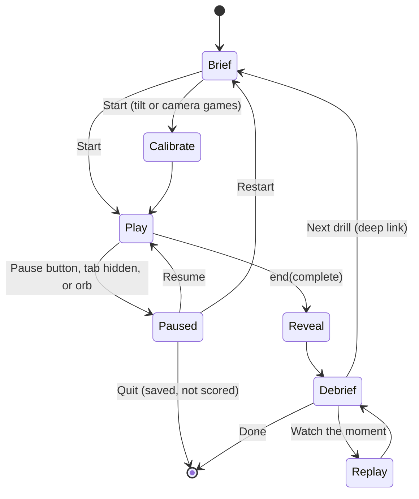

# UI Spec: Learn, Games, Voice and Portals
> Project: Margdarshak · Owner: Design lead (UI/UX) · Status: Draft v0.1 · Last updated: 2026-10-23
> Related: [PROJECT_BRIEF](../00-overview/PROJECT_BRIEF.md) · [PRD](../01-product/PRD.md) · [UI_SPEC (journey screens)](./UI_SPEC.md) · [ACCESSIBILITY](./ACCESSIBILITY.md) · [LOCALIZATION](./LOCALIZATION.md) · [FRONTEND](../03-engineering/FRONTEND.md) · [API_SPEC](../03-engineering/API_SPEC.md) · [DATA_MODEL](../03-engineering/DATA_MODEL.md) · [AI docs](../04-ai/) · [Learning & games docs](../09-learning-games/) · [Government docs](../10-government/)
> Inputs: `research/ps1-deep/06-design-language.md` (tokens, type, motion, orb, game UI), `research/ps1-deep/08-game-ai-n8n.md` (games G1–G10, Game SDK, gamification, debrief), `research/ps1-deep/02-accident-curriculum.md` (modules M1–M22), `research/ps1-deep/05-psychology.md` (via 08), `war-room/margdarshak-verification.md` (D-01..D-25), `field-kit/NAZAR-FIELD-KIT.md`.

This file is the screen-level contract for everything a learner does to *learn and practise* (F-20 to F-28, F-31), the Voice Guide (F-30) as it appears on every screen, and the four ecosystem surfaces (F-40, F-41, F-42 and the clip admin behind F-23). The journey screens (S0–S2, S5–S9: Home, plan, guided LL application, slots, tracker, renewals) live in `UI_SPEC.md`; where a screen here hands off to one of them, the route is named.

UI/UX is the team's top priority. Every screen below is specified to the level a front-end engineer can build it without asking a designer, and a tester can write the Playwright + axe test from it.

---

## Contents
- [0. How to read this spec](#0-how-to-read-this-spec)
- [1. Shared foundations for this group](#1-shared-foundations-for-this-group)
- [2. Learn](#2-learn)
- [3. LL Test Simulator (F-22)](#3-ll-test-simulator-f-22)
- [4. Game frame (shared by all nine mini-games)](#4-game-frame-shared-by-all-nine-mini-games)
- [5. The mini-games, one by one](#5-the-mini-games-one-by-one)
- [6. AI Debrief and replay (F-25)](#6-ai-debrief-and-replay-f-25)
- [7. Gamification surfaces (F-26, F-27, F-28)](#7-gamification-surfaces-f-26-f-27-f-28)
- [8. Voice Guide (F-30)](#8-voice-guide-f-30)
- [9. Driving-school portal (F-40)](#9-driving-school-portal-f-40)
- [10. State / RTO console (F-41)](#10-state--rto-console-f-41)
- [11. Rule-pack studio (F-42)](#11-rule-pack-studio-f-42)
- [12. Clip admin (F-23 pipeline)](#12-clip-admin-f-23-pipeline)
- [13. Analytics event catalogue](#13-analytics-event-catalogue)
- [14. Traceability: features and edge cases](#14-traceability-features-and-edge-cases)
- [15. Inconsistencies found, and unverified items](#15-inconsistencies-found-and-unverified-items)

---

## 0. How to read this spec

### 0.1 Per-screen template
Every screen has the same blocks, in the same order:

| Block | What it contains |
|---|---|
| **Purpose** | One sentence: the job the screen does for the user, and the one primary action |
| **Route** | Next.js 16 App Router path (`app/[locale]/...`). Locale prefix is implied: `/hi/learn` and `/en/learn`. Query params are listed |
| **Feature / data** | F-xx, E-xx entities read or written, API-xx calls |
| **Phase** | **Hackathon build (Phase 1–2)**: Deep / Thin / Slide. **Production (Phase 3+)**: what changes |
| **Wireframe** | ASCII at 360 px wide for learner screens (36–38 characters ≈ 360 px at 18 px body); 1280 px for portals |
| **Components** | HeroUI v3 components plus our own (named in `PascalCase`, defined once in §1.4) |
| **Copy** | EN + HI table. Hindi is written, not machine-translated; Dogri is voice-in only (F-50) |
| **States** | loading · empty · error · offline · success, plus screen-specific states |
| **Motion / sound / haptics** | Tokens from `06-design-language.md` B7 and B9 |
| **Accessibility** | No-audio, colour-blind safe, reduced motion, screen reader, one-hand, text size |
| **Analytics** | Events sent through API-63 (F-55). Names in `snake_case`; no PII ever |
| **Edge cases** | EC-xx handled on this screen, and how |

### 0.2 Global rules that every screen in this file obeys
1. **One primary action per screen** (design principle B1-1). Secondary actions are text buttons.
2. **Non-affiliation footer** on every scrollable learner page and every portal page (D-01): *"Independent prototype by team Chanakya. Not affiliated with MoRTH, NIC or any State Transport Department. Uses simulated government data."* / *"टीम चाणक्य का स्वतंत्र प्रोटोटाइप। MoRTH, NIC या किसी राज्य परिवहन विभाग से संबद्ध नहीं। सरकारी डेटा सिम्युलेटेड है।"* Game screens in play mode and the exam-mode simulator hide the footer (it reappears on results).
3. **Wording bans (D-19)** are enforced by a copy lint (`scripts/copy-lint.ts`, CI): "official", "first" (as first-ever), "doesn't exist", "DPDP-compliant", "STQC-certified", "integrated with Sarathi/Aadhaar", "verified licence", "safe" (as a scam verdict), "you would crash", "unsafe driver", "lives saved", "Saarthi". Hindi equivalents in the same lint: "आधिकारिक", "सरकारी सेवा", "पहला/पहली बार" (when used as first-ever), "सुरक्षित है" (as a verdict). Note: "guided first run" and "first attempt" are ordinary-sense uses and are allowed; the lint allow-lists those two phrases.
4. **No rupee literal** in any UI string (D-06). Fees always come from `fees.json` via API-03 with "source: CMVR r.32, checked <date>".
5. **Games label**: every game's brief and results carry *"Practice and familiarisation, not certification"* / *"अभ्यास और परिचय के लिए, प्रमाणन नहीं"* (D-11).
6. **AI surfaces label**: every surface where Gemini text appears carries *"AI can't book, pay or submit"* / *"AI बुकिंग, भुगतान या सबमिट नहीं कर सकता"* (verification §3.3) and labels its text "Coach notes" (AI) or "Auto notes" (template).
7. **Family mode** (D-13 revised, EC-05): a learner under 18 uses Margdarshak on a parent's phone, inside the parent's (adult) account, with the parent's consent (DPDP s.9(1), Rule 10). Every screen in this file works exactly as for any user: lessons, LL simulator, games, server-verified scores, XP, streaks, Practice Record, AI debrief, tutor, voice guide and Road Sign Snap. Two differences only: squads and share cards for the minor's profile need the parent's consent, and the minor's data is never used for behavioural tracking, profiling or targeted ads (s.9(3)). Each screen's States block lists the `family` state where it differs.
8. **Riding lock** (D-14, verification row 11): if the device reports speed > 10 km/h (Geolocation `coords.speed`, only if the user has already granted location for another feature; we never ask for it for this), every learner screen is covered by a full-screen card: *"Pull over to use Margdarshak."* / *"Margdarshak इस्तेमाल करने के लिए गाड़ी किनारे रोकें।"* with a single button *"I'm a passenger"* / *"मैं सवारी (पैसेंजर) हूँ"* that dismisses it for 30 minutes. No location permission means no lock (we do not request location to enforce it).
9. **Server time is the source of truth** for streak weeks, readiness freshness, squad weeks and countdowns (EC-15). The client shows a quiet note if the device clock is off by more than 5 minutes: *"Your phone's clock looks off. We're using Margdarshak's time."*
10. **Numbers in copy come from code** (D-10). Every `{placeholder}` below is filled by the client from API data or by `game-core`; no Gemini text contains digits (08 §5.5).

### 0.3 Phase legend
| Tag | Hackathon build (Phase 1–2) | Production (Phase 3+) |
|---|---|---|
| **Deep** | Fully built, scored, debriefed, in the demo path, Playwright + axe tested | Hardening, localisation into rule-pack languages, analytics dashboards |
| **Thin** | Working end to end on mocks, one level / one scenario, no dead buttons (D-04) | Full content, adaptation levels 1–5 |
| **Slide** | Storyboard frame in the deck plus a static, non-interactive "coming" card in-app that says so honestly | Built |

Depth per screen (from 08 §3.11 and verification §4 risk 1): **Deep**: Learn hub, review queue, question card, Readiness dial, LL simulator, Nazar (mock + learn), Stopping Distance, Blind Spot (Part A + short Part B), AI Debrief, replay, XP/badges/streak, share card, Voice orb (one scripted Hindi flow live), clip admin, rule-pack studio diff. **Thin**: lesson player (6 lessons), Junction Scan, Track Test Twin (figure-8, touch + keyboard), Helmet Fit (framing + checklist), Golden Hour (one scenario, "draft"), squads, Practice Record + QR, Road Sign Snap, school portal (learners, logs, sign-off), state console (4 views on seeded data). **Slide**: Night & Glare, Hill Road (J&K storyboard), school bookings and vehicle hire, console demand forecast model training.

---

## 1. Shared foundations for this group

### 1.1 Tokens used (all from `06-design-language.md` B2–B7; never re-declared here)
| Purpose | Token | Note |
|---|---|---|
| Canvas / cards / wells | `--bg #FCFCFA`, `--surface #FFFFFF`, `--surface-2 #F2F2EE` | Dark: `#0C0C0F / #16161B / #1B1B20` |
| Text | `--ink`, `--ink-2`, `--ink-3` (≥14 px only) | 16.05 / 10.57 / 5.59 : 1 |
| Primary action | `--primary #3333CC` fill, white label 8.45:1 | Dark fill `#8FA3F2` with `#0C0C0F` label |
| "Now" / selecting | `--amber #FEB12B` | Never text; always paired with an ink label |
| Done | `--success #3D6B1C` + ✓ circle glyph | |
| Caution | `--warning-ink #7A5210` on `--warning-soft #FFF8E6` | Wrong-answer and debrief "where you lacked" cards use this, never red |
| Real danger only | `--danger #A21913` + ⬣ octagon glyph | Allowed in games only for critical-fault markers (with pattern + icon), never for a wrong answer |
| Game canvas / HUD | `--road #2A2C33`, white on it 13.94:1 | |
| Nazar tap ring | `--nazar #FFB053` on road, 7.69:1 | |
| Topic hues (Learn tiles) | Signs `#E8EFFC`, Rules `#E3F1D8`, Survival `#FEEDE6`, Night & highway `#D2DFF9`, First aid `#F9D5E1` | Tile backgrounds only, `--ink` on top (> 13:1) |
| Easing | `--ease-standard`, `--ease-out-expo`, `--ease-spring-reward` (rewards only) | Durations `80/160/240/400/700` ms |
| Score numerals | DM Mono 56/56, `tabular-nums` | |
| Radius | `lg 12` chips, `xl 16` cards, `2xl 24` sheets, `full` buttons and orb | Concentric rule: inner = outer − padding |

**Game colour rule (EC-13 colour vision):** game states use the Okabe-Ito palette **plus** a shape and a pattern for every state (08 §2.3-6). Fixed mapping used by every game:

| Game state | Colour (Okabe-Ito) | Shape | Pattern | Word |
|---|---|---|---|---|
| Hazard / threat | Vermillion `#D55E00` | Triangle ▲ | 45° hatching | "Hazard" / "खतरा" |
| No-zone / blind area | Orange `#E69F00` | Eye-off icon | Cross-hatch | "Can't see you" / "आप नहीं दिखते" |
| Safe position / correct | Bluish green `#009E73` | Circle ● | Solid | "Good" / "सही" |
| Your tap / your position | Amber `--nazar #FFB053` | Ring ◯ | Solid ring | "You" / "आप" |
| Scoring window (debrief) | Sky blue `#56B4E9` | Band | Vertical stripes | "Window" / "सही समय" |
| Critical fault | Vermillion + ⬣ | Octagon | Dense hatching | "Critical" / "गंभीर गलती" |

Every pair above is checked in the "Deuteranopia / Protanopia / Tritanopia" Chrome DevTools emulation in the a11y test checklist; the shape and word carry the meaning without colour.

### 1.2 Learner shell
Four bottom tabs (team report §redesign, kept by the council): **Home · My Licence · Learn · Help** / **होम · मेरा लाइसेंस · सीखें · मदद**. Everything in §2–§8 lives under the **Learn** tab, except the Voice orb (every screen) and the share/verify pages (public, no shell).

```
┌────────────────────────────────────┐ 360
│ [M] Margdarshak        [हि/EN] [⚙] │ 56 header (no emblem, D-01)
├────────────────────────────────────┤
│                                    │
│          screen content            │
│                                    │
│                                    │
│               ( ◉ )                │ 72 voice orb, docked
├────────────────────────────────────┤
│  ⌂ Home  ▤ My Licence  ✎ Learn  ? │ 64 tab bar, labels always shown
│                         ▔▔▔▔▔      │ active = 3px --primary bar + bold
└────────────────────────────────────┘
```
- Inside a game in play mode, the tab bar and orb hide (full-screen); the orb is reachable from the pause sheet.
- In the LL simulator exam mode, the orb is **removed** (exam fidelity, zero decoration, B7 rule), and the header shows only the exam bar.
- Lite mode (F-51) uses the same layout with no Rive, Lottie, shadows or blur; the orb becomes the CSS concentric-ring fallback.

### 1.3 Learn sub-navigation
The Learn tab has a segmented control at the top: **Learn · Practise · Me** / **सीखें · अभ्यास · मेरी प्रगति**.
- **Learn** = hub (skill tree + review queue), lessons, readiness. Route `/learn`.
- **Practise** = LL simulator + games grid. Route `/learn/practise`.
- **Me** = XP, rank, badges, streak, squads, Practice Record. Route `/learn/me`. Shown in family mode too (D-13 revised); the squad and share entries show a parent-consent step until the parent turns them on.

### 1.4 Component inventory (defined once, used everywhere in this file)
| Component | Built on | Props (key) | Notes |
|---|---|---|---|
| `SkillNode` | HeroUI `Button` + SVG | `nodeId, state: locked\|learning\|mastered\|fading, mastery 0–1, moduleId` | 64 px circle, state by glyph (lock / half-ring / ✓ / refresh arrow) + word |
| `SkillTree` | SVG + DOM list | `tree, classFilter` | Visual tree for sighted users; the DOM is an ordered `<ol>` with `aria-describedby` dependencies (screen readers get a list, not a picture) |
| `ReviewQueueCard` | HeroUI `Card` | `dueCount, estMinutes, topics[]` | |
| `LessonPlayer` | DOM + Motion | `lesson, step, total` | Step pager, sticky progress |
| `QuestionCard` | HeroUI `RadioGroup` | `question, variant, options[], mode: practice\|mock, confidence` | §2.5 |
| `ConfidencePicker` | HeroUI `RadioGroup` (segmented) | `value: 50\|75\|100` | §2.5 |
| `ExplanationPanel` | HeroUI `Card` | `correct, why, ruleId, source` | Zutobi pattern |
| `SourceChip` | HeroUI `Chip` | `ruleId, label, url, verifiedOn, verified` | `verified=false` renders "Being checked" and is never shown under AI text (08 §5.5-2) |
| `ReadinessDial` | SVG arc + Motion spring | `score, knowledge, calibration, trend, gate=85` | §2.7 |
| `SimExamBar` | DOM | `q, total, perQTimer, totalTimer` | Zero motion |
| `GameBrief` | HeroUI `Card` | `game, objective, controls, a11yModes, scoringSummary` | §4.1 |
| `GameHUD` | DOM over canvas/video | `counter, skillTag, pause` | §4.2 |
| `PauseSheet` | HeroUI `Drawer` (bottom) | | §4.4 |
| `ScoreReveal` | DOM + Motion | `score, max, skillName, passed` | §4.5 |
| `DebriefStack` | HeroUI `Card` stack + swipe | `debrief: E-19` | §6 |
| `FrozenFrame` | `<canvas>` still + SVG | `frameUrl, cue, facts` | §6.3 |
| `XPBar`, `RankBadge`, `RoadSignBadge` | SVG | | §7 |
| `StreakRoad` | SVG | `weeks[], goal, done, potholes[]` | §7.3 |
| `ShareCardPreview` | `` of server OG render | | §7.5 |
| `VoiceOrb` | Rive (canvas-lite) + CSS fallback | `state (8), level 0–1` | §8 |
| `MicChip` | HeroUI `Chip` | | "Mic on · not stored" |
| `KAnonCell` | DOM | `value, n, k=5` | Console: shows "< 5" instead of a value |
| `DiffView` | DOM table | `before, after, fieldMeta` | §11 |
| `RaterTimeline` | `<video>` + SVG scrub | `clip, windows[]` | §12 |
| `Footer` | DOM | | Non-affiliation line + grievance officer link (G12) |

### 1.5 Global states used by name below
| State | Pattern | EN | HI |
|---|---|---|---|
| `loading` | Skeleton blocks in `--surface-2` with a 1.2 s shimmer (reduced motion: static) | — (skeleton) | — |
| `offline` | Top banner `--primary-soft`, Lite badge | "You're offline. Mock tests and saved lessons still work." | "आप ऑफ़लाइन हैं। मॉक टेस्ट और सेव किए गए पाठ फिर भी चलेंगे।" |
| `error` | Inline card, Diya "think" state, one retry | "That didn't load. Your progress is saved." · Retry | "यह लोड नहीं हुआ। आपकी प्रगति सेव है।" · फिर कोशिश करें |
| `family` | Calm info chip, no lock icon (D-13 revised) | "Family mode: you're learning in {account_holder}'s account. Everything works here, AI included." | "फ़ैमिली मोड: आप {account_holder} के अकाउंट में सीख रहे हैं। यहाँ सब कुछ चलता है, AI समेत।" |
| `ai_off` (EC-29) | Grey "Auto notes" label on cards | "Coach is resting. These are auto notes, same facts." | "कोच अभी उपलब्ध नहीं। ये ऑटो नोट्स हैं, तथ्य वही हैं।" |
| `not_counted` (integrity) | Neutral chip, never an accusation (08 §2.3-4) | "This session wasn't counted for your card." | "यह सेशन आपके कार्ड में नहीं गिना गया।" |

### 1.6 Analytics envelope (F-55, API-63)
Every event below is sent as `{event, ts_server, session_band: "adult", locale, lite: bool, offline_queued: bool, props}`. **Never** sent: uid in clear (a rotating daily pseudonym is used), name, DOB, phone, RTO, case data, free text, coordinates, camera or audio. Events from a minor's profile (family mode) follow the same allowlist and are never used for behavioural tracking, profiling or ads (s.9(3), D-13 revised). Events queue in IndexedDB offline and flush idempotently by `(pseudonym, seq)`.

---

## 2. Learn

### 2.1 Learn hub (skill tree + today's review queue)
**Purpose.** Show, in one glance, what to do today (the review queue) and where the learner stands on the curriculum (the skill tree). Primary action: **Start today's review**.

**Route.** `/learn` · query `?class=MCWG|LMV-NT|MCWOG|MC50CC` (defaults to the case's classes from E-03; a learner with two classes, EC-21, gets a class switch).

**Feature / data.** F-20, F-21 (dial preview), F-26 (rank chip). Reads E-18 TopicMastery, E-22 Achievement, E-03 ClassSelection. API-30 `GET /v1/learn/modules`, API-31 `GET /v1/learn/review-queue`, API-33 `GET /v1/readiness`, API-38.

**Phase.** Hackathon: **Deep** (LL syllabus branch + M1, M3, M4, M5, M6 survival nodes; other nodes render with "content coming" per D-05). Production: all 22 modules, per-class trees for transport classes, state rule-pack topic weights.

**Wireframe (360 px).**
```
┌────────────────────────────────────┐
│ [Learn] Practise   Me              │ segmented control
├────────────────────────────────────┤
│ Gali rider · 340 XP      ◔ 78      │ rank chip  ·  mini dial → /learn/readiness
│ ▸ Week 3: ●●●○  3 of 4 sessions    │ StreakRoad mini
├────────────────────────────────────┤
│ ┌────────────────────────────────┐ │
│ │ Today's review                 │ │ ReviewQueueCard
│ │ 12 cards · about 6 min         │ │
│ │ Signs 5 · Rules 4 · Hazard 3   │ │
│ │ ┌────────────────────────────┐ │ │
│ │ │   Start today's review   → │ │ │ primary, 56 px
│ │ └────────────────────────────┘ │ │
│ └────────────────────────────────┘ │
├────────────────────────────────────┤
│ Your road  [Bike ▾]                │ class switch (EC-21)
│                                    │
│ LL SYLLABUS                        │ (weight label, not caps for Indic)
│  (✓)──(◐)──(◐)──(🔒)               │ Signs · Rules · Hand signals · MV Act
│  Signs  Rules Hand  MV Act         │
│                                    │
│ SURVIVAL SKILLS                    │
│  (◐)M1 Stopping ──► (🔒)M2 Impact  │
│  (✓)M3 Helmet                      │
│  (◐)M4 No-zone ──► (🔒)M5 Overtake │
│  (↻)M6 Junctions  "refresh"        │ fading node, soft chip
│  (🔒)M8 Night     (🔒)M19 Golden hr│
│                                    │
│ DL TEST                            │
│  (🔒)Track Twin  needs M1 + Signs  │
│                                    │
│ Show as list ☰                     │ toggles tree → plain list
└────────────────────────────────────┘
│              ( ◉ )                 │
│  ⌂     ▤     ✎ Learn     ?         │
```

**Components.** `SkillTree`, `SkillNode`, `ReviewQueueCard`, `ReadinessDial` (size `sm`, 48 px, number only), `RankBadge` chip, `StreakRoad` (mini), HeroUI `Tabs` (segmented), `Select` (class switch).

**Skill-tree mapping (data, from 08 §4.3 and 02 modules).**
| Branch | Node (ID) | Unlocks after | Games feeding it | Topic hue |
|---|---|---|---|---|
| LL syllabus | `LL_SIGNS`, `LL_RULES`, `LL_HAND`, `LL_MVACT` | none (all open) | G10 LL sim, lessons, Road Sign Snap | Signs / Rules |
| Survival | `M1` Stopping distance → `M2` Impact speed → `M7` Following distance → `M16` Fog/rain | M1 ≥ learning | G3 | Survival |
| Survival | `M3` Helmet → `M13` Pillion/loads | — | G8 | Survival |
| Survival | `M4` No-zone → `M5` Left-overtake | — | G4, G1 | Survival |
| Survival | `M6` Junctions → `M18` Pedestrians/animals | — | G2, G1 | Survival |
| Night & highway | `M8` Night/glare → `M16` | — | G6, G1 | Night & highway |
| J&K pack (tenant `JK`) | `M14` Hill → `M15` Landslides/snow | — | G7 | Night & highway |
| First aid | `M19` Golden hour | — | G9 | First aid |
| DL test | `TRACK_<class>` | `M1` + `LL_SIGNS` ≥ learning | G5 | Rules |

Node states (08 §4.3): **locked** (lock glyph, "Opens after M1"), **learning** (half-ring filled to mastery, "Learning · 62%"), **mastered** (✓ circle, "Mastered"), **fading** (↻ arrow, soft amber chip "Refresh", when mastery falls below 0.7 by FSRS decay; never red).

**Copy.**
| Key | EN | HI |
|---|---|---|
| `learn.hub.title` | Your road | आपका रास्ता |
| `learn.review.title` | Today's review | आज का रिविज़न |
| `learn.review.meta` | {n} cards · about {min} min | {n} कार्ड · लगभग {min} मिनट |
| `learn.review.cta` | Start today's review | आज का रिविज़न शुरू करें |
| `learn.review.empty` | All caught up. Your next review opens tomorrow. | सब हो गया। अगला रिविज़न कल खुलेगा। |
| `learn.review.empty.cta` | Try a Nazar clip | एक नज़र क्लिप आज़माएँ |
| `learn.node.locked` | Opens after {prereq} | {prereq} के बाद खुलेगा |
| `learn.node.learning` | Learning · {pct}% | सीख रहे हैं · {pct}% |
| `learn.node.mastered` | Mastered | पक्का हो गया |
| `learn.node.fading` | Refresh | दोहराएँ |
| `learn.node.coming` | Learning content coming for this class. Verify at your RTO. | इस क्लास का सीखने वाला कंटेंट जल्द आएगा। अपने RTO से पुष्टि करें। |
| `learn.tree.list` | Show as list | सूची में देखें |
| `learn.class.switch` | Your road for: | किसके लिए: |

**States.**
- `loading`: skeleton tree (static grey circles) + skeleton queue card.
- `empty` (new learner, no evidence yet): queue card becomes *"Start with signs. 8 cards, about 4 min."* / *"संकेतों से शुरू करें। 8 कार्ड, लगभग 4 मिनट।"*; all LL nodes "learning · 0%".
- `nothing due`: copy `learn.review.empty` + Diya idle + CTA to Nazar.
- `offline`: queue computed on device by ts-fsrs from the cached deck (works fully offline, 08 §4.4); banner `offline`; games that need clips not downloaded show "Download practice pack (≈ {mb} MB)" with size shown before download (no silent download, 08 §1.3).
- `error`: tree from the last cached copy + `error` banner.
- `family`: identical to every user (tree, server review queue, rank chip, streak, dial); `family` chip at top.
- `EC-22` (already holds an LL): the hub opens with a one-time sheet *"Already have your learner's licence? We'll start you on the driving-test skills."* · *"Start there"* / *"पहले से लर्नर लाइसेंस है? हम आपको ड्राइविंग टेस्ट वाले कौशल से शुरू कराएँगे।"* · *"वहीं से शुरू करें"*.
- `EC-21` (two classes, different eligibility ages, e.g. 17-year-old wanting MC50CC now and LMV later): the class switch shows LMV as *"Opens at 18"* and its tree read-only.

**Motion / sound / haptics.** Node completion: dot fills then the connector line grows to the next node (layout animation, 400 ms `--ease-out-expo`, B7). Reduced motion: instant state swap with a 160 ms opacity fade. No sound on the hub. No haptics.

**Accessibility.** Tree is an SVG with `aria-hidden="true"`; the same data is an `<ol>` of nodes, each a button with name *"M4 No-zone: trucks and buses. Learning, 62 percent. Opens M5."*; the "Show as list" toggle swaps the visual to that list for sighted low-vision users. Every node is ≥ 48 px. State never by colour alone (glyph + word). Topic hue tiles keep `--ink` text at > 13:1. Font scaling to 200% reflows the tree into the list automatically below 320 CSS px of available width.

**Analytics.** `learn_hub_viewed {due_count, nodes_learning, nodes_mastered, nodes_fading, class}` · `learn_review_started {due_count}` · `learn_node_opened {node_id, state}` · `learn_tree_list_toggled {to}` · `learn_class_switched {class}`.

**Edge cases.** EC-05 (family mode: identical, D-13 revised), EC-19 (Lite: SVG tree replaced by list by default; first load of the hub ≤ 60 KB incl. data), EC-21, EC-22, EC-15 (queue "due" uses server date when online, device date offline, reconciled on sync with server winning).

---

### 2.2 Skill node detail
**Purpose.** Explain why a skill matters (with source), show mastery, and send the learner to the right lesson or game. Primary action: **Practise this** (the best next activity, chosen by FSRS + staircase in code).

**Route.** `/learn/skill/[nodeId]`.

**Feature / data.** F-20, F-24. E-18, rule rows from `rules.json` (E-08). API-30.

**Phase.** Hackathon: **Deep** for nodes with content; "content coming" card for others. Production: all nodes.

**Wireframe.**
```
┌────────────────────────────────────┐
│ ← Your road                        │
│ ┌──────────────────────────────┐   │ topic hue tile (Survival #FEEDE6)
│ │  ▲  M4 · The no-zone         │   │
│ │  Trucks and buses            │   │
│ └──────────────────────────────┘   │
│ Learning · 62%   ▓▓▓▓▓▓░░░░        │
│                                    │
│ Why this matters                   │
│ Trucks and buses killed 18,556     │
│ two-wheeler riders in 2023.        │
│ [MoRTH RAI 2023, Table 4.5 ↗]      │ SourceChip
│                                    │
│ You'll learn to                    │
│ • name the 4 blind spots of a truck│
│ • never overtake from the left     │
│ • not linger beside a truck        │
│                                    │
│ ┌────────────────────────────────┐ │
│ │   Practise this: Blind Spot  → │ │ primary
│ └────────────────────────────────┘ │
│ Read the lesson (3 min)            │ secondary
│ Cards in this skill: 9 · 3 due     │
└────────────────────────────────────┘
```
**Copy.**
| Key | EN | HI |
|---|---|---|
| `skill.why` | Why this matters | यह क्यों ज़रूरी है |
| `skill.learn` | You'll learn to | आप सीखेंगे |
| `skill.cta.practise` | Practise this: {game} | इसका अभ्यास करें: {game} |
| `skill.cta.lesson` | Read the lesson ({min} min) | पाठ पढ़ें ({min} मिनट) |
| `skill.cards` | Cards in this skill: {n} · {due} due | इस कौशल के कार्ड: {n} · {due} बाकी |

The "why" figure is a template filled from the curriculum table (`02-accident-curriculum.md` M-rows, with its source); no AI. Tone rule: one fact, no gore, no "you would die" (05 principle; tone lint).

**States.** `loading` skeleton; `coming` (no content for this class, D-05); `locked` (CTA becomes *"Opens after {prereq}"*, secondary *"Go to {prereq}"*); `offline` (CTA disabled only if the game needs uncached assets, with the download size). `family`: identical.

**Motion.** Shared-axis slide in (16 px + fade, 240 ms). Reduced motion: fade.

**Accessibility.** Heading order h1 (skill) → h2 (Why / You'll learn). Source chip has accessible name *"Source: MoRTH Road Accidents in India 2023, table 4.5, opens in new tab"*.

**Analytics.** `skill_viewed {node_id, state}` · `skill_cta_tapped {node_id, target: game|lesson}` · `source_chip_opened {rule_id, surface:"skill"}`.

---

### 2.3 Review queue session
**Purpose.** Run the FSRS-due cards in one short sitting, with confidence rated on each, and end with a 1-line summary. Primary action per card: **Check** (after choosing an answer and a confidence).

**Route.** `/learn/review` · `?topic=` optional filter.

**Feature / data.** F-20 (FSRS via ts-fsrs 5.x, pinned at H0 after `npm view ts-fsrs version`), F-21. Writes E-18 via API-32 `POST /v1/learn/answers` (batched; offline queue).

**Phase.** Hackathon: **Deep**. Production: same, plus per-state topic weights.

**Wireframe.** Card frame = `QuestionCard` (§2.5) with a progress bar on top:
```
┌────────────────────────────────────┐
│ ✕   ▓▓▓▓▓░░░░░░░  5 / 12           │ close (confirms "progress saved")
├────────────────────────────────────┤
│   [ QuestionCard, §2.5 ]           │
└────────────────────────────────────┘
```
End of queue:
```
┌────────────────────────────────────┐
│  Review done                       │
│  12 cards · 9 right                │
│  Sure and wrong: 1                 │ calibration line (private)
│  +60 XP                            │
│  Next review: tomorrow             │
│ ┌────────────────────────────────┐ │
│ │      Practise a weak sign    → │ │ primary (lowest-R card's topic)
│ └────────────────────────────────┘ │
│  Back to your road                 │
└────────────────────────────────────┘
```
**Copy.**
| Key | EN | HI |
|---|---|---|
| `review.done.title` | Review done | रिविज़न पूरा |
| `review.done.score` | {n} cards · {right} right | {n} कार्ड · {right} सही |
| `review.done.cal` | Sure and wrong: {k} | पक्का था पर गलत: {k} |
| `review.done.next` | Next review: {when} | अगला रिविज़न: {when} |
| `review.close.confirm` | Leave now? Your answers so far are saved. | अभी छोड़ें? अब तक के जवाब सेव हैं। |

**States.** `offline`: works fully (ts-fsrs on device); answers queue for API-32. `error` on sync: silent retry with exponential backoff; a small "Saved on this phone, will sync" chip. `family`: identical, XP line included.

**Motion / sound / haptics.** Card advance: 240 ms horizontal slide. Correct: 2-note marimba C5→G5 + `[12]`; wrong: soft "tok" + `[8, 40, 8]` (B9; Android only; iOS has no Vibration API). End screen: XP number ticks up 400 ms (no spring; spring is for game rewards). Reduced motion: no slide, no tick-up.

**Accessibility.** Progress announced as *"Card 5 of 12"* via `aria-live="polite"` on advance. Close button 48 px top-left. Sound defaults follow B9 (on in Learn, respects silent mode); every sound has a visual equivalent (✓ / ▲ banner).

**Analytics.** `review_session_started {due}` · `review_answer {topic, correct, confidence, latency_bucket}` (no question text) · `review_session_completed {n, right, overconf_events}` · `review_session_abandoned {at}`.

**Edge cases.** EC-15 (due dates use server time on sync), EC-19 (deck cached ≤ 150 KB of JSON + sign SVGs).

---

### 2.4 Lesson player
**Purpose.** Teach one concept in 3–6 short steps (see → try → explain), Enlightr-style, ending in a 2-question check that feeds FSRS. Primary action: **Next**.

**Route.** `/learn/lesson/[lessonId]` · `?step=n` (deep-linkable for the voice guide's `open_drill`).

**Feature / data.** F-20, F-31 (tutor link on wrong answers). Content from the reviewed bank (`content/lessons/*.mdx`, versioned, `reviewed_by`). API-30.

**Phase.** Hackathon: **Thin** (6 lessons: signs ×2, rules ×2, M1, M4). Production: 22 modules × 2–4 lessons.

**Wireframe.**
```
┌────────────────────────────────────┐
│ ✕  M1 · Stopping distance   2 / 5  │ sticky header, step pager
│ ▓▓▓▓▓▓▓░░░░░░░░░░░░                │
├────────────────────────────────────┤
│ ┌────────────────────────────────┐ │
│ │      [illustration: Dawn road, │ │ 16:9, SVG or WebP ≤ 40 KB
│ │       child at 25 m]           │ │
│ └────────────────────────────────┘ │
│                                    │
│ At 40 km/h you travel about 11 m   │ body 18/28
│ every second. Before your foot     │
│ even reaches the brake, you've     │
│ covered about 17 m.                │
│                                    │
│ [▶ Watch it] (6 s animation)       │ optional, captioned
│                                    │
│ Source: MoRTH RAI 2023 · WHO       │ SourceChip
│                                    │
│ ┌──────────────┐ ┌───────────────┐ │
│ │   ← Back     │ │    Next →     │ │ bottom 40% zone, 56 px
│ └──────────────┘ └───────────────┘ │
└────────────────────────────────────┘
```
The numbers in that sample come from the lesson's computed facts (`d = v·t_r` at 40 km/h with t_r = 1.5 s = 16.7 m; reviewed content, not AI).

Step types: `explain` (text + image), `animate` (Motion/Rive with captions and a pause), `try` (one interactive: drag a marker, tap a sign), `check` (2 `QuestionCard`s in practice mode). The last screen: *"Lesson done. 2 cards added to your review."*

**Copy.**
| Key | EN | HI |
|---|---|---|
| `lesson.next` / `lesson.back` | Next / Back | आगे / पीछे |
| `lesson.watch` | Watch it | देखें |
| `lesson.done` | Lesson done. {n} cards added to your review. | पाठ पूरा। {n} कार्ड आपके रिविज़न में जोड़े गए। |
| `lesson.done.cta` | Practise it in {game} | {game} में अभ्यास करें |
| `lesson.tutor` | Why was I wrong? | मैं गलत क्यों था? |

**States.** `loading` (text first, media lazy); `offline` (cached lessons work; uncached show "Saved lessons only" with list); `error` (media failed → alt text shown in a `--surface-2` box, lesson continues). `family`: same, tutor link included.

**Motion.** Step change: 16 px shared-axis slide. `animate` steps pause at each caption; never autoplay with sound. Reduced motion: `animate` steps show a 3-frame still sequence with captions instead.

**Accessibility.** Every image has authored alt text describing the *teaching point*, not the picture ("A child steps out 25 metres ahead; at 40 km/h you need about 26 metres to stop"). Animations have captions and a transcript link. Swipe is optional; Back/Next buttons are always present. Text never inside images.

**Analytics.** `lesson_started {lesson_id}` · `lesson_step_viewed {lesson_id, step, type}` · `lesson_completed {lesson_id, check_right}` · `lesson_abandoned {lesson_id, step}` · `tutor_opened {surface:"lesson"}`.

**Personal tutor sheet (F-31, M-04).** "Why was I wrong?" opens a bottom sheet with 2–3 sentences grounded only in the reviewed explanation for that question (M-04 content-grounded), a `SourceChip`, and the AI label. Offline / AI consent off / EC-29: the sheet shows the reviewed explanation verbatim under "Auto notes". API-41.

---

### 2.5 Question card with confidence rating
**Purpose.** Ask one question in one of its 3–6 surface variants, collect a confidence rating **before** feedback (practice mode), then explain. Primary action: **Check**.

**Route.** Component; used in `/learn/review`, `/learn/lesson/*`, `/learn/practise/ll-sim` (practice mode), Nazar learn mode prediction step.

**Feature / data.** F-20 (variants so memorising fails), F-21 (calibration/Brier), E-18. API-32 sends `{card_id, variant_id, option, correct, confidence, latency_ms}`.

**Wireframe (practice mode).**
```
┌────────────────────────────────────┐
│ SIGNS · Mandatory                  │ topic chip (Signs hue)
│ ┌────────────────────────────────┐ │
│ │        [IRC:67 sign SVG,       │ │ true colours, neutral tile
│ │         photographed variant]  │ │
│ └────────────────────────────────┘ │
│ What does this sign tell you?      │ h3
│                                    │
│ ◯  No entry for all vehicles       │ 56 px rows, full-width
│ ◯  One-way: no entry from here     │
│ ◉  Compulsory turn left            │ selected = 2 px --primary ring + fill dot
│ ◯  No left turn                    │
│                                    │
│ How sure are you?                  │
│ ┌────────┬──────────┬────────────┐ │ ConfidencePicker (segmented)
│ │ Guess  │  Fairly  │  Certain   │ │
│ │  50%   │   75%    │   100%     │ │
│ └────────┴──────────┴────────────┘ │
│ ┌────────────────────────────────┐ │
│ │            Check               │ │ disabled until answer + confidence
│ └────────────────────────────────┘ │
└────────────────────────────────────┘
```
After **Check** (wrong, was "Certain"):
```
┌────────────────────────────────────┐
│ ▲ Not quite                        │ --warning-soft card, never red
│ You chose: Compulsory turn left    │
│ Answer: No left turn               │ ✓ glyph + bold
│                                    │
│ A red ring with a slash means      │ ExplanationPanel (reviewed text)
│ "don't". A blue circle means       │
│ "must".                            │
│ [IRC:67 · Mandatory signs ↗]       │ SourceChip
│                                    │
│ You were certain on this one.      │ calibration note (private)
│ Worth a second look.               │
│                                    │
│ Why was I wrong?                   │ tutor (AI, every user)
│ ┌────────────────────────────────┐ │
│ │           Continue →           │ │
│ └────────────────────────────────┘ │
└────────────────────────────────────┘
```
**Rules.**
- Option order shuffled per variant from the session seed; the correct option's position is not stored on the client before answering in mock mode.
- **Practice mode:** confidence before feedback (08 G10). **Mock mode (LL sim exam):** no confidence during the exam; one combined confidence question after the exam ("How many do you think you got right?") to stay true to the real format.
- FSRS rating mapping is deterministic (08 §4.4): wrong → 1 Again; correct but slow (> 80% of the per-question timer) or at 50% → 2 Hard; correct on time → 3 Good; correct at 100% and fast → 4 Easy; **wrong at 100%** → 1 Again + an overconfidence event.
- Keyboard: `1–4` choose options, `Q/W/E` choose 50/75/100, `Enter` checks.

**Copy.**
| Key | EN | HI |
|---|---|---|
| `q.sure` | How sure are you? | आप कितने पक्के हैं? |
| `q.conf.50` | Guess · 50% | अंदाज़ा · 50% |
| `q.conf.75` | Fairly · 75% | काफ़ी हद तक · 75% |
| `q.conf.100` | Certain · 100% | पूरा यकीन · 100% |
| `q.check` | Check | जाँचें |
| `q.right` | Right | सही |
| `q.notquite` | Not quite | पूरा सही नहीं |
| `q.youchose` | You chose: {a} | आपने चुना: {a} |
| `q.answer` | Answer: {a} | सही जवाब: {a} |
| `q.overconf` | You were certain on this one. Worth a second look. | इस पर आपको पूरा यकीन था। एक बार और देख लें। |
| `q.underconf` | You guessed, and you were right. You know more than you think. | आपने अंदाज़ा लगाया और सही निकले। आप सोच से ज़्यादा जानते हैं। |
| `q.continue` | Continue | आगे बढ़ें |

**States.** `answered-right`, `answered-wrong`, `timed-out` (LL sim only: "Time's up on this one" / "इस सवाल का समय खत्म"), `image-failed` (alt text shown + "Report a problem"), `offline` (works; queue).

**Motion / sound / haptics.** Selection: 80 ms ring. Feedback panel: 240 ms expand from the options (`--ease-out-expo`). Sounds per B9. Reduced motion: panel appears without expansion.

**Accessibility.** `RadioGroup` with `aria-labelledby` = question; confidence is a second `RadioGroup` labelled "How sure are you?". The sign image has alt text that does **not** give the answer away ("A circular sign with a red border and a left-pointing arrow under a diagonal red line" would give it away, so alt is "Road sign, picture 1 of 3: circular sign, see description" with a long description available only *after* answering). For blind users the question offers an "Audio-described version" variant written for the concept (EC-13: we do not make blind users fail sign questions that the real test would accommodate differently; label it "practice description, the RTO test may differ"). Feedback announced with `role="status"`.

**Analytics.** `question_answered {mode, topic, card_id_hash, variant, correct, confidence, latency_bucket, timed_out}` · `tutor_opened {surface:"question"}`.

**Edge cases.** EC-13 (colour vision: sign questions never depend on hue alone, every sign family also has its shape named in the explanation; for colour-vision test applicants, a note links to the RTO medical rules section in Help), EC-18 (screen readers), EC-20 (tutor input is not free text; it's a button, so no PII can be typed here).

---

### 2.6 Calibration view
**Purpose.** Show, privately, how well the learner's confidence matches their accuracy, so overconfidence becomes visible (05 principle 11, 08 §4.5). Primary action: **Practise my "sure but wrong" cards**.

**Route.** `/learn/readiness/calibration`.

**Wireframe.**
```
┌────────────────────────────────────┐
│ ← Readiness                        │
│ How well you know what you know    │
│                                    │
│ When you said    You were right    │
│ Guess (50%)      ████████░░ 58%    │ bars + numbers + words
│ Fairly (75%)     ███████░░░ 71%    │
│ Certain (100%)   ██████░░░░ 61%  ▲ │ ▲ "over-sure" marker
│                                    │
│ Over the last 40 answers.          │
│ Sure and wrong this week: 4        │
│                                    │
│ Calibrated badge: needs Brier      │ criteria shown before earning
│ ≤ 0.18 over 40+ answers            │ (bait-and-switch rule)
│ ┌────────────────────────────────┐ │
│ │ Practise my "sure but wrong" → │ │
│ └────────────────────────────────┘ │
└────────────────────────────────────┘
```
**Copy (HI).** "आप जो जानते हैं, उसे कितना ठीक आँकते हैं" · "जब आपने कहा" · "आप सही थे" · "इस हफ़्ते पक्का था पर गलत: {k}" · "'पक्का पर गलत' वाले कार्ड का अभ्यास करें".

**Accessibility.** Bars are decorative; a `<table>` holds the same numbers. **Analytics.** `calibration_viewed {bins_ready}` · `calibration_practise_tapped`.

---

### 2.7 Test Readiness dial (F-21)
**Purpose.** Tell the learner, honestly and with the arithmetic shown, how ready they are for the LL test, what to do next, and let them book whenever they choose. Primary action: **Practise the 3 weakest** (below 85) or **Book your LL test** (at or above 85). **"Book anyway" is always visible** (interface-interference rule, 08 §4.10).

**Route.** `/learn/readiness`.

**Feature / data.** F-21. API-33 `GET /v1/readiness` returns `{score, knowledge, calibration_penalty, topics[{id, mastery, weight, weight_source}], last_mocks[], trend, gate:{threshold:85, topics_ok, mocks_ok}}`. The client never computes the score itself (offline it shows the last cached score).

**Formula shown to the user** (08 §4.4): `Readiness = 100 × Σ w_t·M_t − CalPenalty`, `CalPenalty = min(10, 40 × max(0, OC − 0.05))`. Weights are equal across the 4 LL topics and labelled *"equal weights: the government's topic mix isn't published"* (02 §4).

**Phase.** Hackathon: **Deep**. Production: state rule packs may set weights where a source exists (F-42), each with source and date.

**Wireframe.**
```
┌────────────────────────────────────┐
│ ← Learn                            │
│ Test readiness                     │
│                                    │
│            ╭─────────╮             │
│        ╭───╯  78     ╰───╮         │ ReadinessDial 240 px
│       ╱   ▲ +6 this week  ╲        │ trend arrow + words
│      │ 60                85🔒│      │ labels on arc
│      ╰── Getting there ──Ready╯     │
│                                    │
│  78 = knowledge 84 − calibration 6 │ the equation, DM Mono
│  How is this worked out? ⓘ        │ opens formula sheet
│                                    │
│ ┌──────────────────────────────┐   │
│ │ Signs        ▓▓▓▓▓▓▓▓░ 0.88  │   │ per-topic mastery bars
│ │ Rules        ▓▓▓▓▓▓▓░░ 0.81  │   │
│ │ Hand signals ▓▓▓▓▓▓░░░ 0.69 ▲│   │ < 0.7 → ▲ + "needs work"
│ │ MV Act       ▓▓▓▓▓▓▓▓░ 0.86  │   │
│ └──────────────────────────────┘   │
│ Last 2 mocks: 13/15 · 11/15        │
│                                    │
│ To reach 85: lift Hand signals     │
│ above 0.7, and be a little less    │
│ sure when you guess.               │
│ ┌────────────────────────────────┐ │
│ │  Practise the 3 weakest      → │ │ primary below 85
│ └────────────────────────────────┘ │
│  Book my LL test anyway →          │ ALWAYS visible text link
│  We suggest 85, it's your choice.  │
└────────────────────────────────────┘
```
At ≥ 85 with all gate conditions met, the lock on the arc opens (B11), the primary becomes **Book your LL test** (hands off to the journey's LL booking screen in `UI_SPEC.md`, F-07 Mode A copy-pack), and the "anyway" link disappears because it is no longer needed.

**Gate conditions** (shown as a checklist under "How is this worked out?"): score ≥ 85 · every topic ≥ 0.7 · last 2 mocks ≥ state pass mark + 10 percentage points (pass mark from the state's LL format config). Each row: ✓ or ○ + words.

**Formula sheet** (bottom sheet):
```
Knowledge 84
  = average mastery across 4 topics (equal weights)
  Mastery = how much of the topic you've seen twice
            × how likely you are to remember it today
Calibration −6
  You said "certain" more often than you were right.
  Over your last 40 answers you were about 20% more
  sure than correct. Each 1% over 5% costs 0.4 points,
  up to 10.
Why equal weights? The government's topic mix
isn't published. Source: research note 02 §4.
```
(The sentence "about 20% more sure" and "−6" are filled from API-33; the rule text is static.)

**Copy.**
| Key | EN | HI |
|---|---|---|
| `ready.title` | Test readiness | टेस्ट की तैयारी |
| `ready.eq` | {s} = knowledge {k} − calibration {c} | {s} = जानकारी {k} − अंदाज़े की चूक {c} |
| `ready.how` | How is this worked out? | यह कैसे निकाला गया? |
| `ready.band.low` | Getting there | पहुँच रहे हैं |
| `ready.band.ready` | Ready, book the test | तैयार, टेस्ट बुक करें |
| `ready.trend.up` | +{d} this week | इस हफ़्ते +{d} |
| `ready.trend.down` | −{d} this week: some cards are fading | इस हफ़्ते −{d}: कुछ कार्ड भूल रहे हैं |
| `ready.cta.practise` | Practise the {n} weakest | सबसे कमज़ोर {n} का अभ्यास करें |
| `ready.cta.book` | Book your LL test | अपना LL टेस्ट बुक करें |
| `ready.anyway` | Book my LL test anyway | फिर भी मेरा LL टेस्ट बुक करें |
| `ready.anyway.note` | We suggest 85. It's your choice. | हम 85 सुझाते हैं। फ़ैसला आपका है। |
| `ready.weights` | Equal weights: the government's topic mix isn't published. | बराबर वज़न: सरकार ने विषयों का अनुपात प्रकाशित नहीं किया है। |
| `ready.nodata` | Answer 20 cards to see your readiness. | अपनी तैयारी देखने के लिए 20 कार्ड हल करें। |

Copy-lint note: this screen deliberately avoids the banned word "official" (D-19) even when describing the government's own unpublished blueprint.

**"Book anyway" confirmation** (one neutral sheet, never confirm-shaming): *"You're at {s}. Most people who pass practise until 85, but you know your schedule. Book now?"* · **Book now** · **Not now**. HI: *"आप {s} पर हैं। पास होने वाले ज़्यादातर लोग 85 तक अभ्यास करते हैं, पर अपना समय आप जानते हैं। अभी बुक करें?"* · **अभी बुक करें** · **अभी नहीं**. [unverified] the clause "most people who pass practise until 85" is a design hypothesis, not a measured fact; until `HYPOTHESES.md` data exists, use the neutral fallback *"We suggest 85, but you know your schedule. Book now?"* (owner: research lead, recheck after the field study, 24 Oct 2026).

**States.** `nodata` (< 20 answers: dial greyed with `ready.nodata`; "Book anyway" still visible); `loading`; `offline` (last cached score with *"as of {time}"*); `family` (identical, server score); `stale` (no activity 14+ days: trend shows decay honestly, `ready.trend.down`); `EC-10` (state has no online LL test: CTA copy becomes *"Book your LL test at the RTO"* and the simulator note says the RTO format may differ); `EC-07/EC-09` not applicable here.

**Motion / sound / haptics.** Dial fill animates from 0 → score with a spring `{stiffness:120, damping:20}` (B7) on first view per day; later views show the number immediately. Crossing 85 for the first time: 4-note resolve + Diya cheer + `[15, 40, 25]` haptic (B9), lock-open animation 400 ms. Reduced motion: static dial, no lock animation; sound still allowed (respecting silent mode).

**Accessibility.** The dial is `role="img"` with name *"Readiness 78 out of 100: knowledge 84 minus calibration 6. Trend up 6 this week. Suggested booking level 85."* The topic bars are a table. The equation line is real text. The "anyway" link is a 48 px tall target and is in the tab order right after the primary.

**Analytics.** `readiness_viewed {score_bucket(5), gate_met, topics_below}` · `readiness_formula_opened` · `readiness_practise_tapped` · `readiness_book_tapped {gate_met:true}` · `readiness_book_anyway_tapped {score_bucket}` · `readiness_book_anyway_confirmed {score_bucket}`.

**Edge cases.** EC-05, EC-10, EC-15 (score freshness uses server time), EC-29 (no AI on this screen at all), EC-27 (rule-pack weight change: a banner *"Topic weights for J&K were updated on {date}. Your score was recalculated."* with a SourceChip).

---
## 3. LL Test Simulator (F-22)

The simulator has four screens: **format card → guided first run → exam → results**. Practice mode (per-question feedback, confidence) reuses `QuestionCard` and is reached from the same format card.

### 3.1 Format card (start)
**Purpose.** Show the learner the exact format their state uses, with source and date, before they start; choose Guided run, Exam (mock) or Practice. Primary action: **Start the exam** (or **Take the guided run** if they have never done one).

**Route.** `/learn/practise/ll-sim` · `?state=JK` (defaults to the case's state, E-02).

**Feature / data.** F-22. State LL-format config from the rule pack (E-08): `{questions, pass, per_q_timer_s, total_timer_s, language_options[], source_url, verified_on, confidence}`; read through the API-02/API-03 rules family (`GET /v1/rules/{state}/...`; the exact LL-format path is for API_SPEC to fix). Question variants come from the reviewed bank, with a seed per session.

**Phase.** Hackathon: **Deep** (J&K config + "format unknown" fallback). Production: every state with a source; online-test-unavailable states (EC-10).

**Wireframe.**
```
┌────────────────────────────────────┐
│ ← Practise                         │
│ LL test simulator                  │
│                                    │
│ ┌────────────────────────────────┐ │
│ │ Format for Jammu & Kashmir     │ │
│ │  10 questions                  │ │ from config
│ │  Pass: 6 right                 │ │
│ │  {per_q_timer} s per question  │ │
│ │ Source: {source} ↗             │ │ SourceChip
│ │ Checked on {verified_on}       │ │
│ │ Confidence: medium ▲           │ │ conflicting sources → ▲ + words
│ └────────────────────────────────┘ │
│ Sources disagree on the format in  │
│ some states. Check at your RTO.    │
│                                    │
│ ┌────────────────────────────────┐ │
│ │  Take the guided run (2 min) → │ │ primary if never done
│ └────────────────────────────────┘ │
│ ┌────────────────────────────────┐ │
│ │        Start the exam          │ │ outline; becomes primary later
│ └────────────────────────────────┘ │
│  Practise with feedback            │ text button
│                                    │
│ Your mocks: 13/15 · 11/15 · 9/15   │
│ Language: [English ▾]              │ test language picker (config)
└────────────────────────────────────┘
```
The J&K "10 questions, 6 to pass" values come from `01-abroad.md` as cited in 08 G10 and are shown with **medium** confidence because sources conflict; the per-question timer is a config value (about 30 s per 04 §3.5) [unverified for J&K; owner: rules lead, recheck 24 Oct 2026].

**Fallback when the state's format is unknown:** the format box reads *"Format not confirmed for {state}. Using 15 questions, 9 to pass, as a practice format."* / *"{state} का फ़ॉर्मेट पक्का नहीं है। अभ्यास के लिए 15 सवाल, 9 सही पर पास।"* (08 G10). It is never presented as the state's format (verification §1.1: "must not copy a claimed format").

**Copy.**
| Key | EN | HI |
|---|---|---|
| `llsim.title` | LL test simulator | LL टेस्ट सिम्युलेटर |
| `llsim.format.for` | Format for {state} | {state} का फ़ॉर्मेट |
| `llsim.q` | {n} questions | {n} सवाल |
| `llsim.pass` | Pass: {p} right | पास: {p} सही |
| `llsim.timer` | {s} s per question | हर सवाल के लिए {s} सेकंड |
| `llsim.checked` | Checked on {date} | {date} को जाँचा गया |
| `llsim.disagree` | Sources disagree on the format in some states. Check at your RTO. | कुछ राज्यों में फ़ॉर्मेट पर स्रोत अलग-अलग हैं। अपने RTO से पुष्टि करें। |
| `llsim.guided` | Take the guided run ({min} min) | गाइडेड रन करें ({min} मिनट) |
| `llsim.start` | Start the exam | परीक्षा शुरू करें |
| `llsim.practice` | Practise with feedback | फ़ीडबैक के साथ अभ्यास |
| `llsim.label` | Practice and familiarisation, not certification | अभ्यास और परिचय के लिए, प्रमाणन नहीं |

**States.**
- `loading`.
- `offline`: works fully (config + 3 cached question sets, F-51).
- `format_unknown`: as above.
- `EC-10` (the state has no online LL test, e.g. tests are held at the RTO): the card shows *"In {state} the LL test is taken at the RTO. This practice uses the same question style; the screen there may look different."* / *"{state} में LL टेस्ट RTO पर होता है। यह अभ्यास उसी तरह के सवालों से है; वहाँ की स्क्रीन अलग दिख सकती है।"*
- `family`: works as for every user; MC50CC learners take the same test.

**Analytics.** `llsim_format_viewed {state, format_known, confidence}` · `llsim_mode_chosen {mode: guided|exam|practice}`.

---

### 3.2 Guided first run
**Purpose.** Walk the learner through the test screen's controls before the stakes are real: "This is the timer. This is how you change an answer." (team report, idea 4). Primary action: **Next tip**, then **Got it, start a practice exam**.

**Route.** `/learn/practise/ll-sim/guided`.

**Wireframe.** The exam screen (§3.3) with a coach-mark overlay, one tip at a time, the rest of the screen dimmed to 40%.
```
┌────────────────────────────────────┐
│ Question 1 of 10        ⏱ 0:28    │ ← 3 px --focus ring on the timer
│ ╭──────────────────────────────╮   │
│ │ This is the question timer.  │   │ coach mark, --surface, e2
│ │ When it reaches 0 the test   │   │
│ │ moves on by itself.          │   │
│ │       Tip 1 of 6   [Next →]  │   │
│ │ Skip tour                    │   │
│ ╰──────────────────────────────╯   │
│ ...dimmed exam content...          │
└────────────────────────────────────┘
```
The six tips:
1. The timer.
2. How to pick an answer and change it.
3. "Next" versus "Submit".
4. What happens on a time-out.
5. The result screen.
6. The at-home device check. From `01-sarathi-screens.md`: *"keep the camera on, don't refresh"*.

The face-authentication step is **described in text only**: *"On the real test site, a camera check runs before the test. That happens on Sarathi, not here."* There is **no face match and no camera use** in the simulator (D-07; verification row 4, CUT iii).

**Copy (HI tips).** "यह सवाल का टाइमर है। शून्य होते ही टेस्ट अपने आप आगे बढ़ जाएगा।" · "जवाब चुनने के लिए उस पर टैप करें। बदलना हो तो दूसरे पर टैप करें।" · "'आगे' अगले सवाल पर ले जाता है। 'सबमिट' टेस्ट खत्म करता है।" · "समय खत्म होने पर टेस्ट अगले सवाल पर चला जाता है और वह सवाल खाली गिना जाता है।" · "आखिर में आपको नतीजा दिखेगा।" · "असली टेस्ट साइट पर टेस्ट से पहले कैमरा जाँच होती है। वह Sarathi पर होती है, यहाँ नहीं।"

**Accessibility.** Each coach mark is a `dialog` with focus trapped and a visible "Skip tour" button. The spotlight is a 3 px `--focus` ring, not just dimming. Reduced motion: coach marks appear without the spotlight moving.

**Analytics.** `llsim_guided_tip_viewed {tip}` · `llsim_guided_completed` · `llsim_guided_skipped {at_tip}`.

---

### 3.3 Exam mode (no decoration)
**Purpose.** Reproduce the state's test format faithfully, so the real test holds no surprises. Primary action per question: **Next** (on the last question: **Submit**).

**Route.** `/learn/practise/ll-sim/exam`. The session id is held in memory, not in the URL.

**Exam-fidelity rules** (B7: "zero decorative motion"):
- No orb, no tab bar, no mascot, no sounds, no haptics, no glows, no confidence picker, and no feedback until the end.
- A plain `--surface` background with `--ink` text. `--primary` is used only for the selected option's ring and the Next button.
- Per-question timer from config, plus a total timer if the config has one. A time-out moves on and records `timeout`.
- Changing an answer before pressing Next is allowed (as the guided run teaches).
- Leaving the tab (`visibilitychange` hidden) pauses nothing, because real tests don't pause. On return a neutral note appears: *"The timer kept running while you were away, as in the real test."* It is an integrity note, not an accusation.
- Back navigation is disabled, with a confirm: *"Leave the exam? This attempt won't count."*

**Wireframe.**
```
┌────────────────────────────────────┐
│ Question 4 of 10        ⏱ 0:21    │ SimExamBar, DM Mono, no animation
├────────────────────────────────────┤
│                                    │
│ [sign image]                       │
│                                    │
│ This sign means:                   │
│                                    │
│ ◯ A. Hospital ahead                │
│ ◯ B. First-aid post                │
│ ◉ C. No parking                    │
│ ◯ D. Parking this side             │
│                                    │
│                                    │
│ ┌────────────────────────────────┐ │
│ │             Next               │ │
│ └────────────────────────────────┘ │
└────────────────────────────────────┘
```
Under 5 s, the timer digits switch to bold `--warning-ink` on `--warning-soft`, and the words *"5 seconds left"* are announced once. No flashing and no colour-only change.

**Copy.**
| Key | EN | HI |
|---|---|---|
| `exam.q` | Question {i} of {n} | सवाल {i} / {n} |
| `exam.next` | Next | आगे |
| `exam.submit` | Submit | सबमिट करें |
| `exam.5s` | 5 seconds left | 5 सेकंड बचे |
| `exam.leave` | Leave the exam? This attempt won't count. | परीक्षा छोड़ें? यह प्रयास नहीं गिना जाएगा। |
| `exam.away` | The timer kept running while you were away, as in the real test. | आपके दूर रहने पर भी टाइमर चलता रहा, जैसे असली टेस्ट में। |
| `exam.recover` | Your last exam stopped at question {i}. It won't count. Start again? | आपकी पिछली परीक्षा सवाल {i} पर रुकी थी। वह नहीं गिनी जाएगी। फिर से शुरू करें? |

**States.** `offline` (works; the result is queued). `timeout` per question. `crash-recovery` (app killed mid-exam: `exam.recover` on reopen).

**Accessibility.**
- The timer is `aria-live="off"` except at 10 s and 5 s (one `polite` announcement each), so screen-reader users aren't flooded.
- A user setting *"Extra time (practice only)"* gives ×1.5 timers and marks the result "practice with extra time". We never claim that RTOs give extra time [unverified whether any RTO offers accommodations; owner: research lead, recheck 30 Oct 2026].
- Keyboard: `A`–`D` select, `Enter` goes next. Touch targets are 56 px rows.

**Analytics.** `llsim_exam_started {state, format_known, extra_time}` · `llsim_exam_answer {q_index, topic, correct, timed_out, latency_bucket}` (sent after submit, not live) · `llsim_exam_submitted {right, n, passed}` · `llsim_exam_abandoned {at}`.

---

### 3.4 Exam results and debrief
**Purpose.** Give the result under the state's own pass rule, then turn the wrong answers into a short practice set. Primary action: **Practise these {n}**.

**Route.** `/learn/practise/ll-sim/result/[sid]`.

**Wireframe.**
```
┌────────────────────────────────────┐
│ Practice exam result               │
│                                    │
│             8 / 10                 │ DM Mono 56; appears, no count-up
│       Pass mark: 6   ✓ Passed      │ (exam screens stay undecorated)
│                                    │
│ How many did you think you got?    │ post-exam confidence (mock mode)
│ ( 6 ) ( 7 ) ( 8 ) ( 9 ) ( 10 )     │
│                                    │
│ Wrong answers, by sign family      │
│ ▲ Mandatory signs (2)              │
│   • No parking → you chose …       │ expandable rows with explanations
│   • Compulsory turn left → …       │
│                                    │
│ Readiness: 74 → 76                 │ link to /learn/readiness
│ ┌────────────────────────────────┐ │
│ │       Practise these 2       → │ │
│ └────────────────────────────────┘ │
│  Take another exam                 │
│  Practice and familiarisation,     │
│  not certification.                │
└────────────────────────────────────┘
```
When the learner doesn't pass, the line reads *"Not this time: 5 / 10. Pass mark 6."* / *"इस बार नहीं: 5 / 10। पास के लिए 6 चाहिए।"*, in `--ink`. It is never red (B12: "Failed test: private, no red"), and the word "FAILED" never appears.

**Debrief.** The simulator uses the debrief card (§6), with finding `LL_OVERCONFIDENT` when it applies (08 §3.12), plus the "wrong answers grouped by sign family" list built by code. AI narration for every user with AI consent (family mode included, D-13 revised); otherwise Auto notes.

**Copy.**
| Key | EN | HI |
|---|---|---|
| `llsim.res.title` | Practice exam result | अभ्यास परीक्षा का नतीजा |
| `llsim.res.passed` | Passed | पास |
| `llsim.res.not` | Not this time: {r} / {n}. Pass mark {p}. | इस बार नहीं: {r} / {n}। पास के लिए {p} चाहिए। |
| `llsim.res.guess` | How many did you think you got? | आपको कितने सही लगे थे? |
| `llsim.res.wrongby` | Wrong answers, by sign family | गलत जवाब, संकेत के प्रकार के अनुसार |
| `llsim.res.practise` | Practise these {n} | इन {n} का अभ्यास करें |
| `llsim.res.again` | Take another exam | एक और परीक्षा दें |

**Motion / sound.** None on this screen except a 160 ms fade-in; the exam family stays undecorated. XP is credited silently and shown on the Me tab.

**Analytics.** `llsim_result_viewed {passed, right_bucket}` · `llsim_selfestimate {estimate, actual}` (feeds calibration) · `llsim_practise_wrong_tapped {n}`.

**Edge cases.**
- EC-10 (as in §3.1).
- EC-13: under sign questions where the real test may include colour-dependent signs, a note reads *"If you have a colour-vision condition, see what the medical rules say"*, linking to Help.
- EC-19: the whole simulator is ≤ 120 KB of JS plus cached question JSON, and works on 2G.
- EC-05: family mode as in §0.2-7 (identical).

---

## 4. Game frame (shared by all nine mini-games)

Every game (F-23, F-24) plugs into one host through the Game SDK contract (08 §2): `host.loadGame(manifest) → init(ctx) → start() → events → end(reason) → SessionResult`. The host owns six screens that look and behave the same for every game; each game only fills the canvas and its HUD slots. Judges and users learn one pattern.



### 4.0 Games grid (Practise tab)
**Purpose.** Pick a game and see what each one trains and how you did last time. Primary action: the **suggested next drill** card at the top (from the last debrief's `next_drill`, or else the FSRS-due skill).

**Route.** `/learn/practise`.

**Wireframe.**
```
┌────────────────────────────────────┐
│ Learn [Practise] Me                │
│ ┌────────────────────────────────┐ │
│ │ Suggested: Blind Spot, level 2 │ │ next-drill card
│ │ Your last debrief said: hold   │ │
│ │ back when a truck turns left.  │ │
│ │ [ Play now → ]                 │ │
│ └────────────────────────────────┘ │
│ LL test simulator          13/15 → │
│ ┌──────────────┐┌──────────────┐   │ 2-col tiles, 160×168
│ │ ◉ Nazar      ││ ⇥ Stopping   │   │ icon + name + skill + last score
│ │ Hazard clips ││   distance   │   │
│ │ Last: 64     ││ Last: 71     │   │
│ └──────────────┘└──────────────┘   │
│ ┌──────────────┐┌──────────────┐   │
│ │ ▣ Blind Spot ││ ✚ Junction   │   │
│ │ Trucks, buses││   Scan       │   │
│ └──────────────┘└──────────────┘   │
│ ┌──────────────┐┌──────────────┐   │
│ │ ∞ Track Twin ││ ⛑ Helmet Fit │   │
│ └──────────────┘└──────────────┘   │
│ ┌──────────────┐┌──────────────┐   │
│ │ ✚ Golden Hour││ ☾ Night &    │   │
│ │   draft      ││ Glare · soon │   │ Slide-phase games: honest "soon"
│ └──────────────┘└──────────────┘   │
│ ┌──────────────┐                   │
│ │ ⛰ Hill Road  │ J&K pack · soon   │
│ └──────────────┘                   │
│ Download practice pack (≈ 38 MB) ↓ │ size shown, explicit (08 §1.3)
└────────────────────────────────────┘
```
The 38 MB is a placeholder computed at build time from the clip manifest (`Σ assets.bytes`); the UI string is `{mb}`.

**Copy.**
| Key | EN | HI |
|---|---|---|
| `practise.suggested` | Suggested: {game}, level {l} | सुझाव: {game}, लेवल {l} |
| `practise.last` | Last: {score} | पिछला: {score} |
| `practise.soon` | Coming soon | जल्द आ रहा है |
| `practise.draft` | Draft, not medical advice | ड्राफ़्ट, चिकित्सा सलाह नहीं |
| `practise.pack` | Download practice pack (≈ {mb} MB) | अभ्यास पैक डाउनलोड करें (≈ {mb} MB) |
| `practise.needpack` | Needs the practice pack | इसके लिए अभ्यास पैक चाहिए |
| `practise.lite` | Lite version | लाइट वर्शन |

**States.**
- `offline`: tiles for games with cached assets are active; the others show `practise.needpack`.
- `family`: all games playable with server-verified scores and "last score" sync, as for every user.
- `lite`: the Phaser games are replaced by their SVG decision versions, labelled `practise.lite` (08 §1.3).

**Analytics.** `practise_grid_viewed {cached_games}` · `practise_suggested_tapped {game_id}` · `practise_tile_tapped {game_id}` · `practice_pack_download_started {mb}` · `practice_pack_download_completed {mb, secs_bucket}`.

### 4.1 Pre-game brief
**Purpose.** In about 10 seconds, say what you'll practise, how it's scored, how to control it, and what accessibility options exist. Primary action: **Start**.

**Route.** `/learn/practise/[gameId]` · `?level=1..5&mode=learn|practice|mock`.

**Wireframe (template; per-game content in §5).**
```
┌────────────────────────────────────┐
│ ✕                                  │
│ ┌────────────────────────────────┐ │ --glow-night panel (game intro);
│ │  ◉ NAZAR                       │ │ text sits on a --road plate,
│ │  Spot the hazard early         │ │ never on the glow itself
│ └────────────────────────────────┘ │
│ You'll practise                    │
│ Seeing a hazard while it develops: │
│ autos cutting in, a child behind a │
│ bus, a door opening.               │
│                                    │
│ How it's scored                    │
│ Earlier tap = more points (5 to 1).│
│ Tapping all the time scores 0 for  │
│ that clip. No timer: it's about    │
│ noticing, not speed.               │
│                                    │
│ Controls       [Touch][Keys][Tilt] │ only the modes the game supports
│ Tap anywhere on the video.         │
│                                    │
│ Options                            │
│ ☐ Left-handed layout               │
│ ☐ Screen-reader version            │
│ ☐ Reduce motion (follows phone)    │
│ ☑ Sound off                        │
│                                    │
│ Mode: (Learn) (Practice) (Mock)    │
│ ┌────────────────────────────────┐ │
│ │             Start              │ │
│ └────────────────────────────────┘ │
│ Practice and familiarisation,      │
│ not certification.                 │
└────────────────────────────────────┘
```
**Shared copy.**
| Key | EN | HI |
|---|---|---|
| `brief.practise` | You'll practise | आप अभ्यास करेंगे |
| `brief.scored` | How it's scored | अंक कैसे मिलते हैं |
| `brief.controls` | Controls | कंट्रोल |
| `brief.options` | Options | विकल्प |
| `brief.lefthand` | Left-handed layout | बाएँ हाथ वाला लेआउट |
| `brief.sr` | Screen-reader version | स्क्रीन-रीडर वर्शन |
| `brief.rm` | Reduce motion (follows your phone) | कम मोशन (फ़ोन की सेटिंग के अनुसार) |
| `brief.sound` | Sound off | आवाज़ बंद |
| `brief.mode.learn` · `.practice` · `.mock` | Learn · Practice · Mock test | सीखें · अभ्यास · मॉक टेस्ट |
| `brief.start` | Start | शुरू करें |
| `brief.badge` | Badge: {badge} needs {criteria} | बैज: {badge} के लिए {criteria} |
| `brief.loading` | Loading {x} of {y} MB | {y} MB में से {x} लोड हुआ |
| `brief.failed` | Couldn't load this game. Try the Lite version. | यह गेम लोड नहीं हुआ। लाइट वर्शन आज़माएँ। |

**States.**
- `assets-loading`: Start shows a determinate progress ring with `brief.loading`. For video games, **the whole MP4 must be preloaded before Start enables** (EC-18; verification §3.2-18).
- `asset-failed`: `brief.failed` plus a button.
- `offline-not-cached`.
- `family`: Mock, practice and commentary modes all available, as for every user.

**Accessibility.** The brief is plain DOM and fully readable. Options are real checkboxes. Settings persist per user (localStorage wrapped in try/catch, plus the server profile, family mode included).

**Analytics.** `game_brief_viewed {game_id, level, mode}` · `game_option_toggled {game_id, option, value}` · `game_started {game_id, level, mode, input_mode, a11y_modes[]}`.

### 4.2 HUD
- **Top bar**, 48 px, `--road` at 88% opacity: item counter ("3/10"), skill tag chip ("Truck blind spot"), and a Pause button (48 × 48, top-right; top-left in the left-handed layout).
- **No countdown timers in any game**, except where the real test has one. Track Twin shows a time limit only at levels whose track spec has `time_limit`, labelled "the track's time limit".
- **The bottom 40% of the screen holds every control** (08 §2.3-6): 56 px minimum, thumb-reachable, mirrored in the left-handed layout.
- **A status line** above the controls shows events that would otherwise be audio-only (for example, "HORN ♪" as a text pulse plus a haptic).
- **No score during play.** These are not speed games, and hiding the score prevents gaming it mid-run. Learn mode shows per-item feedback instead.

### 4.3 Input modes (per game; set in the brief)
| Mode | How | Notes |
|---|---|---|
| **Touch** | Tap, hold or drag areas in the bottom 40%. A "tap-only" variant replaces every drag or stick with buttons | Default |
| **Keyboard** | Documented per game. `Space` = primary action, `P`/`Esc` = pause, arrows/WASD to steer | For desktop judges, and for switch-access users |
| **Tilt** | `DeviceOrientationEvent.gamma` → steer. Neutral is calibrated at start; dead-zone ±3°. iOS needs `DeviceOrientationEvent.requestPermission()` from a user gesture (the "Calibrate" button) | Track Twin and Hill Road only; never required |
| **One hand** | Every game can be played with one thumb: tap-only plus left/right layouts | Stated in each brief |

### 4.4 Pause
Triggers: the Pause button, `P`/`Esc`, `visibilitychange` hidden (mandatory auto-pause, 08 §2.1), an incoming call, or the orb. A timed item that is in progress is **voided** when the tab is hidden (integrity rule) and re-dealt with a new seed on resume.

```
┌────────────────────────────────────┐
│ (game dimmed 60%, frozen)          │
│ ╭────────────────────────────────╮ │ PauseSheet, bottom drawer
│ │ Paused                         │ │
│ │ ┌────────────────────────────┐ │ │
│ │ │          Resume            │ │ │
│ │ └────────────────────────────┘ │ │
│ │  Restart this level            │ │
│ │  How to play                   │ │
│ │  Options (sound, layout …)     │ │
│ │  Ask the guide  ◉              │ │ every user
│ │  Quit: progress saved,         │ │
│ │  this run won't be scored      │ │
│ ╰────────────────────────────────╯ │
└────────────────────────────────────┘
```
| Key | EN | HI |
|---|---|---|
| `pause.title` | Paused | रुका हुआ |
| `pause.resume` | Resume | फिर शुरू करें |
| `pause.restart` | Restart this level | यह लेवल फिर से शुरू करें |
| `pause.how` | How to play | कैसे खेलें |
| `pause.quit` | Quit: progress saved, this run won't be scored | छोड़ें: प्रगति सेव है, इस रन के अंक नहीं गिने जाएँगे |
| `pause.voided` | That clip was paused partway, so it won't count. Here's a fresh one. | वह क्लिप बीच में रुक गई थी, इसलिए नहीं गिनी जाएगी। यह रही नई क्लिप। |

Focus moves to Resume when the sheet opens; `Esc` resumes.

Analytics: `game_paused {game_id, trigger}` · `game_resumed` · `game_item_voided {game_id, reason: hidden|buffering|spam}` · `game_quit {game_id, at_item}`.

### 4.5 Results reveal (the score counts up, then names the skill)
The sequence (B11) lasts at most 1.2 s, and a tap anywhere skips to the end state:
1. **0–300 ms:** the play view dims to `--road` at 90%.
2. **300–1,000 ms:** the score counts up from 0 in DM Mono 56 px, `tabular-nums`, with `--ease-spring-reward`.
   - If the server re-score (API-35) is still pending, the client score counts up with a small "checking" chip.
   - If the server later overwrites the score (08 §2.3-2), the number animates to the server value with *"Score updated after check"*.
3. **1,000–1,200 ms:** the **skill name** fades up under the number (*"Hazard spotting · Kerala format"*), with the result word: Passed / Not yet (mock), or a level line (practice).
4. **Then:** a one-line verdict built by code (never "FAILED") and two buttons, **See your debrief** (primary) and **Play again**.

```
┌────────────────────────────────────┐
│                                    │
│                64                  │ count-up
│               / 100                │
│   Hazard spotting · Kerala format  │ skill named
│   Pass mark 60 (as reported) ✓     │
│                                    │
│ You spotted 7 of 9 hazards. Two    │ code-built line
│ were late.                         │
│ ┌────────────────────────────────┐ │
│ │      See your debrief        → │ │
│ └────────────────────────────────┘ │
│  Play again                        │
│  +38 XP                            │
└────────────────────────────────────┘
```
| Key | EN | HI |
|---|---|---|
| `reveal.checking` | Checking | जाँच रहे हैं |
| `reveal.updated` | Score updated after check | जाँच के बाद स्कोर अपडेट हुआ |
| `reveal.passed` / `reveal.notyet` | Passed / Not yet | पास / अभी नहीं |
| `reveal.spotted` | You spotted {h} of {n} hazards. {late} were late. | आपने {n} में से {h} खतरे पहचाने। {late} देर से पहचाने। |
| `reveal.debrief` | See your debrief | अपनी डीब्रीफ़ देखें |
| `reveal.again` | Play again | फिर खेलें |

- **Sound:** a 4-note rise for completed sessions. There is never a "fail" sound.
- **Haptic:** `[15]` on reveal (Android).
- **Reduced motion:** the final number appears with a 160 ms fade and no count-up.
- **Screen reader:** one `role="status"` announcement: *"Score 64 out of 100. Hazard spotting, Kerala format. Pass mark 60, passed. You spotted 7 of 9 hazards; 2 were late."*

Analytics: `game_completed {game_id, level, mode, score_bucket(5), passed, trust_bucket, timing_mode}` · `game_reveal_skipped`.

### 4.6 Integrity surfaces (shared)
- **Neutral chip, never an accusation.** A spam-tap void (Nazar), a replay mismatch, a reaction time under 100 ms (Stopping Distance, which re-deals the round) and a hidden tab each show only the `not_counted` chip, with a "Why?" link: *"We only count runs where the game could time every tap. Your practice still counts for learning."* / *"हम वही रन गिनते हैं जिनमें गेम हर टैप का समय नाप सका। आपका अभ्यास सीखने में फिर भी गिना जाता है।"*
- **Low-trust sessions** (`trust < 0.6`): practice XP is still awarded, but there is no share card, no percentile and no Nazar Score update (08 §2.3-4).

---

## 5. The mini-games, one by one

Each game below lists only what differs from the shared frame in §4. Scoring parameters marked **[D]** are design parameters held in `game-config.json` with `source: "design"`; they are never presented as government rules (08 §3). Rendering stack per 08 §1.3: Nazar, Stopping Distance, Golden Hour and Helmet Fit UI are DOM/SVG/`<video>` + React + Motion; Junction Scan, Blind Spot, Track Twin, Night & Glare and Hill Road are Phaser 4 scenes (v4.2.1, fall back to the last Phaser 3.x if v4 blocks us in hour 1) over `sim-core` at a fixed 60 Hz. Per-game chunk target ≤ 350 KB gzip excluding the shared engine chunk, measured on the slowest team phone in hour 2 (no figure is claimed before that).

### 5.1 Nazar: hazard perception (G1 · F-23 · Deep · hero)
**Purpose.** Train and measure *anticipation*: tap when you first see a hazard developing on real Indian road clips, in Kerala's announced format. Primary action in play: **tap anywhere**.

**Routes.**
- `/learn/practise/nazar` (brief) · `?mode=mock|learn|commentary`
- `/learn/practise/nazar/play` (full-screen)
- `/learn/practise/nazar/sr` (screen-reader alternative)
- Public taker flow for the field study (F-57) reuses the same player at `/nazar` with the consent screen from `NAZAR-FIELD-KIT.md` §2 first.

**Data.** E-20 Clip (blurred media, hazard windows from two raters), E-16 GameSession, E-17 GameEvent, E-19 Debrief. API-37 `GET /v1/nazar/clips` (unseen clips for mocks; the server tracks which clips each user has seen), API-34, API-35 (server re-score), API-36.

**Modes.**
| Mode | What happens | Feedback |
|---|---|---|
| **Mock (Kerala format)** | 10 clips, tap anywhere, scored /100; up to 2 hazards per clip; pass mark 60 *as reported* | None between clips (test fidelity); full replay in the debrief |
| **Practice** | Same clips pool (seen allowed), any count | Per-clip reveal after each clip |
| **Learn (occlusion and prediction)** | The clip freezes 0.5 s before onset [D] and asks "What happens next?" (4 picture options from the `hazard_type` enum), then "Tap where" | Immediate, with the cue circled |
| **Commentary** (*bolke chalao*) | Every user (family mode included), online, opt-in. Record your spoken commentary over one clip; audio is transcribed (Gemini, or Sarvam Saaras for Dogri, M-08); a deterministic matcher lines up mentioned hazards against the curator list; the debrief narrates the result. **Record, then score; never live** (D-12) | In the debrief only |

**Pre-mock calibration (one screen).** *"How many of the 10 clips do you think you'll pass?"* ( 0–10 stepper ) / *"आपको लगता है 10 में से कितनी क्लिप में पास होंगे?"*; compared after the mock (08 §4.5).

**Play wireframe (portrait; landscape uses the same HUD at the edges).**
```
┌────────────────────────────────────┐
│ 3/10   [Bus stop · pedestrians] ⏸ │ HUD 48 px, --road 88%
├────────────────────────────────────┤
│                                    │
│                                    │
│       [ dash-cam clip, 480p ]      │ full-bleed <video>, no controls,
│                                    │ no scrub, muted, playsinline
│                    ◯⚑              │ your tap: --nazar ring + flag
│                                    │
│                                    │
├────────────────────────────────────┤
│ Tap anywhere when you see a hazard │ status line (first clip only)
│ developing.                        │
└────────────────────────────────────┘
```
- **No countdown timer** (B11). The clip has no visible time code during mock play.
- A tap drops a `--nazar` amber ring (7.69:1 on road) with a 160 ms ripple and a small flag at the tap point (UK-style feedback). Up to 3 taps per hazard are counted.
- **Spam-tap void:** more than 3 taps in any 1.0 s, or more than (2 × hazards + 4) taps in a clip, scores 0 for that clip [D, modelled on the UK pattern-clicking rule] (08 G1). The player is **not** told mid-clip. On the per-clip reveal (practice) or in the debrief (mock), the clip shows *"Too many taps on this clip, so it scored 0. Tap when you see something develop."* / *"इस क्लिप पर बहुत ज़्यादा टैप हुए, इसलिए 0 अंक। कुछ बनता दिखे तभी टैप करें।"*. Tapping on a no-hazard clip (2–3 per set, field kit §4) records false alarms, which the debrief reports.
- **Buffering** (EC-18): the whole MP4 is preloaded before Start (§4.1), and tap time maps to media time via `requestVideoFrameCallback` (fallback `currentTime`, `timing_mode:"fallback"`, not eligible for percentiles). If playback stalls anyway, the clip is voided and re-dealt (`game_item_voided {reason:"buffering"}`).
- **Tab hidden** voids the clip (§4.4).
- Clips cut **before** any impact; no crash is ever shown (B6 no-fear rule).

**Per-clip reveal (practice mode).** Per B11:
```
┌────────────────────────────────────┐
│               8                    │ count-up, DM Mono 56
│              /10                   │
│  ┌───┬───┬───┬───┬───┐             │ 5-band window strip
│  │ 5 │ 4◯│ 3 │ 2 │ 1 │             │ your tap in band 4
│  └───┴───┴───┴───┴───┘             │ (stripes = window, ring = you)
│  Spotted in band 4 of 5            │
│  The bus was pulling out; the      │
│  person behind it was the hazard.  │ teaching note (template)
│ ┌────────────────────────────────┐ │
│ │          Next clip           → │ │
│ └────────────────────────────────┘ │
│  Watch again                       │
└────────────────────────────────────┘
```
Scoring display rule: "band 1" is the earliest fifth of the window and scores 5; the strip is labelled with the points, not "early/late" words alone. Two-hazard clips show two strips.

**Mock set summary** (before the debrief): Nazar session score /100, pass mark 60 *as reported*, the calibration chip (*"You expected 8 passes; you got 6"*), and *"Counts toward your Nazar Score"* when the session is a mock on unseen clips with trust ≥ 0.6 (08 G1). The **Nazar Score** (0–100) shown on the Me tab and share card = mean of the last 3 counted mocks.

**Screen-reader alternative (`/sr`)** (EC-18, D-21). A still-frame "Which one is the hazard?" mode: 4 frames from the clip, each with authored alt text, and the question "Which of these is developing into a hazard?". It is labelled honestly: *"A different exercise from the timed clips: it practises the same hazard types without timing."* / *"यह टाइम वाली क्लिप से अलग अभ्यास है: इसमें वही खतरे बिना समय के पहचानने होते हैं।"*. It never blocks progress and feeds the same `hazard_type` FSRS cards (not the Nazar Score).

**Brief copy (Nazar-specific).**
| Key | EN | HI |
|---|---|---|
| `nazar.name` | Nazar · Spot the hazard early | नज़र · खतरा जल्दी पहचानें |
| `nazar.practise` | Seeing a hazard while it develops: autos cutting in, a child behind a bus, a door opening. | खतरे को बनते हुए पहचानना: बीच में घुसता ऑटो, बस के पीछे से निकलता बच्चा, खुलता दरवाज़ा। |
| `nazar.scored` | Earlier tap = more points (5 to 1). Tapping all the time scores 0 for that clip. No timer: it's about noticing, not speed. | जितना जल्दी टैप, उतने ज़्यादा अंक (5 से 1)। लगातार टैप करने पर उस क्लिप के 0 अंक। कोई टाइमर नहीं: बात ध्यान देने की है, तेज़ी की नहीं। |
| `nazar.format` | Kerala format, as reported in Sep 2026: 10 clips, 10 marks each, pass 60. | केरल फ़ॉर्मेट, सितंबर 2026 की रिपोर्ट के अनुसार: 10 क्लिप, हर एक के 10 अंक, पास 60। |
| `nazar.controls` | Tap anywhere on the video. Works with one thumb. No sound needed. | वीडियो पर कहीं भी टैप करें। एक अंगूठे से चलता है। आवाज़ की ज़रूरत नहीं। |
| `nazar.calib` | How many of the 10 clips do you think you'll pass? | आपको लगता है 10 में से कितनी क्लिप में पास होंगे? |
| `nazar.counts` | Counts toward your Nazar Score | आपके नज़र स्कोर में गिना जाएगा |
| `nazar.learn.predict` | What happens next? | आगे क्या होगा? |
| `nazar.learn.where` | Tap where | कहाँ, टैप करें |
| `nazar.commentary.consent` | We'll record your voice for this clip, turn it into text, then delete the audio. The text is used only for your debrief. | इस क्लिप के लिए आपकी आवाज़ रिकॉर्ड करेंगे, उसे टेक्स्ट में बदलेंगे, फिर ऑडियो मिटा देंगे। टेक्स्ट सिर्फ़ आपकी डीब्रीफ़ के लिए है। |

[unverified] audio retention: "then delete the audio" must match the AI privacy doc's retention for Gemini/Saaras transcription (04 §2); owner: AI lead, confirm by 24 Oct 2026 before this string ships.

**States.** `clips-loading` (determinate); `no-unseen-clips` (mock unavailable: *"You've seen every clip we have. Practice mode still works; new clips arrive weekly."* / *"आप हमारी सारी क्लिप देख चुके हैं। अभ्यास मोड चलता रहेगा; नई क्लिप हर हफ़्ते आती हैं।"*); `offline` (practice/mock on cached clips; mock eligibility checked on sync, and the result may be marked practice if a clip turns out to be seen); `family` (all modes and Nazar Score sync as for every user; the share card needs the parent's consent); `EC-28` Kerala HPT stayed or postponed (config flag `kerala_hpt_status`): the format line becomes *"Kerala's hazard test was announced for Dec 2026; its status changed on {date}. The practice is still useful anywhere."* with a SourceChip; nothing else changes.

**Motion / sound / haptics.** Tap ring 160 ms ripple (reduced motion: ring appears without ripple). Sound **off** by default for Nazar play (the skill is visual; also good for deaf users); if the user turns sound on, an early-band tap plays a bright chime whose pitch rises with earliness, a late tap a muted thud (B9). Haptic `[18]` on an in-window tap only in practice mode (mock mode gives no in-window cue, which would leak the window). No vibration during commentary recording (mic noise, B9).

**Accessibility.** Visual-only by design, so it works for deaf and hard-of-hearing users (verification §3.3). Tap anywhere = one-handed. Hazard windows in the debrief use vertical stripes plus a label, not colour alone. Photosensitivity: clips are screened in the clip admin for > 3 flashes per second (WCAG 2.3.1) and rejected if they exceed it. Screen-reader users get the `/sr` mode offered in the brief.

**Analytics.** `nazar_mock_calibration {expected}` · `nazar_clip_started {clip_id, mode, difficulty}` · `nazar_clip_completed {clip_id, band_first, taps, voided, false_alarms}` · `nazar_set_completed {mode, score_bucket, counted, expected, actual}` · `nazar_sr_mode_used` · `nazar_commentary_recorded {secs_bucket}`.

**Edge cases.** EC-18 (buffering, spam taps, screen readers, photosensitivity), EC-19 (360p clips ~1–2 MB, Lite plays clips but no other decoration), EC-28, EC-05, EC-29 (debrief template), EC-13 (deaf users: fully playable).

---

### 5.2 Stopping Distance (G3 · F-24 · Deep)
**Purpose.** Make the physics felt: how far you travel before you even brake, and how speed and wet roads multiply the distance. Primary action: varies per round (Predict → **Lock my guess**; Reflex → **BRAKE**; Choose → **Ride at this speed**).

**Route.** `/learn/practise/stopping-distance` · play `/play`.

**Physics shown to the user** (08 G3): `d_total = v·t_r + v² / (2·μ·g)` with g = 9.81, μ dry 0.7, μ wet 0.4, t_r 1.5 s default. Check figures: 40 km/h dry ≈ 25.7 m; 60 km/h dry ≈ 45.2 m; 60 km/h wet ≈ 60.4 m; 80 km/h dry ≈ 69.3 m. These are computed by `game-core`, never typed into copy.

**Round 1: Predict, then reveal.**
```
┌────────────────────────────────────┐
│ Round 1 of 3 · 60 km/h · Dry    ⏸ │
├────────────────────────────────────┤
│  🛵→                         🧍    │ top-down strip, --road
│  ├────┼────┼────┼────┼────┼────┤   │ metre ticks every 10 m, labelled
│  0   10   20   30   40   50   60   │
│                    ▲               │ your marker (drag or ◀ ▶ buttons)
│                 "I'd stop here"    │
├────────────────────────────────────┤
│ Where would you stop?              │
│ ◀ 1 m   [ 38 m ]   1 m ▶           │ tap-only stepper alternative
│ ┌────────────────────────────────┐ │
│ │         Lock my guess          │ │
│ └────────────────────────────────┘ │
└────────────────────────────────────┘
```
Reveal: the bike animates along the strip in two coloured-and-patterned segments, **thinking distance** (dotted, label "Before you brake: 25.0 m") and **braking distance** (solid, "Braking: 20.2 m"), stopping at 45.2 m; your guess marker stays; a line *"You guessed 38 m. Real: about 45 m."*. The pedestrian figure is placed beyond the stop point in round 1 (no contact).

**Round 2: Brake reflex.** A child steps out at a seeded distance; the user taps **BRAKE** (bottom, full width, 72 px). Their measured reaction time replaces t_r for this run. RT < 100 ms is treated as an anticipatory tap and the round is re-dealt (08 G3). The reaction time is **reported, not scored** (anticipation over twitch). If the stopping distance exceeds the distance to the child, the scene **freezes before contact** and shows *"You'd still be moving at about {impact_kmh} km/h where the child stepped out."* plus the WHO band only from the two published points (*"under 20% risk below 50 km/h"* / *"about 60% at 80 km/h"*; no curve between them). Copy never says "you would crash" or "you hit" (D-19).

**Round 3: Choose a speed.** A bend or a hidden driveway with visible distance *X* m; pick the highest speed at which you can still stop (stepper 20–80 km/h in 5 km/h steps; a big slider for sighted touch users, both always present).

**HUD.** "Round 1 of 3", speed, surface chip (*Dry* / *Wet* with a texture icon: droplets pattern on the road, plus the word), pause.

**Scoring display on results.** Estimation 30 + reflex (no contact) 20 + speed choice 50 = /100 (08 G3).

**Copy.**
| Key | EN | HI |
|---|---|---|
| `sd.name` | Stopping distance | रुकने की दूरी |
| `sd.practise` | Knowing how far you need to stop at 40, 60 and 80 km/h, dry and wet. | 40, 60 और 80 km/h पर, सूखी और गीली सड़क पर रुकने के लिए कितनी दूरी चाहिए। |
| `sd.q.where` | Where would you stop? | आप कहाँ रुकेंगे? |
| `sd.lock` | Lock my guess | मेरा अंदाज़ा पक्का करें |
| `sd.think` | Before you brake: {m} m | ब्रेक लगाने से पहले: {m} मी |
| `sd.brake` | Braking: {m} m | ब्रेक लगने के बाद: {m} मी |
| `sd.result1` | You guessed {g} m. Real: about {t} m. | आपका अंदाज़ा {g} मी। असल में: लगभग {t} मी। |
| `sd.btn.brake` | BRAKE | ब्रेक |
| `sd.rt` | Your reaction: {s} s (not scored) | आपकी प्रतिक्रिया: {s} सेकंड (अंक नहीं) |
| `sd.early` | That was before anything happened. Let's try again. | वह कुछ होने से पहले था। फिर से करते हैं। |
| `sd.moving` | You'd still be moving at about {kmh} km/h where the child stepped out. | जहाँ बच्चा निकला, वहाँ आप तब भी लगभग {kmh} km/h पर होते। |
| `sd.choose` | You can see {x} m ahead. What's the fastest you can go and still stop? | आपको {x} मी आगे तक दिख रहा है। सबसे तेज़ कितनी रफ़्तार पर चलकर भी रुक सकते हैं? |
| `sd.ride` | Ride at this speed | इस रफ़्तार से चलें |
| `sd.wet` | Wet road | गीली सड़क |

**States.** `offline` (fully offline; no assets beyond SVG); `family` (identical); `lite` (identical: SVG game is already Lite).

**Motion / sound / haptics.** Reveal animation 1.5 s per run at real-time-proportional speed (reduced motion: the two segments draw instantly with labels). Brake tap haptic `[12]`. Freeze before contact: no sound, no shake. Correct speed choice: 2-note marimba.

**Accessibility.** Numbers are always shown, never only the animation (08 G3). Tap-only steppers replace every drag. Wet shown by texture + word. BRAKE is reachable with `Space`. Screen reader: each round is a form; the reflex round has an alternative *"Estimate instead"* path for users who cannot do a timed tap (scored the same, labelled).

**Analytics.** `sd_predict {speed, surface, err_pct_bucket}` · `sd_reflex {rt_bucket, contact:boolean}` · `sd_reflex_redealt` · `sd_speed_choice {sight_m, over_by_bucket}`.

**Edge cases.** EC-18 (anticipatory taps), EC-13 (no colour-only segments), EC-19.

---

### 5.3 Blind Spot: trucks and buses (G4 · F-24 · Deep: Part A + short Part B)
**Purpose.** Learn the four no-zones around a truck and the riding habits that keep you out of them. Primary action: Part A **Place here**; Part B the lane/mirror/hold-back buttons.

**Route.** `/learn/practise/blind-spot` · `/play`.

**Part A: Place (retrieval first, feedback second).**
```
┌────────────────────────────────────┐
│ Part A · Position 2 of 5        ⏸ │
├────────────────────────────────────┤
│        ┌──────────┐                │ top-down truck, --road canvas
│        │  TRUCK   │                │
│        │  ▲front  │                │
│   ○1   │          │   ○5           │ tap-only: 8 numbered spots
│   ○2   │          │   ○6           │ (drag also works)
│   ○3   │          │   ○7           │
│        └──────────┘                │
│            ○4   ○8                 │
│                                    │
│ Where can the driver see you       │
│ in his mirror?                     │
│ ┌────────────────────────────────┐ │
│ │           Place here           │ │
│ └────────────────────────────────┘ │
└────────────────────────────────────┘
```
After each commit, the no-zone shading appears (orange + cross-hatch + eye-off icon + the words "Can't see you") with *"Right: he can see you in his mirror"* or *"He can't see you here."*. 5 positions × 6 points.

**Part B: Ride.**
```
┌────────────────────────────────────┐
│ Part B · Highway             ⏸    │
├────────────────────────────────────┤
│         ║  TRUCK  ║                │ scrolling road
│         ║  ⇦ L    ║   indicator    │ blinking arrow + word "LEFT"
│                                    │ (≤ 2 blinks/s, photosafe)
│            🛵 (you)                │
│  ░░░░hatched no-zone░░░░           │
├────────────────────────────────────┤
│ [ Left ] [ Centre ] [ Right ]      │ lane thirds, 3 × 56 px
│ [ Mirror check 👁 ] [ Hold back ]  │
└────────────────────────────────────┘
```
Mirror check shows a 1 s inset of the truck's mirror view (driver's face visible / not visible + words). Critical fault: overtaking on the left while the truck indicates left → the item scores 0, the scene **freezes** (no contact shown) with *"The truck was turning left. Never pass on the left of a turning truck."*, and the finding goes first in the debrief (08 G4).

**Copy.**
| Key | EN | HI |
|---|---|---|
| `bs.name` | Blind Spot · Trucks and buses | ब्लाइंड स्पॉट · ट्रक और बस |
| `bs.practise` | Knowing where a truck driver can't see you, and how to stay out of those zones. | ट्रक ड्राइवर आपको कहाँ नहीं देख पाता, और उन जगहों से कैसे बचें। |
| `bs.q.place` | Where can the driver see you in his mirror? | ड्राइवर आपको अपने शीशे में कहाँ देख सकता है? |
| `bs.place` | Place here | यहाँ रखें |
| `bs.cansee` | Right: he can see you in his mirror. | सही: वह आपको शीशे में देख सकता है। |
| `bs.cantsee` | He can't see you here. | यहाँ वह आपको नहीं देख सकता। |
| `bs.rule` | If you can't see the driver in his mirror, he can't see you. | अगर आप शीशे में ड्राइवर को नहीं देख सकते, तो वह भी आपको नहीं देख सकता। |
| `bs.mirror` | Mirror check | शीशा देखें |
| `bs.hold` | Hold back | पीछे रुकें |
| `bs.lane.l` / `.c` / `.r` | Left / Centre / Right | बाएँ / बीच / दाएँ |
| `bs.crit` | The truck was turning left. Never pass on the left of a turning truck. | ट्रक बाएँ मुड़ रहा था। मुड़ते ट्रक के बाएँ से कभी न निकलें। |

**States.** `offline` (works); `lite` (Part B replaced by "tap the safe position" on 4 static diagrams, 08 §1.3); `family` (identical).

**Motion / sound / haptics.** Indicator blink ≤ 2 Hz. Part B scroll at a constant, modest speed (no speed choices: D-11). Reduced motion: Part B becomes stepwise ("next scene" button between 6 static frames). Critical-fault freeze: haptic `[8, 40, 8]`, no alarm sound.

**Accessibility.** Lane thirds as three buttons (no drag); no-zones = hatch + icon + words; truck indicator = arrow + word. Screen-reader version: a decision quiz on the same 6 scenes ("The truck indicates left at the junction. Do you: pass on the left, hold back, pass on the right?").

**Analytics.** `bs_place {position, correct}` · `bs_ride_completed {nozone_share_bucket, mirror_checks, hold_back_correct, crit_left_overtake}`.

**Edge cases.** EC-13, EC-18 (photosafe indicator), EC-19.

---

### 5.4 Junction Scan (G2 · F-24 · Thin)
**Purpose.** Practise slow → scan → creep → go at uncontrolled and T-junctions, and yielding when right-of-way is unclear. Primary action: **GO** (after scanning).

**Route.** `/learn/practise/junction-scan` · `/play`.

**Wireframe.**
```
┌────────────────────────────────────┐
│ Junction 2 of 4 · T-junction   ⏸ │
├────────────────────────────────────┤
│ ▓▓▓▓▓▓fog▓▓▓▓│   │▓▓▓▓fog▓▓▓▓▓▓▓▓ │ fog-of-war outside sight cones
│ ═════════════╡   ╞═══════════════ │
│      [BUS parked]│   │             │ occluder
│ ═════════════╡   ╞═══════════════ │
│              │ 🛵│                 │ you, at the stop line
├────────────────────────────────────┤
│ [ ◀ Look L ] [ Look ↑ ] [ Look R ▶]│ reveal each arm ~0.8 s
│ [ Hold to creep ▲ ]   [   GO   ]   │ GO = primary, 56 px
└────────────────────────────────────┘
```
- Look buttons reveal each arm for ~0.8 s (the gaze proxy). Hold to creep widens the sight-lines past the parked bus. GO commits.
- Seeded traffic: cars, 2Ws, an auto, a pedestrian, a cyclist, sometimes a wrong-side rider (level 5).
- Scoring shown on results: scan completeness 30 (looked both ways and right again last, since traffic comes from the right first in India), gap acceptance 40 (full at ≥ 4.0 s [D], linear to 0 at 2.0 s), creep use 15, yield correctness 15; critical fault (contact, or GO without scanning the threat side) caps the item at 20 (08 G2). Contact is never shown: freeze-frame before it.

**Copy.**
| Key | EN | HI |
|---|---|---|
| `js.name` | Junction Scan | जंक्शन स्कैन |
| `js.practise` | Slow, scan, creep, go: crossing junctions without signals. | धीमे, देखें, धीरे आगे, फिर जाएँ: बिना सिग्नल वाले चौराहे पार करना। |
| `js.lookl` / `js.lookr` / `js.looka` | Look left / Look right / Look ahead | बाएँ देखें / दाएँ देखें / आगे देखें |
| `js.creep` | Hold to creep | धीरे आगे बढ़ने के लिए दबाए रखें |
| `js.go` | GO | जाएँ |
| `js.tip.right` | Look right again last: traffic reaches you from the right first. | आखिर में दोबारा दाएँ देखें: ट्रैफ़िक पहले दाएँ से आता है। |
| `js.freeze` | An auto was coming from the right, hidden by the bus. | बस के पीछे छिपा एक ऑटो दाएँ से आ रहा था। |

**States.** `lite` (static "which arm do you check last?" diagrams); `offline`; `family` (identical).

**Accessibility.** Buttons only; arrows + words for directions; sight-lines solid against hatching (not colour). Keyboard: `←` look left, `→` look right, `↑` look ahead, hold `Shift` to creep, `Space` = GO. Screen-reader version: a sequence quiz ("Put these in order: look right, look left, creep, look right, go").

**Analytics.** `js_item_completed {layout, scan_complete, gap_bucket, creep_used, yield_ok, crit}`.

---

### 5.5 Track Test Twin (G5 · F-12/F-24 · Thin: figure-8 with touch + keyboard; tilt stretch)
**Purpose.** Rehearse the *shapes and fault types* of the driving test so test day is predictable. Layout familiarisation at walking pace, **not** handling skill (D-11, verification §1.1). Primary action: complete the course.

**Route.** `/learn/practise/track-twin` · `?class=MCWG|LMV-NT&course=figure8|reverse_park|gradient` · `/play`.

**Brief specifics.** The track card shows *"Practice layout, not your RTO's track"* / *"अभ्यास लेआउट, आपके RTO का ट्रैक नहीं"* until a track spec with a source exists (`tracks/{state}/{rto}.json`). Exact RTO parameters are unknown (08 G5), and the brief says so.

**Calibrate screen (tilt only).** *"Hold your phone the way you'll play, then tap Calibrate."* / *"फ़ोन को वैसे पकड़ें जैसे खेलेंगे, फिर कैलिब्रेट दबाएँ।"* · **Calibrate** (this tap also fires the iOS permission request).

**Play wireframe (figure-8, two-wheeler).**
```
┌────────────────────────────────────┐
│ Figure-8 · Demerits 2  [Practice  │
│ layout]                         ⏸ │
├────────────────────────────────────┤
│      ╭───────╮ ╭───────╮           │ top-down, lines + cones
│     │    ◯   ╳   ◯    │           │
│      ╰───────╯ ╰───────╯           │
│            🛵 →                    │
│ Balance ▓▓▓▓▓▓░░░  OK              │ balance meter + word
├────────────────────────────────────┤
│  (◎ stick)            [Go ▲]       │ left-thumb stick, right throttle
│                       [Brake ▼]    │ or "hold-to-go, slide-to-steer"
└────────────────────────────────────┘
```
- Inputs: touch stick + throttle/brake; single-thumb "hold-to-go, slide-to-steer"; keyboard WASD/arrows; tilt (gamma, dead-zone ±3°). An **assist mode** (auto-throttle at a safe walking speed, steer only) for users who need it.
- Below the minimum balance speed [D], the bike wobbles; below a lower threshold it registers **foot down**.
- Fault events: `line_touch`, `cone`, `foot_down`, `stall`, `rollback` (gradient), `timeout` (only if the track spec has a limit). Each fault: an icon at the spot + haptic `[8, 40, 8]` + status-line word.
- Results: a Singapore-style **demerit sheet**: fault type · points · count · total; pass if demerits ≤ threshold and no immediate-fail fault. The replay shows faults on the path: *"You touched the line here at 0:41."*

```
┌────────────────────────────────────┐
│ Practice demerit sheet             │
│ Fault          Points  Count  Sum  │
│ Line touch        2      1     2   │
│ Foot down         4      0     0   │
│ Cone              4      0     0   │
│ ─────────────────────────────────  │
│ Total 2 · Limit 8 · ✓ Within limit │
│ Practice layout, not your RTO's.   │
│ [ Watch my path → ]                │
└────────────────────────────────────┘
```
(Point values are `[D]` from the generic track spec, labelled as such.)

**Copy.**
| Key | EN | HI |
|---|---|---|
| `tt.name` | Track Test Twin | ट्रैक टेस्ट ट्विन |
| `tt.practise` | The shapes and checks of the driving test: figure-8, reverse parking, starting on a slope. | ड्राइविंग टेस्ट के आकार और जाँचें: 8 का आकार, रिवर्स पार्किंग, ढलान पर गाड़ी चलाना। |
| `tt.notrto` | Practice layout, not your RTO's track | अभ्यास लेआउट, आपके RTO का ट्रैक नहीं |
| `tt.balance.ok` / `.low` | Balance OK / Too slow: keep moving | संतुलन ठीक / बहुत धीमे: चलते रहें |
| `tt.footdown` | Foot down | पैर ज़मीन पर |
| `tt.line` | Touched the line | लाइन छू गई |
| `tt.sheet` | Practice demerit sheet | अभ्यास डिमेरिट शीट |
| `tt.within` | Within limit | सीमा के अंदर |
| `tt.over` | Over the limit this time | इस बार सीमा से ऊपर |
| `tt.assist` | Assist mode: steering only | असिस्ट मोड: सिर्फ़ स्टीयरिंग |
| `tt.calibrate` | Calibrate | कैलिब्रेट करें |

**States.** `tilt-denied` (*"Tilt isn't allowed on this phone. Use touch instead."* auto-switch); `no-gyro`; `lite` (step-by-step explainer quiz); `offline`; `family` (identical).

**Motion / sound / haptics.** Rive (canvas-lite) only for the separate track explainer (F-12), not here. Phaser scene at 60 fps, 30 fps fallback with identical logic. Fault haptic as above. Reduced motion: camera never shakes; wobble shown as the meter only.

**Accessibility.** Assist + tap-only + keyboard; faults = icon + haptic + word; screen-reader version = the explainer quiz (08 G5).

**Analytics.** `tt_run_completed {course, input_mode, demerits_bucket, faults_by_type, assist}` · `tt_input_switched {from, to, reason}`.

**Edge cases.** EC-13 (adapted vehicles: the brief links to the adapted-vehicle note in Help; we don't simulate adapted controls), EC-19.

---

### 5.6 Helmet Fit: camera check (G8 · F-24 · Thin: framing + checklist)
**Purpose.** Help a rider choose an ISI-marked helmet and fasten it properly, with an on-device camera framing assist and an honest self-check (no stock model detects "strap fastened", 08 G8). Primary action: **Start the check**.

**Route.** `/learn/practise/helmet-fit` · `/play` · `/no-camera` (alternative path).

**Privacy chip** (always visible while the camera is on): **"Camera on · stays on this phone"** / **"कैमरा चालू · फ़ोन में ही रहता है"**. No frame ever leaves the device and no face image is ever sent to Gemini (M-09; 04). Telemetry carries booleans only.

**Wireframe (camera step).**
```
┌────────────────────────────────────┐
│ Step 1 of 4      [● Camera on ·   │
│                   stays on phone]⏸│
├────────────────────────────────────┤
│   ┌──────────────────────────┐     │ front camera, mirrored
│   │      ╭────────╮          │     │ oval guide
│   │     (  face    )         │     │
│   │      ╰──┬──┬──╯          │     │
│   │         └──┘ chin/strap  │     │ chin zone box
│   └──────────────────────────┘     │
│ ✓ Face centred                     │ MediaPipe Face Landmarker
│ ○ Chin visible: tilt up a little   │ live hints
├────────────────────────────────────┤
│ Fasten the strap, then slide two   │
│ fingers under it.                  │
│ ┌────────────────────────────────┐ │
│ │      Done: two fingers fit     │ │ self-report
│ └────────────────────────────────┘ │
│  Doesn't fit / not sure            │
└────────────────────────────────────┘
```
Steps: 1 framing (face centred, chin visible) → 2 strap + two-finger rule (self-report) → 3 shake your head "no": did it stay put? (self-report) → 4 ISI and type quiz (real vs fake ISI labels, IS 4151; full-face vs open). The stretch classifier (helmet on / strap visible), if trained, gives advice only, labelled *"Camera hint, may be wrong"*.

**No-camera path.** The same checklist and quiz with illustrations, **same score cap** (camera use is never forced: CCPA "forced action").

**Copy.**
| Key | EN | HI |
|---|---|---|
| `hf.name` | Helmet Fit | हेलमेट फ़िट |
| `hf.practise` | Choosing an ISI-marked helmet and wearing it so it stays on. | ISI मार्क वाला हेलमेट चुनना और ऐसे पहनना कि वह टिका रहे। |
| `hf.cam.chip` | Camera on · stays on this phone | कैमरा चालू · फ़ोन में ही रहता है |
| `hf.cam.ask` | We'll use your front camera to help you frame your chin. Nothing is recorded or sent. | ठुड्डी को फ़्रेम में लाने के लिए फ़्रंट कैमरा इस्तेमाल होगा। कुछ भी रिकॉर्ड या भेजा नहीं जाएगा। |
| `hf.nocam` | Do it without the camera | बिना कैमरे के करें |
| `hf.centred` | Face centred | चेहरा बीच में |
| `hf.chin` | Chin visible: tilt up a little | ठुड्डी दिखे: थोड़ा ऊपर करें |
| `hf.strap` | Fasten the strap, then slide two fingers under it. | पट्टा बाँधें, फिर उसके नीचे दो उँगलियाँ डालें। |
| `hf.done2` | Done: two fingers fit | हो गया: दो उँगलियाँ आती हैं |
| `hf.shake` | Shake your head "no". Did the helmet stay put? | सिर "ना" में हिलाएँ। क्या हेलमेट अपनी जगह रहा? |
| `hf.badge` | Self-checked | खुद जाँचा |

**States.** `permission-prompt` (our explainer before the browser prompt); `permission-denied` (*"No problem. Do the check without the camera."* → no-camera path); `no-camera-device`; `model-loading` (MediaPipe WASM + model; size shown; fall back to no-camera after 10 s); `low-light` (*"It's a bit dark. Face a window."*); `family` (identical; the camera never leaves the device and the parent's consent covers the camera prompt).

**Motion / sound / haptics.** Oval guide turns from dashed to solid when framed (shape change, not colour). Step done: `[12]`. Reduced motion: no guide pulsing.

**Accessibility.** Voice and visual prompts; every camera hint also in text; a screen-reader user is offered the no-camera path first. The quiz is DOM.

**Analytics.** `hf_camera_permission {result}` · `hf_framing_achieved {secs_bucket}` · `hf_steps_completed {n, path: camera|nocamera}` · `hf_quiz {right}`.

**Edge cases.** EC-14 (shared phone: the camera is never on without the chip; the screen never stores an image), EC-13, EC-19 (MediaPipe not loaded in Lite; no-camera path only).

---

### 5.7 Golden Hour: first-aid decisions (G9 · F-15/F-24 · Thin: one scenario, "draft")
**Purpose.** Get the order of first actions at a crash scene right, and lose the fear of helping (Good Samaritan protection, MV Act s.134A). Primary action: **Choose** an action card.

**Route.** `/learn/practise/golden-hour` · `/play`. The static **Golden-hour card** (one-tap 112, "you are protected (s.134A)", 4 do/don't steps) lives at `/help/golden-hour` and is linked from the brief and results.

**Content gate.** Until a medical reviewer signs off (`reviewed_by` in `rules.json`), every screen carries the banner **"Draft, not medical advice"** / **"ड्राफ़्ट, चिकित्सा सलाह नहीं"**, and the Rah-Veer badge is not awardable. Rah-Veer and cashless-scheme amounts are **not shown** until re-verified (D-14, D-25). **No generative AI anywhere in this game**: the debrief is template-only (D-09: golden hour is code-owned).

**Wireframe.**
```
┌────────────────────────────────────┐
│ [Draft, not medical advice]     ⏸ │
│ Highway, dusk. A rider is down     │ stylised illustration, no injury
│ after a fall. Traffic is passing.  │ detail, no blood
│ ┌────────────────────────────────┐ │
│ │   [flat dawn-palette scene]    │ │
│ └────────────────────────────────┘ │
│ What do you do first?              │
│ ┌────────────────────────────────┐ │
│ │ ▲ Make the scene safe: hazard  │ │ action cards (4), 72 px
│ │   lights, warn traffic         │ │
│ ├────────────────────────────────┤ │
│ │ ☎ Call 112                     │ │
│ ├────────────────────────────────┤ │
│ │ ⛑ Take the helmet off          │ │
│ ├────────────────────────────────┤ │
│ │ ↻ Move them to the roadside    │ │
│ └────────────────────────────────┘ │
│ No timer. Take your time.          │
└────────────────────────────────────┘
```
Each choice changes the next state. The "Police arrive" branch dispels myths ("Do I have to give my name?", "Will I be detained?"), answered **from rule IDs only** with a SourceChip.

**Scoring on results** (08 G9): order 60 (LCS against the protocol), law myths 25, time to call 112 in *steps* (not seconds) 15; any critical error (removing a helmet when a neck injury is possible, moving the person without a hazard, leaving without calling) caps the run at 40. The critical error card is calm: *"Removing the helmet can hurt the neck. Leave it on unless they can't breathe."* (wording pending medical review).

**Copy.**
| Key | EN | HI |
|---|---|---|
| `gh.name` | Golden Hour | गोल्डन आवर |
| `gh.practise` | What to do first at a crash scene, and the law that protects you when you help. | दुर्घटना की जगह पर सबसे पहले क्या करें, और मदद करने पर आपको बचाने वाला कानून। |
| `gh.first` | What do you do first? | सबसे पहले आप क्या करेंगे? |
| `gh.notimer` | No timer. Take your time. | कोई टाइमर नहीं। आराम से सोचें। |
| `gh.protected` | You are protected when you help (MV Act s.134A). | मदद करने पर कानून आपको बचाता है (मोटर वाहन अधिनियम धारा 134A)। |
| `gh.call` | Call 112 | 112 पर कॉल करें |
| `gh.draft` | Draft, not medical advice | ड्राफ़्ट, चिकित्सा सलाह नहीं |
| `gh.notmedical` | Not medical training. | यह चिकित्सा प्रशिक्षण नहीं है। |

**States.** `draft` (default until sign-off); `offline` (fully offline, static); `family` (identical).

**Motion / sound / haptics.** Card select 160 ms; no urgency sounds, no sirens. Reduced motion: none needed beyond fades.

**Accessibility.** Fully DOM, TalkBack-friendly, no timing (08 G9). Illustrations have alt text describing the situation without injury detail.

**Analytics.** `gh_choice {node, choice_id}` · `gh_completed {order_score_bucket, critical}` · `gh_112_card_opened`.

---

### 5.8 Night & Glare (G6 · F-24 · Slide in hackathon; Phase 3+ build)
**Purpose.** Dip the beam, handle glare by looking to the left edge and slowing down, and ride within the reach of your lights. Primary action in play: the **beam toggle** and the **left-edge hold pad**.

**Route.** `/learn/practise/night-glare`. Hackathon: the tile opens a static storyboard card *"Coming soon: night riding. Here's what it will teach."* with 3 frames and the M8 lesson link (no dead button: the CTA is "Read the night riding lesson").

**Play wireframe (Phase 3+).**
```
┌────────────────────────────────────┐
│ Night · Level 1                 ⏸ │
├────────────────────────────────────┤
│ ░░░░░ dark road ░░░░░░░░░░░░░░░░░░ │ --road at night
│            ✺ oncoming glare        │ pre-baked radial sprite + outline
│        ▽ your headlight cone       │
│  ▲ unlit tractor (hazard)          │
├────────────────────────────────────┤
│ [ Look at left edge (hold) ]       │ bottom-left pad
│ Beam: [ Low | High ]   Speed: 1 2 3│
└────────────────────────────────────┘
```
Scoring (08 G6) [D]: dipping within X m of oncoming 25, left-edge hold during glare 20, speed within headlight range 30 (G3 formula), hazards spotted 25.

**Copy.** `ng.name` "Night & Glare" / "रात और चकाचौंध" · `ng.left` "Look at the left edge" / "सड़क के बाएँ किनारे को देखें" · `ng.beam.low/high` "Low beam / High beam" / "लो बीम / हाई बीम" · `ng.soon` "Coming soon: night riding." / "जल्द आ रहा है: रात में गाड़ी चलाना।"

**Accessibility and photosensitivity.** Glare = brightness gradient + outline, not colour; a **safe-luminance option** caps peak brightness; flash rate always < 3 per second (WCAG 2.3.1, EC-18). Reduced motion: glare fades in over 400 ms instead of flaring.

**Analytics.** `ng_storyboard_viewed` (hackathon) · `ng_run_completed {...}` (Phase 3+).

---

### 5.9 Hill Road, J&K (G7 · F-24 · Slide in hackathon: J&K storyboard for J&K judges)
**Purpose.** Practise hill discipline: low gear downhill, no riding the brakes, downhill gives way to uphill, horn on blind bends, no overtaking on bends, don't stop under loose slopes. Shown to the J&K tenant (`JK` rule pack) and opt-in elsewhere.

**Route.** `/learn/practise/hill-road`. Hackathon: storyboard card + M14 lesson link.

**Pre-game trip plan (M15).** Pick a departure time and route given a seeded **sample advisory** card that is labelled *"Sample advisory. Check J&K Traffic Police for today's."* / *"नमूना सूचना। आज की जानकारी J&K ट्रैफ़िक पुलिस से देखें।"*. It never shows fake live status.

**Play wireframe (Phase 3+).**
```
┌────────────────────────────────────┐
│ Hill road · Downhill            ⏸ │
├────────────────────────────────────┤
│  cliff ▒▒▒▒▒╲                      │ hairpin, cliff side hatched
│              ╲  🚚 uphill truck    │
│        🛵 ↓   ╲                    │
│  ▲ shooting-stones zone (hatched)  │
│ Brakes ▓▓▓▓░░░░  warm              │ brake heat meter + word
├────────────────────────────────────┤
│ Gear [1][2][3][4]   [Horn ♪]       │
│ [ Brake (hold) ]  [ Wait at widening ] │
└────────────────────────────────────┘
```
- Brake heat meter: holding the brake heats it; over-held brakes fade (stopping distance grows) [D].
- Narrow-section encounter: an uphill truck appears; choose *Wait at the widening* or *Push on*.
- Critical fault: running off the edge zeroes the item, shown calmly: *"You went off the edge. Let's try that bend in a lower gear."* / *"आप किनारे से बाहर चले गए। यह मोड़ कम गियर में फिर से आज़माते हैं।"* Never gore (05 insight 3).
- Rule source: the uphill-priority rule is `verified:false` until checked (08 G7), so its SourceChip reads *"Being checked"* and the AI debrief cannot cite it (08 §5.5-2).

**Accessibility.** Buttons for gear, brake and horn; horn feedback is visual ("HORN ♪" status pulse) + haptic; cliff side by hatching + label.

**Analytics.** `hr_storyboard_viewed` (hackathon) · `hr_run_completed {...}` (Phase 3+).

---

## 6. AI Debrief and replay (F-25)

### 6.1 Debrief screen
**Purpose.** After every scored session, say in four short parts how it went, where the learner fell short, what they could have done, and the one drill to do next. Primary action: **Next drill: {drill}**.

**Route.** `/learn/practise/sessions/[sid]/debrief`.

**Data.** E-19 Debrief (deterministic findings + AI narration of IDs only + validator verdict), E-16. API-36 `GET /v1/games/sessions/{id}/debrief`. Pipeline (08 §5.3): `load_and_gate → build_facts → debrief_agent (M-02, Gemini Flash-Lite) → validate → render`; fallback to the template on offline, a > 6 s timeout [D], 2 validation failures, no AI consent, or an open circuit breaker (EC-29). A minor's profile in family mode gets the AI debrief like everyone else (D-13 revised).

**Template-first rendering.** The template card (Auto notes) renders **instantly** from `findings[].facts`; when the coach card (Coach notes) arrives, it cross-fades in place (240 ms) with no layout jump, so the user never waits (08 §5.8). If the coach card never arrives, nothing changes and no error is shown.

**Wireframe.**
```
┌────────────────────────────────────┐
│ ✕  Your debrief · Nazar mock       │
│ [Coach notes · AI]  AI can't book, │ label + boundary line
│                     pay or submit  │
├────────────────────────────────────┤
│ ┌────────────────────────────────┐ │ card 1 of 4 (swipe or buttons)
│ │ ◉ How you did                  │ │
│ │ 64 / 100 in the Kerala format. │ │
│ │ You saw buses and autos early; │ │
│ │ people behind parked vehicles  │ │
│ │ came late.                     │ │
│ └────────────────────────────────┘ │
│ ┌────────────────────────────────┐ │ card 2, --warning-soft
│ │ ▲ Where you lacked             │ │
│ │ 1. A man stepped out from      │ │
│ │    behind the bus. You saw it  │ │
│ │    1.4 s late, about 16 m      │ │ numbers from facts
│ │    further on.                 │ │
│ │    [Watch the moment ▶]        │ │ → replay §6.3
│ │    [Pedestrians at bus stops · │ │ SourceChip (verified rule only)
│ │     MoRTH ↗]                   │ │
│ │ 2. 2 taps on a clip with no    │ │
│ │    hazard.                     │ │
│ └────────────────────────────────┘ │
│ ┌────────────────────────────────┐ │ card 3
│ │ ✓ What you could have done     │ │
│ │ Watch the gap under and beside │ │
│ │ a stopped bus; feet show first.│ │
│ │ [rule chip]                    │ │
│ └────────────────────────────────┘ │
│ ┌────────────────────────────────┐ │ card 4
│ │ → Your next drill              │ │
│ │ Nazar Learn: bus stops, lvl 2  │ │
│ │ Why: it trains the cue you     │ │
│ │ missed.                        │ │
│ └────────────────────────────────┘ │
│ ┌────────────────────────────────┐ │
│ │ Next drill: Nazar Learn      → │ │ primary
│ └────────────────────────────────┘ │
│  Listen to this ▶   Share my score │
│  Improved since last time: door    │ improved_since_last (if any)
│  openings ✓                        │
└────────────────────────────────────┘
```
**Card anatomy rules** (06 B11 + 08 §5.1):
- Header row: icon + the section name.
- At most 3 items in "Where you lacked" and 3 in "What you could have done"; the highest-severity finding always appears (validator rule 4).
- Each item may carry: a **Watch the moment** link (video games) or **See it on the path** (sims); a `SourceChip` only for `verified:true` rules; "UNKNOWN" rule IDs render no chip.
- "Where you lacked" uses `--warning-soft`, never red. Critical faults are listed first with the ⬣ glyph and the word "Critical".
- Every number is a `{{fact:*}}` placeholder rendered by code in the locale's format ("≈ 16 m" / "लगभग 16 मीटर").
- Hinglish locale is allowed for AI text when the user's UI language is Hindi and their voice/typing style is Latin-script (a profile setting "Hinglish notes").

**Template example (Auto notes, HI)** from 08 §5.6: *"आपने खतरा 1.4 सेकंड देर से पहचाना — 40 km/h पर यह लगभग 16 मीटर है।"*

**Copy.**
| Key | EN | HI |
|---|---|---|
| `db.title` | Your debrief | आपकी डीब्रीफ़ |
| `db.coach` | Coach notes · AI | कोच नोट्स · AI |
| `db.auto` | Auto notes | ऑटो नोट्स |
| `db.boundary` | AI can't book, pay or submit | AI बुकिंग, भुगतान या सबमिट नहीं कर सकता |
| `db.how` | How you did | आपने कैसा किया |
| `db.lacked` | Where you lacked | कहाँ कमी रही |
| `db.could` | What you could have done | आप क्या कर सकते थे |
| `db.next` | Your next drill | आपका अगला अभ्यास |
| `db.cta` | Next drill: {drill} | अगला अभ्यास: {drill} |
| `db.watch` | Watch the moment | वह पल देखें |
| `db.path` | See it on the path | रास्ते पर देखें |
| `db.listen` | Listen to this | इसे सुनें |
| `db.improved` | Improved since last time: {skill} | पिछली बार से बेहतर: {skill} |
| `db.critical` | Critical | गंभीर गलती |
| `db.unknown` | Not enough data from this session to say more. | इस सेशन से और कहने लायक डेटा नहीं है। |
| `db.notcounted` | This session wasn't counted for your card. | यह सेशन आपके कार्ड में नहीं गिना गया। |
| `db.wrong.ai` | Something wrong in these notes? | इन नोट्स में कुछ गलत है? |

**States.**
- `template_only` (EC-29 / no consent / offline): Auto notes label; identical structure.
- `coach_arrived`: cross-fade, label switches to Coach notes.
- `zero_findings`: "Where you lacked" card is replaced by *"Nothing to fix in this session. Try a harder level."* / *"इस सेशन में सुधारने को कुछ नहीं। अगला लेवल आज़माएँ।"*.
- `not_counted` (integrity): debrief still shows, with the `db.notcounted` chip.
- `loading` (session result not yet re-scored by API-35): skeleton for ≤ 1 s, then the client-score template with "checking" chip.
- `voice_read` (online, every user): **Listen to this** reads the *rendered* card verbatim (Bulbul hi-IN or a Live session told to read verbatim; 08 §5.7). If the transcript of the spoken audio differs from the card (similarity < 0.9 [D]), the on-screen text is highlighted as authoritative with *"The text on screen is the correct version."*.
- `report`: "Something wrong in these notes?" opens a 3-option sheet (number wrong · rule wrong · tone) → logged to the eval review queue; no free text (EC-20).

**Motion / sound / haptics.** Cards stack in with a 60 ms stagger (`--ease-out-expo`, 240 ms). Swipe between cards with spring snap; Previous/Next buttons always present. Reduced motion: all four cards visible as a vertical list (the default layout at ≥ 600 px anyway). No sound except the optional read-out.

**Accessibility.** The four cards are four `<section>`s with `h2`s, so a screen reader reads them as a document, not a carousel. The swipe stack is `aria-roledescription="carousel"` only in the stacked layout, with "Card 2 of 4" labels. Read-out has captions (the card text itself, highlighted per sentence). SourceChips open in a new tab with that stated.

**Analytics.** `debrief_viewed {game_id, mode, source: coach|template, fallback_reason?}` · `debrief_coach_swapped_in {latency_bucket}` · `debrief_card_viewed {index}` · `debrief_watch_moment {finding_id}` · `debrief_next_drill_tapped {drill_id}` · `debrief_listen {engine}` · `debrief_reported {kind}`.

**Edge cases.** EC-29 (template fallback), EC-05 (family mode: AI debrief and Listen as for every user), EC-20 (no free-text input on this screen), EC-18.

### 6.2 Golden Hour and LL debrief variants
- **Golden Hour:** template-only by policy (no AI), header label "Auto notes", no Listen in Phase 1–2 (static TTS of reviewed text allowed in Phase 3+).
- **LL simulator:** the "Where you lacked" card is the grouped wrong-answer list (sign family → items); "Next drill" is "Practise these {n}".

### 6.3 Replay with frozen frame
**Purpose.** Show the exact moment the learner missed, in their own run, with the cost turned into metres. Primary action: **Try a clip like this**.

**Route.** `/learn/practise/sessions/[sid]/replay/[findingId]`.

**Wireframe (Nazar).**
```
┌────────────────────────────────────┐
│ ← Debrief     Clip 6 · Bus stop    │
├────────────────────────────────────┤
│ ┌────────────────────────────────┐ │
│ │ [frozen frame at hazard onset] │ │ FrozenFrame: still from the clip
│ │        ◯ cue circled           │ │ cue: dashed ring + label "Feet
│ │   "feet under the bus"         │ │ under the bus" (authored)
│ └────────────────────────────────┘ │
│ ◀ 0:04.2 hazard began              │
│ ▶ 0:05.6 you tapped                │
│ ┌────────────────────────────────┐ │ scrub bar
│ │░░░░░░▥▥▥▥▥▥▥▥▥▥░░░░░░░░░░░░░░░░│ │ stripes = scoring window (5 bands)
│ │       ^onset      ◯you         │ │ ring = your first tap
│ └────────────────────────────────┘ │
│  1.4 s late ≈ 16 m                 │ DM Mono 32, from facts
│  at about 40 km/h (estimated)      │ speed is a curator estimate
│                                    │
│ [ ▶ Play from 2 s before ]         │ plays 2 s before onset to 2 s after
│ [ Frame by frame ◀ ▶ ]             │ 1-frame steps
│ ┌────────────────────────────────┐ │
│ │     Try a clip like this     → │ │
│ └────────────────────────────────┘ │
└────────────────────────────────────┘
```
- The frame is pulled with `video.requestVideoFrameCallback` seeking to `onset`; the cue overlay is authored in the clip admin (§12), never AI-drawn.
- The metre line is `late_s × speed_kmh_est / 3.6`, formatted to the nearest metre with "≈" (08 G1). The speed is labelled *"estimated"* because it is a curator estimate.
- For Phaser sims, the replay is a re-run of `replay.inputs + seed` in `sim-core` paused at the fault frame, with a path trace; for Stopping Distance, the strip with both segments.

**Copy.**
| Key | EN | HI |
|---|---|---|
| `rp.began` | Hazard began | खतरा शुरू हुआ |
| `rp.tapped` | You tapped | आपने टैप किया |
| `rp.late` | {s} s late ≈ {m} m | {s} सेकंड देर ≈ {m} मीटर |
| `rp.speed` | at about {kmh} km/h (estimated) | लगभग {kmh} km/h पर (अनुमानित) |
| `rp.play` | Play from 2 s before | 2 सेकंड पहले से चलाएँ |
| `rp.frame` | Frame by frame | फ़्रेम-दर-फ़्रेम |
| `rp.try` | Try a clip like this | ऐसी ही एक क्लिप आज़माएँ |
| `rp.early` | You tapped before the hazard began. That's anticipation; it isn't scored, but it's logged. | आपने खतरा शुरू होने से पहले टैप किया। यह अंदाज़ा है; इसके अंक नहीं मिलते, पर यह दर्ज होता है। |

**States.** `clip-not-cached` (offline: still frame from cache only, video disabled with "Needs internet"); `missed` (no tap in window: *"No tap in the window."* and the band strip without a ring); `pre-onset` (`rp.early`, per field-kit H scoring note that anticipation taps are logged separately).

**Accessibility.** The frame has authored alt text ("A bus stopped at a stop; a person's feet are visible under its front bumper"). The scrub bar has a text equivalent (the two timestamps and the delta). Frame-by-frame buttons are 48 px, keyboard `,` and `.`.

**Analytics.** `replay_viewed {game_id, finding_id}` · `replay_played` · `replay_frame_stepped` · `replay_try_similar`.

---

## 7. Gamification surfaces (F-26, F-27, F-28)

All gamification works for every user, including a minor's profile in family mode (D-13 revised). Squads and share cards for a minor's profile need the parent's consent. The 13 CCPA dark patterns are banned by lint (08 §4.10). XP is earned only for learning acts; there is no XP for opening the app, sharing or inviting.

### 7.1 Me tab: XP, rank, badges
**Purpose.** Show progress honestly: XP, the current rider rank and what the next rank needs, badges earned and their criteria. Primary action: **What's next for {rank}** (deep link to the gating skill).

**Route.** `/learn/me`.

**Data.** E-22 Achievement, E-18. API-38 `GET /v1/me/achievements`.

**Rank ladder** (08 §4.2): *Gali* (lane) → *Mohalla* (neighbourhood) → *Shehar* (city) → *Highway* → *Ghat* (hill). Each needs XP **and** skill nodes ≥ learning (e.g. Highway needs M1, M4, M5, M7; Ghat needs M14). XP alone can't buy a rank.

**XP rules shown in "How XP works"** (sheet): `XP = base × quality`, quality = score% floored at 0.3; base: mock 40, practice 20, learn 15, a due review 5 per card; ×0.5 after 45 min of play in a day, ×0.2 after 90 min.

**Wireframe.**
```
┌────────────────────────────────────┐
│ Learn  Practise [Me]               │
│ ┌────────────────────────────────┐ │
│ │  [rank badge: road-sign disc]  │ │
│ │  Mohalla rider                 │ │
│ │  1,240 XP ▓▓▓▓▓▓▓░░  Shehar at │ │
│ │  1,600 XP + M6 learning        │ │ both conditions listed
│ │  [ What's next for Shehar → ]  │ │
│ └────────────────────────────────┘ │
│ Nazar Score 64 · 3 counted mocks   │
│ Road readiness: 0.58 (not a gate)  │ separate from LL readiness
│                                    │
│ Badges (3 of 9)                    │
│  ⯃      ▲      ◯     ◌ ◌ ◌ ◌ ◌ ◌  │ earned in colour, unearned outline
│ Khud   No-Zone Calib-              │
│ Licence Navig. rated               │
│ Tap a badge to see what it needs.  │
│                                    │
│ This week ●●●○ 3 of 4 → Streak     │ §7.3
│ Squad: Gandhi Nagar 4  →           │ §7.4
│ Practice Record →                  │ §7.6
│ How XP works ⓘ                     │
└────────────────────────────────────┘
```
**Badges** (road-sign shaped; 9 slots per F-26; criteria always shown **before** earning: bait-and-switch rule):
| Slot | Badge | Shape (IRC-style) | Criterion (08 §4.8) | Label |
|---|---|---|---|---|
| 1 | Khud Licence | Octagon (like STOP: "stopped paying agents") | User declares "got my DL without an agent" + DL issue date | **"Self-declared"**, never a government check |
| 2 | Pehli Baar Pass | Circle, blue (mandatory-style) | Self-declared pass at the first attempt | "Self-declared" |
| 3 | Nazar 90 | Triangle (warning-style) | Nazar Score ≥ 90 over ≥ 3 counted mocks on unseen clips, trust ≥ 0.6 | |
| 4 | Calibrated | Circle | Brier ≤ 0.18 over ≥ 40 items and |stated − actual| ≤ 0.10 in the 100% bin | |
| 5 | No-Zone Navigator | Triangle | Blind Spot ≥ 85 twice, ≥ 2 days apart | |
| 6 | Strap Streak | Circle | 7 helmet self-checks in 14 days | "Self-checked" |
| 7 | Night Ready (all) / Ghat Ready (J&K pack) | Rectangle (informatory) | G6 / G7 mastered | Phase 3+ (games are Slide in hackathon) |
| 8 | Rah-Veer Ready | Rectangle, with a cross | Golden Hour ≥ 80 with no critical error | **Only after medical sign-off** |
| 9 | Squad Sangathan | Octagon | Squad weekly goal met 3 times | Co-op |

Badge detail sheet: shape, name, criterion, progress ("2 of 3 counted mocks"), date earned, and *"Badges are for practice. They aren't a licence or a certificate."* / *"बैज अभ्यास के लिए हैं। ये लाइसेंस या प्रमाणपत्र नहीं हैं।"*.

**Copy.**
| Key | EN | HI |
|---|---|---|
| `me.rank.next` | {rank} at {xp} XP + {node} learning | {rank}: {xp} XP + {node} सीखना शुरू |
| `me.next.cta` | What's next for {rank} | {rank} के लिए आगे क्या |
| `me.nazar` | Nazar Score {s} · {n} counted mocks | नज़र स्कोर {s} · {n} गिने गए मॉक |
| `me.road` | Road readiness: {r} (not a gate) | सड़क की तैयारी: {r} (कोई रोक नहीं) |
| `me.badges` | Badges ({e} of 9) | बैज ({e} / 9) |
| `me.badge.tap` | Tap a badge to see what it needs. | बैज पर टैप करके देखें कि उसके लिए क्या चाहिए। |
| `me.xp.how` | How XP works | XP कैसे मिलते हैं |
| `me.selfdecl` | Self-declared | खुद बताया गया |
| `me.u18` | Family mode: squads and share cards open once your parent says yes. Everything else is on. | फ़ैमिली मोड: स्क्वॉड और शेयर कार्ड आपके माता-पिता की हाँ के बाद खुलते हैं। बाकी सब चालू है। |

**Motion / sound / haptics.** Badge unlock (once, at the end of the session that earned it, not as a push): dotLottie ≤ 60 KB, lazy-loaded, ≤ 1.2 s, skippable; sound: 3-note arpeggio; haptic `[10, 30, 10]`. Rank up: Diya "proud" state + 4-note resolve. Reduced motion: static badge with a 160 ms fade; Lite: CSS only.

**Accessibility.** Badge shapes carry meaning together with names; unearned badges are outline + the word "Not yet" (not just grey). XP bar has a text equivalent.

**Analytics.** `me_viewed {rank, badges_earned}` · `badge_detail_opened {badge_id, earned}` · `badge_earned {badge_id}` · `rank_up {to}` · `xp_howto_opened`.

**Edge cases.** EC-05 (family-mode card `me.u18`), EC-26 (account deleted mid-case: achievements deleted with the account; the Me tab after deletion shows the fresh-start state).

### 7.2 Khud Licence declaration
Route `/learn/me/badges/khud-licence`. A plain yes/no in the user's language (CCPA trick-question rule): *"Did you get your driving licence without paying an agent?"* · **Yes, I did it myself** · **No** / *"क्या आपने एजेंट को पैसे दिए बिना ड्राइविंग लाइसेंस लिया?"* · **हाँ, मैंने खुद किया** · **नहीं**, then the DL issue date (month/year picker; no DL number). Optional: DigiLocker "DL present" check in Phase 3+ via the adapter (no number stored). The badge reads "Khud Licence · self-declared". Choosing **No** shows no shaming copy (confirm-shaming rule): *"Thanks for telling us. Your progress is still yours."*

### 7.3 Weekly repairable streak
**Purpose.** Encourage spaced practice across weeks without fear. Primary action: **Fill the pothole** (when a week was missed) or nothing (the screen is informational).

**Route.** `/learn/me/streak`.

**Rules (08 §4.6, 06 B11).**
- The user picks a weekly goal of 2–6 sessions (default 4). A session = ≥ 1 scored game or ≥ 10 due reviews.
- **Road-dots:** one dot per goal session in the current week (●●●○ = 3 of 4). Weeks are drawn as road segments.
- One **freeze token** earned per completed week (max 2 banked), applied automatically and silently ("phrased as a refill").
- A missed week becomes a **pothole** in the road; it can be **filled** by doing goal + 2 sessions in the next week (repair).
- Silent on break: no push, no sad emoji. The home just says *"New week, new streak: 0/4."*
- Ends on DL test day: archived as *"Prep streak: {n} weeks"*.
- Week boundaries use **server time**, Monday 00:00 IST (EC-15).

**Wireframe.**
```
┌────────────────────────────────────┐
│ ← Me     Your prep road            │
│ Weekly goal: 4 sessions  [Change]  │
│                                    │
│ ═══●●●●═══●●●●═══◌◌◌◌═══●●●○═══▶   │ StreakRoad: weeks as segments
│   Wk 1     Wk 2   pothole   Wk 4   │ pothole = dashed hole + label
│                    Wk 3            │
│ This week: 3 of 4                  │
│ Freeze tokens: ❄ 1 (used for you   │
│ automatically if a week slips)     │
│                                    │
│ ┌────────────────────────────────┐ │
│ │ Fill the Week 3 pothole: do 6  │ │ repair card
│ │ sessions this week (4 + 2).    │ │
│ │ Progress 3 of 6                │ │
│ └────────────────────────────────┘ │
│ Your streak ends on your DL test   │
│ day. That's the point.             │
└────────────────────────────────────┘
```
**Copy.**
| Key | EN | HI |
|---|---|---|
| `st.title` | Your prep road | आपकी तैयारी का रास्ता |
| `st.goal` | Weekly goal: {n} sessions | हफ़्ते का लक्ष्य: {n} सेशन |
| `st.week` | This week: {d} of {n} | इस हफ़्ते: {n} में से {d} |
| `st.freeze` | Freeze tokens: {k} (used for you automatically if a week slips) | फ़्रीज़ टोकन: {k} (कोई हफ़्ता छूटे तो अपने आप लग जाएगा) |
| `st.fill` | Fill the week {w} pothole: do {g} sessions this week ({n} + 2). | हफ़्ते {w} का गड्ढा भरें: इस हफ़्ते {g} सेशन करें ({n} + 2)। |
| `st.new` | New week, new streak: 0/{n}. | नया हफ़्ता, नई स्ट्रीक: 0/{n}। |
| `st.archived` | Prep streak: {w} weeks | तैयारी स्ट्रीक: {w} हफ़्ते |
| `st.end` | Your streak ends on your DL test day. That's the point. | आपकी स्ट्रीक DL टेस्ट के दिन खत्म होगी। मकसद यही है। |

**Motion / sound / haptics.** Weekly tick: 3-note arpeggio + `[10, 30, 10]` at the end of the session that completes the week (not a notification). Pothole fill: the hole closes with a 400 ms morph. Milestones (4, 8 weeks) get a single dotLottie; ordinary days just tick (Duolingo lesson: special animation only on milestones). Reduced motion: dots fill instantly.

**Accessibility.** The road is decorative; the same data is a list ("Week 1: 4 of 4, complete. Week 3: missed, can be filled this week, 3 of 6 done."). Potholes = dashed outline + word.

**Analytics.** `streak_viewed {weeks, potholes}` · `streak_goal_changed {from, to}` · `streak_week_completed {week_index}` · `streak_pothole_filled` · `streak_freeze_applied` (server-side event).

**Edge cases.** EC-15 (device clock), EC-05 (streaks work in family mode, D-13 revised), EC-30 (no streak messages on WhatsApp at all; streaks never generate notifications).

### 7.4 Squads (co-op)
**Purpose.** Let 3–5 friends prepare together, where the score is shared and one weak member pulls everyone down, so they help each other. Primary action: **Invite a friend** (forming) or **Play the squad's clips** (active).

**Routes.** `/learn/me/squad` · `/learn/me/squad/new` · `/s/[inviteToken]` (join link, our own domain only). API-39 `POST /v1/squads`.

**Rules (08 §4.7; D-13 revised wins over 08 where they differ).**
- 3–5 members, invite-only by link. Open to every user. A minor's profile (family mode) joins only after the parent consents (D-13 revised); 08's class-code squads are not built in P1–2 (see §15).
- **Squad score** = mean over members of (Nazar Score × (1 − Brier)). Shown as one number; individual members' scores are **not** shown to each other, only "done this week ✓/○".
- **Weekly squad goal:** e.g. "Squad does 15 sessions". Everyone gets the badge, or nobody does.
- **Duels:** same seed, same 10 clips, played live; the result shows anticipation and calibration, never raw reaction speed alone.
- No public loss, no "your friend beat you" pushes (08 §4.10 additions).
- Leave anytime, one tap; the squad sees "{name} left" only.

**Wireframe.**
```
┌────────────────────────────────────┐
│ ← Me     Gandhi Nagar 4            │
│ Squad score 51                     │
│ Goal this week: 15 sessions        │
│ ▓▓▓▓▓▓▓▓▓░░░░░  9 of 15            │
│                                    │
│ Members                            │
│  K  Kabir      ✓ done this week    │ initials only by default
│  T  Tanvi      ✓                   │
│  A  Aarav      ○ not yet           │
│  R  Riya       ✓                   │
│                                    │
│ ┌────────────────────────────────┐ │
│ │  Duel: same 10 clips, live   → │ │
│ └────────────────────────────────┘ │
│  Invite a friend (1 spot left)     │
│  Leave squad                       │
└────────────────────────────────────┘
```
**Copy.** `sq.score` "Squad score {s}" / "स्क्वॉड स्कोर {s}" · `sq.goal` "Goal this week: {n} sessions" / "इस हफ़्ते का लक्ष्य: {n} सेशन" · `sq.done` "done this week" / "इस हफ़्ते हो गया" · `sq.notyet` "not yet" / "अभी नहीं" · `sq.duel` "Duel: same 10 clips, live" / "मुकाबला: वही 10 क्लिप, लाइव" · `sq.invite` "Invite a friend ({k} spots left)" / "दोस्त को बुलाएँ ({k} जगह बाकी)" · `sq.leave` "Leave squad" / "स्क्वॉड छोड़ें" · `sq.how` "Your squad score goes up when everyone practises. Nobody's score is shown to others." / "सब अभ्यास करें तो स्क्वॉड स्कोर बढ़ता है। किसी का स्कोर दूसरों को नहीं दिखता।".

**States.** `forming` (< 3 members: *"Squads start at 3. Invite 2 more."*); `full`; `invite-expired` (links expire in 7 days [D]); `family` (parent-consent step first, card `me.u18`; then as for everyone); `offline` (read-only cached).

**Moderation.** Squad names are chosen from a curated generator (place + number) or typed and checked against a blocklist; no free-text chat (IT Rules 2021 intermediary exposure, G12).

**Analytics.** `squad_created` · `squad_invite_shared {channel}` · `squad_joined` · `squad_left` · `squad_goal_met {week}` · `duel_started` · `duel_completed {result_kind}`.

### 7.5 Share cards (Nazar Score)
**Purpose.** Let a learner share their Nazar Score as a challenge, without PII, from our own domain. Primary action: **Share**.

**Routes.** In-app preview `/learn/me/share`; public card `/c/[shortId]` (server-rendered OG image 1080×1350 + a landing page "Take the 3-minute test" → `/nazar`).

**Content (08 §4.9).** First name or initials (the user's choice) · Nazar Score with "counted sessions: n" · rank · one badge · "Rewards anticipation, not speed" · "Challenge me on the same 10 clips". **No PII, no RTO, no dates.** The percentile appears only once ≥ 200 counted mocks exist in the baseline [D]. The card is regenerated from server-recomputed scores. No APK, no install bait; the link is our domain only (rogue-malware rule).

**Card layout (1080×1350).**
```
┌──────────────────────────────┐
│  ░░ dawn glow ░░             │
│  Margdarshak · Nazar         │
│                              │
│            64                │ DM Mono, very large
│      Nazar Score · 3 mocks   │
│                              │
│  K. · Mohalla rider          │
│  [badge]                     │
│  Rewards anticipation,       │
│  not speed.                  │
│  Challenge me on the same    │
│  10 clips → margdarshak.…/c/ │
│  Practice tool. Not a licence│
│  test. Not affiliated with   │ non-affiliation line on the card
│  MoRTH/NIC.                  │
└──────────────────────────────┘
```
**Preview screen.** Name toggle (First name / Initials / None), badge picker, the card image, **Share** (Web Share API; fallback copy link), **Save image**.

**Copy.** `sh.title` "Share your Nazar Score" / "अपना नज़र स्कोर शेयर करें" · `sh.name` "Show on card:" / "कार्ड पर दिखाएँ:" · `sh.first` "First name" / "पहला नाम" · `sh.initials` "Initials" / "नाम के पहले अक्षर" · `sh.none` "No name" / "कोई नाम नहीं" · `sh.challenge` "Challenge me on the same 10 clips" / "इन्हीं 10 क्लिप पर मुझे चुनौती दें" · `sh.antic` "Rewards anticipation, not speed." / "तेज़ी नहीं, पहले से भाँपने के अंक।" · `sh.notcounted` "Your score needs 3 counted mocks before you can share it." / "शेयर करने के लिए 3 गिने गए मॉक चाहिए।".

Note on the field-kit share text (`NAZAR-FIELD-KIT.md` §1: *"Kerala would fail me 😬"*): it is fine in a user's own WhatsApp message, but the card itself never says "fail" or uses fear; see §15.

**States.** `ineligible` (< 3 counted mocks); `low-trust` (`not_counted`); `family` (needs the parent's consent; card `me.u18`); `offline` (share link queued; image from cache if rendered).

**Analytics.** `share_preview_viewed` · `share_name_mode {mode}` · `share_completed {channel}` · `share_card_landing_viewed` (public, cookieless) · `share_card_challenge_started`.

### 7.6 Practice Record (QR)
**Purpose.** A user-held record of what happened in the app (practice sessions, Nazar Score, modules done, supervisor sign-offs) that a school, parent or RTO counter can check by QR. Never "verified", "certified" or "licensed" (verification row 10). Primary action: **Show QR** (or **Download PDF**).

**Routes.** `/learn/me/practice-record` (owner view) · `/r/[token]` (public check page, no login). API-46 `GET /v1/me/practice-record`, API-47 `GET /v1/verify/practice-record/{token}` (the path name stays as in PROJECT_BRIEF; the UI never says "verify").

**Wireframe (owner).**
```
┌────────────────────────────────────┐
│ ← Me     Practice Record           │
│ What happened in Margdarshak, for  │
│ you to share if you want.          │
│                                    │
│ Practice hours (in app)   6 h 40 m │
│ Nazar Score               64 (3)   │
│ Modules done   M1 M3 M4 · LL 4/4   │
│ Mock LL tests  4 · best 9/10       │
│ Supervised practice (school)       │
│  • 12 Oct · figure-8 · signed by   │
│    Jammu Motor Training School ✓   │ attributed field, separate
│                                    │
│ ┌──────────────┐                   │
│ │  ▓▓ QR ▓▓    │  Valid until      │ token expires (default 30 days)
│ │  ▓▓▓▓▓▓▓▓    │  22 Nov 2026      │
│ └──────────────┘                   │
│ ┌────────────────────────────────┐ │
│ │            Show QR             │ │
│ └────────────────────────────────┘ │
│  Download PDF · Download JSON      │
│  Stop sharing (revoke this QR)     │
│ Signed by Margdarshak only for     │
│ what happened in the app. Not a    │
│ licence, certificate or test.      │
└────────────────────────────────────┘
```
**Public check page `/r/[token]`.**
```
┌────────────────────────────────────┐
│ Practice Record check              │
│ This matches Margdarshak's copy    │ ✓ circle + words
│ as of 23 Oct 2026, 14:05 IST.      │
│ Holder: K. (initials only)         │
│ Practice hours (in app): 6 h 40 m  │
│ Nazar Score: 64 over 3 mocks       │
│ School sign-offs: 1 (Jammu Motor   │
│ Training School, 12 Oct)           │
│ What this is: a record of practice │
│ in an app. It is not a licence,    │
│ certificate or test result.        │
│ Independent prototype. Not         │
│ affiliated with MoRTH/NIC.         │
└────────────────────────────────────┘
```
States for the check page: `match`; `revoked` (*"The holder stopped sharing this record."*); `expired`; `withdrawn` (EC-26 account deleted: *"This record is no longer available."*); `not_found`.

**Copy.**
| Key | EN | HI |
|---|---|---|
| `pr.title` | Practice Record | अभ्यास रिकॉर्ड |
| `pr.sub` | What happened in Margdarshak, for you to share if you want. | Margdarshak में आपने क्या किया, अगर चाहें तो शेयर करने के लिए। |
| `pr.signed` | Signed by Margdarshak only for what happened in the app. Not a licence, certificate or test. | Margdarshak सिर्फ़ ऐप में हुई गतिविधि की पुष्टि करता है। यह लाइसेंस, प्रमाणपत्र या टेस्ट नहीं है। |
| `pr.show` | Show QR | QR दिखाएँ |
| `pr.revoke` | Stop sharing (revoke this QR) | शेयर करना बंद करें (यह QR रद्द करें) |
| `pr.valid` | Valid until {date} | {date} तक मान्य |
| `pr.check.match` | This matches Margdarshak's copy as of {ts}. | यह {ts} तक Margdarshak की कॉपी से मेल खाता है। |
| `pr.check.revoked` | The holder stopped sharing this record. | धारक ने यह रिकॉर्ड शेयर करना बंद कर दिया है। |
| `pr.check.gone` | This record is no longer available. | यह रिकॉर्ड अब उपलब्ध नहीं है। |
| `pr.school` | Supervised practice (school) | निगरानी में अभ्यास (स्कूल) |

**Accessibility.** The QR has an adjacent short code (8 characters) that can be typed at `/r`; the PDF is tagged (headings, table semantics) and bilingual.

**Analytics.** `pr_viewed` · `pr_qr_shown` · `pr_pdf_downloaded` · `pr_revoked` · `pr_check_viewed {result}` (public, cookieless).

**Edge cases.** EC-26 (withdrawn), EC-14 (shared phone: Show QR requires the device unlock / app PIN if Helper mode is active), EC-25 (helper misuse: a Helper can't open the Practice Record of the applicant they help).

### 7.7 Road Sign Snap (F-27, M-07)
**Purpose.** Point the camera at a real road sign as a passenger or pedestrian, learn what it means, and add it to the review deck. Primary action: **Snap**.

**Route.** `/learn/snap`. Every user, including family mode (D-13 revised). The sign catalogue browser at `/learn/signs` is the fallback when the camera or AI is off.

**Safety first.** The riding lock (§0.2-8) applies, and the screen opens with a one-time card: *"Only use Snap when you're not riding or driving."* / *"Snap सिर्फ़ तब इस्तेमाल करें जब आप गाड़ी नहीं चला रहे हों।"* · **I'm not riding**.

**Flow.** Camera viewfinder with a square guide → **Snap** → the image is cropped to the guide, downscaled to ≤ 512 px, EXIF stripped, sent to M-07 → the result is **confirmed against the sign catalogue** (IRC:67 set); if confidence is low or the sign isn't in the catalogue, *"Not sure which sign this is. Pick from these 3?"*.

```
┌────────────────────────────────────┐
│ ✕  Road Sign Snap    [Camera on]   │
│ ┌────────────────────────────────┐ │
│ │  ┌──────────────┐              │ │ square guide
│ │  │   (sign)     │              │ │
│ │  └──────────────┘              │ │
│ └────────────────────────────────┘ │
│ Fit the sign in the square. Avoid  │
│ faces and number plates.           │
│ ┌────────────────────────────────┐ │
│ │             Snap               │ │
│ └────────────────────────────────┘ │
│  Pick from the sign list instead   │
└────────────────────────────────────┘
Result:
┌────────────────────────────────────┐
│ [catalogue SVG]  No left turn      │ catalogue art, not the photo
│ Mandatory sign · IRC:67 ↗          │
│ A red ring with a slash means      │
│ "don't".                           │
│ ┌────────────────────────────────┐ │
│ │       Add to my review         │ │
│ └────────────────────────────────┘ │
│  Not this sign? Pick from list     │
│ Photo not kept after this check.   │
└────────────────────────────────────┘
```
**Copy.** `snap.title` "Road Sign Snap" / "रोड साइन स्नैप" · `snap.fit` "Fit the sign in the square. Avoid faces and number plates." / "साइन को चौकोर में रखें। चेहरे और नंबर प्लेट से बचें।" · `snap.btn` "Snap" / "फ़ोटो लें" · `snap.add` "Add to my review" / "मेरे रिविज़न में जोड़ें" · `snap.unsure` "Not sure which sign this is. Pick from these 3?" / "पक्का नहीं कि यह कौन-सा साइन है। इन 3 में से चुनें?" · `snap.notkept` "Photo not kept after this check." / "जाँच के बाद फ़ोटो नहीं रखी जाती।".

[unverified] "Photo not kept" must match the Gemini paid-tier data terms and our retention config (04 §0.2); owner: AI lead, confirm by 24 Oct 2026.

**States.** `permission-denied` → sign list; `offline` → *"Snap needs internet. The sign list works offline."*; `ai_off` (EC-29) → sign list; `family` → identical.

**Analytics.** `snap_opened` · `snap_taken` · `snap_result {matched: bool, picked_from_list: bool}` · `snap_added`.

---

## 8. Voice Guide (F-30)

### 8.1 Orb placement and behaviour
- A 72 px orb docked bottom-centre above the tab bar, expandable to a 50%-height sheet with live captions (06 B10). Built in Rive (canvas-lite, ~222 KB brotli; lazy-loaded after first interaction) with inputs `state` (enum of 8) and `level` (0–1 amplitude); **CSS concentric-ring fallback** in Lite mode and before Rive loads.
- **Every user** (D-13 revised), including a learner under 18 in a parent's account; the parent's mic consent covers the minor's case.
- **Never** submits, pays or books on Sarathi (F-30). It navigates within Margdarshak and fills fields inside Margdarshak, always waiting for confirmation.
- Languages: Hindi and English via Gemini Live native audio (M-01); **Dogri speech-in** via Sarvam Saaras (M-08), answered in Hindi text + voice.
- Answers ≤ 2 sentences + one action button + a **rule-ID SourceChip**.
- **Client-side PII redaction** before send (EC-20): 12-digit Aadhaar-like numbers and 4–8-digit OTP-like numbers spoken or typed are masked in the transcript and never sent; the guide says *"Please don't share Aadhaar numbers or OTPs. I don't need them."* / *"कृपया आधार नंबर या OTP न बताएँ। मुझे उनकी ज़रूरत नहीं है।"*. The ADK PII plugin is the server-side second layer.
- Hidden on: LL simulator exam mode; game play mode (reachable from pause); camera screens while the camera is live (Helmet Fit, Snap) to avoid mic + camera together.

### 8.2 Sheet layout (expanded)
```
┌────────────────────────────────────┐
│ (page dimmed 40%)                  │
│ ╭────────────────────────────────╮ │ sheet 50% height, --surface, 2xl
│ │ ━━━  (drag handle)          ✕ │ │
│ │ [● Mic on · not stored]        │ │ MicChip (listening only)
│ │                                │ │
│ │ You: "papa ke liye licence     │ │ live transcript, --ink-2
│ │ renew karna hai"               │ │
│ │                                │ │
│ │ Guide: Renewal is on the       │ │ caption, karaoke highlight
│ │ Renew tab. I'll open it.       │ │
│ │ [CMVR Rule 18 ↗]               │ │ SourceChip (example ID)
│ │ ┌────────────────────────────┐ │ │
│ │ │   Open Renew or fix      → │ │ │ action button (closed enum)
│ │ └────────────────────────────┘ │ │
│ │ AI can't book, pay or submit.  │ │
│ │          ( ◉ orb 72 )          │ │
│ │ [⌨ Type instead]   [⏸ Pause]  │ │
│ ╰────────────────────────────────╯ │
└────────────────────────────────────┘
```
(The rule ID in the sample is illustrative; real answers carry the ID returned by `get_rule`.)

### 8.3 The 8 states
| # | State | Visual (Rive `state`) | Caption / copy EN | HI | Controls | Screen reader |
|---|---|---|---|---|---|---|
| 1 | **Idle** (with suggested prompts) | Still periwinkle→ember sphere, 4 s breathing (scale 1→1.03) | "Ask by speaking" + 3 prompt chips | "बोलकर पूछिए" + chips: "Papa ke liye licence" · "Fees kitni hai?" · "Test kab de sakta hoon?" | Tap orb = start; chips = start with that text | `button` "Start voice guide"; chips are buttons |
| 2 | **Listening** (live transcript) | Orb brightens, ember core grows with `level`, 3 rings pulse outward | "Listening…" + live transcript word by word | "सुन रहा हूँ…" | 48 px **Stop**; tap orb to end; MicChip shown | Transcript `aria-live="polite"`; Stop is focused |
| 3 | **Thinking** | Conic gradient rotates 1.6 s/rev; 3 dots orbit (no spinner). After 2 s, shows the step being taken | "Checking verified rules" → after 2 s "Checking rules for {state}…" | "नियम देख रहा हूँ" → "{state} के नियम देख रहा हूँ…" | Cancel | `aria-busy="true"`; step text announced once |
| 4 | **Speaking** (captions + source chip) | Surface ripples with TTS amplitude; karaoke caption, current word on `--primary-soft` | Answer ≤ 2 sentences + action button + SourceChip | (Hindi answer) | Pause, Replay, action button | Captions always on (they are the text); Replay re-reads |
| 5 | **Filling fields** (with confirm) | Orb shrinks to the corner; a BorderBeam traces the field being filled | "Filled your name. OK?" | "आपका नाम भर दिया। ठीक है?" | **Yes** / **Change** (both 48 px) | Focus moves to the filled field; "Filled by voice guide, needs your OK" |
| 6 | **Didn't catch** | Orb dims once, no shake | "Say again, or type" | "फिर से बोलिए, या लिख दीजिए" | Mic again / **Type** | Announced; keyboard opens on Type |
| 7 | **Offline / no mic** | Grey ring with a mic-off glyph | "Voice needs internet. Try typing — it works offline." / no mic: "Mic is off for Margdarshak. You can type instead." | "आवाज़ के लिए इंटरनेट चाहिए। लिखकर देखें — यह ऑफ़लाइन भी चलता है।" / "माइक बंद है। आप लिखकर पूछ सकते हैं।" | Type; "How to allow the mic" link | Announced |
| 8 | **Hand-off** | Orb turns into a phone/arrow glyph | "I can't do that here. {target}" with the right target: Sarathi (for submit/pay/book), the mParivahan helpdesk, your RTO, or a Helper | "यह मैं यहाँ नहीं कर सकता। {target}" | Button: **Open Sarathi** (new tab, with copy-pack) / **Email the helpdesk** / **Find my RTO** | Announced; destination stated in the button name |

**Hand-off targets.** Sarathi (submit, pay, book, eKYC: F-07 hand-off screen in `UI_SPEC.md`), the mParivahan support email `helpdesk-mparivahan@gov.in` (as listed on the mParivahan Play Store page, `research/ps1-current-state/raw/playstore_mparivahan.html`), the user's RTO (office card from API-25), or Helper mode (F-17). A helpline phone number is **not** shown until verified [unverified: a phone number +91 120 4925505 appears in the Play Store listing's developer contact, not confirmed as a citizen helpline; owner: research lead, verify by 24 Oct 2026].

**"Mic on · not stored" chip.** Shown in state 2 (and while commentary recording, §5.1). Tap → sheet: *"Your voice is turned into text to answer you. We don't keep the recording."* / *"आपकी आवाज़ को जवाब देने के लिए टेक्स्ट में बदला जाता है। हम रिकॉर्डिंग नहीं रखते।"* [unverified: must match the voice retention setting in the AI privacy doc, 04 §2; owner: AI lead, 24 Oct 2026].

### 8.4 Motion / sound / haptics
Orb animations are Rive state-machine driven; transitions 240 ms. **No haptics during voice input** (mic noise, B9). No earcons except a soft start tick (≤ 120 ms) when listening begins, off if the phone is on silent. Reduced motion: breathing off, rings replaced by a static ring that changes thickness with `level` in 4 steps; thinking = static "…" text.

### 8.5 Accessibility
- Text is always available: "Type instead" in every state; captions always shown (deaf users can use the guide by typing and reading).
- The orb is a `button` with the state in its name ("Voice guide, listening. Press to stop.").
- Field fills never move focus away from where the user is without announcing it.
- The sheet is a modal `dialog` with focus trap; `Esc` closes; swipe-down also closes.

### 8.6 Analytics (no audio, no transcript text ever)
`voice_opened {surface}` · `voice_prompt_chip {chip_id}` · `voice_turn {intent_enum, latency_bucket, lang: hi|en|doi}` · `voice_field_filled {field_id, confirmed}` · `voice_didnt_catch` · `voice_handoff {target}` · `voice_pii_redacted {kind: aadhaar|otp}` · `voice_typed_instead`.

### 8.7 Edge cases
EC-20 (redaction), EC-29 (AI unavailable → state 7 variant: *"The guide is resting. Search help instead."* with the help search), EC-05 (family mode: orb as for everyone), EC-14 (shared phone/Helper mode: the guide announces *"Helping {initials}'s case"* and never reads out personal fields), EC-19 (Lite: CSS orb; voice needs online), EC-11 (Sarathi outage: hand-off state adds *"Sarathi isn't responding right now; your answers are saved here."*).

---

## 9. Driving-school portal (F-40)

**Who.** P-05, the driving-school owner and their instructors. **Why they pay** (D-23): Kerala's announced hazard-perception training requirement and RTO inspections need training logs; schools also want students. [unverified: the "3-month HPT training mandate" for schools is from the council's reading of Kerala news coverage (`margdarshak-verification.md` §2, Rutvik row); owner: research lead, confirm the circular text by 30 Oct 2026.]

**Shell (desktop-first, 1280 px; usable at 768 px; phone view for instructors' sign-offs).** Left nav 240 px; content max 1200 px (06 B4); top bar with school name, role, language, and the non-affiliation footer at the bottom of every page. Built on the same tokens; tables use HeroUI `Table` with sticky headers; charts follow the dataviz rules (Okabe-Ito categorical, every chart has a table alternative).

**Roles.** `school_owner` (everything incl. billing), `instructor` (own learners, sign-offs, logs), `front_desk` (bookings, vehicle requests). Every action writes E-30 AuditLog.

**Consent model.** A learner links to a school from their app (*"Share my progress with {school}"* with a per-item choice: progress, Nazar sessions, Practice Record). The school sees **only** what the learner shares, and loses access the moment the learner revokes. A learner under 18 is linked from the family-mode profile, and the parent gives the share consent (D-13 revised).

**Phase.** Hackathon: **Thin** (learners list, learner detail, hazard-training log export, sign-off). **Slide**: bookings, vehicle hire, Pro billing. Production: all, plus parent updates via n8n W5/W7 and remedial-training referrals.

### 9.1 Learners (home)
**Route.** `/school/[schoolId]/learners` · filters `?class=&stage=&ready=`.
**Data.** E-25 DrivingSchool, E-01 (pseudonymous + display name the learner chose to share), E-18, E-16, E-27. API-52 `/v1/school/...`.

```
┌──────────────┬──────────────────────────────────────────────────────────────────────────────────┐
│ ◧ Jammu Motor│ Learners                                              [+ Invite a learner]       │
│   Training   │ ┌──────────────────────────────────────────────────────────────────────────────┐ │
│              │ │ Class [All ▾]  Stage [All ▾]  Readiness [Any ▾]   Search name…               │ │
│ ▸ Learners   │ └──────────────────────────────────────────────────────────────────────────────┘ │
│   Hazard logs│ ┌───────────────┬───────┬─────────┬───────────┬──────────┬─────────┬──────────┐ │
│   Sign-offs 3│ │ Learner       │ Class │ Stage   │ LL ready  │ Nazar    │ Hazard  │ Next     │ │
│   Bookings   │ │               │       │         │           │ (3 mocks)│ hours   │ action   │ │
│   Vehicles   │ ├───────────────┼───────┼─────────┼───────────┼──────────┼─────────┼──────────┤ │
│   Profile    │ │ Kabir S.      │ MCWG  │ S4 day 21│ 81 ▲      │ 64       │ 2.5 h   │ Sign-off │ │
│   Billing    │ │ Tanvi R.      │ LMV-NT│ S3      │ 58        │ —        │ 0.5 h   │ Nudge*   │ │
│              │ │ Mohan-ji      │ LMV-NT│ S9 retest│ —        │ 49       │ 1.0 h   │ Track    │ │
│              │ └───────────────┴───────┴─────────┴───────────┴──────────┴─────────┴──────────┘ │
│              │ * Nudges go through the learner's own chosen channel, max 1 a day.              │
│              │ Showing 3 of 41 learners who share with you.                                    │
│              │──────────────────────────────────────────────────────────────────────────────────│
│              │ Independent prototype by team Chanakya. Not affiliated with MoRTH, NIC or any   │
│              │ State Transport Department. Uses simulated government data. Grievance officer →  │
└──────────────┴──────────────────────────────────────────────────────────────────────────────────┘
```
**Copy.**
| Key | EN | HI |
|---|---|---|
| `sch.learners` | Learners | शिक्षार्थी |
| `sch.invite` | Invite a learner | शिक्षार्थी को जोड़ें |
| `sch.col.ready` | LL ready | LL तैयारी |
| `sch.col.hazard` | Hazard hours | हैज़र्ड अभ्यास घंटे |
| `sch.col.next` | Next action | अगला कदम |
| `sch.share.only` | You see only what learners choose to share. | आपको सिर्फ़ वही दिखता है जो शिक्षार्थी शेयर करते हैं। |
| `sch.empty` | No learners share with you yet. Send your invite link or QR. | अभी कोई शिक्षार्थी आपसे शेयर नहीं करता। अपना इनवाइट लिंक या QR भेजें। |
| `sch.revoked` | {name} stopped sharing with you on {date}. | {name} ने {date} को आपसे शेयर करना बंद किया। |

**States.** `empty`, `loading` (table skeleton), `error`, `revoked` row (greyed with the line above, then removed after 7 days [D]), `EC-08` (a learner with 3+ fails shows a calm chip *"Retest plan: remedial training"* and the referral action).

**Accessibility.** Keyboard-first table (row = link to detail; `j/k` move, `Enter` opens), sortable headers with `aria-sort`, readiness arrows are glyph + number.

**Analytics (portal, operational).** `school_learners_viewed {n_bucket}` · `school_filter_used {filter}` · `school_nudge_sent` · `school_invite_created`.

### 9.2 Learner detail
**Route.** `/school/[schoolId]/learners/[learnerId]`.
```
┌──────────────┬──────────────────────────────────────────────────────────────────────────────────┐
│ nav          │ ← Learners   Kabir S. · MCWG · S4 (30-day bridge, day 21)                         │
│              │ ┌───────────────────────────┐ ┌───────────────────────────┐ ┌──────────────────┐ │
│              │ │ LL readiness              │ │ Nazar (counted mocks)     │ │ Practice hours   │ │
│              │ │ 81 = 85 − 4               │ │ 58 → 61 → 64              │ │ in app 6h40      │ │
│              │ │ Hand signals 0.69 ▲       │ │ Weak: pedestrians at stops│ │ supervised 2h30  │ │
│              │ └───────────────────────────┘ └───────────────────────────┘ └──────────────────┘ │
│              │ Skills  M1 ◐  M3 ✓  M4 ✓  M5 ◐  M6 ↻ refresh                                     │
│              │ Sessions (shared)                                                                 │
│              │  Date      Game          Mode     Score  Findings (top)            Debrief         │
│              │  22 Oct    Nazar         mock     64     NAZ_LATE_RESPONSE ×2      View            │
│              │  21 Oct    Blind Spot    practice 88     —                          View           │
│              │ ┌──────────────────────────────────────────────────────────────────────────────┐ │
│              │ │ Sign off supervised practice      [ Add a sign-off ]                         │ │
│              │ └──────────────────────────────────────────────────────────────────────────────┘ │
└──────────────┴──────────────────────────────────────────────────────────────────────────────────┘
```
"View" opens the learner's debrief in read-only form (as rendered for the learner; the school never sees raw telemetry). Readiness and Nazar numbers are the same server values the learner sees.

### 9.3 Hazard-training logs (for RTO inspections)
**Purpose.** Produce an exportable, attributable log of hazard-perception training per learner, for an inspection. Primary action: **Export log (PDF/CSV)**.

**Route.** `/school/[schoolId]/hazard-logs` · `?from=&to=&learner=`.

```
┌──────────────┬──────────────────────────────────────────────────────────────────────────────────┐
│ nav          │ Hazard-training logs                     Period [1 Oct – 23 Oct 2026 ▾]          │
│              │ ┌──────────┬───────────┬──────────┬──────────┬─────────┬──────────┬────────────┐ │
│              │ │ Learner  │ Date      │ Session  │ Clips    │ Score   │ Minutes  │ Supervised │ │
│              │ │          │           │ type     │          │         │          │ by         │ │
│              │ ├──────────┼───────────┼──────────┼──────────┼─────────┼──────────┼────────────┤ │
│              │ │ Kabir S. │ 22 Oct    │ Mock     │ 10       │ 64/100  │ 12       │ self       │ │
│              │ │ Kabir S. │ 19 Oct    │ Class    │ 15       │ —       │ 30       │ R. Sharma  │ │
│              │ └──────────┴───────────┴──────────┴──────────┴─────────┴──────────┴────────────┘ │
│              │ Totals: 41 learners · 96 sessions · 31.5 hours                                   │
│              │ [ Export log (PDF) ]  [ Export CSV ]                                              │
│              │ This log records practice in Margdarshak. It is not a test result or certificate.│
└──────────────┴──────────────────────────────────────────────────────────────────────────────────┘
```
The PDF header: school name, period, generated time (IST), the record statement above, and a QR to the Practice Record check page for each learner who consented. No claim that the log satisfies any regulation (we don't know the circular's format yet; see the unverified note at the top of §9).

**Copy.** `sch.logs` "Hazard-training logs" / "हैज़र्ड प्रशिक्षण लॉग" · `sch.export` "Export log (PDF)" / "लॉग निर्यात करें (PDF)" · `sch.logs.note` "This log records practice in Margdarshak. It is not a test result or certificate." / "यह लॉग Margdarshak में हुए अभ्यास का रिकॉर्ड है। यह टेस्ट का नतीजा या प्रमाणपत्र नहीं है।"

**Analytics.** `school_hazard_log_exported {format, rows_bucket}`.

### 9.4 Sign-offs (PracticeLog, E-27)
**Purpose.** An instructor confirms a supervised practice session, which appears on the learner's Practice Record as a separate, attributed field. Primary action: **Sign off**.

**Route.** `/school/[schoolId]/sign-offs` (queue) · phone-friendly.

```
Instructor phone view (360 px)
┌────────────────────────────────────┐
│ Sign-offs (3 waiting)              │
│ ┌────────────────────────────────┐ │
│ │ Kabir S. asked you to sign:    │ │
│ │ 19 Oct · 30 min · figure-8     │ │
│ │ "Practised at the school yard" │ │ learner picks from fixed options
│ │ [ Sign off ]   [ Not me / wrong]│ │
│ └────────────────────────────────┘ │
│ Signing adds your name and the     │
│ school to the learner's record.    │
└────────────────────────────────────┘
```
Rules: the learner requests, the instructor confirms (never the reverse); options are structured (date, duration, activity enum: figure-8, H-track, reverse park, gradient, road practice, hazard class); no free text. A sign-off can be withdrawn within 7 days [D], which shows as "withdrawn by school" on the record.

**Copy.** `so.ask` "{name} asked you to sign:" / "{name} ने आपसे पुष्टि माँगी है:" · `so.sign` "Sign off" / "पुष्टि करें" · `so.reject` "Not me / wrong" / "मेरा नहीं / गलत" · `so.note` "Signing adds your name and the school to the learner's record." / "पुष्टि करने से आपका और स्कूल का नाम शिक्षार्थी के रिकॉर्ड में जुड़ जाता है।"

**Analytics.** `school_signoff {result: signed|rejected}` · `school_signoff_withdrawn`.

### 9.5 Bookings (E-26) — Slide in hackathon
**Route.** `/school/[schoolId]/bookings`. Week calendar of lesson slots and instructor columns; a booking request from a learner (API-51) arrives via n8n W7 lead routing with *"Accept / Decline"*; accepted bookings show the **total including any vehicle rental before the learner taps** (drip-pricing rule). No payments in Margdarshak in Phase 1–2.
```
┌──────────────┬──────────────────────────────────────────────────────────────────────────────────┐
│ nav          │ Bookings · week of 26 Oct          [Day][Week]   Instructor [All ▾]              │
│              │        Mon 26     Tue 27     Wed 28     Thu 29     Fri 30     Sat 31             │
│              │ 07:00 [Kabir·F8]  [ free ]   [Tanvi·LMV] [ free ]  [ free ]   [Mohan·rev]        │
│              │ 08:00 [ free ]    [Aarav·F8] ...                                                 │
│              │ Requests (2)  Riya K. · LMV-NT · Sat 07:00 · school car  [Accept] [Decline]      │
└──────────────┴──────────────────────────────────────────────────────────────────────────────────┘
```
Copy: `bk.title` "Bookings" / "बुकिंग" · `bk.accept` "Accept" / "स्वीकार करें" · `bk.decline` "Decline" / "मना करें" · `bk.total` "Total shown to learner: {amount} (incl. vehicle)" / "शिक्षार्थी को दिखने वाली कुल राशि: {amount} (गाड़ी सहित)". `{amount}` is the school's own price list, entered by the school; Margdarshak never invents prices (verification row 14).

### 9.6 Test-day vehicles — Slide in hackathon
**Route.** `/school/[schoolId]/vehicles`. The school lists vehicles it offers for the driving test (class, transmission, L-plate ready, papers checklist: RC, insurance, PUC valid until). The learner side is the **listing + checklist** only (D-14): no booking engine, no payments, no AI. Each vehicle row has a "papers valid until" date; an expired paper hides the vehicle from listings automatically.

### 9.7 Profile, listing and billing
- **Profile/listing** (`/school/[schoolId]/profile`): name, address, accreditation (ADTC or not, with document date), classes taught, languages. Paid placement in learner search results is labelled **"Sponsored"** / **"प्रायोजित"** (disguised-ads rule).
- **Billing** (Phase 3+): Pro tier; if it exists, **cancel in one tap** (subscription-trap rule); invoice download. No subscription in the hackathon build.

### 9.8 School portal edge cases
EC-08 (remedial referral), EC-25 (consent revoked mid-relationship), EC-26 (learner deleted account: rows disappear; exported PDFs already downloaded keep the record with the "as of" time), EC-30 (learner said STOP on WhatsApp: the school's nudge button shows *"This learner turned off WhatsApp messages"* and offers nothing else), EC-05 (a minor is linkable with the parent's consent).

---

## 10. State / RTO console (F-41)

**Who.** P-06: RTO officers, the Transport Commissioner's office, and Margdarshak ops moderators. **What.** Palantir-style **decision views**: each view starts from an *object* (an RTO, a stage, a fail reason), shows the evidence, and ends in a *recommended action card* that a human accepts, edits or dismisses. All data is **anonymised and aggregated**; any cell with fewer than **5** underlying cases shows "< 5" (k-anonymity, `KAnonCell`). In the hackathon every number is from **seeded/simulated data** and the console shows a persistent **"Simulated data"** chip (D-01, D-14).

**Shell (1280 px).** Left nav: Overview · Stall funnel · Fail reasons · Demand forecast · Slot utilisation · Live Intel moderation · Query deflection · Audit. Top bar: tenant (state), RTO picker (multi-select), date range, "Simulated data" chip, export. Every chart has a "View as table" toggle and a "How is this computed?" drawer that names the query version (`queries/*.sql`, versioned) and the source tables.

**Roles.** `state_viewer` (read all RTOs), `rto_officer` (own RTO), `moderator` (Live Intel queue), `ops_admin`. Every view and export is written to E-30 AuditLog (CERT-In 180-day retention in production).

**Phase.** Hackathon: **Thin**: Overview, Stall funnel, Fail reasons, Slot utilisation on seeded data; Live Intel moderation working on seeded reports; Demand forecast as a **Slide** (seasonal-naive line only, labelled). Production: real adapters (SlotAdapter, SarathiAdapter under a state MoU), forecasting model validated, query deflection from help-search logs.

### 10.1 Overview
**Route.** `/console/[tenant]/overview`.
```
┌───────────────┬──────────────────────────────────────────────────────────────────────────────────────┐
│ ◧ Console · JK│ Overview · Jammu & Kashmir · last 30 days     RTO [All ▾]  [Simulated data]  Export │
│ ▸ Overview    │ ┌────────────────┐┌────────────────┐┌────────────────┐┌────────────────┐           │
│   Stall funnel│ │ Cases active   ││ Median days    ││ DL test pass   ││ Slots used     │           │
│   Fail reasons│ │ 4,210          ││ LL→DL  74      ││ 1st attempt 61%││ 83%            │           │
│   Forecast    │ │ ▲ 6% vs prev   ││ ▼ 5 vs prev    ││ ▲ 3 pts        ││ ▼ 2 pts        │           │
│   Slots       │ └────────────────┘└────────────────┘└────────────────┘└────────────────┘           │
│   Live Intel 7│ Decisions waiting                                                                    │
│   Deflection  │ ┌──────────────────────────────────────────────────────────────────────────────────┐ │
│   Audit       │ │ ◆ RTO Jammu: 38% of LL holders stall at "book DL test" for 20+ days.             │ │
│               │ │   Evidence: funnel S4→S5, 612 cases; slot fill 97% Tue–Thu.                       │ │
│               │ │   Suggested: open 40 more MCWG slots Tue–Thu next 2 weeks.                        │ │
│               │ │   [Open evidence]  [Accept → send to RTO]  [Edit]  [Dismiss with reason]          │ │
│               │ └──────────────────────────────────────────────────────────────────────────────────┘ │
└───────────────┴──────────────────────────────────────────────────────────────────────────────────────┘
```
(All numbers in wireframes are illustrative seeded values.) Suggested actions are produced by **deterministic rules** over the aggregates (e.g. "stall share > 30% AND slot fill > 90%" → "add slots"); no LLM writes decisions (D-09). "Accept" creates a task record and an audit entry; Margdarshak never changes a government system.

### 10.2 Stall funnel
**Route.** `/console/[tenant]/funnel`.
- Horizontal funnel by stage S1 Plan → S2 Apply → S3 LL test → S4 Bridge → S5 Book DL → S6 Test → S7 Issued, with counts, conversion %, and **median days in stage** (box plot per stage toggle).
- Breakdown by RTO (small multiples) and by class.
- "Where it stalls" table: stage × top 3 blocker codes (from E-04/E-11 and EC states, e.g. `LL_EXPIRING_NO_SLOT` EC-07, `PAYMENT_PENDING` EC-09, `SARATHI_OUTAGE` EC-11).
- Click a stage → object view: distribution of days, the blockers, the timeline of outages (EC-11 annotations).
```
 S1 Plan     ████████████████████████████████████  5,120
 S2 Apply    ███████████████████████████████       4,380  86%   med 3 d
 S3 LL test  █████████████████████████             3,610  82%   med 9 d
 S4 Bridge   ███████████████████████               3,390  94%   med 30 d (rule minimum)
 S5 Book DL  ██████████████                        2,060  61%   med 26 d  ◆ stall
 S6 Test     ████████████                          1,780  86%
 S7 Issued   ██████████                            1,490  84%   med 11 d
```
Copy (EN/HI): "Stall funnel" / "कहाँ अटकते हैं" · "Median days in stage" / "चरण में औसत (मीडियन) दिन" · "Where it stalls" / "रुकावट कहाँ है" · "Fewer than 5 cases" / "5 से कम मामले".

### 10.3 Fail reasons per RTO
**Route.** `/console/[tenant]/fail-reasons`.
- Heatmap: RTO (rows) × fail reason code (columns: `FOOT_DOWN`, `LINE_TOUCH`, `ROLLBACK`, `STALL`, `SIGNAL_MISSED`, `DOCS`, `OTHER`), cell = share of failed attempts, with the count; cells < 5 suppressed. Sequential single-hue ramp (colour-blind safe) + the number in every cell.
- Source of reasons: **user-entered** fail reasons (E-11, from F-13's private debrief) and, in government mode, adapter data. The view says which: *"Reasons as reported by applicants (self-reported)."*
- Decision card example: *"RTO Kathua: 'foot down' is 2.1× the state rate on the figure-8. Suggested: publish the track dimensions and add a Track Twin layout for this RTO."*
- The view never names an examiner (D-14).

### 10.4 Demand forecast (Slide in hackathon)
**Route.** `/console/[tenant]/forecast`.
- Line chart: expected DL-test demand per RTO per week for the next 12 weeks, driven by **LL issued cohorts** (an LL issued in week *w* creates DL-test demand from *w*+30 days, with the observed booking-lag distribution) plus seasonality. Method label: *"Cohort-lag model, v0 (seasonal-naive in the hackathon)."* Prediction band shown as a lighter area with "likely range" text.
- Overlay: current slot capacity (from SlotAdapter); gap weeks highlighted with a pattern + "Gap" label.
- Hackathon: the chart is drawn from seeded data with the method chip "Illustrative, simulated". No accuracy claim until back-tested (owner: data lead, Phase 3).

### 10.5 Slot utilisation
**Route.** `/console/[tenant]/slots`.
- Calendar heatmap (day × hour) per RTO: booked / capacity, no-show rate (if adapter supplies it), released-late slots.
- "Notify-me watchers" count per RTO (from API-27 slot-watches, aggregated) as a demand signal.
- Decision card: *"Wed 07:00–09:00 at RTO Jammu is full 4 weeks running while Sat 07:00 is 40% used."*

### 10.6 Live Intel moderation (F-11, n8n W9)
**Purpose.** Approve, edit or reject structured crowd reports before publication. Primary action per report: **Approve**.

**Route.** `/console/[tenant]/live-intel`.

**Report fields are structured only** (D-14): slot-release time seen · documents asked (checklist) · track type · wait time band. **No free text, no names of officials, examiners or agents.** Publication of a field requires k ≥ 5 reports in 30 days; seeded rows carry a "Sample data" chip.
```
┌───────────────┬──────────────────────────────────────────────────────────────────────────────────────┐
│ nav           │ Live Intel · queue (7)                     Auto-published today: 12  [Rules ⓘ]       │
│               │ ┌──────────────────────────────────────────────────────────────────────────────────┐ │
│               │ │ RTO Jammu · 23 Oct 10:40 · "Slots opened" · seen 10:30 · reporters 2 (need 3)   │ │
│               │ │ Pre-check: PII ✓ none · phone/UPI ✓ none · duplicates 1 · agent-promo score low  │ │
│               │ │ Corroboration: 2 of 3 in 24 h                                                    │ │
│               │ │ [Approve]  [Edit field]  [Reject: reason ▾]   Hold for corroboration ○           │ │
│               │ ├──────────────────────────────────────────────────────────────────────────────────┤ │
│               │ │ RTO Kathua · "Documents asked: Form 1A" · flagged: possible "setting" offer link │ │
│               │ │ ⬣ Flag: link to an agent number pattern (EC-24)                                   │ │
│               │ │ [Reject + ban pattern]   [Escalate: show ACB / CPGRAMS links to reporter]         │ │
│               │ └──────────────────────────────────────────────────────────────────────────────────┘ │
│               │ Grievance officer: {name}, {email} · takedown SLA per IT Rules 2021 (see LEGAL)     │
└───────────────┴──────────────────────────────────────────────────────────────────────────────────────┘
```
- **EC-24** (fake slot or "setting" offer reported): reject; the pattern (phone/UPI/URL shape) joins the pre-check blocklist; the reporter gets the state ACB/vigilance and CPGRAMS links (we never host corruption reports).
- "Slots opened" approvals trigger n8n W3 alerts labelled *"Reported {time} by {n} users, check Sarathi now"* (no fake urgency).
- Rules drawer: auto-publish if low risk AND ≥ 3 corroborating reports in 24 h; otherwise moderator decision (08 W9).

Copy (EN/HI): "Approve" / "मंज़ूर करें" · "Reject" / "अस्वीकार करें" · "Hold for corroboration" / "पुष्टि के लिए रोकें" · "Sample data" / "नमूना डेटा" · "Reported {time} by {n} users" / "{time} पर {n} लोगों ने बताया".

### 10.7 Query deflection
**Route.** `/console/[tenant]/deflection`. Top help topics and voice intents (from `voice_turn.intent_enum` and help-search, aggregated), the share answered in-app vs handed off (voice state 8), and "counter questions avoided" as an **estimate labelled as such**. No transcripts are ever stored or shown.

### 10.8 Console states, a11y, analytics, edge cases
- **States:** `loading` (chart skeletons); `empty` (no data for the range); `k-suppressed` cells; `simulated` chip always in hackathon; `adapter-down` (*"Slot data last updated {time}; adapter not responding"*); `permission` (rto_officer opening another RTO → "Not in your access").
- **Accessibility:** every chart has a data table and a text summary sentence generated by code ("S5 Book DL has the longest median, 26 days"); keyboard navigation across heatmap cells with `aria-label` "RTO Kathua, foot down, 23 percent, 41 cases"; no colour-only encoding (pattern for gaps, numbers in cells).
- **Analytics (operational):** `console_view_opened {view}` · `console_decision {action: accept|edit|dismiss, rule_id}` · `console_export {view, format}` · `intel_moderated {result, auto:boolean}`.
- **Edge cases:** EC-11 (outage annotations on charts), EC-24, EC-27 (rule-pack change markers on time series), EC-07/EC-09 blockers in the funnel.

---

## 11. Rule-pack studio (F-42)

**Purpose.** Let a state's rules team (or Margdarshak's rules lead in the hackathon) edit versioned rule packs (classes, fees, LL formats, timelines, documents) with **maker-checker** approval, every row carrying `source`, `verified_on` and `confidence` (D-05). Primary action: **Submit for review** (maker) / **Approve and publish** (checker).

**Routes.** `/studio/[tenant]/rulepacks` (list) · `/studio/[tenant]/rulepacks/[packId]/draft/[draftId]` (editor) · `/studio/[tenant]/rulepacks/[packId]/review/[draftId]` (diff + approval) · `/studio/[tenant]/rulepacks/[packId]/history`. API-54.

**Roles.** `rules_maker`, `rules_checker`, `rules_admin`. **The checker must be a different person from the maker** (enforced server-side; the Approve button is hidden for the maker with the line *"You made this change, so someone else must approve it."*).

**Phase.** Hackathon: **Deep** for the diff view and approval (the demo shows a fee row change being caught). Production: per-state tenants, translations per rule, scheduled effective dates.

### 11.1 Pack list
```
┌───────────────┬──────────────────────────────────────────────────────────────────────────────────────┐
│ ◧ Studio · JK │ Rule packs                                                       [+ New draft]      │
│               │ Pack            Version  Status      Effective     Rows  Low-confidence  Owner       │
│               │ classes         v1.4     Published   01 Oct 2026   18    2 ▲             rules lead  │
│               │ fees            v1.2     In review   —             11    0               rules lead  │
│               │ ll_format       v1.0     Published   22 Oct 2026   4     1 ▲             rules lead  │
│               │ timelines       v1.1     Published   01 Oct 2026   9     0                           │
│               │ Sources due for re-check (n8n W15): 3 →                                               │
└───────────────┴──────────────────────────────────────────────────────────────────────────────────────┘
```

### 11.2 Maker-checker diff view
```
┌───────────────┬──────────────────────────────────────────────────────────────────────────────────────┐
│ nav           │ fees · draft 7 → v1.3        Maker: A. Gupta · 23 Oct 11:02     Status: In review    │
│               │ ┌──────────────┬───────────────────────────┬───────────────────────────┬───────────┐ │
│               │ │ Rule         │ Before (v1.2)             │ After (draft 7)           │ Change    │ │
│               │ ├──────────────┼───────────────────────────┼───────────────────────────┼───────────┤ │
│               │ │ FEE_LL       │ 150 per class             │ 150 per class             │ —         │ │
│               │ │ FEE_DL_TEST  │ 300 per class             │ 300 per class             │ —         │ │
│               │ │ FEE_CARD     │ 200                       │ 200                       │ source ✎  │ │
│               │ │   source     │ CMVR r.32 (02 §7)         │ CMVR r.32 + state notice  │           │ │
│               │ │   verified_on│ 22 Oct 2026               │ 23 Oct 2026               │           │ │
│               │ │ FEE_SVC_JK   │ —                         │ + new row: service charge │ ＋ added  │ │
│               │ │   confidence │                           │ low ▲  "verify at RTO"    │           │ │
│               │ └──────────────┴───────────────────────────┴───────────────────────────┴───────────┘ │
│               │ Checks: ✓ schema  ✓ every row has source + date  ▲ 1 low-confidence row              │
│               │         ✓ no rupee literal in copy keys  ✓ fixtures: fee totals recomputed           │
│               │ Impact preview: 1,212 open cases in J&K would see a new fee line (EC-27).            │
│               │   Notice to users: "The fee list for J&K changed on {date}. See what's new." [edit]  │
│               │ Comment (required to reject) [                                         ]              │
│               │ [ Approve and publish ]   [ Request changes ]                                         │
└───────────────┴──────────────────────────────────────────────────────────────────────────────────────┘
```
- Diff colours: added rows use `--success-soft` + "＋ added" word; removed rows `--danger-soft` + "− removed" + strikethrough; changed cells `--warning-soft` + "✎ changed". Words and glyphs always present (colour-blind safe).
- **Impact preview (EC-27):** the backend re-evaluates open cases against the draft (dry run) and shows counts by effect (new fee line, changed eligibility, changed dates). Publishing sends the in-app notice (and WhatsApp only to opted-in users, ≤ 1/day, W2).
- The sample amounts in the wireframe are the CMVR r.32 values from `02-rules-process.md` §7; in the product they are data rows, never copy strings (D-06).
- Publish creates an immutable version; **Rollback** (history page) creates a new version equal to an old one (never deletes), and also needs a checker.

**Copy.** `rp.submit` "Submit for review" / "समीक्षा के लिए भेजें" · `rp.approve` "Approve and publish" / "मंज़ूर करें और प्रकाशित करें" · `rp.changes` "Request changes" / "बदलाव माँगें" · `rp.self` "You made this change, so someone else must approve it." / "यह बदलाव आपने किया है, इसलिए कोई और इसे मंज़ूर करेगा।" · `rp.impact` "{n} open cases would see this change." / "{n} खुले मामलों पर यह बदलाव असर डालेगा।" · `rp.lowconf` "Low confidence: verify at RTO" / "कम भरोसा: RTO से पुष्टि करें".

**States.** `draft`, `in_review`, `changes_requested`, `published`, `rolled_back`, `conflict` (another draft published meanwhile: rebase prompt), `source_changed` (W15 found the source page changed: banner on the row).

**Accessibility.** The diff is a real table with row headers; change type is in a column, not only colour; keyboard `n`/`p` jump between changes.

**Analytics (operational).** `rulepack_draft_created` · `rulepack_submitted {rows_changed}` · `rulepack_reviewed {result}` · `rulepack_published {impact_bucket}` · `rulepack_rolled_back`.

---

## 12. Clip admin (F-23 pipeline)

**Purpose.** Run the human steps of the Nazar clip pipeline (the headline Render Workflow, D-15): blur audit, **two independent raters** setting hazard windows, agreement check, adjudication, and publish. Primary action per clip: **Save my window** (rater) / **Publish** (admin).

**Routes.** `/admin/clips` (pipeline board) · `/admin/clips/[clipId]/blur` · `/admin/clips/[clipId]/rate` · `/admin/clips/[clipId]/adjudicate` · `/admin/clips/[clipId]/publish`. API-55.

**Roles.** `rater` (rates assigned clips only), `blur_auditor`, `clip_admin`. Raters are **blind** to each other's windows and to the Gemini proposal (M-06) until both have saved, to avoid anchoring. [Design decision; 08 W8 and the verification spec say Gemini *proposes* and two humans set final windows; blinding is our addition.]

**Phase.** Hackathon: **Deep** (it feeds the field study; ≥ 12 usable clips by Fri 12:00 or the Ruko backup triggers, verification §4). Production: rater pool, inter-rater dashboards, licence workflow for contributed clips.

### 12.1 Pipeline board
```
┌───────────────┬──────────────────────────────────────────────────────────────────────────────────────┐
│ ◧ Clip admin  │ Clips · Render Workflow runs                       Usable: 14 / target 20  ✓ ≥ 12  │
│               │ Uploaded  Transcoded  Blurred  Blur audit  Rater A  Rater B  Agreement  Published   │
│               │   2          1          1        3 ⧗         4        2        1 ▲Δ0.9s   14        │
│               │ ┌──────────────────────────────────────────────────────────────────────────────────┐ │
│               │ │ clip_031 · Market road · 34 s · run r_8f2 · step "proposeWindows" failed ↻ retry │ │
│               │ │   1/3 (Gemini 429) · [View run in Render]                                         │ │
│               │ │ clip_027 · Bus stop · Δonset 0.9 s > 0.5 s → needs adjudication  [Adjudicate]     │ │
│               │ └──────────────────────────────────────────────────────────────────────────────────┘ │
└───────────────┴──────────────────────────────────────────────────────────────────────────────────────┘
```
The retry line is the visible-retry moment for the Render Workflows demo (D-15).

### 12.2 Blur audit (100% before publish)
Frame grid (1 frame per second + every detector hit), each with face/plate boxes; the auditor marks *Missed face / Missed plate / OK*; any miss sends the clip back to the blur step with the frame list. Also checks: **photosensitivity** (no > 3 flashes per second, WCAG 2.3.1; automated luminance-change check + human confirm), and "no crash shown" (the clip ends before any impact). Raw footage is deleted after the blur check passes (field kit §4).

### 12.3 Rater view (two-rater, blind)
```
┌──────────────────────────────────────────────────────────────────────────────────────────────────────┐
│ clip_027 · Bus stop, Gandhi Nagar · rater B · you can't see rater A's window until you save         │
│ ┌──────────────────────────────────────────────────────────────┐  Hazard 1                          │
│ │                                                              │  Type [pedestrian_bus_stop ▾]      │
│ │                     [ video 720p, frame-accurate ]           │  Onset   0:04.20  [Set = I]        │
│ │                                                              │  End     0:07.10  [Set = O]        │
│ └──────────────────────────────────────────────────────────────┘  Cue frame 0:04.20 [Mark cue = C]  │
│ ◀◀ ◀ ▶ ▶▶   0:04.20 / 0:34.00   speed 0.25× 0.5× 1×               Cue label: "Feet under the bus"   │
│ ├────────────────▥▥▥▥▥▥▥▥▥▥▥───────────────────────────────────┤  Speed estimate: 40 km/h          │
│                  I        O                                        + Add hazard 2 (max 2)            │
│                                                                    ☐ No-hazard clip                  │
│                                                                    [ Save my window ]                │
└──────────────────────────────────────────────────────────────────────────────────────────────────────┘
```
- Keys: `,`/`.` one frame, `J/K/L` shuttle, `I` onset, `O` end, `C` cue, `Space` play/pause.
- Hazard type from the `hazard_type` enum; up to 2 hazards per clip (Kerala format as reported); a "no-hazard clip" option for over-tapping measurement.
- The cue frame + label + alt text feed the learner's frozen-frame replay (§6.3).
- The speed estimate feeds the "≈ m" conversion and is labelled "estimated" to learners.

### 12.4 Agreement and adjudication
After both raters save: agreement = |Δonset| per hazard; if ≤ 0.5 s (pre-registered H4 threshold, field kit §3) the final onset = mean of the two; else the clip goes to adjudication, where the admin sees both windows and the Gemini proposal as a dashed band labelled *"AI proposal (not used for scoring)"*, and sets the final window or rejects the clip.
```
 Rater A   ├──────▥▥▥▥▥▥▥▥▥▥────────────┤  onset 4.20
 Rater B   ├─────────▥▥▥▥▥▥▥▥▥▥▥────────┤  onset 5.10   Δ 0.90 s  ▲ above 0.5 s
 AI (M-06) ├────────┄┄┄┄┄┄┄┄┄┄──────────┤  proposal 4.80 (not used for scoring)
 Final     [ set ]                          [ Reject clip ]
```

### 12.5 Publish
Checklist (all must be ✓): blur audit passed · photosensitivity passed · two windows or adjudicated · difficulty (curator 1–5) set · licence CC-BY 4.0 recorded · alt text for cue frame written (EN + HI). **Publish** adds the clip to the manifest (CDN warm). AI never auto-publishes (08 W8).

**Copy (admin; EN primary, HI provided for state teams).** "Save my window" / "मेरी विंडो सेव करें" · "You can't see the other rater's window until you save" / "सेव करने तक दूसरे रेटर की विंडो नहीं दिखेगी" · "Needs adjudication" / "निर्णय की ज़रूरत" · "AI proposal (not used for scoring)" / "AI सुझाव (अंक देने में इस्तेमाल नहीं)" · "Publish" / "प्रकाशित करें" · "Missed face" / "चेहरा छूट गया" · "Missed plate" / "नंबर प्लेट छूट गई".

**States.** `workflow_running`, `step_failed` (retry count + link to the run), `waiting_rater`, `needs_adjudication`, `rejected`, `published`, `retired` (clip removed from mocks after it is widely seen; stays in practice).

**Accessibility.** Fully keyboard-operable; timeline bands have numeric equivalents; the rater UI is admin-only but still meets WCAG 2.1 AA (government-hosting readiness).

**Analytics (operational).** `clip_step_completed {step}` · `clip_rated {rater_role}` · `clip_agreement {delta_bucket}` · `clip_adjudicated {result}` · `clip_published` · `blur_audit {result, misses}`.

**Edge cases.** R-06 (too few usable clips: the board's counter shows the ≥ 12 trigger), R-12 (bystander privacy: 100% blur audit), EC-18 (photosensitivity).

---

## 13. Analytics event catalogue

All learner events use the envelope in §1.6 (API-63, F-55): rotating daily pseudonym, no PII, no free text, no audio or images, buckets instead of raw values where a value could identify someone. Events from a minor's profile (family mode) follow the same rules and are never used for behavioural tracking, profiling or ads (s.9(3)). Portal events are operational and go to E-30 AuditLog as well. The funnel digest (n8n W13) reads only these aggregates.

| Area | Events | Key props | F-xx |
|---|---|---|---|
| Learn hub | `learn_hub_viewed`, `learn_review_started`, `learn_node_opened`, `learn_tree_list_toggled`, `learn_class_switched` | due_count, node_id, state, class | F-20 |
| Skill / lesson | `skill_viewed`, `skill_cta_tapped`, `source_chip_opened`, `lesson_started`, `lesson_step_viewed`, `lesson_completed`, `lesson_abandoned`, `tutor_opened` | lesson_id, step, type, surface | F-20, F-31 |
| Review / questions | `review_session_started`, `review_answer`, `review_session_completed`, `review_session_abandoned`, `question_answered` | topic, correct, confidence, latency_bucket, card_id_hash | F-20, F-21 |
| Readiness | `readiness_viewed`, `readiness_formula_opened`, `readiness_practise_tapped`, `readiness_book_tapped`, `readiness_book_anyway_tapped`, `readiness_book_anyway_confirmed`, `calibration_viewed`, `calibration_practise_tapped` | score_bucket, gate_met, topics_below | F-21 |
| LL simulator | `llsim_format_viewed`, `llsim_mode_chosen`, `llsim_guided_tip_viewed`, `llsim_guided_completed`, `llsim_guided_skipped`, `llsim_exam_started`, `llsim_exam_answer`, `llsim_exam_submitted`, `llsim_exam_abandoned`, `llsim_result_viewed`, `llsim_selfestimate`, `llsim_practise_wrong_tapped` | state, format_known, right, passed, extra_time | F-22 |
| Game frame | `practise_grid_viewed`, `practise_suggested_tapped`, `practise_tile_tapped`, `practice_pack_download_started`, `practice_pack_download_completed`, `game_brief_viewed`, `game_option_toggled`, `game_started`, `game_paused`, `game_resumed`, `game_item_voided`, `game_quit`, `game_completed`, `game_reveal_skipped` | game_id, level, mode, input_mode, a11y_modes, score_bucket, trust_bucket, timing_mode | F-23, F-24 |
| Nazar | `nazar_mock_calibration`, `nazar_clip_started`, `nazar_clip_completed`, `nazar_set_completed`, `nazar_sr_mode_used`, `nazar_commentary_recorded` | clip_id, band_first, taps, voided, false_alarms, counted | F-23 |
| Other games | `sd_predict`, `sd_reflex`, `sd_reflex_redealt`, `sd_speed_choice`, `bs_place`, `bs_ride_completed`, `js_item_completed`, `tt_run_completed`, `tt_input_switched`, `hf_camera_permission`, `hf_framing_achieved`, `hf_steps_completed`, `hf_quiz`, `gh_choice`, `gh_completed`, `gh_112_card_opened`, `ng_storyboard_viewed`, `hr_storyboard_viewed` | per game (see §5) | F-24 |
| Debrief / replay | `debrief_viewed`, `debrief_coach_swapped_in`, `debrief_card_viewed`, `debrief_watch_moment`, `debrief_next_drill_tapped`, `debrief_listen`, `debrief_reported`, `replay_viewed`, `replay_played`, `replay_frame_stepped`, `replay_try_similar` | source (coach/template), fallback_reason, latency_bucket, finding_id | F-25 |
| Gamification | `me_viewed`, `badge_detail_opened`, `badge_earned`, `rank_up`, `xp_howto_opened`, `streak_viewed`, `streak_goal_changed`, `streak_week_completed`, `streak_pothole_filled`, `streak_freeze_applied`, `squad_created`, `squad_invite_shared`, `squad_joined`, `squad_left`, `squad_goal_met`, `duel_started`, `duel_completed`, `share_preview_viewed`, `share_name_mode`, `share_completed`, `share_card_landing_viewed`, `share_card_challenge_started` | badge_id, rank, weeks, channel | F-26 |
| Practice Record | `pr_viewed`, `pr_qr_shown`, `pr_pdf_downloaded`, `pr_revoked`, `pr_check_viewed` | result | F-28 |
| Sign Snap | `snap_opened`, `snap_taken`, `snap_result`, `snap_added` | matched, picked_from_list | F-27 |
| Voice | `voice_opened`, `voice_prompt_chip`, `voice_turn`, `voice_field_filled`, `voice_didnt_catch`, `voice_handoff`, `voice_pii_redacted`, `voice_typed_instead` | intent_enum, lang, target, kind | F-30 |
| School portal | `school_learners_viewed`, `school_filter_used`, `school_nudge_sent`, `school_invite_created`, `school_hazard_log_exported`, `school_signoff`, `school_signoff_withdrawn` | rows_bucket, result | F-40 |
| Console | `console_view_opened`, `console_decision`, `console_export`, `intel_moderated` | view, action, rule_id, auto | F-41, F-11 |
| Rule-pack studio | `rulepack_draft_created`, `rulepack_submitted`, `rulepack_reviewed`, `rulepack_published`, `rulepack_rolled_back` | rows_changed, impact_bucket | F-42 |
| Clip admin | `clip_step_completed`, `clip_rated`, `clip_agreement`, `clip_adjudicated`, `clip_published`, `blur_audit` | step, delta_bucket, result | F-23 |

**Measurable UX targets for this group** (checked in the 5-person journey test and the Nazar study, D-22; targets are design goals, not results):
| Target | Measure | Goal |
|---|---|---|
| Time from Learn tab to first answered card | `learn_hub_viewed` → first `review_answer` | p50 < 20 s |
| Nazar mock completion | `game_started{nazar,mock}` → `nazar_set_completed` | ≥ 85% |
| Debrief perceived wait | template card visible after `game_completed` | < 300 ms (template-first) |
| "Book anyway" visibility | axe + visual test: link present at every readiness score | 100% |
| Game a11y | every game has a working `screen_reader_alt` or tap-only path | 9 / 9 games |
| Lite budget | first load of `/learn` in Lite mode | < 300 KB (F-51) |

---

## 14. Traceability: features and edge cases

### 14.1 Features → sections
| Feature | Section(s) |
|---|---|
| F-11 RTO Live Intel (moderation side) | §10.6 |
| F-12 Driving-test readiness (track twin part) | §5.5 |
| F-15 New-rider year (golden-hour card link) | §5.7 |
| F-20 Learn hub | §2.1–2.5 |
| F-21 Test Readiness Score | §2.6, §2.7 |
| F-22 LL Test Simulator | §3 |
| F-23 Nazar + clip pipeline | §5.1, §6.3, §12 |
| F-24 Simulation mini-games | §4, §5.2–5.9 |
| F-25 AI Debrief | §6 |
| F-26 Gamification engine | §7.1–7.5 |
| F-27 Road Sign Snap | §7.7 |
| F-28 Practice Record | §7.6 |
| F-30 Voice Guide | §8 |
| F-31 Personal tutor | §2.4 (tutor sheet), §2.5 |
| F-40 Driving-school portal | §9 |
| F-41 State / RTO console | §10 |
| F-42 Rule-pack studio | §11 |
| F-50 Languages | every Copy block (EN + HI), §8 Dogri speech-in |
| F-51 Lite / offline | §1.2, every States block |
| F-52 Accessibility | §1.1 colour rule, every Accessibility block |
| F-55 Privacy-preserving analytics | §1.6, §13 |
| F-57 Field-study module (taker flow) | §5.1 route `/nazar` |

### 14.2 Edge cases → where handled in this file
| EC | Handling | Section |
|---|---|---|
| EC-05 Aged 16–17 | Family mode (D-13 revised): full product on every screen, AI and voice included; squads and share cards need the parent's consent | §0.2-7, all States blocks, §7, §8.1 |
| EC-07 LL expires waiting for a slot | Console funnel blocker code | §10.2 |
| EC-08 3+ fails, remedial training | School portal chip + referral | §9.1, §9.8 |
| EC-09 Payment pending | Console funnel blocker code | §10.2 |
| EC-10 No online LL test in state | Simulator and readiness copy switch to "test at the RTO" | §2.7, §3.1 |
| EC-11 Sarathi outage | Voice hand-off line; console annotations | §8.7, §10.2 |
| EC-13 Disability, colour vision, deaf applicants | Okabe-Ito + shape + pattern; no-audio games; sign-question notes; adapted-vehicle note | §1.1, §2.5, §3.4, §5.1, §5.5 |
| EC-14 Shared phone / cyber café | Camera chip; QR behind unlock in Helper mode; voice doesn't read personal fields | §5.6, §7.6, §8.7 |
| EC-15 Device clock tampering | Server time for streaks, readiness, due dates | §0.2-9, §2.1, §7.3 |
| EC-18 Game edge cases | Preload, rVFC timing, spam-tap void, voided clips, screen-reader modes, ≤ 3 flashes/s | §4.1, §4.4, §4.6, §5.1, §5.8, §12.2 |
| EC-19 Low-end phone on 2G | Lite versions, size budgets, offline decks | §1.2, §3.4, §4.0, §5 |
| EC-20 Aadhaar/OTP typed into AI | Client redaction + spoken warning; no free-text inputs on debrief/tutor | §2.5, §6.1, §8.1 |
| EC-21 Two classes, different ages | Class switch with "Opens at 18" | §2.1 |
| EC-22 LL already held | Hub onboarding sheet | §2.1 |
| EC-24 Fake slot / "setting" offer | Moderation reject + pattern ban + ACB/CPGRAMS links | §10.6 |
| EC-25 Helper misuse / consent revoked | Helper can't open Practice Record; school access ends on revoke | §7.6, §9 |
| EC-26 Account deleted mid-case | Achievements deleted; QR check shows "no longer available" | §7.1, §7.6, §9.8 |
| EC-27 Rule pack changes mid-case | Studio impact preview + user notice; readiness banner | §2.7, §11.2 |
| EC-28 Kerala HPT stayed/postponed | Config flag changes the Nazar format line only | §5.1 |
| EC-29 AI unavailable | Template "Auto notes"; voice resting state; Snap → sign list | §1.5, §6.1, §7.7, §8.7 |
| EC-30 WhatsApp STOP | No streak messages ever; school nudge disabled | §7.3, §9.8 |

EC-01..EC-04, EC-06, EC-12, EC-16 and EC-17 are journey-stage cases handled in `UI_SPEC.md` (plan, application, renewal). EC-17 (minor riding the family scooter) also has the M20 parent lesson in the Learn hub content plan (Phase 3+).

### 14.3 Test hooks
Every primary action carries `data-testid="<screen>.<action>"` (e.g. `readiness.book-anyway`, `nazar.tap-surface`, `debrief.next-drill`). Playwright e2e covers: review queue offline; readiness "book anyway" present at scores 0/50/84/85; LL exam timer and time-out; Nazar mock with spam taps → clip 0; debrief template-first then coach swap; voice hand-off on "pay my fee"; studio maker cannot approve own draft; clip publish blocked until blur audit passes. axe runs on every route in light, dark, `prefers-contrast: more` and 200% zoom.

---

## 15. Inconsistencies found, and unverified items

### 15.1 Inconsistencies between sources (reported, not silently fixed)
| # | Where | Conflict | What this spec does |
|---|---|---|---|
| 1 | Nazar spam rule | `06-design-language.md` B11: "more than 5 per second voids the clip"; `08-game-ai-n8n.md` G1: "more than 3 taps in any 1.0 s, or more than (2 × hazards + 4) taps in a clip"; `NAZAR-FIELD-KIT.md` §3 exclusion: "> 3 taps per second" | Uses the 08 rule (config value `spam_taps_per_s = 3`), which also matches the field kit's exclusion. 06 should be corrected |
| 2 | Nazar scoring | 08 and PROJECT_BRIEF F-23: UK-style 5 bands per hazard window; field kit H-block: "full 10 marks if the tap falls in [onset, onset+2 s], linear decay to 0 at onset+5 s" | UI shows 5 bands (product). The field study's pre-registered scoring may differ; the research lead must make `HYPOTHESES.md` and `game-core` agree **before** any participant data, or label the study scoring separately |
| 3 | Streak shape | 06 B11: "7 small road-dots; a missed day becomes a pothole"; 08 §4.6: weekly goal of 2–6 sessions, repair a missed **week** with goal + 2 | Uses 08 (weekly), with one dot per goal session and potholes for missed weeks (§7.3) |
| 4 | Squads for minors | 08 §4.7 allows under-18 squads from a school/class code; the original D-13 said no squads for under-18 | Follows D-13 revised: a minor's profile joins a squad with the parent's consent; class-code squads not built in P1–2 |
| 5 | Badge count | F-26 says 9 badges; 08 §4.8 lists Night Ready / Ghat Ready in one row | Treated as 9 slots with slot 7 having two variants (§7.1). PRD should confirm |
| 6 | "Verified" wording | 08 §4.8/§4.9 use "verified mocks", "verified sessions: n" on the share card; D-14/verification row 10 forbid "verified" for the Practice Record, and D-19 bans "verified licence" | UI uses "counted mocks / counted sessions" everywhere a learner sees it. API names (API-47 `/verify/...`) unchanged |
| 7 | Field-kit copy | `NAZAR-FIELD-KIT.md` §1 recruitment text says "We built India's first practice version" (banned "first", D-19) and the share text says "Kerala would fail me 😬" | Not used in-product. Field kit copy should drop "first"; the card never uses "fail" (§7.5) |
| 8 | Mascot vs exam screens | 06 B8 allows Diya in Learn and debriefs; B11 voice orb is "on every screen" | Orb and mascot are both removed from the exam simulator and live game play (exam fidelity, B7) |
| 9 | Golden Hour AI | 08 §5 implies a debrief after every scored session (incl. G9); D-09 / verification row 12 make golden hour code-only with no generative AI | Golden Hour debrief is template-only (§6.2) |
| 10 | Helmet Fit data claim | 02 M3 says the camera "detects a helmet, then the chin strap"; 08 G8 says no stock model detects "strap fastened" | Follows 08: guided self-check, camera framing only, optional classifier labelled "may be wrong" |
| 11 | Readiness copy | REFINED-OVERVIEW shows "78% ready"; F-21 shows "78 = knowledge 84 − calibration 6" | Uses the F-21 form; "%" is not used for readiness (it's a score, not a probability) |

### 15.2 Items marked [unverified] in this file
| Item | Section | Owner | Recheck by |
|---|---|---|---|
| J&K LL format (10 questions, 6 to pass) and per-question timer | §3.1 | Rules lead | 24 Oct 2026 |
| Any RTO offering extra-time accommodation in the LL test | §3.3 | Research lead | 30 Oct 2026 |
| "Most people who pass practise until 85" (design hypothesis; neutral fallback copy in use) | §2.7 | Research lead | after the field study, 24 Oct 2026 |
| Commentary audio "deleted after transcription" matches AI retention config | §5.1 | AI lead | 24 Oct 2026 |
| Voice "not stored" chip matches voice retention config | §8.3 | AI lead | 24 Oct 2026 |
| Road Sign Snap "photo not kept" matches Gemini paid-tier terms and retention | §7.7 | AI lead | 24 Oct 2026 |
| mParivahan phone number in the Play Store listing as a citizen helpline (only the support email is shown) | §8.3 | Research lead | 24 Oct 2026 |
| Kerala HPT school-training requirement ("3-month mandate") and log format for inspections | §9 | Research lead | 30 Oct 2026 |
| Uphill-priority rule (MV Driving Regulations 2017), helmet section (MV Act s.129): `verified:false` until re-fetched (from 02/08) | §5.6, §5.9 | Rules lead | before stage, D-25 |
| Kerala HPT status (no stay found as of 23 Oct 2026) | §5.1 | Research lead | demo morning (D-25) |
| Golden Hour protocol wording (critical-error card) pending medical reviewer | §5.7 | Content lead + medical reviewer | before "draft" label is removed |
| Resolved by D-13 revised: family-mode use of the on-device camera in Helmet Fit is covered by the parent's consent (no data leaves the device) | §5.6 | Privacy lead | closed 23 Oct 2026 |

### 15.3 Open design questions (with owners)
1. Hinglish as a selectable notes language for AI text (§6.1): content lead to confirm with 3 users in the journey test (24 Oct 2026).
2. Console decision-card rules (§10.1): data lead to write them as versioned rules in `console/rules.yaml` with thresholds, so they are auditable (Phase 2).
3. Rater blinding to the AI proposal (§12): clip lead to confirm it doesn't slow the ≥ 12-clip target (Fri 23 Oct, 12:00 trigger).
