# Architecture
> Project: Margdarshak · Owner: Tech lead (architecture) · Status: Draft v0.1 · Last updated: 2026-10-23
> Related: [PROJECT_BRIEF](../00-overview/PROJECT_BRIEF.md) · [Tech stack](TECH_STACK.md) · [Data model](DATA_MODEL.md) · [API spec](API_SPEC.md) · [OpenAPI](../../api/openapi.yaml) · [Integrations](INTEGRATIONS.md) · ADRs: [0001](adr/ADR-0001-hexagonal-core-and-adapters.md) · [0002 (superseded)](adr/ADR-0002-python-fastapi-adk-backend.md) · [0011](adr/ADR-0011-go-backend.md) · [0003](adr/ADR-0003-nextjs-heroui-frontend.md) · [0004](adr/ADR-0004-phaser4-game-core-server-replay.md) · [0005](adr/ADR-0005-render-workflows-durable-jobs.md) · [0006](adr/ADR-0006-n8n-edge-only.md) · [0007](adr/ADR-0007-rule-packs-as-data-maker-checker.md) · [0008](adr/ADR-0008-no-aadhaar-data-handoff-to-sarathi.md) · [0009](adr/ADR-0009-multi-tenant-per-state.md) · [0010](adr/ADR-0010-apache2-and-cc-by.md)

**One paragraph.** Margdarshak is a reference citizen front end plus an open adapter specification that MoRTH, NIC or a State Transport Department can host over Sarathi, DigiLocker and Bhashini (D-02). It is **not affiliated** with any of them and the hackathon build runs on **mock adapters with simulated government data**. The shape is a **hexagonal core** (pure domain: case state machine, rules engine, fees, timeline, scoring facade, consent ledger) surrounded by **ports**. Every government system sits behind a port in the **Government Adapter Layer**, each with a `mock` and a `real` implementation that pass the **same contract tests**, selected per state tenant by configuration. One **Go backend** (Go 1.27: chi, oapi-codegen handlers generated from `api/openapi.yaml`, pgx + sqlc, Google ADK for Go) owns all logic (ADR-0011); a small Node **score verifier** replays game sessions with the same TypeScript `game-core` the browser runs; **Render Workflows** runs durable jobs as TypeScript tasks that call back into the Go API for every business step (the clip pipeline is the headline); the backend **notifier** sends every citizen message; **n8n** is only the internal operations layer (schedules, human approvals, staff notifications). There is no Python anywhere in the repository. Everything is containerised and cloud-agnostic, so it runs on Render (Singapore) for the hackathon and on MeghRaj / a MeitY-empanelled Indian cloud on Kubernetes for adoption (D-17).

---

## 0. Architectural principles (each traces to a directive)
| # | Principle | Consequence | Source |
|---|---|---|---|
| P1 | **The government runs the integrations; we ship the socket and the spec** | Ports + mock adapters now; `real` adapters are implemented by/with NIC or a state after adoption. Never scrape, never build booking bots | D-02, D-08, G3 (NIC stopped private data sharing on 1 Oct 2026) |
| P2 | **Never touch Aadhaar data** | No Aadhaar number, OTP, biometrics or face matching anywhere; eKYC happens on Sarathi (hand-off). AadhaarOffline is mock-only; government mode uses the state's service | D-07, ADR-0008, brief F-56 |
| P3 | **Code computes, AI narrates** | Eligibility, fees, timelines, scores, scam verdicts, golden hour are deterministic code. Gemini picks IDs from allowlists and writes glue text without digits | D-09, D-10 |
| P4 | **Rules are data** | State rule packs (classes, fees, formats, timelines, blockers) are versioned, signed JSON with source/date/confidence and maker-checker approval | D-05, D-06, F-42, ADR-0007 |
| P5 | **One brain, thin edges** | One Go backend + one Postgres. The backend sends citizen messages; n8n fires schedules, waits for staff and notifies staff; Workflows tasks orchestrate and process media; neither decides anything | D-16, D-17, ADR-0006, ADR-0011 |
| P6 | **Server is the source of truth for time and scores** | Server clock for deadlines (EC-15); server replay overwrites client scores | D-11, F-09, ADR-0004 |
| P7 | **AI for everyone, children protected by consent** | Every feature, AI included, is available to every user. A learner aged 16–17 uses a parent's account in family mode; the adult account holder gives verifiable parental consent. No behavioural tracking, analytics events or targeted ads on a child's data; squads and share cards only with the parent's consent | D-13 revised, brief §15 |
| P8 | **Works on a ₹10k phone on 2G** | Lite mode < 300 KB first load, offline mock tests, cached clips, no Phaser in Lite | F-51, EC-19 |
| P9 | **Portable by construction** | Docker, Postgres, S3-compatible storage, OpenTelemetry; Render-specific code sits behind the `JobRunner` port (Render Workflows / Temporal / inline) | D-17, ADR-0005 |
| P10 | **Every module has a named owner who can explain it** | Owner column in §3.3; architecture slide mirrors it | D-24 |

---

## 1. C4 Level 1 — System context

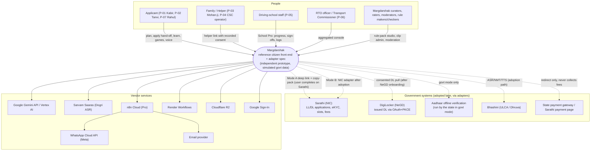
Dotted lines are **mock in the hackathon** (except the Mode A deep link, which works today because it only opens the public Sarathi site). Solid lines are live in the hackathon build.

---

## 2. C4 Level 2 — Containers

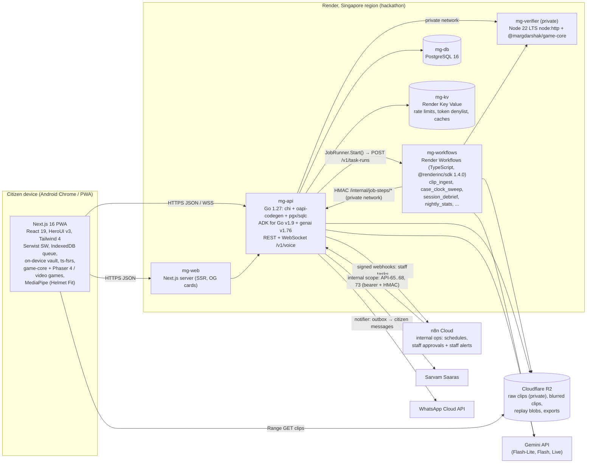

| Container | Tech | Responsibility | Scales by | Owner |
|---|---|---|---|---|
| `mg-web` + PWA | Next.js 16.4, React 19.3, HeroUI 3.2, Serwist 9.5 | UI, offline shell, on-device checks (photo, helmet), on-device vault for personal values, local game play, FSRS scheduling | stateless replicas + CDN | Frontend lead |
| `mg-api` (`services/api`) | Go 1.27, chi v5.5, oapi-codegen v2.8 (strict server), pgx v5.11 + sqlc v1.31, goose v3.29, ADK for Go v1.9 + genai v1.76, slog, OpenTelemetry Go | All business logic, auth, rules engine, case state machine, ADK agents, voice WebSocket, outbox, job step handlers | stateless replicas (sticky only for WS) | Backend lead |
| `mg-verifier` (`services/score-verifier`) | Node 22.23 LTS, `node:http` (no framework), `@margdarshak/game-core`, HMAC request auth | Deterministic server replay of game sessions; returns the server score | stateless replicas, CPU | Games lead |
| `mg-workflows` (`services/workflows`) | Render Workflows, TypeScript, `@renderinc/sdk` 1.4.0, ffmpeg + `onnxruntime-node` | Durable, retried, fan-out orchestration and media processing; every business step and DB write is an HMAC call to the Go API (no `DATABASE_URL`) | per-run instances (Render) | Platform lead |
| `mg-db` | PostgreSQL 16 | System of record (Margdarshak's own data; Sarathi stays the government system of record) | vertical + read replica | Backend lead |
| `mg-kv` | Render Key Value (Redis-protocol) | rate limits, idempotency hot cache, token denylist, plan cache | vertical | Backend lead |
| Object storage | Cloudflare R2 (S3 API) | clips, replays, exports | managed | Platform lead |
| n8n | n8n Cloud Pro | schedules, staff approvals, staff notifications (no citizen messages) | managed (10k executions/month on Pro); load grows with staff, not citizens | Automation owner |

---

## 3. C4 Level 3 — Components

### 3.1 `mg-api`: hexagonal core

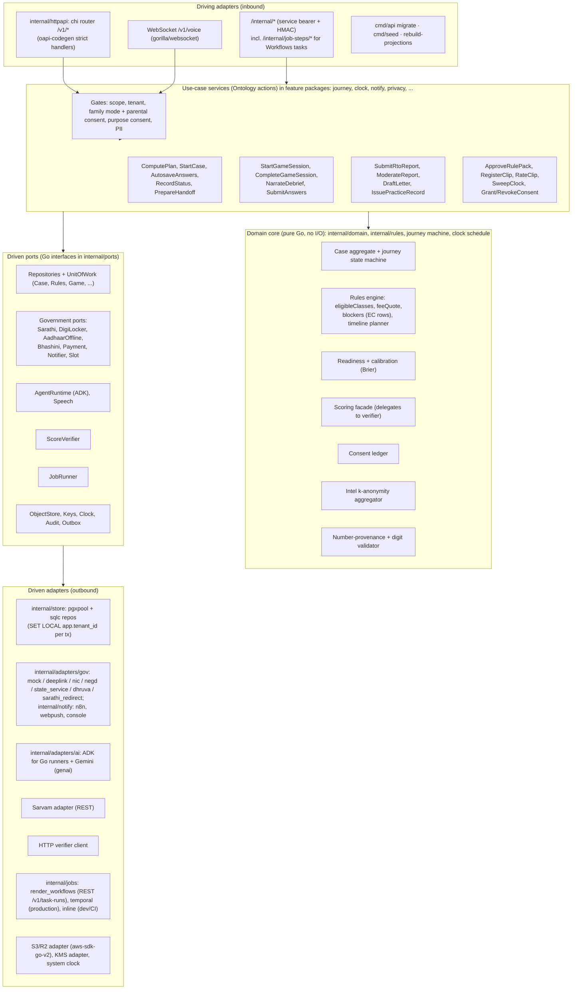

Dependency rule (enforced in CI by golangci-lint `depguard` rules plus Go's `internal/` visibility): the pure packages (`internal/domain`, `internal/rules`, the journey machine and the clock schedule) import only the standard library and `internal/domain`; use-case services import `domain` and `ports` (interfaces only); only adapters (`internal/store`, `internal/adapters/*`, `internal/notify` channels, `internal/jobs` runners) import pgx, `net/http` clients, `google.golang.org/adk`, `google.golang.org/genai`, go-redis or the S3 SDK; `internal/httpapi` is the only package that imports chi and the generated `api` package; `cmd/api` is the composition root.

### 3.2 Repository layout (monorepo: Go module + pnpm workspaces; matches BACKEND.md §2 and ENVIRONMENT_SETUP)
```
margdarshak/
├── apps/
│   ├── web/                      Next.js 16 PWA (App Router), :3000
│   └── console/                  School Pro, state console, rule-pack studio, clip admin, :3001
├── services/
│   ├── api/                      Go 1.27 module github.com/sruj08/margadarshak/services/api, :8000
│   │   ├── cmd/api/              main: serve | migrate up|down|status | healthcheck (composition root: adapters per tenant config)
│   │   ├── cmd/seed/             synthetic demo seed
│   │   ├── api/                  GENERATED by oapi-codegen from ../../api/openapi.yaml (package api; never hand-edited)
│   │   ├── migrations/           goose SQL migrations, embedded in the binary
│   │   └── internal/
│   │       ├── platform/         config (caarlos0/env), slog logging, OpenTelemetry, server lifecycle, health
│   │       ├── httpapi/          chi router, middleware (request id, tenant, auth, rate limit, idempotency), strict handlers, problem+json, WS voice, /internal/* (n8n: API-65..69, 72, 73; Workflows job steps)
│   │       ├── domain/           pure types: Paise (int64), StateCode, VehicleClass, CaseID (UUIDv7), errors with stable codes
│   │       ├── ports/            Go interfaces: repositories, government (Sarathi, DigiLocker, AadhaarOffline, Bhashini, Payment, Slot), notify, ai, jobs, scoring, storage, clock, audit
│   │       ├── adapters/         gov/{sarathimock, sarathideeplink, sarathireal, digilockermock, aadhaarofflinemock, bhashinimock, paymentredirect, slotmock}, ai/, scoring/, storage/, kv/
│   │       ├── rules/            authoritative rules engine (pure): pack loader, evaluator, fees (paise), class planner; golden tests
│   │       ├── journey/          14-state machine (pure) + case service
│   │       ├── clock/            milestone schedule (pure) + sweep
│   │       ├── privacy/          PII redactor (Verhoeff), consent purposes, family mode, retention, export/delete
│   │       ├── notify/           notification service + channels (n8n webhook in P1; WhatsApp Cloud / email / web push notifiers per ADR-0006 rev.)
│   │       ├── store/            pgx pool, UnitOfWork, repositories, sqlc output (sqlcgen/), embedded-postgres test helper
│   │       ├── audit/            append-only audit writer
│   │       ├── jobs/             JobRunner (inline | render_workflows | temporal) + Go step handlers + job_runs
│   │       └── tenant/           tenant registry, resolution, per-tenant adapter choice, feature flags
│   ├── workflows/                Render Workflows tasks in TypeScript (@renderinc/sdk); orchestration + media only, business steps call the Go API
│   └── score-verifier/           Node 22 service wrapping game-core, :8090
├── packages/
│   ├── game-core/                @margdarshak/game-core: Zod schemas, sim-core (fixed 60 Hz, mulberry32), scoring/*.ts
│   ├── rules/                    TS mirror of the Go engine (offline plan cards) + types; conformance-tested on tests/golden/
│   ├── api-client/               generated from api/openapi.yaml (openapi-typescript + openapi-fetch)
│   └── ui/                       HeroUI v3 theme + UX4G skin
├── rulepacks/                    schema/, IN-base/2026.10.0/, JK/, DL/, KL/ (JSON + golden tests)
├── content/                      modules, questions+variants, explanations, error catalogue (CC-BY)
├── n8n/workflows/                exported staff/internal workflow JSON (W01, W07–W09, W12–W18), credentials by reference only
├── tests/golden/                 shared golden cases (JSON) run by the Go engine and the TS mirror
├── api/openapi.yaml              this contract (+ api/adapters/*.yaml government-side adapter specs)
└── infra/                        render.yaml, docker/ (api.Dockerfile: Go multi-stage → distroless; compose.yaml), helm/, terraform/ (adoption)
```
No Python anywhere: the API is Go; web, console, packages, score verifier, Workflows tasks and scripts are TypeScript.

**Port naming.** PROJECT_BRIEF F-56 names the plug-and-play units `SarathiAdapter`, `DigiLockerAdapter`, `AadhaarOfflineAdapter`, `BhashiniAdapter`, `PaymentAdapter`, `NotificationAdapter`, `SlotAdapter`. In code each is a **port** (a Go interface in `internal/ports`, e.g. `ports.Sarathi`) plus its implementations (`sarathimock.Adapter`, `sarathideeplink.Adapter`, `sarathireal.Adapter`); "the SarathiAdapter" in product docs means the port with whichever implementation the tenant selects.

### 3.3 Module ownership (D-24)
| Module | Owner (role; named at H0 in TEAM.md) | Explains on stage |
|---|---|---|
| Rules engine + rule packs + fees | Backend lead | why ₹700 + ₹200 is computed, never typed |
| Case state machine + timeline + clock sweep | Backend lead | event store and idempotent reminders |
| Government Adapter Layer + contract tests | Tech lead | "we ship the socket and the spec" |
| game-core + verifier + Nazar | Games lead | server replay and the 5-band score |
| ADK agents + guardrails + evals | AI lead | validator rejecting a digit, the Go eval harness over `ai/evals/` |
| Render Workflows + n8n | Platform lead | clip pipeline run with a visible retry |
| PWA, Lite mode, accessibility | Frontend lead | < 300 KB on 3G, screen-reader path |

---

## 4. Domain core

### 4.1 Journey state machine (F-08)
The persisted journey `state` is the **14-state machine** of BACKEND.md §5 (PLAN … RENEWAL_DUE), produced by a pure reducer over `core.case_events` (DATA_MODEL §4.3, §5). The product stage (S0–S9, S6F), `display_stage` and `alerts[]` are **derived per request**; `LL_EXPIRING` (≤ 30 days to LL expiry) is a display stage only, never stored. `primary_action(case, decision, now)` returns **one** action from a closed enum (`START_PLAN` … `RENEW`) for the stage-aware home. The reducer has property-based tests (`pgregory.net/rapid` in `go test`) asserting that no event sequence produces an illegal stage and that replaying events is deterministic.

### 4.2 Rule-pack engine (F-42, ADR-0007)
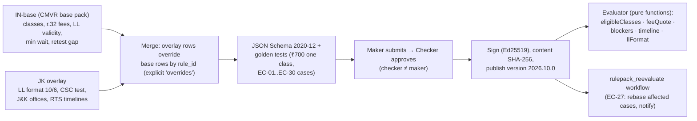
- **Row shape:** `{rule_id, kind, applies_to, value, text_en, text_hi, source_title, source_url, verified_on, confidence, verified, effective_from, effective_to, overrides}`.
- **Evaluation** is plain Go over the merged JSON (`internal/rules`, authoritative); the TypeScript mirror in `packages/rules` evaluates the same packs offline and must match on the shared golden cases in `tests/golden/`. Blockers are data rows of the form `{when: <predicate id>, params}` where predicates are a closed registry of Go functions (mirrored in TS) (`age_below`, `dob_year_only`, `aadhaar_address_mismatch`, `turns_age_during`, `ll_expires_before`, `fails_at_least`, …). New predicates need code review; new rows need only maker-checker.
- **Caching:** the published pack is loaded into memory per tenant, keyed by version; ETag = content SHA.
- **Provenance:** every value returned carries its `rule_id`; the AI allowlist contains only rows with `verified: true`.
- **Production:** states edit packs in the studio (API-54); a weekly n8n W15 check flags changed or dead source URLs for re-verification.

### 4.3 Multi-tenancy per state (F-58, ADR-0009)
| Concern | Hackathon (Phase 1–2) | Production (Phase 3+) |
|---|---|---|
| Tenant key | `tenant_id` = state code (JK seeded; KL, DL sample packs) | same |
| Isolation | pooled DB, Postgres RLS on every C2+ table | tier 1 pooled RLS; tier 2 schema-per-state; tier 3 dedicated deployment on the state's own cloud |
| Keys | one KEK from env, per-tenant data keys | per-tenant KEK in an India KMS/HSM |
| Adapters | `core.tenant_adapter_config` (JK: sarathi=deeplink, others mock) | state flips `sarathi` to `nic` after contract suite passes |
| Theme | UX4G tokens + neutral palette; **no emblem in independent mode** | state branding allowed only in `government_hosted` mode |
| Rule packs | `IN-base` + `JK` | each state owns its overlay with its own makers/checkers |
| Feature flags | per tenant: `ai_coach`, `voice_guide`, `live_intel`, `school_portal`, `sms`, `aadhaar_offline` | same, plus per-district rollout |
| Routing | `?state=` / token claim | host-based (`<state>.<domain>`) or path, plus token claim |

---

## 5. Government Adapter Layer (F-56, the plug-and-play core)

### 5.1 Port catalogue
| Port | Purpose | `mock` (hackathon) | `real` implementations | Selected by | Never does |
|---|---|---|---|---|---|
| **SarathiPort** | Hand-off packs, application status, test results, DL approval status | `SarathiMockAdapter`: in-memory state machine with fixtures; "simulated" chip | `SarathiDeeplinkAdapter` (**Mode A, works today**: public deep link + copy-pack template, user completes on Sarathi) · `SarathiRealAdapter` (**Mode B**: NIC-granted API after an STD + NIC MoU; spec in this repo) | `tenant_adapter_config.sarathi` | scrape, automate logins, solve captchas, submit for the user |
| **DigiLockerPort** | Consented pull of the issued DL (`DRVLC`) | `DigiLockerMockAdapter`: local OAuth+PKCE server, consent screen with the real pattern, synthetic DRVLC XML | `DigiLockerRequesterAdapter`: DigiLocker Requester API v1.12 (OAuth 2.0 code + PKCE S256, `req_doctype=DRVLC`, `oauth2/1/pull`, `files/issued`) after NeGD onboarding | `.digilocker` | store the DL number in clear or the document file |
| **AadhaarOfflinePort** | Derive age band / address-state match from a Secure QR or Paperless XML | `AadhaarOfflineMockAdapter` only (synthetic UIDAI-format samples) | `AadhaarOfflineStateServiceAdapter`: calls the **state's** OVSE service in government mode (OVSE duties sit with the state, brief F-56) | `.aadhaar_offline` (`disabled`/`mock`/`state_service`) | eKYC, OTP, store number/photo/name/address |
| **BhashiniPort** | ASR, NMT, TTS for state languages | `BhashiniMockAdapter` (fixtures) and `LocalIndicTrans2Adapter` (self-hosted, optional) | `BhashiniDhruvaAdapter`: ULCA pipeline-config → Dhruva inference (endpoints from community code, **[unverified]**) | `.bhashini` | send PII or Aadhaar-like digits |
| **PaymentPort** | Get a redirect for government fees; reconcile status | `PaymentMockAdapter`: fake gateway page + HMAC callback (API-24) | `PaymentRedirectAdapter` (deep link to Sarathi's fee page) · `PaymentStateGatewayAdapter` (PayGov / state treasury, reconciled by receipt number) | `.payment` | **collect government fees**, store card/UPI data |
| **NotificationPort** | Send templated messages, track receipts, honour opt-outs and quiet hours | `ConsoleNotifier` (logs + in-app inbox) | `WhatsAppCloudNotifier` (Meta WhatsApp Cloud API, called directly) · `EmailNotifier` (SMTP to the transactional provider) · `WebPushNotifier` (webpush-go, VAPID) · `MgovSmsNotifier` (**roadmap until TRAI DLT**). The P1 build still delivers through the n8n webhook channel; moving it to these notifiers is open (ADR-0006 rev.) | `.notification` | free-text marketing, > 1 nudge/day, messages in quiet hours |
| **SlotPort** | Slot availability, slot-watch triggers | `SlotMockAdapter` (seeded, `sample_data`) | `SlotCrowdIntelAdapter` (only moderated Live Intel "slots opened" reports) · `SlotRealAdapter` (NIC read API after adoption) | `.slot` | book, hold or scrape slots |

### 5.2 Port contracts (Go interfaces in `internal/ports`, abridged)
```go
package ports

type Sarathi interface {
	Mode() SarathiMode // "mock" | "deeplink" | "nic"
	HandoffPack(ctx context.Context, c domain.CaseView, step domain.HandoffStep) (domain.HandoffPack, error)
	ApplicationStatus(ctx context.Context, ref domain.ApplicationRef) (domain.StatusSnapshot, error) // deeplink → ErrUnknown
	TestResults(ctx context.Context, ref domain.ApplicationRef) ([]domain.TestResult, error)         // deeplink → ErrUnknown
	Health(ctx context.Context) AdapterHealth
}

type DigiLocker interface {
	AuthorizeURL(state, codeChallenge string, doctypes []string) string
	ExchangeCode(ctx context.Context, code, codeVerifier string) (DigiLockerToken, error)
	PullDrivingLicence(ctx context.Context, tok DigiLockerToken) (domain.DLMirrorFacts, error) // returns facts only
	Revoke(ctx context.Context, tok DigiLockerToken) error
}

type AadhaarOffline interface {
	// kind: "secure_qr" | "paperless_xml_zip"; returns booleans + hash only
	Check(ctx context.Context, artefact []byte, kind ArtefactKind, shareCode Secret) (domain.AadhaarOfflineVerdict, error)
}

type Bhashini interface {
	ASR(ctx context.Context, audio []byte, lang domain.LangCode) (domain.Transcript, error)
	Translate(ctx context.Context, text string, src, tgt domain.LangCode) (string, error)
	TTS(ctx context.Context, text string, lang domain.LangCode, voice string) ([]byte, error)
}

type Payment interface {
	CreateRedirect(ctx context.Context, c domain.CaseView, q domain.FeeQuote, returnURL string) (domain.PaymentIntent, error)
	ParseCallback(ctx context.Context, h http.Header, body []byte) (domain.PaymentStatus, error) // verifies signature
}

type Notifier interface {
	Send(ctx context.Context, msg domain.TemplatedMessage) (DeliveryTicket, error) // template_id + vars only
	HandleReceipt(ctx context.Context, r ProviderReceipt) error
	OptOut(ctx context.Context, contact domain.ContactRef, ch domain.Channel) error
}

type Slot interface {
	ListSlots(ctx context.Context, officeID string, kind domain.SlotKind, window domain.DateRange) (domain.SlotList, error) // source tagged
	WatchHits(ctx context.Context, since time.Time) ([]domain.SlotHit, error)
}
```
Rules for every adapter: every method takes a `context.Context` and honours its deadline (timeout ≤ 5 s, configurable), circuit breaker (`sony/gobreaker/v2`, open after 5 failures in 60 s, half-open after 30 s), retries only for idempotent calls (`sethvargo/go-retry`, exponential with jitter, max 3), errors wrap a typed `*ports.AdapterError{Kind: unavailable|rejected|invalid|unknown}` (checked with `errors.As`), OpenTelemetry span `adapter.<port>.<op>` with no PII attributes, and `health()` exposed on API-64 deep checks. **Anti-corruption:** nothing outside an adapter sees DigiLocker XML, Sarathi field names or gateway payloads; adapters translate into Ontology objects.

### 5.3 Contract tests (same suite for mock and real)
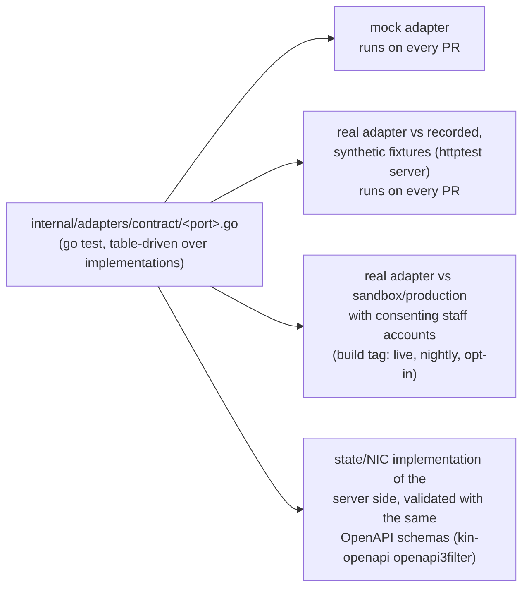
Each suite asserts behaviour, not implementation: e.g. for SarathiPort — `handoff_pack` never contains a field whose name or value matches the CX list; deeplink `application_status` returns `Unknown` (never invents a status); outage → `AdapterError(unavailable)` within the timeout; for PaymentPort — `create_redirect` never returns a URL on a Margdarshak domain and `collected_by == "state_gateway"`; callbacks with bad signatures are rejected; for NotificationPort — quiet hours, ≤ 1 nudge/day, STOP honoured within one message (EC-30); for DigiLockerPort — PKCE `S256` mandatory, `state` replay rejected, the pulled DL number is hashed and discarded. A tenant can activate a `real` adapter only if `contract_suite_version` passes in CI for that build (recorded in `core.tenant_adapter_config`).

### 5.4 Modes in one table
| Mode | Who hosts | Sarathi | DigiLocker | Aadhaar | Payment | Data residency |
|---|---|---|---|---|---|---|
| **Independent (hackathon, Phase 1–2)** | Team Chanakya on Render Singapore | `deeplink` (Mode A) / `mock` | `mock` | hand-off to Sarathi's own eKYC; offline `mock` | `sarathi_redirect` / `mock` | synthetic data only |
| **Independent (post-event, Phase 3)** | Nestiq on an Indian cloud | `deeplink` | `negd` after requester onboarding | hand-off | `sarathi_redirect` | India |
| **Government-hosted (adoption)** | NIC / state on MeghRaj or NIC cloud | `nic` (Mode B) | `negd` (state's client ID) | state's eKYC inside Sarathi; offline via `state_service` | `state_gateway` | India; inside NIC |

---

## 6. Game core and the score verifier (ADR-0004)
- `@margdarshak/game-core` holds the Game SDK contract (Zod `GameManifest`, `GameEvent`, `SessionResult`), `sim-core` (fixed 60 Hz step, seeded `mulberry32`, kinematic bicycle model) and one pure scoring function per game. It has **no engine or DOM dependencies**, so it runs in the browser and in Node.
- Engines: **Phaser 4.2.1** for the top-down sims (Junction Scan, Blind Spot, Track Twin, Night & Glare, Hill Road), **HTML video + SVG + React + Motion** for Nazar, Stopping Distance, Golden Hour and the LL simulator, **MediaPipe Tasks Vision 1.1.1** on device for Helmet Fit (no frame leaves the phone; fit/position guidance only, no strap-detection claim).
- **Nazar timing:** taps use `PointerEvent.timeStamp`; media time from `requestVideoFrameCallback` (fallback `currentTime`, flagged `timing_mode=fallback`); the whole MP4 is preloaded so buffering cannot shift timing (EC-18).
- **Nazar scoring (brief §15):** UK-style 5 bands per hazard window, scaled to Kerala's format (10 clips × 10 marks, pass 60); **> 3 taps per second voids the clip** (config value); late facts `late_s` and `metres = late_s × speed/3.6` feed the debrief.
- **Server replay:** the verifier (`services/score-verifier`) is a stateless Node 22 LTS `node:http` service on the private network with HMAC request auth and `POST /verify {gameId, gameVersion, scoringVersion, seed, items, inputs}` (2 s timeout; BACKEND.md §9). It loads hazard windows / track specs **server-side** (clients never receive them), re-runs scoring and returns `SessionResult`. The API stores the server result and flags differences above tolerance (`replay_mismatch_corrected`); trust < 0.6 ⇒ the session counts for practice but not for share cards or percentiles. Old `scoring_version`s stay loadable for re-scoring.
- **Why Node and not Go:** one scoring implementation in TypeScript avoids the classic drift between a client and a re-implemented server scorer. It is the one runtime exception to "one Go backend" (noted as a tension in §17); it holds no state and no business rules beyond scoring.
- **Learners under 18** (family mode, D-13 revised) get the same server sessions, replay, AI debrief and streaks as every user, inside the parent's account and under the parent's consent. Their sessions produce no analytics events (API-63) and feed no behavioural profiling or ads; squads and share cards need the parent's consent.

---

## 7. AI layer (Google ADK for Go v1.9 + Go Gemini SDK v1.76, in-process in the Go API)
| ID | Agent | ADK shape | Model (env-pinned) | Tools / inputs | Guardrails |
|---|---|---|---|---|---|
| M-01 | VoiceGuideAgent | `llmagent.New` + `Runner.RunLive(ctx, userID, sessionID, agent.LiveRunConfig)` → `agent.LiveSession.Send(agent.LiveRequest{RealtimeInput: *genai.Blob})` + event iterator, bidi | `GEMINI_MODEL_LIVE` (`gemini-3.8-live`; fallback `GEMINI_MODEL_LIVE_FALLBACK` = `gemini-2.5-flash-native-audio-preview-12-2025`) | `functiontool.New` tools: `navigate(screen_id: enum)`, `set_field(field_id: enum non-sensitive)`, `read_back`, `confirm`, `get_rule`, `read_debrief`, `open_drill` | confirm before big jumps; Aadhaar/OTP fields absent from the enum; pii_gate on transcripts; no submit/pay/book; available to every user (minors through the parent's account, D-13 revised) |
| M-02 | DebriefAgent | Go code around one LLM call: `[code] load_and_gate → [code] build_facts → [LLM] draft (llmagent with OutputSchema, Runner.Run) → [code] validate (retry once) → [code] render → [code] persist` | `GEMINI_MODEL_DEBRIEF` (`gemini-3.1-flash-lite`) | none (facts injected via state); dynamic enums for finding/rule/drill IDs | no digits in model text; closed IDs; `verified:false` rules excluded; top finding coverage; tone + language lint; template fallback |
| M-03 | CoachAgent | same graph pattern | Flash-Lite | weekly plan JSON (FSRS + staircase computed in code) | as M-02 |
| M-04 | TutorAgent | single LLM node + validator | Flash-Lite | reviewed explanation for the chosen option | output = reviewed text + digit-free glue only |
| M-05 | ScreenDecoderAgent | vision LLM node → code mapper | `GEMINI_MODEL_VISION` (Flash, vision) | screenshot (blurred on device) | structured output `{catalogue_id enum | UNKNOWN}`; user confirms |
| M-06 | ClipWindowProposer | offline step inside the TS `clip_ingest` task (`@google/genai`) | `GEMINI_MODEL_VISION` (`gemini-3.8-flash`, fps 2) | blurred clip via File API | proposals only (±1 s); two humans set final windows |
| M-07 | SignSnap | vision node → sign-catalogue matcher | Flash (vision) | camera frame of a road sign (no faces) | must match catalogue or `UNKNOWN` |
| M-08 | Sarvam Saaras v3 | Speech port adapter (REST from Go) | `saaras:v3` | Dogri audio → text → same agents over text | reviewed output text only |
| M-09 | MediaPipe / YuNet / plate detector | on device / in the TS workflow task (`onnxruntime-node`) | n/a | camera (helmet), clip frames (blur) | no frames leave device (helmet); 100% blur audit before publish |

Runner-level plugins (all agents, `plugin.New` in ADK for Go): **PII redaction** (`OnUserMessageCallback` / `BeforeModelCallback` running our regex + Verhoeff `pii_gate` from `internal/privacy`), **number-provenance** (`AfterModelCallback` replaces any ₹/day/age/metre/second not present in tool results), **Flash-Lite jailbreak judge** on user-originated text, **safety settings set explicitly** in `genai.GenerateContentConfig` (`BLOCK_MEDIUM_AND_ABOVE`; default is off on 2.5+). No ADK memory service (in-memory session service per request or per voice connection); case state lives in Postgres. Evals: ≥ 30 cases per agent with the Go eval harness over `ai/evals/*.jsonl` in CI (`go test -tags evals`; hallucination, safety, rubric and trajectory metrics; ADK for Go has no `adk eval` CLI). **Gates:** purpose consent + paid tier for any real user, available to everyone; for a learner under 18 the adult account holder's parental consent covers the AI purposes (D-13 revised). Agents run inside the Go API service on Render; production path: Cloud Run or Vertex AI `asia-south1` (brief §11, §15).

---

## 8. Durable jobs: Render Workflows (ADR-0005)
Render Workflows (public beta since 7 Apr 2026) runs each task run on its own instance, supports chaining via `ctx.run()`, fan-out with `Promise.all` over `ctx.run()` calls (TypeScript SDK `@renderinc/sdk` 1.4.0), automatic retries with backoff (default 3), run timeouts from 30 s to 24 h, and queues runs over compute limits. It has **no native cron, no documented sleep/delay API and no completion webhook** (`research/B-sponsors.md` §1). The design follows from those facts.

**Division of labour.** Tasks are TypeScript in `services/workflows` and are **thin orchestrators**: media steps (ffmpeg transcode, blur with `onnxruntime-node`, flash check, Gemini video proposals with `@google/genai`) run inside the task; every business step (select due rows, lock, decide, write, notify) is an HMAC-signed call to the Go API over the private network (`POST /internal/job-steps/{step}`, proposed in OpenAPI as `x-proposed`). The workflows service has **no `DATABASE_URL`**, so every decision and every DB write stays in Go.

| Task (TypeScript, `@renderinc/sdk`) | Trigger | Steps (each a chained `ctx.run`; "→ API" marks a Go job step) | Retry / timeout | Why durable |
|---|---|---|---|---|
| **`clip_ingest`** (headline) | API-55 register | `transcode` (ffmpeg → 360p/480p H.264, faststart) → `blur` (YuNet faces + plate detector via `onnxruntime-node`) → `flash_check` (≤ 3 flashes/s, WCAG 2.3.1) → `propose_windows` (Gemini video; retries on 429/5xx — the demo injects one failure to show the retry on the Runs page) → `open_review` (status `awaiting_ratings`, webhook to n8n W08) | 3 retries, 1.5× backoff; transcode/blur 30 min; propose 10 min | long, failure-prone, parallel per clip |
| **`clip_finalize`** | **n8n W08** holds the two-rater wait (send-and-wait to both raters, ratings saved via API-55), then calls API-67 `/internal/jobs/clip_finalize` | `agreement` (onset Δ ≤ 0.5 s, matched hazards; else third rater) → `blur_audit_check` (100%) → `publish_manifest` (R2) → `cdn_warm` → `recompute_difficulty` | 3 retries; 5–10 min | Workflows has no sleep API and a 24 h run cap, so the human wait lives in n8n between two runs |
| **`case_clock_sweep`** | n8n W1 Schedule 06:30 IST → API-65 | → API `clock.plan_pages` (keyset pages of 500) → fan-out `clock_batch` (≤ 8 concurrent; each batch → API `clock.fire_batch`, which locks rows `FOR UPDATE SKIP LOCKED`, marks them firing and inserts notifications with idempotency keys and `send_after`; the notifier delivers them) | 3 retries per batch; 20 min | fan-out, retries, idempotent keys make re-runs safe |
| **`session_debrief`** | API-35 when the inline 6 s debrief budget is exceeded, or batch (`debrief_backfill`) | `load_and_gate` → per-finding `prepare_facts` in parallel → `narrate` (DebriefAgent, retry on 429) → `validate` → `persist` → optional `notify_card` | 3 retries; 2 min; template already shown | retries on Gemini 429 without blocking the user |
| **`nightly_stats`** | n8n Schedule 02:00 IST → API-65-style internal trigger | recompute Nazar n, % below 60, r(LL quiz, Nazar) + 95% CI (Fisher z), journey-test medians → API-71 cache | 3 retries; 15 min | batch analytics with retry |
| `rulepack_reevaluate` | API-54 approve | find cases on old version → fan-out re-evaluate blockers/timeline → append `rule_pack_rebased` → notify (EC-27) | 3; 30 min | fan-out over many cases |
| `user_export` / `user_delete` | API-61 / API-62 | collect/delete across schemas and object storage; signed link | 5; 1 h | must complete even if the API restarts |
| `replay_pending_sessions` | every sweep (via API-67) | sessions in `pending_verification` → score verifier → overwrite score | 3; 10 min | verifier outage recovery |
| `db_maintenance` | monthly | create next partitions, drop expired ones, rebuild-projection sample diff | 3; 1 h | |

Apart from the media steps (`transcode`, `blur`, `flash_check`, `propose_windows`, the R2 upload in `publish_manifest`, `cdn_warm`), every step above is a Go job step behind `/internal/job-steps/{step}`; the DebriefAgent in `session_debrief` runs in the Go API (ADK for Go), not in the task.

**JobRunner port** (Go, `internal/ports`):
```go
type JobRunner interface {
	Start(ctx context.Context, task string, args any, idemKey string) (RunRef, error)
	Get(ctx context.Context, ref RunRef) (RunStatus, error)
}
```
Three implementations in `internal/jobs`, chosen by `JOB_RUNNER`: `render_workflows` (hackathon; `POST https://api.render.com/v1/task-runs` with `{task: "<WORKFLOW_SLUG>/<task>", input: [...], idempotencyKey}` and `Authorization: Bearer $RENDER_API_KEY` → `202` TaskRun; there is no completion webhook, so a background goroutine polls `GET /v1/task-runs/{id}` (statuses `pending|running|succeeded|failed|canceled`) into `ops.job_runs`; locally `render workflows dev` serves the same API at `http://localhost:8120` with `RENDER_USE_LOCAL_DEV=true`), `temporal` (production on Kubernetes; Temporal Go SDK `go.temporal.io/sdk` v1.50.0; workflows and activities in Go call the same step handlers, and native durable timers let the clip pipeline become one workflow with a human-wait signal) and `inline` (dev/CI and a degraded demo mode: the Go step handlers run in a goroutine; media steps use fixture clips). The Go step handlers are the only place job logic lives; there is **no business logic only in a TS task**. Run IDs are stored in `ops.job_runs` and shown in clip admin for the demo.

Hackathon facts to respect: API-triggered root runs are limited to 50/min on the Hobby workspace (1,500/min on Pro); args ≤ 4 MB (we pass IDs, never media); a task run cannot receive inbound connections, so tasks *call* the API (job steps) and the verifier over the private network; they never connect to Postgres. [unverified: Workflows task instances reaching the API's private `hostport`; owner Platform lead, 2026-10-24 H0]

---

## 9. n8n: internal and staff operations only (ADR-0006, rev. 2026-10-24)
n8n Cloud (Pro perk) fires schedules, holds human approvals and notifies **staff** (team, school staff, RTO/state staff). **No citizen message goes through n8n**: the case clock, the case reducer and the intel decision handler write outbox rows, and the backend notifier (`NotificationPort`, §5) delivers them. n8n authenticates to the internal scope with a service bearer token plus an HMAC body signature and **never queries Postgres directly**. Full spec: [N8N_WORKFLOWS](../05-ops/N8N_WORKFLOWS.md).

**Scalability:** n8n's executions grow with staff, offices and review tasks, never with citizens. The citizen path (≤ 660k notifications/day at the §13 peak, plus receipts) runs in the API and notifier, which scale horizontally.

| n8n workflow | Audience | Calls into core | Core calls n8n | Business logic location |
|---|---|---|---|---|
| W01 daily case-clock trigger + watchdog | on-call | API-65 (starts `case_clock_sweep`; the API sets `asOf` from server time), sweep status | none | timeline planner + rule pack |
| W07 school lead routing | school staff | API-73 next school; API-66 `school_lead_decision` | `school-lead` | routing in code (consent, area, class, declines) |
| W08 clip review queue (two-rater wait) | curators | ratings via API-55 (curator UI); API-67 starts `clip_finalize` | `clip-review` | agreement + publish in `clip_finalize` |
| W09 Live Intel moderation | moderators | API-68 decision | `intel-moderation`, only for reports the inline precheck flags | precheck + k-threshold code |
| W12 incident/guardrail alerts | on-call | `/internal/ops/metrics` | `alert` | thresholds in config |
| W13 analytics digest | team | API-67 `analytics-digest`, `nightly_stats` | none | aggregation code |
| W14 field-test capture | research team | API-70; API-66 `field_form_submitted` | `field-session` | study tables |
| W15 rule source freshness | rules owner | `/v1/admin/rulepacks` (read, verify) | none | maker-checker |
| W16 RTO morning brief | RTO/ARTO staff (govt mode) | API-67 `rto-brief` | none | console aggregates (k ≥ 5) |
| W17 stall and SLA alerts | RTO + state staff (govt mode) | console alert ack | `console-alert` | thresholds in code |
| W18 staff task reminders | all staff | API-67 `staff-tasks` | none | task queues in code |

Retired from n8n (now backend): W02 milestones, W03 slot-watch alerts, W04 test-eve, W05 family card, W06 coach plan, W10 fail follow-up, W11 escalation letter.

If n8n is down, **no citizen message is delayed and no fact changes**; staff tasks wait in their queues and the backend review pages still work. If the notifier or a channel is down, notifications stay `queued` in the outbox and in-app inbox, web push still works through `WebPushNotifier`, and the outbox retries for 24 h.

---

## 10. Key flows (sequence diagrams)

### 10.1 Licence plan (API-01, F-02/F-03/F-04)
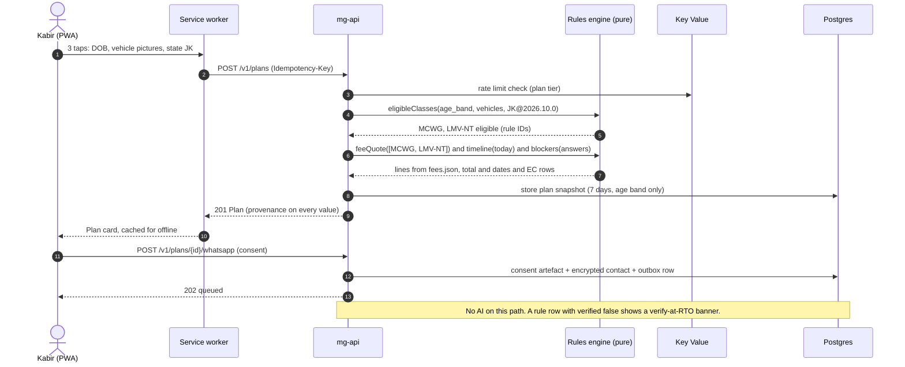

### 10.2 Guided LL application and Sarathi hand-off (API-10/12/16/19, F-05/F-06/F-07)
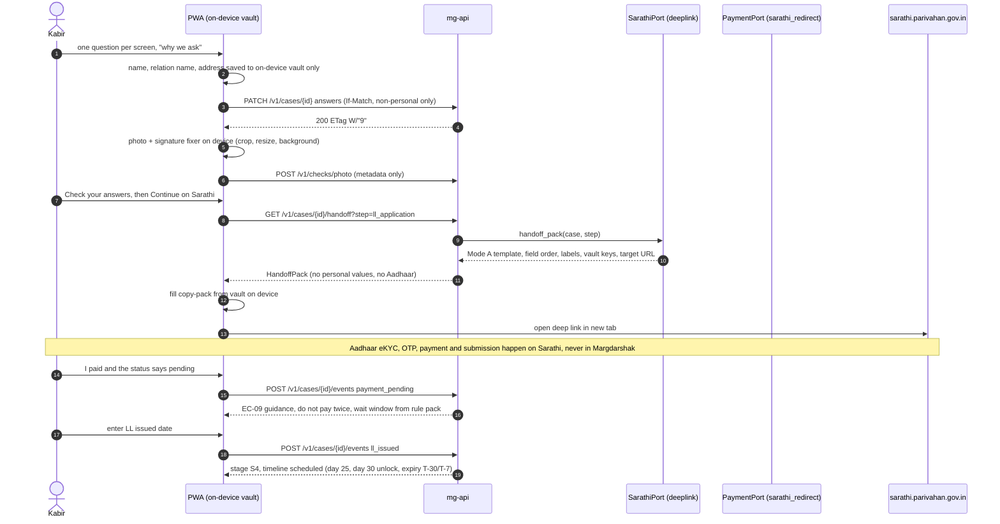

### 10.3 Case clock sweep (API-65, F-09)
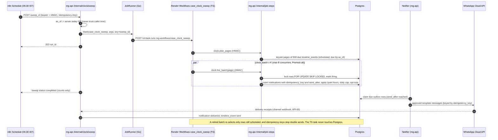

### 10.4 Game session → server replay → debrief (API-34/35/36, F-23/F-25)
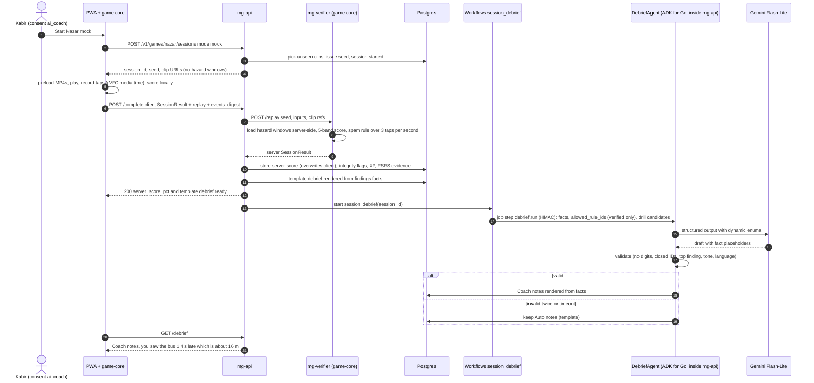

### 10.5 Voice guide turn (API-40, F-30)
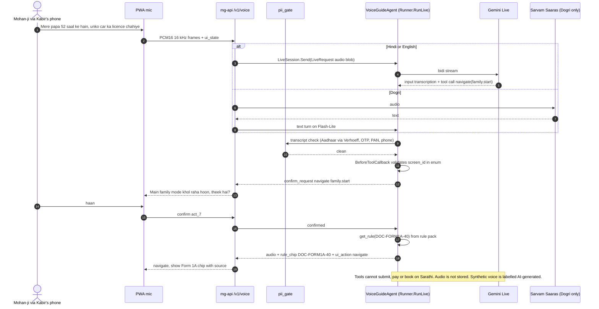

### 10.6 Clip pipeline (API-55, Render Workflows headline)
```mermaid
sequenceDiagram
  autonumber
  actor CU as Curator
  participant API as mg-api
  participant JR as JobRunner (Go)
  participant T as clip_ingest (Workflows, TS)
  participant R2 as R2
  participant G as Gemini video (fps 2)
  participant N8 as n8n W8
  actor R1 as Rater 1
  actor R2r as Rater 2
  participant P as clip_finalize (Workflows, TS)
  CU->>R2: upload raw clip to private bucket (passenger or fixed mount)
  CU->>API: POST /v1/admin/clips (consent, CC-BY)
  API->>JR: start clip_ingest(clip_id)
  JR->>T: run
  T->>T: transcode (ffmpeg 360p/480p)
  T->>T: blur faces (YuNet via onnxruntime-node) and plates
  T->>R2: write blurred renditions
  T->>G: propose hazard windows
  G--xT: 429 rate limited
  T->>G: automatic retry with backoff (visible in Runs page)
  G-->>T: proposals plus or minus 1 s
  T->>API: job step clip.open_review (HMAC): status awaiting_ratings
  API->>N8: clip-review webhook
  N8->>R1: review task
  N8->>R2r: review task
  N8->>N8: W08 send-and-wait for both raters (hours to days)
  R1->>API: POST ratings (frames, blur audit)
  R2r->>API: POST ratings
  API->>N8: rating saved
  N8->>API: POST /internal/jobs/clip_finalize (API-67)
  API->>JR: start clip_finalize(clip_id)
  JR->>P: run
  P->>API: job step clip.agreement (onset delta, matched hazards; computed in Go)
  alt agreement passes and blur audit 100 percent
    P->>R2: publish to manifest, warm CDN, delete raw after 7 days
  else disagreement
    P->>API: status needs_adjudication (third rater)
  end
  Note over T,P: AI never publishes. The human wait lives in n8n W08 because Workflows has no sleep API and a 24 h cap.
```

### 10.7 RTO Live Intel moderation (API-28/29/56, F-11)
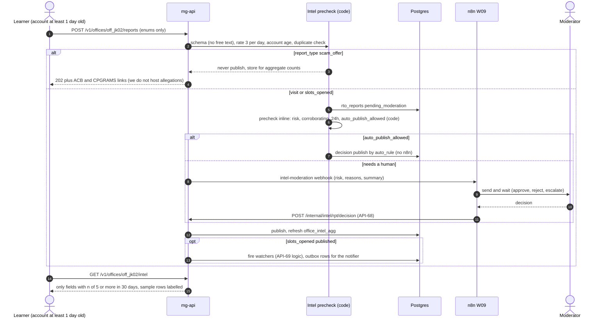

---

## 11. Data flow and offline/sync strategy
- **On device only:** personal values for the copy-pack (on-device vault, encrypted with a WebCrypto key in IndexedDB), photo/signature images, helmet camera frames and FSRS state (mirrored to the server only for multi-device users).
- **Synced:** non-personal answers (PATCH with ETag), answers (batched, `client_answer_id`), game completions (`Idempotency-Key`), analytics (consented; never for a learner under 18 in family mode, D-13 revised).
- **Service worker (Serwist 9.5):** precache app shell; runtime cache for rules/offices/modules (stale-while-revalidate); clip packs only on explicit "Download practice pack (≈ N MB)" with Range support (`workbox-range-requests` 7.4); background sync replays the IndexedDB queue.
- **Lite mode (< 300 KB first load):** server components, no Phaser, no Rive, no Lottie, SVG decision versions of sims, LL simulator, plan card. Budget enforced by Lighthouse CI on a 3G profile.
- **Conflict policy:** server wins for stage and dates (event store); field-level last-writer-wins for answers after an ETag refresh; game sessions are immutable once completed.

---

## 12. Failure modes
| # | Failure | Detection | User sees | System does | EC / R |
|---|---|---|---|---|---|
| F1 | Sarathi down (or deep link unreachable) | adapter health, user reports | "Sarathi is not responding. Your draft is saved." banner | keep drafts; reschedule hand-off reminder; no retries against Sarathi | EC-11 |
| F2 | Gemini 429/5xx or slow (> 6 s) | circuit breaker, fallback rate metric | Auto notes (template) instantly | `session_debrief` retries; alert at > 20% fallback over 5 min (W12) | EC-29, R-04 |
| F3 | Model writes a digit, an unknown rule, or unsafe tone | validator | nothing different (template or retried card) | retry once with error list; then template; logged for eval set | D-10 |
| F4 | Score verifier down | health + timeout 2 s | score shown as "provisional" | session stored `pending_verification`; `replay_pending_sessions` re-checks; share card waits | R-05 |
| F5 | Render Workflows run fails or is queued | run status poll, `ops.job_runs` | clip admin shows retrying | automatic retries (3); manual re-run from admin; `JOB_RUNNER=inline` fallback for the sweep in a demo emergency | R-11 |
| F6 | Notifier/channel down or WhatsApp template rejected | outbox age > 30 min | in-app inbox + web push still work | outbox retries 24 h; email fallback; SMS only after DLT | R-08, EC-30 |
| F6b | n8n down | W12 heartbeat missing; no W01 sweep by 07:00 | none for citizens | on-call starts the sweep with `/internal/clock/sweep` (idempotent); staff use the review pages directly | ADR-0006 |
| F7 | Postgres unavailable | health, error rate | 503 problem with `offline_draft` fallback | PWA queues writes; read-only cached plan works offline | R-11 |
| F8 | Cold start during judging | synthetic check | slow first load | paid instances (no sleep); n8n pings `/v1/health` every 10 min during judging; README notes ~1 min cold start on free services | R-11 |
| F9 | Wrong rule or fee | golden tests, W15 source check, user report | "verify at your RTO" on low-confidence rows | maker-checker hotfix pack; EC-27 rebase + notice | R-09 |
| F10 | Rule pack changes mid-case | publish event | "Rules changed on <date>: here is what changes for you" | `rulepack_reevaluate` workflow | EC-27 |
| F11 | Device clock wrong | server_time vs device skew | countdowns from server time | ignore device clock for deadlines | EC-15 |
| F12 | Buffering video during Nazar | `waiting` events, rVFC gaps | clip paused and restarted, not scored late | full preload; item voided on stall | EC-18 |
| F13 | Spam tapping | > 3 taps/s | "this clip wasn't counted" | clip voided; no accusation | EC-18 |
| F14 | Prompt injection via screenshot/commentary/scam text | jailbreak judge, schema | "couldn't read that" | structured outputs only; closed enums | OWASP LLM01 |
| F15 | Aadhaar number or OTP typed into AI or answers | pii_gate, strict request decoding + Verhoeff check in `internal/privacy`, DB CHECK | "Don't share this here; type it only on Sarathi" | dropped before any model call or storage | EC-20 |
| F16 | Helper misuse | user revokes | helper loses access within 60 s | token denylist; audit trail | EC-25 |
| F17 | Data breach suspicion | alerts, audit hash-chain break | — | CERT-In 6 h report; DPDP Rule 7 notice without delay + detailed report in 72 h (RUNBOOK) | — |
| F18 | Kerala HPT stayed or postponed | W15 / manual | Nazar labelled "practice" with the latest status | config flag `kerala_hpt_status`; wording "from December 2026" | EC-28, R-10 |
| F19 | Too few usable clips | clip count < kill-switch threshold | Nazar runs a 6-clip format | kill switch per brief §15; journey test carries evidence | R-06 |
| F20 | Render Singapore latency from India | p95 metrics | slower API | edge-cached reads; batch writes; India hosting in Phase 3 | R-05 |

---

## 13. Scalability to national load
India's licence volumes are not restated here; the numbers below are a **design-target assumption [D]** used to size the system, not a statistic.

| Assumption [D] | Value |
|---|---|
| New cases per year (national, all states adopted) | 10 million |
| Average journey length | ~4 months → ~3.3 million active cases at any time |
| Daily active share of active cases | 20% → ~660k DAU |
| Peak hour share of DAU | 12% → ~80k users in the 9–10 am hour |
| API calls per active user per day | 40 |
| Game sessions per DAU per day | 1.5 → ~1 million replays/day |

Derived load: peak-hour average ≈ 80k × 40 / 3,600 ≈ **890 req/s**, peak-second factor 3 ≈ **2,700 req/s**; replays ≈ 1M/day at ~50 ms CPU each ≈ 14 CPU-hours/day (≈ 1–2 vCPU average, burst to 20); clock sweep ≈ 3.3M cases × ~10 timeline rows = 33M rows scanned by index on `due_at` per day; notifications ≤ 1/user/day ≈ ≤ 660k/day at peak.

| Layer | How it scales | National target |
|---|---|---|
| Static/PWA | CDN; immutable assets; Lite mode | > 95% of bytes from CDN |
| `mg-api` | stateless; horizontal pods; one Go process per pod using all cores (goroutine per request, `GOMAXPROCS` from the CPU limit); pgxpool sized per pod; per-tenant caches of rule packs | ~20 pods × 2 vCPU at peak (≈ 150 req/s/pod for cached/cheap endpoints, measured in load test before claiming) |
| Plan/rules reads | in-memory pack + ETag + CDN for public reads | ~0 DB queries per plan except the snapshot |
| Postgres | partitioning (game events, audit), hash-partition `case_events` by `case_id` at > 1B rows, read replicas for console/analytics, PgBouncer transaction pooling | primary 16 vCPU / 64 GB + 2 replicas; tier-3 tenants get their own clusters |
| Verifier | stateless CPU pods with HPA on CPU | 4–20 pods |
| Jobs | Workflows/Temporal fan-out by tenant × shard; sweeps idempotent | sweep < 15 min nationally with 64 shards |
| Voice | the costliest path (≈ ₹2/min Live audio); capped 10 min/user/month; separate WS pool | concurrency budgeted per tenant |
| AI text | Flash-Lite ≈ ₹0.10 per debrief; template-first so AI is never on the critical path | rate-limited per tenant; Vertex quota in `asia-south1` |
| Notifications | backend notifier workers scale with the API; per-tenant WhatsApp numbers; mGov SMS in government mode; n8n not on this path | ≤ 1 nudge/day caps volume |

Hackathon targets (measured with k6 before quoting; owner Platform lead): API-01 p95 < 300 ms server-side at 50 req/s; API-35 p95 < 800 ms including replay; Lite first load < 300 KB; Kapoor's "10,000 users at 9 am" = ~1k req/s → requires the production profile, which we state honestly.

---

## 14. Security architecture (summary; detail in `docs/06-security-compliance/`)
- TLS everywhere; HSTS; CSP with nonces; no third-party scripts on citizen pages.
- AuthN: device keys + EdDSA JWT; refresh rotation with reuse detection; admin hardware-key 2FA (production).
- AuthZ: scope + tenant + family-mode/parental-consent + purpose-consent gates in one chi middleware chain plus a single `authorize(principal, action, resource)` check in the use-case services; RLS in Postgres as a second wall.
- Data: C3/C4 field encryption with per-tenant keys; CX never stored; on-device vault for personal values.
- Logs: `log/slog` with a redaction handler (Aadhaar/Verhoeff, OTP, phone, email, PAN); OpenTelemetry attributes allowlisted; Sentry (sentry-go) with `SendDefaultPII: false` and `BeforeSend` scrubbing.
- Audit: append-only `audit.audit_log` with a SHA-256 hash chain; logs kept ≥ 1 year (DPDP Rules, Rule 8), 180 days of them in India (CERT-In); NTP to NIC/NPL servers in production.
- Supply chain: lockfiles (`go.sum`, `pnpm-lock.yaml`), `govulncheck`/`pnpm audit`, SBOM (CycloneDX), Dependabot, pinned container digests; distroless non-root API image.
- OWASP ASVS L2 and OWASP LLM Top 10 checklists; audit-ready pack for STQC/CERT-In-empanelled auditors before any government hosting ("audit-ready", never "certified").

---

## 15. Deployment views

### 15.1 Hackathon: Render (Singapore), synthetic data only
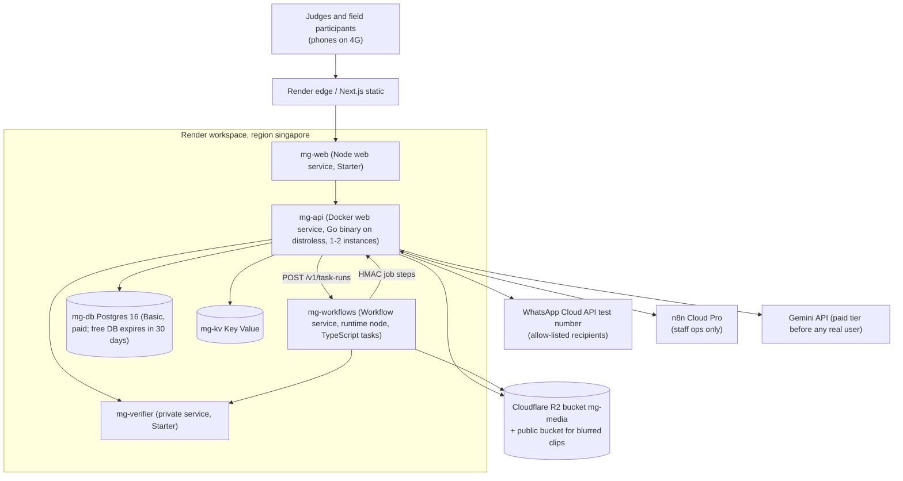
Blueprint sketch (the real file is `infra/render.yaml`, which is authoritative; Workflows in Blueprints supported since 16 Sep 2026 per the Render changelog — field names to be confirmed at H0 against the Render docs, owner Platform lead):
```yaml
services:
  - type: web
    name: mg-api
    runtime: docker
    region: singapore
    dockerfilePath: ./infra/docker/api.Dockerfile   # Go multi-stage build → distroless static, non-root
    dockerContext: .
    healthCheckPath: /v1/health
    preDeployCommand: /app/api migrate up            # goose migrations embedded in the binary
    envVars:
      - { key: DATABASE_URL, fromDatabase: { name: mg-db, property: connectionString } }
      - { key: REDIS_URL, fromService: { type: keyvalue, name: mg-kv, property: connectionString } }
      - { key: JOB_RUNNER, value: render_workflows }
      - { key: RENDER_API_KEY, sync: false }
      - { key: GEMINI_MODEL_DEBRIEF, value: gemini-3.1-flash-lite }
  - type: web
    name: mg-web
    runtime: node
    region: singapore
    buildCommand: pnpm i --frozen-lockfile && pnpm --filter web build
    startCommand: pnpm --filter web start
  - type: pserv
    name: mg-verifier
    runtime: node
    region: singapore
    buildCommand: pnpm i --frozen-lockfile && pnpm --filter score-verifier build
    startCommand: node services/score-verifier/dist/server.js
  - type: keyvalue
    name: mg-kv
    region: singapore
    ipAllowList: []
databases:
  - name: mg-db
    region: singapore
    postgresMajorVersion: "16"
  - type: workflow
    name: mg-workflows
    runtime: node                                   # TypeScript tasks (@renderinc/sdk); no DATABASE_URL
    region: singapore
    buildCommand: corepack enable && pnpm install --frozen-lockfile --filter "@margdarshak/workflows..." && pnpm --filter @margdarshak/workflows build
    startCommand: node services/workflows/dist/main.js
```
Demo hardening: paid instances (no 15-min sleep), `/v1/health` pinged every 10 min during judging, pre-recorded fallback for voice, seeded tenant JK with `sample_data` chips, a "simulated government data" footer on every page.

### 15.2 Adoption: MeghRaj / MeitY-empanelled cloud or NIC, Kubernetes
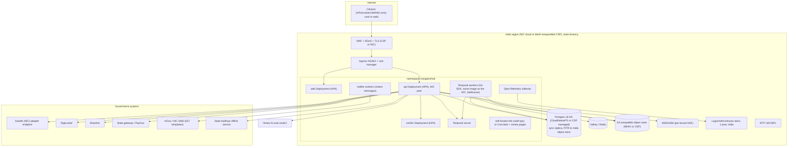
Packaging: OCI images (multi-arch, pinned digests), a Helm chart (`infra/helm/margdarshak`) with values per state, Terraform modules for empanelled CSPs, and a docker-compose profile for a single-VM NIC pilot. Everything a state needs to audit: source (Apache-2.0), SBOM, OpenAPI, adapter contract suites, threat model, VAPT scope.

---

## 16. Hackathon (Phase 1–2) vs Production (Phase 3+)
| Area | Hackathon build | Production |
|---|---|---|
| Hosting | Render Singapore, synthetic data only | NIC / MeitY-empanelled India cloud, Kubernetes |
| Jobs | Render Workflows (TS tasks; `JOB_RUNNER=render_workflows`), inline in dev/CI (`JOB_RUNNER=inline`) | Temporal Go SDK (`JOB_RUNNER=temporal`) |
| Citizen messaging | backend notifier: WhatsApp test number, email, web push | notifier workers; state WhatsApp business number; mGov SMS with DLT |
| Staff operations | n8n Cloud Pro | n8n self-hosted (licence check) or CronJobs/Temporal schedules + review pages |
| AI | Gemini API (paid tier before any real user) | Vertex AI `asia-south1`; Bhashini for speech where coverage allows |
| Sarathi | deeplink (Mode A) + mock | NIC adapter (Mode B) |
| DigiLocker | mock consent (real pattern) | NeGD requester onboarding |
| Aadhaar | hand-off to Sarathi; offline mock | state eKYC in Sarathi; state OVSE service |
| Payments | redirect to Sarathi / mock | state gateway / PayGov reconciliation |
| Storage | R2 | S3-compatible object store in India |
| Auth | device + email magic link / Google | + DigiLocker OAuth / Jan Parichay via adapters `[unverified]` |
| Logs | Render + Sentry, PII-redacted | 1 year retention, 180 days in India, NTP to NIC/NPL |

## 17. Trade-offs and tensions
| Decision | Gain | Cost | Mitigation |
|---|---|---|---|
| Hexagonal ports for every government system | adoptable, testable, honest about mocks | more interfaces than a hackathon strictly needs | ports are small; mocks double as demo fixtures |
| Go backend + Node verifier + TS Workflows tasks (ADR-0011) | one static binary owns all logic; ADK for Go has `RunLive`; scoring stays in one TS codebase | two runtimes (Go, Node); the Go rules engine needs a TS mirror for offline plans | verifier is stateless, < 300 lines around game-core; TS tasks hold no business logic (they call Go job steps); shared golden JSON in `tests/golden/` keeps the Go engine and the TS mirror identical in CI |
| Render Workflows for durable jobs | sponsor track, retries and fan-out for free | beta; no cron/sleep/webhook; no India region; one more HTTP hop per step | `JobRunner` port; two-run clip pipeline; Temporal for adoption |
| n8n for staff ops only | non-devs edit schedules and staff routing; approvals with send-and-wait; flat load as citizens grow | we build the citizen notifier in code | no logic in n8n; no citizen data in n8n; outbox + notifier own the citizen path |
| Event-sourced case timeline | explainable, idempotent reminders, rebase on rule change | more code than CRUD | single writer path; projections rebuilt nightly sample |
| Template-first debrief | AI never blocks the user; works when Gemini is down (EC-29) | AI adds "only" phrasing | AI is honest about its role; eval shown |
| Personal values in on-device vault | server never holds name/address | no cross-device copy-pack | user re-enters on a new device; helper can type on their device |

## 18. ADR index
| ADR | Title |
|---|---|
| [ADR-0001](adr/ADR-0001-hexagonal-core-and-adapters.md) | Hexagonal core with a Government Adapter Layer (mock + real, same contract tests) |
| [ADR-0002](adr/ADR-0002-python-fastapi-adk-backend.md) | Python 3.12 + FastAPI + Google ADK as the single backend — **superseded by ADR-0011** |
| [ADR-0003](adr/ADR-0003-nextjs-heroui-frontend.md) | Next.js 16 + HeroUI v3 PWA frontend |
| [ADR-0004](adr/ADR-0004-phaser4-game-core-server-replay.md) | Phaser 4 + `@margdarshak/game-core` with server replay |
| [ADR-0005](adr/ADR-0005-render-workflows-durable-jobs.md) | Render Workflows (TypeScript SDK tasks) for durable jobs behind the `JobRunner` port |
| [ADR-0006](adr/ADR-0006-n8n-edge-only.md) | n8n for internal and staff operations only (citizen messages via the backend notifier) |
| [ADR-0007](adr/ADR-0007-rule-packs-as-data-maker-checker.md) | Rule packs as signed data with maker-checker |
| [ADR-0008](adr/ADR-0008-no-aadhaar-data-handoff-to-sarathi.md) | No Aadhaar data; hand-off to Sarathi |
| [ADR-0009](adr/ADR-0009-multi-tenant-per-state.md) | Multi-tenant per state |
| [ADR-0010](adr/ADR-0010-apache2-and-cc-by.md) | Apache-2.0 code, CC-BY 4.0 content |
| [ADR-0011](adr/ADR-0011-go-backend.md) | Go 1.27 backend (chi, oapi-codegen, pgx + sqlc, goose, ADK for Go); supersedes ADR-0002 |
