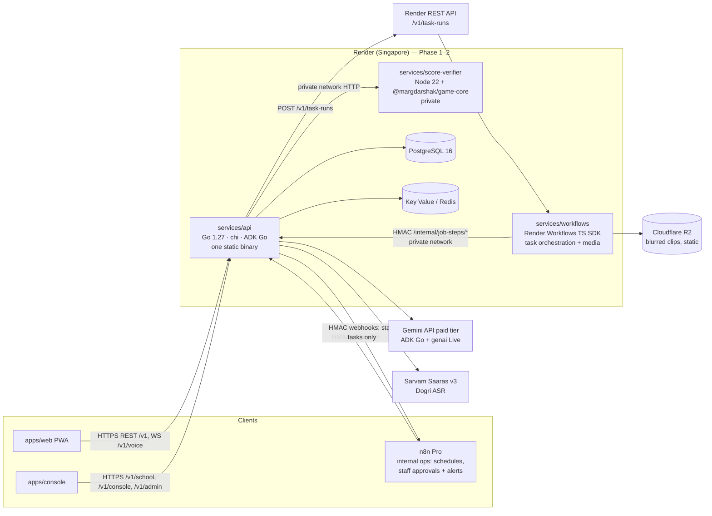
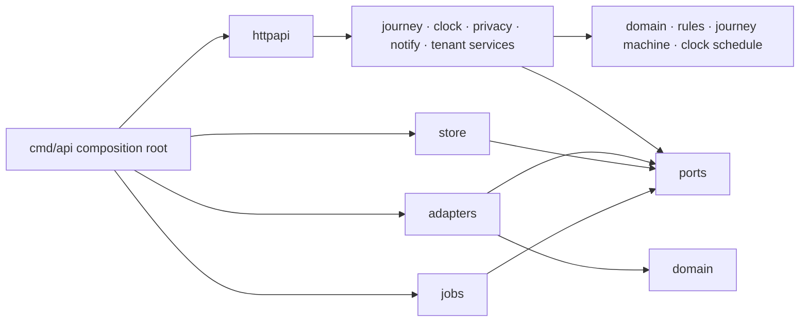

# Backend Engineering
> Project: Margdarshak · Owner: Backend lead · Status: Draft v0.2 (Go) · Last updated: 2026-10-23
> Related: [Project Brief](../00-overview/PROJECT_BRIEF.md) · [Build Conventions](../08-project/BUILD_CONVENTIONS.md) · [ADR-0011 Go backend](adr/ADR-0011-go-backend.md) · [Architecture](ARCHITECTURE.md) · [Tech Stack](TECH_STACK.md) · [Data Model](DATA_MODEL.md) · [API Spec](API_SPEC.md) · [Integrations](INTEGRATIONS.md) · [Frontend](FRONTEND.md) · [Testing](TESTING.md) · [Performance](PERFORMANCE.md) · [Coding Standards](CODING_STANDARDS.md) · [AI Models](../04-ai/MODELS.md) · [Prompts](../04-ai/PROMPTS.md) · [Security Architecture](../06-security-compliance/SECURITY_ARCHITECTURE.md) · [Observability](../05-ops/OBSERVABILITY.md)

This document defines three services:
- the **Go API** (`services/api`);
- the **Render Workflows task service** (`services/workflows`, TypeScript);
- the **Node score verifier** (`services/score-verifier`).

It is the reference for code review.

> **Change note (23 Oct 2026):** the backend moved from Python to **Go 1.27** ([ADR-0011](adr/ADR-0011-go-backend.md), which supersedes ADR-0002). Render Workflows tasks moved to the **TypeScript SDK** ([ADR-0005](adr/ADR-0005-render-workflows-durable-jobs.md)). There is no Python anywhere in the repository.

**The one-sentence rule:** deterministic code owns every fact (eligibility, fees, dates, scores, the scam verdict, golden hour, the class planner). AI only narrates, navigates, explains reviewed text, decodes screenshots, and proposes clip windows offline (D-09).

**AI for everyone (D-13 revised):** every AI feature is available to every user. A learner aged 16–17 uses Margdarshak on a parent's phone, inside the parent's (adult) account, in **family mode**. The account holder gives the consents, including verifiable parental consent for the minor's case. There is no age gate on AI. What remains for a minor's case: no behavioural tracking, no analytics events, and no targeted ads.

Every section has two scopes:
- **Hackathon build (Phase 1–2):** mock adapters, hosted on Render Singapore.
- **Production (Phase 3+):** a State Transport Department / NIC deployment on a MeitY-empanelled Indian cloud (D-17).

---

## 1. Services at a glance



| Service | Runtime | Exposed | Owns |
|---|---|---|---|
| `services/api` | **Go 1.27**: chi v5.5.0, oapi-codegen v2.8.0 strict server, pgx v5.11.0 + sqlc v1.31.1, goose v3.29.0, ADK Go v1.9.0, genai v1.76.0 | Public HTTPS + WS | <ul><li>All API-xx endpoints</li><li>Rules engine (authoritative), journey state machine, case clock</li><li>Game sessions and debrief orchestration</li><li>ADK agent hosting (voice included)</li><li>Auth and tenancy</li><li>**Every database read and write**</li><li>Every business step of every job</li></ul> |
| `services/workflows` | Node 22, TypeScript, `@renderinc/sdk` 1.4.0 | None (Workflows runs cannot receive inbound connections) | <ul><li>Durable, retried, fan-out orchestration</li><li>Media steps of the clip pipeline (ffmpeg, blur, flash check)</li><li>Calls the Go API for every decision and every DB write</li></ul> |
| `services/score-verifier` | Node 22, `@margdarshak/game-core` | Private network only | Server replay and scoring of game sessions (anti-cheat) |

**Why Go for the API (ADR-0011):**
- **Live voice:** ADK for Go has `Runner.RunLive` (bidirectional audio) in v1.9.0. The live-voice reason that once tied us to Python is gone.
- **Deployment:** one static binary per image (distroless, about 20–30 MB). Memory per instance is low, start-up is fast, and goroutines suit the WS voice bridge.
- **Contract-first:** handlers and types are generated from `api/openapi.yaml`.
- **TypeScript stays for:** the score verifier (scoring must be the same TypeScript as the browser) and the Workflows tasks (Render's TS SDK; no Go SDK exists, so the Go side uses Render's REST API).

---

## 2. Package layout of `services/api` (hexagonal)

Module: `github.com/sruj08/margadarshak/services/api` (`go 1.27.0` in `go.mod`). Only the BE-platform owner runs `go get` / `go mod tidy` (BUILD_CONVENTIONS §3).

```
services/api/
├── go.mod / go.sum
├── oapi-codegen.yaml          # generate: chi-server + strict-server + models → ./api
├── sqlc.yaml                  # engine postgresql, sql_package pgx/v5, schema = migrations/, queries = internal/store/queries
├── .golangci.yml              # golangci-lint v2 config (depguard layers, forbidigo bans); see CODING_STANDARDS
├── api/                       # GENERATED from ../../api/openapi.yaml (package api). Never hand-edited; committed
│   └── api.gen.go
├── cmd/
│   ├── api/main.go            # composition root. Subcommands: serve (default) · migrate up|down|status · healthcheck
│   └── seed/main.go           # synthetic demo data: seed --profile demo --synthetic
├── migrations/                # goose SQL (NNNNN_name.sql, -- +goose Up / Down), embedded via embed.FS (embed.go)
└── internal/
    ├── platform/              # config (caarlos0/env v11), slog setup, OTel setup, http.Server lifecycle, health aggregation
    ├── httpapi/               # chi router, middleware (request id, tenant, auth, rate limit, idempotency, CORS), strict handlers per API group, problem+json, WS voice bridge
    ├── domain/                # PURE value types and entities: Paise, Date, StateCode, VehicleClass, CaseID (uuid v7), AgeBand (under_16 | 16_17 | 18_25 | 26_40 | 41_60 | 60_plus), DOBPrecision, Principal, Error{Code}
    ├── ports/                 # Go interfaces for every driven dependency (§3)
    ├── adapters/              # outbound implementations of ports
    │   ├── gov/               # sarathi{mock,deeplink,real-stub}, digilocker/mock, aadhaaroffline/mock, bhashini/mock, payment/redirect, slot/mock
    │   ├── ai/                # voiceguide, debrief, coach, tutor, decoder, clipproposer, signsnap, scam, commentary · plugins/{pii,provenance} · sarvam (Dogri ASR)
    │   ├── scoring/           # score-verifier HTTP client (HMAC)
    │   ├── storage/           # S3-compatible (R2 / MinIO), local fs
    │   └── kv/                # Redis/Key Value client, in-memory fallback for dev
    ├── rules/                 # AUTHORITATIVE rules engine (pure): pack loader (fs.FS), JSON Schema validation, expression interpreter, evaluator, fees, class planner, golden tests
    ├── journey/               # case state machine (pure transition table) + CaseService (plans, cases, events, blockers, handoff)
    ├── clock/                 # milestone schedule (pure) + sweep service + SystemClock / FrozenClock
    ├── privacy/               # PII redactor (Verhoeff Aadhaar-like, OTP-in-context, phone, email, tokens) + slog redaction handler, consent purposes, family mode / parental consent, retention, export/erase
    ├── notify/                # notification service (templates, channel fallback, opt-out) + channels: n8n webhook, web push, console
    ├── store/                 # pgxpool, UnitOfWork (tx + SET LOCAL app.tenant_id), repositories implementing ports, sqlcgen/ (generated), queries/*.sql, storetest/ (embedded-postgres helper)
    ├── audit/                 # append-only audit writer (E-30)
    ├── jobs/                  # JobRunner implementations (inline, renderworkflows, temporal [design]) + Go step handlers + job_runs bookkeeping
    └── tenant/                # tenant registry (E-31), host/X-Tenant resolution, per-tenant adapter choice, feature flags
```

Feature packages for Phase 2+ are added in the same style when they are built: `internal/{games,learn,debrief,intel,letters,schools,console}`. Each has a pure core plus a `service.go` that depends only on `ports`.

### 2.1 Dependency rule (enforced)



- **Pure packages:** `internal/domain`, `internal/rules`, the journey transition table and the clock schedule.
  - They import only the standard library, `internal/domain` and `internal/ports` (interfaces only).
  - They never import `net/http`, `database/sql`, `pgx`, `chi`, `genai`, `adk`, `go-redis`, `os/exec`, or the time-now functions (time comes from `ports.Clock`).
- **Services** (`journey`, `clock`, `privacy`, `notify`, `tenant`, feature packages) depend on `ports`, never on adapters.
- **Adapters** never import each other. They meet only in `cmd/api/main.go`, which is the only composition root. There are no package-level singletons.
- **Enforcement:**
  - `depguard` rules in `.golangci.yml`.
  - An architecture test (`go list -deps`), which fails CI on a forbidden edge.
  - Go's `internal/` visibility.
  - See [CODING_STANDARDS](CODING_STANDARDS.md).

### 2.2 Request lifecycle

```mermaid
sequenceDiagram
  participant C as Client
  participant M as chi middleware
  participant H as Strict handler (generated interface)
  participant S as Service
  participant D as Pure core
  participant P as Port → Adapter
  C->>M: HTTPS + X-Tenant + Idempotency-Key + cookie
  M->>M: request id, otelhttp span, tenant resolve, auth → Principal, rate limit, idempotency claim
  M->>H: decoded, typed request (generated from OpenAPI; unknown fields rejected)
  H->>S: command struct (ctx carries Principal, Tenant, deadline)
  S->>P: load via UnitOfWork (pgx tx, SET LOCAL app.tenant_id)
  S->>D: pure decision (rules / journey / fees / clock)
  D-->>S: result + trace (rule IDs)
  S->>P: persist + outbox events + audit (same tx)
  S-->>H: result struct
  H-->>C: JSON (+ ETag / version) or application/problem+json
```

### 2.3 Contract-first code generation
- `api/openapi.yaml` is the contract. `go generate ./...` runs:
  - `go run github.com/oapi-codegen/oapi-codegen/v2/cmd/oapi-codegen@v2.8.0 -config oapi-codegen.yaml ../../api/openapi.yaml`.
    - Outputs: `models`, `chi-server` and `strict-server` → `services/api/api/api.gen.go`.
    - `internal/httpapi` implements the generated `StrictServerInterface`. The generated chi router is mounted under our middleware.
    - Runtime helpers come from `github.com/oapi-codegen/runtime` v1.8.0.
  - `go run github.com/sqlc-dev/sqlc/cmd/sqlc@v1.31.1 generate`.
    - Inputs: queries in `internal/store/queries/*.sql`. Schema read from `migrations/`.
    - Output: type-safe pgx v5 code in `internal/store/sqlcgen`.
- Generated code is committed. CI runs `go generate ./... && git diff --exit-code`, so the spec, the queries and the code can never drift.
- WebSocket (API-40) and binary endpoints (API-57 PNG) have no generated handler: they are hand-written chi routes that match the spec exactly.
- The TS client `packages/api-client` is generated from the same file (openapi-typescript).

---

## 3. Ports and adapters (F-56)

| Port (Go interface in `internal/ports`) | Methods (abridged) | Adapters: Phase 1–2 | Adapters: Phase 3+ |
|---|---|---|---|
| `Sarathi` | `BuildHandoff(ctx, domain.Case) (domain.HandoffPack, error)` · `FetchStatus(ctx, appRef string) (domain.ApplicationStatus, error)` · `Submit(...)` (Mode B only) | `sarathi/deeplink` (Mode A: copy-pack template + deep link to `sarathi.parivahan.gov.in`), `sarathi/mock` (demo statuses, "simulated" chip) | `sarathi/real` (NIC-granted API; contract in `api/adapters/sarathi.yaml`), never scraping (D-08) |
| `DigiLocker` | `AuthorizeURL(ctx, state, pkce)` · `Exchange(ctx, code)` · `PullDocument(ctx, docType)` · `IssuedPointer(ctx, caseID)` | `digilocker/mock` | DigiLocker requester adapter (after NeGD requester onboarding) |
| `AadhaarOffline` | `VerifyOfflineXML(ctx, zip []byte, shareCode string)` / `VerifySecureQR(ctx, payload)` → age band + name only; **never** stores the number | `aadhaaroffline/mock` | **Mock-only in Margdarshak.** Real offline QR/XML verification carries OVSE duties, so in government mode it runs through the state's own system (PROJECT_BRIEF F-56, D-07) |
| `Bhashini` | `Translate(ctx, text, src, tgt)` · `ASR(ctx, audio, lang)` · `TTS(ctx, text, lang)` | `bhashini/mock` (returns reviewed strings) | Bhashini ULCA pipelines |
| `Payment` | `RedirectURL(ctx, caseID) (string, error)` · `Status(ctx, ref)` | `payment/redirect` (points to Sarathi/state gateway; we never take money) | PayGov / state gateway status adapter |
| `Notifier` | `Send(ctx, notify.Message) (MsgID, error)` (template ID, channel, recipient ref, vars, idempotency key) · `Status(ctx, MsgID)` | P1 build: `notify/n8n` (WhatsApp sandbox/test numbers, email), `notify/webpush`, `notify/console` (dev). Target (ADR-0006 rev., 24 Oct): `WhatsAppCloudNotifier` (Meta Cloud API, called directly), `EmailNotifier` (SMTP), so citizen messages never go through n8n | Same with the state's WhatsApp business number + SMS after TRAI DLT (D-16) |
| `Slots` | `ListOffices(ctx, state, near)` · `Availability(ctx, officeID, week)` | `slot/mock` (seeded, labelled) | State slot API via adapter |
| `ScoreVerifier` | `Verify(ctx, VerifyRequest) (VerifiedResult, error)` | `scoring/http` (private network, HMAC) | same |
| `Narrator` | `Debrief(ctx, DebriefInput) (DebriefDraft, error)` · `Coach(ctx, CoachPlan) (CoachDraft, error)` | `ai/debrief`, `ai/coach` (ADK Go llmagent on Gemini Flash-Lite), `ai/template` (fallback, EC-29) | + India-region model or Bhashini/local Indic model behind the same port (D-17) |
| `VoiceSessions` | `OpenLive(ctx, Principal, locale, screen string) (LiveSession, error)` | `ai/voiceguide` (ADK `Runner.RunLive`), `ai/sarvam` cascade for Dogri | same |
| `JobRunner` | `Start(ctx, task TaskName, input []any, idemKey string) (RunRef, error)` · `Get(ctx, RunRef) (RunStatus, error)` · `Name() string` | `jobs/renderworkflows` (Render REST API), `jobs/inline` (goroutine; dev, CI, degraded mode) | `jobs/temporal` (Temporal Go SDK `go.temporal.io/sdk` v1.50.0) on the state cloud (production; cloud-agnostic, D-17) [design only] |
| `ObjectStore` | `Put`, `Get`, `SignedURL(ctx, key, ttl)` | `storage/s3` (Cloudflare R2) | Indian S3-compatible store / MinIO |
| `Clock` | `Now() time.Time` (UTC; IST conversion in `domain`) | `clock.System` (host NTP), `clock.Frozen` (tests) | NIC/NPL NTP-synced hosts (CERT-In) |
| `Audit` | `Append(ctx, audit.Entry) error` (actor, action, target, tenant, meta) | Postgres append-only table (E-30) | + WORM export, 180-day India retention |

```go
// internal/ports — representative signatures (the files are the source of truth).
type Clock interface{ Now() time.Time }

type JobRunner interface {
	Start(ctx context.Context, task TaskName, input []any, idemKey string) (RunRef, error)
	Get(ctx context.Context, ref RunRef) (RunStatus, error)
	Name() string // "inline" | "render_workflows" | "temporal" — logged on every job
}

type Narrator interface {
	Debrief(ctx context.Context, in DebriefInput) (DebriefDraft, error)
	Coach(ctx context.Context, plan CoachPlan) (CoachDraft, error)
}

type VoiceSessions interface {
	OpenLive(ctx context.Context, p domain.Principal, locale, screen string) (LiveSession, error)
}

type UnitOfWork interface {
	// Do runs fn in one pgx transaction with SET LOCAL app.tenant_id; repos are tx-bound.
	Do(ctx context.Context, tenant domain.TenantID, fn func(ctx context.Context, r Repos) error) error
}
```

- **Contract tests:** every port has one shared suite (`internal/ports/porttest`). Both the mock and the real adapter must pass it. The tests are named `TestContract_<Port>` (see [TESTING](TESTING.md) §5).
- **Adapter choice is per-tenant config** (`tenants.adapters.sarathi = "deeplink" | "mock" | "real"`), resolved by `internal/tenant`. A state flips modes without a code change.
- **Anti-corruption:** adapters translate external formats into `domain` types. Nothing outside `internal/adapters/gov/` sees Sarathi or DigiLocker payload shapes.

---

## 4. Rules engine (F-02, F-03, F-04, F-42; D-05)

The Go engine in `internal/rules` is **authoritative**. `packages/rules` is a TypeScript mirror for offline plan cards. The two are conformance-tested on the same golden JSON in `tests/golden/rules/` (TESTING §4).

### 4.1 Rule packs as data

```
rulepacks/
├── schema/rulepack.schema.json     # JSON Schema 2020-12 (validated in Go with santhosh-tekuri/jsonschema v6; mirrored to Zod in packages/rules)
├── base/cmvr.json                  # Central base pack: MV Act 1988 + CMVR 1989
├── states/{JK,DL,KL,MH,TN,PB}.json # State overlays (extend base)
├── fees.json                       # CMVR r.32 fee table, integer paise
├── classes.json                    # vehicle classes
└── CHANGELOG.md                    # public changelog of rule changes (D-05 trust)
```

The RULES owner maintains these files (BUILD_CONVENTIONS §3). Every pack carries a manifest block:
```json
{
  "packId": "JK",
  "version": "2026.10.0",
  "extends": "IN-base@2026.10.0",
  "effectiveFrom": "2026-10-23",
  "status": "approved",
  "maker": "user:rp-maker-01",
  "checker": "user:rp-checker-02",
  "approvedAt": "2026-10-23T10:00:00+05:30",
  "sha256": "<digest of all files>",
  "notes": "Seeded for the hackathon; transport-class rows flagged verify."
}
```

Every rule row has the same envelope:
```json
{
  "id": "ELIG-MC50-16",
  "kind": "eligibility",
  "appliesTo": ["MC50CC"],
  "when": { "all": [ { "gte": [ { "ageOn": "asOf" }, 16 ] }, { "lt": [ { "ageOn": "asOf" }, 18 ] } ] },
  "then": { "eligible": true, "requires": ["GUARDIAN_CONSENT"], "noticeIds": ["NOTICE-MOST-SCOOTERS-OVER-50CC"] },
  "source": { "title": "MV Act 1988 s.4(2); Delhi Transport class table", "url": "<URL from research/ps1-current-state/02-rules-process.md>" },
  "verified_on": "2026-10-23",
  "confidence": "high",
  "verify": false,
  "text_en": "At 16–17 you can only get a licence for a gearless motorcycle up to 50 cc, with a parent's or guardian's consent.",
  "text_hi": "16–17 साल की उम्र में केवल 50 cc तक की बिना गियर वाली मोटरसाइकिल का लाइसेंस मिलता है, माता-पिता या अभिभावक की सहमति से।"
}
```

- **`verify: true` rows** (e.g. the transport-class LMV prerequisite, D-05/D-25):
  - They show a "verify at your RTO" chip.
  - They are **never** in the AI's allowed rule set.
- **Numbers in rule text:** rule text may mention a rule-defined quantity only through `{placeholders}` filled from the row's own data (`"{minAge}"`). Never hard-code a number in a translation.
- **Class coverage:** all classes are in the engine (D-05). Deep learning content exists only for MCWOG, MCWG and LMV. Other classes return `content_status: "coming"`.
- **Licence vs product access:** `GUARDIAN_CONSENT` is a *licence* requirement (MV Act s.4(2)). It is separate from the product consent that the account holder gives in family mode (§12).

### 4.2 Expression language (no `eval`)
The engine uses a small, closed JSON expression language. A pure interpreter in `internal/rules/expr.go` evaluates it, and it is fuzz-tested (`FuzzExpr`):

| Operator | Meaning |
|---|---|
| `all`, `any`, `not` | boolean combinators |
| `eq`, `ne`, `lt`, `lte`, `gt`, `gte`, `between` | comparisons (numbers, ISO dates) |
| `in`, `has` | membership in a list / fact set |
| `ageOn` (`"asOf"` or a date fact) | age in whole years on that date, honouring `dobPrecision` |
| `daysBetween`, `addDays`, `addMonths` | date arithmetic (calendar-aware, IST date boundaries) |
| `fact` | read a named fact from the closed `Facts` struct |
| `const` | literal |

Bad packs fail **at pack load time**, never at request time:
- Unknown operators or facts fail the JSON Schema and the static check.
- Complexity guards: max expression depth 8, max 200 rows per file.

### 4.3 Evaluator

```go
// internal/rules/evaluator.go — signature contract (illustrative)
type Facts struct {
	AsOf                  domain.Date           // from ports.Clock, IST calendar date
	DOB                   *domain.Date
	DOBPrecision          domain.DOBPrecision   // "day" | "year" — EC-01: Aadhaar shows only the year
	ResidenceState        domain.StateCode
	IDAddressState        *domain.StateCode     // EC-02 migrant case
	RequestedClasses      []domain.VehicleClass
	HoldsLL               *LLFacts              // EC-22 mid-journey onboarding
	HoldsDL               *DLFacts              // EC-16 expired DL
	ParentNameOnID        *bool                 // EC-03 S/o line blank
	Disability            []DisabilityFlag      // EC-13
	ForeignLicence        bool                  // EC-12
	FailedAttempts        int                   // EC-08
	OnlineLLTestAvailable bool                  // EC-10, from the pack
}

// Evaluate is pure: same pack + same facts → same Decision. It returns eligible classes,
// blockers, notices, the fee quote, the milestone schedule and a trace of every rule ID that fired.
func Evaluate(pack *CompiledPack, f Facts) (Decision, error)
```

`Decision` carries the following fields (snake_case on the wire):

| Field | Content |
|---|---|
| `EligibleClasses` | eligible classes, each with its reason rule IDs |
| `Ineligible` | each with the blocking rule and the fix |
| `Blockers` | F-04, each `{RuleID, Severity, Fix, Source, Confidence}` |
| `Notices` | notices that apply |
| `FeeQuote` | §6 |
| `Plan.Steps`, `Plan.MaxRTOVisits`, `Plan.EarliestLicenceDate` | the plan |
| `Trace` | every rule ID that fired |
| `RulePackVersion` | the pack version used |

- **Age with a year-only DOB (EC-01):** with `DOBPrecision == "year"` the evaluator does three things:
  - It computes the **minimum possible age** (assume 31 Dec of that year) for eligibility.
  - It computes the maximum possible age for upper limits (Form 1A at 40, EC-04).
  - It adds blocker `BLK-DOB-YEAR-ONLY` ("bring a document that shows your full date of birth").
- **Two classes with different ages (EC-21):** eligibility is per class. The class planner returns:
  - which classes can share one LL now;
  - which must wait, with the date each becomes eligible.
- **Compiled pack cache:** a pack is compiled once per `(packID, version)`: the overlay is merged onto the base and the expressions are parsed. Compiled packs are cached in process (immutable values behind a `sync.Map`; small LRU of 32) and in Key Value (`rulepack:<id>:<v>`). The API never reads JSON files at request time. Packs load at start-up from `RULEPACK_DIR` through an `fs.FS`.

### 4.4 Rule-pack studio and change management (F-42, EC-27)
1. **Draft.** A maker drafts a new version in the console (API-54).
2. **Validate.** Validation runs JSON Schema, the static expression check and **the full golden suite for that tenant** ([TESTING](TESTING.md) §4). The result is attached to the draft.
3. **Approve.** A checker approves. The checker must be a different user (enforced). Approval does four things:
   - writes `approvedAt`;
   - signs the manifest digest;
   - appends an audit row;
   - publishes a public changelog entry.
4. **Re-evaluate open cases (EC-27).** On publish, the API starts the job `rulepack_reevaluate(tenant, from, to)`. The job:
   - pages through the open cases of that tenant and runs `rules.Evaluate` for each;
   - diffs the old and new decisions;
   - for changed cases, writes a `RULES_CHANGED` timeline event and a notice ("A rule changed on <date>; your plan was updated").

   Cases keep `rule_pack_version`, so the old decision can be reproduced.
- **Kerala HPT stayed or postponed (EC-28):** this is a pack flag (`hpt.status: "announced" | "active" | "stayed"`) with its own source. The Nazar copy reads it ("practice in Kerala's announced format").

---

## 5. Journey state machine (F-08)

### 5.1 States and events

```mermaid
stateDiagram-v2
  [*] --> PLAN: POST /v1/cases (API-10)
  PLAN --> LL_APPLYING: ll_application_started
  PLAN --> BRIDGE: ll_issued (EC-22 already holds an LL)
  LL_APPLYING --> HANDED_OFF: handoff_done (copy-pack used / deep link opened)
  HANDED_OFF --> PAYMENT_PENDING: payment_pending (user-reported)
  HANDED_OFF --> LL_TEST: payment_confirmed
  PAYMENT_PENDING --> LL_TEST: payment_confirmed
  LL_TEST --> LL_TEST: ll_test_failed (retest; no 7-day rule for LL unless pack says)
  LL_TEST --> BRIDGE: ll_issued
  BRIDGE --> DL_BOOKABLE: clock: min_wait_days reached (rule TL-LL-MIN-WAIT)
  DL_BOOKABLE --> TEST_BOOKED: slot_booked
  TEST_BOOKED --> TEST_FAILED: test_failed
  TEST_FAILED --> TEST_BOOKED: slot_booked [retest gap elapsed, TL-RETEST-GAP]
  TEST_BOOKED --> AWAITING_APPROVAL: test_passed
  AWAITING_APPROVAL --> DL_ISSUED: approved
  DL_ISSUED --> DL_HOLDER: card_received
  BRIDGE --> LL_EXPIRED: clock: LL validity ended
  DL_BOOKABLE --> LL_EXPIRED: clock
  TEST_BOOKED --> LL_EXPIRED: clock
  TEST_FAILED --> LL_EXPIRED: clock
  LL_EXPIRED --> LL_APPLYING: reapply (EC-07 new application number)
  DL_HOLDER --> RENEWAL_DUE: clock: renewal window opens
  RENEWAL_DUE --> DL_HOLDER: renewed
  DL_HOLDER --> [*]: case closed
```

- **Persisted vs derived:**
  - Persisted: `case.stage` (the enum above).
  - Derived per request: `case.display_stage` and `case.alerts[]`. Examples: `LL_EXPIRING` when `ll_expires_at − now ≤ 30 days`, `DOB_YEAR_ONLY`, `RULES_CHANGED`, `SARATHI_DOWN`.
  - The web app picks its home view from `display_stage`; `LL_EXPIRING` overrides the stage view. See [FRONTEND](FRONTEND.md) §3.2.
- **Stage → product stage mapping:**

  | Journey states | Product stage |
  |---|---|
  | PLAN | S1 |
  | LL_APPLYING, HANDED_OFF, PAYMENT_PENDING | S2 |
  | LL_TEST | S3 |
  | BRIDGE | S4 |
  | DL_BOOKABLE, TEST_BOOKED | S5/S6 |
  | TEST_FAILED | S6F |
  | AWAITING_APPROVAL, DL_ISSUED | S7 |
  | DL_HOLDER | S8 (first 12 months) / S9 |
  | RENEWAL_DUE | S9 |

### 5.2 Implementation
- **Transition table.** `internal/journey/machine.go` holds a transition table: `map[transitionKey]Transition`, where `transitionKey{From State; Event EventType}`.
  - Each transition has guards: pure `func(Case, rules.Decision, time.Time) error`.
  - Each transition has effects: milestones to schedule and notices.
  - No library is used. The table is data and is golden-tested. The `exhaustive` linter checks every `switch` over `State` / `EventType`.
- **Apply is pure.** `Apply(c Case, ev Event, d rules.Decision, now time.Time) (Case, []Effect, error)`. An invalid transition returns `domain.Error{Code: "JOURNEY_INVALID_TRANSITION"}` → HTTP 409.
- **Event sources:**
  - API-15, user-reported. Event types are listed in PROJECT_BRIEF §15: `ll_application_started`, `handoff_done`, `payment_pending`, `payment_confirmed`, `ll_issued`, `ll_test_failed`, `slot_booked`, `test_failed`, `test_passed`, `approved`, `card_received`, `reapply`, `renewed`.
  - Adapters (Mode B status).
  - The clock sweep.
- **Event fields:**
  - `event_id`: idempotent.
  - `occurred_on`: must not be in the future by server time (EC-15) and must not be before the case's previous event.
- **Primary action.** `PrimaryAction(c Case, d rules.Decision, now time.Time) ActionID` returns a value from a closed enum: `START_PLAN`, `RESUME_STEP`, `OPEN_HANDOFF`, `CHECK_PAYMENT`, `TAKE_MOCK_TEST`, `PRACTISE_NAZAR`, `BOOK_TEST`, `OPEN_TEST_DAY`, `SEE_RETEST_PLAN`, `CHASE_APPROVAL`, `SHOW_CARD`, `RENEW`. There is one per stage, so the client never guesses.
- **3+ fails (EC-08).** After the third `test_failed`, the next booking is shown as available only when `remedial_training_ack` is set, per the pack's remedial rule. The copy is private and face-saving.
- **Optimistic concurrency.** `case.version` is an int. PATCH/POST require `If-Match`. A mismatch returns 412.

---

## 6. Fee computation (`fees.json`, CMVR r.32; D-06)

### 6.1 Data

```json
{
  "currency": "INR",
  "unit": "paise",
  "source": { "title": "CMVR 1989 r.32 (revised table, GSR 1183(E), 29 Dec 2016), HP reproduction + Delhi totals", "url": "https://himachal.gov.in/WriteReadData/l892s/3_l892s/rule32_cmvr-40224160.pdf" },
  "verified_on": "2026-10-23",
  "confidence": "medium",
  "items": [
    { "id": "FEE-LL-ISSUE",   "label_key": "fee.ll_issue",   "amount": 15000, "per": "class",       "stage": "LL" },
    { "id": "FEE-LL-TEST",    "label_key": "fee.ll_test",    "amount": 5000,  "per": "application", "stage": "LL" },
    { "id": "FEE-DL-TEST",    "label_key": "fee.dl_test",    "amount": 30000, "per": "class",       "stage": "LL", "note_key": "fee.paid_with_ll" },
    { "id": "FEE-DL-ISSUE",   "label_key": "fee.dl_issue",   "amount": 20000, "per": "application", "stage": "DL" },
    { "id": "FEE-SMART-CARD", "label_key": "fee.smart_card", "amount": 20000, "per": "application", "stage": "DL" }
  ],
  "retest": [
    { "id": "FEE-LL-RETEST", "amount": 5000,  "per": "attempt" },
    { "id": "FEE-DL-RETEST", "amount": 30000, "per": "class_attempt" }
  ],
  "stateCharges": { "known": false, "notice_key": "fee.state_charges_may_apply" }
}
```

Overlays may add state items. Example: J&K postage, which `02-rules-process.md` reports inside a ₹1,050 slot-booking payment with an unknown breakdown. Each such item has its own `source`, `verified_on` and `confidence: "low"`.

### 6.2 Computation
- **Integer paise only.** `rules.ComputeFeeQuote(pack *CompiledPack, classes []domain.VehicleClass, scope StageScope) (FeeQuote, error)` works in **`domain.Paise` (int64 paise)**. There are no floats anywhere in money paths: `forbidigo` bans `float32`/`float64` in `internal/rules` fee code and in `domain` money types.
- **Multipliers:** `per: "class"` items multiply by the number of classes. `per: "application"` items appear once.
- **Golden expectations** (from the PROJECT_BRIEF facts):

  | Case | Sum | Total |
  |---|---|---|
  | One class | 15000 + 5000 + 30000 + 20000 | **70000 paise (₹700)** |
  | One class + smart card | 70000 + 20000 | **90000 paise (₹900)** |
  | Each additional class | 15000 + 30000 | adds **45000 paise (₹450)** |

  These match Delhi's published LL-stage totals of ₹500 / ₹950 / ₹1,400 for 1 / 2 / 3 classes (LL issue + LL test + DL test).
- **The quote.** The `FeeQuote` (E-07) carries `LineItems`, `Total`, `RulePackVersion`, `Source`, `VerifiedOn`, and the notice "state charges may apply". The UI renders the trust line from it ("₹700 for one class + ₹200 card; state charges may apply"). There is no literal anywhere (D-06).
- **AI never computes or states a fee.** The voice guide reads fees only through the `get_fee_quote` tool result. The provenance guard replaces any ₹ amount that is not in a tool result (D-10).

---

## 7. Case clock (F-09)

### 7.1 Milestones (from the pack's timeline rules)

| Milestone ID | When (rule) | Message (template) | Edge case |
|---|---|---|---|
| `LL_DAY_25_PREP` | LL issue + (`min_wait_days` − 5) | "Book your driving test soon" | — |
| `LL_DAY_30_UNLOCK` | LL issue + `min_wait_days` (TL-LL-MIN-WAIT; research: DL test from day 31) | "You can now book your driving test" | — |
| `LL_EXPIRY_M30`, `LL_EXPIRY_M7` | LL expiry − 30 / − 7 days (LL validity 6 months, TL-LL-VALIDITY) | "Your LL expires on <date>" | EC-07 |
| `TEST_EVE` | test date − 1 day, 19:00 IST | test-eve checklist + ICS | — |
| `RETEST_ELIGIBLE` | fail date + 7 days (TL-RETEST-GAP) | private "your retest plan" | EC-08 |
| `APPROVAL_CHASE` | pass date + 3 days with no `approved` | "No SMS yet? Here's how to check" | EC-23 |
| `FORM_1A_AT_40` | 40th birthday before expected DL date | "You'll need Form 1A" | EC-04 |
| `DL_RENEWAL_M60`, `DL_EXPIRED`, `DL_EXPIRED_Y1` | DL validity rules | renewal reminder; "no grace period"; > 1 year late = retest | EC-16 |
| `RULES_CHANGED` | rule-pack re-evaluation | "A rule changed; your plan was updated" | EC-27 |

- **Computed from server dates.** `clock.Schedule(c journey.Case, d rules.Decision) []Milestone` (pure) computes every milestone.
- **Stored with an idempotency key.** Milestones are stored as `TimelineEvent` rows (E-12) with a unique key `"{caseID}:{milestoneID}:{dueOn}"`.
  - A re-computation that yields the same key is a no-op (`INSERT … ON CONFLICT DO NOTHING`).
  - A changed due date cancels the old row and inserts the new one.

### 7.2 Execution: n8n triggers, Workflows orchestrates, the Go API decides, the notifier delivers

Render Workflows has **no native cron and no documented sleep** (`B-sponsors.md` §1). So durable timers are rows in Postgres, swept on a schedule:

```mermaid
sequenceDiagram
  participant N as n8n W1 Schedule 06:30 IST
  participant A as Go API-65 /internal/clock/sweep
  participant R as Render REST /v1/task-runs
  participant T as TS task case_clock_sweep
  participant B as TS subtask clock_batch ×K
  participant S as Go /internal/job-steps/*
  participant DB as Postgres
  participant N2 as n8n W1/W2 webhook
  N->>A: POST (HMAC, ts, nonce) {as_of?}
  A->>A: verify HMAC; as_of := server today (IST) — never trust caller time
  A->>R: POST {task: "<WORKFLOW_SLUG>/case_clock_sweep", input: [tenant, as_of], idempotencyKey: "sweep:{tenant}:{as_of}"}
  R->>T: run
  T->>S: POST clock.plan_pages {tenant, as_of}
  S->>DB: count due TimelineEvent (due_on <= as_of, status='scheduled'), keyset page cursors of 500
  S-->>T: [cursor…]
  T->>B: Promise.all(pages.map(p => ctx.run(clockBatch, tenant, as_of, p))) (≤ 8 concurrent)
  B->>S: POST clock.fire_batch {tenant, as_of, cursor}
  S->>DB: FOR UPDATE SKIP LOCKED, mark 'firing', create Notification (E-13) per opted-in channel
  S->>N2: POST batch {uid_ref, milestone_id, channel, template_id, vars} (HMAC)
  N2-->>S: 202
  S->>DB: mark 'fired' (or 'retry', attempt++)
  S-->>B: {fired, skipped_opt_out, failed}
  T-->>R: summary {due, fired, skipped_opt_out, failed}
```

- **As built (P1):** the batch is delivered through the n8n W02 webhook, as drawn above.
- **Decided change (24 Oct, ADR-0006 rev., TEAM DEC-022):** citizen messages move to a notifier worker inside `services/api` (same image, separate process). `clock.fire_batch` then only inserts Notification rows with `send_after`; the notifier claims due rows (`SKIP LOCKED`), applies quiet hours, the ≤ 1 nudge/day cap and per-number rate limits, and sends through the WhatsApp Cloud API / email / web push, keyed by `idempotency_key`. Receipts come back on the Meta channel webhook (API-66). n8n leaves this path. Tracked in [`WHATS_LEFT.md`](../08-project/WHATS_LEFT.md).
- **Exactly-once user effect:** `notification.idempotency_key = timelineEventKey + ":" + channel`. The receiver (n8n today, the notifier after the change) drops duplicates. The WhatsApp send is keyed too.
- **WhatsApp opt-out "STOP" (EC-30):** the inbound channel webhook (API-66) sets that channel's consent to withdrawn. The batch skips that channel and falls back to web push / in-app only.
- **Family mode:** reminders for a family member's case (e.g. a 16–17 learner) go to the account holder's opted-in channels. There are no streak nudges or engagement campaigns on a minor's case (no behavioural tracking).
- **Other triggers:** the sweep also runs after a deploy and on demand from the console. It is idempotent by `as_of`.
- **If n8n is down:** nothing the user sees changes. In-app timelines read the same rows. On-call can start the sweep through API-65 by hand (idempotent by `as_of`).
- **If Workflows is down:** `JOB_RUNNER=inline` runs the same Go step handlers in process (§8.4).

---

## 8. Background jobs (Render Workflows, TypeScript SDK)

### 8.1 Division of labour
- **The Go API owns:**
  - every decision and every database write;
  - every Gemini call (one AI codebase, so the PII and provenance plugins sit in one place).
- **The TypeScript tasks** in `services/workflows` are **thin orchestrators**:
  - They chain steps with `ctx.run`.
  - They fan out with `Promise.all`.
  - They let Render retry failed steps.
  - They run the media work that needs ffmpeg and ONNX models.
- **Each business step is one HMAC-signed call** from the task to the Go API over Render's private network: `POST /internal/job-steps/{step}`.
  - The endpoint is a proposed one, marked `x-proposed` in `api/openapi.yaml`.
  - It is allow-listed, idempotent by `(run_id, step, input digest)`, and limited to IDs-only inputs of at most 16 KB.
  - The Go handlers live in `internal/jobs/steps`. The inline and Temporal runners call the same handlers directly.
- **The workflows service has no `DATABASE_URL`.**

### 8.2 SDK and registration
- **Package:** `@renderinc/sdk` **1.4.0** on npm (`import { task, type TaskContext } from "@renderinc/sdk/workflows"`). The SDK is "early access, subject to breaking changes".
- **Layout of `services/workflows` (package `@margdarshak/workflows`, a pnpm workspace member):**

  | Path | Purpose |
  |---|---|
  | `src/main.ts` | imports every task module; the task server starts automatically when `RENDER_SDK_SOCKET_PATH` is set |
  | `src/tasks/*.ts` | one module per task |
  | `src/lib/api.ts` | HMAC client for `/internal/job-steps/*` using `API_INTERNAL_HOSTPORT` + `INTERNAL_HMAC_SECRET` |
  | `src/lib/media/*` | ffmpeg wrapper; face + plate blur with `onnxruntime-node` (YuNet + plate model); flash check |

- **Task definition:**
  ```ts
  export const clockBatch = task(
    { name: "clock_batch", retry: { maxRetries: 3, waitDurationMs: 1000, backoffScaling: 2 }, timeoutSeconds: 300 },
    async (ctx: TaskContext, tenant: string, asOf: string, cursor: string) =>
      api.step("clock.fire_batch", { tenant, as_of: asOf, cursor }, { runId: ctx.metadata.taskRunId }),
  );
  ```
- **Plan names:** the SDK README lists `starter` / `standard` / `pro`. The Blueprint header in `infra/render.yaml` records renamed compute IDs. Verify at H0 [unverified; owner Backend lead, 2026-10-24].
- **How the Go API starts a run** (`internal/jobs/renderworkflows`): Render's REST API, with no SDK on the Go side.
  - Start: `POST https://api.render.com/v1/task-runs` with `Authorization: Bearer $RENDER_API_KEY` and body `{"task": "<WORKFLOW_SLUG>/<task>", "input": [...], "idempotencyKey": "<our key>"}` → `202` with a `TaskRun`.
  - Track: Workflows has no completion webhook, so a goroutine polls `GET /v1/task-runs/{id}` (5 s, backing off to 60 s) until the status is terminal (`succeeded` / `completed`, `failed`, `canceled`). It writes each status to `job_runs`.
  - Cancel: `DELETE /v1/task-runs/{id}`.
  - Optional: SSE on `/v1/task-runs/events` instead of polling.
- **Local development:**
  - Run `render workflows dev -- pnpm --filter @margdarshak/workflows dev`. The local task server runs on `http://localhost:8120`.
  - Start the API with `JOB_RUNNER=render_workflows RENDER_USE_LOCAL_DEV=true` (or `RENDER_LOCAL_DEV_URL`).
  - See [ENVIRONMENT_SETUP](ENVIRONMENT_SETUP.md) §7.

### 8.3 Task catalogue

| Task (TS) | Trigger | Steps (each a `ctx.run` or an API step, retried independently) | Timeout | Notes |
|---|---|---|---|---|
| `clip_ingest(clip_id)` **(headline, D-15)** | console upload (API-55) | `transcode` (ffmpeg → 360p/480p H.264, faststart; TS) → `blur` (face + plate detection, M-09; TS) → `flash_check` (≤ 3 flashes/s, WCAG 2.3.1; TS) → API step `clip.propose_windows` (M-06, Gemini Flash video, offline, in Go) → API step `clip.open_review` (two-rater task) | 30 min | Visible retry in the Workflows dashboard for the demo. AI never publishes |
| `clip_finalize(clip_id)` | n8n W08 via API-67, once both raters have submitted | API steps `clip.agreement` (Δ onset ≤ 0.5 s; else third rater) → `clip.blur_audit_check` (100% audited flag) → `clip.publish_manifest` (R2) → `cdn_warm` (TS) | 5 min | Human gates live outside the run (no sleep API) |
| `case_clock_sweep(tenant, as_of)` | n8n W1 via API-65 | `clock.plan_pages` → `clock_batch` fan-out → `clock.fire_batch` | 20 min | §7.2 |
| `session_debrief(sid)` | API-35 when the inline debrief times out, or batch replays | API step `debrief.run` (load and gate → narrate → validate → persist, all in Go) | 60 s | The inline path is preferred for latency; this is the retry/fan-out path |
| `debrief_backfill(cohort)` | field study end (API-67) | API step `debrief.list_pending` → fan-out `session_debrief` | 30 min | — |
| `nightly_stats(date)` | n8n W13 via API-67 | API step `stats.aggregate` (n, % below 60/100, r with LL quiz, 95% CI) → `stats_public` (API-71) | 15 min | No PII; k ≥ 5 |
| `rulepack_reevaluate(tenant, from, to)` | rule-pack approval | API step `rules.list_open_cases` → fan-out `rules.reevaluate_page` → notices | 30 min | EC-27 |
| `user_export(principal)` | API-61 | API steps `privacy.collect` → `privacy.package` (zip of JSON) → signed URL (24 h) | 10 min | DPDP rights |
| `user_delete(principal)` | API-62 | API steps `privacy.cancel_timers` → `privacy.delete_case_data` → `privacy.tombstone` → `privacy.purge_objects` → audit | 10 min | EC-26 |
| `replay_pending_sessions()` | every sweep (API-67) | API step `games.replay_pending` (sessions in `pending_verification` → score verifier) | 10 min | Verifier outage recovery |

- **Durability rule:** tasks and steps are idempotent by input. Steps read state from Postgres and write with unique keys. So a Workflows retry or a duplicate trigger never double-fires a notification or double-publishes a clip.
- **Run-level idempotency:** our input-derived key is sent as Render's `idempotencyKey` and also stored in `job_runs` (unique).

### 8.4 Runners behind the `JobRunner` port

| Runner (`JOB_RUNNER`) | Where | Behaviour |
|---|---|---|
| `render_workflows` | hackathon (Render) | §8.2 |
| `inline` | local dev, CI, degraded mode if Workflows is unavailable during judging (risk R-11) | <ul><li>Runs the **same Go step handlers** in process, in a goroutine.</li><li>Bounded by a semaphore (8); per-task timeout from the catalogue; context detached from the request with `context.WithoutCancel`.</li><li>Fan-out uses `errgroup` with a limit.</li><li>`clip_ingest` media steps need ffmpeg/ONNX, so inline mode processes pre-blurred fixture clips only.</li></ul> |
| `temporal` | production on the state cloud [design only] | <ul><li>Temporal Go SDK (`go.temporal.io/sdk` v1.50.0).</li><li>The Go binary runs `api worker`. Workflows are Go code; activities call the same step handlers.</li><li>The two-rater wait becomes a signal inside one workflow; schedules replace n8n triggers where the state prefers.</li><li>Media activities run on a TS Temporal worker that reuses `services/workflows/src/lib/media`.</li></ul> |

The chosen runner is logged on every job (`runner` attribute) and reported by API-64.

---

## 9. Game sessions and the score verifier (F-23..F-26, E-16, E-17)

### 9.1 Session lifecycle

```mermaid
sequenceDiagram
  participant W as Web GameHost
  participant A as Go API (games service)
  participant V as score-verifier (Node)
  participant D as Debrief
  W->>A: POST /v1/games/{gameId}/sessions (API-34) Idempotency-Key
  A->>A: band gate, pick items (mock: unseen clips only), seed = crypto/rand uint32, scoringVersion pin
  A-->>W: {sid, seed, items, difficulty, scoring_version, expires_at (2 h)}
  W->>W: play; events with (sid, seq)
  W->>A: POST /v1/games/sessions/{sid}/complete (API-35) {client_result, replay.inputs (gz-b64), events_digest}
  A->>A: size limits (inputs ≤ 256 KB, http.MaxBytesReader), sid open & owned, not expired
  A->>V: POST /verify {game_id, game_version, scoring_version, seed, items, inputs} (HMAC, 2 s ctx timeout)
  V-->>A: {result: SessionResult, digest}
  A->>A: compare client vs server (|Δpct| ≤ 1.0 and same passed) else flag replay_mismatch; server wins
  A->>A: integrity: trust = f(flags); trust < 0.6 → practice only (no card, no percentile)
  A->>D: debrief(sid) inline with 6 s budget (else Workflows session_debrief)
  A-->>W: {verified_result, trust, debrief_status}
```

- **Mock mode uses unseen clips.** `clip_exposures(user, clip_id)` is written at session creation. Nazar Score = the mean of the last 3 mock sessions on unseen clips with trust ≥ 0.6.
- **Offline sessions** (client-generated `sid`) count for practice only. The server re-scores them, but they never count for share cards or percentiles.
- **Family mode (minor learner):** the full product applies, the AI debrief included.
  - Sessions are stored so that the learner's progress shows in the parent's account.
  - **No analytics events** are stored for a minor subject: API-63 drops them server-side.
  - No behavioural profiling, no use for ads or marketing.
  - Share cards and squads stay off until the account holder turns them on (parental consent).
- **Telemetry events (E-17)** arrive in batches of ≤ 500 with a unique `(sid, seq)`. Duplicates are ignored (idempotent sync from IndexedDB).

### 9.2 Score verifier service
- **Shape:** `services/score-verifier` is Node 22: a single HTTP server (`node:http`, no framework) that imports `@margdarshak/game-core` at the **exact version** pinned by `scoring_version`.
- **Security:** stateless; private network only; HMAC request auth with `SCORE_VERIFIER_HMAC_SECRET`.
- **Deterministic replay:** a fixed 60 Hz step and seeded mulberry32. No `Date` / `Math.random` in the scoring path (lint-enforced in game-core).
- **Outage:** the API stores the session as `pending_verification` and shows the provisional score as provisional. `replay_pending_sessions` retries later.
- **Target:** p95 < 150 ms per verify for a 10-clip Nazar session [target; measure at H0].

---

## 10. Debrief orchestration (F-25, M-02, D-09, D-10)

ADK for Go has agents (`llmagent`, `sequentialagent`, `parallelagent`, `loopagent`) but no graph workflow type. So the debrief is a **plain Go pipeline**: deterministic functions around exactly one ADK LLM call. It is hosted in process in the API.
- The pure parts live in `internal/debrief`: facts builder, allow-list builder, validator, template renderer.
- The LLM part lives in `internal/adapters/ai/debrief`.

| Step | Type | What it does |
|---|---|---|
| `loadAndGate` | code | <ul><li>Loads the **server-verified** `SessionResult`.</li><li>Requires the AI-coach consent of the account holder. For a family member under 18, this is the recorded parental consent.</li><li>Otherwise → template.</li></ul> |
| `buildFacts` | code | <ul><li>Top-3 findings by severity.</li><li>`facts` (numbers with keys).</li><li>`allowedRuleIDs` = ∪ of the findings' rule IDs ∩ rules where `verify=false`.</li><li>`drillCandidates` (top 3), `locale`, the previous 3 finding IDs.</li></ul> |
| `narrate` | LLM: `llmagent` with `GEMINI_MODEL_DEBRIEF` (default `gemini-3.1-flash-lite`), `Runner.Run` | <ul><li>`OutputSchema` (a `*genai.Schema`) is built **per request** with enums from the allow-lists. The agent value is constructed per call; the model client is shared.</li><li>No tools.</li><li>`GenerateContentConfig.SafetySettings` is set explicitly (`BLOCK_MEDIUM_AND_ABOVE`), since the defaults are off on 2.5+ (`04-ai-adk-gemini.md` §1.8).</li></ul> |
| `validate` | code | <ul><li>No digits (`[0-9०-९]`) outside `{{fact:key}}`.</li><li>IDs ∈ allow-lists; placeholders exist; the top finding is covered.</li><li>Tone lint; script ratio.</li><li>Lengths (Gemini ignores minLength/maxLength).</li></ul> |
| `retryOrFallback` | code | One retry with the error list, then `ai/template` |
| `render` | code | Fills placeholders from facts with locale formatting; appends rule text + source; HTML-escapes |
| `persist` | code | Stores `Debrief` (E-19) with `validator_verdict` and `mode: coach\|template`; prompt text retained ≤ 7 days |

- **Runner-level plugins** (`plugin.New`), shared by every agent:
  - PII redaction in `OnUserMessageCallback` / `BeforeModelCallback`.
  - The number-provenance guard in `AfterModelCallback` (D-10).
- **Circuit breaker:** if the fallback rate exceeds 20% over 5 minutes, the breaker opens for 5 minutes (template only) and n8n W12 fires. The state is kept in Key Value so all instances agree.
- **Latency budget:** inline 6 s (`context.WithTimeout`). The web shows the template card instantly and swaps in the coach card (see [FRONTEND](FRONTEND.md) §8.4).
- **Cost reference:** ≈ $0.0012 (≈ ₹0.10) per debrief at the Flash-Lite prices recorded in `08-game-ai-n8n.md` §5.8.
- **Open item:** confirm on H0 that per-request `OutputSchema` enums work with `gemini-3.1-flash-lite` through ADK Go. If not, `narrate` calls `client.Models.GenerateContent` with `ResponseSchema` directly (genai v1.76.0), behind the same `Narrator` port and the same guards.

---

## 11. ADK agent hosting (M-01..M-05, M-10, M-11)

| Agent | Mode | Hosting | Model (env var) | Tools / boundary |
|---|---|---|---|---|
| VoiceGuideAgent (M-01) | live (bidi audio) | Go API process: `(*runner.Runner).RunLive(ctx, userID, sessionID, agent.LiveRunConfig{…})` behind the WS endpoint API-40 | `GEMINI_MODEL_LIVE` = `gemini-3.8-live` (fallback `GEMINI_MODEL_LIVE_FALLBACK` = `gemini-2.5-flash-native-audio-preview-12-2025`; ADK Go support for 3.8 Live is to be confirmed at H0) | <ul><li>`functiontool.New` tools: `navigate(route_id: enum)`, `fill_field(field_id: enum, value)`, `get_rule(rule_id)`, `get_fee_quote(case_id)`, `get_case_summary(case_id)`, `read_debrief(sid)`, `open_drill(drill_id: enum)`.</li><li>**No submit/pay/book tools exist.**</li></ul> |
| DebriefAgent (M-02) | pipeline step (§10) | Go API (inline) and the `session_debrief` task (API step) | `GEMINI_MODEL_DEBRIEF` | none |
| CoachAgent (M-03) | pipeline step | Go API, weekly coach-plan TimelineEvent in `case_clock_sweep` (n8n W6 retired, ADR-0006 rev.) | `GEMINI_MODEL_DEBRIEF` | none; input = plan JSON computed by code |
| TutorAgent (M-04) | single LLM call with retrieved reviewed text | Go API | `GEMINI_MODEL_DEBRIEF` | content-grounded only (reviewed question bank) |
| ScreenDecoderAgent (M-05) | vision | Go API (API-42) | `GEMINI_MODEL_VISION` (Gemini Flash) | matches the verified error catalogue; `unknown` allowed |
| ScamExplainer (M-10) | single LLM call | Go API (API-43) | `GEMINI_MODEL_DEBRIEF` | explains the rules verdict; never decides "safe" |
| ClipWindowProposer (M-06) | video, offline | Go API step `clip.propose_windows`, called by the `clip_ingest` task | `GEMINI_MODEL_VISION` | proposals only; two humans set windows |

**Hosting details:**
- **Runners:** one `runner.Runner` per long-lived agent, created in `cmd/api` at start-up (`runner.New(runner.Config{AppName, Agent, SessionService: session.InMemoryService(), PluginConfig})`).
  - One-shot calls use `Runner.Run` and drain the `iter.Seq2[*session.Event, error]`.
  - Voice sessions are per connection and are not persisted. There is no ADK memory service: the case file is structured state in our DB (`04` §1.4).
- **Versions:** `google.golang.org/adk` **v1.9.0** and `google.golang.org/genai` **v1.76.0** (proxy.golang.org, 2026-10-15 / 2026-10-22). Models are created with `gemini.NewModel(ctx, name, &genai.ClientConfig{APIKey, Backend: genai.BackendGeminiAPI})`. Model IDs live only in env vars (PROJECT_BRIEF §10).
- **Voice bridge (API-40):** `gorilla/websocket` v1.5.3 runs two goroutines per connection.
  - Browser PCM frames → `LiveSession.Send(agent.LiveRequest{RealtimeInput: &genai.Blob{…}})`.
  - Range over the event iterator → audio and transcript frames back to the browser.
  - Close on context cancel. Heartbeat 15 s. 1 concurrent connection per principal.
  - A WS ticket (`POST /v1/voice/ticket`) is required, because browsers cannot send headers on WS.
- **Dogri (M-08):** Sarvam Saaras v3 STT (`doi-IN`) runs as a cascade in front of the agent (`internal/adapters/ai/sarvam`, plain HTTPS; text in), with Hindi voice out. Sarvam is a disclosed processor.
- **Consent gate, not age gate (D-13 revised):** every AI endpoint and the WS handshake check the relevant **purpose consent** of the account holder (AI coach, voice/mic, screenshot decode).
  - For a family member's case under 18, the gate also needs the recorded **parental consent** artefact (E-15).
  - If it is missing → 403 `PARENT_CONSENT_REQUIRED` / WS close 4403 (consent missing). A missing ordinary purpose consent for the account holder → 403 `CONSENT_REQUIRED`.
  - There is no age-based block on any AI feature.
- **Paid tier:** in `APP_ENV=production|field`, the API refuses to start AI features unless `GEMINI_BILLING_CONFIRMED=true` (real users run on the paid Gemini tier, R-13).
- **EC-20:** inbound text is redacted with the same patterns as the client before it reaches any agent (`privacy.Redact`). Transcripts are redacted before logging.
- **Voice field-fill exception:** dictating your own name or address sends speech to Gemini. This is a documented exception behind separate consent (PROJECT_BRIEF §15).

---

## 12. Auth, authorisation and tenancy

### 12.1 Principals
| Principal | How | Phase |
|---|---|---|
| Anonymous device session | `POST /v1/sessions/device` → opaque 256-bit token (`crypto/rand`) in the `md_sid` cookie (HttpOnly, Secure, SameSite=Lax); session record in Key Value (TTL 180 days, sliding) | 1–2 |
| Account (always an adult) | Email magic link (signed, single-use, 15 min) or Google OIDC; the device session is upgraded and linked | 1–2 |
| Family member (F-17, family mode) | A case with `for_family_member: true` inside the account holder's account. A learner aged 16–17 uses the parent's phone and account. The parent records verifiable parental consent (E-15) for that case | 1–2 |
| Helper (P-04) | `HelperLink` (E-29) with a recorded `ConsentArtefact` (E-15) from the applicant; scoped to one case; auto-expires; revocation is immediate (EC-25) | 1–2 |
| Console users | Account + role grants per tenant (invite-only) | 1–2 |
| Production citizen | DigiLocker OAuth 2.0 (PKCE) / Jan Parichay via adapters | 3+ |
| Service-to-service | HMAC-SHA256 (n8n, score verifier, Workflows tasks → `/internal/job-steps/*`) with timestamp + nonce, 5-minute window, replay cache in Key Value | 1–2 |

### 12.2 RBAC + ABAC

| Role | Scope | Can |
|---|---|---|
| `citizen` | own cases and family-member cases in the account | all citizen endpoints on own data, AI included |
| `helper` | linked case(s) | read/write the linked case, never delete, never change contacts; every action audited |
| `account_holder` of a minor's case (family mode) | that case | gives and withdraws parental consent (AI, squads, share cards, reminders); receives reminders |
| `school_owner`, `school_staff` | own school | API-52; learner data only with the learner's (or, for a minor, the account holder's) consent |
| `rto_officer`, `state_admin` | tenant | API-53 aggregated views (k ≥ 5) |
| `rulepack_maker`, `rulepack_checker` | tenant | API-54; checker ≠ maker (enforced) |
| `clip_curator`, `clip_reviewer` | platform | API-55; two different reviewers per clip |
| `moderator` | tenant | Live Intel queue |
| `platform_admin` | all | tenant config, audit read; break-glass actions double-logged |

ABAC conditions are evaluated by one function, `authz.Authorize(ctx, p domain.Principal, action Action, res Resource) error`, called from services (not handlers). The conditions:
- tenant match;
- ownership or an active helper link;
- the purpose consent is present (for a minor's case, parental consent);
- the case is not deleted.

The function returns `domain.Error{Code: "FORBIDDEN" | "CONSENT_REQUIRED" | "PARENT_CONSENT_REQUIRED"}`.

### 12.3 Tenancy (F-58)
- **Tenant** = State/UT (`E-31 Tenant`: theme, rule pack, adapters, languages, feature flags), loaded by `internal/tenant`.
- **Resolution:** the `X-Tenant` header must match the host's allowed tenants (`tenants.hosts[]`). Otherwise the user's chosen state applies, for the citizen app.
- **Isolation:**
  - Every tenant-owned table has `tenant_id` (NOT NULL).
  - Postgres **row-level security** policies use `current_setting('app.tenant_id')`.
  - The UnitOfWork sets the value per transaction: `SET LOCAL app.tenant_id = $1` inside `pgx.BeginTxFunc`. Because it is transaction-scoped, pooled connections never leak a tenant.
  - Platform-admin jobs use a dedicated role with `BYPASSRLS` and are audited.
- **Production option** for states that demand it: schema-per-tenant or a separate deployment (`07-govt-plug-and-play.md` B3).

---

## 13. Idempotency

| Where | Mechanism |
|---|---|
| Client mutations (API-10, 15, 27, 28, 32, 34, 35, 39, 45, 51, 60, 61, 62, 63, 70) | <ul><li>`Idempotency-Key` header (uuid, ≤ 64 chars), handled by the `httpapi` middleware.</li><li>Table `idempotency_keys(tenant_id, principal_id, key, method, path, request_sha256, status_code, response_body, created_at)`, unique `(tenant_id, principal_id, key)`, TTL 24 h.</li><li>The claim is `INSERT … ON CONFLICT DO NOTHING RETURNING`.</li><li>Same key + same body → the stored response is replayed (`Idempotent-Replayed: true`).</li><li>Same key + different body → 422 `IDEMPOTENCY_KEY_REUSED`.</li><li>In flight → 409 `IDEMPOTENCY_IN_PROGRESS` with `Retry-After: 1`.</li></ul> |
| Autosave (API-12) | `If-Match: <case.version>` optimistic concurrency (PATCH is naturally idempotent for the same body) |
| Journey events | `event_id` unique per case |
| Timeline / notifications | deterministic keys `{caseID}:{milestone}:{dueOn}[:{channel}]` |
| Telemetry | unique `(sid, seq)` |
| Workflows runs | input-derived key sent as Render `idempotencyKey` and stored in `job_runs` (unique) |
| Job steps (`/internal/job-steps/*`) | unique `(run_id, step, input_sha256)` in `job_steps`; a replay returns the stored result |
| Inbound webhooks (n8n staff events, Meta/email channel receipts) | HMAC (n8n) or provider signature (Meta `X-Hub-Signature-256`) + nonce replay cache (Key Value, 10 min) + unique `delivery_id` |

---

## 14. Error model

All errors are **RFC 9457 `application/problem+json`**, written by one function in `internal/httpapi/problem.go`:

```json
{
  "type": "https://margdarshak.example/problems/journey-invalid-transition",
  "title": "This step isn't available yet",
  "status": 409,
  "code": "JOURNEY_INVALID_TRANSITION",
  "detail": "slot_booked is not allowed while the case is in BRIDGE.",
  "i18n_key": "errors.journey.invalid_transition",
  "trace_id": "01J…",
  "errors": [ { "pointer": "/event/type", "code": "NOT_ALLOWED" } ],
  "retryable": false
}
```

(The `type` host is a placeholder until the domain is registered. Owner: Backend lead, 2026-10-30.)

**In Go:**
- **Domain errors:** a value of `*domain.Error{Code, Detail, Pointer, Retryable, Err}`. It implements `error` and `Unwrap()`.
- **Wrapping:** each layer wraps with context: `fmt.Errorf("journey: apply %s: %w", ev.Type, err)`.
- **Mapping:** the HTTP layer uses `errors.As(err, &de)` and maps `de.Code` to a status through one table.
- **Unknown errors:** anything else is logged with the trace ID and returned as `INTERNAL`.
- **Panics:** a recover middleware turns a panic into `INTERNAL`. Panics are bugs, never control flow.
- **Strict-server errors:** the generated `RequestErrorHandlerFunc` and `ResponseErrorHandlerFunc` are wired to the same problem writer, so decode errors are `VALIDATION_FAILED` too.

| Code | HTTP | Meaning | Client behaviour |
|---|---|---|---|
| `VALIDATION_FAILED` | 422 | request decoding / validation failed (`errors[]` with JSON pointers) | inline errors + error summary |
| `UNAUTHENTICATED` | 401 | no/expired session | silent device-session refresh |
| `FORBIDDEN` | 403 | role/ABAC denied | generic message |
| `CONSENT_REQUIRED` | 403 | a purpose consent of the account holder is missing | open the consent sheet |
| `PARENT_CONSENT_REQUIRED` | 403 (WS close 4403) | parental consent is missing for a minor family member's case in family mode (D-13 revised); the only minor-related error | ask the account holder (parent) to give consent in Family settings |
| `NOT_FOUND` | 404 | resource missing or not visible (no existence leak) | — |
| `GONE_DELETED` | 410 | account/case deleted (EC-26) | wipe local data |
| `JOURNEY_INVALID_TRANSITION` | 409 | state machine guard | refetch case |
| `PRECONDITION_FAILED` | 412 | `If-Match` stale | refetch + merge |
| `IDEMPOTENCY_KEY_REUSED` / `IDEMPOTENCY_IN_PROGRESS` | 422 / 409 | §13 | new key / retry |
| `RULEPACK_UNAVAILABLE` | 503 | pack for tenant not approved/loaded | "We don't know for your state yet" (a valid answer, D-05 trust) |
| `ADAPTER_UNAVAILABLE` | 503 | e.g. Sarathi outage (EC-11) | banner, keep draft, retry later |
| `RATE_LIMITED` | 429 | `Retry-After` set | backoff |
| `VOICE_QUOTA_EXCEEDED` | 429 | monthly voice cap | text fallback |
| `SESSION_EXPIRED` / `REPLAY_REJECTED` | 409 / 422 | game session closed / inputs invalid | practice-only result |
| `INTERNAL` | 500 | unexpected (details only in logs, by `trace_id`) | generic retry |

The earlier codes `AI_AGE_GATED` and `MINOR_LOCAL_ONLY` are **retired** (D-13 revised). The OpenAPI owner removes them from `api/openapi.yaml`.

**Rules:**
- No stack traces or SQL in responses.
- 5xx bodies never echo input.
- `pgx` errors are translated in `internal/store`: a unique violation becomes a typed conflict, and `pgx.ErrNoRows` becomes `NOT_FOUND`.

---

## 15. Validation, caching, rate limits

**Validation**
- **Every inbound boundary decodes into generated types** with strict JSON decoding (`DisallowUnknownFields`, one JSON value only).
- **Body caps:** bodies are capped with `http.MaxBytesReader` (64 KB by default; per-route overrides).
- **Field caps:** string length caps come from the OpenAPI `maxLength`. They are enforced by an explicit `Validate()` on each command struct, because Go codegen does not enforce `maxLength`.
- **Live Intel reports (API-28)** accept **structured enums only** (no free text, D-14). They run the PII patterns before storage.
- **Screenshots (API-42):**
  - ≤ 2 MB, JPEG/PNG only (sniffed with `http.DetectContentType`).
  - EXIF stripped by re-encoding.
  - Not stored after decoding (processed in memory).
- **Forbidden fields:** no request or adapter DTO may contain an Aadhaar number, VID, OTP or biometric field. A Go test walks the generated types and the adapter DTOs with reflection and fails on forbidden field names (D-07).

**Caching**

| Data | Where | TTL / invalidation |
|---|---|---|
| Compiled rule packs | in-process + Key Value | by `(packID, version)`; immutable |
| `GET /v1/rules/{state}/classes\|fees` (API-02/03) | HTTP `Cache-Control: public, max-age=3600` + `ETag` = pack digest | new version → new ETag |
| Plans (API-01) | Postgres (`plans`, 30 days, no PII) | immutable |
| Offices / slots (mock) | Key Value | 5 min |
| Live Intel aggregates | Key Value | 10 min, invalidated on moderation publish |
| Public stats (API-71) | Key Value | 60 s |
| Sessions | Key Value | sliding |

In local dev without Key Value (`REDIS_URL` empty), `internal/adapters/kv` falls back to an in-memory store. This is single-instance only, and is refused when `APP_ENV` is not `dev`/`test`.

**Rate limits** (Key Value token buckets, per principal, and per IP /24 for anonymous users)

| Endpoint group | Limit |
|---|---|
| API-01 plans (anonymous) | 30/min/IP, 300/day/IP |
| API-12 autosave | 120/min/principal |
| API-28 Live Intel reports | 5/day/account; accounts < 24 h old cannot report (EC-24) |
| API-34/35 games | 60/hour/principal |
| AI (API-41, 42, 43) | 20/hour/principal; 100/day |
| API-40 voice | 1 concurrent connection; 10 min/month free |
| Auth (magic link) | 5/hour/email, 20/hour/IP |
| `/internal/*` | HMAC only; 60/min (`/internal/job-steps/*`: 600/min, private network) |

---

## 16. Observability hooks (detail in [OBSERVABILITY](../05-ops/OBSERVABILITY.md))
- **Tracing:** OpenTelemetry Go (`go.opentelemetry.io/otel` v1.47.0; `otelhttp` v0.72.0 around the chi router and outbound clients). Spans cover:
  - every request;
  - every DB call (pgx tracer hook);
  - every adapter call;
  - every ADK/genai model call (model, tokens, latency, fallback flag);
  - every JobRunner start and job step.
  - `trace_id` is propagated to the TS tasks through the step-call headers (`traceparent`).
- **Logging:** `log/slog` JSON logs. The handler is wrapped by `privacy.NewRedactingHandler`, which redacts attribute values and messages: Aadhaar-like 12 digits with a Verhoeff check, OTP-in-context, phone, email, tokens. See [CODING_STANDARDS](CODING_STANDARDS.md) §6. Request bodies are never logged.
- **Errors:** Sentry `github.com/getsentry/sentry-go` v0.50.0 with `SendDefaultPII: false`. BE-platform adds it to `go.mod`.
- **Health:** API-64 `GET /v1/health` returns `{status, version, rule_packs: {JK: "2026.10.0"}, adapters: {sarathi: "up|degraded|down", workflows: "...", score_verifier: "...", gemini: "..."}, job_runner: "render_workflows"}`. It drives the EC-11 banner. `api healthcheck` calls it for the container `HEALTHCHECK` (the distroless image has no shell or curl).
- **Shutdown:** on SIGTERM, `http.Server.Shutdown` drains within 25 s (below the 30 s platform grace). WS voice sessions get a close frame 4001 "server restarting".

---

## 17. Hackathon build (Phase 1–2) vs Production (Phase 3+)

| Area | Hackathon build (Phase 1–2) | Production (Phase 3+) |
|---|---|---|
| Hosting | Render Singapore: web service (Go API, Docker distroless), private service (score verifier), Workflows service (Node/TS), Postgres 16, Key Value. Keep instances warm before judging (risk R-11) | MeitY-empanelled Indian cloud / NIC, containers (Docker, Helm), Postgres + S3-compatible storage only (D-17) |
| Adapters | Sarathi Mode A deeplink + mock; DigiLocker/Aadhaar-offline/Bhashini/Payment/Slot mocks with "simulated" chips | Real adapters per state after onboarding (DigiLocker requester via NeGD; Sarathi via NIC) |
| Auth | Device session + magic link / Google; family mode for minors | DigiLocker OAuth (PKCE) / Jan Parichay |
| Jobs | Render Workflows (TS tasks, Go steps) + inline fallback | Same `JobRunner` port; Temporal Go SDK on the state cloud |
| AI | Gemini API **paid tier** before any real-user field test; models via env; every AI feature for every user | Vertex AI India region or Bhashini/local models behind the same ports |
| Rule packs | base + JK (+ DL, KL, MH, TN, PB overlays seeded), maker-checker in console | Signed by the State Transport Department; public changelog |
| Logs | Sentry + structured logs on Render | Logs kept ≥1 year (DPDP Rule 8), with 180 days held in India (CERT-In); NTP to NIC/NPL; 6-hour incident reporting |
| Data | Synthetic + consented field-study data only | DPDP Rules 2025 processes (see PRIVACY) |

## 18. Open items
| Item | Owner | Due |
|---|---|---|
| Verify Render Workflows plan names and `POST /v1/task-runs` idempotency behaviour on our workspace; confirm Workflows tasks can reach the API's private hostport | Backend lead | 2026-10-24 |
| ADK Go v1.9 `OutputSchema` with per-request enums on `gemini-3.1-flash-lite`; `RunLive` with `gemini-3.8-live` (else the fallback live model) | AI lead | 2026-10-24 |
| Confirm Postgres RLS + `SET LOCAL` in pgx transactions on Render Postgres (no pgbouncer) | Backend lead | 2026-10-24 |
| Add `/internal/job-steps/{step}` (x-proposed) to `api/openapi.yaml`; remove `AI_AGE_GATED` / `MINOR_LOCAL_ONLY` from the error-code list | API owner | 2026-10-24 |
| Add `sentry-go`, `go-redis` (and later the Temporal SDK) to `go.mod` | BE-platform | when first used |
| Register a domain for problem `type` URIs and the CORS allow-list | Backend lead | 2026-10-30 |
| Transport-class rules (`verify: true`) re-verification (D-25) | Rules owner | before stage |
