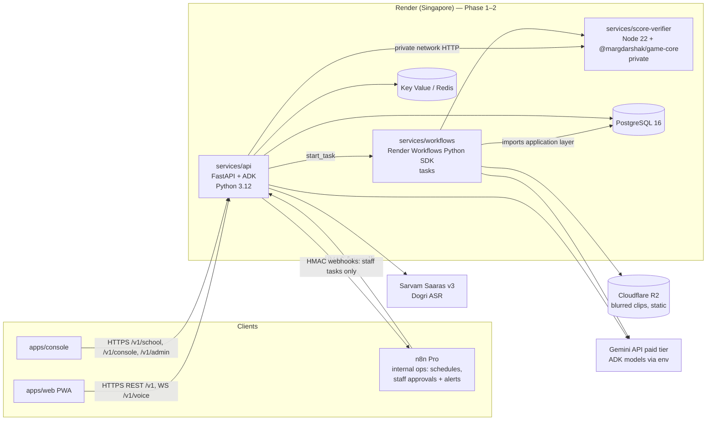
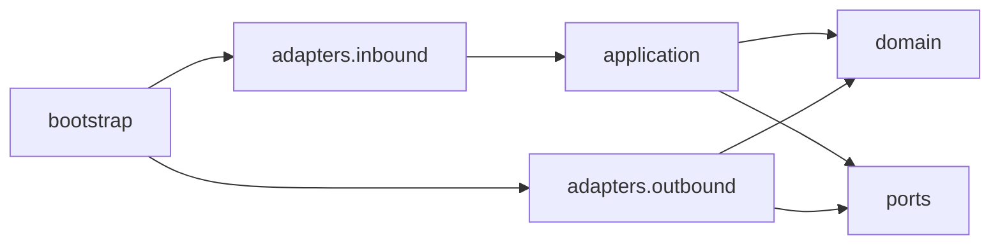
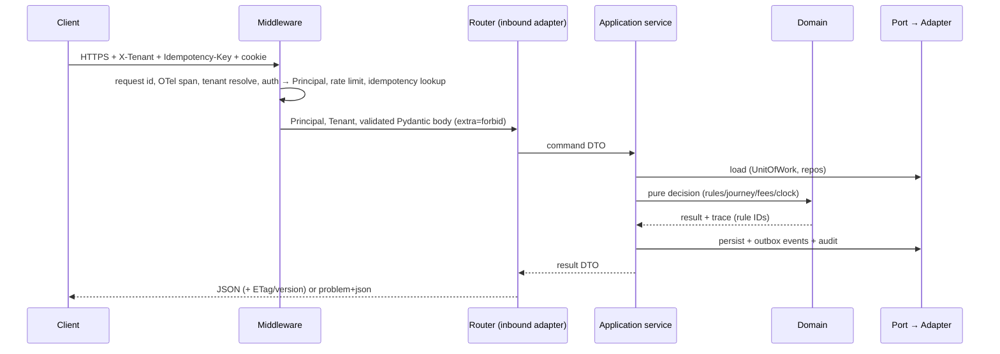
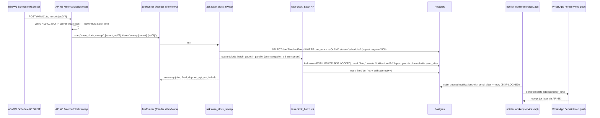

# Backend Engineering
> Project: Margdarshak · Owner: Backend lead · Status: Draft v0.1 · Last updated: 2026-10-23
> Related: [Project Brief](../00-overview/PROJECT_BRIEF.md) · [Architecture](ARCHITECTURE.md) · [Tech Stack](TECH_STACK.md) · [Data Model](DATA_MODEL.md) · [API Spec](API_SPEC.md) · [Integrations](INTEGRATIONS.md) · [Frontend](FRONTEND.md) · [Testing](TESTING.md) · [Performance](PERFORMANCE.md) · [Coding Standards](CODING_STANDARDS.md) · [AI Models](../04-ai/MODELS.md) · [Prompts](../04-ai/PROMPTS.md) · [Security Architecture](../06-security-compliance/SECURITY_ARCHITECTURE.md) · [Observability](../05-ops/OBSERVABILITY.md)

This document defines the Python backend (`services/api`), the Render Workflows task service (`services/workflows`) and the Node score verifier (`services/score-verifier`). It is the reference for code review.

**The one-sentence rule:** deterministic code owns every fact (eligibility, fees, dates, scores, the scam verdict, golden hour, the class planner); AI only narrates, navigates, explains reviewed text, decodes screenshots, and proposes clip windows offline (D-09).

Two scopes appear in every section: **Hackathon build (Phase 1–2)** on mock adapters at Render Singapore, and **Production (Phase 3+)** for a State Transport Department / NIC deployment on a MeitY-empanelled Indian cloud (D-17).

---

## 1. Services at a glance



| Service | Runtime | Exposed | Owns |
|---|---|---|---|
| `services/api` | Python 3.12, FastAPI 0.161.1, Uvicorn 0.54.0 | Public HTTPS + WS | All API-xx endpoints, rules engine, journey state machine, case clock logic, game sessions, debrief orchestration, ADK agent hosting, auth, tenancy |
| `services/workflows` | Python 3.12, `render-sdk` 1.4.0 | None (Workflows runs cannot receive inbound connections) | Durable, retried, fan-out tasks; imports `margdarshak.application` |
| `services/score-verifier` | Node 22.23 LTS, `@margdarshak/game-core` | Private network only | Server replay and scoring of game sessions (anti-cheat) |

**Why one Python backend** (D-17, risk 5): FastAPI, ADK (Python is the only GA path for ADK live mode alongside Java, `04-ai-adk-gemini.md` §0.4) and the Render Workflows Python SDK share one codebase, one Postgres and one deploy. The only non-Python service is the score verifier, because the scoring code must be the same TypeScript that runs in the browser.

---

## 2. Hexagonal layout of `services/api`

```
services/api/
├── pyproject.toml                 # pinned deps (uv), ruff, mypy strict, pytest config
├── uv.lock
├── alembic.ini
├── migrations/                    # Alembic revisions (expand → migrate → contract)
├── src/margdarshak/
│   ├── domain/                    # PURE. No I/O, no framework imports (enforced by import-linter)
│   │   ├── model/                 # entities + value objects (E-01..E-31): Applicant, Case, ClassSelection, FeeQuote, Rule, RulePack …
│   │   ├── values.py              # Paise (int), StateCode, VehicleClass, AgeBand, DobPrecision, CaseId (uuid7) …
│   │   ├── rules/                 # rule-pack model, expression evaluator, eligibility, blockers, class planner
│   │   ├── fees/                  # fee computation from fees.json (integer paise)
│   │   ├── journey/               # case state machine (states, events, guards, primary action)
│   │   ├── clock/                 # milestone calculator (LL day 30, expiry, retest gap, renewal, Form 1A at 40)
│   │   ├── games/                 # session policy (unseen clips, trust thresholds, tolerance), not scoring itself
│   │   ├── learning/              # readiness formula, Brier calibration, FSRS mirror types
│   │   ├── debrief/               # facts builder, allow-list builder, validator, template renderer
│   │   ├── scam/                  # rules-only scam verdict (domain/sender allow-lists, APK = never)
│   │   ├── privacy/               # consent purposes, age gating policy, retention policy
│   │   └── errors.py              # DomainError hierarchy with stable codes
│   ├── application/               # use cases; orchestrate domain + ports; transaction boundaries
│   │   ├── plans.py  cases.py  blockers.py  handoff.py  documents.py
│   │   ├── clock.py  notifications.py  slots.py  intel.py
│   │   ├── learn.py  readiness.py  games.py  debrief.py  achievements.py  squads.py
│   │   ├── voice.py  tutor.py  decoder.py  scam.py  letters.py  practice_record.py
│   │   ├── schools.py  console.py  rulepack_studio.py  clips.py
│   │   ├── privacy.py  analytics.py  lab.py
│   │   └── uow.py                 # UnitOfWork protocol usage
│   ├── ports/                     # typing.Protocol interfaces (driven side)
│   │   ├── repositories.py        # CaseRepo, PlanRepo, RulePackRepo, SessionRepo, … , UnitOfWork
│   │   ├── government.py          # SarathiPort, DigiLockerPort, AadhaarOfflinePort, BhashiniPort, PaymentPort, SlotPort
│   │   ├── notify.py              # NotificationPort
│   │   ├── ai.py                  # NarratorPort (debrief/coach), TutorPort, DecoderPort, VoiceSessionPort, AsrPort
│   │   ├── jobs.py                # JobRunnerPort
│   │   ├── scoring.py             # ScoreVerifierPort
│   │   ├── storage.py             # ObjectStorePort
│   │   ├── clock.py               # ClockPort (server time; NTP-synced host)
│   │   ├── audit.py               # AuditPort (append-only)
│   │   └── ids.py                 # IdGenerator (uuid7), SeedGenerator (secrets)
│   ├── adapters/
│   │   ├── inbound/
│   │   │   ├── http/              # FastAPI routers per API group: plans, rules, cases, checks, offices, learn, games, ai, letters, schools, console, admin, me, platform, lab
│   │   │   ├── ws/voice.py        # API-40 WebSocket ↔ ADK run_live
│   │   │   └── internal/          # API-65 clock sweep, API-66 channel + n8n staff webhooks (HMAC), API-67/68/73 staff jobs
│   │   └── outbound/
│   │       ├── db/                # SQLAlchemy 2 models + repositories (async, psycopg 3)
│   │       ├── gov/               # sarathi_mock, sarathi_deeplink, sarathi_real (stub, contract only); digilocker_mock; aadhaar_offline_mock; bhashini_mock; payment_redirect; slot_mock
│   │       ├── notify/            # whatsapp_cloud (Meta Cloud API), email_smtp, webpush, console_log; outbox worker
│   │       ├── ai/                # adk_runtime.py, agents/ (voice_guide, debrief_graph, coach, tutor, screen_decoder), sarvam_asr.py, plugins/ (pii, provenance)
│   │       ├── jobs/              # render_workflows.py, inline.py
│   │       ├── scoring/           # score_verifier_http.py
│   │       ├── storage/           # r2_s3.py (S3-compatible), local_fs.py
│   │       └── cache/             # redis_kv.py
│   ├── bootstrap/
│   │   ├── container.py           # composition root: picks adapters per tenant config + env
│   │   ├── settings.py            # pydantic-settings; reads env (see .env.example)
│   │   └── logging.py             # structlog JSON + redaction processor
│   └── main.py                    # create_app(): routers, middleware, lifespan (DB pool, ADK runner, OTel)
└── tests/                         # unit/ (domain, no I/O) · application/ (fakes) · contract/ (adapters) · api/ (httpx ASGI) · golden/ · evals/
```

### 2.1 Dependency rule (enforced)



- `domain` imports only the standard library and `pydantic` (for value validation). No `sqlalchemy`, `fastapi`, `httpx`, `google.adk`, `redis`, `render_sdk`.
- `application` imports `domain` and `ports` only.
- `adapters` never import each other; they meet in `bootstrap/container.py`.
- Enforced with `import-linter` contracts in CI ([CODING_STANDARDS](CODING_STANDARDS.md) §4.6) and checked again by `mypy --strict`.

### 2.2 Request lifecycle



---

## 3. Ports and adapters (F-56)

| Port | Methods (abridged) | Adapters: Phase 1–2 | Adapters: Phase 3+ |
|---|---|---|---|
| `SarathiPort` | `build_handoff(case) -> HandoffPack` · `fetch_status(application_ref) -> ApplicationStatus` · `submit(...)` (Mode B only) | `SarathiDeeplinkAdapter` (Mode A: prefilled copy-pack + deep link to `sarathi.parivahan.gov.in`), `SarathiMockAdapter` (demo statuses, "simulated" chip) | `SarathiRealAdapter` (NIC-granted API; contract defined in `api/adapters/sarathi.yaml`), never scraping (D-08) |
| `DigiLockerPort` | `authorize_url(state, pkce)` · `exchange(code)` · `pull_document(doc_type)` · `issued_pointer(case)` | `DigiLockerMockAdapter` | `DigiLockerRequesterAdapter` (after NeGD requester onboarding) |
| `AadhaarOfflinePort` | `verify_offline_xml(zip, share_code)` / `verify_secure_qr(payload)` → age band + name only; **never** stores the number | `AadhaarOfflineMockAdapter` | **Mock-only in Margdarshak.** Real offline QR/XML verification carries OVSE duties, so in government mode it runs through the state's own system (PROJECT_BRIEF F-56, D-07) |
| `BhashiniPort` | `translate(text, src, tgt)` · `asr(audio, lang)` · `tts(text, lang)` | `BhashiniMockAdapter` (returns reviewed strings) | Bhashini ULCA pipelines |
| `PaymentPort` | `payment_redirect(case) -> URL` · `status(ref)` | `PaymentRedirectAdapter` (points to Sarathi/state gateway; we never take money) | PayGov / state gateway status adapter |
| `NotificationPort` | `send(template_id, channel, recipient_ref, vars, idem_key)` · `status(msg_id)` | `WhatsAppCloudNotifier` (Meta WhatsApp Cloud API, test number), `EmailNotifier` (SMTP), `WebPushNotifier`, `ConsoleNotifier` (dev). Citizen messages never go through n8n (ADR-0006) | Same with the state's WhatsApp business number + SMS after TRAI DLT (D-16) |
| `SlotPort` | `list_offices(state, near)` · `availability(office, week)` | `SlotMockAdapter` (seeded, labelled) | State slot API via adapter |
| `ScoreVerifierPort` | `verify(game_id, game_version, scoring_version, seed, items, inputs) -> VerifiedResult` | `ScoreVerifierHttp` (private network) | same |
| `NarratorPort` | `debrief(facts, allowed_rule_ids, drill_candidates, locale) -> DebriefDraft` · `coach(plan) -> CoachDraft` | `AdkNarrator` (Gemini Flash-Lite via ADK graph), `TemplateNarrator` (fallback, EC-29) | + India-region model or Bhashini/local Indic model behind the same port (D-17) |
| `VoiceSessionPort` | `open_live(principal, locale, screen) -> LiveSession` | `AdkLiveVoice` (ADK `run_live`), `SarvamAsr` for Dogri | same |
| `JobRunnerPort` | `start(task, args, idem_key) -> RunRef` · `get(run_ref)` | `RenderWorkflowsJobRunner`, `InlineJobRunner` (local/tests) | `TemporalJobRunner` on the state cloud (production; cloud-agnostic, D-17) [design only] |
| `ObjectStorePort` | `put`, `get`, `signed_url(ttl)` | `S3CompatibleStore` (Cloudflare R2) | Indian S3-compatible store / MinIO |
| `ClockPort` | `now() -> datetime (UTC, tz-aware)` | `SystemClock` (host NTP), `FrozenClock` (tests) | NIC/NPL NTP-synced hosts (CERT-In) |
| `AuditPort` | `append(actor, action, target, tenant, meta)` | Postgres append-only table (E-30) | + WORM export, 180-day India retention |

**Contract tests**: every port has one suite in `tests/contract/<port>/` that both the mock and the real adapter must pass (see [TESTING](TESTING.md) §5). Adapter choice is per-tenant config (`tenants.adapters.sarathi = "deeplink" | "mock" | "real"`), so a state flips modes without a code change.

**Anti-corruption**: adapters translate external formats into domain objects. Nothing outside `adapters/outbound/gov/` sees Sarathi or DigiLocker payload shapes.

---

## 4. Rules engine (F-02, F-03, F-04, F-42; D-05)

### 4.1 Rule packs as data

```
rulepacks/
├── schema/                         # JSON Schema 2020-12 for every file (also compiled to Zod in packages/rules)
│   ├── manifest.schema.json  classes.schema.json  fees.schema.json  eligibility.schema.json
│   ├── timelines.schema.json  tests.schema.json  documents.schema.json  blockers.schema.json
├── IN-base/2026.10.0/              # Central base pack: MV Act 1988 + CMVR 1989
│   ├── manifest.json  classes.json  fees.json  eligibility.json  timelines.json  tests.json  documents.json  blockers.json
├── JK/2026.10.0/                   # J&K overlay (extends IN-base)
├── DL/2026.10.0/                   # Delhi overlay
└── KL/2026.10.0/                   # Kerala overlay (HPT config, EC-28 status flag)
```

`manifest.json`:
```json
{
  "packId": "JK",
  "version": "2026.10.0",
  "extends": "IN-base@2026.10.0",
  "effectiveFrom": "2026-10-23",
  "status": "approved",
  "maker": "user:rp-maker-01",
  "checker": "user:rp-checker-02",
  "approvedAt": "2026-10-23T10:00:00+05:30",
  "sha256": "<digest of all files>",
  "notes": "Seeded for the hackathon; transport-class rows flagged verify."
}
```

Every rule row (in `eligibility.json`, `timelines.json`, `blockers.json` …) has the same envelope:
```json
{
  "id": "ELIG-MC50-16",
  "kind": "eligibility",
  "appliesTo": ["MC50CC"],
  "when": { "all": [ { "gte": [ { "ageOn": "asOf" }, 16 ] }, { "lt": [ { "ageOn": "asOf" }, 18 ] } ] },
  "then": { "eligible": true, "requires": ["GUARDIAN_CONSENT"], "noticeIds": ["NOTICE-MOST-SCOOTERS-OVER-50CC"] },
  "source": { "title": "MV Act 1988 s.4(2); Delhi Transport class table", "url": "<URL from research/ps1-current-state/02-rules-process.md>" },
  "verified_on": "2026-10-23",
  "confidence": "high",
  "verify": false,
  "text_en": "At 16–17 you can only get a licence for a gearless motorcycle up to 50 cc, with a parent's or guardian's consent.",
  "text_hi": "16–17 साल की उम्र में केवल 50 cc तक की बिना गियर वाली मोटरसाइकिल का लाइसेंस मिलता है, माता-पिता या अभिभावक की सहमति से।"
}
```

- Rows with `verify: true` (e.g. transport-class LMV prerequisite, D-05/D-25) are shown with a "verify at your RTO" chip and are **never** in the AI's allowed rule set.
- Rule text may mention a rule-defined quantity only through `{placeholders}` filled from the row's own data (`"{minAge}"`), never a hard-coded number in a translation.
- All classes are in the engine (D-05). Deep learning content exists only for MCWOG/MCWG/LMV; other classes return `contentStatus: "coming"`.

### 4.2 Expression language (no `eval`)
A small, closed JSON expression language, evaluated by a pure interpreter in `domain/rules/expr.py`:

| Operator | Meaning |
|---|---|
| `all`, `any`, `not` | boolean combinators |
| `eq`, `ne`, `lt`, `lte`, `gt`, `gte`, `between` | comparisons (numbers, ISO dates) |
| `in`, `has` | membership in a list / fact set |
| `ageOn` (`"asOf"` or a date fact) | age in whole years on that date, honouring `dobPrecision` |
| `daysBetween`, `addDays`, `addMonths` | date arithmetic (calendar-aware, IST date boundaries) |
| `fact` | read a named fact from the closed `Facts` model |
| `const` | literal |

Unknown operators or facts fail **at pack load time** (schema + static check), never at request time. Max expression depth 8, max 200 rows per file (complexity guard).

### 4.3 Evaluator

```python
# domain/rules/evaluator.py — signature contract (illustrative)
@dataclass(frozen=True, slots=True)
class Facts:
    as_of: date                           # from ClockPort, IST calendar date
    dob: date | None
    dob_precision: Literal["day", "year"]  # EC-01: Aadhaar shows only the year → "year"
    residence_state: StateCode
    id_address_state: StateCode | None    # EC-02 migrant case
    requested_classes: tuple[VehicleClass, ...]
    holds_ll: LlFacts | None              # EC-22 mid-journey onboarding
    holds_dl: DlFacts | None              # EC-16 expired DL
    parent_name_on_id: bool | None        # EC-03 S/o line blank
    disability: frozenset[DisabilityFlag] # EC-13
    foreign_licence: bool                 # EC-12
    failed_attempts: int                  # EC-08
    online_ll_test_available: bool        # EC-10, from the pack

def evaluate(pack: CompiledPack, facts: Facts) -> Decision:
    """Pure. Same inputs → same Decision. Returns eligible classes, blockers, notices,
    fee quote, milestone schedule and a trace of every rule ID that fired."""
```

`Decision` contains: `eligibleClasses[]` (with reason rule IDs), `ineligible[]` (with the blocking rule and the fix), `blockers[]` (F-04, each `{ruleId, severity, fix, source, confidence}`), `notices[]`, `feeQuote` (§6), `plan.steps[]`, `plan.maxRtoVisits`, `plan.earliestLicenceDate`, `trace[]`, `rulePackVersion`.

**Age with year-only DOB (EC-01):** with `dob_precision = "year"`, the evaluator computes the **minimum possible age** (assume 31 Dec of that year) for eligibility and the maximum for upper limits (Form 1A at 40, EC-04), and adds blocker `BLK-DOB-YEAR-ONLY` ("bring a document that shows your full date of birth").

**Two classes with different ages (EC-21):** eligibility is per class; the class planner returns which classes can share one LL now and which must wait, with the date each becomes eligible.

**Compiled pack cache:** packs are compiled (overlay merged onto base, expressions parsed) once per `(packId, version)` and cached in-process (LRU 32) and in Redis (`rulepack:<id>:<v>`). The API never reads JSON files at request time.

### 4.4 Rule-pack studio and change management (F-42, EC-27)
- Maker drafts a new version in the console (API-54); validation = JSON Schema + static expression check + **the full golden suite for that tenant** ([TESTING](TESTING.md) §4); the result is attached to the draft.
- Checker (a different user, enforced) approves; approval writes `approvedAt`, signs the manifest digest, appends an audit row, and publishes a public changelog entry (D-05 trust: public `CHANGELOG` of rule changes).
- On publish, the workflow task `rulepack_reevaluate(tenant, from_v, to_v)` re-runs `evaluate()` for every open case of that tenant, diffs the decision, and for changed cases writes a `RULES_CHANGED` timeline event + notice ("A rule changed on <date>; your plan was updated") (EC-27). Cases keep `rulePackVersion` so the old decision is reproducible.
- Kerala HPT stayed/postponed (EC-28) is a pack flag (`tests.json → hpt.status: "announced" | "active" | "stayed"`) with its own source; the Nazar copy reads it ("practice in Kerala's announced format").

---

## 5. Journey state machine (F-08)

### 5.1 States and events

```mermaid
stateDiagram-v2
  [*] --> PLAN: POST /v1/cases (API-10)
  PLAN --> LL_APPLYING: application_started
  PLAN --> BRIDGE: ll_issued (EC-22 already holds an LL)
  LL_APPLYING --> HANDED_OFF: handoff_done (copy-pack used / deep link opened)
  HANDED_OFF --> PAYMENT_PENDING: payment_pending (user-reported)
  HANDED_OFF --> LL_TEST: payment_confirmed
  PAYMENT_PENDING --> LL_TEST: payment_confirmed
  LL_TEST --> LL_TEST: ll_test_failed (retest; no 7-day rule for LL unless pack says)
  LL_TEST --> BRIDGE: ll_issued
  BRIDGE --> DL_BOOKABLE: clock: day 30 reached (rule TL-LL-MIN-WAIT)
  DL_BOOKABLE --> TEST_BOOKED: slot_booked
  TEST_BOOKED --> TEST_FAILED: test_failed
  TEST_FAILED --> TEST_BOOKED: slot_booked [retest gap elapsed, TL-RETEST-GAP]
  TEST_BOOKED --> AWAITING_APPROVAL: test_passed
  AWAITING_APPROVAL --> DL_ISSUED: approved
  DL_ISSUED --> DL_HOLDER: card_received
  BRIDGE --> LL_EXPIRED: clock: LL validity ended
  DL_BOOKABLE --> LL_EXPIRED: clock
  TEST_BOOKED --> LL_EXPIRED: clock
  TEST_FAILED --> LL_EXPIRED: clock
  LL_EXPIRED --> LL_APPLYING: reapply (EC-07 new application number)
  DL_HOLDER --> RENEWAL_DUE: clock: renewal window opens
  RENEWAL_DUE --> DL_HOLDER: renewed
  DL_HOLDER --> [*]: case closed
```

- Persisted field: `case.stage` (enum above). Derived per request: `case.displayStage` and `case.alerts[]` (e.g. `LL_EXPIRING` when `llExpiresAt − now ≤ 30 days`, `DOB_YEAR_ONLY`, `RULES_CHANGED`, `SARATHI_DOWN`). The web app's home view is chosen from `displayStage` (LL_EXPIRING overrides the stage view) — see [FRONTEND](FRONTEND.md) §3.2.
- Stage → product stage mapping: PLAN = S1; LL_APPLYING, HANDED_OFF, PAYMENT_PENDING = S2; LL_TEST = S3; BRIDGE = S4; DL_BOOKABLE, TEST_BOOKED = S5/S6; TEST_FAILED = S6F; AWAITING_APPROVAL, DL_ISSUED = S7; DL_HOLDER = S8 (first 12 months) / S9; RENEWAL_DUE = S9.

### 5.2 Implementation
- `domain/journey/machine.py` holds a **transition table** `dict[(State, EventType), Transition]` where each transition has guards (pure functions over `Case`, `Decision`, `now`) and effects (new milestones to schedule, notices). No library; the table is data and is golden-tested.
- `apply(case, event, decision, now) -> (case', effects)` is pure. Invalid transitions raise `InvalidTransition(code="JOURNEY_INVALID_TRANSITION")` → HTTP 409.
- Events arrive from API-15 (user-reported: `ll_issued`, `slot_booked`, `test_failed`, `test_passed`, `approved`, `card_received`), from adapters (Mode B status), and from the clock sweep. Each event has an `eventId` (idempotent) and `occurredOn` (validated: not in the future by server time, EC-15; not before the case's previous event).
- **Primary action**: `primary_action(case, decision, now) -> ActionId` (closed enum: `START_PLAN`, `RESUME_STEP`, `OPEN_HANDOFF`, `CHECK_PAYMENT`, `TAKE_MOCK_TEST`, `PRACTISE_NAZAR`, `BOOK_TEST`, `OPEN_TEST_DAY`, `SEE_RETEST_PLAN`, `CHASE_APPROVAL`, `SHOW_CARD`, `RENEW`). One per stage; the client never guesses.
- 3+ fails (EC-08): after the third `test_failed`, the guard requires `remedialTrainingAck` per the pack's remedial rule before the next booking is shown as available; the copy is private and face-saving.
- Optimistic concurrency: `case.version` (int); PATCH/POST require `If-Match`; mismatch → 412.

---

## 6. Fee computation (`fees.json`, CMVR r.32; D-06)

### 6.1 Data

```json
{
  "currency": "INR",
  "unit": "paise",
  "source": { "title": "CMVR 1989 r.32 (revised table, GSR 1183(E), 29 Dec 2016), HP reproduction + Delhi totals", "url": "https://himachal.gov.in/WriteReadData/l892s/3_l892s/rule32_cmvr-40224160.pdf" },
  "verified_on": "2026-10-23",
  "confidence": "medium",
  "items": [
    { "id": "FEE-LL-ISSUE",   "label_key": "fee.ll_issue",   "amount": 15000, "per": "class",       "stage": "LL" },
    { "id": "FEE-LL-TEST",    "label_key": "fee.ll_test",    "amount": 5000,  "per": "application", "stage": "LL" },
    { "id": "FEE-DL-TEST",    "label_key": "fee.dl_test",    "amount": 30000, "per": "class",       "stage": "LL", "note_key": "fee.paid_with_ll" },
    { "id": "FEE-DL-ISSUE",   "label_key": "fee.dl_issue",   "amount": 20000, "per": "application", "stage": "DL" },
    { "id": "FEE-SMART-CARD", "label_key": "fee.smart_card", "amount": 20000, "per": "application", "stage": "DL" }
  ],
  "retest": [
    { "id": "FEE-LL-RETEST", "amount": 5000,  "per": "attempt" },
    { "id": "FEE-DL-RETEST", "amount": 30000, "per": "class_attempt" }
  ],
  "stateCharges": { "known": false, "notice_key": "fee.state_charges_may_apply" }
}
```

Overlays may add state items (e.g. J&K postage, which `02-rules-process.md` reports inside a ₹1,050 slot-booking payment with an unknown breakdown) with their own `source`, `verified_on` and `confidence: "low"`.

### 6.2 Computation
- `compute_fee_quote(pack, classes, stage_scope) -> FeeQuote` in `domain/fees/` uses **integers in paise**; no floats anywhere in money paths (lint: `float` banned in `domain/fees`).
- `per: "class"` items multiply by the number of classes; `per: "application"` items appear once.
- Golden expectations (from the PROJECT_BRIEF facts): one class = 15000 + 5000 + 30000 + 20000 = **70000 paise (₹700)**, + 20000 smart card = **90000 (₹900)**; each additional class adds 15000 + 30000 = **45000 (≈ ₹450)**. These match Delhi's published LL-stage totals of ₹500 / ₹950 / ₹1,400 for 1 / 2 / 3 classes (LL issue + LL test + DL test).
- The `FeeQuote` (E-07) carries `lineItems[]`, `total`, `rulePackVersion`, `source`, `verified_on`, and the notice "state charges may apply". The UI renders the trust line from it ("₹700 for one class + ₹200 card; state charges may apply") — no literal anywhere (D-06).
- AI never computes or states a fee; the voice guide reads fees only through the `get_fee_quote` tool result, and the provenance guard replaces any ₹ amount not present in a tool result (D-10).

---

## 7. Case clock (F-09)

### 7.1 Milestones (from `timelines.json`)

| Milestone ID | When (rule) | Message (template) | Edge case |
|---|---|---|---|
| `LL_DAY_25_PREP` | LL issue + 25 days | "Book your driving test soon" | — |
| `LL_DAY_30_UNLOCK` | LL issue + 30 days (TL-LL-MIN-WAIT) | "You can now book your driving test" | — |
| `LL_EXPIRY_M30`, `LL_EXPIRY_M7` | LL expiry − 30 / − 7 days (LL validity 6 months, TL-LL-VALIDITY) | "Your LL expires on <date>" | EC-07 |
| `TEST_EVE` | test date − 1 day, 19:00 IST | test-eve checklist + ICS | — |
| `RETEST_ELIGIBLE` | fail date + 7 days (TL-RETEST-GAP) | private "your retest plan" | EC-08 |
| `APPROVAL_CHASE` | pass date + 3 days with no `approved` | "No SMS yet? Here's how to check" | EC-23 |
| `FORM_1A_AT_40` | 40th birthday before expected DL date | "You'll need Form 1A" | EC-04 |
| `DL_RENEWAL_M60`, `DL_EXPIRED`, `DL_EXPIRED_Y1` | DL validity rules | renewal reminder; "no grace period"; > 1 year late = retest | EC-16 |
| `RULES_CHANGED` | rule-pack re-evaluation | "A rule changed; your plan was updated" | EC-27 |

All milestones are computed by `domain/clock/schedule(case, decision) -> list[Milestone]` from **server dates**. They are stored as `TimelineEvent` rows (E-12) with a unique **idempotency key** `"{caseId}:{milestoneId}:{dueOn}"`. A re-computation that yields the same key is a no-op; a changed due date cancels the old row and inserts the new one.

### 7.2 Execution: n8n triggers, Workflows runs, API decides, notifier delivers

Render Workflows has **no native cron and no documented sleep** (`B-sponsors.md` §1), so durable timers are rows in Postgres swept on a schedule:



- Exactly-once user effect: `Notification.idempotency_key = timelineEventKey + ":" + channel`; the notifier claims each row once and the WhatsApp send is keyed too.
- WhatsApp opt-out "STOP" (EC-30): the Meta channel webhook (API-66) sets the channel consent to withdrawn; the batch skips that channel and falls back to web push / in-app only.
- The notifier is a worker inside `services/api` (same image, separate process) and scales by replica count; it applies quiet hours, the ≤ 1 nudge/day cap and per-number rate limits. n8n is not on this path (ADR-0006).
- Under-18 cases get reminders only to the guardian contact the guardian consented to (no streak nudges).
- Sweep is also triggered after a deploy and on demand from the console (idempotent by `asOf`).
- If n8n is down, citizens notice nothing: on-call starts the sweep through API-65 by hand (idempotent by `asOf`), and the notifier keeps sending.

---

## 8. Background jobs (Render Workflows Python SDK)

### 8.1 SDK and registration
- Package: `render-sdk` **1.4.0** on PyPI (2026-10-22; "early access, subject to breaking changes"; it depends on the `render` 1.4.0 distribution and is imported as `render_sdk`). Python ≥ 3.10.
- `services/workflows/src/margdarshak_workflows/app.py` creates `app = Workflows(default_retry=Retry(max_retries=3, wait_duration_ms=1000, backoff_scaling=2.0), default_timeout=600, default_plan="flex")` and registers tasks with `@app.task`. Task modules are combined with `Workflows.from_workflows(...)`.
- The API starts tasks through `JobRunnerPort` → `RenderWorkflowsJobRunner`, which wraps `RenderAsync().workflows.start_task("<WORKFLOW_SLUG>/<task>", [args])` and stores the returned run id with our own idempotency key (Workflows has no completion webhook, so we poll `get_task_run` or `await` the run handle in a background coroutine and write status to `job_runs`).
- Local development: `render workflows dev -- uv run python -m margdarshak_workflows` (local task server on :8120, CLI ≥ 2.12.0, `RENDER_USE_LOCAL_DEV=true` in the API) — see [ENVIRONMENT_SETUP](ENVIRONMENT_SETUP.md) §7.
- Note: the SDK README examples still use `plan="standard"`/`"starter"`, while Render's changelog of 1 Sep 2026 says `flex` replaced them (`B-sponsors.md` §1). We use `flex` and verify at H0 [unverified; owner Backend lead, 2026-10-24].

### 8.2 Task catalogue

| Task | Trigger | Steps (each a chained `ctx.run`, retried independently) | Timeout | Notes |
|---|---|---|---|---|
| `clip_ingest(clip_id)` **(headline, D-15)** | console upload (API-55) | `transcode` (ffmpeg → 360p/480p H.264, faststart) → `blur` (face + plate detection, M-09) → `flash_check` (≤ 3 flashes/s, WCAG 2.3.1) → `propose_windows` (M-06 Gemini Flash video, offline) → `open_review` (two-rater task) | 30 min | Visible retry in the Workflows dashboard for the demo. AI never publishes |
| `clip_publish(clip_id)` | after two raters submit (API-55) | `agreement` (Δ onset ≤ 0.5 s; else third rater) → `blur_audit_check` (100% audited flag) → `publish_manifest` (R2) → `cdn_warm` | 5 min | Human gates live outside the run (no sleep API) |
| `case_clock_sweep(tenant, as_of)` | n8n W01 via API-65 | page → `clock_batch` fan-out (incl. weekly coach-plan and family-card TimelineEvents) | 20 min | §7.2 |
| `session_debrief(sid)` | API-35 when inline debrief times out, or batch replays | `load_and_gate` → `narrate` → `validate` → `persist` | 60 s | Inline path is preferred for latency; this is the retry/fan-out path |
| `debrief_backfill(cohort)` | field study end | fan-out `session_debrief` | 30 min | — |
| `nightly_stats(date)` | n8n W13 schedule | aggregate field-study metrics (n, % below 60/100, r with LL quiz, 95% CI) → `stats_public` (API-71) | 15 min | No PII; k ≥ 5 |
| `rulepack_reevaluate(tenant, from, to)` | rule-pack approval | page open cases → re-evaluate → diff → notices | 30 min | EC-27 |
| `user_export(principal)` | API-61 | collect → zip (JSON) → signed URL (24 h) | 10 min | DPDP rights |
| `user_delete(principal)` | API-62 | cancel timers → delete case data → tombstone → purge object store → audit | 10 min | EC-26 |
| `replay_pending_sessions()` | every sweep | sessions in `pending_verification` → score verifier | 10 min | verifier outage recovery |

**Durability rule:** tasks are idempotent by input (they read state from Postgres and write with unique keys), so a Workflows retry or a duplicate trigger never double-fires a notification or double-publishes a clip.

**Inline fallback:** `InlineJobRunner` runs the same task functions in-process (`asyncio.create_task`) for local dev, tests, and as a degraded mode if Workflows is unavailable during judging (risk R-11). The chosen runner is logged on every job.

---

## 9. Game sessions and the score verifier (F-23..F-26, E-16, E-17)

### 9.1 Session lifecycle

```mermaid
sequenceDiagram
  participant W as Web GameHost
  participant A as API (GameSessionService)
  participant V as score-verifier (Node)
  participant D as Debrief
  W->>A: POST /v1/games/{gameId}/sessions (API-34) Idempotency-Key
  A->>A: band gate, pick items (mock: unseen clips only), seed = secrets.randbits(32), scoringVersion pin
  A-->>W: {sid, seed, items, difficulty, scoringVersion, expiresAt (2 h)}
  W->>W: play; events with (sid, seq)
  W->>A: POST /v1/games/sessions/{sid}/complete (API-35) {clientResult, replay.inputs (gz-b64), eventsDigest}
  A->>A: size limits (inputs ≤ 256 KB), sid open & owned, not expired
  A->>V: POST /verify {gameId, gameVersion, scoringVersion, seed, items, inputs} (HMAC, 2 s timeout)
  V-->>A: {result: SessionResult, digest}
  A->>A: compare client vs server (|Δpct| ≤ 1.0 and same passed) else flag replay_mismatch; server wins
  A->>A: integrity: trust = f(flags); trust < 0.6 → practice only (no card, no percentile)
  A->>D: debrief(sid) inline with 6 s budget (else Workflows session_debrief)
  A-->>W: {verifiedResult, trust, debriefStatus}
```

- **Mock mode uses unseen clips**: `clip_exposures(user, clip_id)` is written at session creation; Nazar Score = mean of the last 3 mock sessions on unseen clips with trust ≥ 0.6.
- **Offline sessions** (client-generated `sid`) are accepted for practice only; the server re-scores them but they never count for share cards or percentiles.
- **Under-18**: the session is scored and returned but not stored beyond the request (no telemetry, no streaks, D-13); the debrief is the template.
- Telemetry events (E-17) are accepted in batches of ≤ 500 with unique `(sid, seq)`; duplicates are ignored (idempotent sync from IndexedDB).

### 9.2 Score verifier service
- `services/score-verifier`: Node 22, a single HTTP server (`node:http`, no framework) importing `@margdarshak/game-core` at the **exact version** pinned by `scoringVersion`. Stateless; private network only; HMAC request auth with `SCORE_VERIFIER_HMAC_SECRET`.
- Deterministic replay: fixed 60 Hz step, seeded mulberry32, no `Date`/`Math.random` in the scoring path (lint-enforced in game-core).
- Outage: API stores the session as `pending_verification`; the provisional score is shown as provisional; `replay_pending_sessions` retries.
- Target: p95 < 150 ms per verify for a 10-clip Nazar session [target; measure at H0].

---

## 10. Debrief orchestration (F-25, M-02, D-09, D-10)

Graph (ADK 2.x graph workflow: deterministic nodes around one LLM node), hosted in-process in the API:

| Node | Type | What it does |
|---|---|---|
| `load_and_gate` | code | Load the **server-verified** `SessionResult`; user band must be adult and AI-coach consent on, else → template |
| `build_facts` | code | Top-3 findings by severity; `facts` (numbers with keys); `allowed_rule_ids = ∪ findings.ruleIds ∩ rules where verify=false`; `drill_candidates` (top-3); `locale`; previous 3 finding IDs |
| `debrief_agent` | LLM (`DEBRIEF_MODEL`, default `gemini-3.1-flash-lite`) | `output_schema=DebriefDraft`, enums generated per request; no tools |
| `validate` | code | No digits (`[0-9०-९]`) outside `{{fact:key}}`; IDs ∈ allow-lists; placeholders exist; top finding covered; tone lint; script ratio; lengths (Gemini ignores min/maxLength) |
| `retry_or_fallback` | code | One retry with the error list; then `TemplateNarrator` |
| `render` | code | Fill placeholders from facts with locale formatting; append rule text + source; HTML-escape |
| `persist` | code | Store `Debrief` (E-19) with `validator_verdict`, `mode: coach\|template`; prompt text retained ≤ 7 days |

- Runner-level plugins: PII redaction and the number-provenance guard (D-10). Safety settings set explicitly (`BLOCK_MEDIUM_AND_ABOVE`), since defaults are off on 2.5+ (`04-ai-adk-gemini.md` §1.8).
- Circuit breaker: if the fallback rate exceeds 20% over 5 minutes, open the breaker for 5 minutes (template only) and fire n8n W12.
- Latency budget: inline 6 s; the web shows the template card instantly and swaps in the coach card (see [FRONTEND](FRONTEND.md) §8.4).
- Cost reference: ≈ $0.0012 (≈ ₹0.10) per debrief at the Flash-Lite prices recorded in `08-game-ai-n8n.md` §5.8.

---

## 11. ADK agent hosting (M-01..M-05)

| Agent | Mode | Hosting | Model (env var) | Tools / boundary |
|---|---|---|---|---|
| VoiceGuideAgent (M-01) | live (bidi audio) | API process, `Runner.run_live()` behind the WS endpoint API-40 | `VOICE_MODEL` = `gemini-3.8-live` (fallback `VOICE_MODEL_FALLBACK` = `gemini-2.5-flash-native-audio-preview-12-2025`, the ADK default; ADK support for 3.8 Live is unknown, `04` §0.4) | `navigate(route_id: enum)`, `fill_field(field_id: enum, value)`, `get_rule(rule_id)`, `get_fee_quote(case_id)`, `get_case_summary(case_id)`, `read_debrief(sid)`, `open_drill(drill_id: enum)`. **No submit/pay/book tools exist.** |
| DebriefAgent (M-02) | graph node | API process (inline) and Workflows (`session_debrief`) | `DEBRIEF_MODEL` | none |
| CoachAgent (M-03) | graph node | Workflows (weekly coach-plan TimelineEvents in `case_clock_sweep`) | `COACH_MODEL` | none; input = plan JSON computed by code |
| TutorAgent (M-04) | single LLM call with retrieved reviewed text | API | `TUTOR_MODEL` | content-grounded only (reviewed question bank) |
| ScreenDecoderAgent (M-05) | vision | API (API-42) | `DECODER_MODEL` (Gemini Flash) | matches the verified error catalogue; `unknown` allowed |
| ClipWindowProposer (M-06) | video, offline | Workflows (`clip_ingest`) | `CLIP_PROPOSER_MODEL` | proposals only; two humans set windows |

Hosting details:
- One `Runner` per agent, created in the FastAPI lifespan; `InMemorySessionService` for one-shot graphs; voice sessions are per-connection and are not persisted (no ADK memory service: the case file is structured state in our DB, `04` §1.4).
- `google-adk` **2.12.0** and `google-genai` **2.33.0** (PyPI, 2026-10-13 / 2026-10-23). Model IDs live only in env vars (PROJECT_BRIEF §10).
- Dogri (M-08): Sarvam Saaras v3 STT (`doi-IN`) runs as a cascade in front of the agent (text in), with Hindi voice out; Sarvam is a disclosed processor.
- **Age gate:** every AI endpoint and the WS handshake check `principal.age_band == "adult"` (verified DOB ≥ 18) and the relevant consent; otherwise 403 `AI_AGE_GATED` / WS close 4403 (D-13).
- **Paid tier:** the API refuses to start AI features in `APP_ENV=production|field` unless `GEMINI_BILLING_CONFIRMED=true` (D-13, R-13).
- EC-20: inbound text is redacted (same patterns as the client) before it reaches any agent; transcripts are redacted before logging.

---

## 12. Auth, authorisation and tenancy

### 12.1 Principals
| Principal | How | Phase |
|---|---|---|
| Anonymous device session | `POST /v1/sessions/device` → opaque 256-bit token in `md_sid` cookie (HttpOnly, Secure, SameSite=Lax); session record in Key Value (TTL 180 days sliding) | 1–2 |
| Account | Email magic link (signed, single-use, 15 min) or Google OIDC; device session is upgraded and linked | 1–2 |
| Helper (P-04) | `HelperLink` (E-29) with a recorded `ConsentArtefact` (E-15) from the applicant; scoped to one case; auto-expires; revocation is immediate (EC-25) | 1–2 |
| Console users | Account + role grants per tenant (invite-only) | 1–2 |
| Production citizen | DigiLocker OAuth 2.0 (PKCE) / Jan Parichay via adapters | 3+ |
| Service-to-service | HMAC-SHA256 (`n8n`, score verifier) with timestamp + nonce, 5-minute window, replay cache in Key Value | 1–2 |

### 12.2 RBAC + ABAC

| Role | Scope | Can |
|---|---|---|
| `citizen` | own cases | all citizen endpoints on own data |
| `helper` | linked case(s) | read/write the linked case, never delete, never change contacts; every action audited |
| `guardian` | minor's case | consent for P-07; receives reminders |
| `school_owner`, `school_staff` | own school | API-52; learner data only with the learner's consent |
| `rto_officer`, `state_admin` | tenant | API-53 aggregated views (k ≥ 5) |
| `rulepack_maker`, `rulepack_checker` | tenant | API-54; checker ≠ maker (enforced) |
| `clip_curator`, `clip_reviewer` | platform | API-55; two different reviewers per clip |
| `moderator` | tenant | Live Intel queue |
| `platform_admin` | all | tenant config, audit read; break-glass actions double-logged |

ABAC conditions evaluated in the application layer by a single `authorize(principal, action, resource)` function: tenant match, ownership/helper link active, age band (AI and telemetry), consent purpose present, case not deleted.

### 12.3 Tenancy (F-58)
- Tenant = State/UT (`E-31 Tenant`: theme, rule pack, adapters, languages, feature flags).
- Resolution: `X-Tenant` header must match the host's allowed tenants (`tenants.hosts[]`); otherwise the user's chosen state for the citizen app.
- Isolation: every tenant-owned table has `tenant_id` (NOT NULL); Postgres **row-level security** policies use `current_setting('app.tenant_id')`, set per transaction by the UnitOfWork (`SET LOCAL app.tenant_id = :t`). Platform-admin jobs use a dedicated role with `BYPASSRLS` and are audited.
- Production option for states that demand it: schema-per-tenant or a separate deployment (`07-govt-plug-and-play.md` B3).

---

## 13. Idempotency

| Where | Mechanism |
|---|---|
| Client mutations (API-10, 15, 27, 28, 32, 34, 35, 39, 45, 51, 60, 61, 62, 63, 70) | `Idempotency-Key` header (uuid, ≤ 64 chars). Table `idempotency_keys(tenant_id, principal_id, key, method, path, request_sha256, status_code, response_body, created_at)`, unique `(tenant_id, principal_id, key)`, TTL 24 h. Same key + same body → stored response replayed (`Idempotent-Replayed: true`). Same key + different body → 422 `IDEMPOTENCY_KEY_REUSED`. In flight → 409 `IDEMPOTENCY_IN_PROGRESS` with `Retry-After: 1` |
| Autosave (API-12) | `If-Match: <case.version>` optimistic concurrency (PATCH is naturally idempotent for the same body) |
| Journey events | `eventId` unique per case |
| Timeline / notifications | deterministic keys `{caseId}:{milestone}:{dueOn}[:{channel}]` |
| Telemetry | unique `(sid, seq)` |
| Workflows tasks | input-derived idempotency key stored in `job_runs`; tasks re-read state |
| Inbound webhooks (n8n staff events, Meta/email channel receipts) | HMAC (n8n) or provider signature (Meta `X-Hub-Signature-256`) + nonce replay cache (Key Value, 10 min) + `deliveryId` unique |

---

## 14. Error model

All errors are **RFC 9457 `application/problem+json`**:

```json
{
  "type": "https://margdarshak.example/problems/journey-invalid-transition",
  "title": "This step isn't available yet",
  "status": 409,
  "code": "JOURNEY_INVALID_TRANSITION",
  "detail": "slot_booked is not allowed while the case is in BRIDGE.",
  "i18nKey": "errors.journey.invalid_transition",
  "traceId": "01J…",
  "errors": [ { "pointer": "/event/type", "code": "NOT_ALLOWED" } ],
  "retryable": false
}
```

(The `type` host is a placeholder until the domain is registered; owner: Backend lead, 2026-10-30.)

| Code | HTTP | Meaning | Client behaviour |
|---|---|---|---|
| `VALIDATION_FAILED` | 422 | Pydantic validation (`errors[]` with JSON pointers) | inline errors + error summary |
| `UNAUTHENTICATED` | 401 | no/expired session | silent device-session refresh |
| `FORBIDDEN` | 403 | role/ABAC denied | generic message |
| `AI_AGE_GATED` | 403 | under-18 or unverified DOB (D-13) | hide AI, show template |
| `CONSENT_REQUIRED` | 403 | purpose consent missing | open consent sheet |
| `NOT_FOUND` | 404 | resource missing or not visible (no existence leak) | — |
| `GONE_DELETED` | 410 | account/case deleted (EC-26) | wipe local data |
| `JOURNEY_INVALID_TRANSITION` | 409 | state machine guard | refetch case |
| `PRECONDITION_FAILED` | 412 | `If-Match` stale | refetch + merge |
| `IDEMPOTENCY_KEY_REUSED` / `IDEMPOTENCY_IN_PROGRESS` | 422 / 409 | §13 | new key / retry |
| `RULEPACK_UNAVAILABLE` | 503 | pack for tenant not approved/loaded | "We don't know for your state yet" (valid answer, D-05 trust) |
| `ADAPTER_UNAVAILABLE` | 503 | e.g. Sarathi outage (EC-11) | banner, keep draft, retry later |
| `RATE_LIMITED` | 429 | `Retry-After` set | backoff |
| `VOICE_QUOTA_EXCEEDED` | 429 | monthly voice cap | text fallback |
| `SESSION_EXPIRED` / `REPLAY_REJECTED` | 409 / 422 | game session closed / inputs invalid | practice-only result |
| `INTERNAL` | 500 | unexpected (details only in logs, by `traceId`) | generic retry |

Rules: domain errors are typed (`DomainError` subclasses with a stable `code`); the HTTP adapter maps them; no stack traces or SQL in responses; 5xx bodies never echo input.

---

## 15. Validation, caching, rate limits

**Validation**: Pydantic v2 models with `model_config = ConfigDict(extra="forbid", strict=True, frozen=True)` at every inbound boundary; string length caps on every field; Live Intel reports (API-28) accept **structured enums only** (no free text, D-14) and run PII regexes before storage; screenshots (API-42) ≤ 2 MB, JPEG/PNG only, EXIF stripped, not stored after decoding (processed in memory).

**Caching**

| Data | Where | TTL / invalidation |
|---|---|---|
| Compiled rule packs | in-process LRU + Key Value | by `(packId, version)`; immutable |
| `GET /v1/rules/{state}/classes|fees` (API-02/03) | HTTP `Cache-Control: public, max-age=3600` + `ETag` = pack digest | new version → new ETag |
| Plans (API-01) | Postgres (`plans`, 30 days, no PII) | immutable |
| Offices / slots (mock) | Key Value | 5 min |
| Live Intel aggregates | Key Value | 10 min, invalidated on moderation publish |
| Public stats (API-71) | Key Value | 60 s |
| Sessions | Key Value | sliding |

**Rate limits** (Key Value token buckets, per principal + per IP /24 for anonymous)

| Endpoint group | Limit |
|---|---|
| API-01 plans (anonymous) | 30/min/IP, 300/day/IP |
| API-12 autosave | 120/min/principal |
| API-28 Live Intel reports | 5/day/account; accounts < 24 h old cannot report (EC-24) |
| API-34/35 games | 60/hour/principal |
| AI (API-41, 42, 43) | 20/hour/principal; 100/day |
| API-40 voice | 1 concurrent connection; 10 min/month free |
| Auth (magic link) | 5/hour/email, 20/hour/IP |
| `/internal/*` | HMAC only; 60/min |

---

## 16. Observability hooks (detail in [OBSERVABILITY](../05-ops/OBSERVABILITY.md))
- OpenTelemetry (`opentelemetry-sdk` 1.45.1, `opentelemetry-instrumentation-fastapi` 0.66b1) spans for every request, DB call, adapter call, ADK model call (model, tokens, latency, fallback flag) and Workflows start.
- structlog JSON logs with a **redaction processor** (Aadhaar-like, OTP-in-context, phone, email, tokens) — see [CODING_STANDARDS](CODING_STANDARDS.md) §6.
- Sentry (`sentry-sdk` 2.73.0) with `send_default_pii=False`.
- Health: API-64 `GET /v1/health` returns `{status, version, rulePacks: {JK: "2026.10.0"}, adapters: {sarathi: "up|degraded|down", workflows: "...", scoreVerifier: "...", gemini: "..."}}` (used for the EC-11 banner).

---

## 17. Hackathon build (Phase 1–2) vs Production (Phase 3+)

| Area | Hackathon build (Phase 1–2) | Production (Phase 3+) |
|---|---|---|
| Hosting | Render Singapore: web service (API), private service (score verifier), Workflows service, Postgres 16, Key Value. Keep instances warm before judging (risk R-11) | MeitY-empanelled Indian cloud / NIC, containers (Docker, Helm), Postgres + S3-compatible storage only (D-17) |
| Adapters | Sarathi Mode A deeplink + mock; DigiLocker/Aadhaar-offline/Bhashini/Payment/Slot mocks with "simulated" chips | Real adapters per state after onboarding (DigiLocker requester via NeGD; Sarathi via NIC) |
| Auth | Device session + magic link / Google | DigiLocker OAuth (PKCE) / Jan Parichay |
| Jobs | Render Workflows + inline fallback | Same `JobRunnerPort`; state-cloud runner |
| AI | Gemini API **paid tier** before any real-user field test; models via env | Vertex AI India region or Bhashini/local models behind the same ports |
| Rule packs | IN-base + JK (+ DL, KL overlays seeded), maker-checker in console | Signed by the State Transport Department; public changelog |
| Logs | Sentry + structured logs on Render | Logs kept ≥1 year (DPDP Rule 8), with 180 days held in India (CERT-In); NTP to NIC/NPL; 6-hour incident reporting |
| Data | Synthetic + consented field-study data only | DPDP Rules 2025 processes (see PRIVACY) |

## 18. Open items
| Item | Owner | Due |
|---|---|---|
| Verify `render-sdk` plan names (`flex`) and `RenderAsync.start_task` behaviour on our workspace | Backend lead | 2026-10-24 |
| ADK 2.12 `output_schema` with dynamic enums on `gemini-3.1-flash-lite`; `run_live` with `gemini-3.8-live` | AI lead | 2026-10-24 |
| Confirm Postgres RLS + async SQLAlchemy `SET LOCAL` pattern under pgbouncer-less Render Postgres | Backend lead | 2026-10-24 |
| Register a domain for problem `type` URIs and the CORS allow-list | Backend lead | 2026-10-30 |
| Transport-class rules (`verify: true`) re-verification (D-25) | Rules owner | before stage |
