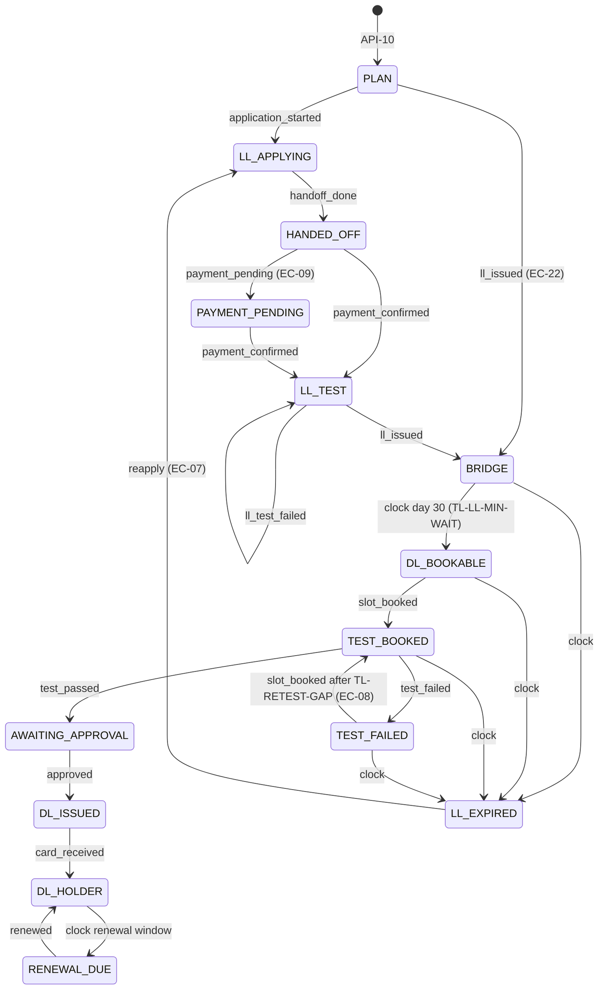
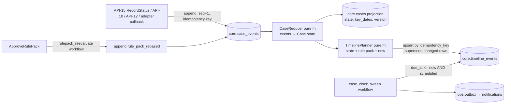

# Data Model
> Project: Margdarshak · Owner: Backend lead · Status: Draft v0.1 · Last updated: 2026-10-23
> Related: [PROJECT_BRIEF](../00-overview/PROJECT_BRIEF.md) · [Architecture](ARCHITECTURE.md) · [API spec](API_SPEC.md) · [OpenAPI](../../api/openapi.yaml) · [Tech stack](TECH_STACK.md) · [Integrations](INTEGRATIONS.md) · [ADR-0007 rule packs](adr/ADR-0007-rule-packs-as-data-maker-checker.md) · [ADR-0008 no Aadhaar data](adr/ADR-0008-no-aadhaar-data-handoff-to-sarathi.md) · [ADR-0009 multi-tenant](adr/ADR-0009-multi-tenant-per-state.md)

This document is the single description of what Margdarshak stores, why, for how long, and who can see it. It has three layers:

1. **The ontology** (Palantir style): objects, links, actions and functions for E-01..E-31. This is the shared language for product, console screens and adapters.
2. **The physical model**: PostgreSQL 16 tables with columns, types, constraints, indexes, PII class and retention.
3. **Engineering notes**: event sourcing for the case timeline, SQLAlchemy 2 / Alembic conventions, migrations, multi-tenancy and erasure.

> **Hard rule (D-07, ADR-0008).** No table, column, log line, analytics event or AI prompt may ever hold an Aadhaar number, Aadhaar VID, OTP, captcha, Sarathi password, biometric, face image used for matching, or a document image. These are class **CX (prohibited)** and are blocked at four layers: Pydantic models (`extra="forbid"` + a prohibited-key validator), the `answers` JSON schema (`propertyNames` deny-list in `api/openapi.yaml`), a Postgres `CHECK` on `answers`, and the log/AI PII redaction filter.

---

## 1. Classification scheme

### 1.1 PII classes (used in every table below)
| Class | Meaning | Storage rule | Examples |
|---|---|---|---|
| **C0 Public** | Published or non-personal | Plain | rule text, fee amounts, office names, published clip manifest |
| **C1 Operational** | Non-personal system data | Plain | rule-pack version, job run IDs, feature flags |
| **C2 Pseudonymous** | Linkable to a person only through our keys | Plain, tenant-scoped, RLS | `applicant_id`, case stage, game scores, FSRS state |
| **C3 Personal identifier** | Directly identifies or contacts a person | **Field-level encrypted** (AES-256-GCM envelope, per-tenant KEK), blind index for lookup | phone, email, DOB, display name, LL/DL last 4 |
| **C4 Restricted** | Raises harm if leaked or concerns a child, health or disability | Encrypted + every read is audit-logged + narrower role access | `is_minor`, disability needs, Form 1A/medical flags, guardian link |
| **CX Prohibited** | Must never be stored | Rejected at input; redacted from logs | Aadhaar number/VID, OTP, biometrics, face templates, document images, Sarathi credentials |

DPDP Act 2023 does not define "sensitive" categories, so C3/C4 are our own stricter internal classes. Children are anyone under 18 (DPDP s.2(f)); see `docs/06-security-compliance/PRIVACY.md` for the notice text and legal bases.

### 1.2 Retention classes
| Code | Rule | Applies to |
|---|---|---|
| **RT-SESSION** | Deleted at end of request / WebSocket | voice audio, screenshot images, Aadhaar offline artefacts, raw prompts |
| **RT-7D** | 7 days | plan snapshots (E-02 pre-case), AI prompt/response traces (debrief validator inputs) |
| **RT-90D** | 90 days, then aggregated | raw game events (E-17), analytics events |
| **RT-CASE** | Life of the case + 12 months after DL issued or case abandoned (no activity 12 months); user may delete any time | cases, timeline, mirrors, document checks |
| **RT-ACCOUNT** | Until account deletion; hard delete ≤ 30 days after request; backups roll off in 35 days | applicant, contacts, consents (consents keep a tombstone) |
| **RT-LOG-1Y-IN** | **At least 1 year** (DPDP Rules 2025, Rule 8, per PROJECT_BRIEF §11), of which a rolling **180 days must be in Indian jurisdiction** (CERT-In Directions, 28 Apr 2022) | security/audit logs, access logs |
| **RT-PUBLIC** | Indefinite (CC-BY) | published clips, rule packs, aggregated statistics |
| **RT-STUDY** | Until study end + 12 months, pseudonymous only; withdraw any time | field-study trials (API-70) |

Hackathon note: the Render deployment is in Singapore with **synthetic data only** (D-17). Production requires the India-hosted stack before any real user data (Phase 3+).

---

## 2. Ontology (objects · links · actions · functions)

Palantir's Ontology is "an operational layer for the organization" made of semantic elements (objects, properties, links) and kinetic elements (action types, functions) ([Palantir docs](https://www.palantir.com/docs/foundry/ontology/overview/)). We use the same structure so that each screen answers one decision, and each action writes an event that feeds the next decision (`research/ps1-deep/07-govt-plug-and-play.md` §C).

### 2.1 Object types
| ID | Object | Primary key | Title property | Key properties | Backing table(s) | Owner |
|---|---|---|---|---|---|---|
| E-01 | Applicant (User) | `applicant_id` | pseudonym "Learner 7Q2K" | age_band, user_band, language, flags (minor, helper), a11y | `core.applicants` | Backend |
| E-02 | Case | `case_id` | "MCWG + LMV-NT · JK" | state (derived stage/display_stage), path, tenant, rule_pack_version, key dates, version | `core.cases` (+ event store `core.case_events`) | Backend |
| E-03 | ClassSelection | `(case_id, class_code)` | class code | status, attempts | `core.class_selections` | Backend |
| E-04 | LearnerLicenceMirror | `case_id` | "LL ···4471" | issued_on, expires_on, classes, source | `core.ll_mirrors` | Backend |
| E-05 | DrivingLicenceMirror | `applicant_id + seq` | "DL ···8810" | valid_to_nt/tr, classes, renewal window | `core.dl_mirrors` | Backend |
| E-06 | DocumentCheck | `check_id` | item | spec_id, passed, issues | `core.document_checks` | Frontend + Backend |
| E-07 | FeeQuote | `quote_id` | "₹ total" (computed) | lines, totals, rule_pack_version | `core.fee_quotes`, `core.fee_quote_lines` | Rules |
| E-08 | Rule / RulePack | `rule_id@version` / `pack_id@version` | rule text | kind, value, provenance, status, maker, checker | `rules.rule_packs`, `rules.rule_pack_versions`, `rules.rules`, `rules.approvals` | Rules |
| E-09 | Office | `office_id` | office name | kind, code, district, tracks, test_mode | `core.offices` | Data |
| E-10 | Slot | `slot_id` | "JK02 · 24 Nov" | kind, date, capacity_band, source | `core.slots`, `core.slot_watches` | Backend |
| E-11 | TestAttempt | `attempt_id` | "DL MCWG #2" | test, class, result, reason_codes | `core.test_attempts` | Backend |
| E-12 | TimelineEvent | `timeline_event_id` | code | kind, due_at, status, idempotency_key | `core.timeline_events` (projection of `core.case_events`) | Backend |
| E-13 | Notification | `notification_id` | template | channel, status, provider id | `msg.notifications` | Backend |
| E-14 | Contact | `contact_id` | masked value | kind, enc value, blind index, opt-outs | `privacy.contacts` | Backend |
| E-15 | ConsentArtefact | `consent_id` | purpose | data categories, recipient, validity, signature | `privacy.consent_artefacts` | Privacy |
| E-16 | GameSession | `session_id` | "Nazar mock" | game, seed, digest, server-checked score, trust | `game.sessions` | Games |
| E-17 | GameEvent | `(session_id, seq)` | type | t, mt, payload | `game.events` (partitioned) | Games |
| E-18 | TopicMastery | `(applicant_id, topic_id)` | topic | FSRS card states, mastery, Brier | `learn.fsrs_cards`, `learn.topic_mastery` | Learning |
| E-19 | Debrief | `debrief_id` | "Coach notes" | source, sections, validator verdict | `game.debriefs` | AI |
| E-20 | Clip | `clip_id` | clip title | status, media keys, hazards, difficulty, licence | `content.clips`, `content.clip_hazards` | Content |
| E-21 | ClipRating | `rating_id` | rater + clip | hazard windows, blur audit | `content.clip_ratings` | Content |
| E-22 | Achievement | `applicant_id` | rank | XP ledger, badges, streak | `game.xp_ledger`, `game.badges`, `game.streaks` | Games |
| E-23 | Squad | `squad_id` | squad name | members, goal | `game.squads`, `game.squad_members` | Games |
| E-24 | RtoReport | `report_id` | "visit · JK02" | structured fields, status | `intel.rto_reports`, `intel.office_intel_agg` | Backend |
| E-25 | DrivingSchool | `school_id` | school name | accreditation, Pro, sponsored | `eco.schools`, `eco.school_staff` | Eco |
| E-26 | Booking | `booking_id` | kind | status, routing | `eco.bookings` | Eco |
| E-27 | PracticeLog | `practice_log_id` | date + minutes | kind, conditions, sign-off | `records.practice_logs`, `records.practice_record_tokens` | Eco |
| E-28 | Letter | `letter_id` | kind | body, facts used, status | `records.letters` | Backend |
| E-29 | HelperLink | `helper_link_id` | "Family helper" | permissions, status, consent | `core.helper_links` | Backend |
| E-30 | AuditLog | `audit_id` | action | actor, target, hash chain | `audit.audit_log` (partitioned) | Security |
| E-31 | Tenant | `tenant_id` | state name | theme, rule pack, adapters, languages, flags | `core.tenants`, `core.tenant_adapter_config` | Platform |

### 2.2 Link types
| Link | From → To | Cardinality | Notes |
|---|---|---|---|
| `owns` | Applicant → Case | 1 : N | a family-mode case still belongs to the account holder (F-17) |
| `selects` | Case → ClassSelection | 1 : 1..4 | EC-21 different eligibility ages per class |
| `holds_ll` | Case → LearnerLicenceMirror | 1 : 0..1 | EC-22 mid-journey onboarding |
| `holds_dl` | Applicant → DrivingLicenceMirror | 1 : 0..N | S9 renew/fix |
| `checked` | Case → DocumentCheck | 1 : N | |
| `quoted` | Case → FeeQuote | 1 : N | latest quote is current |
| `governed_by` | Case → RulePack(version) | N : 1 | pinned version; EC-27 re-evaluation on publish |
| `belongs_to` | Rule → RulePack | N : 1 | base pack `IN` + state overlay |
| `scheduled_at` | Case → Slot (via TestAttempt / slot_booked event) | 1 : N | |
| `located_at` | Slot → Office | N : 1 | |
| `attempted` | Case → TestAttempt | 1 : N | EC-08 three or more fails |
| `emits` | Case → TimelineEvent | 1 : N | idempotent keys |
| `notifies` | TimelineEvent → Notification | 1 : 0..N | one per channel |
| `reachable_at` | Applicant → Contact | 1 : 0..N | separate table, encrypted |
| `consents` | Applicant → ConsentArtefact | 1 : N | every share/processing purpose |
| `played` | Applicant → GameSession | 1 : N | |
| `contains` | GameSession → GameEvent | 1 : N | bounded ≤ 20k events per session |
| `uses_clip` | GameSession → Clip | N : M | via `game.session_items` |
| `masters` | Applicant → TopicMastery | 1 : N | |
| `debriefed_by` | GameSession → Debrief | 1 : 0..1 | |
| `rated_by` | Clip → ClipRating | 1 : 2..N | two independent raters required |
| `earns` | Applicant → Achievement | 1 : 1 | |
| `member_of` | Applicant → Squad | N : M | ≤ 5 per squad |
| `reports_on` | RtoReport → Office | N : 1 | reporter linked only by pseudonymous id, never shown |
| `trains_at` | Applicant → DrivingSchool | N : M | via Booking + consent `school_share` |
| `logs` | Applicant → PracticeLog | 1 : N | school sign-off attributed |
| `drafts` | Case → Letter | 1 : N | |
| `helps` | HelperLink: Applicant(helper) → Case | N : M | consent-bound, revocable (EC-25) |
| `audited` | any action → AuditLog | N : 1 | append-only |
| `scoped_to` | every C2+ object → Tenant | N : 1 | RLS |

### 2.3 Action types (kinetic layer)
Every action is a use-case function in `services/api/src/margdarshak/app/actions/`. Each one validates against the rule pack, checks scope + consent + age band, writes **one event** (`core.case_events` or the object's own audit row), and returns the new object state. API IDs show where each action is exposed.

| Action | Objects touched | Validation | Permission | Writes event | API |
|---|---|---|---|---|---|
| `ComputePlan` | Plan (ephemeral), FeeQuote | rule pack published; DOB → band; EC rows | public | `plan_computed` (analytics, no PII) | API-01 |
| `StartCase` | Case, ClassSelection | plan not expired; classes eligible or flagged | anon, user, helper(case.write) | `case_started` | API-10 |
| `AutosaveAnswers` | Case | ETag match; prohibited keys; schema per step | anon, user, helper(case.write_answers) | `answers_saved` (diff keys only, no values) | API-12 |
| `EvaluateBlockers` | Case | — | read scopes | none (pure) | API-13 |
| `RecordStatus` | Case, ClassSelection, LL/DL mirror, TestAttempt, TimelineEvent | legal transition table (§4.3); dates not in future beyond 1 day (EC-15) | user, helper(case.record_events) | the status event | API-15 |
| `PrepareHandoff` | Case | step valid for stage | read scopes | `handoff_opened` | API-16 |
| `CheckAadhaarOffline` (**mock-only**; government mode calls the state's own OVSE service) | Case (derived flags) | tenant flag `mock`/`state_service`; consent `aadhaar_offline_check` | user (18+) | `aadhaar_offline_checked` (booleans only) | API-18 |
| `CreatePaymentRedirect` | PaymentIntent (in `core.payment_intents`) | quote current; adapter mode | anon, user, helper | `payment_redirected` | API-19 |
| `PullDigiLockerDL` | DrivingLicenceMirror, ConsentArtefact | consent `digilocker_pull`; PKCE | user | `dl_pulled` | API-21/22 |
| `RecordDocumentCheck` | DocumentCheck | metadata only | anon, user, helper | `document_checked` | API-20 |
| `WatchSlots` | SlotWatch | ≤ 5 offices; latest ≤ LL expiry | anon, user | `slot_watch_created` | API-27 |
| `SubmitRtoReport` | RtoReport | structured enums only; 3 reports/user/day; account age ≥ 1 day | user (18+) | `report_submitted` | API-28 |
| `PrecheckReport` / `ModerateReport` | RtoReport, OfficeIntel | precheck in code; decision reason code | internal (n8n W9) / admin:moderation | `report_prechecked` / `report_moderated` | API-68, API-56 |
| `FireSlotWatch` | SlotWatch, Notification | moderated `slots_opened` report | internal (n8n W3) | `slot_watch_fired` | API-69 |
| `DispatchLetter` | Letter | user approval recorded | internal (n8n W11) | `letter_dispatched` | API-72 |
| `RouteLead` | Booking | consent, area, class, prior declines | internal (n8n W7) | `lead_routed` | API-73 |
| `StartJob` | JobRun | job allowlist, input-derived key | internal (n8n) | `job_started` | API-67 |
| `SubmitAnswers` | TopicMastery, FSRS cards | dedupe client_answer_id | anon, user | `answers_recorded` | API-32 |
| `StartGameSession` | GameSession | min_user_band; unseen clips for mock | anon, user | `session_started` | API-34 |
| `CompleteGameSession` | GameSession, Achievement, TopicMastery, Debrief | digest matches; replay verified | anon, user | `session_verified` | API-35 |
| `NarrateDebrief` | Debrief | adult + consent `ai_coach`; validator | system | `debrief_narrated` / `debrief_fallback` | (workflow) |
| `CreateSquad` / `JoinSquad` | Squad | adults only | user | `squad_*` | API-39 |
| `DeclareKhudLicence` | Achievement (badge, `self_declared=true`) | DL issue date not in future; one per account | user | `khud_declared` | API-44 |
| `RevokeRecordToken` | PracticeRecord token | holder only | user | `record_token_revoked` | API-48 |
| `RequestSignOff` | PracticeLog, SignOffRequest | consent `school_share` for schools; one-time link for supervisors | user | `signoff_requested` | API-49 |
| `RenderShareCard` | ShareCard (`game.share_cards`) | user chose to share; server score only | user | `share_card_created` | API-57 |
| `DraftLetter` | Letter | facts from case only | user, helper(letters.draft) | `letter_drafted` | API-45 |
| `IssuePracticeRecord` | PracticeRecord token | — | user | `record_issued` | API-46 |
| `SignOffPractice` | PracticeLog | school staff linked + learner consent | school | `practice_signed` | API-52 |
| `RequestBooking` | Booking | consent `school_share` | user | `booking_requested` | API-51 |
| `DraftRulePack` / `SubmitRulePack` / `ApproveRulePack` | RulePack, Rule | JSON schema + golden tests; checker ≠ maker | admin:rules.maker / admin:rules.checker | `rulepack_*` (audit) | API-54 |
| `RegisterClip` / `RateClip` / `PublishClip` | Clip, ClipRating | contributor consent; blur audit; agreement | admin:clips.* | `clip_*` (audit) | API-55 |
| `GrantConsent` / `RevokeConsent` | ConsentArtefact | notice version current | anon, user | `consent_*` | API-60 |
| `LinkHelper` / `RevokeHelper` | HelperLink, ConsentArtefact | applicant adult; ≤ 3 active helpers | user | `helper_*` | API-58 |
| `ExportMyData` / `EraseMe` | all owned objects | re-auth within 10 min | user | `export_*` / `erasure_*` | API-61/62 |
| `SweepClock` | TimelineEvent, Notification | as_of server time | internal | `milestone_due` | API-65 |

### 2.4 Functions (derived, read-only, deterministic)
| Function | Signature | Used by |
|---|---|---|
| `nextBestStep(case)` | → `NextAction` (the single primary action per stage, F-08) | API-11, stage-aware home |
| `eligibleClasses(age_band, vehicles, pack)` | → class rows with rule IDs | API-01/02 |
| `feeQuote(classes, pack)` | → `FeeQuote` (no literals; from `fees.json`) | API-01/03 |
| `timeline(case, pack, now)` | → planned `TimelineEvent`s with idempotency keys | API-14, clock sweep |
| `blockers(case, pack, now)` | → `Blocker[]` for EC-01..EC-30 | API-13 |
| `readiness(applicant)` | → score, knowledge, calibration penalty | API-33 |
| `nazarScore(applicant)` | → mean of the last 3 server-checked mocks on unseen clips, trust ≥ 0.6 | API-38, share card |
| `officeIntel(office, now)` | → k-anonymous field summaries (k ≥ 5 in 30 days) | API-29 |
| `stalls(tenant, range)` | → per office × stage medians (k ≥ 10) | API-53 |
| `slotUtilisation(office)` | → from adapter (Phase 3+) | API-53 |

---

## 3. ER diagram

```mermaid
erDiagram
  TENANTS ||--o{ APPLICANTS : scopes
  TENANTS ||--o{ RULE_PACK_VERSIONS : publishes
  TENANTS ||--o{ OFFICES : has
  APPLICANTS ||--o{ CASES : owns
  APPLICANTS ||--o{ CONTACTS : reachable_at
  APPLICANTS ||--o{ CONSENT_ARTEFACTS : grants
  APPLICANTS ||--o{ DL_MIRRORS : holds
  APPLICANTS ||--o{ GAME_SESSIONS : plays
  APPLICANTS ||--o{ FSRS_CARDS : learns
  APPLICANTS ||--o{ TOPIC_MASTERY : masters
  APPLICANTS ||--|| ACHIEVEMENT_STATE : earns
  APPLICANTS }o--o{ SQUADS : member_of
  APPLICANTS ||--o{ PRACTICE_LOGS : logs
  APPLICANTS ||--o{ HELPER_LINKS : helps
  CASES ||--|{ CLASS_SELECTIONS : selects
  CASES ||--o| LL_MIRRORS : holds_ll
  CASES ||--o{ DOCUMENT_CHECKS : checked
  CASES ||--o{ FEE_QUOTES : quoted
  FEE_QUOTES ||--|{ FEE_QUOTE_LINES : lines
  CASES ||--o{ CASE_EVENTS : event_store
  CASES ||--o{ TIMELINE_EVENTS : emits
  CASES ||--o{ TEST_ATTEMPTS : attempted
  CASES ||--o{ LETTERS : drafts
  CASES ||--o{ PAYMENT_INTENTS : redirects
  CASES }o--|| RULE_PACK_VERSIONS : governed_by
  CASES ||--o{ HELPER_LINKS : helped_via
  RULE_PACKS ||--|{ RULE_PACK_VERSIONS : versions
  RULE_PACK_VERSIONS ||--|{ RULES : contains
  RULE_PACK_VERSIONS ||--o{ RULE_APPROVALS : approved_by
  TIMELINE_EVENTS ||--o{ NOTIFICATIONS : notifies
  OFFICES ||--o{ SLOTS : offers
  OFFICES ||--o{ SLOT_WATCHES : watched
  OFFICES ||--o{ RTO_REPORTS : reported
  OFFICES ||--o{ TEST_ATTEMPTS : hosted
  GAME_SESSIONS ||--o{ GAME_EVENTS : contains
  GAME_SESSIONS ||--o| DEBRIEFS : debriefed_by
  GAME_SESSIONS }o--o{ CLIPS : uses_clip
  CLIPS ||--o{ CLIP_HAZARDS : hazards
  CLIPS ||--o{ CLIP_RATINGS : rated_by
  SQUADS ||--|{ SQUAD_MEMBERS : members
  SCHOOLS ||--o{ BOOKINGS : receives
  SCHOOLS ||--o{ SCHOOL_STAFF : employs
  PRACTICE_LOGS }o--o| SCHOOLS : signed_by
  APPLICANTS ||--o{ AUDIT_LOG : actor

  TENANTS { text tenant_id PK  text display_name  jsonb theme  text hosting_mode }
  APPLICANTS { uuid applicant_id PK  text tenant_id FK  text user_band  text age_band  bytea dob_enc }
  CASES { uuid case_id PK  uuid applicant_id FK  text state  text path  text rule_pack_version  int version  bigint last_seq }
  CASE_EVENTS { uuid case_id PK  int seq PK  text type  jsonb payload  timestamptz recorded_at }
  TIMELINE_EVENTS { uuid timeline_event_id PK  uuid case_id FK  text code  timestamptz due_at  text idempotency_key UK }
  RULES { text rule_id PK  text pack_version PK  text kind  jsonb value  date verified_on  text confidence }
  GAME_SESSIONS { uuid session_id PK  uuid applicant_id FK  text game_id  bigint seed  numeric server_score_pct  numeric trust }
  CLIPS { text clip_id PK  text status  text media_key_360p  smallint difficulty  text licence }
  CONSENT_ARTEFACTS { uuid consent_id PK  uuid applicant_id FK  text purpose  timestamptz granted_at  timestamptz revoked_at }
  CONTACTS { uuid contact_id PK  uuid applicant_id FK  text kind  bytea value_enc  bytea blind_index }
```

---

## 4. Physical schema (PostgreSQL 16)

### 4.0 Conventions
- **Database:** PostgreSQL 16 (Render Postgres in the hackathon; CloudNativePG or a MeitY-empanelled managed Postgres in India for production). Extensions: `pgcrypto` (gen_random_uuid fallback, digest), `btree_gist` (exclusion constraints), `pg_trgm` (office search), `pg_partman` optional in production (`[unverified]` availability on Render; owner Backend lead, check at H0).
- **Schemas:** `core`, `rules`, `learn`, `game`, `content`, `intel`, `eco`, `records`, `msg`, `privacy`, `audit`, `ops`, `study`.
- **Keys:** `uuid` primary keys generated as **UUIDv7** in the application (`uuid6` package) so they sort by time. The API shows them as prefixed Crockford base32 (`cas_01JB8ZC…`) through one codec in `margdarshak/ids.py`. Natural keys (rule_id, clip_id, office_id, tenant_id) are `text`.
- **Tenancy:** every C2+ table has `tenant_id text NOT NULL REFERENCES core.tenants`. RLS is on: `USING (tenant_id = current_setting('app.tenant_id', true))`; the app sets `SET LOCAL app.tenant_id` per transaction. Cross-tenant jobs run as the `mg_jobs` role with `BYPASSRLS` and are audit-logged.
- **Time:** `timestamptz` in UTC, server-generated (`now()` / app clock synced to NTP); dates the user declares are `date` (Asia/Kolkata calendar). Device clocks are never trusted (EC-15).
- **Money:** `integer` **paise** (`amount_paise`; 70000 = ₹700), the unit used by `fees.json` (BACKEND.md §6). No floats or `numeric` in money paths; values come from rule rows, never literals.
- **Encryption:** C3/C4 columns are `bytea` holding an envelope `{kid, nonce, ciphertext}` (AES-256-GCM via `cryptography`), with per-tenant data keys wrapped by a KEK (hackathon: env secret; production: CSP KMS/HSM in India). Lookup uses `blind_index bytea = HMAC-SHA256(tenant_pepper, normalised_value)`.
- **Soft delete:** `deleted_at timestamptz NULL` on user-owned roots (applicants, cases); a nightly erasure job hard-deletes after 30 days.
- **Optimistic concurrency:** `version integer NOT NULL DEFAULT 1` on mutable aggregates; the API exposes it as a weak ETag.
- **Standard columns** (omitted from tables below unless special): `created_at timestamptz NOT NULL DEFAULT now()`, `updated_at timestamptz NOT NULL DEFAULT now()` (trigger), `tenant_id`.

### 4.1 `core` schema

#### `core.tenants` (E-31)
| Column | Type | Constraints | PII | Notes |
|---|---|---|---|---|
| tenant_id | text | PK, `CHECK (tenant_id ~ '^[A-Z]{2}$')` | C1 | JK, KL, DL; `IN` is reserved for the base pack, not a tenant |
| display_name | jsonb | NOT NULL | C0 | `{en, hi, doi}` |
| hosting_mode | text | `CHECK IN ('independent','government_hosted')` | C1 | independent = footer + no emblem |
| languages | text[] | NOT NULL | C0 | |
| theme | jsonb | NOT NULL | C0 | UX4G tokens |
| current_rule_pack_version | text | FK → rules.rule_pack_versions | C1 | |
| features | jsonb | NOT NULL DEFAULT '{}' | C1 | `ai_coach`, `voice_guide`, `live_intel`, `school_portal`, `sms`, `aadhaar_offline` |
| grievance_officer | jsonb | NOT NULL | C0 | name + email (IT Rules 2021) |
| kek_id | text | NOT NULL | C1 | key reference only |
| data_region | text | NOT NULL | C1 | `render-singapore` (hackathon) / `in-*` |

#### `core.tenant_adapter_config` (E-31)
| Column | Type | Constraints | PII | Notes |
|---|---|---|---|---|
| tenant_id | text | PK part, FK | C1 | |
| port | text | PK part, `CHECK IN ('sarathi','digilocker','aadhaar_offline','bhashini','payment','notification','slot')` | C1 | |
| implementation | text | NOT NULL | C1 | e.g. `deeplink`, `mock`, `negd`, `sarathi_redirect` |
| config | jsonb | NOT NULL DEFAULT '{}' | C1 | non-secret settings; secrets in the secret store, referenced by name |
| contract_suite_version | text | NOT NULL | C1 | adapter must pass this suite before activation |
| activated_at / activated_by | timestamptz / text | | C1 | maker-checker like rule packs |
Retention: RT-PUBLIC (config history kept in audit).

#### `core.applicants` (E-01)
| Column | Type | Constraints | PII | Notes |
|---|---|---|---|---|
| applicant_id | uuid | PK | C2 | |
| tenant_id | text | FK, NOT NULL | C1 | home tenant; may change on move (EC-12) |
| kind | text | `CHECK IN ('device','account')` | C1 | anonymous device → account upgrade |
| auth_subject_hash | bytea | UNIQUE NULL | C2 | HMAC of email/Google sub; the email itself is in contacts |
| user_band | text | `CHECK IN ('u18','adult','unknown')` NOT NULL DEFAULT 'unknown' | C4 | drives AI gate (D-13) |
| age_band | text | `CHECK IN ('under_16','16_17','18_19','20_39','40_plus','unknown')` | C2 | |
| dob_enc | bytea | NULL | C3 | needed for EC-04 (turning 40) and renewal maths |
| dob_precision | text | `CHECK IN ('day','year_only')` | C2 | EC-01 |
| is_minor | boolean | NOT NULL DEFAULT false | C4 | rules-only features, no telemetry |
| language | text | NOT NULL DEFAULT 'en' | C2 | |
| a11y | jsonb | NOT NULL DEFAULT '{}' | C4 | reduced_motion, screen_reader, no_audio, colour_safe |
| quiet_hours | tstzrange-free jsonb | `{start:"22:00",end:"07:00"}` default | C2 | |
| flags | text[] | DEFAULT '{}' | C2 | helper, field_study |
| last_seen_at | timestamptz | | C2 | inactivity retention |
| deleted_at | timestamptz | | C1 | |
Indexes: `UNIQUE (auth_subject_hash) WHERE auth_subject_hash IS NOT NULL`; `(tenant_id, last_seen_at)`; partial `(deleted_at) WHERE deleted_at IS NOT NULL`. Retention: RT-ACCOUNT; device-only applicants with no case are deleted after 90 days idle.

#### `core.devices`
| Column | Type | Constraints | PII | Notes |
|---|---|---|---|---|
| device_id | uuid | PK | C2 | |
| applicant_id | uuid | FK | C2 | |
| public_key | bytea | NOT NULL | C2 | Ed25519, proof-of-possession on refresh |
| platform / app_version | text | | C1 | |
| refresh_token_hash | bytea | UNIQUE | C2 | rotating; reuse = revoke family |
| revoked_at | timestamptz | | C1 | "clear this device" (EC-14) |
Retention: 90 days after revoke.

#### `core.cases` (E-02) — projection of the event store
| Column | Type | Constraints | PII | Notes |
|---|---|---|---|---|
| case_id | uuid | PK | C2 | |
| tenant_id | text | FK NOT NULL | C1 | |
| applicant_id | uuid | FK NOT NULL | C2 | |
| for_family_member | boolean | DEFAULT false | C2 | F-17 |
| state | text | `CHECK IN ('PLAN','LL_APPLYING','HANDED_OFF','PAYMENT_PENDING','LL_TEST','BRIDGE','DL_BOOKABLE','TEST_BOOKED','TEST_FAILED','AWAITING_APPROVAL','DL_ISSUED','DL_HOLDER','LL_EXPIRED','RENEWAL_DUE')` | C2 | persisted journey state (§4.3); S-code `stage`, `display_stage` and `alerts` are derived, not stored |
| path | text | `CHECK IN ('aadhaar_contactless','non_aadhaar_rto','adtc')` | C2 | |
| answers | jsonb | NOT NULL DEFAULT '{}', `CHECK (NOT jsonb_path_exists(answers, '$.** ? (@.type() == "string" && @ like_regex "^[2-9][0-9]{11}$")'))` and key deny-list check via `core.no_prohibited_keys(answers)` | C2 | autosaved non-personal choices only (district, preferred office, test language, blood group). **Name, relation name and address are not accepted by the server**: they live in the on-device vault and fill the hand-off copy-pack on the device (brief §15); `core.no_prohibited_keys` also rejects `name*`, `relation*`, `address*` keys |
| rule_pack_version | text | FK NOT NULL | C1 | pinned (EC-27) |
| key_dates | jsonb | NOT NULL DEFAULT '{}' | C2 | dl_test_unlock, ll_expiry, turns_40_on |
| flags | text[] | DEFAULT '{}' | C2 | helper_linked, minor_rules_only, deleted_pending (alerts such as RULES_CHANGED / SARATHI_DOWN are derived) |
| last_seq | integer | NOT NULL DEFAULT 0 | C1 | last applied event |
| version | integer | NOT NULL DEFAULT 1 | C1 | ETag |
| deleted_at | timestamptz | | C1 | EC-26 |
Indexes: `(applicant_id) WHERE deleted_at IS NULL`; `(tenant_id, state)`; `(tenant_id, rule_pack_version)` for EC-27 re-evaluation; GIN `(key_dates jsonb_path_ops)`. Retention: RT-CASE.

The Aadhaar-number check above is a defence in depth (12 digits starting 2–9, the Aadhaar format); the primary control is the Pydantic validator, which also runs the Verhoeff checksum.

#### `core.case_events` — event store (backs E-02, E-11, E-12)
| Column | Type | Constraints | PII | Notes |
|---|---|---|---|---|
| case_id | uuid | PK part, FK | C2 | |
| seq | integer | PK part, `CHECK (seq > 0)` | C1 | gapless per case (assigned under `SELECT … FOR UPDATE` on the case row) |
| tenant_id | text | NOT NULL | C1 | |
| type | text | NOT NULL | C2 | `case_started`, `application_started`, `handoff_done`, `answers_saved`, `payment_pending`, `payment_confirmed`, `ll_test_failed`, `ll_issued`, `slot_booked`, `test_failed`, `test_passed`, `approved`, `card_received`, `reapply`, `renewed`, clock events (`dl_unlocked`, `ll_expired`, `renewal_window_opened`), `rule_pack_rebased` |
| schema_version | smallint | NOT NULL DEFAULT 1 | C1 | upcasters in code |
| payload | jsonb | NOT NULL | C2 | no CX; C3 values never (only last4, dates, codes) |
| occurred_on | date | NULL | C2 | user-declared |
| recorded_at | timestamptz | NOT NULL DEFAULT now() | C1 | server clock (EC-15) |
| actor_kind | text | `CHECK IN ('applicant','helper','system','adapter','admin')` | C1 | |
| actor_id | uuid | NULL | C2 | helper's applicant_id when acting |
| idempotency_key | text | UNIQUE (case_id, idempotency_key) | C1 | |
| rule_pack_version | text | NOT NULL | C1 | rules in force when recorded |
Append-only: `REVOKE UPDATE, DELETE` from the app role; erasure deletes by `case_id` through the `mg_erasure` role only. Retention: RT-CASE.

#### `core.class_selections` (E-03)
| Column | Type | Constraints | PII | Notes |
|---|---|---|---|---|
| case_id | uuid | PK part, FK ON DELETE CASCADE | C2 | |
| class_code | text | PK part, `CHECK IN ('MC50CC','MCWOG','MCWG','LMV-NT','LMV-TR','E-RICKSHAW','E-CART','MGV','HGMV','HPMV','HTV','ADAPTED')` | C2 | |
| status | text | `CHECK IN ('planned','ll_applied','ll_issued','dl_test_booked','dl_failed','dl_passed','dl_issued','withdrawn')` | C2 | |
| attempts | smallint | DEFAULT 0, `CHECK (attempts >= 0)` | C2 | EC-08 |
| eligible_from | date | | C2 | EC-21 |
| content_depth | text | `CHECK IN ('deep','thin','coming')` | C0 | D-05 |

#### `core.ll_mirrors` (E-04) and `core.dl_mirrors` (E-05)
| Column | Type | Constraints | PII | Notes |
|---|---|---|---|---|
| case_id (LL) / dl_mirror_id (DL) | uuid | PK | C2 | |
| applicant_id | uuid | FK (DL only) | C2 | |
| issued_on | date | | C2 | |
| expires_on (LL) / valid_to_nt, valid_to_tr (DL) | date | `CHECK (expires_on > issued_on)` | C2 | |
| classes | text[] | NOT NULL | C2 | |
| number_last4_enc | bytea | | C3 | **never the full number** |
| number_hash | bytea | | C2 | HMAC(tenant_pepper, full number) — only when pulled via DigiLocker, to dedupe; the full number is discarded |
| source | text | `CHECK IN ('user_entered','digilocker','adapter','screenshot_confirmed')` | C1 | |
| renewal_window_opens (DL) | date | | C2 | F-16 |
Retention: RT-CASE (LL), RT-ACCOUNT (DL).

#### `core.document_checks` (E-06)
`check_id uuid PK, case_id uuid FK, item text CHECK IN ('photo','signature','form_1a','address_proof','age_proof'), spec_id text NOT NULL, width_px int, height_px int, bytes int, format text, face_detected bool, background_ok bool, passed bool NOT NULL, issues text[]` — all C2, **no image column exists by design**. Index `(case_id, item, created_at DESC)`. Retention RT-CASE.

#### `core.fee_quotes` / `core.fee_quote_lines` (E-07)
| Column | Type | Constraints | PII | Notes |
|---|---|---|---|---|
| quote_id | uuid | PK | C1 | |
| case_id | uuid | FK NULL | C2 | NULL for anonymous plan quotes |
| rule_pack_version | text | NOT NULL | C1 | |
| classes | text[] | NOT NULL | C2 | |
| subtotal_govt_fee_paise / total_paise | integer | `CHECK (>= 0)`, `CHECK (total_paise >= subtotal_govt_fee_paise)` | C0 | |
| excludes | text[] | | C0 | state_service_charge, postage |
| lines.line_no | smallint | PK part | C0 | |
| lines.line_id, label_key, class_code, quantity, amount_paise, rule_id | | `quantity >= 1`, FK rule_id@version | C0 | |
Test invariant (CI golden, integer paise): one class = 15000 + 5000 + 30000 + 20000 = **70000** (₹700) + 20000 card = **90000** (₹900); each extra class adds 15000 + 30000 = 45000, so MCWG + LMV-NT = 115000 + 20000 = **135000** (₹1,350) (CMVR r.32 via `fees.json`).

#### `core.offices` (E-09) and `core.slots` / `core.slot_watches` (E-10)
| Table.column | Type | Constraints | PII | Notes |
|---|---|---|---|---|
| offices.office_id | text | PK `^off_[0-9a-z_]+$` | C0 | |
| offices.kind | text | `CHECK IN ('rto','arto','adtc','csc','adtt')` | C0 | |
| offices.code, name (jsonb i18n), district | | | C0 | |
| offices.geo | point | | C0 | |
| offices.tracks | text[] | | C0 | |
| offices.test_mode | text | | C0 | |
| offices.source / verified_on / sample_data | text / date / bool | | C0 | seeded rows carry `sample_data=true` |
| slots.slot_id | uuid | PK | C0 | |
| slots.office_id, kind, date, window, capacity_band, source, as_of | | `UNIQUE (office_id, kind, date, window, source)` | C0 | source ∈ mock/crowd_reported/adapter |
| slot_watches.slot_watch_id | uuid | PK | C2 | |
| slot_watches.applicant_id, case_id, office_ids text[], kind, earliest, latest, channels, status | | `CHECK (latest >= earliest)`, `cardinality(office_ids) <= 5` | C2 | |
Indexes: offices GIST `(geo)`, trigram `(name->>'en')`; slots `(office_id, kind, date)`; slot_watches `(status, kind) WHERE status='active'`, GIN `(office_ids)`. Retention: slot_watches RT-CASE.

#### `core.test_attempts` (E-11)
`attempt_id uuid PK, case_id FK, test text CHECK IN ('ll','dl','hpt'), class_code text, office_id text FK NULL, attempted_on date NOT NULL, result text CHECK IN ('pass','fail','absent','unknown'), reason_codes text[] (from the fail-reason enum, e.g. TT_FOOT_DOWN), attempt_no smallint, source text CHECK IN ('user','adapter','screenshot_confirmed')`. Index `(case_id, test, attempted_on)`; `(tenant_id, office_id, result)` for the console. Retention RT-CASE; aggregated stats RT-PUBLIC.

#### `core.timeline_events` (E-12) — projection
| Column | Type | Constraints | PII | Notes |
|---|---|---|---|---|
| timeline_event_id | uuid | PK | C1 | |
| case_id | uuid | FK ON DELETE CASCADE | C2 | |
| kind | text | `CHECK IN ('fact','milestone','reminder','deadline')` | C1 | |
| code | text | NOT NULL | C1 | LL_DAY_25_PREP, LL_DAY_30_UNLOCK, LL_EXPIRY_M30, LL_EXPIRY_M7, TEST_EVE, RETEST_ELIGIBLE, APPROVAL_CHASE, APPROVAL_CHASE (EC-23), RENEWAL_DUE |
| due_at / occurred_at | timestamptz | | C2 | |
| status | text | `CHECK IN ('scheduled','sent','done','cancelled','superseded')` | C1 | |
| rule_id | text | | C0 | |
| idempotency_key | text | UNIQUE | C1 | `"{caseId}:{milestoneId}:{dueOn}"` (BACKEND.md §7.1) |
| source_seq | integer | | C1 | case_events.seq that produced it |
Indexes: **`(due_at) WHERE status = 'scheduled'`** (the sweep's hot path), `(case_id, due_at)`. Retention RT-CASE.

#### `core.payment_intents` (supports F-07, API-19)
`payment_intent_id uuid PK, case_id FK, quote_id FK, adapter text, redirect_url text, amount_paise int, status text CHECK IN ('redirected','pending','success','failed','expired'), receipt_number_enc bytea (C3), callback_at timestamptz`. **No card, UPI or bank data ever** (the gateway collects). Index `(case_id, created_at DESC)`, `(status) WHERE status='pending'` (EC-09 guidance). Retention RT-CASE.

#### `core.helper_links` (E-29)
| Column | Type | Constraints | PII | Notes |
|---|---|---|---|---|
| helper_link_id | uuid | PK | C2 | |
| case_id | uuid | FK | C2 | |
| applicant_id | uuid | FK (owner) | C2 | |
| helper_applicant_id | uuid | FK NULL until accepted | C2 | |
| helper_kind | text | `CHECK IN ('family','csc_operator','cyber_cafe')` | C2 | |
| permissions | text[] | NOT NULL, subset check | C1 | |
| invite_code_hash | bytea | UNIQUE | C2 | single use, 72 h |
| consent_id | uuid | FK NOT NULL | C2 | |
| status | text | `CHECK IN ('pending','active','revoked','expired')` | C1 | |
| expires_at / revoked_at | timestamptz | `CHECK (expires_at <= created_at + interval '90 days')` | C1 | EC-25 |
Index: `(helper_applicant_id, status)`, `(case_id) WHERE status='active'`; `EXCLUDE`-style trigger limiting ≤ 3 active helpers per case. Retention: RT-CASE; revoked links kept 180 days for audit.

### 4.2 `rules` schema (E-08)
| Table.column | Type | Constraints | PII | Notes |
|---|---|---|---|---|
| rule_packs.pack_id | text | PK `^([A-Z]{2}|IN-base)$` | C0 | `IN-base` (base CMVR) and `<STATE>` (e.g. `JK`) |
| rule_packs.tenant_id | text | NULL for base | C0 | |
| rule_pack_versions.pack_id, version | text | PK | C0 | version = `YYYY.MM.n` (e.g. `2026.10.0`, BACKEND.md §4.1) |
| .base_version | text | FK → base pack version | C0 | overlay model |
| .status | text | `CHECK IN ('draft','submitted','approved','published','rejected','retired')` | C1 | |
| .maker / .checker | text | `CHECK (checker IS NULL OR checker <> maker)` | C1 | maker-checker |
| .content | jsonb | NOT NULL | C0 | full merged pack (signed snapshot) |
| .content_sha256 | bytea | NOT NULL | C0 | |
| .signature | bytea | NOT NULL when published | C0 | Ed25519 by the tenant signing key |
| .effective_from | date | | C0 | |
| .published_at | timestamptz | | C1 | |
| rules.rule_id, pack_version | text | PK | C0 | |
| rules.kind | text | `CHECK IN ('eligibility','fee','timeline','document','test_format','blocker','office','content')` | C0 | |
| rules.applies_to | jsonb | | C0 | `{class_codes, age_band, path}` |
| rules.value | jsonb | NOT NULL | C0 | e.g. `{"amount":15000,"per":"class"}` (paise, `fees.json` unit) |
| rules.text_en / text_hi / text_doi | text | | C0 | |
| rules.source_title / source_url | text | NOT NULL | C0 | every row carries a source (D-05) |
| rules.verified_on | date | NOT NULL | C0 | |
| rules.confidence | text | `CHECK IN ('high','medium','low')` | C0 | |
| rules.verify | boolean | NOT NULL | C0 | pack-row flag (BACKEND.md §4.1): true ⇒ "verify at your RTO" chip and never in AI allowed sets; the API exposes it as `provenance.verified = !verify` |
| rules.overrides | text | NULL | C0 | base rule_id overridden by a state |
| approvals.* | | (pack_id, version, actor, decision, comment, at) | C1 | append-only |
Indexes: `rules (pack_version, kind)`, GIN `(applies_to)`; `rule_pack_versions (pack_id) WHERE status='published'` UNIQUE partial on `(pack_id, effective_from)`. Retention RT-PUBLIC (rule packs are CC-BY 4.0, ADR-0010).

### 4.3 Case state machine (validated in `RecordStatus`)
The persisted `core.cases.state` is the **14-state journey machine** defined in [BACKEND](BACKEND.md) §5 (the transition table lives in `domain/journey/machine.py`). The product stage code (S0–S9, S6F) and the home view's `display_stage` are **derived per request, never stored**:

| Derived field | Rule |
|---|---|
| `stage` (S-code) | PLAN = S1; LL_APPLYING, HANDED_OFF, PAYMENT_PENDING = S2; LL_TEST = S3; BRIDGE = S4; DL_BOOKABLE, TEST_BOOKED = S5/S6; TEST_FAILED = S6F; AWAITING_APPROVAL, DL_ISSUED = S7; DL_HOLDER = S8 (first 12 months) / S9; RENEWAL_DUE = S9 |
| `display_stage` | equals `state`, except that alerts override it; **`LL_EXPIRING`** (LL expiry − now ≤ 30 days) is display-only and never stored |
| `alerts[]` | `LL_EXPIRING`, `DOB_YEAR_ONLY`, `RULES_CHANGED`, `SARATHI_DOWN`, `PAYMENT_PENDING_LONG`, `APPROVAL_STALLED` |
| `next_action` | `primary_action(case, decision, now)` → closed enum `START_PLAN … RENEW` |

Illegal transitions return `409 https://margdarshak.example/problems/journey-invalid-transition` (`JOURNEY_INVALID_TRANSITION`). Mid-journey onboarding (EC-22) goes PLAN → BRIDGE with `existing_ll`.

### 4.4 `learn` schema (E-18)
| Table.column | Type | Constraints | PII | Notes |
|---|---|---|---|---|
| fsrs_cards.applicant_id, card_id | uuid, text | PK | C2 | one card per concept |
| .state | jsonb | NOT NULL | C2 | ts-fsrs card (`due, stability, difficulty, elapsed_days, scheduled_days, reps, lapses, state, last_review`) mirrored by Python `fsrs` 6.3.2 |
| .due | timestamptz | NOT NULL | C2 | |
| .topic_id | text | NOT NULL | C0 | |
| answers.answer_id | uuid | PK | C2 | |
| .client_answer_id | text | UNIQUE (applicant_id, client_answer_id) | C2 | offline dedupe |
| .question_id, variant_id, option_id, correct, confidence, latency_ms, mode, answered_at | | | C2 | |
| topic_mastery.applicant_id, topic_id | | PK | C2 | |
| .mastery, coverage, brier, node_state | numeric(4,3)… | `CHECK (mastery BETWEEN 0 AND 1)` | C2 | |
Indexes: `fsrs_cards (applicant_id, due)`; `answers (applicant_id, answered_at DESC)`. Retention: answers RT-90D raw then folded into card state; cards RT-ACCOUNT. **Minors:** no rows written (D-13); practice happens client-side only.

Content (questions, variants, modules M1–M22, reviewed explanations, error catalogue, sign catalogue) is **versioned JSON in the repo** (`content/`), loaded read-only at boot; not in the database. CC-BY 4.0 where we authored it.

### 4.5 `game` schema (E-16, E-17, E-19, E-22, E-23)
| Table.column | Type | Constraints | PII | Notes |
|---|---|---|---|---|
| sessions.session_id | uuid | PK (client-visible UUIDv7) | C2 | |
| .applicant_id | uuid | FK | C2 | |
| .game_id | text | `CHECK IN ('nazar','junction_scan','stopping_distance','blind_spot','track_twin','night_glare','hill_road','helmet_fit','golden_hour','ll_sim')` | C0 | |
| .mode | text | `CHECK IN ('learn','practice','mock','duel')` | C2 | |
| .manifest_version / scoring_version | text | NOT NULL | C1 | |
| .seed | bigint | NOT NULL | C1 | issued by server |
| .difficulty | smallint | `CHECK (difficulty BETWEEN 1 AND 5)` | C2 | |
| .status | text | `CHECK IN ('started','submitted','checked','pending_verification','expired','voided')` | C1 | |
| .events_digest | bytea | | C1 | sha256 of the event stream |
| .replay_object_key | text | | C2 | gz replay blob in object storage (≤ 512 KB) |
| .client_score_pct / server_score_pct | numeric(5,2) | `CHECK BETWEEN 0 AND 100` | C2 | the server score overwrites the client score and is the one that counts |
| .trust | numeric(3,2) | | C2 | < 0.6 ⇒ not counted for card |
| .integrity_flags | text[] | | C2 | |
| .timing_mode | text | `CHECK IN ('rvfc','fallback','sim')` | C1 | |
| .findings | jsonb | | C2 | deterministic findings with facts |
| .started_at / submitted_at / verified_at | timestamptz | | C1 | |
| session_items.session_id, item_ref, ordinal | | PK (session_id, ordinal) | C1 | tracks seen clips (unseen-clip rule for mocks) |
| events (partitioned by month on `t_server`) | | PK (session_id, seq) | C2 | E-17; **only for adult, consented sessions**; bounded; no PII |
| debriefs.debrief_id | uuid | PK | C2 | E-19 |
| .session_id | uuid | UNIQUE FK | C2 | |
| .source | text | `CHECK IN ('template','ai')` | C1 | |
| .status | text | `CHECK IN ('template_ready','ai_pending','ai_ready','ai_failed')` | C1 | |
| .sections | jsonb | NOT NULL | C2 | the four sections, rendered |
| .allowed_rule_ids / drill_candidates | text[] | | C1 | what the model could choose |
| .validator | jsonb | NOT NULL | C1 | passed, attempts, violations |
| .model_id / prompt_version | text | | C1 | env-pinned model ID |
| .trace_expires_at | timestamptz | | C1 | prompt/response trace kept 7 days (RT-7D) in `game.debrief_traces` |
| xp_ledger.(applicant_id, entry_id) | | PK | C2 | append-only; `amount int`, `reason`, `session_id` |
| badges.(applicant_id, badge_id) | | PK | C2 | `self_declared bool` for Khud Licence / Pehli Baar Pass |
| streaks.applicant_id | | PK | C2 | weekly_goal 2–6, freeze tokens ≤ 2, archived on DL test day |
| squads.squad_id / name / invite_code_hash / weekly_goal | | | C2 | adults only (no school-code path; brief §15) |
| share_cards.short_id | text | PK | C2 | API-57; kind, applicant_id, rendered_object_key, display_name_choice (initials or first name), withdrawn_at |
| squad_members.(squad_id, applicant_id) | | PK; trigger ≤ 5 members | C2 | |
Indexes: `sessions (applicant_id, game_id, mode, verified_at DESC)` (Nazar score), `sessions (status) WHERE status='pending_verification'` (`replay_pending_sessions` task), `session_items (item_ref)`. Retention: sessions RT-ACCOUNT (scores), events RT-90D, replay blobs 90 days.

### 4.6 `content` schema (E-20, E-21)
| Table.column | Type | Constraints | PII | Notes |
|---|---|---|---|---|
| clips.clip_id | text | PK | C0 after publish | |
| .status | text | `CHECK IN ('registered','transcoding','blurring','proposing','awaiting_ratings','computing_agreement','ready_to_publish','published','rejected','failed')` | C1 | |
| .raw_object_key | text | | **C3 until blurred** (bystander faces/plates) | raw bucket private, deleted 7 days after publish |
| .media_key_360p / 480p | text | | C0 | blurred only |
| .sha256 / bytes / duration_ms | | | C0 | |
| .state / road_type / filmed_by | text | `filmed_by CHECK IN ('passenger','fixed_mount')` | C0 | never the rider |
| .contributor_consent_id | uuid | FK | C2 | |
| .licence | text | `CHECK (licence='CC-BY-4.0')` | C0 | |
| .blur_audit | text | `CHECK IN ('pending','passed','failed')`; publish requires passed | C1 | 100% human audit (M-09) |
| .proposals | jsonb | | C1 | Gemini proposals (±1 s), never used for scoring |
| .difficulty_curator / difficulty_empirical | smallint / numeric | | C0 | |
| .workflow_runs | jsonb | | C1 | Render run IDs for the demo |
| clip_hazards.(clip_id, hazard_no) | | PK, `hazard_no IN (1,2)` | C1 | final windows = agreed windows; **served only to the verifier, never to clients** |
| .hazard_type, onset_ms, offset_ms, speed_kmh_est | | `CHECK (offset_ms > onset_ms)` | C1 | |
| clip_ratings.rating_id | uuid | PK | C1 | |
| .clip_id, rater | | `UNIQUE (clip_id, rater)` | C1 | rater = staff pseudonym |
| .hazards, blur_audit_passed | jsonb, bool | | C1 | |
| clip_agreement.(clip_id) | | onset Δ median, matched count, passed | C1 | inter-rater Δ (D-22) |

### 4.7 `intel` schema (E-24)
`rto_reports(report_id uuid PK, tenant_id, office_id FK, reporter_id uuid (C2, never exposed), report_type CHECK IN ('visit','slots_opened','scam_offer'), visited_on date, fields jsonb (enums only; JSON schema enforced), status CHECK IN ('pending_moderation','published','rejected','takedown'), reason_code, moderator text, decided_at)`. No free-text column exists (D-14). `scam_offer` rows are never published (EC-24). `office_intel_agg(office_id, field, value_hash, value jsonb, n int, window_end date, sample_data bool)` refreshed on publish; API-29 shows rows with `n >= 5`. Indexes: `rto_reports (office_id, status, visited_on DESC)`, `(reporter_id, created_at)` for the 3/day limit. Retention: raw reports 12 months; aggregates RT-PUBLIC; takedown log 180 days (IT Rules 2021 grievance record).

### 4.8 `eco` and `records` schemas (E-25..E-28)
| Table | Key columns | PII | Notes |
|---|---|---|---|
| eco.schools (E-25) | school_id PK, tenant_id, name jsonb, district, geo, accreditation CHECK IN ('adtc_accredited','licensed_school','unknown'), classes text[], offers_test_vehicle, pro bool, sponsored bool, sample_data bool | C0 | paid listings labelled "Sponsored" (CCPA disguised-ads rule) |
| eco.school_staff | (school_id, applicant_id) PK, role CHECK IN ('owner','instructor') | C2 | scope `school` |
| eco.bookings (E-26) | booking_id PK, applicant_id, school_id, kind, class_code, preferred_date, status, consent_id FK, routed_to text[], price_shown_paise int NULL | C2 | no payments |
| records.practice_logs (E-27) | practice_log_id PK, applicant_id, date, minutes CHECK 1–600, kind, conditions text[], supervisor jsonb (display name C3 enc), sign_off_status, signed_by_school_id, signed_by_name_enc, signed_at | C2/C3 | attributed sign-off, separate from in-app facts (D-14) |
| records.practice_record_tokens | token_hash PK, applicant_id, payload_sha256, signature, revoked_at, expires_at | C2 | API-47 check, API-48 revoke |
| records.signoff_requests | signoff_request_id PK, applicant_id, practice_log_ids uuid[], signer_kind CHECK IN ('school','supervisor'), school_id NULL, supervisor_contact_id NULL (C3 via privacy.contacts), one_time_token_hash, status, expires_at (14 days) | C2 | API-49 |
| records.declarations | (applicant_id, kind) PK, kind CHECK IN ('khud_licence','pehli_baar_pass'), dl_issued_on date, declared_at | C2 | API-44; always shown as self-declared |
| records.letters (E-28) | letter_id PK, case_id, kind CHECK IN ('escalation','rti_s6_test_record','cpgrams_steps'), body_enc bytea (C3), facts_used jsonb, status, approved_at | C3 | user sends; we never file |
Retention: bookings RT-CASE; practice logs RT-ACCOUNT; letters RT-CASE.

### 4.9 `msg` and `privacy` schemas (E-13, E-14, E-15)
| Table.column | Type | Constraints | PII | Notes |
|---|---|---|---|---|
| msg.notifications.notification_id | uuid | PK | C2 | E-13 |
| .applicant_id, timeline_event_id | uuid | | C2 | |
| .channel | text | `CHECK IN ('whatsapp','email','web_push','sms','in_app')` | C1 | sms disabled until DLT (D-16) |
| .template_id / template_vars | text / jsonb | vars contain no C3 except first name when opted in | C2 | |
| .status | text | `CHECK IN ('queued','sent','delivered','read','failed','suppressed_quiet_hours','suppressed_opt_out','suppressed_daily_cap')` | C1 | ≤ 1 nudge/day |
| .provider_message_id | text | | C1 | |
| .idempotency_key | text | UNIQUE | C1 | `{timelineEventKey}:{channel}` (BACKEND.md §7.2); n8n receives it and drops duplicates |
| privacy.contacts.contact_id | uuid | PK | C3 | E-14 |
| .kind | text | `CHECK IN ('phone','email')` | C1 | |
| .value_enc | bytea | NOT NULL | C3 | |
| .blind_index | bytea | UNIQUE (tenant_id, kind, blind_index) | C2 | STOP lookups (EC-30) |
| .verified_at / opted_out_channels text[] | | | C2 | |
| privacy.consent_artefacts.consent_id | uuid | PK | C2 | E-15 |
| .applicant_id, purpose, data_categories text[], recipient, notice_version, language | | purpose CHECK in the enum of `ConsentPurpose` | C2 | |
| .granted_at / expires_at / revoked_at | timestamptz | `CHECK (revoked_at IS NULL OR revoked_at >= granted_at)` | C2 | |
| .guardian_applicant_id | uuid | NULL (Phase 3+, verifiable parental consent) | C4 | |
| .signature | bytea | | C2 | Ed25519 over canonical artefact JSON |
| privacy.dsr_requests | request_id, applicant_id, kind CHECK IN ('export','erasure','correction','grievance'), status, due_at | | C2 | grievance SLA tracking |
Indexes: `consent_artefacts (applicant_id, purpose) WHERE revoked_at IS NULL` UNIQUE partial (one active per purpose/recipient); `notifications (status, created_at)`. Retention: notifications 180 days; contacts RT-ACCOUNT; consents RT-ACCOUNT + tombstone (purpose, dates, hash) for 7 years `[unverified]` legal need — owner: Compliance lead, decide by 2026-11-30.

### 4.10 `audit`, `ops`, `study`
| Table | Columns | PII | Retention |
|---|---|---|---|
| audit.audit_log (E-30), partitioned monthly | audit_id uuid, at timestamptz, tenant_id, actor (pseudonymous), actor_scope, action, target, ip_trunc (/24 IPv4, /48 IPv6), user_agent_hash, trace_id, prev_hash bytea, hash bytea (SHA-256 chain) | C2 | RT-LOG-1Y-IN minimum; admin/rule-pack/console rows 3 years `[unverified]` (owner Compliance lead, 2026-11-30) |
| ops.idempotency_keys | (scope, key) PK, request_hash, response_status, response_body jsonb, expires_at (24 h) | C2 | 24 h |
| ops.outbox | outbox_id, topic (`notify`, `n8n.webhook`, `workflow.start`), payload, available_at, attempts, last_error, sent_at | C2 | 7 days after sent |
| ops.job_runs | run_id, job, runner, input_hash, status, started_at, finished_at, external_run_id | C1 | 90 days |
| ops.analytics_events | day, tenant_id, name, props jsonb (no PII; allowlisted keys), count | C1 | RT-90D raw → daily rollups RT-PUBLIC |
| study.lab_trials | trial_id, participant_code (`P-017`), arm, task_id, started_at, ended_at, errors, completed, sus_score, would_pay_agent, consent_id | C2 | RT-STUDY |
| study.nazar_participants | participant_code, age_band, licence_held_years_band, ll_quiz_score, nazar_session_id | C2 | RT-STUDY |

---

## 5. Event sourcing for the timeline

**Why:** the case clock (F-09) must be explainable ("why did I get this reminder?"), idempotent (n8n and Workflows both retry), and robust to rule-pack changes (EC-27) and clock tampering (EC-15). An append-only event log with derived projections gives all three.

Rules:
1. **One writer path.** Only `CaseService.append(event)` writes `case_events`, inside the same transaction that updates `cases` (projection) and `timeline_events`, and inserts outbox rows. No dual writes.
2. **Gapless sequence** per case using `SELECT … FOR UPDATE` on `core.cases`; concurrency conflicts surface as 412/409.
3. **Idempotency:** `UNIQUE (case_id, idempotency_key)`; a replay returns the original result.
4. **Upcasting:** `schema_version` per event; upcasters live in `margdarshak/domain/events/upcasters.py`; old events are never rewritten.
5. **Rebuild:** `python -m margdarshak.tools.rebuild_projections --case <id>` replays events; nightly a 1% sample is rebuilt and diffed against the projection (drift alarm).
6. **Timeline keys:** `"{caseId}:{milestoneId}:{dueOn}"` (BACKEND.md §7.1). If the LL issue date or the rule pack changes, the key changes, the old row becomes `superseded`, and the new row is `scheduled`. A notification is sent at most once per key (`msg.notifications.idempotency_key`).
7. **Server time only:** `recorded_at` and all `due_at` come from the server (NTP-synced; production NTP to NIC/NPL per CERT-In). The client clock is used only for display.
8. **Erasure:** events are deleted with the case (`mg_erasure` role); aggregated counters already exclude identifiers.

---

## 6. SQLAlchemy 2 and Alembic notes

- **Versions:** SQLAlchemy **2.1.6**, Alembic **1.20.1**, asyncpg **0.32.0** (driver for the API), psycopg **3.3.6** (Alembic + workflows sync paths). Pins in [TECH_STACK](TECH_STACK.md).
- **Models:** typed declarative (`class Case(Base): case_id: Mapped[UUID] = mapped_column(primary_key=True)`), one module per schema in `services/api/src/margdarshak/infra/db/models/`. **Domain objects are not ORM models**: repositories map rows ↔ dataclasses so the hexagonal core never imports SQLAlchemy ([ADR-0001](adr/ADR-0001-hexagonal-core-and-adapters.md)).
- **Sessions:** `async_sessionmaker(engine, expire_on_commit=False)`; one transaction per request; `SET LOCAL app.tenant_id = :t` and `SET LOCAL statement_timeout = '3s'` at transaction start. Workflows use a separate pool and the `mg_jobs` role.
- **Encrypted columns:** a `TypeDecorator` `EncryptedBytes(kind="C3")` encrypts on bind and decrypts on result using the tenant data key from the key cache; it refuses to run if no tenant is set.
- **Alembic layout:** `services/api/migrations/`, one linear history; filenames `YYYYMMDD_HHMM_<slug>.py`; `compare_type=True`, `include_schemas=True`. Autogenerate is a draft only; every migration is reviewed.
- **Expand → migrate → contract:** additive migration ships first (nullable column / new table), code dual-reads, a backfill runs as a job through `JobRunnerPort` (`db_backfill`), and the contract migration (drop/NOT NULL) ships in a later release. Never rename in place.
- **RLS and grants live in migrations** (`op.execute("ALTER TABLE … ENABLE ROW LEVEL SECURITY")`, policies, `REVOKE UPDATE, DELETE ON core.case_events`), and a CI test asserts every table with `tenant_id` has RLS enabled.
- **Partitions:** `game.events` and `audit.audit_log` monthly; a monthly Workflows task creates next month's partition and drops partitions past retention.
- **Seed data:** `python -m margdarshak.tools.seed --tenant JK --synthetic` loads offices, schools and intel rows with `sample_data=true`, plus synthetic applicants generated with `polyfactory` (no real PII, ever).
- **Zero-downtime:** migrations run in Render's pre-deploy command (`alembic upgrade head`) with `lock_timeout = '2s'`; long index builds use `CREATE INDEX CONCURRENTLY` in an `autocommit_block()`.

---

## 7. Edge cases that live in the data model
| EC | Where it is handled |
|---|---|
| EC-01 year-only DOB | `applicants.dob_precision='year_only'` → planner assumes 1 Jan and raises a blocker asking for a DOB document |
| EC-02 address ≠ residence | `cases.path='non_aadhaar_rto'` + blocker row `BLK-AADHAAR-ADDR` |
| EC-04 turning 40 | `key_dates.turns_40_on` from `dob_enc`; timeline `FORM_1A_AT_40` |
| EC-05/EC-17 minors | `applicants.is_minor`, `user_band='u18'` → games run locally with **no server session** (API-34 returns 403 `minor-local-only`), no rows in learn/game tables, no AI, no squads, no streaks |
| EC-07 LL expiry vs slot | `timeline_events` `LL_EXPIRY_M30/T7` + slot watch `latest ≤ ll_expiry` |
| EC-08 three fails | `class_selections.attempts`, `test_attempts`, rule `TL-RETEST-GAP` |
| EC-09 payment pending | `payment_intents.status='pending'` + guidance; never "pay again" |
| EC-14 shared device | `devices.revoked_at` on "clear this device"; helper links |
| EC-15 clock tampering | server `recorded_at`, `due_at`; `server_time` in every case response |
| EC-22 mid-journey | `ll_mirrors.source='user_entered'`, case created in S4 |
| EC-23 no SMS in 3 days | timeline `APPROVAL_CHASE` after `test_passed` |
| EC-25 helper misuse | `helper_links.revoked_at`, token denylist (60 s) |
| EC-26 deleted mid-case | `deleted_at`, cancel scheduled timeline rows, outbox purge |
| EC-27 rule pack change | `cases.rule_pack_version`, `rule_pack_rebased` event, `flags += rule_pack_changed` |
| EC-30 STOP | `contacts.opted_out_channels`, `msg.notifications.status='suppressed_opt_out'` |

## 8. Open items
| Item | Owner | Due |
|---|---|---|
| Confirm `pg_partman` / extensions on Render Postgres 16 | Backend lead | H+4 of build |
| Legal retention for consent tombstones and admin audit (7 y / 3 y are placeholders) | Compliance lead | 2026-11-30 |
| Whether `dob_enc` can be replaced by `birthday_month_day + birth_year` to reduce C3 | Privacy lead | 2026-11-15 |
| Per-tenant KEK in an India KMS for Phase 3 | Platform lead | before any government pilot |
