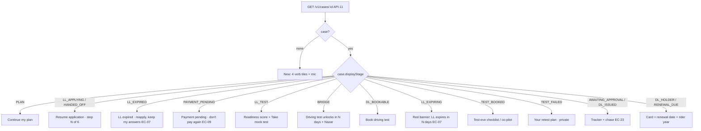

# Frontend Engineering
> Project: Margdarshak · Owner: Frontend lead · Status: Draft v0.1 · Last updated: 2026-10-23
> Related: [Project Brief](../00-overview/PROJECT_BRIEF.md) · [Architecture](ARCHITECTURE.md) · [Tech Stack](TECH_STACK.md) · [Backend](BACKEND.md) · [API Spec](API_SPEC.md) · [Performance](PERFORMANCE.md) · [Testing](TESTING.md) · [Coding Standards](CODING_STANDARDS.md) · [Design System](../02-design/DESIGN_SYSTEM.md) · [UI Spec](../02-design/UI_SPEC.md) · [Accessibility](../02-design/ACCESSIBILITY.md) · [Localization](../02-design/LOCALIZATION.md) · [AI Models](../04-ai/MODELS.md)

This document defines how the two front ends are built: **`apps/web`** (the citizen PWA, every stage S0–S9) and **`apps/console`** (driving schools, State/RTO console, rule-pack studio, clip and moderation admin). It is binding for code review. Where it says **MUST**, a PR that breaks it is rejected.

Two scopes appear in every section:
- **Hackathon build (Phase 1–2)**: what ships on the live Render URL for judging, on mock adapters.
- **Production (Phase 3+)**: what a State Transport Department or NIC adoption needs.

---

## 0. Ten rules that shape every screen

| # | Rule | Source |
|---|---|---|
| 1 | One headline and **one primary action per screen**. The primary action for the home screen comes from the journey state machine on the server (API-11 `primaryAction`), never from client logic. | F-08, design principle B1 |
| 2 | **No number is computed in the browser** for fees, ages, dates, eligibility or scores that the user is told as fact. The browser renders what the API (rules engine, case clock, score verifier) returned. Game scores computed on the client are labelled "provisional" until API-35 returns the server-replayed score. | D-06, D-09 |
| 3 | **No rupee literal in any UI string or prompt.** Fees render from `FeeQuote.lineItems[]` (E-07) via `formatInr()`. A Biome/grit lint rule (§12) fails the build on `₹\s?\d` in `messages/*.json` and `*.tsx`. | D-06 |
| 4 | **Non-affiliation footer** on every page, both apps, every theme including Lite: "Independent prototype, not affiliated with MoRTH/NIC/State Transport Departments; simulated government data." Plus a first-launch disclaimer sheet. No emblem, no "official" wording (D-19 wording-ban lint, §12). | D-01, D-19 |
| 5 | **Aadhaar, OTP, payment and submission never happen in Margdarshak.** There is no input field anywhere that accepts an Aadhaar number or OTP. Those steps are a hand-off to Sarathi (F-07 Mode A) or the state's adapter (Mode B). | D-07 |
| 6 | Every AI surface shows the line "AI can't book, pay or submit" and a source chip with the rule ID. Every user sees every AI surface, including a learner under 18 (P-07) in a parent's account (family mode); for that learner the client sends no analytics or game telemetry, and squads and share cards appear only after the parent's consent. | D-09, D-13 revised |
| 7 | Mobile first at **360 × 640 CSS px**, 18 px body text, 48 × 48 px targets, WCAG 2.1 AA. Desktop is an enhancement. | F-52, D-21 |
| 8 | Works offline for: mock LL tests, downloaded Nazar packs, saved lessons, the last plan card, and the application draft. Writes queue in IndexedDB and replay with idempotency keys. | F-51, EC-11, EC-19 |
| 9 | Lite mode first load **< 300 KB** transferred (brotli), with no HeroUI, Motion, Rive, Lottie, Phaser or TanStack Query in that bundle. | F-51, EC-19 |
| 10 | Server time is the source of truth for every countdown (LL expiry, day-30 unlock, retest gap). The device clock is only used for display interpolation between server syncs. | EC-15 |

---

## 1. Monorepo position

```
margdarshak/
├── apps/
│   ├── web/                 # citizen PWA (Next.js 16) — stages S0–S9, Lite mode, games host
│   └── console/             # schools / State-RTO console / rule-pack studio / clip + moderation admin (Next.js 16)
├── packages/
│   ├── ui/                  # @margdarshak/ui — tokens.css, Tailwind 4 preset, HeroUI v3 theme, shared components
│   ├── game-core/           # @margdarshak/game-core — Game SDK contract (Zod), pure scoring, sim-core (fixed step, seeded PRNG)
│   ├── rules/               # @margdarshak/rules — rule-pack JSON Schema, generated TS types, Zod; (Phase 3) offline evaluator
│   └── api-client/          # @margdarshak/api-client — generated from api/openapi.yaml (openapi-typescript + openapi-fetch)  [new: added by this doc]
├── services/
│   ├── api/                 # Go 1.27 API: chi + oapi-codegen + pgx/sqlc + ADK for Go (see BACKEND.md, ADR-0011)
│   ├── score-verifier/      # Node service that imports @margdarshak/game-core and replays sessions
│   └── workflows/           # Render Workflows tasks in TypeScript (@renderinc/sdk)
└── api/openapi.yaml         # the contract both apps are generated from
```

`packages/api-client` is not in the original skeleton. It is added so both apps share one generated, typed client and the OpenAPI file stays the single contract (reported as an inconsistency in the hand-back).

### 1.1 Pinned frontend dependencies (checked on npm, 2026-10-23)

| Package | Version | Used in | Why |
|---|---|---|---|
| `next` | 16.4.3 | web, console | App Router, React Server Components, Turbopack default bundler |
| `react` / `react-dom` | 19.3.1 | all | Required by Next 16 |
| `typescript` | 6.0.3 | all | 7.0.2 (native compiler) is `latest`, but peer ranges of `@hey-api/openapi-ts`, Serwist and others declare `>=5`/`6`; we pin the last JS-based line and re-evaluate TS 7 after the event (owner: Frontend lead, 2026-11-15) |
| `@heroui/react` + `@heroui/styles` | 3.2.6 | web (full mode), console | Team's Vakyam stack; React Aria underneath (keyboard, screen reader, RTL) |
| `tailwindcss` + `@tailwindcss/postcss` | 4.3.3 | all | CSS-first config, `@theme` tokens |
| `tailwind-variants` | 3.3.1 | ui | Required by HeroUI v3 for variant styling |
| `next-intl` | 4.14.9 | web, console | App Router i18n, ICU messages, server + client |
| `@serwist/turbopack` / `serwist` / `@serwist/window` | 9.5.13 | web | Service worker with Turbopack (Next 16's default bundler); `@serwist/next` 9.5.13 is the webpack fallback |
| `@tanstack/react-query` (+ `-persist-client`, `query-async-storage-persister`, `-devtools`) | 5.104.5 | web (full), console | Server state, caching, offline persistence |
| `zustand` | 5.0.16 | web, console | Small client-only UI state |
| `zod` | 4.6.7 | all, game-core | Runtime validation at every boundary; Game SDK schemas |
| `motion` | 14.6.0 | web (full) | Page transitions, readiness dial, reduced-motion aware |
| `@rive-app/react-canvas-lite` | 4.37.1 | web (full, lazy) | Voice orb, track explainer (canvas-lite ≈ 222 KB brotli per `08-game-ai-n8n.md` §1.2, so lazy only) |
| `@lottiefiles/dotlottie-react` | 0.20.0 | web (full, lazy) | Celebrations only, each file < 60 KB |
| `phaser` | 4.2.1 | web (lazy, games only) | Five top-down sims (F-24) |
| `@mediapipe/tasks-vision` | 1.1.1 | web (lazy) | Helmet Fit (G8), photo fixer segmentation (F-06); on device |
| `ts-fsrs` | 5.4.2 | web (offline review queue), api mirror | FSRS scheduling (F-20); pinned 5.x per PROJECT_BRIEF §8 |
| `idb` | 8.0.4 | web | IndexedDB wrapper: drafts, outbox, telemetry queue, query cache |
| `openapi-fetch` / `openapi-typescript` | 0.17.0 / 7.13.0 | api-client | Typed client from `api/openapi.yaml` |
| `lucide-react` | 1.61.0 | ui | ISC icon set (design B5) |
| `web-vitals` | 6.2.3 | web | Field RUM (LCP, INP, CLS) to API-63 |
| `@sentry/nextjs` | 11.9.0 | web, console | Errors, with PII scrubbing (§13) |
| `@fontsource-variable/figtree`, `@fontsource/mukta` (+ Noto families) | 5.3.0 | ui | Self-hosted, script-subset fonts (design B3) |

Versions are exact (no `^`) in `package.json`; Renovate proposes updates weekly (see [GIT_WORKFLOW](GIT_WORKFLOW.md)).

---

## 2. `apps/web` structure (citizen PWA)

```
apps/web/
├── next.config.ts               # next-intl plugin, Serwist (turbopack), headers (CSP), images, bundle analyzer
├── middleware.ts                # next-intl locale negotiation, tenant resolution, Lite cookie, security headers nonce
├── public/
│   ├── manifest.webmanifest     # PWA manifest (name "Margdarshak", no emblem)
│   ├── icons/                   # maskable 192/512
│   ├── mediapipe/               # self-hosted WASM + .task models (lazy, cached by SW on demand)
│   └── offline.html             # last-resort offline page (≤ 8 KB, inline CSS)
├── messages/                    # en.json, hi.json (full); doi.json (voice prompts + UI where reviewed); *.json rule-pack-ready
├── src/
│   ├── app/
│   │   ├── [locale]/
│   │   │   ├── layout.tsx                 # html lang/dir, fonts per script, NextIntlClientProvider, Providers, footer
│   │   │   ├── (citizen)/                 # full experience (HeroUI + TanStack Query + Motion)
│   │   │   │   ├── layout.tsx             # tab bar: Home · My Licence · Learn · Help; voice orb dock
│   │   │   │   ├── page.tsx               # S0 Home (stage-aware)
│   │   │   │   ├── plan/…                 # S1
│   │   │   │   ├── apply/…                # S2
│   │   │   │   ├── learn/…                # S3
│   │   │   │   ├── bridge/…               # S4 (+ play/)
│   │   │   │   ├── book/…                 # S5
│   │   │   │   ├── test-day/…             # S6
│   │   │   │   ├── recover/…              # S6F
│   │   │   │   ├── issued/…               # S7
│   │   │   │   ├── rider/…                # S8
│   │   │   │   ├── licence/…              # S9
│   │   │   │   ├── helper/…, family/…     # F-17
│   │   │   │   ├── privacy/…              # F-54
│   │   │   │   └── help/…, services/…     # "All services" grouped by who you are (F-01)
│   │   │   ├── (lite)/lite/…              # Lite mode route group: server-rendered HTML forms, no client framework (§9)
│   │   │   ├── (lab)/lab/…                # F-57 field-study journey-test lab (unbranded replica), gated by study code
│   │   │   └── verify/practice-record/[token]/page.tsx   # API-47 public verifier (static, no auth)
│   │   ├── sw.ts                          # Serwist service worker source
│   │   ├── manifest.ts                    # typed manifest (locale-aware name)
│   │   └── api/health/route.ts            # liveness for Render (no business logic in Next route handlers)
│   ├── features/                # vertical slices; each owns its components, hooks, queries, store slices
│   │   ├── home/  plan/  apply/  photo-fixer/  handoff/  tracker/  case-clock/
│   │   ├── learn/  readiness/  ll-sim/  sign-snap/  tutor/
│   │   ├── games/               # GameHost, manifests, lazy loaders per game
│   │   ├── debrief/  achievements/  squads/
│   │   ├── slots/  rto-intel/  test-day/  recover/  letters/
│   │   ├── rider/  scam-check/  golden-hour/  renew/
│   │   ├── voice/               # orb, WebSocket client, audio worklets, action executor
│   │   ├── helper/  privacy/  notifications/  lite/
│   │   └── lab/
│   ├── lib/
│   │   ├── api/                 # createApiClient(), idempotency, error mapping, query-key factory
│   │   ├── offline/             # outbox (IndexedDB), sync manager, connectivity store
│   │   ├── i18n/                # routing.ts, request.ts, formatters (formatInr, formatDate, formatDistance)
│   │   ├── redact/              # client-side PII redaction (EC-20)
│   │   ├── time/                # serverClock (offset from Date header), countdown helpers (EC-15)
│   │   ├── a11y/                # reduced motion, focus management, live regions
│   │   ├── telemetry/           # analytics (API-63, no PII), web-vitals, off for a family-mode learner under 18
│   │   └── flags/               # tenant feature flags from API (ai_coach, voice, school_portal…)
│   ├── stores/                  # Zustand stores (§4.3)
│   └── styles/globals.css       # @import "tailwindcss"; @import "@heroui/styles"; @import "@margdarshak/ui/tokens.css"
└── tests/                       # Playwright e2e + axe (see TESTING.md); unit tests sit next to code (*.test.ts)
```

**Folder rules**
- A `features/<x>` folder may import from `lib/`, `stores/`, `packages/*` and its own files. It may **not** import from another feature's internals; cross-feature use goes through that feature's `index.ts` public surface. Enforced by Biome `noRestrictedImports` patterns (see [CODING_STANDARDS](CODING_STANDARDS.md) §3.4).
- `app/` files are thin: they fetch on the server (RSC), choose a feature component, and set metadata. No business logic in `page.tsx`.
- Anything that touches `window`, `navigator`, WebGL, `AudioContext`, camera or IndexedDB is in a `"use client"` file and is loaded with `next/dynamic` when heavy.

---

## 3. Routing per stage (`apps/web`)

All routes are under `/[locale]` (`en`, `hi`; `doi` for reviewed strings, falling back to `hi`). The table lists the full-mode routes; the Lite equivalents are in §9.

### 3.1 Route map

| Stage | Route | Rendering | Auth | Features / API | Notes and edge cases |
|---|---|---|---|---|---|
| S0 Home | `/` | RSC + client islands | none (anonymous device session) | F-01, F-08; API-11 (if a case exists), API-71 | Language picker first on first launch (each language in its own script). 4 verb tiles. Stage-aware header uses `case.stage` + `primaryAction`. Non-affiliation sheet on first launch |
| S0 | `/services` | static (SSG per locale) | none | F-01 "All services" grouped by who you are | Replaces ~120 links with grouped verbs |
| S1 Plan | `/plan` → `/plan?step=age\|vehicle\|state` | client wizard | none | F-02, F-03, F-04; API-01, API-02, API-03 | 3 taps. DOB input accepts year-only (EC-01) and then asks for a DOB document. Vehicle pictures, not class codes |
| S1 | `/plan/[planId]` | RSC (cached 10 min) | none | Plan card, fee breakdown, blockers, API-04 (send to WhatsApp) | EC-05 (16–17 ≤ 50 cc copy), EC-06 (transport < 20), EC-21 (two classes, different ages), EC-10 (no online LL test → "test at RTO"), EC-04 (turning 40 → Form 1A) |
| S2 Apply | `/apply` | RSC | device session; account prompt (optional) | API-10 creates the case | EC-22: "I already have an LL" branch → mid-journey onboarding (enter LL issue date) |
| S2 | `/apply/[caseId]/[step]` | client, one question per screen | case owner or consented helper | F-05; API-12 autosave on every change (debounced 800 ms), API-13 blockers | Steps: `who` → `identity-handoff` → `personal` → `address` → `classes` → `documents` → `photo` → `signature` → `check-answers` → `fees` → `handoff` → `payment-pending`. "Why we ask" disclosure on each. EC-02 (address ≠ residence path), EC-03 (S/o line blank), EC-13 (adapted vehicle, deaf applicant, colour vision) |
| S2 | `/apply/[caseId]/photo` | client (camera) | owner | F-06; API-20 (metadata only) | On-device crop, resize, whiten, size check; no image upload |
| S2 | `/apply/[caseId]/handoff` | RSC + client copy buttons | owner | F-07; API-16 copy-pack/prefill | Mode A: copy-pack + deep link to Sarathi; Mode B: adapter (tenant flag `sarathi_real`). EC-11 Sarathi outage banner |
| S2 | `/apply/[caseId]/payment-pending` | client polling (30 s, max 2 h) | owner | API-11, API-15 | EC-09 "Don't pay again" copy; cancel forfeits fee warning |
| S3 Learn | `/learn` | RSC shell + client | device session | F-20; API-30, API-31 | Topic tiles with Learn-hub hues |
| S3 | `/learn/modules/[moduleId]` | SSG + client | none | F-20 | Offline-capable (precached when the user taps "Save for offline") |
| S3 | `/learn/review` | client | device session | API-31, API-32; ts-fsrs offline | Review queue works offline; answers sync via outbox |
| S3 | `/learn/readiness` | client | device session | F-21; API-33 | Shown as "78 = knowledge 84 − calibration 6"; "book anyway" always visible (advisory gate) |
| S3 | `/learn/ll-test` | client (zero decorative motion) | none | F-22 | Format from the tenant rule pack (timer, count, pass mark), guided first run; fully offline |
| S3 | `/learn/sign-snap` | client (camera) | consent | F-27, M-07 | Could; available to every user (D-13 revised) |
| S4 Bridge | `/bridge` | RSC + client | case owner | F-09 case clock day plan; API-14 | "Driving test unlocks in N days" from server `unlockAt` |
| S4 | `/bridge/play` | RSC | device session | Game picker (F-23, F-24) | Every user; for a family-mode learner under 18: server sessions and streaks as usual, no telemetry |
| S4 | `/bridge/play/nazar` | client (video) | device session | F-23; API-37, API-34, API-35 | §7 timing. Mock = unseen clips only |
| S4 | `/bridge/play/[gameId]` | client (Phaser or React) | device session | F-24; API-34, API-35 | `gameId` ∈ manifest enum; unknown → 404 |
| S4 | `/bridge/play/session/[sid]/debrief` | client | device session | F-25; API-36 | Template card renders instantly; AI "Coach notes" swap in (§8.4) for every user |
| S4 | `/bridge/practice-record` | RSC | account | F-28; API-46 | "Practice Record", never "verified" |
| S5 Book | `/book` | RSC + client map | case owner | F-10; API-25, API-26 | Map = static tiles + list fallback (list is default on Lite/2G) |
| S5 | `/book/offices/[officeId]` | RSC (ISR 5 min) | none | API-26, API-29 (Live Intel) | F-11: k ≥ 5 aggregates only; seeded rows labelled |
| S5 | `/book/offices/[officeId]/report` | client form | account | API-28 | Structured fields only, no free text (D-14); EC-24 "fake slot / setting offer" report type |
| S5 | `/book/watch` | client | account + channel consent | API-27 | "Notify me" relays moderated crowd reports only (no scraping, D-08) |
| S6 Test | `/test-day` | RSC | case owner | F-12 | Track explainer (Rive, lazy), test-eve checklist |
| S6 | `/test-day/copilot` | client, offline-first | case owner | F-12 | Counter steps, papers check, "show at counter" QR (rendered locally), 2-min calm-down |
| S6F Fail | `/recover/[attemptId]` | client | case owner | F-13; API-15 `test_failed`, API-36 | Private debrief (no red), drill, retest booking; EC-08 (3+ fails, 7-day gap, remedial training), EC-07 (LL expiry check) |
| S6F | `/recover/[attemptId]/rti` | RSC | owner | API-45 | Test-record request (RTI template), user-sent |
| S7 Issued | `/issued` | RSC + polling | owner | F-14; API-11, API-45 | Parcel tracker Approved → Printed → Dispatched; EC-23 (passed, no SMS in 3 days → chase) |
| S8 Rider | `/rider`, `/rider/pledge`, `/rider/first-vehicle`, `/rider/golden-hour` | SSG + client | DL holder | F-15 | Golden hour is static content, no AI (D-14) |
| S8 | `/rider/scam-check` | client | none | F-33; API-43 | Rules decide; AI only explains; never says "safe" (D-19) |
| S9 Renew | `/licence`, `/licence/renew`, `/licence/add-class`, `/licence/fix` | RSC | DL holder only | F-16 | EC-16 (expired DL, no grace, > 1 year → retest), EC-12 (moving state, foreign licence, IDP) |
| Cross | `/helper`, `/helper/[linkId]` | client | helper with consent artefact | F-17; E-29 | EC-14 shared phone / cyber café: banner, auto-logout 10 min idle, "clear this device"; EC-25 revoked consent → immediate lockout |
| Cross | `/privacy`, `/privacy/consents`, `/privacy/export`, `/privacy/delete` | RSC + client | account | F-54; API-60, API-61, API-62 | EC-26 deletion mid-case: confirm screen lists open timers that will be cancelled |
| Cross | `/settings` | client | none | Language, Lite toggle, sound, reduced motion, high contrast, Sunlight mode | |
| Lab | `/lab/[studyCode]/…` | client | study code | F-57; API-70 | Unbranded replica; separate analytics cohort |

### 3.2 Stage-aware home (F-08)

The home page never derives the stage itself. It renders a `HomeView` chosen by `case.displayStage` (the persisted `stage`, overridden by alerts such as `LL_EXPIRING`) and the `primaryAction` the server computed from the journey state machine (see [BACKEND](BACKEND.md) §5).



`N` is never computed in the browser: the API returns `clock.unlockAt`, `clock.llExpiresAt` and a server `now`; the client renders `days = ceil((unlockAt − serverNow)/86_400_000)` using `serverClock` (§4.5), and re-syncs on focus.

### 3.3 Navigation conventions
- Four tabs only: **Home · My Licence · Learn · Help** (icon + text label always).
- `next/link` with `prefetch={false}` on Lite and when `navigator.connection.saveData` is true or `effectiveType` is `2g`/`slow-2g`.
- Back always works: wizard steps are real URLs, so the browser back button and TalkBack's back gesture behave.
- Deep links from WhatsApp messages (n8n) carry only `caseId` + a short-lived signed token (no PII in URLs).

### 3.4 `apps/console` structure and routes

```
apps/console/src/app/[locale]/
├── (auth)/sign-in/                         # email magic link / Google (Phase 1–2); Jan Parichay via adapter (Phase 3+)
├── (school)/school/                        # P-05 driving-school owner — F-40, API-52
│   ├── page.tsx                            # learner list, progress, hazard-training logs
│   ├── learners/[learnerId]/               # practice sign-off (E-27), parent updates (consented)
│   ├── bookings/                           # E-26, test-vehicle hire
│   └── inspection-pack/                    # hazard-training log export for RTO inspection (Kerala)
├── (state)/console/                        # P-06 RTO officer / Transport Commissioner — F-41, API-53
│   ├── page.tsx                            # where applications stall (funnel by stage, k ≥ 5)
│   ├── fail-reasons/                       # fail reasons per RTO
│   ├── demand/                             # demand forecast, slot utilisation
│   └── deflection/                         # counter-query deflection
├── (admin)/admin/
│   ├── rulepacks/                          # F-42, API-54: list → draft → diff → submit → approve (maker-checker)
│   ├── rulepacks/[packId]/versions/[v]/    # golden-test results shown before approval
│   ├── clips/                              # API-55: clip pipeline runs (Render Workflows), two-rater windows, agreement, publish
│   ├── moderation/intel/                   # RTO Live Intel queue (with n8n W9)
│   └── audit/                              # E-30 append-only audit viewer
└── layout.tsx                              # role-aware nav; tenant switcher only for platform admins
```

- Console is desktop-first (1200 px max width, 12-column grid) but must still pass axe and keyboard checks.
- Every console view is **aggregated and anonymised** (F-41); tables with fewer than 5 records render "Not enough data (k < 5)".
- Role checks are done by the API (RBAC + tenant scope, [BACKEND](BACKEND.md) §10). The console hides links by role only for usability; it never relies on that for security.
- Rule-pack studio diff view shows each changed row with `source`, `verified_on`, `confidence`, `approver` (D-05) and the result of the golden suite for that pack version (see [TESTING](TESTING.md) §4).

---

## 4. State management

### 4.1 Which state lives where

| Kind of state | Tool | Examples | Persistence |
|---|---|---|---|
| Server state (truth lives in the API) | **TanStack Query 5** | case, plan, fee quote, blockers, timeline, offices, slots, readiness, review queue, achievements, debrief | Query cache persisted to IndexedDB for allow-listed keys (§4.4) |
| Form drafts not yet saved | React Hook-less controlled state inside the step + **outbox** | the field being typed in `/apply/.../personal` | Draft mirrored to IndexedDB every 800 ms; outbox replays API-12 |
| Client UI state shared across components | **Zustand 5** | voice orb state, game host status, a11y prefs, Lite flag, connectivity, consent sheet visibility | `persist` middleware → `localStorage` only for prefs (never PII) |
| URL state | Next router / search params | wizard step, filters, selected office | URL |
| Server-rendered data | RSC `fetch` with `next.revalidate` | static rule-pack summaries, module content, office pages | Next data cache |

**Never** put server data in Zustand. **Never** put Aadhaar-like or contact data (E-14) in any persisted client store.

### 4.2 TanStack Query conventions

```ts
// src/lib/api/keys.ts — single query-key factory (illustrative contract, not app code)
export const qk = {
  plan: (planId: string) => ["plan", planId] as const,
  case: (caseId: string) => ["case", caseId] as const,
  blockers: (caseId: string) => ["case", caseId, "blockers"] as const,
  timeline: (caseId: string) => ["case", caseId, "timeline"] as const,
  fees: (state: string, classes: readonly string[]) => ["rules", state, "fees", [...classes].sort()] as const,
  offices: (state: string, near?: string) => ["offices", state, near ?? "all"] as const,
  slots: (officeId: string, week: string) => ["offices", officeId, "slots", week] as const,
  intel: (officeId: string) => ["offices", officeId, "intel"] as const,
  reviewQueue: () => ["learn", "review-queue"] as const,
  readiness: () => ["readiness"] as const,
  debrief: (sid: string) => ["games", "sessions", sid, "debrief"] as const,
  achievements: () => ["me", "achievements"] as const,
};
```

| Setting | Default | Overrides |
|---|---|---|
| `staleTime` | 60 s | rules/fees/classes 24 h (versioned by `rulePackVersion` in the key's response; refetched when the case's `rulePackVersion` changes, EC-27); case 0 s on focus; slots 5 min; intel 10 min |
| `gcTime` | 24 h | game sessions 1 h |
| `retry` | 2 (exponential, max 8 s) | never retry 4xx except 408/429; respect `Retry-After` |
| `networkMode` | `offlineFirst` | so cached data shows instantly on 2G |
| `refetchOnWindowFocus` | true for case/timeline (server clock resync), false otherwise | |
| Errors | mapped from RFC 9457 problem+json (see [BACKEND](BACKEND.md) §12) to a typed `AppError` with an i18n `code` | |

**Mutations**
- Every non-idempotent mutation sends `Idempotency-Key: <uuidv7>` generated once per user intent and stored with the outbox entry, so a retry after a network drop never creates a second case, a second slot watch or a second report.
- Autosave (API-12) uses `PATCH` with `If-Match: <case.version>` (optimistic concurrency). On `412 Precondition Failed` the client refetches and shows "Updated on another device; we kept the newer answers" (resume on any device, F-05).
- Optimistic updates only for local-feel actions (bookmark a module, toggle a checklist item). Never for fees, dates, eligibility or scores.

### 4.3 Zustand stores (all small, typed, sliced)

| Store | Shape (abridged) | Persisted? |
|---|---|---|
| `usePrefsStore` | `locale, lite, reducedMotion, highContrast, sunlight, sound, dataSaver` | yes (localStorage) |
| `useConnectivityStore` | `online, effectiveType, saveData, lastSyncAt, outboxSize` | no |
| `useVoiceStore` | `state: idle\|listening\|thinking\|speaking\|acting\|didnt_catch\|offline\|handoff`, `level`, `transcript`, `pendingAction` | no |
| `useGameHostStore` | `status, gameId, sid, provisionalScore, timingMode, paused` | no |
| `useConsentUiStore` | which consent sheet is open, helper banner visibility | no |
| `useSessionStore` | `deviceSessionId, familyLearner: boolean, parentConsent: { squads, shareCards }, role` (no names, no DOB) | yes (`familyLearner` only) |

`familyLearner` is set from the server (`/v1/cases/{id}`: `for_family_member` with an under-18 `age_band`) and only switches off analytics/game telemetry and shows the parent-consent step before squads and share cards (D-13 revised). It never hides AI or any other feature. It is a UX hint; the API enforces the same rule (403 `PARENT_CONSENT_REQUIRED`).

### 4.4 Offline persistence and the outbox

```mermaid
sequenceDiagram
  participant UI as Step screen
  participant OB as Outbox (IndexedDB)
  participant SW as Service worker
  participant API as Go API
  UI->>OB: put {id, method:PATCH, url:/v1/cases/:id, body, idemKey, ifMatch}
  UI-->>UI: show "Saved on this phone"
  OB->>API: replay when online (FIFO per caseId)
  alt 200
    API-->>OB: new version → delete entry, update query cache
    OB-->>UI: "Saved"
  else 412
    API-->>OB: conflict → refetch case, merge rule: server wins, keep local field if server field empty
  else 5xx / offline
    OB-->>OB: backoff 2,4,8…60 s; Background Sync tag "outbox" where supported (Chrome Android)
  end
```

- IndexedDB databases: `md-outbox` (pending writes), `md-drafts` (per-step drafts), `md-telemetry` (game events, `(sid, seq)` dedupe), `md-query` (persisted TanStack cache for allow-listed keys: plan, case, timeline, review queue, module content, fees).
- **EC-14 shared device:** "Clear this device" deletes all four databases, Cache Storage entries tagged `user:*`, localStorage, and unregisters push. Helper mode clears automatically on sign-out and after 10 minutes idle.
- **EC-26 account deleted:** the API returns `410 Gone` for the case; the client wipes local stores for that `caseId` and shows the confirmation.
- A family-mode learner under 18 does not write to `md-telemetry`.

### 4.5 Server clock (EC-15)
- Every API response carries the `Date` header and a `serverNow` field on clock-bearing resources (API-11, API-14).
- `serverClock.offsetMs = serverNow − Date.now()` measured at response time (mid-point of request RTT). Countdowns use `Date.now() + offsetMs`.
- If `|offset| > 5 min`, show a quiet note "Your phone's clock looks off; dates here use the server time." Never let a device clock unlock a step: unlock state (`dlBookable`) is a server boolean.

---

## 5. Data fetching and the API client

- `packages/api-client` is generated on `pnpm gen:api` from `api/openapi.yaml` with `openapi-typescript`; requests go through `openapi-fetch`. Generated files are committed, and CI fails if `pnpm gen:api` produces a diff.
- **RSC fetches** (server side, in `page.tsx`) call the API over Render's private network URL (`API_INTERNAL_URL`) with the user's session cookie forwarded. **Client fetches** use `NEXT_PUBLIC_API_BASE_URL`.
- Every request sends `X-Tenant: <state code>` (resolved in middleware from host or the user's chosen state), `Accept-Language`, and `X-Request-Id` (uuidv7) for tracing.
- Responses are validated with Zod at the boundary only for data the UI turns into facts (fee quotes, clock, debrief card). A schema mismatch is a Sentry error and the screen shows the "we couldn't load this" state, not wrong numbers.
- No Next.js Server Actions write to the database; Server Actions are used only in Lite mode to proxy form POSTs to the API (§9), so all business logic stays in the Go API.

---

## 6. Styling: HeroUI v3 + Tailwind 4 + tokens

### 6.1 Layering

```
packages/ui/
├── src/tokens.css        # design tokens (06-design-language B2–B7): --bg, --ink, --primary … light/dark/high-contrast/sunlight
├── src/heroui-theme.css  # maps Margdarshak tokens → HeroUI v3 variables (oklch)
├── src/ux4g-skin.css     # tenant skin: UX4G aliases (primary #4A2BC2, Noto Sans), no component changes
├── src/preset.css        # Tailwind 4 @theme block exposing tokens as utilities
└── src/components/       # JourneyMap, PlanCard, FeeBreakdown, SourceChip, VoiceOrb, ReadinessDial, NazarHud, DebriefCard, VerbTile, NonAffiliationFooter …
```

`apps/web/src/styles/globals.css`:

```css
@import "tailwindcss";
@import "@heroui/styles";                 /* must come after Tailwind */
@import "@margdarshak/ui/tokens.css";
@import "@margdarshak/ui/heroui-theme.css";
@import "@margdarshak/ui/preset.css";
@source "../../../packages/ui/src";       /* let Tailwind 4 scan shared components */
```

### 6.2 Token mapping to HeroUI v3 variables
HeroUI v3 is themed with CSS variables (no provider) in `oklch`, with `[data-theme='dark']` switching. Colour names without suffix are backgrounds; `-foreground` is text. We map our hex tokens (contrast already computed in `06-design-language.md` B2) to the HeroUI names:

```css
/* packages/ui/src/heroui-theme.css — light */
:root, [data-theme="light"] {
  --background: var(--bg);              /* #FCFCFA */
  --foreground: var(--ink);             /* #1F1F1F, 16.05:1 */
  --surface: var(--surface);
  --surface-secondary: var(--surface-2);
  --accent: var(--primary);             /* #3333CC, white on it 8.45:1 */
  --accent-foreground: var(--on-primary);
  --focus: var(--focus);                /* #556ADC 3px ring, 2px offset */
  --success: var(--success);  --success-foreground: #FFFFFF;
  --danger: var(--danger);    --danger-foreground: #FFFFFF;
  --warning: var(--warning-soft); --warning-foreground: var(--warning-ink);
  --border: var(--border-strong);       /* UI 3.27:1; hairline is decorative only */
  --separator: var(--hairline);
  --radius: 0.5rem;                     /* md 8px → fields get calc(radius*1.5)=12 */
  --field-border-width: 1px;            /* HeroUI default is 0; we need a visible boundary (WCAG 1.4.11) */
  --field-border: var(--border-strong);
  --tooltip-delay: 600ms;               /* default 1500 ms is too slow for low-literacy users */
}
[data-theme="dark"] { /* same mapping onto the dark token set from 06 B2 */ }
```

Rules:
- Components use **semantic variants** (`primary`, `secondary`, `tertiary`, `danger`, `ghost`, `outline`), never raw colours.
- `--ember`, `--amber` and `--hairline` are **decorative only**; a lint (stylelint-free: Biome `noRestrictedSyntax` via GritQL plugin, [CODING_STANDARDS](CODING_STANDARDS.md)) flags `text-[--ember]`/`text-ember` utilities.
- Status is always icon + colour + words (✓ done, ● now, ○ later, ▲ warning, ⬣ danger).
- Use HeroUI compound components (`<Card><Card.Header>…`) and `onPress`, not `onClick`.
- Theme switching: `<html data-theme="light|dark" class="dark?">`; plus `data-contrast="more"` (high contrast) and `data-theme="sunlight"` for RTO yards.
- Tenant white-label (F-58): the API's tenant config returns a theme key (`default` | `ux4g`); the root layout adds `data-skin="ux4g"` which swaps aliases in `ux4g-skin.css`. No state branding in code.

### 6.3 Typography and fonts
- Self-hosted via `@fontsource*`, subset per script, `font-display: swap`. The root layout loads Latin + Devanagari only for `en`/`hi`/`doi`; other scripts load when that locale is chosen.
- Body 18/28 Latin, Indic line-height 1.65; no letter-spacing on Indic text; no all-caps eyebrows for Indic.
- Numerals in scores and fees use `font-variant-numeric: tabular-nums`.
- Layouts must tolerate +40% text length; Playwright visual checks run with a pseudo-locale `en-XA` that pads strings by 40% (see [TESTING](TESTING.md) §8).

### 6.4 Motion
- `motion` package; every animated component reads `useReducedMotion()` and drops to opacity-only.
- Exam simulator screens (`/learn/ll-test`) have zero decorative motion.
- No flashing content above 3 Hz anywhere (WCAG 2.3.1, EC-18). Nazar clips are screened for flashes in the clip pipeline (see [BACKEND](BACKEND.md) §8).

---

## 7. Internationalisation (next-intl)

| Item | Decision |
|---|---|
| Locales | `en`, `hi` complete (F-50, D-21). `doi` (Dogri, Devanagari) for reviewed UI strings and voice prompts; missing keys fall back to `hi`, then `en`. Other locales exist only as rule-pack-ready message files, not exposed in the picker. |
| Routing | `src/lib/i18n/routing.ts` with `defineRouting({ locales: ["en","hi","doi"], defaultLocale: "hi", localePrefix: "always" })`. Middleware negotiates from cookie → `Accept-Language` → tenant default. |
| Messages | `messages/<locale>.json`, ICU syntax, namespaced by feature (`plan.card.title`). Keys are stable IDs, never English sentences. |
| Facts in strings | Placeholders only: `"plan.fee.total": "Total fee {total}"`, where `total` is formatted by `formatInr(lineItems.sum)` from the API. **No currency or numbers hard-coded** (lint, §0 rule 3). |
| Rule text | Rule descriptions (`text_en`, `text_hi`) come from the rule pack via the API, with `source` and `verified_on`; they are not in message files. |
| Formatting | `useFormatter()` for dates (`Asia/Kolkata`, `dd MMM yyyy`), numbers (Latin digits default, toggle for native digits), distance "≈ 16 m" / "लगभग 16 मीटर". `formatInr` uses `Intl.NumberFormat("en-IN", { style: "currency", currency: "INR", maximumFractionDigits: 0 })` → "₹700"; the `₹` comes from Intl, not a literal. |
| Direction | `dir="rtl"` support exists for future Urdu/Kashmiri (Nastaliq line-height 2.1) but these are not exposed (D-21). |
| Translation workflow | English source → human Hindi translation → review by a native speaker; Dogri strings reviewed by a native Dogri speaker (see [LOCALIZATION](../02-design/LOCALIZATION.md)). CI fails on missing `en`/`hi` keys (`pnpm i18n:check`). |

---

## 8. PWA and offline (Serwist)

### 8.1 Setup
- `@serwist/turbopack` integrates with Next 16's default Turbopack bundler (peer `next >=14`); if a blocking bug appears, switch the build to webpack (`next build --webpack`) and `@serwist/next` 9.5.13. Decision owner: Frontend lead, at H0 spike.
- Service worker source: `src/app/sw.ts`; output `public/sw.js`; scope `/`. Registered by `@serwist/window` after `load` and only in production.
- Update flow: new SW waits; a toast "Update ready — reload" (never auto-reload mid-application or mid-game).

### 8.2 Caching strategy

| Asset / route | Strategy | Cache name | Limit |
|---|---|---|---|
| App shell (`/[locale]` layout chunks, fonts, icons) | Precache (revisioned) | `md-precache` | Full-mode precache ≤ 1.2 MB; Lite precache ≤ 250 KB |
| JS/CSS chunks (hashed) | CacheFirst | `md-static` | 60 entries, 30 days |
| Rule-pack summaries, module content (`/v1/learn/modules`) | StaleWhileRevalidate | `md-content` | 200 entries, 7 days |
| Case, timeline, blockers | NetworkFirst, 4 s timeout → cache | `md-api-user` (tagged `user:*`) | 50 entries, 24 h |
| Fees/classes (API-02/03) | StaleWhileRevalidate keyed by `rulePackVersion` | `md-rules` | 20 entries |
| Nazar clips and game packs | **CacheOnly after explicit download** + `RangeRequestsPlugin` (video needs HTTP Range from cache) | `md-pack-<packId>` | User-visible size before download; no silent download (dark-pattern rule) |
| MediaPipe WASM + models | CacheFirst on first use | `md-ml` | ~ the model files only |
| Navigation fallback | `offline.html` when nothing cached | precache | — |
| POST/PATCH | **not** cached; the outbox handles them (§4.4); Background Sync replays where supported | — | — |

### 8.3 Offline matrix

| Capability | Offline? | How |
|---|---|---|
| LL mock test (F-22) | Yes | Question bank for the tenant precached on first visit to Learn; scoring local; result syncs later |
| FSRS review (F-20) | Yes | ts-fsrs runs locally on cached cards; answers queue to API-32 |
| Nazar mock (F-23) | Yes, after "Download practice pack (≈ N MB)" | Clips in `md-pack-*`; taps queued; **server replay on reconnect** decides the counted score |
| Plan card (F-02) | Last generated plan only | Persisted query; new plans need the network (rules engine is server-side in Phase 1–2) |
| Application draft (F-05) | Yes | Drafts + outbox |
| Voice guide (F-30) | No | Orb shows "Voice needs internet. Try typing — it works offline." |
| Debrief (F-25) | Template card only | Template packs per finding ID are precached; "Coach notes" when online |
| Slot finder (F-10) | Last fetched list | Labelled with fetch time |
| Sarathi outage (EC-11) | n/a | Status banner from API `/v1/health` `adapters.sarathi`; hand-off button disabled with "we'll retry and ping you" |

### 8.4 Debrief rendering (template first)
1. On session end, render the **template card** ("Auto notes") immediately from `SessionResult.findings` + local templates.
2. Call API-35 (server replay) → API-36 (debrief). If the AI card ("Coach notes") arrives within 6 s and passes the server validator, cross-fade to it; otherwise keep the template (EC-29).
3. Every user, including a family-mode learner under 18, gets the AI path (D-13 revised).

---

## 9. Lite mode (< 300 KB first load)

Lite mode is a separate route group, not a CSS toggle, because the budget cannot be met with the full client framework.

| Aspect | Full mode | Lite mode (`/[locale]/lite/…`) |
|---|---|---|
| Rendering | RSC + client islands | **RSC only**, HTML forms, progressive enhancement; one tiny client script (≤ 12 KB) for the outbox and countdown |
| UI library | HeroUI v3 + Motion | Plain semantic HTML styled with `packages/ui` tokens + a Lite stylesheet (≤ 15 KB brotli). No shadows, no blur, no gradients |
| Data | TanStack Query | Server fetch per request; POSTs go to a Server Action that proxies to the Go API with the idempotency key |
| Media | Rive orb, Lottie, images | CSS concentric-ring orb fallback (no voice in Lite); no hero images; SVG icons inlined only where used |
| Games | Phaser sims, Nazar video | LL simulator (HTML form) + SVG "decision" versions of the sims (e.g. Blind Spot "tap the safe position" on a static diagram). Nazar only after explicit pack download, 360p |
| Fonts | Figtree + Mukta subsets | System UI font stack first; Mukta Devanagari subset (~ 20 KB woff2) only for `hi`/`doi` |
| Entry | default | auto-suggested when `saveData` or `effectiveType ∈ {slow-2g, 2g}` or a device-memory hint ≤ 1 GB; always user-switchable; choice stored in the `md_lite` cookie |

Lite routes cover: Home, Plan (3 taps), Plan card, Apply steps (same step IDs), Hand-off copy-pack, Payment pending, LL mock test, Review queue (server-scored in Lite), Case tracker, Help, Privacy, Settings.

**Lite budget (transferred, brotli, cold cache, first navigation to `/hi/lite`)**

| Item | Budget |
|---|---|
| HTML document | ≤ 30 KB |
| CSS (Lite stylesheet + critical tokens) | ≤ 15 KB |
| JS (Next runtime minimal + outbox/countdown) | ≤ 90 KB |
| Fonts | ≤ 25 KB (Devanagari subset; 0 for `en`) |
| Icons/images | ≤ 20 KB |
| Service worker + manifest | ≤ 25 KB |
| **Headroom** | ≥ 95 KB |
| **Total** | **< 300 KB** (CI hard gate, `size-limit` + Lighthouse CI, see [PERFORMANCE](PERFORMANCE.md) §4) |

[unverified] Whether the Next 16 App Router runtime alone fits under 90 KB brotli for a route with one client component must be measured at H0 (owner: Frontend lead, 2026-10-24). Fallback if it does not: serve Lite routes as fully static/RSC with **zero** client JS and put the outbox in the service worker (forms POST natively; the SW intercepts and queues when offline).

---

## 10. Games in React

### 10.1 Game host
`features/games/GameHost.tsx` is the only component that loads a game. It:
1. Resolves the `GameManifest` (Zod, `@margdarshak/game-core`) for `gameId`; rejects unknown IDs.
2. Calls API-34 to create a session → `{ sid, seed, difficulty, items[], scoringVersion }`. Offline: generates a local `sid` (uuidv7) and seed, marked `offline: true`; the server re-seeds on sync and the session counts only for practice.
3. Builds the `ctx` (`{ sessionId, locale, a11y, difficulty, seed, items, offline, deviceClass }`). Games never receive a name, DOB, phone, case file or location.
4. Lazy-loads the game module with `next/dynamic(() => import("@/features/games/<id>"), { ssr: false })`.
5. Subscribes to the game's event bus; appends events to `md-telemetry` with strictly increasing `seq` (skipped for a family-mode learner under 18).
6. Pauses on `visibilitychange` (mandatory); a hidden tab during a timed item voids that item (integrity flag).
7. On `end`, gets the client `SessionResult`, shows it as **provisional**, posts API-35 with `replay.inputs` (delta-encoded, gzip, base64) + seed. The server replay result replaces the provisional score.

### 10.2 Phaser 4 inside React (F-24 top-down sims)

```tsx
// features/games/phaser/PhaserMount.tsx — contract sketch (illustrative)
"use client";
export function PhaserMount({ scene, ctx, onEvent }: Props) {
  const ref = useRef<HTMLDivElement>(null);
  useEffect(() => {
    let game: Phaser.Game | undefined;
    let cancelled = false;
    (async () => {
      const Phaser = await import("phaser");               // shared chunk, cached once for all 5 sims
      if (cancelled || !ref.current) return;
      game = new Phaser.Game({
        type: Phaser.AUTO, parent: ref.current, backgroundColor: "#2A2C33",
        scale: { mode: Phaser.Scale.FIT, autoCenter: Phaser.Scale.CENTER_BOTH, width: 360, height: 640 },
        render: { antialias: false, powerPreference: "low-power" },
        resolution: Math.min(window.devicePixelRatio, 2),  // cap DPR at 2
        fps: { target: 60, forceSetTimeOut: false },
        scene: [scene], callbacks: { postBoot: (g) => g.registry.set("ctx", ctx) },
      });
      game.events.on("md:event", onEvent);                 // game emits SDK events; React never polls the canvas
    })();
    return () => { cancelled = true; game?.destroy(true); };  // destroy on unmount (StrictMode double-mount safe)
  }, [scene, ctx, onEvent]);
  return <div ref={ref} role="application" aria-label={…} className="touch-none select-none" />;
}
```

Rules:
- **Logic in `game-core/sim`, rendering in Phaser.** Phaser scenes read state from the deterministic `sim-core` step (fixed 60 Hz, seeded mulberry32 PRNG); Phaser's own physics and `Math.random` are banned inside scoring paths (lint rule). If rendering drops to 30 fps the logic still runs at 60 Hz with an accumulator, so the score and the server replay match.
- React → Phaser communication goes through `game.registry` and the event bus only; no React state updates per frame.
- One texture atlas per game, object pooling, no full-screen filters (night glare = pre-baked radial sprite).
- WebGL context loss: Phaser 4 recovers; we additionally pause the sim and show "Tap to continue".
- Every canvas game ships a `screen_reader_alt` DOM version (a11y mode) because TalkBack cannot read a WebGL canvas.
- Controls in the bottom 40% of the screen, ≥ 48 dp; tap-only mode (no drag, no tilt).
- Fallback: if Phaser 4 blocks us in the H0 spike, pin the last Phaser 3.x (owner: Game lead, decision by 2026-10-24 12:00).

### 10.3 Nazar video timing with `requestVideoFrameCallback` (F-23, EC-18)

Problem: taps must be scored against the **media time** of the frame the user saw, not wall-clock, otherwise buffering or decode jank shifts the score.

```mermaid
sequenceDiagram
  participant V as <video>
  participant R as rVFC loop
  participant P as Pointer handler
  participant S as Scorer (game-core)
  V->>R: frame presented (now, metadata.mediaTime, expectedDisplayTime, presentedFrames)
  R->>R: lastFrame = {perfNow: metadata.presentationTime, mediaMs: mediaTime*1000}
  P->>P: pointerdown (e.timeStamp on performance.now clock)
  P->>S: tap {t: e.timeStamp - t0, mt: lastFrame.mediaMs + (e.timeStamp - lastFrame.perfNow) clamped to [0, 1 frame], x, y}
  S->>S: score by hazard windows [a,b] split in 5 bands (5,4,3,2,1); pattern-click rule
```

Implementation contract:
1. **Preload the whole MP4** before the clip starts (`fetch` → Blob URL from the pack cache, or `preload="auto"` and wait for `canplaythrough` plus `buffered.end(0) ≥ duration − 0.1`). No streaming during a scored clip; this removes the buffering failure mode (EC-18, `grand-council.md` §2).
2. Loop `video.requestVideoFrameCallback(cb)`; store the latest `{ presentationTime, mediaTime }`.
3. On `pointerdown` (listener on a full-screen overlay, `passive: true`, `touch-action: none`), compute `mt = lastFrame.mediaTime*1000 + clamp(e.timeStamp − lastFrame.presentationTime, 0, frameDurationMs)`. Record both `t` and `mt`.
4. If `requestVideoFrameCallback` is not available (`!("requestVideoFrameCallback" in HTMLVideoElement.prototype)`), fall back to `video.currentTime` at tap time and set `timingMode: "fallback"`; the session keeps its score but is excluded from percentiles.
5. Expected error ≈ 1 frame (±33 ms at 30 fps), well inside the 1-band width.
6. **Stall detection:** if `waiting`/`stalled` fires, or the media-time delta and the performance-time delta diverge by > 250 ms over 1 s, pause, void that clip (integrity flag `stall`), and offer "Watch again".
7. **Spam taps:** pattern-clicking rule from `game-core` (more than 3 taps in any 1.0 s, or more than (2 × hazards + 4) taps in a clip ⇒ that clip scores 0). The HUD only shows a ring per tap; it never says "cheating" ("this clip wasn't counted").
8. **No audio needed**; no countdown timer; Pause button 48 px.
9. Screen-reader alternative: still-frame "which one is the hazard?" mode, labelled as a substitute, not the same skill.
10. Photosensitivity: clips are pre-screened in the pipeline (≤ 3 flashes/s); a reduced-motion setting adds a 0.5 s fade-in and disables the tap ripple.

### 10.4 Other games
| Game | Tech | Notes |
|---|---|---|
| Stopping Distance (G3) | SVG + Motion | Numbers from `game-core` physics tables, never typed in JSX |
| Golden Hour (G9) | React state machine (table-driven) | Static, cited content; no AI (D-14) |
| LL Test Simulator (G10, F-22) | React | Format from tenant rule pack; offline |
| Helmet Fit (G8) | React + MediaPipe | §11 |
| Junction Scan, Blind Spot, Track Test Twin, Night & Glare, Hill Road (G2, G4–G7) | Phaser 4 over `sim-core` | Lazy; Lite gets SVG decision versions |

---

## 11. MediaPipe on device (Helmet Fit F-24/G8, photo fixer F-06)

- Package `@mediapipe/tasks-vision` 1.1.1; WASM and model files (`face_landmarker.task`, selfie segmenter) are **self-hosted** under `/mediapipe/` (no third-party CDN at runtime, for CSP and data residency).
- Loaded only after the user taps "Start camera check"; the camera permission prompt is preceded by our own explainer ("No photo or video leaves your phone").
- Run mode `VIDEO` with `detectForVideo(video, performance.now())` inside a `requestVideoFrameCallback` loop, throttled to 15 Hz on `deviceClass: "low"`.
- Delegate: `GPU`, falling back to `CPU` on error. Where `OffscreenCanvas` and module workers are available, inference runs in a Web Worker so the UI thread stays responsive.
- **No frame, landmark array or image is sent to the API.** API-20 receives only metadata (e.g. `{ check: "photo", passed: true, widthPx, heightPx, bytes }`). The ScreenDecoder (M-05) is a different, explicit upload flow with its own consent, not this one.
- Photo fixer: segmenter mask → background whiten on a canvas → crop to the state's required ratio → encode JPEG at decreasing quality until the size limit in the rule pack is met. Size limits come from the rule pack because sources conflict (10–20 KB per `team-saarthi-report.md`), flagged `verify`.
- Helmet strap detection has no off-the-shelf model; Helmet Fit stays a guided self-check with face-landmark-based "helmet too high / tilted" cues (per `08-game-ai-n8n.md` §7 risk 6).

---

## 12. Voice orb: WebSocket client to ADK for Go `RunLive` (F-30, API-40)

### 12.1 Gates before connecting
1. Tenant flag `voice` on. The orb is rendered for every user, including a learner under 18 in family mode (D-13 revised).
2. Consent "Voice guide" artefact present (API-60); for a family-mode learner, the parent's consent covers it. Privacy chip "Mic on · not stored" while listening.
3. Online. Otherwise show the offline state.

### 12.2 Protocol (client side)

| Direction | Frame | Payload |
|---|---|---|
| C → S | text JSON `hello` | `{ type:"hello", v:1, locale:"hi"\|"en"\|"doi", screen:"<routeId>", caseId?, token }` (token = short-lived WS ticket from `POST /v1/voice/ticket`; cookies are not relied on for WS auth) |
| C → S | binary | PCM16 mono **16 kHz**, 40 ms chunks (1,280 bytes), from an `AudioWorkletProcessor` that downsamples the mic stream |
| C → S | text JSON `text` | typed question (always available as fallback), **after client-side redaction** (§12.4) |
| C → S | text JSON `confirm` | `{ type:"confirm", actionId, accepted: boolean }` |
| C → S | text JSON `end` | user stopped |
| S → C | text JSON `transcript` | `{ role:"user"\|"agent", text, final }` → live captions (`aria-live="polite"`) |
| S → C | binary | PCM16 **24 kHz** agent audio → playback `AudioWorklet` with a 120 ms jitter buffer; `level` drives the orb |
| S → C | text JSON `action` | `{ type:"action", actionId, name: "navigate"\|"fill_field"\|"open_drill"\|"read_debrief"\|"show_rule", args }` — a **closed enum**; anything else is ignored and logged |
| S → C | text JSON `source` | `{ ruleId, sourceUrl, verifiedOn }` → source chip |
| S → C | text JSON `state` | `listening`/`thinking`/`speaking`/`handoff`/`error` |
| S → C | close codes | 4401 unauthenticated, 4403 consent missing (`PARENT_CONSENT_REQUIRED` for a family-mode learner, or the voice purpose), 4429 voice quota, 1011 upstream error → orb "Didn't catch" + text fallback |

### 12.3 Action executor rules
- `navigate(routeId)`: `routeId` must be in a static allow-list map (`voiceRoutes.ts`); unknown IDs are dropped.
- `fill_field(fieldId, value)`: only fields marked `voiceFillable` on the current screen; the value is shown with "Filled your name. OK?" and **requires a tap on Yes** before it is written (the "acting" orb state).
- The executor has **no** handler that submits, pays, books or calls Sarathi; those buttons are not reachable by voice (D-09, F-30).
- If the server-reported transcript of the agent's speech differs from the text it claims to read (debrief read-out), the on-screen text is authoritative.

### 12.4 Client-side redaction (EC-20)
Applied to typed text before send and to the displayed user transcript:
- Aadhaar-like: `/\b[2-9]\d{3}[\s-]?\d{4}[\s-]?\d{4}\b/` → `[aadhaar removed]`
- OTP in context: `/\b(otp|ओटीपी|code|कोड)\D{0,12}\d{4,8}\b/i` → `[otp removed]`
- Phone: `/\b(?:\+?91[\s-]?)?[6-9]\d{9}\b/` → `[phone removed]`
- Card/UPI PIN context: `/\b(pin|पिन)\D{0,8}\d{4,6}\b/i`
Spoken digits cannot be redacted on the client; the server applies transcription-side redaction plus our ADK for Go PII plugin, and the agent is instructed to refuse and explain ("Never share your Aadhaar or OTP with anyone, including me"). Unit tests cover Devanagari digits (`०-९`) too.

### 12.5 Failure handling
- Reconnect with backoff 1, 2, 4 s, max 3 tries, then the text fallback.
- Voice is **not on the critical demo path** (D-04, risk 5); a pre-recorded fallback clip is available for the pitch.
- Monthly voice cap per user (10 min on the free plan) returns 4429 → "Voice limit reached this month. Typing still works."

---

## 13. Security, privacy and telemetry in the browser

- **CSP** (set in `next.config.ts` headers, nonce per request from middleware): `default-src 'self'; script-src 'self' 'nonce-…' 'wasm-unsafe-eval'; connect-src 'self' <API> <WS> <Sentry ingest>; media-src 'self' blob: <R2 clip domain>; img-src 'self' data: blob: <R2>; worker-src 'self' blob:; frame-ancestors 'none'; form-action 'self' https://sarathi.parivahan.gov.in`. `wasm-unsafe-eval` is needed for MediaPipe and Rive.
- Other headers: HSTS, `Referrer-Policy: strict-origin-when-cross-origin`, `Permissions-Policy: camera=(self), microphone=(self), geolocation=()`, `X-Content-Type-Options: nosniff`.
- No third-party analytics or ad SDKs. Analytics go to API-63 as aggregated, PII-free events (F-55); a family-mode learner under 18 sends none.
- Sentry: `sendDefaultPii: false`; `beforeSend` scrubs query strings, form values and anything matching the §12.4 patterns; Session Replay disabled.
- Cookies: `md_sid` (device session, HttpOnly, Secure, SameSite=Lax), `md_lite`, `NEXT_LOCALE`. No PII in cookies or localStorage.
- Phone/email (E-14) are entered only on the account and notification-consent screens and are never cached by the SW (`md-api-user` excludes `/v1/me/contacts`).

---

## 14. Performance budgets (summary; full SLOs in [PERFORMANCE](PERFORMANCE.md))

Reference device: ₹8–12k Android, 2–3 GB RAM, Chrome, Moto G-class (Lighthouse "Moto G Power" emulation), network profiles Slow 3G (400 kbps, 400 ms RTT) and "Regular 2G" (250 kbps, 300 ms RTT).

| Metric (p75 field, reference device) | Full mode | Lite mode |
|---|---|---|
| First-load transfer (route `/hi`) | ≤ 450 KB brotli JS+CSS+fonts | **< 300 KB total** (hard gate) |
| LCP on Slow 3G (400 kbps, 400 ms RTT) | ≤ 4.0 s | ≤ 3.0 s |
| LCP on Regular 2G (250 kbps, 300 ms RTT) | not targeted (Lite suggested) | ≤ 5.0 s; full first load complete ≤ 12 s |
| INP | ≤ 200 ms | ≤ 200 ms |
| CLS | ≤ 0.05 | ≤ 0.05 |
| TTFB (Render Singapore → India) | ≤ 800 ms p75 | ≤ 800 ms p75 |
| Route JS (any non-game route, incremental) | ≤ 120 KB brotli | ≤ 30 KB |
| Game chunk (per game, engine excluded) | ≤ 350 KB gzip | n/a |
| Phaser shared chunk | measured at H0 [unverified size; owner Game lead, 2026-10-24] | none |
| Nazar clip | 360p/480p H.264, target 1–2 MB per clip in Lite, ≤ 5 MB full | 360p only |
| Game frame rate | 60 fps target, 30 fps floor with logic unchanged | n/a |
| Autosave round trip (API-12) | p95 ≤ 600 ms | same |

Enforcement: `size-limit` per route chunk in CI, Lighthouse CI on Slow 3G throttling for `/hi`, `/hi/lite`, `/hi/plan`, `/hi/learn/ll-test`; `web-vitals` RUM from real devices during the field study.

---

## 15. Accessibility implementation checklist (F-52)
- React Aria (via HeroUI v3) for focus management, roles and keyboard; custom components use `react-aria` hooks.
- Error summary pattern at the top of each step (GOV.UK), focus moves to it; inline errors with ⬣ glyph and text.
- Live regions: countdown announcements are throttled (no announcing every second); voice captions `polite`.
- 48 × 48 px targets, 56 px primary buttons full width on mobile; text ≥ 18 px; zoom to 200% without loss.
- `prefers-reduced-motion`, `prefers-contrast: more`, Sunlight mode.
- Captions on every video with speech; Nazar needs no audio.
- axe-core in every Playwright test (see [TESTING](TESTING.md) §8); manual TalkBack pass on the three deep slices.

---

## 16. Hackathon build (Phase 1–2) vs Production (Phase 3+)

| Area | Hackathon build (Phase 1–2) | Production (Phase 3+) |
|---|---|---|
| Depth | Three deep slices (D-04): (A) plan card → guided LL application → check answers; (B) Nazar + AI debrief + field study; (C) stage-aware home + journey sweeper. All other routes **work end to end on mocks**, no dead buttons | All stages deep; per-state content |
| Hosting | Render Singapore static + Node web service for `apps/web` and `apps/console` | MeitY-empanelled Indian cloud / NIC; CDN in India |
| Auth | Anonymous device session → optional email magic link / Google | DigiLocker OAuth (PKCE) / Jan Parichay via adapters |
| Sarathi | Mode A hand-off (copy-pack + deep link), "simulated" chips on mock data | Mode B adapter once a state adopts |
| Languages | en + hi complete; Dogri voice in | Rule-pack-ready translations per state, human-reviewed |
| Offline | Mock tests, drafts, Nazar pack, last plan | Offline plan evaluator (`packages/rules` TS mirror sharing the `tests/golden/` files with the authoritative Go engine) |
| Lite | `/lite` routes for Home, Plan, Apply, LL test, Tracker | All stages; SMS/IVR fallbacks after TRAI DLT |
| Console | School Pro list + inspection export; State console read-only views on seeded aggregates; rule-pack studio with maker-checker; clip admin | Jan Parichay SSO, per-tenant RBAC, STQC audit |
| Games | Nazar deep; 4 deep sims (Stopping Distance, Blind Spot, Junction Scan, Track Test Twin); others thin | All 8 deep with calibrated difficulty |
| Monitoring | Sentry + web-vitals → API-63 | OpenTelemetry browser traces to an India-hosted collector |

## 17. Open items
| Item | Owner | Due |
|---|---|---|
| Measure Next 16 minimal runtime size for Lite; decide RSC-zero-JS fallback | Frontend lead | 2026-10-24 |
| Phaser 4 on the slowest team phone (fps, chunk size); Phaser 3 fallback decision | Game lead | 2026-10-24 12:00 |
| `@serwist/turbopack` + Range requests for cached video, verified on Android Chrome | Frontend lead | 2026-10-24 |
| ADK live audio formats (16 kHz in / 24 kHz out) confirmed against `gemini-3.8-live` vs `gemini-2.5-flash-native-audio-preview-12-2025` [unverified for 3.8] | AI lead | 2026-10-24 |
| TypeScript 7 compatibility review | Frontend lead | 2026-11-15 |

## 18. P2 wiring in `apps/web` (W0b, 2026-10-24)

**Workspace packages.** `@margdarshak/game-core`, `@margdarshak/gamification` and `@margdarshak/content` are `workspace:*` dependencies, and `phaser` comes from the catalog. Their package `exports` put a custom `margdarshak-source` condition (→ `src/*.ts`) ahead of `types`/`default` (→ an unbuilt `dist/`). Turbopack has no custom-condition option, so the web app resolves them from source with tsconfig `paths`. Next/Turbopack, `tsc` and the editor read those paths, and `vitest.config.ts` mirrors them as aliases. They are also listed in `transpilePackages`. The packages' explicit `.ts` relative imports need `allowImportingTsExtensions`, which `apps/web/tsconfig.json` already sets; Turbopack and Vite accept them unchanged.

| Import | Resolves to |
|---|---|
| `@margdarshak/game-core` · `/schema` · `/sim` · `/scoring` · `/integrity` · `/learning` · `/sdk` · `/sdk/browser` · `/fixtures` · `/debrief` | `packages/game-core/src/index.ts`, `src/<sub>/index.ts` |
| `@margdarshak/gamification` · `/learning` · `/gamification` | `packages/gamification/src/{index,learning,gamification}.ts` |
| `@margdarshak/content` | `packages/content/src/index.ts`. **`@margdarshak/content/node` is deliberately unmapped**: it reads the disk, so a web import of it fails to type-check |
| `@content/*` | the repo's `content/` data, for example `import games from "@content/catalogue/games.json"` |

Game code must never enter a shared layout. A game page loads its module with `next/dynamic(..., { ssr: false })` (§10.1). Phaser is imported with `await import("phaser")` inside the mount effect (§10.2), so it gets its own lazy chunk; this was checked in a production build.

**Message namespaces.** P2 copy lives in `messages/{en,hi}/<ns>.json` for `games`, `nazar`, `learnHub`, `llSim`, `sims`, `me`, `study` and `curator`, and never in `messages/{en,hi}.json`. Each file holds the namespace body with no wrapper key, and is read with `useTranslations("nazar")` or `getTranslations("nazar")`. `src/i18n/messages.ts` (`MESSAGE_NAMESPACES`, `loadMessages`) deep-merges these files into the catalogue in `src/i18n/request.ts`. `global.d.ts` types each namespace from its English file. `scripts/check-messages.mjs` (`pnpm lint:i18n`) and `src/lib/messages.test.ts` fail in four cases:
- a key, placeholder or tag differs between en and hi;
- a namespace file exists in only one locale;
- a namespace reuses a top-level key of `<locale>.json`;
- a body is wrapped in its own name.

To add a namespace, update the list, both files and `global.d.ts`. All messages are serialised into every page's HTML through the root `NextIntlClientProvider`, and the first-load gate counts them, so keep each namespace lean.

**Play shell.** The route group `src/app/[locale]/(play)/layout.tsx` is a full-screen `<main id="main" data-shell="play">` with no TopBar, tab bar or orb. It serves the game `…/play` routes, LL exam mode and the `/nazar` player. It stays under `[locale]/layout.tsx`, so the non-affiliation footer (D-01, D-19) renders below the stage, one scroll away.

**Clip media and packs.**
- **CSP.** `NEXT_PUBLIC_MEDIA_HOST` (an origin, or a bare host that means https) is added to `media-src`, `img-src` and `connect-src`. `media-src` keeps `blob:` for clips preloaded whole (§10.3).
- **Downloads (page side).** The service worker has an opt-in `md-clip-pack` cache. The page writes it through `src/lib/offline/clip-pack.ts`:
  - `downloadClipPack({ urls, userAction: true, onProgress, signal })`: call it only from an explicit tap, after the pack size is shown;
  - `clipPackStatus(urls)`, `removeClipPack(urls)` and `clearClipPacks()`.
- **Serving (worker side).** `src/app/sw.ts` serves clip requests cache-first with Range support (`<video>` requests, plus `.mp4`, `.webm` and `.m4v` fetches). It never stores a network response, so streaming stores nothing. Its route sits ahead of `defaultCache`.
- **Cache matching.** Lookups ignore the query string and `Vary`, so clip URLs must be unique by origin and path.
- **Media host.** It must answer a CORS `GET` with a full `200`.

**Admin.** `/:locale/admin/*` gets `X-Robots-Tag: noindex, nofollow, noarchive` (plan D4).
