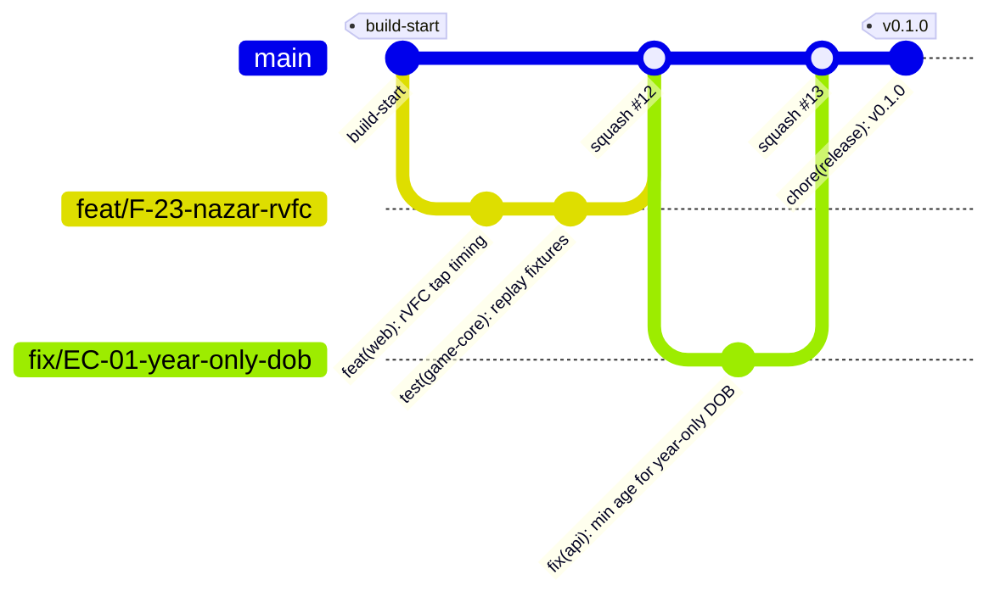

# Git Workflow
> Project: Margdarshak · Owner: Tech lead · Status: Draft v0.1 · Last updated: 2026-10-23
> Related: [Project Brief](../00-overview/PROJECT_BRIEF.md) · [Coding Standards](CODING_STANDARDS.md) · [Testing](TESTING.md) · [CI/CD](../05-ops/CICD.md) · [Deployment](../05-ops/DEPLOYMENT.md) · [Environment Setup](ENVIRONMENT_SETUP.md) · [Hackathon Plan](../08-project/IMPLEMENTATION_PLAN.md)

---

## 0. The hackathon rule that overrides everything (R-14)
The HackCache '26 start time is disputed (Fri 00:00 vs Fri 21:30 IST, PROJECT_BRIEF §14). **No application code is committed and no participant data is collected before the confirmed start.** Bible documents and config skeletons (this repo's `docs/`, root config files) are planning artefacts.
- The first commit after the confirmed start is tagged `build-start` and its timestamp is shown in the README.
- Every commit after that is pushed within 30 minutes (no local-only history that could look back-dated).
- Never rewrite published history (`git push --force` to `main` is blocked).

---

## 1. Repository shape: one monorepo, two package managers

| Ecosystem | Tool | Workspace definition | Lockfile |
|---|---|---|---|
| TypeScript (apps, packages, score verifier) | **pnpm 12.15.0** (via Corepack, pinned by `packageManager` in root `package.json`) | `pnpm-workspace.yaml`: `apps/*`, `packages/*`, `services/score-verifier`, `tests/e2e` | `pnpm-lock.yaml` |
| Python (API, workflows, scripts) | **uv 0.13.5** | `services/api/pyproject.toml` (project `margdarshak-api`); `services/workflows` depends on it via a `[tool.uv.sources]` path entry | `services/api/uv.lock`, `services/workflows/uv.lock` |

Root scripts orchestrate both (`pnpm dev`, `pnpm test`, `pnpm lint` call `uv run …` for Python). See the root `package.json`.

```
margdarshak/
├── apps/web, apps/console           (pnpm)
├── packages/ui, game-core, rules, api-client (pnpm)
├── services/score-verifier          (pnpm)
├── services/api, services/workflows (uv)
├── rulepacks/                       (data, versioned with CalVer per pack)
├── api/openapi.yaml                 (contract; generated clients committed)
├── ai/prompts, ai/evals             (versioned prompts + eval sets)
├── n8n/                             (exported workflow JSON, credentials excluded)
├── infra/ (render.yaml, docker), tests/ (e2e, load, security), scripts/
└── docs/
```

---

## 2. Branching: trunk-based



- **`main` is always deployable.** Render auto-deploys `main` to the hackathon environment after CI is green.
- Branches live **≤ 1 day** in Phase 1–2 (≤ 3 days in Phase 3+). Integrate small; hide unfinished work behind tenant feature flags, not long branches.
- No `develop` or release branches. Hotfixes are normal short branches off `main`.
- Rebase your branch on `main` before merge (`git pull --rebase`); merge via **squash** so each PR is one Conventional Commit on `main`.

### 2.1 Branch naming
`<type>/<id>-<slug>` where `<type>` matches the Conventional Commit type and `<id>` is a PROJECT_BRIEF/backlog ID when one exists.

| Example | Use |
|---|---|
| `feat/F-02-plan-card` | feature |
| `fix/EC-09-payment-pending-copy` | bug / edge case |
| `test/EC-01-EC-30-golden` | tests only |
| `chore/deps-renovate-2026-10-26` | tooling |
| `docs/adr-0006-job-runner` | docs |
| `rules/JK-2026.10.1-retest-gap` | rule-pack change (goes through the studio's maker-checker too) |
| `ai/debrief-prompt-v3` | prompt change (eval gate) |

---

## 3. Conventional Commits

Format: `<type>(<scope>)!?: <summary in imperative, ≤ 72 chars>` + optional body + footers.

| Type | When |
|---|---|
| `feat` | user-visible capability |
| `fix` | bug or edge-case handling |
| `perf` | performance without behaviour change |
| `refactor` | internal change without behaviour change |
| `test` | tests only |
| `docs` | documentation only |
| `build` | build system, dependencies |
| `ci` | GitHub Actions |
| `chore` | everything else (tooling, housekeeping) |
| `rules` | rule-pack data change (custom type; triggers the golden suite and the public rules changelog) |
| `ai` | prompt / agent config / eval set change (custom type; triggers evals) |
| `revert` | reverts |

**Scopes** (closed list, enforced by commitlint): `web`, `console`, `ui`, `game-core`, `rules`, `api-client`, `api`, `workflows`, `verifier`, `rulepacks`, `ai`, `n8n`, `infra`, `e2e`, `load`, `docs`, `deps`, `repo`.

**Footers**: `Refs: F-23, EC-18` (IDs from PROJECT_BRIEF), `BREAKING CHANGE: …`, `Co-Authored-By: …`.

Examples:
```
feat(web): score Nazar taps on media time via requestVideoFrameCallback

Taps are mapped to the last presented frame's mediaTime so buffering cannot
shift the score. Falls back to currentTime with timingMode=fallback.

Refs: F-23, EC-18
```
```
rules(rulepacks): JK 2026.10.1 — mark transport LMV prerequisite as verify

Refs: D-05, D-25, EC-06
```

`commitlint.config.cjs` extends `@commitlint/config-conventional` 21.2.4 with the custom types and the scope enum; `lefthook` runs it on `commit-msg`.

---

## 4. Pull requests

### 4.1 Rules
- Every change to `main` goes through a PR (branch protection: required checks, 1 approval in Phase 1–2, 2 for protected paths in Phase 3+, linear history, no force push, conversation resolution required).
- PR title = the squash commit message (Conventional Commit format; checked by a CI job).
- Size target ≤ 400 changed lines excluding generated files and fixtures; larger PRs need a reason in the description.
- Generated files (`packages/api-client/src/schema.d.ts`, `packages/rules/src/generated/*`) must match their sources (CI regenerates and diffs).
- Draft PRs welcome; CI runs on drafts.

### 4.2 Required checks (names as they appear in GitHub; workflow YAML in [CI/CD](../05-ops/CICD.md))
| Check | What |
|---|---|
| `lint` | Biome, ESLint (Next rules), Ruff, wording/fact lints, commitlint on PR title |
| `typecheck` | `tsc --noEmit` all TS projects; `mypy --strict` |
| `unit` | Vitest (TS), pytest (Python) with coverage gates ([TESTING](TESTING.md) §10) |
| `golden` | rules + fees + journey golden suites (EC-01..EC-30) — required for any change under `rulepacks/`, `services/api/src/margdarshak/domain/` |
| `contract` | adapter contract tests (mock adapters always; real adapters on nightly) |
| `replay` | game-core determinism + replay fixtures (browser build vs score-verifier build) |
| `e2e` | Playwright + axe on the three deep slices (all stages on nightly) |
| `evals` | ADK eval sets for changed agents/prompts (`ai/**`, `adapters/outbound/ai/**`) |
| `size` | `size-limit` (Lite < 300 KB) + Lighthouse CI budget |
| `security` | `pnpm audit --prod`, `pip-audit`, `bandit`, `detect-secrets`, OpenAPI breaking-change diff |

### 4.3 PR template (`.github/pull_request_template.md`)
```markdown
## What and why
<!-- One paragraph. Link IDs: F-xx, EC-xx, D-xx, API-xx, E-xx, ADR-xxxx -->

Refs:

## How it was tested
- [ ] Unit / golden / contract / replay / e2e (tick what applies)
- [ ] Manually on a low-end Android (Chrome) or DevTools "Moto G Power" + Slow 3G
- [ ] Screen reader pass (TalkBack/VoiceOver) for changed screens

## Screenshots / recordings
<!-- en + hi, light + dark, Lite if affected -->

## Facts, privacy and safety
- [ ] No fee/age/date/score computed outside rules engine / case clock / game-core
- [ ] No ₹ literal, no banned wording (D-19)
- [ ] No new PII; or PRIVACY data inventory updated
- [ ] Under-18 gate respected (no AI, telemetry, streaks, squads)
- [ ] AI changes: eval suite green, no new tools that submit/pay/book

## Rollout
- [ ] Behind a feature flag: `<flag>` / not needed
- [ ] Migration: none / expand-only / contract (link plan)
- [ ] Docs / ADR updated

## Owner who can explain this module on stage (D-24)
@<handle>
```

### 4.4 Review expectations
- Reviewer responds within 2 hours during the hackathon build (within 1 working day in Phase 3+).
- Use the review checklist in [CODING_STANDARDS](CODING_STANDARDS.md) §10.
- "Approve with nits" is allowed; the author fixes nits before merge or files a follow-up with an owner and date.

---

## 5. CODEOWNERS (`.github/CODEOWNERS`)
Team handles are placeholders until the GitHub org/team names are fixed (owner: Tech lead, before `build-start`). Each line names the module owner who can explain it to the judges (D-24).

```
# Default
*                                   @margdarshak/tech-lead

# Frontend
/apps/web/                          @margdarshak/frontend
/apps/console/                      @margdarshak/frontend
/packages/ui/                       @margdarshak/frontend @margdarshak/design
/packages/api-client/               @margdarshak/frontend @margdarshak/backend

# Games
/packages/game-core/                @margdarshak/games
/services/score-verifier/           @margdarshak/games @margdarshak/backend
/apps/web/src/features/games/       @margdarshak/games

# Backend
/services/api/                      @margdarshak/backend
/services/api/src/margdarshak/domain/rules/   @margdarshak/backend @margdarshak/rules
/services/api/src/margdarshak/domain/fees/    @margdarshak/backend @margdarshak/rules
/services/workflows/                @margdarshak/backend
/api/openapi.yaml                   @margdarshak/backend @margdarshak/frontend

# Rules data (maker-checker also enforced in the studio)
/rulepacks/                         @margdarshak/rules
/packages/rules/                    @margdarshak/rules

# AI
/ai/                                @margdarshak/ai
/services/api/src/margdarshak/adapters/outbound/ai/   @margdarshak/ai

# Automation and infra
/n8n/                               @margdarshak/ops
/infra/                             @margdarshak/ops
/.github/                           @margdarshak/ops @margdarshak/tech-lead

# Compliance-sensitive docs
/docs/06-security-compliance/       @margdarshak/tech-lead @margdarshak/product
```

---

## 6. Versioning and release tags

### 6.1 What gets a version
| Artefact | Scheme | Example tag | Where recorded |
|---|---|---|---|
| Product (web + console + API, released together) | **SemVer** `vMAJOR.MINOR.PATCH` | `v0.1.0` | `CHANGELOG.md` (Keep a Changelog) |
| `@margdarshak/game-core` | SemVer; **`scoringVersion`** pinned per session | `game-core@1.2.0` | `packages/game-core/CHANGELOG.md` |
| Rule packs | **CalVer** `YYYY.MM.N` per pack | `rulepack/JK@2026.10.1` | `rulepacks/CHANGELOG.md` (public rules changelog, D-05 trust) |
| Prompts / agents | `v<N>` per agent | `ai/debrief@v3` | `ai/prompts/<agent>/CHANGELOG.md` with eval scores |
| OpenAPI | `info.version` follows product SemVer; breaking changes only in a new `/v2` path | — | `api/openapi.yaml` |
| Hackathon submission | fixed tag | `hackcache26-submission` | README + submission form |

### 6.2 How a release is cut
1. `main` green → the `release-please` GitHub Action (release-please 17.11.2, manifest mode, reading Conventional Commits) keeps a release PR open with version bumps and CHANGELOG entries. (`pnpm release` only prints this pointer; releases are never cut from a laptop.)
2. Merge the release PR → GitHub Actions creates the tag(s) and a GitHub Release, builds images, and deploys (see [DEPLOYMENT](../05-ops/DEPLOYMENT.md)).
3. Rule-pack tags are created by the rule-pack studio's publish step (after checker approval), not by humans.

SemVer meaning for the product: MAJOR = breaking API (`/v2`) or data contract; MINOR = new features (F-xx); PATCH = fixes. Pre-1.0 (`0.x`) during the hackathon and pilot.

### 6.3 Hackathon tags
| Tag | When |
|---|---|
| `build-start` | first commit after the confirmed start |
| `slice-a`, `slice-b`, `slice-c` | each deep slice is demo-ready (D-04) |
| `v0.1.0` | feature-complete for judging |
| `hackcache26-submission` | the exact commit behind the live URL and the video |

---

## 7. Dependencies and generated code
- Exact versions in `package.json` and `pyproject.toml` (see the files); lockfiles committed.
- Renovate (Phase 1–2: weekly, grouped, automerge for patch devDependencies only; Phase 3+: + security PRs immediately). Major upgrades of Next, React, HeroUI, Phaser, ADK, `render-sdk` require an ADR note.
- `pnpm gen:api` regenerates `packages/api-client` from `api/openapi.yaml`; `pnpm gen:rules` regenerates `packages/rules` types from `rulepacks/schema/`. CI fails on drift.
- Never commit: `.env*` (except `.env.example`), secrets, real participant data, raw (unblurred) clips, n8n credentials, model API keys. `detect-secrets` baseline is committed and must stay clean.

---

## 8. Large files and data
- Clips are **not** in Git. Raw clips stay on the curator's encrypted drive; blurred, published clips live in R2 (the pipeline's output). Git holds the clip manifest (IDs, hashes, hazard windows, licence CC-BY 4.0).
- Fixture media for tests (≤ 5 synthetic or CC0 clips, ≤ 2 MB each) live under `tests/fixtures/media/` and are tracked with Git LFS.
- Field-study exports never enter Git (pseudonymous sheet only, via n8n W14).

---

## 9. Hackathon build (Phase 1–2) vs Production (Phase 3+)
| Area | Phase 1–2 | Phase 3+ |
|---|---|---|
| Approvals | 1 reviewer (module owner) | 2 for `domain/`, `rulepacks/`, auth, AI prompts, infra |
| Deploy | Auto-deploy `main` to Render | Tag-based promotion dev → staging → prod; change advisory for state tenants |
| Signing | Not required | Signed commits and tags (Sigstore/gitsign), SBOM per release |
| Release cadence | As needed | Fortnightly; rule packs on their own cadence with notice to users (EC-27) |
| Branch life | ≤ 1 day | ≤ 3 days |
