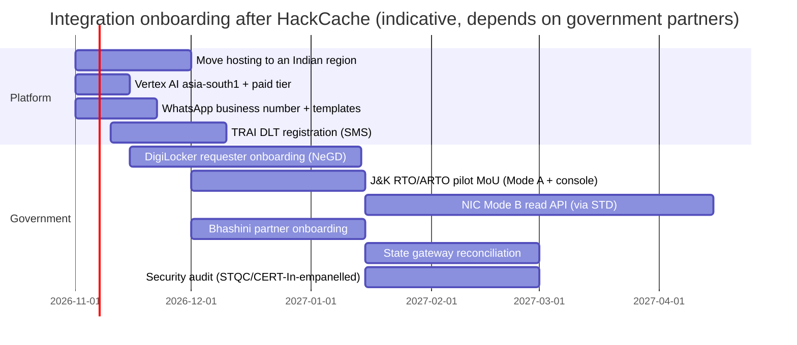

# Integrations
> Project: Margdarshak · Owner: Tech lead (Government Adapter Layer) · Status: Draft v0.1 · Last updated: 2026-10-23
> Related: [Architecture §5](ARCHITECTURE.md) · [Backend §3](BACKEND.md) · [API spec](API_SPEC.md) · [Tech stack](TECH_STACK.md) · [Data model](DATA_MODEL.md) · [ADR-0001](adr/ADR-0001-hexagonal-core-and-adapters.md) · [ADR-0008](adr/ADR-0008-no-aadhaar-data-handoff-to-sarathi.md) · Sources: `research/ps1-deep/07-govt-plug-and-play.md`, `war-room/margdarshak-verification.md` §3.1, `research/B-sponsors.md`, `research/ps1-deep/04-ai-adk-gemini.md`, `research/ps1-deep/08-game-ai-n8n.md`

**The honest line (D-02, D-03, G3).** Margdarshak is an independent prototype, not affiliated with MoRTH, NIC or any State Transport Department, and it runs on simulated government data. NIC's RTI reply of 16 Oct 2026 says data sharing with private entities was discontinued from 1 Oct 2026 ([IFF, 20 Oct 2026](https://internetfreedom.in/who-reads-your-vehicle-record-nic-gave-us-numbers-morth-gave-us-a-generic-webpage/)). Our design never needed it: every government system sits behind a port, the hackathon runs mock adapters, and the **government runs the real adapters** after adoption. We never scrape, never automate logins, never solve captchas and never build booking bots (D-08; IT Act s.43).

---

## 1. Status matrix
| # | System | Port | Hackathon status | Production path | Who must act | Blocking for demo? |
|---|---|---|---|---|---|---|
| 1 | **Sarathi** (NIC) | SarathiPort | **Mode A real today** (deep link to the public site + copy-pack template); everything else **mock** | Mode B: NIC-granted API via an STD + NIC MoU (`SarathiRealAdapter`) | State Transport Dept + NIC | no |
| 2 | **DigiLocker** (NeGD) | DigiLockerPort | **mock** (local OAuth+PKCE, real consent pattern) | Requester onboarding through NeGD by Nestiq Pvt Ltd, or the state's existing client ID | Nestiq / state + NeGD | no |
| 3 | **API Setu** | (catalogue) | not used | publisher-approved access to MoRTH APIs; register our core API as a provider if a state adopts | publisher (MoRTH/NIC), state | no |
| 4 | **Aadhaar offline** (Secure QR / Paperless XML) | AadhaarOfflinePort | **mock only** (synthetic samples) | runs through the **state's** OVSE service in government mode (brief F-56) | state | no |
| 5 | Aadhaar eKYC / OTP | — (none) | **never** — hand-off to Sarathi's own eKYC | stays inside Sarathi (government AUA) | — | — |
| 6 | **Bhashini** (ULCA / Dhruva) | BhashiniPort | **mock** | Bhashini onboarding under a state/MeitY partnership | Nestiq / state | no |
| 7 | **Payments** (Sarathi page, state gateway, PayGov) | PaymentPort | **redirect** to Sarathi (`PaymentRedirectAdapter`) + mock gateway | state gateway reconciliation by receipt number | state | no |
| 8 | **WhatsApp Cloud API** (Meta) | NotificationPort (via n8n) | **real, test number** (allow-listed recipients) | business number + approved templates per tenant | Nestiq / state | demo moment |
| 9 | Email | NotificationPort (via n8n) | real (n8n email node, provider [unverified], owner Platform lead, H+4) | transactional provider in India / state mail relay | Nestiq | no |
| 10 | Web push | NotificationPort | real (VAPID) | same | — | no |
| 11 | SMS (mGov / NIC / DLT) | NotificationPort | **not used** (roadmap until TRAI DLT) | DLT entity, headers and templates; mGov in government mode | Nestiq / state | no |
| 12 | Slots | SlotPort | **mock** (seeded, `sample_data`) + crowd intel relay | NIC slot read API after adoption | state + NIC | no |
| 13 | **Render Workflows** | `JobRunner` port | **real** (headline sponsor tech) | Temporal on the state cloud | team | yes |
| 14 | **n8n** | edge | **real** (Pro) | self-host or replace with a notifier service | team | yes |
| 15 | **Gemini API / ADK** | AgentRuntimePort, NarratorPort | **real** (paid tier before any real user) | Vertex AI `asia-south1` | team | partly (template fallback) |
| 16 | **Sarvam** (Saaras v3, Bulbul v3) | SpeechPort | real (Dogri voice-in, Hindi read-out) | same or Bhashini | team | no |
| 17 | **Cloudflare R2** | ObjectStorePort | real | S3-compatible store in India | team | yes (clips) |
| 18 | Google Sign-In | auth | real | + DigiLocker OAuth / Jan Parichay [unverified] | team | no |
| 19 | CPGRAMS, state ACB/vigilance, RTI | links only | static links and templates | same | user acts | no |
| 20 | UX4G design system | UI | tokens/skin | full UX4G components in government skin | team | no |

---

## 2. Government integrations

### 2.1 Sarathi (NIC) — SarathiPort
- **Purpose:** hand the user over to Sarathi for the steps that legally belong there (Aadhaar eKYC, OTP, payment, submission); later, read application status and test results.
- **What exists publicly:** NIC designs, develops and supports Sarathi ([Puducherry Transport](https://transport.py.gov.in/node/102)). The API Setu "transport" entry describes DL/RC **pull into DigiLocker**, not a third-party verification or write API ([apis.guru listing](https://apis.guru/apis/apisetu.gov.in/transport)). Sarathi's stack is unknown. Write APIs (LL application, slot booking, fee posting) are **NIC-internal / unknown** (`07` §A1).
- **Modes:**
  | Mode | Adapter | What it does | Status |
  |---|---|---|---|
  | mock | `SarathiMockAdapter` | in-memory statuses with a "simulated" chip | hackathon demo |
  | **A (deeplink)** | `SarathiDeeplinkAdapter` | opens `https://sarathi.parivahan.gov.in/` and shows an ordered copy-pack **template**; personal values (name, relation name, address) are filled on the device from the on-device vault (brief §15); `application_status` returns `Unknown` | **works today**, needs no permission |
  | **B (real)** | `SarathiRealAdapter` | NIC-granted API for prefill, status, results; contract in `api/adapters/sarathi.yaml` | after adoption |
- **Onboarding (Mode B):** (1) State Transport Department adopts Margdarshak (MoU, data-processor terms under the DPDP Act); (2) STD requests NIC for status/read APIs and confirms that Sarathi remains the system of record; (3) NIC implements or approves the server side of `api/adapters/sarathi.yaml` (or publishes on API Setu for publisher-approved access, §2.3); (4) our `SarathiRealAdapter` passes the contract suite against NIC's staging; (5) tenant config flips `sarathi: real` after maker-checker; (6) security audit before production hosting (GIGW 3.0 guideline 5.3.1, STQC/CERT-In-empanelled auditor; "audit-ready", never "certified").
- **Auth:** whatever NIC prescribes (mutual TLS + client credentials expected) [unverified; owner Tech lead, at MoU].
- **Data exchanged (Mode B):** application reference, stage code, test results per class, DL approval/dispatch status. Never Aadhaar data.
- **Failure handling:** outage (EC-11, e.g. the June 2026 Telangana outage in research) → adapter `health()` down → banner "Sarathi is not responding; your draft is saved", no retries against Sarathi, reminder rescheduled. Unknown status is a valid answer.
- **Cost:** none to us in Mode A; Mode B per MoU.

### 2.2 DigiLocker (NeGD) — DigiLockerPort
- **Purpose:** with the citizen's consent, pull the **issued DL** (`DRVLC`) to fill E-05 (classes, validity, renewal window) and to show a "your DL is in DigiLocker" pointer at S7.
- **Spec (verified in `07` §A2 from the DigiLocker Requester API Specification v1.12, Sept 2023):** OAuth 2.0 authorisation code with **PKCE S256 required** at `https://api.digitallocker.gov.in/public/oauth2/1/authorize` (`client_id`, `redirect_uri`, `code_challenge`, `code_challenge_method=S256`, optional `req_doctype=DRVLC`); token at `…/oauth2/1/token` (access token 3600 s, refresh token, `consent_valid_till`, `digilockerid`); files at `…/oauth2/2/files/issued`, `…/oauth2/1/file/uri`, `…/oauth2/1/xml/uri`; pull at `…/oauth2/1/pull/pulldocument` with explicit consent text; scope `partners.DRVLC`; issued URI pattern `in.gov.transport-DRVLC-<DL no.>`. Sources: [Requester spec v1.12](https://cf-media.api-setu.in/resources/Requester-APISpecification-V1_12.pdf), [Authorised Partner spec v1.11](https://img1.digitallocker.gov.in/assets/img/Digital%20Locker%20Authorized%20Partner%20API%20Specification%20v1.11.pdf).
- **Sandbox:** none reported by a third-party integrator; testing hits production with consenting staff accounts ([Sunbird RC note](https://rc.sunbird.org/use/integrations/digilocker-integration)).
- **Requester onboarding checklist (D-18; post-event, through Nestiq Private Limited):**
  1. Confirm eligibility: private organisations registered in India (Companies Act, MSME, Startup India, trusts and others) are eligible; requirements include demonstrable experience of online services to citizens and a senior authorised representative ([NeGD Partner SOP](https://cf-media.api-setu.in/resources/Partners-SOP.pdf), [Requester Terms of Use, Jun 2025](https://cf-media.api-setu.in/resources/DigiLocker-Terms-of-User-Requester-june-2025.pdf); verification §3.1 G2).
  2. Register on the API Setu / DigiLocker Partner Portal **from the organisation's own email domain**; nominate the authorised signatory.
  3. Submit use case (purpose: "show the citizen's own DL validity and classes to plan renewal or an added class"), doctypes `DRVLC`, data retention (facts only, document discarded), consent text, privacy policy, grievance officer.
  4. NeGD verification of the organisation and use case.
  5. Register `redirect_uri` (callback changes go through partners@digitalindia.gov.in per the onboarding FAQ, `07` §A2).
  6. Integrate per spec (PKCE, `state`, pull consent text); pass our DigiLockerPort contract suite against production with consenting staff.
  7. Test/audit by NeGD → go-live; accept the Requester ToU; record the client ID in the tenant config (`digilocker: requester`).
  8. Ongoing: revoke tokens after pull (`…/oauth2/1/revoke`), log consent artefacts (E-15), annual review.
  In **government mode** the state's existing DigiLocker client may be used instead.
- **Hackathon:** `DigiLockerMockAdapter` runs a local OAuth server with PKCE and a consent screen that shows the real pattern (purpose, documents, validity), labelled "simulated".
- **Data minimisation:** keep `classes`, validity dates, last 4 and an HMAC of the DL number; discard the XML/PDF.
- **Failure handling:** token or pull failure → "try again later or enter your DL dates" (manual path always available).
- **Cost:** none published for requesters [unverified; owner Tech lead, at onboarding].

### 2.3 API Setu
- **Purpose:** the government API exchange; access to a publisher's API is granted **only after the publisher approves** ([API Setu SOP](https://cdn.apisetu.gov.in/portal/assets/sop-apisetu-v0.pdf), [docs](https://docs.apisetu.gov.in/document-central/explore-apisetu/Overview.html)).
- **Our use:** none in the hackathon. After adoption: (a) request publisher approval for any MoRTH/NIC API the state agrees to expose (e.g. status read); (b) optionally register Margdarshak's core API (`api/openapi.yaml`) as a provider so other government apps (UMANG, mParivahan entry card) can consume plans and case status.
- **Onboarding steps:** organisation registration → API subscription request with purpose → publisher review and approval → credentials → integration → go-live.
- **Cost:** [unverified].

### 2.4 Aadhaar — offline only, never eKYC (AadhaarOfflinePort; ADR-0008)
- **Rule:** Margdarshak never collects an Aadhaar number, VID, OTP, biometrics or a face for matching (D-07). Private Aadhaar authentication requires Central Government approval under the Jan 2025 Good Governance amendment ([Scroll](https://scroll.in/latest/1078654/it-ministry-notifies-rules-allowing-private-entities-to-carry-out-aadhaar-authentication), [Khaitan](https://www.khaitanco.com/thought-leadership/Aadhaar-authentication-for-private-entities)) — SECONDARY, gazette not read.
- **eKYC:** happens **inside Sarathi** (the user's own contactless flow) in independent mode, and inside Sarathi via the state in government mode.
- **Offline verification (Secure QR / Paperless XML):** a separate route for Offline Verification Seeking Entities, with obligations ([UIDAI OVSE FAQ](https://uidai.gov.in/images/FAQ_OVSE.pdf), [UIDAI do's and don'ts](https://www.uidai.gov.in/images/DosandDon_ts_for_Offline_Verification_Seeking_entities.pdf)); a Dec 2025 commentary says regulated entities now apply under Reg. 13A ([Vinod Kothari](https://vinodkothari.com/2025/12/a-new-way-to-verify-aadhaar-offline-introduction-of-face-matching/)). Because these duties are real, the adapter is **mock-only in Margdarshak**; in government mode `AadhaarOfflineStateServiceAdapter` calls the **state's** service and receives only derived booleans (age band, address-state match, signature valid).
- **Mock behaviour (API-18):** synthetic UIDAI-format samples, signature check against a test key, retained fields `signature_valid`, `age_band`, `dob_precision`, `address_state_matches`, `reference_hash`; artefact and share code processed in memory and discarded.
- **Never sent to AI:** Aadhaar number, OTP, captcha, face. The PII gate (regex + Verhoeff) drops Aadhaar-like digits before any model call (EC-20).

### 2.5 Bhashini (ULCA / Dhruva) — BhashiniPort
- **Purpose:** government-preferred ASR, MT and TTS for state languages in government mode.
- **What is known:** ULCA is open source (MIT) ([GitHub](https://github.com/bhashini-dibd/ulca)); Bhashini exposes pre-trained models to ecosystem partners. The flow seen in community code (pipeline-config with `userId` + `ulcaApiKey` → inference endpoint on `dhruva-api.bhashini.gov.in`) is **[unverified]**; formal onboarding, quotas and ToS for private apps are **unknown** (`07` §A4). Dogri/Kashmiri speech coverage is unknown (`04` §1.9).
- **Onboarding steps (planned):** (1) register on the Bhashini/ULCA portal as an ecosystem partner (or under the adopting state's account); (2) obtain `userId` and API key; (3) list pipelines for the state's languages; (4) run our BhashiniPort contract suite (fixtures in hi, doi, ks) and a native-speaker review of outputs; (5) set `bhashini: dhruva` for the tenant.
- **Hackathon:** `BhashiniMockAdapter` returns reviewed strings; Dogri speech-in uses Sarvam Saaras (§3.6); Dogri screen text is authored offline with IndicTrans2 and reviewed.
- **Failure handling:** fall back to the reviewed static strings; voice falls back to text.

### 2.6 Government fees — PaymentPort (we never collect)
- **Facts:** transport fees are collected inside Parivahan/Sarathi via state-configured gateways (SBI ePay, state treasury such as GRAS/IFMS); the exact gateway per state is **unknown** (`07` §A5). PayGov India is MeitY's gateway run by NDML ([mgov PayGov PDF](https://mgov.gov.in/Resources/PayGov.pdf)).
- **Adapters:** `PaymentMockAdapter` (fake gateway page + HMAC callback to API-24), `PaymentRedirectAdapter` (deep link to Sarathi's fee page; hackathon default), `PaymentStateGatewayAdapter` (production: redirect + status by receipt/challan number).
- **State gateway onboarding steps:** (1) STD confirms the gateway and the reconciliation field (receipt/challan number); (2) gateway issues return-URL registration and a callback signing secret; (3) contract suite (signature, idempotent callbacks, `collected_by = state_gateway`); (4) go-live under the STD's merchant account — **never ours**.
- **EC-09 (debited but pending):** guidance "don't pay again; cancelling forfeits the fee", wait window from the rule pack, then a facts-only letter (API-45).
- **Fee display:** computed from `fees.json` in integer paise (one class 70000 + card 20000), "state charges may apply".

### 2.7 SMS — mGov / NIC and TRAI DLT (roadmap)
- SMS needs TRAI DLT registration of the entity, headers and templates (HUNCH in verification §3.1 G11; [unverified] specifics). Until then **no SMS** (D-16). In government mode the state's mGov/NIC gateway with DLT templates is used through `MgovSmsNotifier`.

### 2.8 Slots — SlotPort
- No public slot API is verified. Hackathon: `SlotMockAdapter` (seeded, `sample_data: true`) and `SlotCrowdIntelAdapter` (only moderated Live Intel "slots opened" reports, API-69). Production: `SlotRealAdapter` against a NIC read API after adoption. Never scrape or hold slots.

### 2.9 CPGRAMS, RTI, vigilance (links and templates only)
- Escalation letters and RTI Act 2005 s.6 templates are drafted from facts (API-45); **the user sends them**; we never log in to CPGRAMS (it needs their login/OTP). Corruption reports deep-link to the state ACB/vigilance and [CPGRAMS](https://pgportal.gov.in); we do not host allegations (D-14).

---

## 3. Platform and vendor integrations

### 3.1 Render Workflows (sponsor; `JobRunner` port)
- **Facts (B-sponsors §1):** public beta since 7 Apr 2026; per-run instances; chaining via `ctx.run()`; fan-out with `Promise.all` over `ctx.run()`; retries with exponential backoff (default 3); timeouts 30 s–24 h; runs over limits are queued; tasks reach other Render services on the private network but cannot receive inbound connections; **no cron, no documented sleep, no completion webhook**; Blueprint support since 16 Sep 2026; pricing `flex` $0.20/CPU-h + $0.05/GB-h (≈ $0.40/h cap), no charge when idle; root runs via API 50/min on Hobby.
- **SDK (tasks):** npm `@renderinc/sdk` **1.4.0**, TypeScript, in `services/workflows` (`@margdarshak/workflows`): `task({ name, retry: { maxRetries, waitDurationMs, backoffScaling }, timeoutSeconds, plan }, fn)`, `ctx.run(subtask, ...args)`; the task server starts automatically inside a Workflow service.
- **Starting runs (Go API):** there is no Go SDK, so `internal/jobs` calls Render's REST API directly: `POST https://api.render.com/v1/task-runs` with `Authorization: Bearer $RENDER_API_KEY` and `{"task": "<WORKFLOW_SLUG>/<task>", "input": [...], "idempotencyKey": "…"}` → `202` TaskRun; `GET /v1/task-runs/{taskRunId}` for status (`pending`, `running`, `succeeded`, `failed`, `canceled`, …); `DELETE` to cancel; SSE at `/v1/task-runs/events`. Endpoint shapes read from the SDK's generated schema (`@renderinc/sdk` 1.4.0, 2026-10-23).
- **Business steps:** each task calls the Go API over the private network with HMAC (`POST /internal/job-steps/{step}`, proposed); the workflows service holds no `DATABASE_URL`.
- **Setup:** `render login` → `render workflows dev -- pnpm --filter @margdarshak/workflows start` (local task server `http://localhost:8120`, CLI ≥ 2.12.0; the API uses it with `RENDER_USE_LOCAL_DEV=true`) → create the Workflow service (runtime `node`; dashboard or Blueprint) → set `RENDER_API_KEY`, `WORKFLOW_SLUG` and `JOB_RUNNER=render_workflows` on `mg-api`.
- **Tasks:** `clip_ingest` (headline, visible retry), `clip_finalize`, `case_clock_sweep` + `clock_batch`, `session_debrief`, `debrief_backfill`, `nightly_stats`, `rulepack_reevaluate`, `user_export`, `user_delete`, `replay_pending_sessions`.
- **Design consequences:** n8n Schedule → API-65/API-67 → `JobRunner` port (no cron); the two-rater wait lives in n8n W08 between `clip_ingest` and `clip_finalize` (no sleep); the API polls run status into `ops.job_runs` (no webhook).
- **Failure handling:** automatic retries; `JOB_RUNNER=inline` degraded mode (Go step handlers in a goroutine); idempotent job steps.
- **Cost:** a few dollars for the event; every participant has $50 in Render credits.

### 3.2 n8n (sponsor; the edge)
- **Plan:** Pro (perk) — €50/month annual list, ~10k executions/month, 20+ concurrent ([n8n pricing](https://n8n.io/pricing/)); keep under budget by batching.
- **Role:** schedules, WhatsApp/email, inbound replies, human approvals (send-and-wait), digests. **No business logic; never queries Postgres directly**; calls only `/internal/*` (API-65..69, 72, 73) with a service bearer token + HMAC, and receives signed webhooks from our outbox.
- **Workflows:** W1 clock tick, W2 milestones, W3 slot watch (API-69), W4 test eve, W5 parent card, W6 coach plan, W7 lead routing (API-73), **W08 clip review / two-rater wait (API-67 `clip_finalize`)**, W9 moderation (API-68), W10 fail follow-up, W11 letter approval (API-72), W12 alerts, W13 digest (API-71/53), W14 field-test capture, W15 rule-source freshness.
- **Setup:** import `n8n/workflows/*.json`; credentials created in the n8n vault (never in Git); set execution-data retention to minimal; PII limited to phone + first name of opted-in users.
- **Known issue:** reports of send-and-wait nodes not resuming on some channels ([n8n #13331](https://github.com/n8n-io/n8n/issues/13331)); fallback is our approval page calling the Wait node resume webhook.
- **Adoption:** self-host (check the Sustainable Use License for government use) or replace with a small notifier service; nothing in the core changes.

### 3.3 WhatsApp Cloud API (Meta) — via n8n
- **Endpoint:** `POST https://graph.facebook.com/{Version}/{Phone-Number-ID}/messages` with a Bearer token; supports text, media, interactive and **template** messages ([Meta reference](https://developers.facebook.com/docs/whatsapp/cloud-api/reference/messages), fetched 2026-10-23). Version pinned in the n8n credential [unverified which version; owner Platform lead, H+2].
- **Rules we follow:** business-initiated messages only with **pre-approved templates and user opt-in** (`whatsapp_updates` consent, E-15); ≤ 1 nudge/day; quiet hours 22:00–07:00 IST; STOP → opt-out within one message (EC-30).
- **Hackathon:** Meta test number reaches only allow-listed recipients (about 5, per B-sponsors §3, HUNCH) — enough for the demo; set up on Day 1 morning (30–60 min).
- **Templates:** `plan_card_v1`, `ll_day25_v1`, `ll_unlock_v1`, `ll_expiry_v1`, `test_eve_v1`, `retest_plan_v1` (no outcome words in the preview), `approval_chase_v1`, `parent_card_v1`, `slot_reported_v1`.
- **Cost:** per-message template pricing applies for production [unverified rates; owner Business lead, before launch].

### 3.4 Google Gemini API and ADK for Go (AI layer)
- **SDKs:** Google ADK for Go `google.golang.org/adk` **v1.9.0** (`Runner.Run`, `Runner.RunLive` for voice) and the Go Gemini SDK `google.golang.org/genai` **v1.76.0** (`genai.NewClient`, `client.Live.Connect`), in-process in the Go API; the offline clip-window proposer in the TS `clip_ingest` task uses `@google/genai`.
- **Access:** API key (Google AI Studio) for the hackathon; **paid tier before any real-user field test** because free-tier inputs may be human-reviewed ([Gemini API terms](https://ai.google.dev/gemini-api/terms)); the terms require users to be 18+ and restrict clients "likely to be accessed by" under-18s, so the **account holder is always an adult**; a learner aged 16–17 uses AI only inside the parent's account in family mode, with the parent's verifiable consent and no behavioural tracking or ads (D-13 revised; the legal question stays logged as R-13). Gemini data may be cached in any country, so the AI notice discloses cross-border processing (brief §11).
- **Models (env-pinned):** `gemini-3.1-flash-lite` (narration, tutor, coach), `gemini-3.8-flash` / `gemini-3.6-flash` (vision/video), `gemini-3.8-live` with `gemini-2.5-flash-native-audio-preview-12-2025` fallback (voice) — IDs and prices from `04` §1.5–1.7.
- **Safety:** set safety settings explicitly (`BLOCK_MEDIUM_AND_ABOVE` in `genai.GenerateContentConfig.SafetySettings`; default off on 2.5+); structured output with per-request enums; Gemini ignores `minLength/maxLength`, so code validates lengths.
- **Production:** Vertex AI `asia-south1` (Mumbai) with enterprise terms; Bhashini where coverage allows.
- **Cost:** ≈ $0.0012 (₹0.10) per debrief; voice ≈ $0.023/min (≈ ₹2/min, the dominant cost; capped 10 min/user/month on the free plan) (`08` §5.8, `04` §5).
- **Failure handling:** template-first UI; circuit breaker at > 20% fallback over 5 min; n8n W12 alert.

### 3.5 Sarvam (Saaras v3, Bulbul v3)
- **Saaras v3 speech-to-text** lists `doi-IN` and `ks-IN` ([Sarvam STT](https://www.sarvam.ai/apis/speech-to-text.md)); used for Dogri voice-in (M-08). **Bulbul v3 TTS** covers 11 languages, no Dogri or Kashmiri; ₹30 per 10k characters ([Sarvam TTS](https://www.sarvam.ai/apis/text-to-speech.md)); used for Hindi read-outs.
- **Access:** API key (`SARVAM_API_KEY`), called over REST from the Go API (`net/http`; Sarvam publishes no official Go SDK). Sarvam is a **disclosed processor** in the privacy notice. Audio is streamed, not stored.
- **Cost:** Saaras ≈ ₹30/hour (aggregator figure, **[unverified]**, owner AI lead, H+6).

### 3.6 Cloudflare R2 (object storage)
- **Buckets:** `mg-raw` (private; raw clips, bystander faces present → C3 until blurred; deleted 7 days after publish), `mg-media` (public; blurred clips, CC-BY 4.0, Range requests), `mg-private` (replays, exports; signed URLs ≤ 24 h).
- **Access:** S3 API via the AWS SDK for Go v2 (`github.com/aws/aws-sdk-go-v2/service/s3`) in the API and the AWS SDK for JavaScript in the Workflows tasks, with an access key scoped per bucket.
- **Cost:** $0.015/GB-month, Class A $4.50/M, Class B $0.36/M, **free egress**, free tier 10 GB-month ([R2 pricing](https://developers.cloudflare.com/r2/pricing/), fetched 2026-10-23). 100 clips × 2 renditions × ~3 MB ≈ 0.6 GB → within the free tier.
- **Production:** S3-compatible object store in India (CSP or MinIO).

### 3.7 Google Sign-In
- OIDC ID token verified server-side (`pyjwt` with Google's JWKS); only `sub` (hashed) and the email (encrypted contact) are kept. Never Aadhaar-OTP login.

### 3.8 Jan Parichay (production) [unverified]
- Government SSO for officer/console users and possibly citizens in government mode; integration details not verified (`07` adoption checklist). Owner Tech lead, at MoU.

### 3.9 UX4G
- MeitY/Digital India design system (GIGW-aligned components, npm package, Figma, Storybook; WCAG 2.1 AA) ([ux4g.gov.in](https://ux4g.gov.in/), [docs](https://doc.ux4g.gov.in/)). We ship a UX4G skin as token aliases over HeroUI; full components in government mode. Trust strip wording: "Designed to UX4G and GIGW 3.0 guidelines" (brief §15).

---

## 4. Onboarding timeline (post-event, indicative)

Dates are planning assumptions, not commitments; each depends on a government counterpart.

## 5. Contract tests and certification of an adapter
1. The adapter passes `tests/contract/<port>/` with its recorded synthetic cassettes in CI.
2. It passes the live suite against the partner's staging (or production with consenting staff accounts for DigiLocker).
3. Security review of the adapter (secrets, logging, PII) and a data-flow update in PRIVACY.
4. Maker-checker activation in `core.tenant_adapter_config` with `contract_suite_version` recorded.
5. Monitoring: adapter `health()` on API-64, alerting via W12.

## 6. Unverified items
| Item | Owner | Due |
|---|---|---|
| NIC auth pattern for a Mode B adapter | Tech lead | at MoU |
| DigiLocker requester fees / SLA | Tech lead | at onboarding |
| API Setu costs and provider registration steps for our API | Tech lead | Phase 3 |
| Bhashini endpoints, quotas, ToS, Dogri coverage | AI lead | 2026-12-01 |
| State fee gateway per state (J&K first) | Backend lead | at MoU |
| TRAI DLT specifics | Platform lead | 2026-11-10 |
| WhatsApp Graph API version and India template pricing | Platform lead / Business lead | H+2 / before launch |
| Email provider choice | Platform lead | H+4 |
| Saaras per-hour price | AI lead | H+6 |
| Jan Parichay integration | Tech lead | at MoU |
