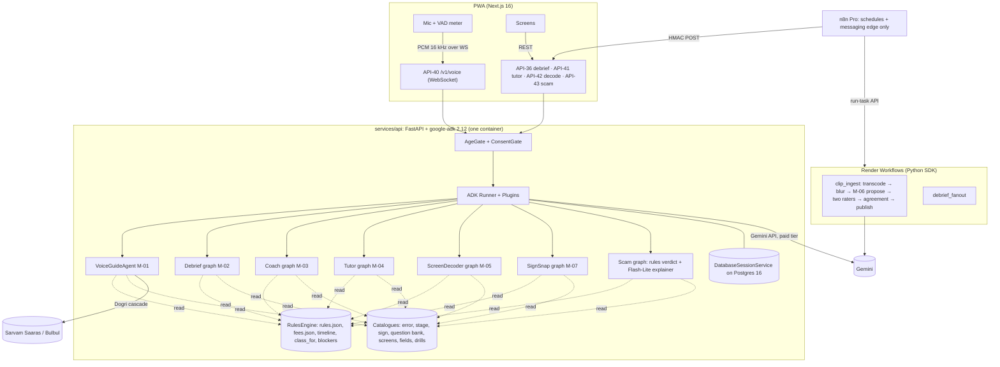
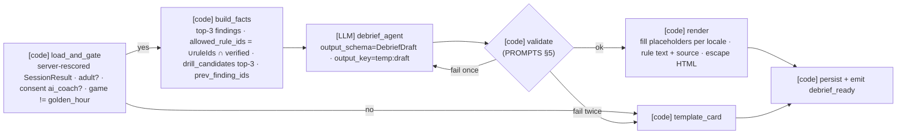
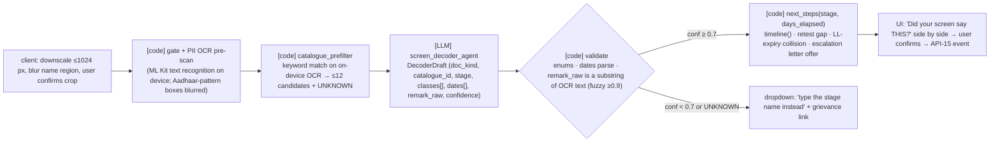
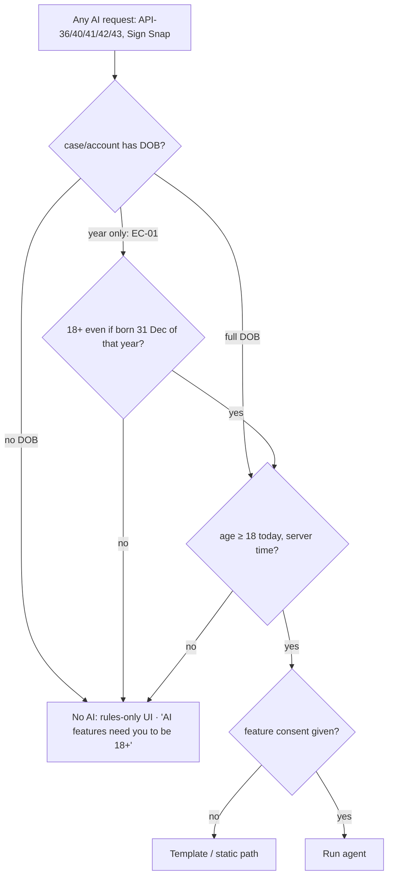

# AI Agents (Google ADK 2.x)
> Project: Margdarshak · Owner: AI lead (team Chanakya) · Status: Draft v0.1 · Last updated: 2026-10-23
> Related: [MODELS](MODELS.md) · [VOICE](VOICE.md) · [PROMPTS](PROMPTS.md) · [AI_EVALS](AI_EVALS.md) · [RESPONSIBLE_AI](RESPONSIBLE_AI.md) · [DATA_PIPELINE](DATA_PIPELINE.md) · [ARCHITECTURE](../03-engineering/ARCHITECTURE.md) · [API_SPEC](../03-engineering/API_SPEC.md) · [SECURITY](../06-security-compliance/SECURITY_ARCHITECTURE.md)
> Sources: 04 = `research/ps1-deep/04-ai-adk-gemini.md`; 08 = `research/ps1-deep/08-game-ai-n8n.md`; D-xx = council directives.

**API shapes.**
- Class and method names below are those cited in 04 from adk.dev: `LlmAgent`, `SequentialAgent`, `LoopAgent`, `ParallelAgent`, graph workflows, `output_schema`, `output_key`, `before_tool_callback`, `after_model_callback`, Plugins, `runner.run_live()`, `LiveRequestQueue`, `tool_context.state`, `EventActions.state_delta`, the state prefixes, `DatabaseSessionService`, `adk web` and `adk eval`.
- The **exact constructor signatures of the ADK 2.x graph API** (node and edge declaration) are **[unverified]**: 04 confirms graphs exist and mix deterministic nodes with LLM nodes, but doesn't quote the syntax.
- Graph code below is therefore pseudocode marked `# PSEUDO`. Owner: AI lead, confirm against https://adk.dev/workflows/ at H0.

---

## 1. Design stance

1. **ADK is used for its deterministic nodes, not for autonomy.**
   - "Deterministic graph nodes are the main reason to use ADK here" (04 §1.2).
   - In every graph, the rules engine, fee calculator, scorers and validators are plain code nodes, and the LLM is one node.
2. **One backend, small agents.** Every agent runs in-process inside `services/api` (Python 3.12, FastAPI, `google-adk==2.12.0`) (04 §2; D-17).
3. **Closed outputs.** Every agent that "states a fact" returns an ID from an enum built **for that request**. User-facing fact text comes from `rules.json`, `error_catalogue.json`, `sign_catalogue.json` or the reviewed question bank, never from model prose (04 §2 guardrail 1).
4. **Number provenance.**
   - Any ₹ amount, day count, age, distance, time or percentage in model text must appear in that turn's tool results or injected facts. Otherwise the message is replaced by the rule card or template (04 §2 guardrail 2).
   - Debrief, coach and tutor go further: **no digits at all** outside `{{fact:key}}` placeholders (08 §5.5).
5. **Unknown is a first-class answer.** Every enum includes `UNKNOWN`, and the UI then says who decides (04 §2 guardrail 3).
6. **No ADK memory service.**
   - The case file is structured state in our Postgres database, exposed read-only to agents as `user:` state.
   - No free-text memory means the model cannot "remember" a wrong fee (04 §1.4).
7. **Adults only.** An `AgeGate` runs before any runner is invoked (§7).

---

## 2. Runtime layout



### 2.1 Runner-level plugins

Order matters: they wrap every agent.

| # | Plugin | Kind | Hook(s) | What it does | Fires on |
|---|---|---|---|---|---|
| P1 | `AgeConsentPlugin` | ours | before run | Re-checks `user:age_band == "adult"` and the feature consent (`ai_coach`, `voice`, `voice_fill`, `decoder`, `sign_snap`). Belt and braces behind the HTTP `AgeGate` | all |
| P2 | **ADK PII Redaction plugin** | ADK (04 §1.8, adk.dev/safety) | before model | Redacts PII patterns in text parts | all text paths |
| P3 | `PiiGatePlugin` | ours | before model; on Live input transcription | Regex + **Verhoeff** check for 12-digit Aadhaar (spaced or not); 4–8-digit OTP-like tokens when an OTP context word is near (`OTP`, `ओटीपी`, `code`, `password`); 10-digit Indian mobile; PAN `[A-Z]{5}[0-9]{4}[A-Z]`; DL-number pattern `[A-Z]{2}[ -]?\d{2}[ /-]?\d{4,11}`; application numbers of 10/15/16/20 digits (01-sarathi §G lengths). Hit → **drop the span**, set `temp:pii_hit = <kind>` and inject the canned reply `PII_REFUSAL` (EC-20) | M-01, M-05 (OCR text), scam paste |
| P4 | `JailbreakJudgePlugin` | ours (04: "Gemini as judge" Flash-Lite screen) | before model, **only on untrusted user free text** (scam paste, commentary transcript, voice transcript) | One Flash-Lite classification `{injection: bool, category: enum}`; true → strip and answer from the template | M-01, scam, commentary |
| P5 | `ProvenancePlugin` | ours | after model (`after_model_callback`) | Extracts numbers (Latin and Devanagari digits, number words in en/hi such as "पचास" and "fifty", ₹, "days", "दिन", "km/h", "%", "साल"). Each must be ∈ `temp:tool_numbers` (filled by `after_tool_callback` and the injected facts). Fail → replace with the rule card / template and log `provenance_block` | M-01, M-05, scam |
| P6 | `SchemaValidatorPlugin` | ours | after model, for structured agents | Pydantic parse, enum membership, lengths (Gemini ignores `maxLength`, 04 §1.3), no-digit rule, placeholder existence, tone lint, script ratio; one retry with the error list, then template | M-02/03/04/05/07 |
| P7 | `AuditPlugin` | ours | after run | Writes an `AuditLog` (E-30) row with agent, prompt version, model ID, latency, token counts, validator verdict, fallback reason and IDs chosen. **Never prompt or response text** | all |
| P8 | `CostGuardPlugin` | ours | before model | Per-user monthly caps (voice minutes, vision calls); over cap → text fallback / dropdown | M-01, M-05, M-07 |

**Gemini safety settings.**
- Set explicitly on every model config: `BLOCK_MEDIUM_AND_ABOVE` on harassment, hate_speech, sexually_explicit, dangerous_content and jailbreak.
- The default is OFF for 2.5+ (04 §1.8).
- A blocked call returns HTTP 400 with code `safety` or `jailbreak`. We map it to `fallback_reason = "provider_safety"` and use the template.

### 2.2 Agent-level callbacks used across agents

| Callback | Used by | Purpose |
|---|---|---|
| `before_tool_callback` | M-01 | Deterministic validators: PIN code (6 digits, valid for the state), DOB band, RTO code ∈ `rto.json`, class ∈ `class_for(vehicle)`, `screen_id`/`field_id` ∈ allowlists. Reject → an error message back to the model (04 §3.1) |
| `after_tool_callback` | M-01 | Appends every number in a tool result to `temp:tool_numbers` for P5 |
| `before_model_callback` | all | Injects `{locale}`, trims history to the last 6 turns in text mode, adds `prompt_version` to the span |
| `after_model_callback` | all | P5/P6 (implemented as plugins so they apply uniformly) |

---

## 3. Agents

Common fields for every agent: purpose · instruction summary (full text in `ai/prompts/`) · tools with signatures · state · callbacks · graph · failure modes · eval.

### 3.1 VoiceGuideAgent (M-01)

**Purpose.**
- Voice navigation and field-fill inside Margdarshak for adults (F-30).
- Read rule cards and the rendered debrief aloud.
- It never submits, pays or books on Sarathi: there is no integration, and saying so is part of the honesty pitch (04 §3.1).

**Instruction summary** (`ai/prompts/voice_guide_agent.md`, `PRM-VOICE` v1.0.0):
- calm, short sentences in the user's language (Hindi, English, Hinglish; others are refused politely);
- confirm before any big jump ("I'm opening *Slot booking guide*, right?");
- fill only fields in the enum, read back in both scripts, wait for a tap or "haan";
- answer rule questions only via `get_rule` and say the source;
- if asked to pay, submit, book, or give Aadhaar/OTP, decline with the canned line and offer the hand-off screen.

**Type.** An `LlmAgent` run under `runner.run_live()` with a `LiveRequestQueue` (bidi, so interruption works, 04 §1.5). Text mode uses the same agent with `MD_MODEL_TEXT_LITE`.

**Tools (function tools; all idempotent because barge-in discards pending calls):**

```python
from typing import Literal
from google.adk.tools import ToolContext

ScreenId = Literal[  # 30 destinations; catalogue in VOICE.md §4.1
  "SCR_HOME","SCR_PLAN","SCR_PLAN_RESULT","SCR_CLASS_PLANNER","SCR_BLOCKERS",
  "SCR_LL_APPLY","SCR_PHOTO_FIXER","SCR_CHECK_ANSWERS","SCR_HANDOFF_SARATHI","SCR_TRACKER",
  "SCR_CASE_CLOCK","SCR_LEARN_HUB","SCR_LL_SIMULATOR","SCR_READINESS","SCR_NAZAR",
  "SCR_GAMES","SCR_SLOT_FINDER","SCR_RTO_INTEL","SCR_TRACK_EXPLAINER","SCR_TEST_DAY",
  "SCR_FAIL_RECOVER","SCR_APPROVAL_TRACKER","SCR_NEW_RIDER","SCR_RENEW_FIX","SCR_FAMILY_HELPER",
  "SCR_PRIVACY","SCR_SCAM_CHECK","SCR_DECODER","SCR_PRACTICE_RECORD","SCR_LANGUAGE"]

FieldId = Literal[  # 18 non-sensitive fields; NO Aadhaar, OTP, mobile, captcha, password, application/LL/DL numbers
  "FLD_FULL_NAME_LATIN","FLD_FULL_NAME_DEVANAGARI","FLD_RELATION_TYPE","FLD_RELATION_NAME",
  "FLD_DOB","FLD_GENDER","FLD_ADDR_LINE","FLD_ADDR_DISTRICT","FLD_ADDR_PIN","FLD_STATE",
  "FLD_RTO_CODE","FLD_VEHICLE_KIND","FLD_CLASSES","FLD_HAS_LL","FLD_LL_ISSUE_DATE",
  "FLD_AADHAAR_ADDR_MATCHES","FLD_TEST_DATE","FLD_LANGUAGE"]

def navigate(screen_id: ScreenId, tool_context: ToolContext) -> dict:
    """Open one Margdarshak screen. Large jumps need confirm(). Returns {ok, screen_id, title_en, title_hi, needs_confirm}."""

def set_field(field_id: FieldId, value: str, tool_context: ToolContext) -> dict:
    """Stage a value in temp:pending_fields (NOT saved). Validators run in before_tool_callback.
       Returns {ok, field_id, display_latin, display_devanagari, error_code?}."""

def read_back(tool_context: ToolContext) -> dict:
    """Return all pending fields for the agent to read aloud and the UI to show in both scripts."""

def confirm(field_ids: list[FieldId], tool_context: ToolContext) -> dict:
    """Only succeeds if the client sent a UI tap or the transcript has an affirmative within 10 s of read_back.
       Moves values from temp:pending_fields into the case via PATCH /v1/cases/{id} (API-12). Returns {ok, saved:[...]}."""

def get_rule(rule_id: str, tool_context: ToolContext) -> dict:
    """rule_id must be in temp:allowed_rule_ids (built from the current screen + case). Returns
       {rule_id, text_en, text_hi, value?, source_url, verified_on, verified} - verified:false rules return {error:'NOT_CITABLE'}."""

def lookup_screen(query: str, tool_context: ToolContext) -> dict:
    """Keyword/synonym search over screen titles + synonyms (hi/en/hinglish/doi). Returns top-3 {screen_id, score}. Deterministic."""

def read_debrief(session_id: str, tool_context: ToolContext) -> dict:
    """Return the RENDERED debrief card text (08 §5.2); the agent reads it verbatim."""

def open_drill(drill_id: str, tool_context: ToolContext) -> dict:
    """drill_id must be in the last debrief's drill_candidates. Navigates to the game level."""
```

**State.**

| Key | Scope | Content |
|---|---|---|
| `user:case_view` | user | `{stage: S0..S9, state_code, classes[], field_status{field_id: empty/filled}, age_band}`. **No field values** for name/DOB/address; the agent never needs them |
| `temp:pending_fields` | invocation | Staged values awaiting confirmation |
| `temp:allowed_rule_ids` | invocation | Built by code from the current screen and case |
| `temp:tool_numbers` | invocation | For P5 |
| `temp:pii_hit` | invocation | Set by P3 |
| `current_screen`, `last_debrief_id`, `turns_misunderstood` | session | UI sync and fallback logic |

**Callbacks.** `before_tool_callback` = validators (§2.2); `after_tool_callback` = number capture; Plugins P1–P8.

**Graph** (text and Dogri mode; Live mode runs the same LlmAgent with the same tools):

```
# PSEUDO (ADK 2.x graph API shape unverified)
voice_text_graph:
  [code] pii_gate            → if hit: emit PII_REFUSAL, end
  [code] synonym_router      → lookup_screen(query); if top score ≥ 0.85 and no slot values → navigate (no LLM)
  [LLM]  voice_guide_agent   → tools above
  [code] provenance_check    → P5
  [code] render_caption      → bilingual caption; Dogri screen text via IndicTrans2 (reviewed strings only)
```

**Live mode specifics.** Detail in [VOICE.md](VOICE.md).
- Barge-in: generation is cancelled, **pending function calls are discarded** and the server sends `interrupted`. On `interrupted`, re-read `temp:pending_fields` and `current_screen` before continuing.
- Session limits: 15 min audio-only; connection lifetime ~10 min. We enable context-window compression and **session resumption** and rotate the connection at 9 min [D] with a resumption handle (04 §1.5).
- VAD: automatic; `silenceDurationMs` 700 by default [D] (recommended 500–800 ms), raised to 800 in noisy mode; `prefixPaddingMs` 300 [D].
- Languages restricted through the system instruction, because native audio models take no language code (04 §1.5).

**Failure modes → guardrails.**

| Failure | Guardrail |
|---|---|
| Wrong destination | `needs_confirm` for any jump that leaves the current stage; spoken and visual confirm |
| Bad transliteration poisons the printout | Both scripts are shown and a tap is required (04 §3.1) |
| User speaks Aadhaar/OTP | P3 drops it: "Don't tell me this; type it only on parivahan.gov.in" (EC-20) |
| "Book my slot" / "pay for me" / "submit it" | Canned `CANNOT_ACT_ON_SARATHI` line + `navigate("SCR_HANDOFF_SARATHI")` or `SCR_SLOT_FINDER` |
| Invented fee or date in speech | P5 on the output transcription; mismatch → the on-screen rule card is authoritative, the event is logged, and the UI highlights the card |
| Live down / cap reached | Text mode → search box (EC-29) |

**Eval:** `ai/evals/voice_nav_30.jsonl` plus the 60-utterance recorded set (04 §3.1): `tool_trajectory_avg_score = 1.0` on `navigate`; slot exact-match ≥ 90% after confirmation; 100% refusal on banned intents.

---

### 3.2 DebriefAgent (M-02)

**Purpose.** Narrate the deterministic `SessionResult` as a four-part card (F-25).

**Instruction summary** (`ai/prompts/debrief_agent.md`, `PRM-DEBRIEF` v1.0.0):
- choose `finding_id`s from `{facts}`; the top-severity finding must appear;
- choose `rule_id`s only from `{allowed_rule_ids}` or `UNKNOWN`, and the drill from `{drill_candidates}`;
- **no digits**; use `{{fact:key}}` placeholders;
- warm, private, never shaming, no gore or death counts, no speed praise;
- the locale is `{locale}`.

**Tools: none.** All facts are injected through state, which avoids the reported `output_schema` + tools conflict (08 §5.2; re-check on 2.12).

**Graph** (ADK 2.x graph: deterministic nodes around one LLM node, 08 §5.3):



**State.**
- `facts`, `allowed_rule_ids`, `drill_candidates`, `locale`, `prev_finding_ids` (session).
- `temp:draft` (model output).
- `user:skill_summary` (node states from our DB, never free text).

**Commentary mode** (record, then score: D-12, F-25).
- An optional pre-node, `commentary_score`. The user records speech over a clip (adult, online, consent `commentary`).
- The audio is transcribed by `gemini-3.1-flash-lite` (audio in $0.50/1M), or by Saaras for Dogri.
- The transcript goes through P3 and P4 (untrusted).
- Then `[LLM] classify_mentions`, with structured output `[{hazard_type: enum, t_ms_approx}]`.
- Then `[code]` matching against the curator's hazard list → findings (`NAZ_COMMENTARY_MISSED`, `NAZ_COMMENTARY_LATE`, `NAZ_COMMENTARY_EARLY_GOOD`).
- The transcript is discarded after scoring; only the matched enum list is kept.

**Failure modes.**
- Digits or invented facts → validator → retry → template.
- A missing top finding → fail.
- Injection inside facts (e.g. a facts key named like an instruction) → keys are validated against the `FactKey` registry before the prompt is built; unknown keys are dropped and logged.

**Fan-out.** `debrief_fanout` (Render Workflow) runs one graph per scenario in parallel for multi-game sessions, retries on Gemini 429 with exponential backoff, assembles, and pushes the card via n8n (D §2.1, "build, don't headline").

**Eval.** `ai/evals/debrief_150.jsonl` (150 cases, 15 adversarial). Gates in [AI_EVALS §3](AI_EVALS.md).

---

### 3.3 CoachAgent (M-03)

**Purpose.** Weekly plan wording (F-26; n8n W6 Monday 07:00 → `POST /jobs/coach`).

**Graph:** `[code] plan_week` (FSRS due cards + staircase + goal) → `[code] gate` (adult, consent, opted into the channel, quiet hours) → `[LLM] coach_agent` (`CoachDraft`) → `[code] validate` (no digits, drill IDs ∈ allowed, banned nagging phrases) → `[code] render` → `[code] enqueue` (n8n sends).

**Tools:** none. **State:** `plan` (session), `temp:draft`.

**Instruction summary.**
- One headline.
- Plan items in the given order: the agent may reorder only within the same priority tier.
- One implementation-intention prompt.
- No guilt, no streak loss language, no comparison with friends.

**Eval:** 30 cases (`coach.evalset.json`, built from the debrief generator's skill summaries). Gates: schema 100%, banned-phrase 0, Hindi fluency ≥ 4/5.

---

### 3.4 TutorAgent (M-04)

**Purpose.** Explain *your* wrong answer from reviewed text (F-31, API-41). See [MODELS §M-04](MODELS.md#m-04-tutoragent-f-31-api-41) for the 04-vs-brief reconciliation.

**Graph.**

```
# PSEUDO
[code] load_item        → question, variant, options, correct, chosen, reviewed_explanations (status=approved only)
[code] gate             → adult & consent; if no approved explanation → return UNKNOWN card (no LLM)
[LLM]  tutor_agent      → TutorDraft (explanation_id enum, bridge_text, rule_id enum, calibration_note enum)
[code] validate         → enums, no digits, ≤200 chars, grounding-overlap check, banned phrases
[code] render           → reviewed explanation text (static) + bridge + rule card with source
```

**Tools:** none. **State:** `item` (session), `temp:draft`.

**Instruction summary.** Use only the provided explanation and option texts. Contrast the chosen option with the correct one in one or two sentences. If the user was 100% sure and wrong, add the `sure_and_wrong` note (calibration, 08 §4.5). Never add a new rule or number.

**Eval:** `ai/evals/tutor_30.jsonl`.

---

### 3.5 ScreenDecoderAgent (M-05)

**Purpose.** Sarathi status screenshot → stage and next step (F-32, API-42).

**Graph.**



**Tools:** none (the candidates are injected). **State:** `candidates`, `temp:draft`. Next steps are **code**: e.g. the 7-day retest gap and 6-month LL validity come from `rules.json` with source and `verified_on`.

**Privacy.**
- The app number may be extracted (it is the user's own data), but it stays in `user:case` and is **not logged** (04 §3.6).
- P3 redacts it from the span.

**Eval:** `ai/evals/decoder_30.jsonl` (+ the 40-string error set in 04 §3.2).

---

### 3.6 ClipWindowProposer (M-06): offline

**Purpose.** Propose hazard windows for the human raters (F-23). It is **not** an interactive agent.
- It is an `LlmAgent` invoked once per 5-min chunk inside the `clip_ingest` Render Workflow step `propose_windows`.
- A `LoopAgent` over chunks is optional (04 §3.4).

**Inputs:** File-API handle of the **blurred** clip; `start_offset`/`end_offset`; `fps: 2`; `media_resolution: low`.
**Output:** `ClipProposal` ([PROMPTS §3.5](PROMPTS.md#35-clipproposal-m-06)).
**Tools:** none.

**Post-node.** `[code] sanity`:
- windows inside the clip;
- `end > start`;
- length 1–10 s [D];
- `hazard_type ∈ enum`;
- de-duplicate overlaps with IoU > 0.6.

Then the clip goes to the rater queue (n8n W8). Detail in [DATA_PIPELINE §2](DATA_PIPELINE.md).

---

### 3.7 SignSnap (M-07)

**Graph:** `[code] gate + riding lock` → `[code] crop/downscale` → `[LLM] sign_snap` (`SignDraft`) → `[code] validate` (`sign_id ∈ catalogue ∪ UNKNOWN`) → confidence ≥ 0.75 → catalogue card + "add to deck" (FSRS); otherwise a top-3 picture chooser.

**Tools:** none. **Eval:** 30 photos across lighting, angle, occlusion and region (in `ai/evals/README.md` as `signsnap_30`, collected at H0; not yet in the repo).

---

### 3.8 Scam explainer (F-33; no M-ID in PROJECT_BRIEF, see Inconsistencies)

**Graph:** `[code] extract` (URLs, phones, UPI IDs, APK mentions, ₹ amounts) → `[code] verdict` (domain allowlist: `parivahan.gov.in` + subdomains, `*.gov.in`, `*.nic.in`, `digilocker.gov.in`; any `.apk` = never install; UPI-request rule; quoted fee vs `fees.json`) → `[LLM] scam_explainer` (`gemini-3.1-flash-lite`; may only **add** `red_flags: enum[]`) → `[code] render` (from flag templates).

- The verdict labels are **"On a government domain list"** / **"Not on our list: do not trust"** / **"Can't verify"**.
- The model can never produce a verdict, and the word "safe" is never shown (D-19).
- P4 always runs, because pasted messages may contain injection (04 §3.7).
- Eval: 50 messages (25 scam, 25 genuine Sarathi SMS); zero "on list" verdicts on scams (04 §3.7).

---

## 4. Graph workflows: the code + LLM pattern in one table

| Graph | Code nodes (deterministic) | LLM nodes | Human nodes |
|---|---|---|---|
| Voice (text/Dogri) | pii_gate, synonym_router, validators, provenance, caption | voice_guide_agent | User confirm tap |
| Debrief | load_and_gate, build_facts, validate, render, persist | debrief_agent (+ classify_mentions in commentary mode) | none at runtime; weekly human sample review (AI_EVALS §7) |
| Coach | plan_week, gate, validate, render, enqueue | coach_agent | none |
| Tutor | load_item, gate, validate (grounding), render | tutor_agent | Offline: explanation review (two-person) |
| Decoder | gate, prefilter, validate, next_steps | screen_decoder_agent | User confirms extracted values |
| Sign Snap | gate, riding lock, crop, validate | sign_snap | User picks from top-3 when unsure |
| Scam | extract, verdict, render | scam_explainer (flags only) | none |
| Clip ingest (Render Workflow) | transcode, blur, sanity, agreement, publish | clip_window_proposer | **Blur audit, rater 1, rater 2, adjudicator** |

Human-in-the-loop waits: ADK graph docs have a human-input page (04 §1.2). Long waits (hours to days) are held by **Render Workflows + n8n W8**, not by an open ADK invocation.

---

## 5. Session and memory policy

| Item | Policy |
|---|---|
| Session service | `DatabaseSessionService` on the same Postgres 16 (ADK offers InMemory, Database and VertexAi, 04 §1.4). InMemory in unit tests only |
| Session lifetime | Voice: the session ends on socket close or 15 min idle; the row is deleted after 24 h [D]. Debrief/tutor/decoder: one invocation per session; deleted after 24 h [D] |
| Transcripts | Kept only inside the session for captions and resumption. The user can switch the transcript off (the UI shows captions live but they are not persisted). Never exported to logs or analytics |
| `user:` state | A **read-only projection** of the case (`case_view`) and `skill_summary`, rebuilt from Postgres on each invocation. Agents never write `user:` state directly; writes go through API-12 after `confirm()` |
| `app:` state | Catalogue versions and prompt registry hashes (read-only) |
| `temp:` state | Pending fields, allowlists, tool numbers, drafts; gone after the invocation |
| Memory services | **None.** No `load_memory`/`preload_memory`, no Memory Bank, no RAG memory (04 §1.4 decision) |
| Deletion | `DELETE /v1/me` (API-62) and `DELETE /v1/cases/{id}` (API-17) cascade to ADK session rows and stored debriefs (EC-26) |
| Debrief storage | `Debrief` (E-19) stores finding IDs, chosen rule/drill IDs, rendered text, validator verdict and prompt version. The prompt input is kept ≤ 7 days for debugging [D], then dropped |

---

## 6. Deployment

### 6.1 Hackathon (Phase 1–2)

- The ADK `Runner` is created once per process at FastAPI start-up (`lifespan`), one per agent graph.
- It runs **in-process in `services/api`** on Render (Singapore region, synthetic data only; Render has no India region, D §3.1 G4).
- Uvicorn workers: 2 [D]. The WebSocket for API-40 is served by the same app. The instance is kept warm before judging (D §4 risk 5).
- `adk web` (port 8000) runs **only locally**, to show judges the trace ("not meant for use in production", 04 §1.6). The demo shows a recorded trace of the provenance guard firing.
- The ClipWindowProposer runs inside the Render Workflows task `propose_windows`, with the same package (`margdarshak_ai`) imported.

### 6.2 Cloud Run alternative

- 04 §1.6 picks **Cloud Run, one FastAPI container** (REST + WebSocket); Agent Runtime is needed only for Memory Bank, which we don't use.
- The same Docker image deploys to Cloud Run (asia-south1) with `--timeout=3600` for WebSockets and min-instances 1 [D].
- Use it when Render WebSocket behaviour or latency to Gemini is worse in the H0 measurement.
- Free-tier limits for Cloud Run and Agent Runtime: **not checked** (04 §6 Q6). Owner: infra lead.

### 6.3 Production (Phase 3+)

- A container on a MeitY-empanelled cloud or NIC.
- `GOOGLE_GENAI_USE_VERTEXAI=true`, with Vertex AI in an Indian region (**[unverified]** region; owner AI lead).
- Bhashini adapter (F-56 `BhashiniAdapter`) as the speech option where coverage is proven.
- The `JobRunner` interface replaces Render Workflows with a Celery/Temporal-style runner (D-17).

---

## 7. Under-18 gating



- **Server-side only.** The client flag is ignored. Age comes from the case DOB and server time, never the device clock (EC-15).
- **Year-only Aadhaar (EC-01):** we assume the **latest** possible birthday (31 Dec), so nobody under 18 slips through.
- **Under 18 (P-07 Rahul, EC-05):** no AI, no telemetry, no streaks, no squads, no account history (D-13). Debriefs are template-only and computed client-side; game sessions are not stored. API-40 refuses the WebSocket upgrade with close code 4403 `AI_U18`.
- **Turning 18 mid-journey:** AI unlocks on the birthday, with the consent screen shown again; there is no back-fill of past telemetry.
- **Helper mode (P-04, EC-14):** the gate checks the **applicant's** age, not the helper's. A helper operating a minor's case gets no AI.
- **Logging:** a gate refusal increments a counter only; no DOB is logged.

---

## 8. Hackathon build (Phase 1–2) vs production (Phase 3+)

| Area | Hackathon | Production |
|---|---|---|
| Agents shipped | Debrief (deep), Voice (Hindi/English, 8 destinations, 10 fields), Decoder (status screenshot), Scam explainer, Clip proposer, Tutor (thin), Coach (thin), Sign Snap (could) | All, plus Dogri cascade GA, paper-slip decoder after real samples, Kashmiri voice-in |
| Eval gate | ≥ 30 cases per agent in CI (D-10) | Plus the quarterly fairness audit and shadow eval on 1% of traffic |
| Sessions | Postgres, 24 h | Same, in an Indian region |
| Providers | Gemini Developer API (paid) + Sarvam | Vertex AI India + Bhashini/Sarvam under DPA |

## 9. Inconsistencies noted (reported, not fixed in PROJECT_BRIEF)

1. **TutorAgent (M-04):** 04 §3.5 rejects runtime tutor AI, while PROJECT_BRIEF lists M-04 as a runtime agent. Resolved here as selection plus a bridge over reviewed text only.
2. **Hosting:** 04 §1.6 picks Cloud Run; PROJECT_BRIEF §8 and D-17 say Render. Resolved as Render primary, Cloud Run alternative, same image. 08 §5.8 latency targets name "Cloud Run asia-south1" and are re-stated here as "server-side".
3. **Scam explainer (F-33)** and the **commentary transcription/classifier** (F-25 commentary mode) use Gemini but have **no M-ID** in PROJECT_BRIEF §10. Suggest adding M-10 (scam explainer, Flash-Lite) and M-11 (commentary classifier, Flash-Lite) to the brief.
4. **Golden Hour (G9) debrief:** 08 §5.9 includes all 10 games in the debrief evalset, but D-14 / council row 12 say golden-hour content takes no generative AI. Here G9 is template-only, and the eval cases for G9 expect `route = template`.
