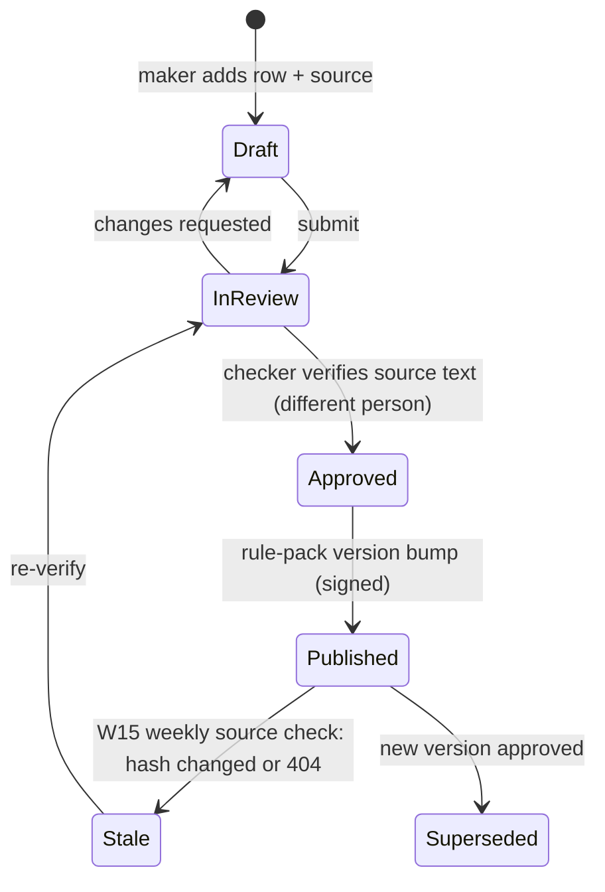
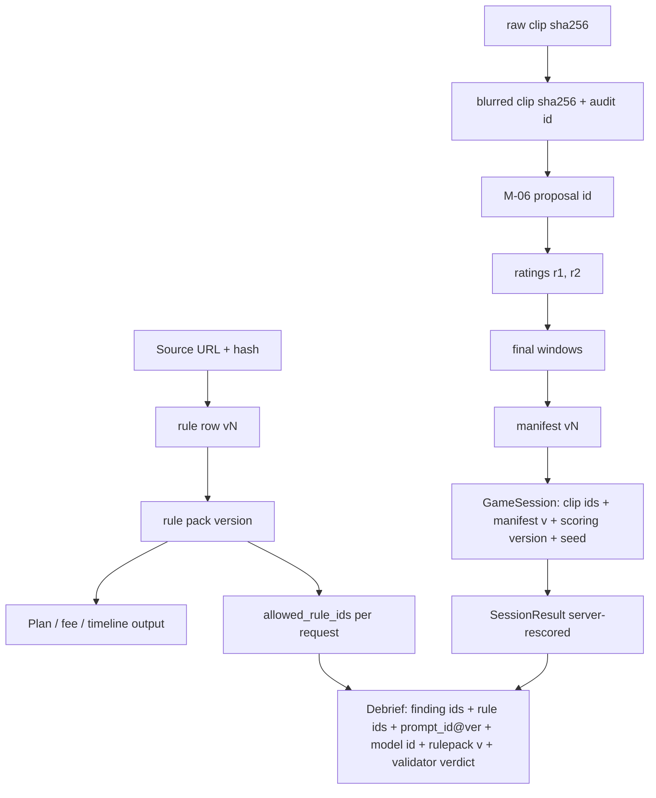

# Data Pipeline: clips, rules, catalogues, telemetry
> Project: Margdarshak · Owner: Pipeline lead (clips) + Rules lead (rule packs) + AI lead · Status: Draft v0.1 · Last updated: 2026-10-23
> Related: [MODELS §M-06, §M-09](MODELS.md) · [AGENTS §3.6](AGENTS.md) · [AI_EVALS](AI_EVALS.md) · [RESPONSIBLE_AI](RESPONSIBLE_AI.md) · [DATA_MODEL](../03-engineering/DATA_MODEL.md) · [PRIVACY / DPDP](../06-security-compliance/PRIVACY.md) · [N8N workflows](../05-ops/N8N_WORKFLOWS.md) · [HYPOTHESES](../08-project/FIELD_STUDY.md)
> Sources: 04 §3.4, §1.8; 08 §1.3 (offline), §2.3 (telemetry), §3 G1 (Nazar), §6 W8/W15; D-15 (headline Workflow), D-22, council §3.3 (data, safety), PROJECT_BRIEF M-06, M-09, E-08, E-16, E-17, E-20, E-21.

**The Render Workflows Python SDK API shape** (task decorators, retries, waiting on external events) is **[unverified]** in our research. Code below is `# PSEUDO`. Owner: Pipeline lead, confirm against the Render Workflows docs at H0 (the B-sponsors notes say Workflows has no cron, so n8n triggers runs via the run-task API).

---

## 1. Data sources and licences

| Source | Used for | Licence / terms | Notes |
|---|---|---|---|
| Team-filmed dashcam clips, J&K roads (passenger or fixed mount, **never the rider**: council §3.3) | Nazar clip bank (F-23, E-20) | **CC-BY 4.0** after blur (PROJECT_BRIEF §8) | Written consent and licence from each filmer; location granularity is the district only |
| Contributed clips (driving schools, volunteers) | Clip bank growth | Contributor signs a CC-BY 4.0 grant + warranty of no third-party rights | Phase 3+ |
| Third-party online clips | **Not used** unless the clip page carries an explicit CC-BY-compatible licence, recorded per clip | as stated | Default is no |
| MV Act 1988 (India Code), CMVR 1989, state notifications | `rules.json`, `fees.json` (E-08) | Government texts | Each row cites `source_url` + `verified_on`; tag `primary`/`secondary`/`MK` (04 §2) |
| `research/ps1-current-state/01-sarathi-screens.md` crawl (22 Oct 2026) | `error_catalogue.json`, `stage_catalogue.json` canonical strings | Quoted short strings for reference; no Sarathi content redistributed beyond those strings | Meanings and what-to-do texts are ours, reviewed |
| MoRTH *Road Accidents in India 2023* tables (via `02-accident-curriculum.md`) | Static, cited stats on cards (never AI-narrated) | Government publication | Cited by table number |
| LL syllabus and sign sets (per `02-rules-process.md`) | Question bank, sign catalogue | Government material; images we redraw are CC-BY 4.0 (ours) | Two-person review |
| AI4Bharat IndicTrans2 | Dogri/Hindi draft translations | Open model; licence **[unverified]** (owner AI lead, check the model card at H0) | Native review mandatory |
| MediaPipe Tasks Vision | Helmet Fit (M-09) | Apache-2.0 [K] | On device |
| YuNet face detector; plate detector | Blur (M-09) | Licence **[unverified]** (owner Pipeline lead, H0 + 4 h) | Worker-side |

---

## 2. Clip pipeline (headline Render Workflow)

D-15: "transcode → blur → propose → two raters → agreement → publish", with a **visible retry** for the Render Workflows prize.

### 2.1 Flow

```mermaid
flowchart LR
  UP["ingest<br/>upload to private R2 bucket · licence + consent form check · sha256"] --> TC["transcode<br/>ffmpeg → H.264 360p + 480p, ~1 min segments, AAC stripped"]
  TC --> BL["blur<br/>YuNet faces + plate detector per frame → Gaussian blur boxes (M-09)"]
  BL --> BA{"blur_audit (HUMAN)<br/>100% of frames at 2 fps contact sheet + scrub"}
  BA -->|miss found| BL
  BA -->|pass| DEL[delete raw upload]
  BA -->|pass| PW["propose_windows (M-06)<br/>File API · fps 2 · low res · 5-min chunks → ClipProposal"]
  PW -->|429 / 5xx| PW
  PW --> R1["await_rater_1 (HUMAN)<br/>curator UI: set onset/end by frame"]
  PW --> R2["await_rater_2 (HUMAN)<br/>independent, blind to rater 1"]
  R1 & R2 --> AG["compute_agreement<br/>match windows · Δonset · Δend · IoU"]
  AG -->|agree| FIN["finalise windows<br/>mean of raters, frame-snapped"]
  AG -->|disagree| ADJ["adjudicate (HUMAN, Nazar content lead)"]
  ADJ --> FIN
  FIN --> PUB["publish<br/>manifest entry · CDN warm · version bump"]
```



**Triggers.**
- n8n W8 fires on "new upload" (or the curator page webhook) and calls the Render run-task API.
- Human waits (hours to days) are held as Workflow waits resumed by our API when a rater submits. n8n sends the reminders (08 §6 W8).

### 2.2 Step details

| Step | Implementation | Retries | Output | Failure handling |
|---|---|---|---|---|
| `ingest` | Signed upload URL (R2, private); checks: container/codec, duration 20 s–15 min, the filmer's consent + CC-BY grant ID present, filmed-by ∈ {passenger, fixed_mount} | 3 × (exp backoff) | `clip_raw` row (E-20, status `ingested`) | Missing consent → reject + notify the uploader |
| `transcode` | `ffmpeg -c:v libx264 -preset veryfast -crf 26 -vf scale=-2:360` (+ 480p) `-an` (audio stripped: no bystander speech) | 3 | 360p/480p MP4s; target **≈ 1–2 MB/clip for Lite** and 3–5 MB at 480p (08 §1.3; council §3.2 #19) | ffmpeg error → `failed_transcode` |
| `blur` | YuNet face detector + plate detector each frame; boxes are expanded 20% [D] and Gaussian-blurred (σ high enough to defeat de-blurring) [D]; temporal smoothing (a box persists ±3 frames) | 2 | blurred MP4 + `blur_boxes.json` (box counts per frame) | GPU/CPU timeout → retry |
| `blur_audit` | **Human, 100%.** Contact sheet at 2 fps + scrub; the auditor marks misses → back to `blur` with manual boxes | n/a | `audit_pass` + auditor ID + time | Never skipped (PROJECT_BRIEF M-09; R-12) |
| delete raw | Raw upload and unblurred intermediates deleted from R2 within 24 h of `audit_pass` [D] | 3 | deletion receipt in AuditLog | Alert if not deleted in 48 h |
| `propose_windows` | M-06 (`gemini-3.8-flash`), see `ai/prompts/clip_window_proposer.md`; only **blurred** media is uploaded to the File API | **5 × exp backoff on 429/5xx** (the demo injects a 429 to show the retry on the Runs page: D-15) | `ClipProposal` per chunk, sanity-checked | All retries fail → raters start with no proposals (the pipeline continues) |
| `await_rater_1/2` | Curator UI (API-55): frame-accurate scrub (`requestVideoFrameCallback`), proposals shown as dashed hints that the rater must actively accept, move or delete; rater 2 doesn't see rater 1 | waits | `ClipRating` rows (E-21) | Reminder at 24 h and 72 h via n8n; reassign after 5 days [D] |
| `compute_agreement` | Code (§2.3) | n/a | agreement metrics | n/a |
| `adjudicate` | Third person; sees both raters plus the proposals | waits | final windows + reason code | n/a |
| `publish` | Writes the manifest entry `{clip_id, version, urls, sha256, bytes, hazards[{a_ms,b_ms,type}], difficulty_curator, region, road_type, time_of_day, licence:"CC-BY-4.0", blur_audit_id}` and warms the CDN | 3 | the manifest version (PWA "download practice pack" picks it up) | Rollback = previous manifest version |

```python
# PSEUDO - Render Workflows Python SDK shape unverified
@workflow(name="clip_ingest")
def clip_ingest(clip_id: str):
    raw = ingest(clip_id)                       # task, retries=3
    mp4 = transcode(raw)                        # task, retries=3
    blurred = blur(mp4)                         # task, retries=2
    audit = wait_for_event("blur_audit", clip_id)   # human; loops back to blur on miss
    delete_raw(raw)
    proposals = propose_windows(blurred)        # task, retries=5, backoff on 429
    r1, r2 = wait_for_event("rating", clip_id, rater=1), wait_for_event("rating", clip_id, rater=2)
    agreement = compute_agreement(r1, r2)
    final = agreement.final if agreement.ok else wait_for_event("adjudication", clip_id)
    publish(clip_id, final, audit)
```

### 2.3 Two-rater agreement (code)

**Matching.** Rater 1 and rater 2 windows are matched greedily by IoU (temporal intersection over union). IoU ≥ 0.3 counts as "same hazard" [D].

**A matched hazard agrees when [D]:**
- |Δonset| ≤ 0.5 s;
- |Δend| ≤ 1.0 s;
- the same `hazard_type`.

(The 0.5 s bound sits well inside the 5-band scoring granularity of a typical window. Bands are window/5 wide, 08 G1.)

**A clip is accepted without adjudication when:**
- every hazard is matched and agrees;
- the clip has ≤ 2 hazards (Kerala format: up to 2 per clip, 08 G1).

**Final window:**
- onset `a` = the mean of the raters' onsets, snapped to the nearest frame;
- end `b` = the mean of the ends.

The scoring bands are computed from `[a, b]` (08 G1: 5 equal bands; 5/4/3/2/1 points).

**Reported per clip and for the bank** (inter-rater Δ; council D-22):
- mean |Δonset|, mean |Δend|, IoU;
- κ on hazard presence per 1-second bin;
- target median |Δonset| ≤ 0.4 s [D].

**Proposer quality** (M-06 eval):
- recall = share of final hazards that had a proposal with IoU ≥ 0.3 (target ≥ 80%, 04 §3.4);
- median |proposal onset − final onset|;
- false-proposal rate.

### 2.4 Bank composition targets

| Item | Hackathon (Phase 1–2) | Production (Phase 3+) |
|---|---|---|
| Published clips | **≥ 30** [D]. Fewer than **12 usable by Fri 12:00** triggers the Ruko backup plan (council §4) | ≥ 300; ≥ 10 per hazard type; per-state packs |
| Hazard mix | ≥ 4 types incl. bus-stop pedestrian, two-wheeler/auto cut-in, cattle, door opening | All 11 enum types |
| Road types | city arterial, market street, highway (NH44), hill road | + rural, night, rain, fog |
| Time of day | day ≥ 70%, dusk/night ≥ 20% | Balanced to the crash data (night 42%, 02) |
| POV | two-wheeler and car | + bus/truck cab views for the blind-spot module |

### 2.5 Clip QA checklist (blocks publish)

- [ ] Faces and plates blurred on 100% of frames (auditor signed).
- [ ] No audio track.
- [ ] No identifiable shop signboards with phone numbers [D]; blur if present.
- [ ] Filmed by a passenger or fixed mount (field present).
- [ ] ≤ 2 hazards; windows agreed or adjudicated.
- [ ] No crash footage, injuries or gore (05: fear appeals backfire; D-11).
- [ ] Flash/glare check: no more than 3 flashes per second (WCAG 2.3.1; D-21), or the clip carries a warning and is excluded from the default set.
- [ ] Bytes within budget (Lite ≤ 2 MB).
- [ ] Licence CC-BY 4.0 recorded, with the contributor credit string.

### 2.6 Difficulty calibration (after publish)

- Curator difficulty 1–5 at publish. Empirical difficulty = the mean band achieved by adult users on **unseen** mock attempts with trust ≥ 0.6. It is recomputed nightly by the field-stats Workflow (D-15) and shown once n ≥ 30 attempts [D].
- Clips whose false-alarm rate is > 2× the bank median are flagged for review (an ambiguous hazard).
- This calibrated difficulty per clip is part of the moat (PROJECT_BRIEF §3).

---

## 3. Rules-table provenance (rule packs, F-42, E-08)

### 3.1 Schema (per row)

```json
{
  "rule_id": "RUL.LL.VALIDITY",
  "state": "*",
  "area": "LL",
  "text_en": "A learner's licence is valid for {value}.",
  "text_hi": "लर्नर लाइसेंस {value} तक मान्य है।",
  "text_doi": null,
  "value": { "months": 6 },
  "source_url": "<URL from 02-rules-process.md>",
  "source_tag": "primary | secondary | MK",
  "verified_on": "2026-10-22",
  "verified": true,
  "confidence": "high | medium | low",
  "maker": "rules-lead", "checker": "product-lead", "approved_at": "2026-10-23T10:00:00+05:30",
  "version": "jk-2026.10.1",
  "supersedes": null
}
```

- `fees.json` uses the same shape, with line items from CMVR r.32. One class = LL ₹150 + LL test ₹50 + DL test ₹300 + DL ₹200 = **₹700**, plus a ₹200 smart card; a second class adds about ₹450. "checked 22 Oct 2026" (PROJECT_BRIEF; D-06). The UI computes totals; no rupee literal is hard-coded anywhere.
- `verified:false` rows can drive game content labels, but **can't be cited by any AI agent** (08 §3.12).

### 3.2 Lifecycle



- **Maker-checker** in the rule-pack studio (API-54). The checker must differ from the maker.
- **Freshness:** n8n W15 runs weekly, fetches each `source_url`, hashes it, and opens a review task when the source changes or 404s (08 §6 W15).
- **Mid-case changes (EC-27):** on publish, cases whose computed plan changes get a notice ("A rule changed on <date>: here's what's different"). Old plan versions are kept for audit.
- **AI coupling:** every debrief/voice/tutor output stores `rulepack_version`. Eval fixtures pin a version.

### 3.3 Catalogues with the same provenance discipline

| Catalogue | Owner | Review | Used by |
|---|---|---|---|
| `error_catalogue.json`, `stage_catalogue.json` (~30 entries, 04 §3.2) | AI lead | Two-person; canonical strings copied verbatim from observed pages | M-05 |
| `sign_catalogue.json` | Learning lead | Two-person; image licence per sign | M-07, Learn hub |
| Question bank + reviewed explanations (≈ 100 questions × 3–6 variants) | Learning lead | Draft by `gemini-3.8-flash` offline → **human check against the source rule** → `status: approved` (04 §3.5) | M-04, LL simulator |
| Debrief templates (`finding_id` × en/hi/doi) | Learning lead + Dogri reviewer | Two-person; Dogri native review | Template fallback (08 §5.6) |
| Screen and field synonyms (hi/en/hinglish/doi) | Design lead | Native review for doi | `lookup_screen` |

### 3.4 No RAG, no vector store (decision)

- **We don't retrieve free text for the model.** Every fact source is a small, closed, versioned catalogue (tens to hundreds of rows), passed as **IDs plus canonical strings** per request.
- Candidate prefiltering for the decoder is a keyword/fuzzy match (rapidfuzz) on on-device OCR text, which is enough at ~30 entries.
- **Why:**
  - RAG over long documents invites paraphrased "rules", the failure we designed out (04 §2);
  - closed catalogues make evals exact.
- **Production:** if the error catalogue grows past ~500 entries, add pgvector embeddings for prefiltering only. The model still outputs a catalogue ID.

---

## 4. Telemetry minimisation (E-16, E-17; F-55)

### 4.1 What is collected (adults only)

- `GameEvent` envelope (08 §2.2): `sid, seq, t, mt, type, p`.
  - The `type` enum is closed (29 types).
  - Payloads are typed per type, with no free text.
- **Sampling:** `lane_pos` and `speed_sample` at 10 Hz, quantised (lateral cm to 10 cm steps; speed to whole km/h) [D] (08 §2.3).
- `SessionResult` (server-rescored), `evidence[]` (FSRS), and `integrity`.
- **Never collected:**
  - raw camera frames (Helmet Fit runs on device, booleans only);
  - microphone audio (commentary audio goes to transcription and is discarded);
  - GPS (the riding lock uses device motion speed **on device** only; nothing is sent);
  - contacts;
  - device identifiers beyond a pseudonymous install ID.
- **Games never see** name, DOB, phone, case file or location (08 §2.1).

### 4.2 Under-18 and no-consent users

- **No telemetry at all** (D-13). Games run locally; the score and template debrief are computed client-side; nothing syncs.
- No account history, streaks or squads.

### 4.3 Analytics (API-63)

- Aggregated, pseudonymous event taxonomy only (see METRICS).
- k-anonymity: no dashboard cell shown below n ≥ 5 [D] (the same threshold as Live Intel).
- The state console (F-41) gets aggregates only.

### 4.4 Transport and storage

- IndexedDB queue on the device; idempotent sync by `(session_id, seq)` (08 §1.3).
- Postgres tables are partitioned by month; pseudonymous `uid`.
- `Contact` (E-14) is encrypted and kept separate from the case.
- Logs and traces carry IDs, never prompt or response text or field values. PII redaction runs at the OTel exporter.

---

## 5. Lineage



Every user-visible AI output can be traced back to:
- its rule-pack version and source;
- the clip manifest version and the raters;
- the scoring version and seed;
- the prompt version and model ID.

---

## 6. Retention

| Data | Where | Retention | Basis / note |
|---|---|---|---|
| Voice audio | Not stored | **0** (streamed only) | "Mic on · not stored" |
| Voice transcripts / ADK sessions | Postgres (ADK sessions) | ≤ 24 h [D]; off by user choice | Captions + resumption only |
| Screenshots (decoder), sign photos | Not stored | **0** (request only) | 04 §2 |
| Prompt inputs for debrief debugging | Postgres (encrypted) | **7 days** [D] (08 §5.3) | Debugging; IDs-only after |
| Rendered debriefs (E-19) | Postgres | 12 months or until the user deletes | User value; deletable (API-62) |
| `SessionResult` (E-16) | Postgres | 12 months or until deletion | Readiness, Practice Record |
| Raw `GameEvent` (E-17) | Postgres | 90 days [D], then deleted (aggregates kept) | Replay/anti-cheat window |
| Aggregated analytics | Warehouse | Indefinite (no PII, k ≥ 5) | Public stats (API-71) |
| Raw clip uploads | R2 private | Deleted ≤ 24 h after blur audit passes (alert at 48 h) [D] | Bystander privacy (R-12) |
| Published blurred clips + windows | R2/CDN | Indefinite, CC-BY 4.0; takedown on request within 72 h [D] | Clip bank |
| Rater annotations (E-21) | Postgres | Indefinite (pseudonymous rater IDs) | Lineage, agreement stats |
| AuditLog (E-30) | Postgres → India-region store in production | **180 days rolling, in India in production** (CERT-In; council G6) | Hackathon: Render Singapore, synthetic data, with that limitation stated |
| n8n execution data | n8n Pro | Minimal; prune after 7 days [D] (08 §6: "execution-data retention set to minimal") | No citizen personal data; staff work contacts, IDs and k-anonymous aggregates only (ADR-0006) |
| Field-study data (journey test, Nazar study) | Postgres + Sheets via W14 | Per `HYPOTHESES.md` consent; pseudonymous codes; delete on request | D-22 |
| Eval datasets | Git (synthetic) / R2 (media, consented) | Indefinite; consented recordings deletable on request | No real user data |

**Deletion (API-62, API-17; EC-26):**
- cascades to sessions, debriefs, game data and ADK sessions;
- aggregates are unaffected (no PII);
- the clip-bank contributor licence survives (CC-BY is irrevocable for copies already distributed; the contributor is told this up front).

---

## 7. Refresh cadence

| Asset | Cadence | Mechanism |
|---|---|---|
| Rule sources | Weekly | n8n W15 → review task |
| Kerala HPT status, Rah-Veer/cashless amounts, transport-class LMV rule | Before every demo/stage (D-25) | Manual checklist, owner Product lead |
| Clip difficulty | Nightly | Field-stats Workflow |
| Error catalogue | On every new unmatched decoder `UNKNOWN` cluster (weekly review) | AI lead |
| Question bank | Monthly + on any rule change touching a topic | Learning lead |
| Eval sets | On every incident (AI_EVALS §6) | AI lead |
| Model IDs and prices | Monthly; mandatory on 2027-01-01 (Flash price change) | AI lead |

## 8. Hackathon build (Phase 1–2) vs production (Phase 3+)

| Item | Hackathon | Production |
|---|---|---|
| Clip storage | Cloudflare R2 (PROJECT_BRIEF §8) | Indian object store |
| Pipeline runner | Render Workflows (prize track) | `JobRunner` interface → Celery/Temporal-style on MeitY cloud/NIC (D-17) |
| Blur audit | Team member, 100% | Trained auditors, 100% + a sampled second audit |
| Raters | Two team members trained on 3 clips | Paid raters with a calibration set; κ monitored |
| Rule packs | J&K + defaults, maker-checker in the repo | Rule-pack studio with state reviewers |
| Logs | Render Singapore (synthetic data) | India region, 180 days |
