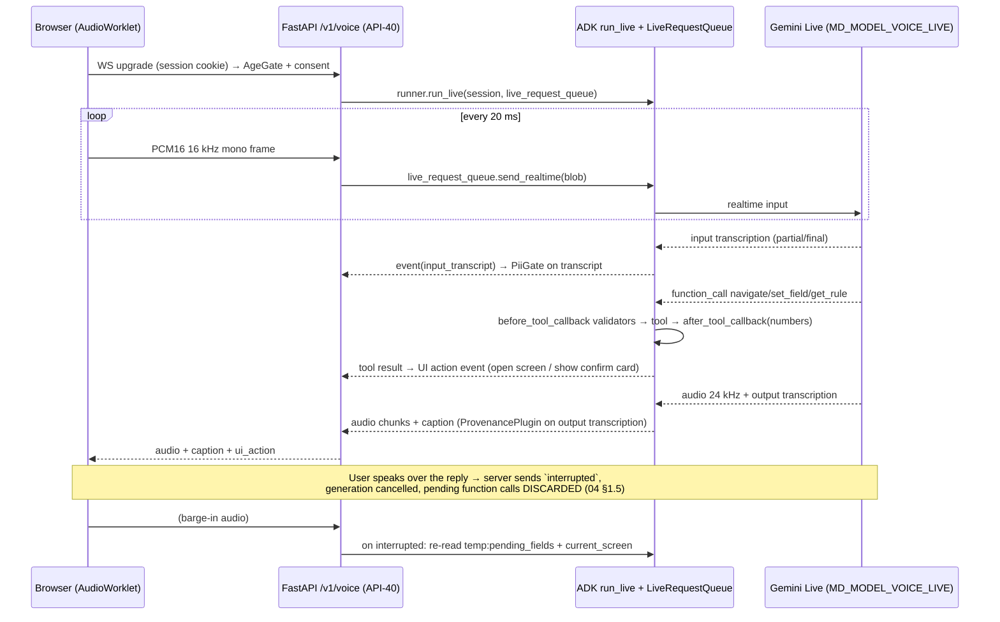
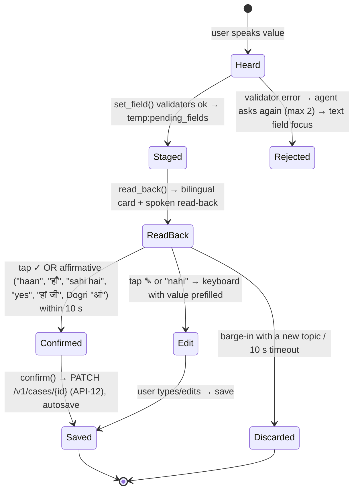

# Voice Guide: UX and Technology (F-30, M-01, M-08)
> Project: Margdarshak · Owner: AI lead + Design lead · Status: Draft v0.1 · Last updated: 2026-10-23
> Related: [AGENTS §3.1](AGENTS.md#31-voiceguideagent-m-01) · [MODELS](MODELS.md) · [PROMPTS](PROMPTS.md) · [AI_EVALS](AI_EVALS.md) · [UI_SPEC](../02-design/UI_SPEC.md) · [ACCESSIBILITY](../02-design/ACCESSIBILITY.md) · [LOCALIZATION](../02-design/LOCALIZATION.md) · `ai/prompts/voice_guide_agent.md` · `ai/evals/voice_nav_30.jsonl`
> Sources: 04 §0.3–0.4, §1.5, §1.9, §3.1, §3.8; 08 §5.7; D-09, D-12, D-13, D-21.

---

## 1. What the voice guide is, and is not

**It is.** Low-literacy users, Hindi and Dogri speakers, and people facing the 16-screen Sarathi flow can say what they want and land on the right screen of *our* app. Pains addressed: Q50 redirect loops, Q52 "2 portals… which one", Q10 re-asking for numbers (04 §3.1). It can also:
- fill non-sensitive fields after a spoken and visual confirmation;
- read a rule card with its source chip;
- read the rendered debrief card verbatim.

**It is not.**
- It never submits, pays or books, on Sarathi or anywhere.
- It never takes an Aadhaar number, OTP, captcha, password or mobile OTP.
- It never gives advice that isn't a rule ID from `rules.json`.
- It is not a chatbot for open conversation.

**The honesty line**, spoken the first time and shown on every voice surface (D §3.3 Trust):
> **hi:** "मैं Margdarshak में रास्ता दिखा सकता हूँ और फ़ॉर्म भरने में मदद कर सकता हूँ। मैं Sarathi पर जमा, भुगतान या बुकिंग नहीं कर सकता।"
> **en:** "I can find screens and help fill forms in Margdarshak. I can't submit, pay or book on Sarathi."

**Who gets it:** adults only (18+, server-side gate, [AGENTS §7](AGENTS.md#7-under-18-gating)), with the `voice` consent. Field-fill needs a separate `voice_fill` consent.

---

## 2. UX

### 2.1 Entry points

- **Home (F-01):** the mic button under the headline, labelled "या बोलकर बताइए / or just tell us".
- **Every screen:** a persistent mic FAB at the bottom right, 56 dp, in the bottom 40% of the screen (08 a11y baseline).
- **Debrief card:** a 🔊 "सुनिए" button → `read_debrief(session_id)`.
- **Rule card:** "पढ़कर सुनाइए" → reads `text_hi` verbatim.

### 2.2 States of the voice orb (Rive, canvas-lite; F-01)

| State | Visual | Text chip | Haptic |
|---|---|---|---|
| Idle | Static orb | "Tap to speak" | none |
| Listening | Orb pulses with the input RMS | **"🎙 Mic on · not stored"** / **"🎙 माइक चालू · रिकॉर्ड नहीं होता"** | 1 short tick on start |
| Thinking | Slow ring | "समझ रहा हूँ…" | none |
| Speaking | Waveform; live caption below | "Tap to interrupt" | none |
| Confirm needed | Orb holds; bilingual value card slides up | "सही है? Tap ✓ or say 'haan'" | 2 ticks |
| Refused (Sarathi action / PII) | Neutral grey (never red) | Canned line + action button | 1 tick |
| Fallback to text | Orb shrinks into the search box | "Let's type instead" | none |

- Reduced motion turns off the pulse; a level bar is used instead.
- No flashing above 3 per second (D-21).
- Captions are always on, with a ≥ 18 px font.

### 2.3 Privacy chip "Mic on · not stored"

The chip is truthful because:
1. The microphone stream goes browser → our WebSocket → Gemini Live (or Saaras), and we store no audio (04 §3.1 Privacy: "Audio is streamed and not stored").
2. Transcripts stay only inside the ADK session, which is deleted after 24 h [D]. The user can turn them off: "Don't keep captions" ([AGENTS §5](AGENTS.md#5-session-and-memory-policy)).
3. Gemini is on the paid tier, where prompts aren't used for product improvement (04 §0.2).
4. The mic is released on the Listening → Idle transition. Chrome's own mic indicator then disappears; QA verifies this.

**Long-press on the chip** opens "What happens to my voice?":
- it goes to Google (Gemini) or Sarvam to understand it;
- nothing is recorded by Margdarshak;
- captions are deleted within a day;
- Aadhaar and OTP are blocked;
- there is a switch for captions;
- there is a link to the privacy centre (F-54).

### 2.4 Conversation patterns

**A. Navigate (small jump inside the current stage):** no confirmation.
> User: "फीस कितनी लगेगी?" → `navigate(SCR_PLAN_RESULT)` (fee section anchor) → the agent says "यह रही फीस की पूरी जानकारी" and reads nothing numeric from memory. The fee card on screen is computed from `fees.json` with "source: CMVR r.32, checked 22 Oct 2026".

**B. Navigate (big jump to another stage):** confirm first.
> User: "मेरा DL टेस्ट स्लॉट बुक करवा दो" → `navigate(SCR_SLOT_FINDER)` returns `needs_confirm: true` → "मैं *स्लॉट ढूँढने* वाला पेज खोल रहा हूँ, ठीक है? बुकिंग आपको Sarathi पर खुद करनी होगी।" → "haan" → open.

**C. Field-fill with confirmation.** Detail in §5.
> User: "मेरा नाम कबीर शर्मा है" → `set_field(FLD_FULL_NAME_DEVANAGARI, "कबीर शर्मा")` + `set_field(FLD_FULL_NAME_LATIN, "Kabir Sharma")` → `read_back()` → card shows **कबीर शर्मा / Kabir Sharma** → "सही है?" → tap ✓ → `confirm([...])`.

**D. Rule question.**
> User: "LL कितने दिन चलता है?" → `get_rule("RUL.LL.VALIDITY")` → the agent says the rule text verbatim from the tool, then "स्रोत: <source>, जाँच की तारीख़ <verified_on>" (all from the tool result, so P5 passes).

**E. Refusal: Sarathi action.**
> User: "पैसे भर दो" → canned `CANNOT_ACT_ON_SARATHI` → offers `SCR_HANDOFF_SARATHI` (the copy-pack and step list; F-07 Mode A).

**F. Refusal: PII (EC-20).**
> User speaks a 12-digit number that passes Verhoeff → P3 drops it before it reaches the model's context. Canned reply: "यह नंबर मुझे मत बताइए। आधार और OTP सिर्फ़ parivahan.gov.in पर खुद टाइप करें।"

**G. Unknown.**
> "Mere RTO mein Sunday ko test hota hai?" → there is no rule for that RTO → "यह हमें आपके RTO के लिए अभी पता नहीं है। यहाँ RTO Live Intel देखें या RTO से पूछें." → `navigate(SCR_RTO_INTEL)` (confirm).

### 2.5 Tone

- Calm, "aap", short sentences of at most 2 clauses, no slang.
- Never "beta". No babying, no shaming, no fear lines (08 §5.5 tone lint).
- Hinglish in, Hinglish out; Devanagari Hindi in, Hindi out; English in, English out.
- In Dogri mode, the reply is Hindi voice plus Dogri text (§3.3).

---

## 3. Technology

### 3.1 Path A: Hindi / English / Hinglish on Gemini Live (Phase 1–2 build)



**Audio formats.** Input 16-bit PCM at 16 kHz; output 24 kHz; WebSocket (04 §1.5). The browser resamples from 48 kHz in an AudioWorklet [K].

**Barge-in.**
- Users can interrupt at any time (04 §1.5). Every tool is idempotent: `set_field` stages, `confirm` commits once per `(field_id, value_hash)`, and `navigate` is a no-op if already there.
- After `interrupted`, the UI cancels any half-shown confirm card and the agent re-reads state.
- The client stops playback within 100 ms of local speech onset (client VAD) [D], so the user never talks over a long reply.

**VAD.**
- Automatic VAD (the default), with `silenceDurationMs` 700 [D] in the recommended 500–800 range and `prefixPaddingMs` 300 [D].
- Noisy mode switches to 800 ms plus **push-to-talk** (manual VAD: hold the orb) (04 §1.5, "manual or hybrid VAD possible").

**Session limits.**
- 15 min audio-only per session; ~10 min connection lifetime (04 §1.5).
- We **rotate the connection at 9 min** using session resumption, with context-window compression enabled.
- At 14 min the agent says "हम थोड़ी देर में फिर से शुरू करेंगे", and the session ends cleanly at 15.
- A per-user monthly cap of 10 min on the free plan (`MD_VOICE_MONTHLY_CAP_MIN`, 04 §5). At the cap, the orb turns into the search box with "आज की आवाज़ की सीमा पूरी हुई".

**Languages.** Native audio models switch language automatically and accept no language code, so the system instruction restricts replies to Hindi, English and Hinglish (04 §1.5). Other detected languages get: "अभी मैं हिंदी और अंग्रेज़ी में बात कर सकता हूँ।"

**Model.** `gemini-3.8-live` via env, fallback `gemini-2.5-flash-native-audio-preview-12-2025`. ADK 2.12 support for 3.8 Live is unknown, so the H0 smoke test decides (04 §6 Q1).

**Keys.** The browser never holds a Google key; the WS terminates at our API. Any client-direct design would need ephemeral tokens (04 §1.5).

### 3.2 Latency budget (targets; Gemini publishes no figures, 04 §1.5)

| Segment | Target p50 | Target p90 | How we measure |
|---|---|---|---|
| End of speech → VAD end-of-turn | silence window (700 ms) | 800 ms | server timestamps |
| Model first audio byte after end-of-turn | < 600 ms [D] | < 1.2 s [D] | ADK event timestamps |
| Network (Render Singapore ↔ Jammu 4G) | ≤ 150 ms [D] | ≤ 300 ms [D] | client RTT ping on the WS |
| **Voice round-trip (end of speech → first audio heard)** | **< 1.5 s** (04 §3.1) | < 2.5 s [D] | `voice_rtt_ms` metric, H0 + 6 h on Jio and Airtel, mid-range Android Chrome |
| Tool call (navigate/set_field) | < 50 ms | < 120 ms | span |

If p90 > 3 s on 4G at H0 + 6 h, the voice guide is **removed from the live demo path** and shown as a recorded clip (D §4 risk 5).

### 3.3 Path B: Dogri cascade (M-08; stretch, +4 h)

Gemini Live does not list Dogri (04 §0.3). Plan for J&K: Dogri in (Saaras), an ADK text agent, Hindi voice out (Bulbul `hi-IN`) and Dogri text on screen (IndicTrans2) (04 §1.9).

```mermaid
sequenceDiagram
  participant B as Browser
  participant API as /v1/voice?lang=doi
  participant S as Sarvam Saaras v3 (doi-IN, streaming WS)
  participant T as ADK text graph (gemini-3.1-flash-lite)
  participant TT as Sarvam Bulbul v3 (hi-IN)
  B->>API: PCM frames (push-to-talk default)
  API->>S: stream audio
  S-->>API: Dogri transcript (final)
  API-->>B: show transcript, editable ("सुनेआ: …")
  B->>API: user taps ✓ (or 2 s auto-accept for pure navigation)
  API->>T: pii_gate → synonym_router → voice_guide_agent (same tools)
  T-->>API: reply text (Hindi) + ui_action
  API->>API: Dogri screen text = REVIEWED string table lookup by reply template ID;<br/>if no reviewed Dogri string → show Hindi text
  API->>TT: Hindi reply text
  TT-->>API: audio
  API-->>B: Hindi audio + Dogri (or Hindi) caption + ui_action
```

**Rules for the Dogri path.**
- The transcript is **shown and editable** before it drives `set_field` (M-08 guardrail: "output reviewed text only").
- **Dogri screen text comes only from a reviewed string table.** Replies are template IDs plus slot values, and IndicTrans2 drafts were reviewed by the team's native Dogri speaker. Free model Dogri is never shown: "Nobody's automated Dogri is trustworthy for legal text" (04 §1.9).
- Barge-in is **not native** in the cascade. The client stops Bulbul playback on speech onset and sends the new turn.
- Latency target: p50 < 2.5 s, p90 < 4 s [D]. Saaras median "< 250 ms" is a vendor claim.
- Cost: Saaras ~₹30/hr **[unverified]**; Bulbul ₹30 per 10k characters.

### 3.4 Path C: text fallback (always available)

The same `voice_guide_agent` and tools over `gemini-3.1-flash-lite`, behind a plain search box with `lookup_screen` synonyms (hi/en/hinglish/doi). With AI off (u18, no consent, EC-29), only `lookup_screen` runs (deterministic).

**Triggers for falling back to text:**
1. Mic permission denied or no `getUserMedia`.
2. Two misunderstood turns in a row (`turns_misunderstood ≥ 2`): "चलिए लिखकर ढूँढते हैं".
3. Noise: client SNR estimate < 10 dB [D] for 3 s.
4. Live error or provider 5xx.
5. Monthly cap reached.
6. Offline or Lite mode (F-51).
7. The user chooses "type instead".
8. Circuit breaker open.

---

## 4. Navigation intents catalogue

### 4.1 Screens (`ScreenId`, 30)

The **Phase 1–2 build wires the 8 marked ★** (04 §3.1: "8 destinations and 10 fields"). The rest exist in the enum but return `{ok:false, error:"NOT_IN_BUILD"}` with "यह हिस्सा अभी बन रहा है" until wired. No dead buttons: the user is offered the nearest built screen.

| screen_id | Stage | Example utterances (hi / hinglish / en / doi*) | Confirm? |
|---|---|---|---|
| ★ SCR_HOME | S0 | "घर पे चलो", "home", "शुरू से" | no |
| ★ SCR_PLAN | S1 | "मुझे लाइसेंस बनवाना है", "bike ka licence chahiye", "मिगी लाइसेंस बनाना ऐ"* | no |
| ★ SCR_PLAN_RESULT | S1 | "फीस कितनी है", "kaun se kagaz chahiye", "what documents" | no |
| SCR_CLASS_PLANNER | S1 | "bike aur car dono ek saath", "दोनों का एक साथ" | no |
| SCR_BLOCKERS | S1–S2 | "कोई दिक्कत तो नहीं", "aadhaar mein address alag hai" | no |
| ★ SCR_LL_APPLY | S2 | "LL का फ़ॉर्म भरना है", "learner apply" | yes |
| SCR_PHOTO_FIXER | S2 | "फोटो ठीक करो", "photo reject ho gayi" | no |
| SCR_CHECK_ANSWERS | S2 | "एक बार चेक कर लो", "review" | no |
| ★ SCR_HANDOFF_SARATHI | S2/S5 | "अब Sarathi पे क्या करूँ", "payment kaise karun" | yes |
| ★ SCR_TRACKER | All | "मेरा केस कहाँ तक पहुँचा", "status" | no |
| SCR_CASE_CLOCK | S2–S7 | "LL कब ख़त्म होगा", "kitne din bache" | no |
| SCR_LEARN_HUB | S3–S4 | "पढ़ाई", "signs seekhne hain" | no |
| ★ SCR_LL_SIMULATOR | S3 | "मॉक टेस्ट", "practice test dena hai" | yes |
| SCR_READINESS | S3–S6 | "मैं तैयार हूँ क्या", "readiness score" | no |
| ★ SCR_NAZAR | S4 | "नज़र", "hazard wala game", "खतरा पहचानने वाला" | yes |
| SCR_GAMES | S4 | "games", "खेल" | no |
| SCR_SLOT_FINDER | S5 | "स्लॉट", "DL test ki date", "slot book karo" (→ refusal line + this screen) | yes |
| SCR_RTO_INTEL | S5–S6 | "RTO में कितनी भीड़", "kaun se kagaz maangte hain wahan" | yes |
| SCR_TRACK_EXPLAINER | S6 | "8 वाला ट्रैक", "figure eight", "reverse parking" | no |
| SCR_TEST_DAY | S6 | "कल टेस्ट है क्या ले जाऊँ", "test day" | no |
| SCR_FAIL_RECOVER | S6F | "फेल हो गया", "retest" | yes |
| SCR_APPROVAL_TRACKER | S7 | "approval kab hoga", "कार्ड कब आएगा" | no |
| SCR_NEW_RIDER | S8 | "नई बाइक के बाद", "new rider" | no |
| SCR_RENEW_FIX | S9 | "renew", "पता बदलना है" (DL holders only, F-16) | yes |
| SCR_FAMILY_HELPER | Cross | "पापा का लाइसेंस", "Mere papa 52 saal ke hain…" | yes |
| SCR_PRIVACY | Cross | "मेरा डेटा मिटाओ", "privacy" | no |
| SCR_SCAM_CHECK | S8 | "ये मैसेज असली है?", "challan ka message aaya" | no |
| SCR_DECODER | S2–S7 | "स्क्रीनशॉट समझाओ", "ye status kya hai" | no |
| SCR_PRACTICE_RECORD | S4–S7 | "मेरा प्रैक्टिस रिकॉर्ड" | no |
| SCR_LANGUAGE | Cross | "भाषा बदलो", "English mein" | no |

\* Dogri examples are drafts **pending native-speaker review** (owner: Dogri reviewer, H0 + 8 h).

### 4.2 Fields (`FieldId`, 18; Phase 1–2 wires the 10 marked ★)

| field_id | Validator (`before_tool_callback`) | Read-back format |
|---|---|---|
| ★ FLD_FULL_NAME_LATIN | Letters, spaces, `.`; 2–60 chars | Latin + Devanagari transliteration |
| ★ FLD_FULL_NAME_DEVANAGARI | Devanagari block; 2–60 chars | Devanagari + Latin |
| FLD_RELATION_TYPE | enum S/o · D/o · W/o · C/o | label |
| FLD_RELATION_NAME | as name. EC-03: if Aadhaar's S/o line is blank, note "Aadhaar में खाली है: RTO पर क्या करें" (rule row) | both scripts |
| ★ FLD_DOB | Valid date, not future; computes the age band; **never spoken back in full**: read back as "15 मार्च" plus the year on screen only [D] | screen shows dd-mm-yyyy |
| FLD_GENDER | enum incl. transgender and "prefer not to say" | label |
| ★ FLD_ADDR_LINE | 5–120 chars; no digits run ≥ 10 (blocks phone/Aadhaar smuggling) | both scripts |
| ★ FLD_ADDR_DISTRICT | ∈ `districts.json` for the state | label |
| ★ FLD_ADDR_PIN | 6 digits, first digit 1–8, consistent with the state | digits grouped "180 001" |
| ★ FLD_STATE | ∈ tenant states | label |
| ★ FLD_RTO_CODE | ∈ `rto.json` | RTO name |
| ★ FLD_VEHICLE_KIND | enum of vehicle pictures (scooter_gearless, motorcycle_geared, moped_le50cc, car, e_rickshaw…) → `class_for(vehicle)` gives the class | picture + class code explained ("Jupiter/Activa = MCWOG") |
| ★ FLD_CLASSES | ⊆ classes eligible for the age (EC-05, EC-06, EC-21) | chips |
| FLD_HAS_LL | bool (EC-22 mid-journey onboarding) | yes/no |
| FLD_LL_ISSUE_DATE | date ≤ today; drives the case clock | date |
| FLD_AADHAAR_ADDR_MATCHES | bool (EC-02) | yes/no |
| FLD_TEST_DATE | date ≥ today | date |
| FLD_LANGUAGE | enum en/hi/doi | label |

**Not in the enum, ever:** Aadhaar number, VID, OTP, mobile number, mobile OTP, captcha, password, LL/DL/application numbers, email, bank/UPI details, blood group (its field list on Sarathi is unverified, 01-sarathi A6).

### 4.3 Banned intents (always refused, with a canned line plus the nearest safe screen)

| Intent | Example | Response ID | Safe screen |
|---|---|---|---|
| Submit on Sarathi | "form submit kar do" | `CANNOT_ACT_ON_SARATHI` | SCR_HANDOFF_SARATHI |
| Pay | "₹ bhar do", "UPI se payment" | `CANNOT_ACT_ON_SARATHI` | SCR_HANDOFF_SARATHI |
| Book a slot | "slot book karo" | `CANNOT_ACT_ON_SARATHI` | SCR_SLOT_FINDER |
| Give Aadhaar/OTP | "OTP 4 8 2 …" | `PII_REFUSAL` | none |
| "Arrange a setting" / bribe / agent | "setting ho jayegi?" | `NO_AGENTS_NO_SETTING` | SCR_SCAM_CHECK |
| Legal advice beyond rules | "challan kaise maaf karaun" | `UNKNOWN_WHO_DECIDES` | none |
| Riding while using | moving > ~10 km/h | `PULL_OVER` (MV Act s.184) | none: the mic is disabled |
| Medical first aid | "accident ho gaya kya karun" | `CALL_112` + the static Golden Hour card (no AI, D-14) | static card |

---

## 5. Field-fill with confirmation



**Rules.**
- Nothing is saved without a confirm. An affirmative counts only if it comes *after* the read-back event, by server ordering.
- Names are shown in both scripts every time: a bad transliteration poisons the printout (04 §3.1).
- The confirm card also states "This is saved in Margdarshak only. You'll still type it on Sarathi." (F-07 Mode A copy-pack).
- At most 3 fields per read-back card [D], for low-literacy readability.
- The DOB is never read aloud in full, in case people are nearby (shared phone, cyber café: EC-14).

---

## 6. Noisy environments (RTO queue, market, bus stand)

| Problem | Measure |
|---|---|
| Background speech triggers turns | Client-side noise gate + push-to-talk in noisy mode; `silenceDurationMs` 800 |
| Low SNR | The client estimates SNR from RMS during the first 500 ms → "शोर ज़्यादा है: बटन दबाकर बोलिए" → PTT; below 10 dB for 3 s → suggest text |
| Mis-heard numbers (PIN, dates) | Digits are read back grouped ("एक आठ शून्य — शून्य शून्य एक") and shown large; PIN and date fields offer a numeric keypad straight after a mis-hear |
| Echo from the phone speaker | `echoCancellation: true`, `noiseSuppression: true`, `autoGainControl: true` in `getUserMedia` constraints [K]; speaker playback ducks during PTT |
| Privacy in public | Earpiece hint; the DOB is never spoken; the "Clear this device" reminder in Helper mode (EC-14) |
| Repeated failure | After 2 misunderstood turns → text fallback (§3.4) |

**Test protocol.** Record the 60-utterance set again with ambient noise from an RTO queue and a market (team recordings, consented). Gate: intent accuracy drops by ≤ 10 points vs the quiet set [D].

---

## 7. Accessibility

- The voice guide is an **alternative**, never the only path. Every action has a tap equivalent (WCAG 2.1 AA, GIGW 3.0).
- Deaf and hard-of-hearing users: captions are always on and all voice output is mirrored as text. The hazard games are visual-only by design (D §3.3).
- Blind users: works with TalkBack. The orb has `aria-live="polite"` captions, and focus moves to the confirm card.
- Speech impairments: push-to-talk with no time-outs; text fallback is one tap away.
- Low literacy: icons on every confirm card, and short read-backs.

---

## 8. Evaluation (detail in [AI_EVALS](AI_EVALS.md))

| Set | Size | Gate |
|---|---|---|
| `voice_nav_30.jsonl` (text transcripts, CI) | 30 | `tool_trajectory_avg_score = 1.0` on the first tool; 100% refusal on banned intents; 0 PII reaching the model |
| Recorded utterances (04 §3.1) | 60 = 20 Hindi, 20 Hinglish, 10 English, 10 Dogri | Intent accuracy ≥ 90% (hi/en), ≥ 80% Dogri [D]; slot exact-match ≥ 90% after confirmation |
| Noisy re-recording | 60 | ≤ 10-point drop |
| Latency | 50 turns on Jio + Airtel | p50 < 1.5 s round-trip |
| Hindi fluency of spoken replies | 30 transcripts | Native rater ≥ 4/5 |

## 9. Hackathon build (Phase 1–2) vs production (Phase 3+)

| Item | Hackathon | Production |
|---|---|---|
| Languages | Hindi, English, Hinglish live; Dogri cascade as a stretch | Dogri GA after the native-review set grows; Kashmiri voice-in (Saaras `ks-IN`) roadmap; Bhashini where proven |
| Destinations / fields | 8 / 10 wired | 30 / 18 |
| Hosting | Render Singapore WS | India region (MeitY cloud/NIC) |
| Demo | One scripted Hindi flow ("Mere papa 52 saal ke hain…" → Form 1A + Helper mode), with a recorded fallback clip if 4G is bad | n/a |
