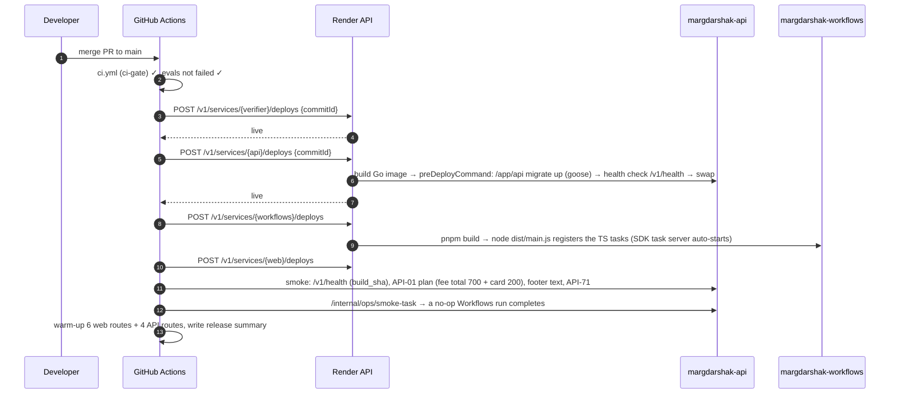

# Deployment
> Project: Margdarshak · Owner: Ops lead (Team Chanakya) · Status: Draft v0.1 · Last updated: 2026-10-23
> Related: [CICD](CICD.md) · [INFRASTRUCTURE](INFRASTRUCTURE.md) · [OBSERVABILITY](OBSERVABILITY.md) · [RUNBOOK](RUNBOOK.md) · [N8N_WORKFLOWS](N8N_WORKFLOWS.md) · [FEATURES](../01-product/FEATURES.md) · [DATA_MODEL](../03-engineering/DATA_MODEL.md) · [ENVIRONMENT_SETUP](../03-engineering/ENVIRONMENT_SETUP.md) · [10-government](../10-government/)
> Real files: [`infra/render.yaml`](../../infra/render.yaml) · [`deploy.yml`](../../.github/workflows/deploy.yml) · [`infra/docker/compose.yaml`](../../infra/docker/compose.yaml) · [`infra/helm/README.md`](../../infra/helm/README.md)

## 0. Two tracks
| | Track A: hackathon (Render, Singapore) | Track B: a state tenant (Helm, India region) |
|---|---|---|
| Who deploys | Ops lead, from `main` automatically | the state's ops team (or NIC) with Nestiq, from a **release tag** |
| Artefact | Render builds the Dockerfiles from the commit | signed images (cosign), mirrored into the state registry |
| Migrations | `preDeployCommand: /app/api migrate up` on the API (goose, embedded in the Go binary) | Helm `pre-upgrade` hook Job (`/app/api migrate up`) |
| Approval | CI green (+ evals not failed) | GitHub Environment reviewers: state nodal officer + Nestiq ops lead |
| Rollback | Render "Rollback" or re-run with the previous SHA | `helm --atomic` / `helm rollback` |
| Data | synthetic | real, under the state's DPDP notice |

**Rule (R-14):** no commits and no participant data before the confirmed hackathon start (the start time is disputed: Fri 00:00 vs Fri 21:30 IST). Steps 2.1–2.2 below happen only after the confirmed start.

## 1. Pre-flight checklist (both tracks)
- [ ] `ci-gate` green on the commit; `evals` not failed (deploy.yml enforces both).
- [ ] Migration plan reviewed: is this release **expand**, **migrate** or **contract** (§6.1)?
- [ ] Rule-pack version to ship is signed and approved (maker-checker, F-42), and the golden tests pass on it.
- [ ] Feature-flag changes listed in the PR (§5).
- [ ] The non-affiliation footer and first-launch disclaimer are present (D-01) and no banned wording is shipped (D-19); `check-wording.mjs` covers this.
- [ ] Runbook updated if a new failure mode was added.

## 2. Track A: hackathon on Render (step by step)

### 2.1 One-time setup (Ops lead, H0, ≈ 60–90 min)
1. **Render workspace.** Create a workspace and add a card (Workflows has no stated free tier, B-sponsors §1). Redeem each member's **$50 credit**. Install the CLI (≥ 2.12.0 for local Workflows dev): `winget install Render.CLI` / `brew install render`, then `render login`.
2. **Blueprint.** Render dashboard → New → Blueprint → connect the GitHub repo → set **Blueprint path** to `infra/render.yaml` (the file isn't at the repo root). Render prompts for every `sync: false` value:

   | Variable | Value to paste |
   |---|---|
   | `OTEL_EXPORTER_OTLP_ENDPOINT`, `OTEL_EXPORTER_OTLP_HEADERS` | Grafana Cloud OTLP gateway + `Authorization=Basic …` |
   | `SENTRY_DSN` | from Sentry project `margdarshak` |
   | `NEXT_PUBLIC_API_BASE_URL` | `https://margdarshak-api.onrender.com` (or the custom domain) |
   | `RENDER_API_KEY` | Account settings → API keys (scoped to this workspace) |
   | `GEMINI_API_KEY` | Google AI Studio project **with billing on** (paid tier, D-13) |
   | `SARVAM_API_KEY` | Sarvam dashboard |
   | `N8N_BASE_URL`, `N8N_HMAC_SECRET`, `N8N_RESUME_AUTH_TOKEN` | n8n workspace URL; `openssl rand -hex 32` twice |
   | `INTERNAL_HMAC_SECRET` | `openssl rand -hex 32`; the same value on `margdarshak-api` and `margdarshak-workflows` (TS tasks → `/internal/job-steps/*`) |
   | `R2_*` | Cloudflare → R2 → API token (Object Read & Write on the 3 buckets) |
   | `CONTACT_ENCRYPTION_KEY` | `openssl rand -base64 32` |
   | `CORS_ALLOWED_ORIGINS` | `https://margdarshak-web.onrender.com` |
3. **Check the workflow service** was created. If the Blueprint rejects the `startCommand` field on `type: workflow` [unverified, §INFRASTRUCTURE 4.5], delete that block and run:
   ```bash
   render workflows create --name margdarshak-workflows --repo https://github.com/<org>/margdarshak \
     --runtime node \
     --build-command 'corepack enable && pnpm install --frozen-lockfile --filter "@margdarshak/workflows..." && pnpm --filter @margdarshak/workflows build' \
     --run-command "node services/workflows/dist/main.js"
   ```
   (CLI flags as in B-sponsors §1. No root directory: `services/workflows` is a pnpm workspace member built from the repo root.)
   Then set `INTERNAL_HMAC_SECRET` to the same value (`openssl rand -hex 32`) on the API and the workflow service: the TypeScript tasks call the Go API's `/internal/job-steps/{step}` with it.
4. **Copy the verifier secret.** `VERIFIER_SHARED_SECRET` is generated on the verifier; copy it into the API's env (a `fromService` reference can't read secrets).
5. **R2.** Create buckets `margdarshak-clips-ingest` (lifecycle: delete after 14 days), `margdarshak-clips-public` (public via a custom domain or r2.dev, CORS GET from the web origin, `Accept-Ranges` for video seeking), `margdarshak-exports` (delete after 7 days), `margdarshak-backups` (keep 14).
6. **GitHub.** Environments `hackathon-prod` and `staging` with variables `RENDER_SERVICE_ID_API/WEB/VERIFIER/WORKFLOWS`, `WEB_URL`, `API_URL` and secrets `RENDER_API_KEY`, `OPS_SMOKE_TOKEN`; environment `ai-evals` with `GEMINI_API_KEY_EVALS`. Branch protection on `main` requires `ci-gate`.
7. **Set `autoDeployTrigger: off`** (already in the Blueprint), so only `deploy.yml` deploys.
8. **n8n.** Follow `n8n/README.md`: Variables, credentials, import W01/W08/W09 (then the rest), set W12 as the error workflow, test with pinned data, activate.
9. **WhatsApp Cloud API.** Meta app + test number for citizens, used by the backend notifier (`WhatsAppCloudNotifier`), not n8n; n8n's staff number is separate; add up to 5 verified recipient numbers (team phones + one judge-demo phone) (B-sponsors §3 `HUNCH`: 5 recipients). Submit templates `md_ll_day25_v1`, `md_ll_expiry_t30_v1`, `md_ll_expiry_t7_v1`, `md_test_eve_v1`, `md_retest_plan_v1` (utility category, en + hi). Template approval can take time, so submit them on Day 1 morning (R-08).
10. **Custom domain (optional).** It must not contain "parivahan", "sarathi" or "gov" (war-room G10).

### 2.2 Every deploy (automatic)

Order matters: verifier → API (migrations) → workflows → web. Each step waits for `live` before the next; a failed step stops the pipeline and leaves the previous versions serving.

### 2.3 Local and staging
- **Local without Docker (default for the team, ENVIRONMENT_SETUP.md):** `cd services/api && go run ./cmd/api migrate up && go run ./cmd/api` against a native Postgres 16 or embedded-postgres, plus `pnpm --filter @margdarshak/web dev` (mock adapters, `AI_MODE=template`, `JOB_RUNNER=inline`).
- **Local with Docker (optional):** `docker compose -f infra/docker/compose.yaml up --build` (same settings).
- **Local with real task runs:** from the repo root, `render workflows dev -- node services/workflows/dist/main.js` after `pnpm --filter @margdarshak/workflows build` (local task server on :8120); set `JOB_RUNNER=render_workflows` and `RENDER_USE_LOCAL_DEV=true` in the API, so the Go JobRunner posts to `http://localhost:8120/v1/task-runs`. Start a run: `render workflows tasks start clip_ingest --input='["clip_demo01"]' --local` (B-sponsors §1, local development).
- **Staging:** a second Blueprint (`infra/render.staging.yaml`, same file with `-staging` names and `APP_ENV=staging`) and `deploy.yml` → `render-staging`. Rehearse every migration here first.

### 2.4 Freeze for judging
- **Deploy freeze from 60 min before the judging slot until it ends.** Only RUNBOOK fixes, approved by the Ops lead.
- T-30 min: run `scripts/ops/warmup.sh` from a laptop (the same route list as deploy.yml's warm-up step; re-running deploy.yml would redeploy, which the freeze forbids), then check the dashboards (OBSERVABILITY §5).

## 3. Database migrations
- **Tooling:** goose v3.29.0 SQL migrations in `services/api/migrations/` (`-- +goose Up` / `-- +goose Down` sections), embedded in the binary with `embed.FS` and applied by `api migrate up|down|status`. Versions are strictly sequential (`goose create -s <slug> sql`); CI rejects duplicate or out-of-order versions, and runs up → down 1 → up on embedded-postgres.
- **Naming:** `NNNNN_<slug>.sql`; every file starts with `-- phase: expand | migrate | contract` and `-- reversible: true | false`; a Go migration-lint test in `internal/store` enforces the rules below. sqlc reads the same files as its schema, so generated queries always match the migrated schema.
- **Rules (zero-downtime):**
  1. **Expand** (release N): add nullable columns or new tables, add indexes `CONCURRENTLY` (in a file marked `-- +goose NO TRANSACTION`), add enum values. Old code must still work.
  2. **Migrate** (release N, a Workflows task or a one-off job): backfill in batches of 5,000 rows with `SKIP LOCKED`; idempotent; resumable.
  3. **Contract** (release N+1 or later, after N is fully rolled out): drop old columns, set `NOT NULL`, remove old code paths.
  - Never `RENAME` a column in place: add the new one, dual-write, switch reads, drop the old one.
  - Lock timeout `SET lock_timeout = '3s'` and statement timeout `'60s'` in every migration.
- **Where they run:** Render → the API's `preDeployCommand` (if it fails, the deploy stops and the old version keeps serving). Helm → the `migrate-job` pre-upgrade hook (if it fails, `--atomic` rolls back).
- **Data protection in migrations:** contact fields (E-14) stay encrypted; a migration never decrypts in bulk. PII columns get a `comment` with their classification (DATA_MODEL.md).
- **Rule packs are not migrations.** They're versioned data (E-08) loaded by the rule-pack studio (F-42) with maker-checker approval. A new version triggers `rulepack_reevaluate` for open cases and a notice to affected users (EC-27).

## 4. Track B: production for a state tenant (step by step)

### 4.1 Prerequisites (owned by the state + Nestiq; see `07-govt-plug-and-play.md` adoption checklist)
- MoU and DPDP data-processor terms signed; the state's privacy notice approved.
- Hosting: NIC / MeghRaj or a MeitY-empanelled CSP (Indian region) with Kubernetes ≥ 1.30, a namespace, a container registry (e.g. Harbor), an S3-compatible store, Postgres 16, a Vault/KMS.
- A self-hosted GitHub runner **inside the state network** with label `md-<tenant>` (outbound to github.com only; no inbound).
- Integrations registered by the state: DigiLocker requester client (with `partners.DRVLC`), Bhashini, NIC/mGov SMS with DLT templates, Sarathi deep-link (or the NIC-granted API).
- Security: VAPT by NIC / STQC / a CERT-In-empanelled auditor completed and a **safe-to-host** certificate issued before go-live (war-room G5). We say "audit-ready" until it is issued.

### 4.2 First install
1. **Tenant config:** create `infra/helm/tenants/values-<tenant>.yaml` (adapters, languages, theme tokens, NTP servers, endpoints, HPA limits) and the tenant row (E-31) via the rule-pack studio: rule-pack version, languages, UX4G theme.
2. **Secrets:** create ExternalSecrets for `md-db`, `md-kv`, `md-objectstore`, `md-ai`, `md-digilocker`, `md-contacts-key`.
3. **Platform dependencies:** CloudNativePG cluster (or managed PG), Valkey, Temporal, OTel Collector + Loki/Tempo/Prometheus (180-day log retention), External Secrets (helm README §2).
4. **Tag a release** `vX.Y.Z` on a commit that passed CI, evals and security.
5. **Run `deploy.yml`** → `target=gov-tenant`, `tenant=<id>`, `ref=vX.Y.Z`:
   build → cosign sign → attest → (reviewers approve) → cosign verify → mirror into the state registry → `helm diff` → `helm upgrade --install --atomic --wait --timeout 15m` → in-network smoke.
6. **Post-install checks:** `/v1/health` shows `ntp_offset_ms < 1000` and `log_shipping == "ok"`; a DigiLocker consent flow with a staff test account (there is **no DigiLocker sandbox**; testing hits production with consenting staff, 07 §A2); one test notification per channel; a restore drill of the empty database.
7. **Go-live** behind the `tenant_public` flag at 1–2 pilot RTOs (§4.4).

### 4.3 Upgrades
Same pipeline with a new tag. Expand/contract migrations ensure old pods keep serving during the rolling update (`maxUnavailable: 0`, `maxSurge: 25%`, readiness gates, native `preStop` sleep action of 10 s; the distroless image has no shell).

### 4.4 Per-state tenant rollout (pilot → state)
| Phase | Scope | Flags on | Exit criteria (from 07 §C2 and the adoption checklist) |
|---|---|---|---|
| 0. Shadow | staff only, 1 RTO | `tenant_public=off`, `sarathi=deeplink` | 2 weeks, zero SEV-1/2, rule pack signed off by the Transport Commissioner's office |
| 1. Pilot | 1–2 RTOs/ARTOs (e.g. a J&K ARTO), 4–6 weeks | `tenant_public=on` for those `office_id`s; `ai_debrief=on`; `voice_guide=off` | baseline vs pilot: counter queries, re-test rate, first-attempt pass rate, time to LL; SUS ≥ 70; no unresolved grievances > 30 days |
| 2. District | all RTOs in 2–3 districts | + `voice_guide=on`, `school_portal=on` | p95 latency and error SLOs met for 30 days (OBSERVABILITY §4) |
| 3. State | all offices | + `sarathi=real` when NIC grants it; `console_state=on` | the state's go-live sign-off; DR drill passed |
| 4. Second state | new tenant id, new values file, new rule-pack overlay on the CMVR base pack | per state | the same gates |

### 4.5 Decommission / exit
Data export (standard formats) + source escrow + handover runbook to NIC/the state's SI (07 adoption checklist "exit/portability plan"). Margdarshak keeps no copy of a state's citizen data after exit except what law requires.

## 5. Feature flags
- **Store:** `feature_flags` table (`tenant_id`, `key`, `value`, `rollout` rule, `updated_by`, `reason`), cached 30 s in Key Value; edited in the console by an admin with the change written to the audit log (E-30). Flags never encode business rules (fees, eligibility live in rule packs).
- **Evaluation:** server-side; the web app receives only the resolved flags for the current user and tenant.
- **Kill switches are flags** so an incident never needs a deploy.

| Flag | Default (hackathon) | Purpose / incident use |
|---|---|---|
| `ai_debrief` | on | off ⇒ template "Auto notes" card for everyone (EC-29, RUNBOOK PB-01) |
| `ai_voice_guide` | on (every user, including a 16–17 learner in a parent's account, D-13 revised) | off when Live errors spike or voice spend exceeds the cap |
| `ai_screen_decoder` | on | M-05 kill switch |
| `family_mode` | on | a learner aged 16–17 uses the parent's (adult) account; the account holder gives verifiable parental consent for the minor's case (DPDP). AI features are not age-gated (D-13 revised); no behavioural tracking or targeted ads on a child's data (CI asserts both) |
| `nazar_hpt_format` | `kerala_10x10` | switch to `practice_only` copy if the Kerala HPT is stayed (EC-28, PB-05) |
| `live_intel_public` | on, k ≥ 5 | off ⇒ intel hidden, reports still collected (PB-11) |
| `whatsapp_outbound` | on | off ⇒ email + web push only (PB-02) |
| `sms_outbound` | **off** | stays off until TRAI DLT registration (D-16) |
| `slot_watch_alerts` | on | backend fires slot-watch alerts on a published "slots opened" report (API-68 → outbox → notifier; W03 relay retired, ADR-0006 rev.) |
| `squads`, `streaks` | on | for a minor in family mode, squads and share cards need the parent's consent (D-13 revised) |
| `sarathi_mode` | `handoff_a` | `handoff_a` (prefilled hand-off + copy-pack) / `adapter_b` (state adopted) |
| `tenant_public` | on (hackathon) | per-tenant go-live gate (§4.4) |
| `fault_injection_clip_blur` | off | `once` for the demo's visible Workflows retry (D-15); env `FAULT_INJECTION_CLIP_BLUR` |
| `demo_mode` | off | shows "sample data" chips on seeded rows and the judge QR (never on in a state tenant) |

## 6. Zero-downtime strategy
### 6.1 Render (hackathon)
- Render health-checks the new instance on `healthCheckPath` before routing traffic to it and keeps the old one serving until then (Render's standard zero-downtime deploy for web services with a health check [K; recheck in Render docs at H0]).
- The Go server drains in-flight requests on SIGTERM (`http.Server.Shutdown` with a 25 s deadline, below Render's 30 s grace), then closes the pgx pool and flushes OpenTelemetry.
- Migrations are expand-first, so the old instance works against the new schema during the switch.
- **The web app tolerates an API one version ahead or behind:** the API keeps `/v1` backward-compatible (oasdiff gate in CI); new fields are additive.
- Workflows: tasks are versioned by name when their input shape changes (`case_clock_sweep_v2`); in-flight runs of the old task finish on the old code.
- n8n: workflows call stable `/internal/*` contracts; changing a contract means a new path version, and the old one stays until n8n is updated.

### 6.2 Kubernetes (state)
- Rolling updates with `maxUnavailable: 0`, readiness probes, PDBs, `preStop` sleep and a 30 s grace period.
- `helm --atomic` rolls back automatically if the rollout or the migration Job fails.
- Blue/green per tenant is possible (two releases behind one Ingress with weighted routing) for risky releases; the default is rolling.

## 7. Release process
1. Conventional Commits → `release-please` PR (Phase 3) updates `CHANGELOG.md`.
2. Tag `vX.Y.Z` (SemVer: MAJOR for a `/v2` API or a breaking adapter contract; MINOR for features; PATCH for fixes and rule-pack-independent copy).
3. Release notes include: migrations (phase), flags changed, rule-pack versions compatible, eval summary, SBOM links, known issues.
4. Rule-pack changes have their **own public changelog** (war-room §3.3 trust: "a public CHANGELOG of rule changes").
