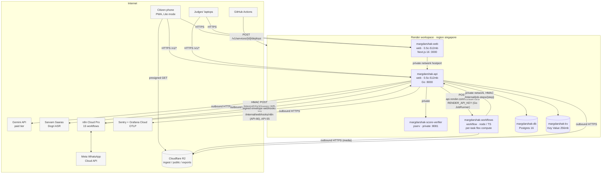
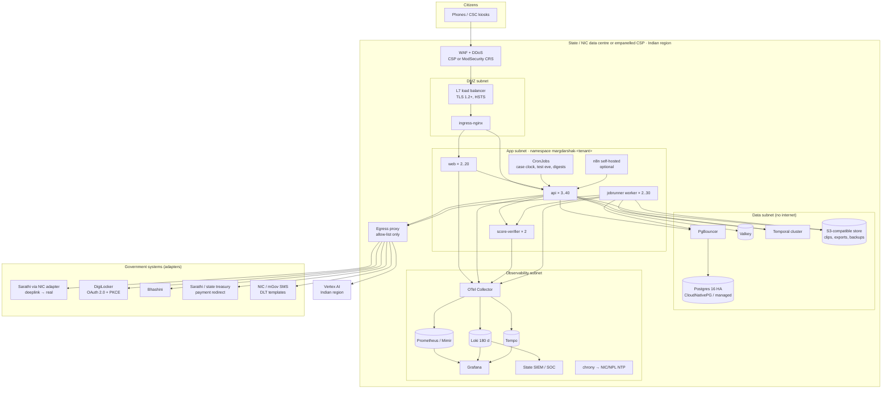

# Infrastructure
> Project: Margdarshak · Owner: Ops lead (Team Chanakya) · Status: Draft v0.1 · Last updated: 2026-10-23
> Related: [PROJECT_BRIEF](../00-overview/PROJECT_BRIEF.md) · [ARCHITECTURE](../03-engineering/ARCHITECTURE.md) · [CICD](CICD.md) · [DEPLOYMENT](DEPLOYMENT.md) · [OBSERVABILITY](OBSERVABILITY.md) · [RUNBOOK](RUNBOOK.md) · [COST](COST.md) · [N8N_WORKFLOWS](N8N_WORKFLOWS.md) · [COMPLIANCE](../06-security-compliance/COMPLIANCE.md) · [PRIVACY](../06-security-compliance/PRIVACY.md)
> Real files: [`infra/render.yaml`](../../infra/render.yaml) · [`infra/docker/`](../../infra/docker/) · [`infra/helm/README.md`](../../infra/helm/README.md) · [`n8n/`](../../n8n/)

## 0. Summary
| | Hackathon build (Phase 1–2) | Production for a state (Phase 3+) |
|---|---|---|
| Hosting | **Render**, region **Singapore** (Render has no India region: Oregon, Ohio, Virginia, Frankfurt, Singapore; https://render.com/docs/regions, war-room G4) | **MeghRaj / NIC cloud or a MeitY-empanelled CSP, Indian region** (07 §A6, D-17) |
| Runtime | 3 Docker services (Go API, Next.js web, Node score verifier) + 1 Render Workflows service (TypeScript) + Render Postgres + Render Key Value | Kubernetes + Helm (`infra/helm/`), or Docker Compose on a single VM for a small NIC install |
| Durable jobs | **Render Workflows** (TypeScript SDK `@renderinc/sdk` 1.4.0; the Go API starts runs over Render's REST API) | **Temporal** (MIT, self-hosted; Temporal Go SDK `go.temporal.io/sdk` v1.50.0) behind the same `JobRunner` port |
| Schedules + messaging edge | **n8n Cloud Pro** (sponsor perk) | self-hosted n8n in India **or** Kubernetes CronJobs + backend NotificationAdapter (no business logic is lost, D-16) |
| Object storage | **Cloudflare R2** (blurred clips, ICS, exports) | the CSP's S3-compatible store in India, or MinIO |
| AI | Gemini API, **paid tier** (D-13) | **Vertex AI in an Indian region** [unverified: model availability in asia-south1; owner AI lead; before the state MoU], Bhashini for speech where the state prefers it |
| Data | **synthetic only** + consented, pseudonymous field-study rows (18+) | real citizen data under the state's notice; all data, logs, backups and inference in India |
| Logs | Render logs + OTLP export (Grafana Cloud free tier) + Sentry | Loki/Tempo/Prometheus in India, **180-day retention**, NTP to NIC/NPL (CERT-In) |

The same three images (`infra/docker/api.Dockerfile`, `web.Dockerfile`, `score-verifier.Dockerfile`) run in both columns. Everything Render-specific sits behind two ports: **`JobRunner`** (Render Workflows ⇄ Temporal) and **`ObjectStore`** (R2 ⇄ any S3 API).

## 1. Components and why each exists
| # | Component | Image / runtime | Render type, plan | Purpose | Talks to |
|---|---|---|---|---|---|
| C1 | `margdarshak-web` | Next.js 16 standalone, Node 22 | `web`, `0.5c-512mb` (legacy "starter") | citizen PWA, Lite mode, state console UI (F-41), clip curator page | C2 over the private network (server-side) and the public URL (browser) |
| C2 | `margdarshak-api` | Go 1.27 static binary (chi v5, pgx v5 + sqlc, goose, ADK for Go v1.9 + genai v1.76), distroless image (ADR-0011) | `web`, `0.5c-512mb` (legacy "starter"; `GOMEMLIMIT=400MiB`; move to `1c-2g` if the k6 burst needs it) | the **one backend** (D-17): rules engine, cases, adapters, ADK agents, `/internal/*` for n8n, `/internal/job-steps/*` for Workflows tasks | Postgres, Key Value, C3, Render API (start/poll task runs), Gemini, Sarvam, R2, n8n webhooks |
| C3 | `margdarshak-score-verifier` | Node 22, `@margdarshak/game-core` | `pserv` (private, no public URL), `0.5c-512mb` | replays every game session from seed + events and **overwrites the client score** (anti-cheat, API-35) | called by C2 only (Workflows replays go through C2 job steps) |
| C4 | `margdarshak-workflows` | Node 22, TypeScript, `@renderinc/sdk` 1.4.0 (`services/workflows`) | `workflow` (per-task compute, default `flex`) | durable jobs: **`clip_ingest`** (headline: transcode → blur faces/plates → propose windows → hand to raters), `clip_finalize` (agreement → publish), `case_clock_sweep` (+ `clock_batch`), `session_debrief`, `debrief_backfill`, `nightly_stats`, `rulepack_reevaluate`, `user_export`, `user_delete`, `replay_pending_sessions`. Media steps run in the task; every business step is an HMAC call to C2 `/internal/job-steps/{step}` (the API owns the DB, Gemini and n8n) | C2 (private network), R2 (outbound only: runs **cannot receive inbound connections**, B-sponsors §1) |
| C5 | `margdarshak-db` | Render Postgres 16 | `0.1c-256mb` (legacy "basic-256mb") | system of record for Margdarshak's own objects (E-01..E-31); **not** a copy of Sarathi | C2 only (Workflows tasks reach data through C2) |
| C6 | `margdarshak-kv` | Render Key Value (Redis-compatible) | `256mb`, `volatile-lru`, private only | rate limits, anonymous sessions, idempotency keys, AI circuit breaker | C2 |
| C7 | Cloudflare R2 | — | — | `margdarshak-clips-ingest` (raw uploads, 14-day lifecycle delete), `margdarshak-clips-public` (blurred, published clips + manifest), `margdarshak-exports` (user data exports, 7-day expiry) | C2, C4 (media steps); browser via presigned URLs and the public clips domain |
| C8 | n8n Cloud Pro | — | — | 15 workflows: schedules, WhatsApp/email out, approvals in (N8N_WORKFLOWS.md) | C2 `/internal/*` and API-55 over HTTPS + HMAC; WhatsApp Cloud API; Gmail; Telegram |
| C9 | External | — | — | Gemini API (paid), Sarvam Saaras (Dogri ASR, M-08), Meta WhatsApp Cloud API (test number), Sentry, Grafana Cloud | — |

**Why Render Workflows here is load-bearing, not decorative** (B-sponsors §7 test): the clip pipeline outlives a request, retries (blur and Gemini calls fail), fans out per clip, and continues after a human wait. The case clock repeats daily. Render Workflows has **no cron, no sleep and no completion webhook** (B-sponsors §1), so n8n supplies the schedule and the human waits, and the backend polls or awaits the run.

## 2. Hackathon network diagram (Render, Singapore)

- `/internal/*` routes accept only HMAC-signed requests from n8n (W-series) or bearer tokens scoped `n8n`/`ops`; they are rate-limited and never linked from the UI.
- `ipAllowList: []` on Postgres and Key Value ⇒ reachable **only** over Render's private network.
- The score verifier has no public URL (`pserv`).

## 3. Data residency
| Data | Hackathon location | Production location | Note |
|---|---|---|---|
| Case and learning data (E-01..E-31) | Render Postgres, Singapore | Postgres in an Indian region | Hackathon holds **synthetic data only**, stated in the README and on the first-launch disclaimer (D-01) |
| Contacts (E-14) | Postgres (field-level encrypted) + n8n execution data (minimal, success executions not saved) | Postgres in India; NotificationAdapter → NIC/mGov SMS or WhatsApp BSP | Phone + first name only, opt-in only |
| Clips (E-20) | R2 (Cloudflare; bucket location hint APAC [unverified: R2 jurisdiction options; owner Ops lead]) | India-region object store | Faces and plates blurred; 100 % blur audit before publish (M-09) |
| Logs and traces | Render logs (retention per plan), Grafana Cloud, Sentry | Loki/Tempo in India, **rolling 180 days within Indian jurisdiction** (CERT-In Directions, 28 Apr 2022, war-room G6) | PII-redacted at source (OBSERVABILITY.md §2) |
| Backups | Render Postgres backups (plan-dependent) + nightly `pg_dump` to R2 | WAL + base backups in India; DR copy in a second Indian region | vendor claim that backups/DR must also be in India (07 §A6) is treated as a design assumption |
| AI prompts/responses | Gemini API (paid tier: no human review of prompts, 04 §0.2) | Vertex AI, Indian region | No PII by construction (08 §5.10); prompts not stored beyond 7 days |
| Field-study rows (F-57) | Postgres + Google Sheet via W14 (pseudonymous codes, no names) | n/a (research only) | consented, 18+, delete on request |

**Honest line for judges (D-17):** "Singapore region today, with synthetic data. For a state, the same containers run on MeghRaj or a MeitY-empanelled Indian cloud, with every byte, log and model call in India."

## 4. Production for a state (Phase 3+)

### 4.1 Hosting options
| Option | When | Notes |
|---|---|---|
| **A. NIC / MeghRaj Kubernetes** | the state or MoRTH hosts it next to Sarathi | best story: "data never leaves NIC" (war-room G3); NIC's own security clearance applies |
| **B. MeitY-empanelled CSP, Indian region** (managed Kubernetes + managed Postgres) | the state procures through GeM/tender | empanelment requires India-hosted data and STQC audit of the CSP (07 §A6) |
| **C. Single VM, Docker Compose** | a pilot at 1–2 RTOs (07 C2 forward deployment) | `infra/docker/compose.yaml` + Temporal + Caddy; nightly backup to the state object store |

### 4.2 Production network diagram


### 4.3 Kubernetes shape (from `infra/helm/README.md`)
- One namespace per tenant (`margdarshak-<tenant>`), or one cluster per state if it insists on isolation (07 §B3).
- Pod security `restricted`: uid 10001, read-only root filesystem, no capabilities, seccomp `RuntimeDefault`.
- NetworkPolicies default-deny; egress only through an allow-listed proxy (Vertex AI India, DigiLocker, Bhashini, NIC SMS).
- Secrets via External Secrets Operator from the state's Vault or CSP KMS; **per-tenant encryption keys** for E-14 contacts (07 §B3).

### 4.4 IaC outline (Terraform; Phase 3)
```
infra/terraform/
├── modules/
│   ├── network/          VPC, 4 subnets (dmz, app, data, obs), NAT/egress proxy, security groups
│   ├── k8s/              managed cluster or NIC-provided; node pools: general (4c-16g), jobs (spot/preemptible if allowed)
│   ├── postgres/         managed PG 16 (HA, PITR 7 d) or CloudNativePG values
│   ├── objectstore/      buckets: clips, ingest (14-d lifecycle), exports (7-d), backups (versioned, object lock 30 d), logs-archive (180 d)
│   ├── kms/              per-tenant keys (contacts, backups)
│   ├── dns-tls/          state domain, certificates
│   └── observability/    log archive bucket, SIEM forwarding
├── envs/
│   ├── jk-uat/  jk-prod/
│   └── kl-uat/  kl-prod/
└── README.md             provider matrix per empanelled CSP (S3 API, K8s version, managed PG)
```
Providers are chosen per CSP at the state MoU. No module depends on a proprietary managed service the other CSPs lack (07 §B4). The hackathon needs no Terraform: `infra/render.yaml` is the IaC.

### 4.5 The `JobRunner` port (the Render ⇄ government seam)
```go
// services/api/internal/ports/jobs.go (interface only; implementations in internal/jobs/*)
type JobRunner interface {
	// Start begins a run. The same idempotency key never starts a second run.
	Start(ctx context.Context, task string, args []any, idempotencyKey string) (RunRef, error)
	// Status reads the run state (polled into job_runs; Workflows has no completion webhook).
	Status(ctx context.Context, run RunRef) (RunStatus, error)
}
```
| Implementation (Go package) | Where | Maps to |
|---|---|---|
| `internal/jobs/renderworkflows` | hackathon (`JOB_RUNNER=render_workflows`) | Render REST API, no SDK needed in Go: `POST https://api.render.com/v1/task-runs` with `{"task": "<WORKFLOW_SLUG>/<task>", "input": [...], "idempotencyKey": "..."}` → `202` TaskRun; `GET /v1/task-runs/{id}` for status (`pending`, `running`, `succeeded`/`completed`, `failed`, `canceled`, `paused`); `DELETE /v1/task-runs/{id}` cancels. Bearer `RENDER_API_KEY`. Local dev: `RENDER_USE_LOCAL_DEV=true` points the adapter at `http://localhost:8120` (or `RENDER_LOCAL_DEV_URL`), the same switch the TS SDK uses (`@renderinc/sdk` 1.4.0, read 2026-10-23) |
| `internal/jobs/temporal` | production (`JOB_RUNNER=temporal`) | Temporal Go SDK `go.temporal.io/sdk` v1.50.0: workflows with the same task names; the worker is the same Go binary (`/app/api worker`) and runs the Go step handlers as activities; media activities run in a TS Temporal worker or a Go ffmpeg wrapper [design only]. Temporal adds timers and signals, so human waits *could* move from n8n into code later |
| `internal/jobs/inline` | dev, CI (`JOB_RUNNER=inline`) | runs the Go step handlers in-process on a goroutine; media steps use pre-blurred fixture clips |

Task definitions are TypeScript in `services/workflows` (`@renderinc/sdk` 1.4.0; https://render.com/docs/workflows-sdk-typescript): each task is `task({ name, retry: { maxRetries: 3, waitDurationMs: 1000, backoffScaling: 2 }, timeoutSeconds, plan }, async (ctx: TaskContext, ...args) => ...)`, subtasks run with `await ctx.run(subtask, ...args)`, fan-out is `Promise.all` over `ctx.run`, and the task server starts automatically when `RENDER_SDK_SOCKET_PATH` is set. Tasks hold no business logic: media steps (ffmpeg, blur with onnxruntime-node, flash check) run in the task; every other step is `POST http://$API_INTERNAL_HOSTPORT/internal/job-steps/{step}` with HMAC (`INTERNAL_HMAC_SECRET`), and the Go API decides, writes and notifies. Plan names: the TS SDK README lists `starter`/`standard`/`pro`, the changelog says `flex` replaced them [unverified; owner Backend lead, H0].

| Task | Timeout | Retries | Plan | Fan-out |
|---|---|---|---|---|
| `clip_ingest(clip_id)` → `transcode` → `blur_faces_plates` → `propose_windows` (API step, Gemini video) → notify W08 (API step) | 30 min | 3, ×2 backoff (blur supports fault injection `FAULT_INJECTION_CLIP_BLUR=once` for the visible-retry demo, D-15) | `flex` (transcode may use `2c-4g`) | one run per clip; batch ingest = `Promise.all` over `ctx.run` (chained runs avoid the Hobby limit of 50 root runs/min) |
| `clip_finalize(clip_id)` → `compute_agreement` → `publish` | 10 min | 3 | `flex` | — |
| `case_clock_sweep(tenant, as_of)` → `clock_batch` per 500-case page | 30 min | 3 | `flex` | pages in parallel (≤ 8); the API step writes idempotent `TimelineEvent` (E-12) + outbox rows (E-13) |
| `session_debrief(sid)` / `debrief_backfill(cohort)` | 60 s / 30 min | 3 (Gemini 429) | `flex` | per session; template fallback on final failure (EC-29) |
| `nightly_stats(date)` | 30 min | 2 | `flex` | — |
| `rulepack_reevaluate(tenant, from, to)` | 60 min | 2 | `flex` | per 1,000 open cases (EC-27) |
| `user_export(principal)` / `user_delete(principal)` | 10 min | 3 | `flex` | — |
| `replay_pending_sessions()` | 10 min | 3 | `flex` | per session (verifier outage recovery) |

## 5. Scaling
### 5.1 Hackathon (judging day)
- Expected load: 6 judges + team + field-study participants (n = 40–80, D-22) ⇒ peak about 50–100 concurrent users.
- **Never the `free` plan:** free web services sleep after 15 min and take about 1 min to wake (B-sponsors §0). Paid instances don't sleep. A warm-up step runs after each deploy (`deploy.yml`) and again 30 min before judging (RUNBOOK §8).
- One instance of each service handles this load. The headroom plan: bump the API from `0.5c-512mb` to `1c-2g` (or `2c-4g`) and `numInstances: 2` in the dashboard (manual scaling works on any paid plan; autoscaling needs a Pro workspace, per the Blueprint spec).
- Load-test target before judging (k6, 5 min): API-01 plan p95 < 300 ms server-side at 50 RPS; zero 5xx (PERFORMANCE.md).

### 5.2 Production (per state)
| Tier | Signal | Min → max | Notes |
|---|---|---|---|
| web | CPU 65 % | 2 → 20 | static assets via CDN/edge cache; Lite pages cached 5 min |
| api | CPU 60 %, p95 latency | 3 → 40 | stateless Go binary; sessions in Valkey; `pgxpool` max 15 connections per pod, PgBouncer (transaction mode) past 20 pods; `GOMEMLIMIT` ≈ 80 % of the pod memory limit |
| score-verifier | CPU 70 % | 2 → 10 | CPU-bound replays, about 10–50 ms each [estimate; measure] |
| jobrunner worker | queue depth 50 | 2 → 30 | case-clock sweep sharded per 500 cases |
| Postgres | — | 1 primary + 2 replicas | reads for the state console (F-41) go to a replica; partition `game_events` (E-17) monthly |
| Valkey | memory | 1 GB → 4 GB | eviction `volatile-lru` |

Capacity anchor: the 9 am spike Kapoor asked about ("10,000 users at 9 am", war-room §2) is about 10k sessions in 15 min ⇒ ~11 sessions/s ⇒ roughly 30–60 API RPS. 3 api pods at 1 vCPU each cover that with headroom [estimate; validated by the Phase 3 load test].

## 6. Backups
| What | Hackathon | Production | Restore test |
|---|---|---|---|
| Postgres | Render-managed backups (availability depends on plan [unverified for `0.1c-256mb`; owner Ops lead, H0]) **plus** a nightly `pg_dump --format=custom` to R2 (`margdarshak-backups`, 14 copies) from a small Render cron job on the `postgres:16` image over the private network [to add at H0 if the plan has no backups; the Workflows tasks and the distroless API image have no database client tools] | continuous WAL archiving + daily base backup, PITR 7 days, weekly full copy to a second Indian region; backup bucket versioned with 30-day object lock | hackathon: one restore into staging before judging; production: monthly restore drill, quarterly DR drill |
| Rule packs | Git (signed commits) + DB (`E-08` versions, append-only) | same | every CI run re-validates them |
| Clips | R2 public bucket = published set; ingest bucket deleted after 14 days | object store with versioning | manifest checksum check nightly |
| n8n workflows | JSON exports in `n8n/workflows/` (Git) + n8n's own version history | same, or replaced by CronJobs | import into a scratch workspace |
| Secrets | Render env + a sealed offline copy held by the Ops lead | state Vault/KMS with its own backup | — |
| Audit log (E-30) | Postgres, append-only | Postgres + daily export to the 180-day archive | — |

## 7. Disaster recovery
| Scenario | RPO | RTO | Plan |
|---|---|---|---|
| Hackathon: a Render service is down or a deploy breaks | 0 (no data loss) | ≤ 5 min | Rollback (CICD.md §6); the demo fallback video (RUNBOOK §8) |
| Hackathon: Render region outage | ≤ 24 h (last nightly dump) | ≤ 60 min, best effort | `docker compose up` on a team laptop with the latest dump + an ngrok-style tunnel **only as a last resort**; the recorded demo is the primary fallback |
| Production: pod/node loss | 0 | ≤ 5 min | Kubernetes reschedules; PDBs keep ≥ 1 replica |
| Production: primary DB loss | ≤ 15 min | ≤ 1 h | promote a replica (CloudNativePG failover), or PITR |
| Production: data-centre loss | ≤ 15 min | ≤ 4 h | restore into the second Indian region from WAL + base backups; DNS switch; adapters re-pointed |
| Ransomware / destructive admin action | ≤ 24 h | ≤ 8 h | object-locked backups; break-glass accounts; CERT-In 6-hour report (RUNBOOK PB-06) |

## 8. Cost-saving with sponsor credits (detail in COST.md)
- **Render:** every participant gets **$50 in Render credits**, and the Render Workflows prize pays out in credits (1st $500 / 2nd $300 / 3rd $100) (B-sponsors §0). A team of 4 has about $200, which covers the hackathon month several times over (COST.md §2).
- **Workflows bills per second with no idle charge**: `flex` is $0.20/CPU-h + $0.05/GB-h, capped at about $0.40/h (B-sponsors §1).
- **n8n Pro is free for the team** (sponsor perk worth $60) and covers about 10k executions a month.
- **Gemini:** Flash-Lite debriefs at about ₹0.10 each (08 §5.8). Voice (about ₹2/min) is the dominant AI cost, so it is capped at 10 min per user per month (04 §5).
- **R2:** no egress fees for the clips that judges stream [K: Cloudflare R2 pricing page; recheck at H0].
- Delete all Render services (or suspend them) after the judging window and the post-event review, so credits aren't burned by idle instances.
