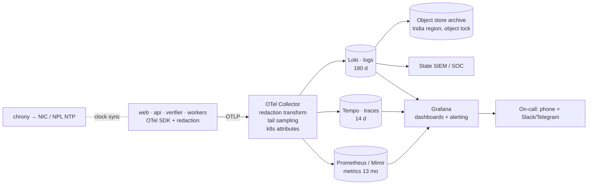

# Observability
> Project: Margdarshak · Owner: Ops lead (Team Chanakya) · Status: Draft v0.1 · Last updated: 2026-10-23
> Related: [INFRASTRUCTURE](INFRASTRUCTURE.md) · [RUNBOOK](RUNBOOK.md) · [CICD](CICD.md) · [COST](COST.md) · [PERFORMANCE](../03-engineering/PERFORMANCE.md) · [AI_EVALS](../04-ai/AI_EVALS.md) · [MODELS](../04-ai/MODELS.md) · [PRIVACY](../06-security-compliance/PRIVACY.md) · [COMPLIANCE](../06-security-compliance/COMPLIANCE.md) · [METRICS](../01-product/METRICS.md)

## 0. Principles
1. **One standard, two backends.** Every service emits OpenTelemetry (traces, metrics, logs). The hackathon exports OTLP to Grafana Cloud plus Sentry for errors; production exports to an OTel Collector and a Grafana LGTM stack **in India**. No code changes between them, only `OTEL_EXPORTER_OTLP_ENDPOINT`.
2. **PII never reaches telemetry.** Redaction happens in the process before export, and again in the Collector (defence in depth). Telemetry carries pseudonymous IDs only.
3. **No behavioural tracking of a child's data** (D-13 revised, DPDP s.9). Every feature, AI included, works for a 16–17 learner in a parent's account (family mode, verifiable parental consent), but that minor's case produces no product-analytics events (API-63) and no data for ads or profiling. Operational telemetry needed to run and secure the service (HTTP status, latency, AI token counts and validator verdicts, never text) is kept, with only pseudonymous or hashed IDs.
4. **Every alert has a runbook link and an owner.** No alert without a playbook in RUNBOOK.md.
5. **Measure the things the judges and the state will ask about:** p95 latency, cold starts, fallback rates, invented-number count, cost in ₹.

## 1. Instrumentation by service
| Service | Library (pin at H0) | Auto-instrumented | Custom spans / metrics |
|---|---|---|---|
| `margdarshak-web` (Next.js 16) | `@vercel/otel` or Next.js `instrumentation.ts` with `@opentelemetry/sdk-node`; `@sentry/nextjs`; web-vitals reporter | route handlers, fetch | `web_vitals_{lcp,inp,cls}` per route and per `lite=true/false`; `page_bytes_first_load` |
| `margdarshak-api` (Go 1.27) | OpenTelemetry Go `go.opentelemetry.io/otel` v1.47.0 (OTLP/HTTP exporters), `otelhttp` v0.72.0 (chi server + outbound `http.Client` transports), a pgx `QueryTracer` hook for DB spans, go-redis v9 OTel hooks, ADK for Go telemetry (`google.golang.org/adk/telemetry`) for model/tool spans, `sentry-go` v0.50.0 with `SendDefaultPII: false` (sentry-go and go-redis are added to go.mod by BE-platform) | HTTP, DB, outbound HTTP, Valkey, ADK/genai calls | rules evaluation, adapter calls (`adapter.name`, `adapter.mode`), ADK graph nodes (§6), validator verdicts, JobRunner start/await, HMAC failures |
| `margdarshak-score-verifier` (Node) | `@opentelemetry/sdk-node` + `@opentelemetry/auto-instrumentations-node` | HTTP | `replay.duration_ms`, `replay.hash_mismatch_total{game}`, `replay.score_delta` (client − server) |
| `margdarshak-workflows` (Render Workflows, TypeScript) | `@opentelemetry/sdk-node` + `@opentelemetry/auto-instrumentations-node`; **trace context passed as a task argument** (`traceparent` string), since runs are separate instances; the HMAC calls to `/internal/job-steps/*` carry it on as a W3C header | outbound HTTP (Go API job steps, R2) | one span per task attempt: `task.name`, `task.attempt`, `task.run_id`, outcome; `clip_pipeline_stage_seconds{stage}` |
| n8n Cloud | execution log (30-day on Pro) + W12 alerts | — | every call to the backend carries `X-MD-Workflow: W0x` and `X-MD-Execution: <id>`, recorded as span attributes |

**Trace propagation:** W3C `traceparent` across web → API → verifier → Workflows. n8n can't propagate W3C context, so the API starts a new root span per n8n call and links it by `n8n.execution_id`.

**Sampling:** `parentbased_traceidratio` at 0.2 in the hackathon (judging day: 1.0 for the demo window); errors and slow spans (> 2 s) kept at 100 % via tail sampling in production (Collector `tail_sampling` processor).

## 2. Logging (structured, PII-redacted)
### 2.1 Format
JSON, one event per line, UTC timestamps with milliseconds, via Go's standard `log/slog` (`slog.NewJSONHandler`, wrapped by the redaction handler from `internal/privacy`, with `trace_id`/`span_id` added from the request context) and `pino` (Node: web, score verifier, workflows tasks):
```json
{"ts":"2026-10-24T09:12:03.418Z","level":"info","service":"margdarshak-api","env":"hackathon-prod",
 "tenant":"jk","trace_id":"4bf92f3577b34da6a3ce929d0e0e4736","span_id":"00f067aa0ba902b7",
 "event":"case.stage_changed","case_id":"case_7Hk2...","from":"S3","to":"S4","actor":"user:u_9fQ...",
 "age_band":"26_40","http":{"route":"/v1/cases/{id}/events","status":200,"duration_ms":41},
 "build_sha":"a1b2c3d"}
```

### 2.2 What is never logged
| Never log | Why | How it's enforced |
|---|---|---|
| Aadhaar numbers (12 digits, with or without spaces), VIDs, OTPs | Aadhaar Act; D-07; EC-20 | redaction in-process: a `slog.Handler` wrapper in `internal/privacy` rewrites every string attribute and the message (12-digit Aadhaar-like numbers validated with Verhoeff, OTP-like codes in context, phone numbers, emails, tokens → `[AADHAAR_REDACTED]` etc.), the same rules in a pino redaction hook for Node, + Collector `transform` processor; a Go test (`go test ./internal/privacy/...`) and a Node test feed samples through the loggers |
| Phone numbers, emails, names, DOB, addresses | DPDP data minimisation | only pseudonymous IDs (`u_…`, `case_…`); E-14 contact is a separate encrypted table that is never serialised in logs |
| LL/DL numbers in clear (E-04, E-05) | identity data | stored hashed; logs show the last 2 characters at most |
| Request/response bodies | may contain any of the above | body logging disabled; only route templates (`/v1/cases/{id}`), not raw paths with IDs |
| Prompt and completion text | may echo user input | LLM telemetry records token counts, IDs, verdicts, never text (§6); a 7-day debug store with access logging is opt-in for the AI lead only |
| Camera frames, audio, clip media | M-09 rule: no frames leave the device | never sent to the backend in the first place |
| Live Intel report contents beyond field enums | IT Rules, defamation risk | only `report_id`, `office_id`, enum values |
| Secrets and tokens | — | header allow-list; `Authorization`, `Cookie`, `X-MD-Signature` dropped |

### 2.3 Log classes and retention
| Class | Examples | Hackathon retention | Production retention (India) |
|---|---|---|---|
| Application | request logs, errors, job outcomes | Render logs (plan default) + Grafana Cloud free tier (14 days [unverified quota; owner Ops lead]) | **180 days hot/warm in Loki + archive** (CERT-In) |
| Security / audit | auth events, admin actions, rule-pack approvals, consent changes, data exports, HMAC failures, `/internal/*` calls | Postgres `audit_log` (E-30, append-only) + logs | **180 days minimum** rolling within Indian jurisdiction (CERT-In Directions 28 Apr 2022, war-room G6) + longer where the state's records policy requires |
| AI telemetry | token counts, cost, verdicts | Postgres `ai_calls` table, 90 days | 180 days |
| Product analytics (F-55) | aggregated, no PII; no events from a minor's case in family mode (D-13 revised) | Postgres, 13 months aggregated | per state policy |

## 3. Production pipeline (India)

- **NTP (CERT-In):** every node syncs to NIC/NPL NTP servers (`samay1.nic.in`, `samay2.nic.in` [unverified hostnames; owner Ops lead; confirm with NIC before the first state go-live], war-room G6). `/v1/health` reports `ntp_offset_ms`; an alert fires above 1,000 ms. Render (hackathon) syncs its own clocks; we record server time from the platform and never trust the device clock (EC-15).
- **Log integrity:** archive bucket with object lock (WORM) for 180 days; daily hash manifest of the archive written to the audit log.
- **Access:** logs are readable by the on-call role only; every query on the audit class is itself audited.

## 4. SLOs
SLIs are measured server-side at the load balancer / Render edge and from synthetic probes (Grafana synthetic monitoring or a GitHub Actions cron probe from India-hosted runners in production).

| # | SLO | SLI | Hackathon target (judging window) | Production target (28-day window) | Error budget |
|---|---|---|---|---|---|
| SLO-1 | Availability: citizen web + API | non-5xx / all requests on `/`, `/v1/*` | 99.5 % | 99.9 % | 40 min / 28 d |
| SLO-2 | Plan card latency (API-01) | server p95 | < 300 ms | < 300 ms | 1 % of requests over 800 ms |
| SLO-3 | Case API latency (API-10..16) | server p95 | < 400 ms | < 400 ms | — |
| SLO-4 | Lite first load (F-51) | ≤ 300 KB transferred; LCP p75 on slow-3G profile | < 300 KB; LCP < 4 s | same | CI budget gate |
| SLO-5 | Debrief available (F-25) | template card shown < 500 ms; coach card p50 < 2.0 s, p90 < 4.0 s (08 §5.8) | template 100 %; coach p90 < 4 s | same | coach fallback < 5 % / day |
| SLO-6 | Score verification (API-35) | p95 replay + response | < 800 ms | < 500 ms | — |
| SLO-7 | Case-clock delivery (F-09) | due notifications sent within 2 h of 06:30 IST | 99 % | 99.5 % | — |
| SLO-8 | Clip pipeline (D-15) | `clip_ingest` completes ≤ 20 min for a 1-min clip, incl. retries | 95 % | — | — |
| SLO-9 | Voice guide (F-30) | session start success; first audio p90 | 95 %; < 2.5 s [target, unmeasured: 04 says no latency figures published] | 99 % | — |
| SLO-10 | Rule freshness | rule rows with `verified_on` ≤ 120 days | 100 % of shown rows | 100 % | CI gate |

## 5. Dashboards
| Dashboard | Panels | Audience |
|---|---|---|
| **D1 Judging-day / service health** | RPS, 5xx %, p50/p95/p99 per route, instance count, cold-start detector (first request latency > 5 s), Render deploy markers, uptime probes | Ops lead, the whole team on demo day (a TV tab) |
| **D2 Journey funnel** (F-55, aggregated) | plan → apply hand-off → LL issued → bridge → DL booked → passed; drop-off by stage; EC banners shown (EC-09, EC-11); hand-off success | Product lead; later the state console (F-41) |
| **D3 AI quality and cost** | calls/min per agent (M-01..M-08), tokens in/out, **₹ per hour and ₹ per debrief**, validator rejections by reason (digit, unknown ID, unverified rule, coverage, tone, language), retry rate, **fallback rate**, circuit-breaker state, invented-number count (must be 0), latency p50/p90 per agent, voice minutes per user vs the 10-min cap | AI lead |
| **D4 Render Workflows** | runs per task, success/failed/retrying, attempts histogram, duration per stage (transcode, blur, propose), queue waits, last failure reason, link to Render Runs page | Ops lead; shown in the demo (D-15) |
| **D5 n8n staff ops + notifier** | n8n: executions/day per workflow vs the ~10k/month Pro budget (burn-down), pending approvals (W08/W09/W17) and their age, HMAC failures. Backend notifier: outbox backlog age, WhatsApp/email/web push sent/failed by channel and Meta error code, STOP latency | Ops lead |
| **D6 Games and anti-cheat** | sessions per game, replay hash mismatches, client–server score deltas, spam-tap penalties, `timing_mode=fallback` share (08 §1.3) | Game lead |
| **D7 Field study (F-57)** | consented participants (n), sessions completed, live % below 60/100, r(LL quiz, Nazar) with 95 % CI from `field_stats_nightly` | Research lead; judges' slide (D-22) |
| **D8 Security** | 401/403 rates, HMAC failures, rate-limit hits, admin actions, data exports, consent revocations, failed logins, WAF blocks (production) | Security owner |
| **D9 Cost (₹)** | Render credits used (manual entry daily), Gemini ₹/day, Sarvam ₹/day, WhatsApp conversations/messages, R2 storage | Ops lead (COST.md) |

## 6. LLM observability
Every model call goes through one Go wrapper (`internal/adapters/ai`, around the ADK runner and the `google.golang.org/genai` client) that emits a span following the OpenTelemetry **GenAI semantic conventions** (`gen_ai.system`, `gen_ai.request.model`, `gen_ai.usage.input_tokens`, `gen_ai.usage.output_tokens`) plus Margdarshak attributes. ADK for Go's own tracing (`google.golang.org/adk/telemetry`, v1.9.0) is used where it exists [unverified: which GenAI attributes it emits and how it shares our tracer provider; owner AI lead, H0].

| Attribute / metric | Example | Why |
|---|---|---|
| `md.agent` | `debrief` (M-02) | per-agent dashboards |
| `gen_ai.request.model` | `gemini-3.1-flash-lite` | drift: the model ID comes from env, re-pinned at H0 |
| `gen_ai.usage.input_tokens` / `output_tokens` | 2,400 / 350 | cost |
| `md.cost_inr` | 0.10 | computed from the price table in `ai/pricing.yaml` (04 §1.7, ₹88/$) |
| `md.latency_ms` | 1,640 | SLO-5 |
| `md.validator.verdict` | `ok` / `retry` / `fallback` | guardrail health |
| `md.validator.reasons` | `["digit_outside_placeholder"]` | what the model got wrong |
| `md.fallback.cause` | `timeout` / `validation` / `no_consent` / `parent_consent_missing` / `breaker_open` / `offline` | EC-29 analysis |
| `md.provenance.replaced_numbers` | 0 | D-10: must be 0 in evals and near 0 live |
| `md.pii.redactions` | 1 | EC-20: counts redactions before send, not content |
| `md.allowed_rule_ids_count` | 4 | closed-ID design check |
| `md.eval_run_id` | `evals-2026-10-24T02:00` | ties nightly eval scores to live behaviour |

**Online quality checks** (no text stored):
- validator rejection rate and fallback rate per hour (alerting below);
- a 1 % sample of debriefs scored by deterministic checks (coverage, length, language ratio) and written to `ai_quality_samples`;
- the voice read-out similarity check (output transcription vs card text ≥ 0.9, 08 §5.7) logged as a metric;
- nightly `evals.yml` results pushed as metrics, so a model-side regression shows on D3 next to live numbers.

**Circuit breaker:** fallback rate > 20 % over 5 minutes opens the breaker for that agent (template cards for everyone) and pages via W12 (08 §5.6).

## 7. Alerts
| ID | Alert | Condition | Severity | Route | Runbook |
|---|---|---|---|---|---|
| A-01 | API 5xx | 5xx > 2 % for 5 min (08 W12 threshold) | SEV-2 (SEV-1 during judging) | phone + Telegram | PB-07 |
| A-02 | Latency | API-01 p95 > 800 ms for 10 min | SEV-3 | Telegram | PB-07 |
| A-03 | Cold start | first-request latency > 10 s on web or API | SEV-2 on demo day | Telegram | PB-03 |
| A-04 | Health probe down | 2 consecutive failures from 2 locations | SEV-1 | phone | PB-03 / PB-07 |
| A-05 | AI fallback spike | debrief fallback > 20 % over 5 min (breaker open) | SEV-3 | Telegram | PB-01 |
| A-06 | AI provider errors | Gemini 5xx/429 > 10 % for 5 min | SEV-3 | Telegram | PB-01 |
| A-07 | Invented number | `md.provenance.replaced_numbers > 0` in production on any agent other than through the validator path, or validator digit rejections > 5 % / hour | SEV-2 | Telegram + AI lead | PB-01 |
| A-08 | Minor's case without parental consent | any AI call, case write or analytics event for a case with `age_band` in (`under_16`, `16_17`) and no valid parental-consent artefact, or any analytics event from a minor's case (must be impossible; D-13 revised) | **SEV-1** | phone | PB-13 |
| A-09 | WhatsApp failures | WhatsApp send failures > 10 % over 1 h (or for one sweep's outbox rows), or Meta error 131047/131026 bursts | SEV-3 | Telegram | PB-02 |
| A-10 | Case-clock missed | no completed `case_clock_sweep` by 08:30 IST | SEV-2 | Telegram | PB-08 |
| A-11 | Workflows failures | task failure after all retries > 3 in 15 min, or a run queued > 10 min | SEV-3 | Telegram | PB-08 |
| A-12 | n8n budget | projected monthly executions > 85 % of ~10k | SEV-4 | email | PB-09 |
| A-13 | n8n down | W12 heartbeat missing for 30 min (the backend expects a 15-min ping from W12) | SEV-3 | Telegram | PB-09 |
| A-14 | Replay mismatch | `replay.hash_mismatch_total` increases | SEV-3 | Telegram | PB-10 |
| A-15 | Rule freshness | any shown rule older than 120 days, or W15 source hash changed | SEV-4 | email | PB-04 |
| A-16 | Wrong fee/rule report | user "this looks wrong" reports on a rule ≥ 3 in 24 h | SEV-2 | Telegram | PB-04 |
| A-17 | Security | HMAC failures > 20 in 5 min; rate-limit spike; admin login from new ASN; mass export | SEV-2 | phone | PB-06 |
| A-18 | NTP drift (production) | `ntp_offset_ms > 1000` | SEV-3 | Telegram | PB-07 |
| A-19 | Log shipping (production) | Loki ingestion gap > 10 min | SEV-2 (CERT-In retention at risk) | phone | PB-07 |
| A-20 | Kerala HPT news | W15-style source check on the Kerala HPT sources reports a change | SEV-3 | Telegram | PB-05 |
| A-21 | Budget | Gemini spend > ₹1,000/day (hackathon) or > 120 % of the forecast (production) | SEV-3 | Telegram | PB-01 / COST.md |

Dedupe: 30 minutes per alert key (08 W12). During the judging window all SEV-2+ alerts page the Ops lead and the backend lead.

## 8. Health endpoints
- `GET /v1/health` (API-64): `{status, build_sha, db, kv, verifier, job_runner, ai_breaker, ntp_offset_ms, log_shipping, rulepack_versions}`; shallow by default, `?deep=true` for synthetic probes (rate-limited).
- `GET /api/health` (web): build SHA, API reachability.
- `GET /healthz` (verifier): self-test replay of one embedded golden session.
