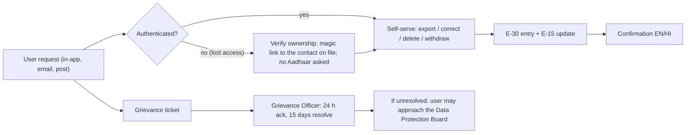

# Privacy
> Project: Margdarshak · Owner: Legal and compliance owner (LC) with Security lead (SEC) · Status: Draft v0.1 · Last updated: 2026-10-23
> Related: [SECURITY_ARCHITECTURE](SECURITY_ARCHITECTURE.md) · [THREAT_MODEL](THREAT_MODEL.md) · [COMPLIANCE](COMPLIANCE.md) · [LEGAL_MEMOS](LEGAL_MEMOS.md) · [EDGE_CASES](EDGE_CASES.md) · Data model: `../03-engineering/DATA_MODEL.md` · [PROJECT_BRIEF](../00-overview/PROJECT_BRIEF.md)

**Wording.** We say "built to DPDP Rules" and "privacy by design". We never say "DPDP-compliant" (D-19).

**Data Fiduciary.** Nestiq Private Limited (team Chanakya), for the independent product. When a State Transport Department hosts Margdarshak (government mode), **the STD becomes the Data Fiduciary** and Nestiq acts as its **Data Processor** under a written contract (DPDP Act s.8(2)); this split is in the adoption MoU (`07-govt-plug-and-play.md` adoption checklist).

**Contact under DPDP Rules 2025 Rule 9 and grievance (s.8(10), s.13).** The Grievance Officer (GO), a named Nestiq director, `grievance@<domain>`, postal address of Nestiq Pvt Ltd, shown in the footer, in the Privacy centre (F-54) and in every notice. Response target: acknowledge in 24 h, resolve within 15 days (our SLA; the outer limit in the Rules is 90 days per secondary sources, [TCSA](https://www.tcsa.in/resources/dpdp-rules-2025-implementation-roadmap) **[secondary]**).

**Legal timing (verified 2026-10-23 from secondary sources).** DPDP Rules 2025 were notified on 13/14 Nov 2025 ([The Week/PTI](https://www.theweek.in/wire-updates/business/2025/11/14/del148-biz-dpdp-rules-ld-govt.html)). The Board provisions took effect at once; consent-manager registration follows at 12 months (about 13 Nov 2026); Rules 3, 5–16, 22 and 23 (notice, security, breach, erasure, children, rights, cross-border) take effect at 18 months, **13 May 2027** ([SCC Online](https://www.scconline.com/blog/?p=371058) **[secondary]**). We build to the full regime now, because the field study (D-22) and a state pilot will run into 2027.

---

## 1. Privacy-by-design commitments
1. **No Aadhaar number, VID, OTP, biometrics, face for matching, captcha or Sarathi password, ever** (D-07). Aadhaar steps are hand-offs to Sarathi.
2. **No document images stored** (E-06 stores only `check_type`, `result`, `checked_at`). Photo and signature checks run on the device (F-06).
3. **Pseudonymous by default.** An applicant (E-01) is a UUID with an age band, language and flags. Contact (E-14) is a separate, encrypted table, joined only when a message is sent.
4. **The plan works with no login** (F-02, API-01). We learn nothing personal from a plan unless the user chooses to save or send it.
5. **Minors are kept out**: no account, no AI, no telemetry, no streaks, no squads (D-13).
6. **Purpose-bound consent artefacts** (E-15) for every optional purpose; one tap to withdraw.
7. **Aggregates only** for analytics (F-55), the state console (F-41, k ≥ 10) and Live Intel (F-11, k ≥ 5).
8. **Short retention** with automatic deletion (§3).

---

## 2. Personal data inventory (per field)

Legend for **legal basis**: **C** = consent (DPDP s.6) recorded as a consent artefact; **V** = legitimate use, data voluntarily provided for a specified purpose where the user has not indicated non-consent (s.7(a)); **L** = compliance with law (s.7(d)-type, e.g. CERT-In logs) **[verify clause numbering against the Act text, owner LC, 2026-11-15]**; **N/A** = not personal data (anonymous or aggregated).

**Who sees it**: U = the user; H = a linked helper (scoped); S = a consented driving school; O = on-call engineer (JIT, logged); P = processor (named).

### 2.1 Citizen core

| Entity · field | Example | Purpose | Basis | Retention | Who sees it | Notes |
|---|---|---|---|---|---|---|
| E-01 `applicant_id` | UUIDv7 | Link records | V | Life of account + 30 days | U, O | Pseudonymous |
| E-01 `age_band` | `18_plus` | Eligibility (F-02), AI gate (D-13) | V | Life of account | U, O | Derived server-side; raw DOB not kept on E-01 |
| E-02 `dob` (in case) | 2007-03-14 | Exact eligibility dates (EC-04 turning 40, EC-05, EC-21) | V | Life of case + 30 days | U, H | Encrypted column; never sent to AI; year-only flag (EC-01) |
| E-01 `language` | `hi` | UI language | V | Life of account | U | — |
| E-01 `flags.minor` / `flags.helper` | — | Gating | V | Life of account | O | — |
| E-01 `disability_needs` (optional) | `deaf`, `colour_vision` | Show rights card and adapted-class path (EC-13) | **C** (explicit, separate tick) | Until withdrawn | U | Health-adjacent; optional; never shared with schools unless separately consented |
| E-02 Case: `state`, `stage`, `path`, `classes`, `office_id`, dates | JK, S4, aadhaar_path | The journey (F-08, F-09) | V | Life of case; closed cases 12 months after S7 then anonymised | U, H | — |
| E-03 ClassSelection | MCWG + LMV-NT | Planner (F-03) | V | With case | U, H | — |
| E-04 LearnerLicenceMirror | issue 2026-10-01, expiry 2027-03-30 | Case clock (F-09) | V | With case | U, H | LL number **not stored** (kept on device only) |
| E-05 DrivingLicenceMirror | validity to 2047 | Renewal reminders (F-16) | V | With case | U | DL number not stored |
| E-06 DocumentCheck | `photo_size_ok=true` | Checklist | V | With case | U, H | No images |
| E-07 FeeQuote | line items | Fee breakdown | N/A (computed from rules) | With case | U | — |
| E-11 TestAttempt | LL pass; DL fail, reason codes | Fail-and-recover (F-13) | V | With case | U only (helpers see "attempt recorded", not the result, unless the applicant shares) | Sensitive to the user socially |
| E-12 TimelineEvent | `ll_expiry_t30` | Reminders | V | With case | U | — |
| E-13 Notification | template ID, delivery state | Delivery tracking | V | 90 days | O | No message bodies stored |
| **E-14 Contact** | phone, email | Send magic links and the reminders the user opted into | **C** for reminders/WhatsApp; V for login email | Until account deletion; phone removed on WhatsApp STOP (EC-30) for messaging purpose | System only; O via JIT | AES-256-GCM + blind index (SECURITY §6) |
| E-15 ConsentArtefact | §4 | Proof of consent | L / V | Life of account + **1 year** after withdrawal or deletion (proof) | U, O | Signed JSON |
| E-29 HelperLink | helper_id, scope, expiry | Helper mode (F-17) | **C** (applicant's) | Expiry + 30 days | U, H | — |
| E-28 Letter | escalation/RTI draft | User-sent letters (F-13, F-14) | V | 12 months | U | The user sends it; we don't |
| E-30 AuditLog | event type, actor hash, time | Security, CERT-In, DPDP Rule 8(3) | L | **1 year** in India (Phase 3+) | O, SEC | No content values |

### 2.2 Learning and games (18+ only for anything stored)

| Entity · field | Purpose | Basis | Retention | Who sees it | Notes |
|---|---|---|---|---|---|
| E-16 GameSession: seed, verified score, version | Readiness (F-21), anti-cheat | V | 24 months or account deletion | U; S if consented | Under-18: not created |
| E-17 GameEvent (bounded, no PII) | Score replay, debrief | V | 90 days raw, then aggregated | System | Taps and timings only |
| E-18 TopicMastery (FSRS, Brier) | Spaced repetition (F-20) | V | Life of account | U | — |
| E-19 Debrief: findings JSON, narration, validator verdict, model ID | AI debrief (F-25) | **C** (AI features consent) | 12 months | U | Narration text from Gemini contains no PII (guarded) |
| Commentary audio (record-then-score, D-12) | Transcribe spoken hazards | **C** (separate mic consent) | **Not stored.** Audio sent to Gemini/Saaras for transcription and discarded; transcript kept 30 days with the session | U | Processor: Google, Sarvam |
| E-22 Achievement, E-23 Squad | Gamification (F-26) | V | Life of account | U, squad members see rank + emoji only | — |
| E-27 PracticeLog + sign-offs | Practice Record (F-28) | **C** (to share with school or third party) | Life of account | U, S (attributed sign-off field) | Never "verified" |
| Field study (F-57) responses: Nazar score, LL quiz score, age band, licence years, district | Pre-registered research (D-22) | **C** (study consent form, 18+) | 24 months, then anonymised dataset (CC-BY release only of aggregates) | Research owner (PL) | Anonymous study IDs; delete on request until anonymisation |

### 2.3 Ecosystem

| Entity · field | Purpose | Basis | Retention | Who sees it |
|---|---|---|---|---|
| E-24 RtoReport (structured fields, reporter hash) | Live Intel (F-11) | V | Raw 90 days; aggregates kept | Public sees aggregates only at k ≥ 5 |
| E-25 DrivingSchool (business data; owner's name and phone) | Listing (F-40) | Contract / V | While listed + 1 year | Public (business info) |
| E-26 Booking | School lessons (API-51) | Contract (via consent) | 3 years (tax/consumer disputes) **[verify retention basis, LC, 2026-12-01]** | U, S |
| School staff accounts | Portal login | Contract | While employed + 90 days | School owner |
| Console users (RTO/state) | Login, audit | L / contract | Per state policy | State admin |
| E-20 Clip (blurred), E-21 ClipRating | Nazar clip bank | See §7 (bystanders) | Published clips: indefinite under CC-BY; raw: 30 days | Public (blurred), raters (raw) |

### 2.4 Analytics (F-55, API-63)
- Event names from a fixed allowlist (`plan_created`, `stage_entered`, `game_completed`, ...), device-session pseudonym rotated every 24 h, no IP stored (truncated to /24 at the edge and dropped), no user agent beyond family, no PII fields accepted by the schema. Aggregated nightly; raw events deleted after 30 days. **Not personal data** once aggregated; the raw stream is treated as personal data until then.
- No third-party analytics, ad SDKs or trackers. Under-18: no analytics at all (s.9(3)).

### 2.5 Data we never collect
Aadhaar number/VID, OTP, biometrics, face templates, captcha, Sarathi/DigiLocker passwords, payment card/UPI details (fees are paid on Sarathi or the state gateway), precise location (no GPS; office chosen from a list), contacts list, photos of documents (checks run on-device), religion/caste, income.

---

## 3. Retention and erasure engine
- A nightly Workflow (`retention_sweep`, behind the `JobRunner` interface) deletes or anonymises rows past their retention per the table above. It logs counts only.
- **48-hour warning.** Before erasing an inactive account for lapse of purpose, we notify the user at least 48 hours ahead (DPDP Rules 2025 Rule 8(2), per [dpdpa.com Rule 8](https://www.dpdpa.com/dpdparules/rule8.html) **[secondary]**). Our inactivity rule: no login and no active case for **18 months** → warning at day 548, erasure at day 550 unless the user logs in.
- **Logs**: processing and traffic logs are kept **at least 1 year** even after erasure (Rule 8(3)) and in India in production; contents are minimised (§2.1 E-30).
- **Third Schedule periods** (3 years for large e-commerce, gaming and social-media entities) don't apply to us at current scale **[secondary; verify schedule text, LC, 2026-11-15]**; our shorter periods above apply.
- **Account deletion mid-case (EC-26):** API-62 deletes E-01, E-02..E-29 rows of that user, crypto-shreds E-14 values, cancels E-12 timers and pending E-13 messages, revokes helper links, and keeps only E-15 proofs and E-30 entries (no content) for 1 year. Confirmation shown and emailed (if an email exists) **before** the email is deleted.

---

## 4. Consent artefacts (DEPA-style, E-15)

Modelled on the DEPA / Account Aggregator artefact pattern (machine-readable, signed, purpose, data, duration, revocable; `07-govt-plug-and-play.md` §A10).

### 4.1 Schema (`schemas/consent-artefact.v1.json`)
```json
{
  "artefact_id": "ca_01JAX9...",
  "version": "1.0",
  "tenant_id": "jk",
  "data_principal": { "applicant_id": "ap_01JAX...", "age_band": "18_plus" },
  "acting_for": null,
  "data_fiduciary": { "name": "Nestiq Private Limited", "role": "fiduciary", "grievance_contact": "grievance@<domain>" },
  "purpose": {
    "code": "PUR-AI-DEBRIEF",
    "text_en": "Use Google Gemini to write a short explanation of your practice results.",
    "text_hi": "आपके अभ्यास के नतीजों की छोटी व्याख्या लिखने के लिए Google Gemini का उपयोग।"
  },
  "data_items": ["game_findings_ids", "topic_ids", "language"],
  "excluded_items": ["contact", "dob", "aadhaar", "otp", "free_text_pii"],
  "recipients": [{ "name": "Google LLC (Gemini API, paid tier)", "role": "processor", "location": "may be processed or cached outside India" }],
  "notice_version": "notice-ai-v1.2-2026-10-23",
  "granted_at": "2026-10-24T10:21:04+05:30",
  "expires_at": "2027-10-24T10:21:04+05:30",
  "status": "active",
  "withdrawn_at": null,
  "channel": "pwa",
  "evidence": { "ui_screen": "S3.ai_consent", "locale": "hi", "device_session_hash": "9f2c..." },
  "signature": { "alg": "Ed25519", "kid": "mg-consent-2026-01", "value": "base64..." }
}
```

### 4.2 Purpose catalogue

| Code | Purpose | Default | Who can grant | Withdraw effect |
|---|---|---|---|---|
| PUR-ACCOUNT | Save and resume my case on any device (email login) | Off until sign-up | 18+ | Account deletion flow |
| PUR-REMIND-WA | WhatsApp reminders for my case (template messages, max 1 nudge a day) | Off | 18+ | Stop within 1 min; also "STOP" reply (EC-30) |
| PUR-REMIND-EMAIL | Email reminders | Off | 18+ | Stop immediately |
| PUR-PLAN-SEND | Send this plan to my WhatsApp once (F-02, API-04) | Off (one-off) | Anyone 18+ entering their own number | One-off; number not kept after send unless PUR-REMIND-WA |
| PUR-AI-FEATURES | Use AI features (voice guide, tutor, debrief narration, screenshot decoder, sign snap) | Off | 18+ only | AI surfaces switch to templates |
| PUR-MIC | Use my microphone for voice and commentary (audio not stored) | Off, asked at use | 18+ | Mic features hidden |
| PUR-DISABILITY | Use my disability needs to tailor guidance | Off | 18+ (or parent for minor, roadmap) | Field deleted |
| PUR-SCHOOL-SHARE | Share my progress and Practice Record with *this* school | Off | 18+ | School loses access immediately |
| PUR-HELPER | Let *this* helper view/edit my draft for *N* days | Off | 18+ applicant | Helper sessions killed (EC-25) |
| PUR-STUDY | Take part in the Nazar study / journey test (F-57) | Off | 18+ | Data deleted until anonymisation |
| PUR-LIVEINTEL | Submit structured reports about an office | Off | 18+ | Future reports blocked; past reports stay as aggregates |

Rules: no pre-ticked boxes; no bundling (each purpose separate; CCPA dark-patterns guidelines also ban forced action); withdrawing is as easy as giving (one tap in F-54); consent screens in the user's language; every artefact references a **notice version**.

### 4.3 Consent managers
Registered consent managers (DPDP s.6(7)–(9), Rule 4) open around Nov 2026. Phase 3+: accept consent via a registered consent manager when a state requires it; our artefacts are already machine-readable.

---

## 5. Notices (EN + HI)

Rule 3 requires a notice that stands alone, is clear and plain, itemises the personal data and the specified purpose, and gives the links to withdraw consent, exercise rights and complain to the Board **[secondary summary; check Rule 3 text, LC, 2026-11-15]**. Shown before the first collection, linked in the footer, versioned.

### 5.1 Short notice: account sign-up (English)
> **Saving your licence plan**
> Margdarshak is an independent app by Nestiq Private Limited. It is not affiliated with MoRTH, NIC or any State Transport Department.
> **What we collect:** your email (to log you in), your date of birth and the vehicle classes you choose (to work out your dates and steps), and the case facts you enter (like your LL issue date).
> **What we never collect:** your Aadhaar number, OTP, fingerprints, face scan or bank details. Those steps happen on the government's Sarathi website.
> **Why:** only to show and remind you of your licence steps.
> **How long:** until you delete your account. Inactive accounts are deleted after 18 months, and we warn you 48 hours before.
> **Your choices:** see, correct, download or delete your data any time in *Privacy centre*. Withdraw any permission in one tap.
> **Questions or complaints:** Grievance Officer, grievance@<domain>. You can also complain to the Data Protection Board of India.
> [Continue] [Read full privacy notice]

### 5.2 संक्षिप्त सूचना: खाता बनाना (हिंदी)
> **आपका लाइसेंस प्लान सेव करना**
> मार्गदर्शक, Nestiq Private Limited का एक स्वतंत्र ऐप है। इसका MoRTH, NIC या किसी राज्य परिवहन विभाग से कोई संबंध नहीं है।
> **हम क्या लेते हैं:** आपका ईमेल (लॉग-इन के लिए), आपकी जन्मतिथि और आपके चुने हुए वाहन वर्ग (आपकी तारीखें और कदम तय करने के लिए), और आपके डाले गए केस की जानकारी (जैसे LL जारी होने की तारीख)।
> **हम कभी नहीं लेते:** आपका आधार नंबर, OTP, उंगलियों के निशान, चेहरे का स्कैन या बैंक विवरण। ये कदम सरकार की सारथी वेबसाइट पर ही होते हैं।
> **क्यों:** सिर्फ़ आपके लाइसेंस के कदम दिखाने और याद दिलाने के लिए।
> **कब तक:** जब तक आप खाता नहीं हटाते। 18 महीने तक इस्तेमाल न होने पर खाता हटा दिया जाता है, और हम 48 घंटे पहले आपको बताते हैं।
> **आपके अधिकार:** *प्राइवेसी सेंटर* में कभी भी अपना डेटा देखें, सुधारें, डाउनलोड करें या हटाएँ। कोई भी अनुमति एक टैप में वापस लें।
> **सवाल या शिकायत:** शिकायत अधिकारी, grievance@<domain>। आप भारत के डेटा संरक्षण बोर्ड से भी शिकायत कर सकते हैं।
> [आगे बढ़ें] [पूरी प्राइवेसी सूचना पढ़ें]

### 5.3 AI features notice (EN)
> **Turn on AI help?** (adults only)
> AI help uses Google's Gemini service to explain your practice results, decode a screenshot of a Sarathi screen, or guide you by voice.
> **Sent to Google:** the IDs of your results and topics, your language, and any screenshot or voice you choose to share. **Never sent:** your contact details, date of birth, Aadhaar, OTP or licence numbers.
> Google may process or briefly store this data outside India. We use Google's paid service, under which Google says it doesn't use your prompts to improve its products; it keeps them for a limited time to detect abuse.
> The AI can't book, pay or submit anything. Every number you see is computed by our code, not by the AI.
> Google's terms require users to be 18 or older.
> [Turn on AI help] [Not now]

### 5.4 AI सहायता सूचना (हिंदी)
> **AI सहायता चालू करें?** (केवल वयस्कों के लिए)
> AI सहायता Google की Gemini सेवा का उपयोग करके आपके अभ्यास के नतीजे समझाती है, सारथी स्क्रीन के स्क्रीनशॉट का मतलब बताती है, या आवाज़ से रास्ता दिखाती है।
> **Google को भेजा जाता है:** आपके नतीजों और विषयों के ID, आपकी भाषा, और वह स्क्रीनशॉट या आवाज़ जो आप साझा करना चुनें। **कभी नहीं भेजा जाता:** आपका संपर्क विवरण, जन्मतिथि, आधार, OTP या लाइसेंस नंबर।
> Google यह डेटा भारत के बाहर प्रोसेस या थोड़े समय के लिए स्टोर कर सकता है। हम Google की पेड सेवा का उपयोग करते हैं, जिसमें Google कहता है कि वह आपके प्रॉम्प्ट से अपने प्रोडक्ट नहीं सुधारता; दुरुपयोग रोकने के लिए वह इन्हें सीमित समय तक रखता है।
> AI कोई बुकिंग, भुगतान या सबमिशन नहीं कर सकता। आपको दिखने वाली हर संख्या हमारा कोड निकालता है, AI नहीं।
> Google की शर्तों के अनुसार उपयोगकर्ता की उम्र 18 वर्ष या उससे अधिक होनी चाहिए।
> [AI सहायता चालू करें] [अभी नहीं]

### 5.5 Helper consent (EN / HI)
> **Let {helper_name} help with your application for {days} days?** They can view and edit your draft. They **cannot** see your test results, change your phone or email, download or delete your data, or send letters. You can stop this any time in *Privacy centre → Helpers*.
> **क्या {helper_name} को {days} दिनों तक आपके आवेदन में मदद करने दें?** वे आपका ड्राफ़्ट देख और बदल सकते हैं। वे आपके टेस्ट नतीजे नहीं देख सकते, आपका फ़ोन या ईमेल नहीं बदल सकते, आपका डेटा डाउनलोड या डिलीट नहीं कर सकते, और पत्र नहीं भेज सकते। आप इसे कभी भी *प्राइवेसी सेंटर → हेल्पर* में बंद कर सकते हैं।

### 5.6 Under-18 screen (EN / HI)
> **You're under 18, so Margdarshak works in simple mode.** You get your licence plan, the checklist and the lessons. We don't save an account, use AI, or track your practice. At 16–17 you can only get a licence for a gearless two-wheeler up to 50 cc, with your guardian's consent. Most scooters are bigger than 50 cc.
> **आपकी उम्र 18 से कम है, इसलिए मार्गदर्शक सरल मोड में चलता है।** आपको अपना लाइसेंस प्लान, चेकलिस्ट और पाठ मिलते हैं। हम कोई खाता सेव नहीं करते, AI का उपयोग नहीं करते, और आपके अभ्यास को ट्रैक नहीं करते। 16–17 वर्ष की उम्र में आप केवल 50 cc तक के बिना गियर वाले दोपहिया का लाइसेंस, अभिभावक की सहमति से, ले सकते हैं। ज़्यादातर स्कूटर 50 cc से बड़े होते हैं।

The full privacy notice (`/privacy`, EN + HI) expands each item of §2 by purpose, lists processors (§8), rights (§6), retention (§3) and the Board complaint route. Dogri and other languages: rule-pack-ready translations only after native review (D-21).

---

## 6. Children's data (under 18)

DPDP Act s.2(f) defines a child as under 18. s.9(1) requires verifiable parental consent; s.9(3) bars tracking, behavioural monitoring and targeted advertising directed at children. Rule 10 sets due diligence that the parent is an identifiable adult, using details already held or details/virtual tokens from an authorised entity including a DigiLocker service provider ([dpdpa.com Rule 10](https://dpdpa.com/dpdparules/rule10.html) **[secondary]**). The Rule 12 / Fourth Schedule exemptions cover classes such as educational and clinical establishments; a B2C learner app is not one ([LiveLaw](https://www.livelaw.in/articles/dpdp-child-data-rules-demand-edtech-platforms-555317) **[secondary]**).

**Our design (Phase 1–2 and Phase 3+ until a parental flow exists):**

| Feature | 16–17 (P-07) | Under 16 |
|---|---|---|
| Plan card (F-02), class info, ≤ 50 cc path, guardian-consent explainer | ✓ (computed, not stored) | ✓ shows "you can apply at 16 for ≤ 50 cc gearless, at 18 for other classes" |
| Checklist, static lessons, LL syllabus (F-20 static) | ✓ | ✓ |
| LL simulator / Nazar practice | Local-only, no server session, no stored score | Same |
| Account, case saving, reminders | ✗ (roadmap: Rule 10 parental flow via DigiLocker) | ✗ |
| AI (all M-xx) | ✗ | ✗ |
| Telemetry, analytics, streaks, XP, squads, share cards | ✗ | ✗ |
| WhatsApp/email | ✗ | ✗ |
| Live Intel, reviews | ✗ | ✗ |
| Parent awareness (s.199A juvenile liability, F-17) | Shown to parents in family mode, not to the minor as shaming | — |

**Parental-consent flow (roadmap, Phase 3+):** parent (18+) signs in → verifies adult status via DigiLocker (Rule 10 Case 2) → creates the minor's case under the parent's account → consent artefact `acting_for` = parent → still no AI, telemetry or tracking (s.9(3)).

---

## 7. Bystanders and the clip bank (E-20)
- Clips are filmed by a passenger or a fixed mount, never by the rider, on public roads (LEGAL_MEMOS M-09).
- Faces and number plates are blurred in the Render Workflow pipeline (M-09 detectors), then a **100% human blur audit** happens before publish; failures go back to the queue.
- Audio is stripped (removes voices and conversations).
- Location metadata (GPS/EXIF) stripped at ingest; captions describe the road type, not the exact spot.
- "Report this clip" on every clip: takedown within 72 h of a credible request, recorded in E-30.
- Released CC-BY 4.0 only after blur audit; raw footage deleted 30 days after publish or reject.
- Contributors (dashcam owners) sign a contribution licence with consent to CC-BY release and a warranty that they filmed lawfully.

---

## 8. Processors and cross-border transfer

| Processor | Data | Location | Basis / safeguard | Phase |
|---|---|---|---|---|
| Render (hosting, Postgres, Key Value, Workflows) | All app data | **Singapore** (no India region: [Render regions](https://render.com/docs/regions)) | DPA with Render; synthetic data + consented 18+ study data only | 1–2 |
| Google (Gemini API, paid tier) | Redacted prompts, finding IDs, screenshots, commentary audio | Gemini API terms: data "may be stored transiently or cached in any country in which Google or its agents maintain facilities" ([terms](https://ai.google.dev/gemini-api/terms), updated 2026-04-28) | PUR-AI-FEATURES consent; paid tier (no use for product improvement; limited logging for abuse) | 1–2 |
| Google Vertex AI (production) | Same | Mumbai `asia-south1` listed for in-region ML processing of several Gemini models ([data residency](https://cloud.google.com/vertex-ai/generative-ai/docs/learn/data-residency)); coverage of current model versions **[unverified]**, AI, 2026-12-01 | Enterprise terms + DPA | 3+ |
| Sarvam AI (Saaras ASR, Dogri) | Commentary/voice audio from users who chose Dogri | India **[unverified]**, AI, 2026-10-30 | Consent + DPA | 1–2 |
| n8n Pro (cloud) | No citizen personal data (ADR-0006); staff work contacts (team, school and RTO/state staff), IDs and k-anonymous aggregates only | EU **[unverified]**, OPS, 2026-10-24; production: self-hosted n8n in India | DPA; minimal payload; 7-day logs | 1–2 |
| Meta (WhatsApp Cloud API) | Phone, template vars | Global | WhatsApp Business terms; opt-in | 1–2 |
| Email provider | Email, message | **[choose at H0]**, OPS | DPA | 1–2 |
| Cloudflare R2 | Blurred clips, static assets (no PII) | Global CDN | — | 1–2 |
| Sentry | Scrubbed errors | US/EU **[unverified]** | `send_default_pii=False`, scrubber | 1–2 |

**DPDP s.16** lets the Central Government restrict transfers to notified countries (a negative-list model). No country had been notified as restricted as of 2026-10-23 **[unverified, LC, recheck monthly]**. Separately, **government hosting** expects India residency for data, logs, backups and AI inference (`07-govt-plug-and-play.md` §A6, §B4), so **Phase 3+ moves every processor into India** or self-hosts (n8n, Bhashini/local Indic models as the AI port alternative).

---

## 9. Data principal rights flows

| Right (DPDP Act) | Where | Flow | SLA |
|---|---|---|---|
| Information about processing (s.11) | Privacy centre → "What we hold" | Live view of every field in §2 for this user, with purpose and processors | Instant |
| Access / export | API-61 | Step-up → JSON + human-readable PDF (EN/HI) → download link valid 24 h | ≤ 24 h (usually instant) |
| Correction / completion / updating (s.12) | Case screens, Privacy centre | User edits; DOB change < 18 → ≥ 18 needs declaration and is rate-limited | Instant |
| Erasure (s.12) | API-62, API-17 | Step-up → confirm screen listing what gets deleted and what we keep (E-15 proofs, E-30 metadata, 1 year) → done | Instant; backups roll off in 30 days |
| Withdraw consent (s.6(4)) | F-54 per purpose; WhatsApp "STOP" | Immediate effect; the backend notifier stops sends on that channel | ≤ 1 min |
| Grievance redressal (s.13) | Footer, Privacy centre, `grievance@` | Ticket ID → acknowledgement 24 h → resolution 15 days → escalation to the Board explained | 24 h / 15 days |
| Nominate (s.14) | Privacy centre | Name + contact of nominee for death/incapacity | Phase 3+ |
| Helper revocation | Privacy centre → Helpers | Revoke → helper sessions killed (EC-25) | Instant |



---

## 10. Breach response (DPDP Rule 7 + CERT-In 6 hours)

| Clock | Action | Owner |
|---|---|---|
| T0 | Detection (alert, report, auditor). Open incident channel; incident commander = SEC | SEC |
| T0 + 1 h | Contain (revoke keys, kill sessions, block IPs, take endpoint offline); preserve logs | OPS |
| **T0 + 6 h** | **CERT-In report** for specified incident types (CERT-In Directions 28 Apr 2022), via incident@cert-in.org.in per the Directions' format **[confirm current channel, SEC, 2026-11-15]** | SEC |
| Without delay | **Board, initial intimation**: description, nature, extent, timing, location, likely impact (Rule 7(2)(a)) | LC |
| Without delay | **Affected users**: plain-language notice via account and registered contact: what happened, likely consequences, what we've done, what they can do, whom to contact (Rule 7(1)) in EN + HI | LC + PL |
| **T0 + 72 h** | **Board, detailed report**: updated facts, causes, mitigation, who caused it (if known), remedial steps, report on user notices (Rule 7(2)(b); extension possible on written request) ([dpdpa.com Rule 7](https://www.dpdpa.com/dpdparules/rule7.html) **[secondary]**) | LC |
| Government mode | Notify the STD (the fiduciary) within 2 h so it can meet its own duties; contract clause | SEC |
| T0 + 5 working days | Post-incident review; threat model and this doc updated | SEC |

Penalties for context (DPDP Act Schedule): up to ₹250 crore for failing to take reasonable security safeguards; up to ₹200 crore for failing to notify a breach; up to ₹200 crore for breaching the children's provisions **[from model knowledge; verify Schedule text, LC, 2026-11-15]**.

---

## 11. DPIA (Data Protection Impact Assessment)

Margdarshak is not a notified Significant Data Fiduciary (s.10), so a DPIA isn't mandated; we run one anyway because a state will ask.

| Step | Finding |
|---|---|
| **Description** | Citizen journey assistant for driving licences; pseudonymous case data; optional contact; optional AI on 18+ users; aggregates for states and schools |
| **Necessity and proportionality** | Every field in §2 maps to a feature; no Aadhaar/biometrics; DOB needed for legal eligibility; contact only for opted-in reminders |
| **Risks to people** | (1) Re-identification of a learner's test fails → embarrassment (P-01); (2) contact leak → phishing using our brand (AC-04); (3) minors' data → s.9 breach; (4) AI misinformation about eligibility → wasted fees and time; (5) bystanders in clips; (6) Live Intel used to harass officials; (7) cross-border processing by Gemini; (8) helper misuse at cyber cafés |
| **Likelihood × severity (before → after controls)** | (1) M×M → L×M; (2) M×H → L×M; (3) M×H → L×H; (4) M×M → L×L (code owns facts); (5) M×M → L×L; (6) M×H → L×M; (7) H×L → H×L (accepted for 18+ consented users, Phase 3 moves to India); (8) M×M → L×M |
| **Controls** | SECURITY_ARCHITECTURE §3–§12; §1–§9 above |
| **Residual risk** | Medium overall in Phase 1–2 (synthetic data limits impact); Low target for Phase 3+ after India residency and external VAPT |
| **Sign-off** | LC + SEC, reviewed with each new purpose or processor; next review before Phase 3 gate |

---

## 12. Hackathon build vs production

| Topic | Hackathon build (Phase 1–2) | Production (Phase 3+) |
|---|---|---|
| Real people's data | **None before the confirmed start (R-14)**; then only consented 18+ field-study participants (journey test n 5–8, Nazar n 40–80) on the Gemini paid tier | Citizens at scale |
| Residency | Render Singapore, Gemini global | India: MeghRaj/empanelled CSP, Vertex AI India region or Bhashini, self-hosted n8n |
| Children | Rules-only, account-less | + Rule 10 parental flow via DigiLocker (still no AI/tracking) |
| Consent managers | Own artefacts | Accept registered consent managers |
| Fiduciary | Nestiq | STD (fiduciary) + Nestiq (processor) in government mode |
