# STQC / Security Pre-Audit Pack
> Project: Margdarshak · Owner: Security lead (SEC) with Product lead (PL) for GIGW · Status: Draft v0.1 · Last updated: 2026-10-23
> Related: [SECURITY_ARCHITECTURE](SECURITY_ARCHITECTURE.md) · [THREAT_MODEL](THREAT_MODEL.md) · [PRIVACY](PRIVACY.md) · [COMPLIANCE](COMPLIANCE.md) C-05, C-06, C-07, C-08 · Ops runbook `../05-ops/RUNBOOK.md` · Government adoption `../10-government/`

**Purpose.** The binder a State Transport Department (STD) hands to NIC, STQC or a CERT-In-empanelled auditor so the "safe-to-host" audit is a formality (`07-govt-plug-and-play.md` §B6). GIGW 3.0 guideline 5.3.1 bars production hosting of a government site until an audit clearance is issued by NIC, STQC, an STQC-empanelled or a CERT-In-empanelled lab ([TCSA](https://www.tcsa.in/learn/who-can-issue-safe-to-host-certificates), [TCSA GIGW](https://www.tcsa.in/learn/gigw-compliance-before-go-live); **SECONDARY**, primary GIGW text to be re-read, PL, 2026-11-01).

**Claim discipline.** This pack makes Margdarshak **audit-ready**. It is never "STQC-certified" until a certificate exists (D-19).

**Status columns.** ✅ evidence exists in the repo at Phase 2 · 🟡 partial / template ready · ⬜ Phase 3 (needs the host, the STD or the auditor).

---

## 1. Audit scope statement (draft for the STD to issue)

| Item | Scope |
|---|---|
| Application | Margdarshak citizen PWA (Next.js 16), FastAPI API (`/v1/*`, OpenAPI 3.1), voice WebSocket (API-40), score verifier (internal), school portal (F-40), state console (F-41), rule-pack studio (F-42), clip admin (API-55) |
| Environments | Staging replica of production in the state's chosen cloud (MeghRaj / MeitY-empanelled CSP / NIC), India region, synthetic data |
| Test types | Black-box and grey-box web application VAPT (OWASP WSTG), API testing, configuration review (OS, container, DB, TLS), source-code review (optional, recommended for auth/policy/pii_guard modules), mobile/PWA review, LLM-specific tests (OWASP LLM Top 10) |
| Exclusions | Government systems behind adapters (Sarathi, DigiLocker, PayGov) — tested by their owners; third-party SaaS (Gemini/Vertex, WhatsApp) beyond our integration surface |
| Accounts given to auditors | One per role (citizen 18+, helper, school owner/instructor, rto_viewer, state_analyst, rule_maker, rule_checker, clip_rater, clip_publisher); a family-mode minor profile inside a parent test account; admin via supervised session only |
| Rules of engagement | Test window, source IPs, no DoS beyond agreed rate, no social engineering of staff, data stays synthetic, findings by encrypted channel |
| Deliverables expected | Findings report (CVSS v3.1/v4.0), retest report, safe-to-host / audit clearance certificate naming URL and version hash |

---

## 2. Evidence binder (what the auditor gets)

| # | Artefact | Location | Status |
|---|---|---|---|
| E1 | System description + architecture diagram + DFD with trust boundaries | `../03-engineering/ARCHITECTURE.md`, [THREAT_MODEL §1](THREAT_MODEL.md) | ✅ |
| E2 | Threat model (STRIDE per component, abuse cases, residual risks) | [THREAT_MODEL](THREAT_MODEL.md) | ✅ |
| E3 | OWASP ASVS 4.0.3 L2 self-assessment with evidence links | [SECURITY §13](SECURITY_ARCHITECTURE.md) + `security/asvs-l2-checklist.csv` | 🟡 |
| E4 | OWASP LLM Top 10 (2025) mitigation matrix + eval results | [SECURITY §14](SECURITY_ARCHITECTURE.md), `ai/evals/` reports | 🟡 |
| E5 | API specification (OpenAPI 3.1) with auth and rate-limit annotations | `../03-engineering/api/openapi.yaml` | 🟡 |
| E6 | SBOM (CycloneDX) per release + vulnerability scan (Grype/Trivy) | GitHub release assets | 🟡 (generated in CI) |
| E7 | SAST/SCA/secret-scan reports (Semgrep, Bandit, pip-audit, pnpm audit, OSV-Scanner, gitleaks) | CI artefacts | 🟡 |
| E8 | DAST baseline (OWASP ZAP baseline + API scan) | CI artefacts | 🟡 |
| E9 | Internal pen-test report (PT-2), LLM red-team (PT-3), anti-cheat test (PT-4), tenancy test (PT-5) | `security/reports/` | ⬜ (Phase 2 end) |
| E10 | Data inventory, retention schedule, consent artefact schema, notices EN/HI, DPIA | [PRIVACY](PRIVACY.md) | ✅ |
| E11 | Incident response plan (CERT-In 6 h, DPDP Rule 7 72 h), contact list, tabletop record | [PRIVACY §10](PRIVACY.md), `../05-ops/RUNBOOK.md` | 🟡 |
| E12 | Logging and monitoring policy (180 days CERT-In, ≥ 1 year DPDP Rule 8(3), in India; NTP to NIC/NPL) | [SECURITY §9](SECURITY_ARCHITECTURE.md) | 🟡 |
| E13 | Key management and crypto policy | [SECURITY §6–7](SECURITY_ARCHITECTURE.md) | ✅ |
| E14 | Access-control matrix (roles × actions) | [SECURITY §4.2](SECURITY_ARCHITECTURE.md), `backend/app/policy/policy_table.yaml` | 🟡 |
| E15 | Backup and restore policy + last restore test record | `../05-ops/RUNBOOK.md` | ⬜ |
| E16 | Business continuity / contingency plan (incl. Sarathi outage EC-11, AI outage EC-29) | `../05-ops/RUNBOOK.md` | 🟡 |
| E17 | Change management: branch protection, CODEOWNERS, release signing, rule-pack maker-checker | `CONTRIBUTING.md`, [SECURITY §16](SECURITY_ARCHITECTURE.md) | 🟡 |
| E18 | Accessibility conformance report (WCAG 2.1 AA) + axe reports | §4 below, CI | 🟡 |
| E19 | Hosting/infra configuration (Dockerfiles, Helm chart / compose, IaC), hardened images | `deploy/` | ⬜ |
| E20 | Third-party/processor list with DPAs and locations | [PRIVACY §8](PRIVACY.md) | 🟡 |
| E21 | Open-source licence report (Apache-2.0 compatible) | CI (`pip-licenses`, `license-checker`) | 🟡 |
| E22 | Site policies required by GIGW (see §3.3) | `/policies/*` pages | 🟡 |

---

## 3. GIGW 3.0 compliance evidence

GIGW 3.0 covers identity and governance, content, accessibility, quality, security and lifecycle. The rows below are our working self-assessment, grouped by theme; guideline numbers other than 5.3.1 are **not cited** until PL reads the primary manual (due 2026-11-01). Each row: requirement as we understand it → how Margdarshak meets it → evidence → status.

### 3.1 Identity, ownership and governance
| Requirement | Margdarshak | Evidence | Status |
|---|---|---|---|
| Site identifies the owning department; government identity used only by the government | Independent mode: no emblem, non-affiliation footer (D-01). Government mode: tenant theme carries the STD's name/emblem **under the STD's authority**, configured by the STD | Tenant config `tenants/<state>.yaml`; screenshots | 🟡 |
| Named Web Information Manager (WIM) | Field in tenant config + "Contact us" page; filled by the STD | Tenant config | ⬜ |
| Domain under gov.in/nic.in for a government site | Government mode served on a domain the STD controls; independent mode deliberately avoids gov-style domains | DNS plan | ⬜ |
| Last-updated date on pages | Footer shows content version and rule-pack `verified_on` | Screenshot | ✅ |
| Contact, feedback and grievance | Footer: Grievance Officer, CPGRAMS link in government mode | Screenshot | ✅ |

### 3.2 Content
| Requirement | Margdarshak | Evidence | Status |
|---|---|---|---|
| Accurate, current, sourced content | Every rule row has `source`, `verified_on`, `confidence`; public CHANGELOG of rule changes; "verify at your RTO" banner on low confidence | Rule packs, CHANGELOG | ✅ |
| Content Contribution, Moderation and Approval Policy (CMAP) | Rule-pack maker-checker (F-42); clip two-rater + blur audit + publisher role (API-55); Live Intel moderation (k ≥ 5, no free text) | Policy page + E-30 approval records | 🟡 |
| Content Review Policy | Rule packs reviewed every 90 days or on gazette change; clips annually | Policy page | 🟡 |
| Content Archival Policy | Superseded rule packs archived read-only with dates; clips retired with reason | Policy page | 🟡 |
| Multilingual content | English + Hindi in full; Dogri voice input; other languages only after native review (D-21) | Locale files `messages/en.json`, `hi.json` | 🟡 |
| Plain language | One question per screen with "why we ask"; reading-level checks on EN copy | Copy review log | 🟡 |
| No broken links; hyperlink policy | Link checker in CI; outbound links only to allowlisted government domains + cited sources; Hyperlinking Policy page | CI report | 🟡 |
| Downloadable documents accessible | Letters/Practice Record PDFs tagged (PDF/UA target) | Sample PDFs | ⬜ |

### 3.3 Mandatory policy pages (templates ready, adopted by the STD in government mode)
| Page | Path | Status |
|---|---|---|
| Copyright Policy (Apache-2.0 code, CC-BY 4.0 rule packs and clips, third-party attributions) | `/policies/copyright` | 🟡 |
| Hyperlinking Policy | `/policies/hyperlinking` | 🟡 |
| Privacy Policy (EN + HI; [PRIVACY §5](PRIVACY.md)) | `/privacy` | 🟡 |
| Terms and Conditions / user agreement (IT Rules 2021 Rule 3(1)(a)–(b) prohibited content) | `/policies/terms` | 🟡 |
| Accessibility Statement (WCAG 2.1 AA, known gaps, contact) | `/policies/accessibility` | 🟡 |
| CMAP, Content Review, Content Archival | `/policies/content` | 🟡 |
| Website Security Policy | `/policies/security` + `SECURITY.md` + `/.well-known/security.txt` | 🟡 |
| Website Monitoring Policy (uptime, performance, broken links, security scans) | `/policies/monitoring` | 🟡 |
| Contingency Management Plan (incl. Sarathi outage, AI outage, defacement) | `/policies/contingency` | 🟡 |
| Grievance / Help | `/help` | 🟡 |
| Disclaimer (non-affiliation in independent mode) | `/policies/disclaimer` | ✅ |

### 3.4 Accessibility (GIGW + WCAG 2.1 AA + RPwD)
| Check | Target | Evidence | Status |
|---|---|---|---|
| Automated | axe-core 0 violations on all routes in CI | CI report | 🟡 |
| Contrast | ≥ 4.5:1 text, ≥ 3:1 large text/UI (UX4G tokens) | Token audit | 🟡 |
| Keyboard | All flows incl. games operable by keyboard; visible focus | Playwright keyboard tests | 🟡 |
| Screen readers | NVDA + Chrome, TalkBack + Chrome on Android: plan, LL application, privacy centre | Manual test log | ⬜ |
| Targets and text | 48 px targets, 18 px+ body text | Lint/visual tests | 🟡 |
| Colour not alone | Icon + colour + words for every status | Design review | ✅ |
| Media | Captions on video; audio-described alternative for hazard clips; no-audio games | Clip pipeline output | 🟡 |
| Motion and flashes | Reduced-motion mode; ≤ 3 flashes/s analysed per clip (WCAG 2.3.1) | Pipeline flash check | 🟡 |
| Language attributes | `lang` per page and per inline Hindi/English segment | HTML check | 🟡 |
| Forms | Labels, error messages in text, "why we ask", no captcha in our flows | e2e | 🟡 |
| Time limits | No time limits except the LL simulator (real format), which offers an untimed practice mode | Design | ✅ |

### 3.5 Quality and performance
| Check | Target | Status |
|---|---|---|
| Lite mode first load | < 300 KB on emulated slow 3G (EC-19) | 🟡 |
| Core Web Vitals (mobile, p75) | LCP ≤ 2.5 s, INP ≤ 200 ms, CLS ≤ 0.1 | 🟡 |
| API latency | p95 ≤ 300 ms for rules/plans; ≤ 800 ms for case writes | 🟡 |
| Availability | 99.5% monthly (production SLO) | ⬜ |
| Cross-browser | Chrome Android ≥ last 3 majors, Samsung Internet, Firefox, Safari iOS | 🟡 |
| Responsive | 320 px to 1920 px; Sarathi's 1366×768 desktop-first problem not repeated | ✅ |

### 3.6 Security (GIGW security clauses + guideline 5.3.1)
| Check | Margdarshak | Status |
|---|---|---|
| Security audit clearance before hosting (5.3.1) | This pack → external VAPT → certificate | ⬜ |
| HTTPS everywhere, TLS 1.2+ | SSL Labs A or better; A+ after HSTS preload | 🟡 |
| Security headers | CSP with nonces, HSTS, XCTO, Referrer-Policy, Permissions-Policy, COOP/CORP, frame-ancestors none | 🟡 |
| No sensitive data in URLs | IDs only; no PII in query strings | ✅ |
| Session security | §3.2 of SECURITY_ARCHITECTURE | ✅ |
| Logs and NTP | 180 days+ in India; NIC/NPL NTP | ⬜ |
| Re-audit | On every major release and at least annually | ⬜ |
| Defacement monitoring | Content hash monitor on public pages; alert to SEC | ⬜ |

---

## 4. Pre-audit self-check (run 2 weeks before the auditor arrives)

### 4.1 Web/API (OWASP WSTG v4.2 subset)
- [ ] INFO: no version banners (`Server`, `X-Powered-By` removed); no `/docs` or `adk web` exposed in production.
- [ ] CONF: TLS config, HTTP methods allowlist, CORS allowlist (no `*` with credentials), directory listing off, error pages generic.
- [ ] IDNT/ATHN: magic link single use, 10 min; OIDC `state`/`nonce`/PKCE; no user enumeration; TOTP/WebAuthn for staff; lockout/backoff on repeated failures.
- [ ] ATHZ: IDOR tests on every `{id}` route (API-11, 12, 13, 14, 15, 16, 17, 36, 45, 47, 51, 52); helper scope tests; maker ≠ checker; RLS cross-tenant tests.
- [ ] SESS: cookie flags, rotation, idle/absolute timeouts, logout-everywhere, CSRF token on state changes.
- [ ] INPV: Pydantic strict models; SQLi (ORM parameterised); XSS (stored via Live Intel is impossible: no free text; reflected via query params); SSRF (no URL fetch tools); file upload (API-42 type/size, re-encode, EXIF strip); JSON parser limits.
- [ ] ERRH: problem+json, no stack traces.
- [ ] CRYP: AES-GCM nonce uniqueness, key rotation `kid`, no secrets in images/env dumps.
- [ ] BUSL: journey state machine edges; Live Intel limits; game session single-use; rate limits per §12.
- [ ] CLNT: CSP violations report-only for 1 week then enforce; no third-party scripts; service-worker scope; "clear this device".
- [ ] APIT: OpenAPI-driven fuzzing (Schemathesis) on all public routes.
- [ ] WebSocket (API-40): origin check, auth token TTL 60 s, message size limits, session caps.

### 4.2 LLM-specific
- [ ] Prompt-injection evalset ≥ 40 cases passes (0 tool calls outside enum).
- [ ] PII vectors: 0 leaks; voice transcript trip ends session.
- [ ] Provenance guard: 0 invented numbers across ≥ 30 cases per agent (D-10).
- [ ] Family mode: AI routes serve a minor profile only under the parent's `PUR-AI-FEATURES` consent artefact (`acting_for` = parent).
- [ ] Safety settings explicitly set (defaults are OFF for Gemini 2.5+).
- [ ] Budget circuit breaker → template fallback works (EC-29).

### 4.3 Infrastructure
- [ ] Containers run as non-root, read-only root FS where possible, minimal base images, Trivy 0 Critical.
- [ ] DB: app role without `BYPASSRLS`, no superuser for the app, TLS to DB, backups encrypted, restore tested.
- [ ] Redis: auth on, not internet-exposed.
- [ ] Object store: raw bucket private, published bucket read via signed CDN URLs, lifecycle rule (raw deleted after 30 days).
- [ ] Secrets only from the secret store/KMS; rotation dates recorded.
- [ ] NTP configured to NIC/NPL; time drift alarm.
- [ ] Logs shipped to India storage, retention 1 year, access logged.
- [ ] WAF managed rules on; DDoS protection from the host.

### 4.4 Privacy and legal (auditor and STD both ask)
- [ ] Data inventory matches the database schema (automated diff of `DATA_MODEL.md` vs Alembic models).
- [ ] Notices EN + HI live and versioned; consent artefacts written for each purpose.
- [ ] Family mode: a minor profile's data never reaches behavioural tracking, profiling or ads; squads and share cards for a minor need the parent's consent.
- [ ] Rights flows: export, correct, delete, withdraw, grievance all tested end to end.
- [ ] Breach runbook rehearsed (tabletop) with timestamps for 6 h CERT-In and 72 h Board milestones.
- [ ] Processor DPAs on file; processors in India for government mode.
- [ ] Non-affiliation footer (independent mode) / STD branding approval (government mode).

---

## 5. Findings handling and timeline

| Severity (CVSS) | Fix target | Re-test |
|---|---|---|
| Critical (9.0–10) | 48 h, hosting blocked | Mandatory |
| High (7.0–8.9) | 7 days, hosting blocked | Mandatory |
| Medium (4.0–6.9) | 30 days or before go-live if the auditor requires | In retest |
| Low (0.1–3.9) | Next release | Optional |
| Informational | Backlog | — |

```mermaid
gantt
  title Path to safe-to-host (indicative, from pilot MoU signature = day 0)
  dateFormat  X
  axisFormat %d
  section Readiness
  Staging in state cloud (India)        :a1, 0, 14
  Internal pre-audit self-check (§4)    :a2, after a1, 7
  Fix internal findings                 :a3, after a2, 7
  section External audit
  Auditor engagement (STD)              :b1, 0, 21
  VAPT cycle 1                          :b2, after a3, 10
  Remediation                           :b3, after b2, 10
  Retest + certificate                  :b4, after b3, 7
  section Go-live
  Pilot at one J&K RTO/ARTO             :c1, after b4, 42
```

Indicative total ≈ 2–2.5 months from MoU to pilot go-live; depends on the STD's auditor procurement (owner PL to confirm with the pilot STD).

---

## 6. Sign-offs

| Role | Name | Date |
|---|---|---|
| Security lead (SEC) | _to fill_ | |
| Product lead (PL) / GIGW self-assessment | _to fill_ | |
| Legal and compliance (LC) | _to fill_ | |
| STD Web Information Manager | _STD_ | |
| Auditor | _CERT-In-empanelled / STQC_ | |
