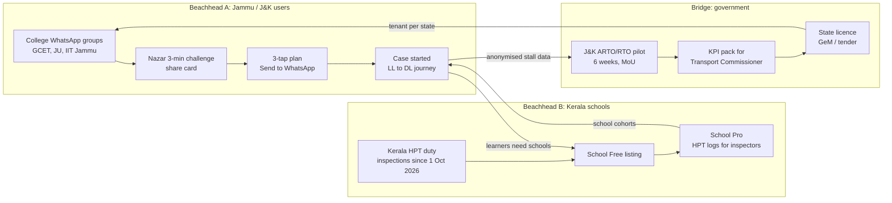
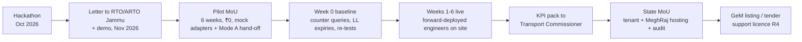

# Go-To-Market
> Project: Margdarshak · Team: Chanakya (@Nestiq Private Limited) · Owner: Business lead · Status: Draft v0.1 · Last updated: 2026-10-23
> Related: [BUSINESS_MODEL](BUSINESS_MODEL.md) · [FINANCIALS](FINANCIALS.md) · [IMPACT](IMPACT.md) · [GOVERNMENT_ADOPTION](../10-government/GOVERNMENT_ADOPTION.md) · [PALANTIR_METHOD](../10-government/PALANTIR_METHOD.md) · [PITCH](../00-overview/PITCH.md) · [PROJECT_BRIEF](../00-overview/PROJECT_BRIEF.md)
> Inputs: `field-kit/NAZAR-FIELD-KIT.md` (recruitment copy), `research/ps1-deep/03-lifecycle.md` §C (schools), `07-govt-plug-and-play.md` (pilot), `research/G-inspiration-library.md` §3 (what wins: WhatsApp, upgrade an existing asset), `war-room/margdarshak-verification.md` D-02, D-16, D-23.
> **HUNCH** marks an untested channel or conversion assumption.

---

## 0. GTM in one line
**Two beachheads, one product:** Jammu college students (users, where we live and can run field studies) and Kerala driving schools (payers, where a mandate creates urgency), joined by **one J&K RTO/ARTO pilot** that turns user numbers into a government case.

---

## 1. Beachheads (smallest viable audiences)

### 1.1 Beachhead A: first-time applicants in Jammu and J&K
| Why here | Evidence |
|---|---|
| We are here, so we can do field work every week | Team at GCET Jammu; ARTO Jammu counter questions are already in the field kit §11.8 |
| The judges and the co-host care about J&K | Dr Simmi Dutta (HoD, GCET): "social relevance to ordinary people, especially women and rural users in J&K" (C-judges §3) |
| J&K has online LL at home or at a CSC, 10 questions with 6 to pass, automated S-track and 8-track in Kashmir, 3 SMS within 24 h after passing | `02-rules-process.md` l.163 (SECONDARY) |
| Hill roads (NH44, Ramban stretch) give Nazar content no other state has | `02-accident-curriculum` §1.9 (via D-14 row 7) |
| Languages we can actually ship: English + Hindi in full, Dogri voice-in (Sarvam Saaras) | D-21, F-50 |
| Enforcement reality to teach against: Srinagar issued 4,11,023 challans in 2024; no helmet 1,10,335; triple riding 11,140 | `02-accident-curriculum` l.136 ([Greater Kashmir](https://www.greaterkashmir.com/article/4-lakh-challans-for-traffic-violations-in-srinagar-this-year/360670)) |

**Segment definition:** 18–24-year-olds in Jammu district who have no DL yet or hold only an LL, on Android, who use WhatsApp daily. Secondary: their parents (P-03) via family mode, and migrants (P-02 Tanvi, Aadhaar in another district).

### 1.2 Beachhead B: Kerala driving schools (the payer)
| Why here | Evidence |
|---|---|
| A legal duty with an inspection behind it | Circular 12 Sep 2026: 3 months of HPT training using open-source computer tools; RTO/Joint RTO inspections since 1 Oct 2026; HPT in effect from 1 Dec 2026 (`02-rules-process` l.91–98) |
| Schools are blamed for failure | Pass rate 95–100% → 40–45% after the 2024 reform (`02-rules-process` l.82) |
| An open, Apache-2.0/CC-BY trainer matches "open-source tools" literally | `07-govt-plug-and-play` §B5 |
| Risk | The owners' Samithi plans a legal challenge (R-10, EC-28). Recheck status before every sales push |

**Segment definition:** licensed (s.12) driving schools in Kerala with 1–4 branches and 1–5 instructors, which are not ADTCs (ADTC land and simulator requirements put most schools out of that class, `03-lifecycle` §C). Number of such schools: **unknown** (owner: Business lead, source the Kerala MVD list by 2026-11-30).

**Why not start schools in J&K?** J&K schools have no mandate, so the pitch is "your students arrive prepared" (PH-02). We sign J&K schools for **distribution** (free tier) in Year 1 and for revenue in Year 2.

### 1.3 Expansion order (after the beachheads)
| Wave | Where | Why | Trigger |
|---|---|---|---|
| 1 | Jammu + Kerala | Above | Now |
| 2 | Delhi, Punjab | Automated tracks with high fail rates: Delhi ~50% (`02-rules-process` l.79); Punjab Faceless RTO (29 Oct 2025) | 1,000 Pro learners and a published J&K pilot |
| 3 | Tamil Nadu, Uttar Pradesh, Rajasthan, Maharashtra | Automated tracks (Maruti had automated 46 ADTTs by Feb 2026, 81 planned; `02-rules-process` l.89) | A second state licence |
| 4 | National via NIC / mParivahan entry card | The RaktKhoj pattern: an entry card inside an existing government app (G §1.4) | Two state tenants live |

---

## 2. First 10 / 100 / 10,000 users

### 2.1 First 10 (during the hackathon, 23–24 Oct 2026): hand-held, observed
| # | Who | How we reach them | What they do | What we learn |
|---|---|---|---|---|
| 5–8 | First-time or prospective applicants on the GCET campus | Field kit §11.2 recruitment message ("Reply LICENCE with a time slot"; tea + ₹100 recharge, same for everyone) | Journey test: lab replica of the observed Sarathi sequence vs Margdarshak, counterbalanced, synthetic identities | J1–J4: time, full success, SUS, "would you still pay an agent?" |
| 2–3 | Mom-Test interviewees | Field kit §6 | 10-min talk about their life, not our idea | Two quotes for the evidence slide |
| 1 | ARTO Jammu counter | Field kit §11.8, 10 minutes on Friday | Three questions: track type, Aadhaar address in another district, PSGA day-limit | Rows in `rules/JK.json` with source "asked at counter, <date>" |

**Rules:** 18+ only; no real Aadhaar, phone or OTP typed; no faces; data under participant codes; replica never public or indexable (field kit §11.8).

### 2.2 First 100 (hackathon weekend → 30 Nov 2026): the Nazar challenge loop
- **Channel:** 3–5 college WhatsApp groups + 10 friends who forward (field kit §0, §1). Copy is pre-written in English and Hindi.
- **Hook:** "3-minute challenge… Can you beat 60/100?" The share card ("I saw the bus 1.2 s late ≈ 13 m at 40 km/h… Can you beat me?") is generated by code and sent on WhatsApp by the backend notifier (F-26, D-16).
- **Target:** n = 40–80 licence holders in the Nazar study (D-22) by Sat 24 Oct 18:00 IST; 100 by 30 Nov.
- **Conversion inside the app:** Nazar taker → "Do you or a sibling need a licence?" → 3-tap plan (F-02) → Send to WhatsApp (API-04).
- **Wording rule:** the field-kit teaser currently says "India's first practice version". It must be edited before it is sent (D-19 bans "first"). Use: "a practice version of Kerala's announced format, with real Jammu road clips".

### 2.3 First 1,000 (Dec 2026 – Feb 2027): colleges + schools + CSCs
| Channel | Mechanic | Target (HUNCH) | Cost (HUNCH) |
|---|---|---|---|
| College ambassadors (5 colleges in Jammu) | One student per college runs a "Licence day": the plan card on a projector + Nazar challenge + help to start cases | 400 cases started | ₹0 cash; certificate + Craftora project credit (sponsor OSEN's platform keeps project pages live, B-sponsors §4) |
| J&K driving schools (free tier) | 10 schools near RTO Jammu and ARTO offices share their invite link with every walk-in | 300 learners | 2 field days/month ≈ ₹3,000 travel |
| CSCs in Jammu district | Helper mode (F-17, P-04) demo for operators: recorded consent, "clear this device", fewer rejected photos | 200 assisted cases | ₹0; operator gets fewer re-dos |
| Kerala schools (Pro pilots at ₹1 for month 1) | 5 schools × ~20 learners | 100 learners | 1 trip to Kochi/Thiruvananthapuram ≈ ₹25,000 |

### 2.4 First 10,000 (Mar 2027 – Oct 2027): content + pilot halo
| Channel | Mechanic | Target (HUNCH) |
|---|---|---|
| **Instagram Reels / YouTube Shorts** (Gary Vee: document, don't create) | 3 formats, 3 posts a week: (1) "Spot the hazard" 15-s clip, answer at the end (no gore, no fear imagery, `05-psychology` §3); (2) "Agent ne ₹4,000 maange, sarkari fee ₹700 + ₹200 card hai" plan-card screen recording; (3) "Track test in 30 seconds" animated explainer (F-12). Every post links to the plan card, not to an app store | 6,000 plans created |
| WhatsApp share loops | Plan card "Send to WhatsApp"; Nazar share card; squad invites (F-26; a minor's profile needs the parent's consent) | 2,000 |
| Kerala Pro schools (40) | Cohort onboarding | 1,600 learners |
| J&K pilot RTO | Counter QR "Plan your licence in 3 taps" (only with the RTO's written permission, non-affiliation line on the poster) | 1,000 |
| Parents via family mode | "Papa's DL has no grace period" reminder (F-16, F-17) | 400 parents |

**Never:** paid installs, fake urgency or countdown dark patterns (CCPA 2023, F-26 lint), "official" wording or the emblem in any creative (D-01, G10), domains containing "parivahan", "sarathi" or "gov".

---

## 3. Channels (Gary Vee: be where the attention already is)

| Channel | Audience | Message | Format | Owner | Metric |
|---|---|---|---|---|---|
| **College WhatsApp groups** | P-01, P-02 | "Can you beat 60/100?" | Text + link + share card | Field lead | Nazar sessions; plan cards created |
| **Instagram Reels / Shorts** | P-01 18–24 | "Bina agent ke" / "spot the hazard" | 15–30 s vertical, Hinglish + Dogri captions | Content lead | Plan-card clicks per 1,000 views |
| **Driving schools (walk-in)** | P-05 | "Hazard-training evidence your inspector can read" (Kerala) / "students arrive prepared" (J&K) | 15-min demo on the owner's phone; leave-behind QR | Business lead | Free→Pro conversion |
| **Driving-school associations (Kerala)** | P-05 | Same, plus the open-source licence | One talk at a district meeting (HUNCH: which association; the Samithi opposes the circular, so approach neutral associations too) | Business lead | Pilot sign-ups |
| **CSCs** | P-04 | "Fewer rejected applications per customer" | 10-min demo; printed one-pager with consent script | Field lead | Assisted cases; consent records |
| **RTO/ARTO counter** | P-01–P-03 at the moment of pain | "Plan your licence in 3 taps" | QR poster, only with written permission | Founder | Plans from the counter QR |
| **Parents** | P-03 | "No grace period. Form 1A at 40+." | WhatsApp card from the child's account | Product lead | Family links |
| **GeM + Transport Commissioner office** | P-06 | "Host it, audit it, own the data" | Pilot MoU + KPI pack | Founder | Pilot signed; KPI movement |
| **Craftora / hackathon page** | Developers, NIC engineers | Open repo, adapter spec | Project page, README | Engineering lead | Stars, forks, issues |

---

## 4. Partnerships
| Partner type | Who (candidates, none approached unless noted) | What we give | What we get | Status |
|---|---|---|---|---|
| **State government** | J&K Transport Department via one RTO/ARTO (pilot); Kerala MVD (HPT content, later) | Free 6-week pilot, open code, audit pack, KPI console | Pilot site, baseline data access (aggregated), letter of outcome | Not approached. Pilot plan: [GOVERNMENT_ADOPTION §8](../10-government/GOVERNMENT_ADOPTION.md) |
| **NIC / MoRTH** | NIC (Sarathi's builder) | Adapter spec (F-56) and a front end that never needs private data sharing, which MoRTH stopped on 1 Oct 2026 (NIC RTI reply, [IFF](https://internetfreedom.in/who-reads-your-vehicle-record-nic-gave-us-numbers-morth-gave-us-a-generic-webpage/)) | Mode B adapter access once a state sponsors it | Not approached |
| **NeGD (DigiLocker)** | NeGD requester onboarding | — | Consent-based DL pull (`partners.DRVLC`) after the event | Feasible post-event through Nestiq Pvt Ltd (G2) |
| **Bhashini** | MeitY Bhashini | Dogri/Kashmiri usage data (consented) | Government-preferred speech path for states | Onboarding terms unknown (`07` §A4) |
| **Academic** | GCET Jammu (co-host), a road-safety research group | Data under pre-registration; co-authorship | IRB-style review, credibility for Tickoo/Sambyal | HUNCH |
| **Incubator** | An incubator eligible under SISFS (e.g. one in J&K) **[unverified which]** | Equity or fee as per scheme | SISFS grant route, mentoring | Owner: Founder, by 2026-11-30 |
| **NGO / road safety** | Road-safety NGOs (e.g. SaveLIFE Foundation, whose CEO Piyush Tewari is a council seat) **[not approached]** | Open clip bank, curriculum | Domain review, CSR introductions | HUNCH |
| **CSR** | Two-wheeler/car makers, insurers, tyre companies **[none approached]** | District programme reports | Funding | HUNCH |
| **Sponsors (hackathon)** | Render, n8n, OSEN/Craftora | Visible, load-bearing use (Render Workflows clip pipeline; n8n clip-review and moderation queues and staff operations) | Render credits ($500/$300/$100 for best use of Workflows); n8n Pro | Active |

---

## 5. Government pilot path (summary; full plan in GOVERNMENT_ADOPTION)

- **Positioning in every government conversation (D-02):** "a reference citizen front end plus an open adapter spec that MoRTH, NIC or a State Transport Department can host." Never "integrated with" anything. Pitch it as an entry card that could live inside mParivahan or UMANG.
- **Forbidden asks:** we never ask for Vahan/Sarathi data, Aadhaar eKYC, or scraping permissions (G1, G3).

---

## 6. Launch plan
| Date | Milestone | Audience | Proof we publish |
|---|---|---|---|
| 23–24 Oct 2026 | Hackathon build + field study | Judges | Pre-registered `HYPOTHESES.md` (commit hash), live counters (API-71) |
| 25 Oct – 15 Nov 2026 | Public repo cleanup; Craftora page; Nazar challenge stays open | Students | n, % below 60/100 with 95% CI |
| Nov 2026 | Kerala school discovery (20 calls), J&K school visits (10), RTO letter | Schools, RTO | Price-test results (PH-01, PH-02) |
| 1 Dec 2026 | Kerala HPT start (if not stayed) → Pro pilots live | Kerala schools | Weekly HPT log exports |
| Jan 2027 | Paid Pro; SISFS application; J&K pilot MoU | Schools, incubator, RTO | — |
| Feb–Mar 2027 | J&K pilot (6 weeks) | RTO, Transport Commissioner | KPI pack ([GOVERNMENT_ADOPTION §10](../10-government/GOVERNMENT_ADOPTION.md)) |
| Q2 2027 | DigiLocker requester onboarding; VAPT; GeM registration | NeGD, state | Audit-ready pack |
| Q3–Q4 2027 | First state licence; wave-2 states | States | Pilot paper / public report |

---

## 7. Messaging per audience
| Audience | Headline | Proof point | Never say |
|---|---|---|---|
| Learner (Kabir) | "Learner se licence tak, bina agent ke." | "Government fee for one vehicle class: ₹700 + ₹200 card (your state may add a service charge). Never pay agents." | "Guaranteed pass", "skip the queue" |
| Parent (Mohan-ji) | "No grace period after your licence expires." | 2019 amendment deleted the 30-day proviso; Delhi HC 2026:DHC:4271-DB (`03-lifecycle` §0.1) | "Your son is an unsafe driver" |
| Helper / CSC | "Help someone apply, with their consent on record." | Recorded consent, "clear this device", auto-logout (F-17, EC-14) | "We do the Aadhaar step for you" |
| Driving school | "Hazard-training evidence your inspector can read." | Signed export of HPT sessions per student | "Certified", "verified", "approved by MVD" |
| RTO officer | "Fewer people at your counter asking what to bring." | Console: queries deflected, stall points per stage | "We replace Sarathi" |
| Transport Commissioner | "Host it, audit it, own the data." | Apache-2.0, adapter spec, MeghRaj-ready containers, pre-audit pack | "Integrated with Sarathi", "official app" |
| CSR head | "1,000 hazard-trained learners in one district, reported with confidence intervals." | Pre/post Nazar gain, pre-registered | Mortality or crash-reduction claims |
| Judges | "The journey is the body; Nazar is the heart." | Field number + before/after metrics | "First", "doesn't exist", "lives saved" |

---

## 8. GTM metrics (AARRR, with targets marked HUNCH)
| Stage | Metric | Event (analytics, API-63, no PII) | Year-1 target (HUNCH) |
|---|---|---|---|
| Acquisition | Plan cards created | `plan_created` | 60,000 |
| Activation | Cases started (S2) | `case_created` | 15,000 |
| Activation | Nazar sessions completed | `game_session_completed{game=nazar}` | 25,000 |
| Retention | Cases active at day 31 (S4→S5) | `stage_entered{stage=S5}` | 50% of LL-issued cases |
| Referral | WhatsApp shares per active user | `plan_shared`, `sharecard_sent` | 0.6 |
| Revenue | Paying school branches | `school_pro_activated` | 60 by Oct 2027 |
| Outcome | Self-declared "no agent" at S7 | `case_completed{agent_used=false}` | 70% of completed cases |
