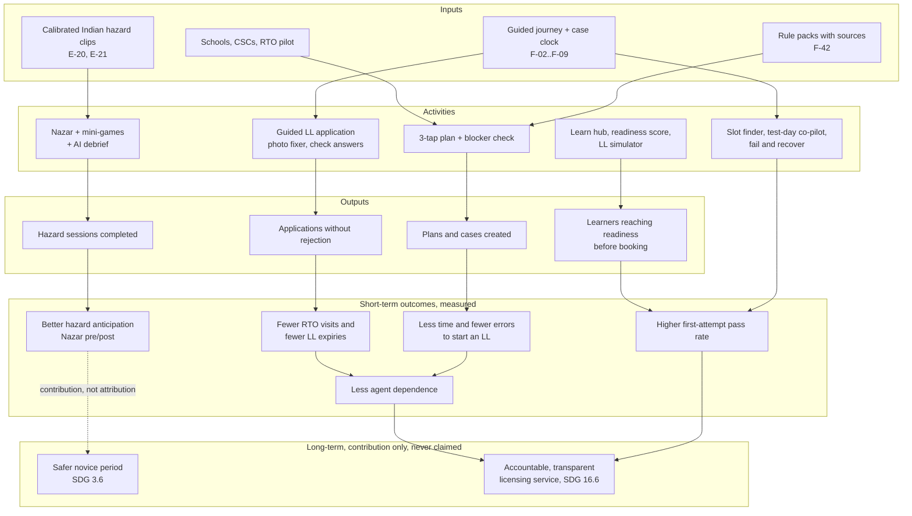

# Impact
> Project: Margdarshak · Team: Chanakya (@Nestiq Private Limited) · Owner: Research lead · Status: Draft v0.1 · Last updated: 2026-10-23
> Related: [VISION](../00-overview/VISION.md) · [BUSINESS_MODEL](BUSINESS_MODEL.md) · [GTM](GTM.md) · [GOVERNMENT_ADOPTION §10 KPIs](../10-government/GOVERNMENT_ADOPTION.md) · `docs/01-product/METRICS.md` · `HYPOTHESES.md` (repo root, committed after the confirmed start) · `field-kit/NAZAR-FIELD-KIT.md`
> **The claims rule (D-22, D-19):** we claim **better test readiness, better hazard anticipation, fewer wasted visits and less agent dependence**, measured and pre-registered. We never claim mortality or crash reductions, and we never use the banned phrase about lives. Road deaths appear only as the *reason* the work matters, with sources.

---

## 1. Why this matters (context, not a claim)
| Fact | Source |
|---|---|
| 1,72,890 road deaths in India in 2023 | MoRTH figures via [Siasat](https://www.siasat.com/1-72-lakh-people-died-in-road-accidents-in-2023-road-ministry-report-3264450/amp/) (PROJECT_BRIEF §2) |
| Over-speeding cited in 68–70%; two-wheeler riders 44.8% of deaths; 54,568 died without a helmet | PROJECT_BRIEF §2; `02-accident-curriculum.md` |
| Heavy vehicles killed 18,556 two-wheeler riders; night accounts for 42% of accidents; highways carry 59% of deaths; uncontrolled and T-junctions account for 37,782 deaths | PROJECT_BRIEF §2 |
| A licensed driver was at the wheel in 70.9% of accidents | PROJECT_BRIEF §2 |
| Crash and near-crash rates are ~8× higher in the first 3 months of solo driving than on the learner permit | Gershon et al. via [PMC3088306](https://pmc.ncbi.nlm.nih.gov/articles/PMC3088306) (`05-psychology.md` l.53) |
| The UK's hazard perception test was associated with an 11.3% fall in non-low-speed public-road crashes in the year after the test | [Horswill 2016 review](https://www.psychologicalscience.org/journals/current-directions/0963721416663186/) |
| A US randomised trial of hazard-anticipation training (n = 5,251 new drivers) found 23.7% lower crash rates for young men and **no overall effect** | [NHTSA DOT HS 812 235](https://rosap.ntl.bts.gov/view/dot/1986) |
| Skid and bravado training **raised** crashes (+12% in Elvik's meta-analysis) | `01-abroad.md` §0.1 (so we never build it, D-11) |
| Agents charge ₹2k–20k against a government fee of ₹700 + ₹200 card for one class | `00-JOURNEY-MAP.md` row 15; CMVR r.32 |

We cite crash research to explain *why we train anticipation*. Our own measurement stops at anticipation and readiness, because that is what we can measure honestly.

---

## 2. Theory of change

### 2.1 Assumptions in the chain (each one is testable)
| # | Assumption | How we test it | Where |
|---|---|---|---|
| T-01 | Knowing the plan up front reduces errors and agent use | Journey test J1–J4 | Field kit §11.6 |
| T-02 | Hazard practice on Indian clips improves anticipation scores | Nazar H3 (paired pre/post on fresh clips) | Field kit §3 |
| T-03 | LL-quiz knowledge does not predict anticipation (so a separate skill needs training) | Nazar H2: \|r\| < 0.3 | Field kit §3 |
| T-04 | Readiness before booking raises first-attempt pass rates | Pilot: pass rate of readiness ≥ 85 vs < 85 (observational, confounded; stated as such) | [GOVERNMENT_ADOPTION §10](../10-government/GOVERNMENT_ADOPTION.md) |
| T-05 | Anticipation gains last | Test-retest after 30 days; FSRS refresh in the new-rider year (F-15) | Year 1 |
| T-06 | Anticipation gains transfer to road behaviour | **Not testable by us.** Only an independent study with crash or near-crash outcomes could test it | Roadmap: academic partner, pre-registered |

---

## 3. Impact metrics

### 3.1 Metric tree
| Level | Metric | Definition | Data source | Target (HUNCH unless pre-registered) |
|---|---|---|---|---|
| **Output** | Plans created | `plan_created` events | API-01 analytics (no PII) | 60,000 in Year 1 |
| Output | Nazar sessions (18+) | Completed, server-verified sessions | E-16 GameSession | 25,000 in Year 1 |
| Output | Practice Records exported | F-28 exports | API-46 | 2,000 in Year 1 |
| **Outcome: access** | Time to start an LL application correctly | Journey test median time_s, Margdarshak vs lab replica | `journey_sessions.csv` | J1: ≥ 40% lower (pre-registered) |
| Outcome: access | Full success (class + path + all planted blockers found before submit) | Field kit §11.5 definition | same | J2: B ≥ 6/8, A ≤ 3/8 (pre-registered) |
| Outcome: access | Usability | SUS (68 = average) | same | J3: B ≥ 75, A ≤ 55 (pre-registered) |
| Outcome: agents | "Would still pay an agent" | Pre → post, and max ₹ | same | J4: falls (pre-registered) |
| Outcome: agents | Self-declared agent-free licences | `case_completed{agent_used=false}` / completed cases | E-02 Case | 70% (HUNCH) |
| **Outcome: readiness** | % of licence holders below 60/100 on Nazar | Kerala's announced format, our clips | E-16 | H1: ≥ 30% (pre-registered; a finding about the gap, not a target) |
| Outcome: readiness | Anticipation gain | Paired pre/post on fresh clips | E-16 | H3: positive, one-sided (pre-registered) |
| Outcome: readiness | Calibration | Brier score on confidence ratings (E-18) | E-18 TopicMastery | −10% from first to last week (HUNCH) |
| **Outcome: system** (pilot RTO) | LL expiries before the DL test | % of LL-issued cases that expire before a test | Pilot console F-41 (aggregated) | −30% vs baseline (HUNCH) |
| Outcome: system | First-attempt DL pass rate | Pilot cohort vs baseline month | RTO aggregate (state-owned) | +10 points (HUNCH; confounded, reported as such) |
| Outcome: system | Counter queries per day | RTO counter tally | Pilot RTO | −20% (HUNCH) |
| Outcome: system | Photo/document rejections | Rejections per 100 applications | RTO aggregate | −50% (HUNCH) |
| **Equity** | Share of women among cases started | Optional, self-declared, aggregated only | E-01 | ≥ 35% (HUNCH); reported by district |
| Equity | Hindi and Dogri-voice use | Language of session | E-01 | Reported, no target |
| Equity | Helper-assisted cases (CSC, family) | E-29 HelperLink | E-29 | Reported |

### 3.2 Before/after product metrics (hackathon, D-22)
| Metric | Before (real portal) | After (Margdarshak) | How measured |
|---|---|---|---|
| Choices on the first screen | ~120 links | 4 verb tiles | Link count from 13 homepage screenshots (`team-saarthi-report` teardown) |
| Screens to start an LL | ~16 | ~6 | Observed Sarathi sequence (`01-sarathi-screens` §A) vs our flow |
| Captchas / OTPs | ~6 / 4+ | 0 in Margdarshak (Aadhaar and OTP stay on Sarathi, D-07) | Same |
| DOB typed | ~6 times | once | Same |
| First-load weight on 3G | to measure | < 300 KB (Lite mode, F-51) | Lighthouse throttled |
| Fields typed vs autofilled | to measure | to measure | Field log |

---

## 4. SDG mapping
| SDG target | Text (short) | Our contribution | Indicator we report (not the SDG indicator) |
|---|---|---|---|
| **3.6** | Halve global deaths and injuries from road traffic accidents | Training the skill the test never checks (anticipation) during the 30-day bridge and the new-rider year; static golden-hour card with 112 and s.134A Good Samaritan protection (F-15, D-14) | Nazar pre/post gain; % of learners reaching 60/100 before the DL test; golden-hour card views. **No casualty indicator** |
| **11.2** | Safe, affordable, accessible and sustainable transport systems for all | Making licensing accessible: Hindi and English in full, Dogri voice-in, Lite mode < 300 KB on 2G, screen-reader paths, helper mode for low-literacy users, women and migrants (P-02) | Journey-test success by group; Lite-mode share; helper-assisted cases |
| **16.6** | Effective, accountable and transparent institutions | Fees and rules shown with source and date; per-RTO stall analytics for the Transport Commissioner (F-41); RTI and escalation templates (F-13, F-14); structured RTO intel with no names (F-11) | Query deflection; approval-stall days; rule-pack change log |
| 16.5 (secondary) | Substantially reduce corruption and bribery | Removing the information gap agents sell; corruption reports deep-link to the state ACB/vigilance and CPGRAMS, never hosted by us (D-14) | "Would still pay an agent" pre → post |

---

## 5. Measurement plan

### 5.1 Phase 1–2: hackathon (23–24 Oct 2026)
| Study | n | Design | Pre-registration | Analysis | Honesty footnote |
|---|---|---|---|---|---|
| **Journey test** | 5–8 first-time applicants | Within-subjects, counterbalanced (4 cells), lab replica (unbranded, `noindex`) vs Margdarshak, synthetic role cards (Tanvi, Rajinder) | J1–J4 in `HYPOTHESES.md`, committed after the confirmed start, hash on the slide | Wilcoxon (time), exact McNemar (success, agent intent), paired t with 95% CI (SUS); every participant's row shown | "N first-time applicants, Jammu, convenience sample; lab replica of Sarathi screens observed 22 Oct 2026; synthetic identities" |
| **Nazar study** | 40–80 licence holders, 18+ | 15-question LL mock → 10 clips (Kerala format, /100) → feedback on 2 clips → 5 fresh clips | H1–H4 | Wilson 95% CI for % < 60; Fisher-z CI for r; one-sided Wilcoxon for pre/post; inter-rater median \|Δonset\| | "Convenience sample of N, 18+, Jammu/Punjab colleges; our clips and windows; not Kerala's clips; no crash outcomes measured" |
| **Before/after product metrics** | — | Counts and Lighthouse runs | Listed in §3.2 | Descriptive | Method on the slide |

Stats code: `analysis/nazar_stats.py` (field kit §7), unchanged after data collection except logged bug fixes. **Data freeze: Sat 24 Oct 18:00 IST.** If A beats B on anything, it goes on the slide too (field kit §11.8).

### 5.2 Phase 3: J&K RTO/ARTO pilot (6 weeks)
- **Design:** interrupted time series at one RTO/ARTO: 2 weeks baseline (counter tallies, LL expiries, rejection counts, pass rates) → 6 weeks with Margdarshak QR at the counter and a CSC helper channel → 4 weeks follow-up. Comparison: a similar ARTO with no intervention, if the department agrees (HUNCH).
- **Pre-registration:** OSF-style document committed to the public repo before baseline starts.
- **Data:** aggregated counts provided by the RTO (state-owned, [GOVERNMENT_ADOPTION §6](../10-government/GOVERNMENT_ADOPTION.md)); Margdarshak analytics without PII (F-55); k ≥ 5 for any cell shown.
- **Confounders stated up front:** seasonality, slot-capacity changes, staff changes, self-selection of users.

### 5.3 Year 1–3: longer horizon
| Question | Method | Partner | When |
|---|---|---|---|
| Do anticipation gains persist? | 30-day and 90-day retest on fresh clips | Internal | Year 1 |
| Does Nazar difficulty generalise across states? | IRT-style difficulty fit across J&K and Kerala takers | Academic partner | Year 2 |
| Does training relate to novice road outcomes? | Independent, pre-registered study with consented outcome data (insurer claims or iRAD via a government partner) | Academic + state | Year 3+, only with ethics approval and only reported by the independent team |

### 5.4 Ethics
- 18+ for every study; anonymous IDs; delete on request; no faces or plates in published clips (blurred, audited 100%, M-09).
- No "unsafe driver" or "you would crash" wording; results are "practice scores".
- Thank-you incentives are equal and not tied to performance.
- Under-18 users (P-07) are never study participants.

---

## 6. Stories (Mike Ross: the person behind the number)
*These are the synthetic personas from PROJECT_BRIEF §4, used as role cards. Real stories from the field study will replace them only with consent, audio-only, no names.*

- **Kabir, 19, Jammu (P-01).** An agent quoted ₹4,000. In 3 taps he learns the government fee for a bike is ₹700 + ₹200 card, that he can add a car to the same LL, and that his earliest DL test is day 31. On Nazar he taps 1.4 s late on a bus pulling out at 40 km/h. That is about 16 m. The debrief tells him where to look next time: parked buses and their front wheels.
- **Tanvi, 19, student in Jammu, Aadhaar address in Kathua (P-02).** The real portal does not warn her about the address mismatch or the blank relation line. Margdarshak flags both before she pays (EC-02, EC-03) and tells her which office to choose and what to bring.
- **Mohan-ji, 52 (P-03).** His son says one sentence to the voice guide: "Papa 52 saal ke hain, unko car ka licence chahiye." The plan shows Form 1A, the renewal window and that there is no grace period. The son runs the case in family mode with consent on record.
- **A Kerala school owner (P-05).** The inspector visits. Instead of a paper register, the owner opens a signed export: 23 students, HPT minutes per week, Nazar scores, instructor sign-offs, each line marked "practice and familiarisation, not certification".
- **An ARTO counter clerk (P-06).** Fewer people ask "what documents?" because the QR poster answers it before they reach the window.
