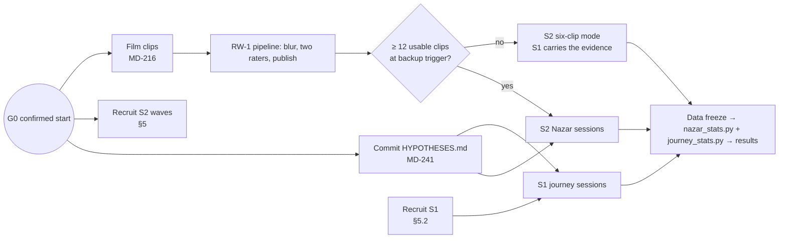

# Field Study
> Project: Margdarshak · Team: Chanakya (@Nestiq Private Limited) · Owner: Product/design lead (study lead) · Status: Draft v0.1 · Last updated: 2026-10-23
> Related: [IMPLEMENTATION_PLAN](IMPLEMENTATION_PLAN.md) §3, §7 · [BACKLOG](BACKLOG.md) EP-17a, EP-17b, EP-38 · [TEAM](TEAM.md) · [GLOSSARY](GLOSSARY.md) §8 · [PRIVACY](../06-security-compliance/PRIVACY.md) · [METRICS](../01-product/METRICS.md) · [PITCH](../00-overview/PITCH.md)
> Inputs: `field-kit/NAZAR-FIELD-KIT.md` (protocols, consent, hypotheses draft), `field-kit/nazar_stats.py` (analysis script), PROJECT_BRIEF §12, directive D-22, `research/ps1-current-state/01-sarathi-screens.md` (lab replica source).

This document turns the field kit into the study protocol for Margdarshak (F-57). It covers two studies run during the hackathon, the before/after product metrics, and the larger studies that follow in production. **Nothing in this file is collected before gate G0 (the confirmed start), and HYPOTHESES.md is committed after G0 and before the first participant session** (R-14, MD-241).

---

## 0. What we are allowed to claim

| We may say | We never say |
|---|---|
| "X% of N licence holders in our sample scored below 60/100 on a practice test in Kerala's announced format" | That anyone would fail Kerala's actual test, or that Kerala's clips were used |
| "In this sample, LL-quiz scores were weakly correlated with Nazar scores (r = Y, 95% CI …)" | That the LL test "doesn't work" |
| "k₁/N → k₂/N completed the application fully right; median X → Y minutes" | That Margdarshak cuts licence time nationally |
| "Better test readiness and anticipation in this sample" | Any claim about crashes or deaths prevented; any verdict on a person's driving |
| "Convenience sample, pre-registered at <hash>" | Representative of India, Jammu or students in general |

Wording bans (D-19) apply to every slide, card and message produced from this study.

---

## 1. Studies at a glance

| ID | Study | Question | Design | N (target) | Where | Phase / tickets |
|---|---|---|---|---|---|---|
| **S1** | **Journey test** | Does Margdarshak let first-time applicants get the LL application fully right, faster, with less wish to pay an agent? | Within-subjects, 2 systems × 2 role cards, counterbalanced (4 cells) | 5–8 (over-recruit 10) | In person, GCET campus or similar | P1 lab (MD-139/140), P6 run (MD-625) |
| **S2** | **Nazar study** | What share of licence holders score below 60/100 in Kerala's announced format? Does LL-quiz knowledge predict it? Does one round of feedback help? Do our raters agree? | Single-arm online session with a pre/post feedback block; two-rater clip annotation | 40+ (stretch 80) | Online on own phone; 3–5 in person (think-aloud) | P2 plumbing (MD-237..241), P6 run (MD-626) |
| **S3** | **Before/after product metrics** | How much simpler is the journey, measured on the artefacts? | Counts and measurements on the real site vs Margdarshak | n/a | Desk | P1/P6 (MD-110, MD-119, MD-612) |
| **S4** | **Production studies** | Validity, reliability and real-office outcomes | See §12 | 200+ / pilot office | Online / pilot RTO | P6–P7 (MD-714, MD-718) |



---

## 2. Roles and governance

| Role | Who | Duties |
|---|---|---|
| Study lead (PI) | PD | Protocol, consent, recruitment, deviations log, reporting; final say on what is claimed |
| Analyst | BE | Exports, `nazar_stats.py` run, `journey_stats.py` (written before journey data exists), RW-4 counters |
| Lab builder and observer | FE | Lab replica (MD-139), session logging checks, observes S1 sessions |
| Raters (2) | Two people not told each other's marks | Independent hazard windows per clip (MD-219) |
| Observers (1–2) | Recruited helpers | S1 note-taking; never help participants beyond the scripted lines |
| Adviser | Faculty adviser at the host college, if available [unverified: owner PD, 2026-10-23] | Reads this protocol and the consent texts before sessions; not a formal ethics board |

**Ethics review status.** This is a student research project within a hackathon. No institutional ethics board approval has been obtained; the risk to participants is minimal (practice tasks, synthetic identities, anonymous data). We ask the faculty adviser to read the protocol before the first session and record the outcome in the deviations log. If the host institution requires formal review for student studies, sessions wait for it [unverified whether required; owner PD, 2026-10-23].

---

## 3. S1 · Journey test protocol

### 3.1 Aim and measures
Compare the **observed Sarathi LL sequence** (lab replica) with **Margdarshak's guided application** for first-time or prospective applicants.

Primary measures: completion time (`time_s`), full success (`full_success`), SUS, "would still pay an agent" (pre vs post). Secondary: errors, back-navigations, help requests, blockers found, screens visited, date-question accuracy, extra-document accuracy, real-site navigation (Task 0).

### 3.2 Setup
- **Laptop A: lab replica `/lab/sarathi-sequence`** (MD-139). Reproduces the observed Aadhaar path: A1–A2 instructions; A3 category / "holds none" / country of birth / RTO-camp / captcha; A4–A5 authentication with a simulated OTP card shown after 10 s; A6 form body (class of vehicle shown only as Sarathi codes MCWG/MCWOG/LMV-NT); A8 application number; A9–A10 upload with re-entry of application number + DOB + captcha (lengths 10/16 as observed); A12 fee shown only after "Click Here to Calculate Fee"; A13 verify pay.
  - Unbranded: no emblem, no NIC or Parivahan logo. Red banner: "Research replica of public Sarathi screens. Not a government site." `noindex`; reachable only with the lab token.
  - The FAQ PDFs from the real site are open in a tab, and web search is allowed, as in real life.
- **Phone B: Margdarshak** demo tenant: plan → blockers → guided application → check answers → fee → hand-off (simulated).
- **Logging (automatic, both systems):** start/end time, screens visited, back-navigations, validation errors, selections (API-70). Observer notes help requests on paper with timestamps.
- **Role cards (synthetic identities, printed):**
  - **Case X "Tanvi":** 19, rides the family Activa (no gears); Aadhaar address Kathua, lives in Jammu; Aadhaar shows "C/o" but no "D/o" line; Aadhaar number `0000 0000 0001` (fake; only the replica accepts it). **Correct outcome:** class MCWOG; flags the address mismatch and chooses an office knowingly; flags the relation-line risk before submitting.
  - **Case Y "Rajinder":** 42, wants a car licence, also owns a geared bike he won't test on; Aadhaar address current. **Correct outcome:** class LMV-NT only; Form 1A (over 40) identified before submitting.
- **Counterbalancing (4 cells, rotate in order of arrival):** A-first + X/Y · A-first + Y/X · B-first + X/Y · B-first + Y/X.

### 3.3 Task script (about 35 minutes per person)
1. **Pre-questions (2 min):** age band; ever applied? (none / via agent / self); "If you needed a licence next month, would you pay an agent? Maximum ₹?"; confidence 1–5 "I know every step until I hold the licence".
2. **Task 0, real site (≤ 5 min, timed):** "On parivahan.gov.in, find the page where someone in J&K would start a new learner's licence application." Stop at the "New LL Stage Details" page; no data entry. Record time and wrong clicks; cap at 5 minutes.
3. **Condition 1 (≤ 12 min cap):** "Using this role card, apply for the learner's licence this person needs. Tell me if anything would stop the application." Think aloud. The observer never helps unless asked; each request is logged as **H** and answered only with "What would you do at home?"; on a second request, point to the FAQ tab.
4. **Post-condition 1 (3 min):** SUS (10 items, 5-point, printed in English and Hindi); "What's the earliest date this person can take the driving test, and when does the LL expire?" (correct: day 31 after LL issue, and about 6 months); "Would this person need any extra document or fix before applying?"
5. **Condition 2:** same, with the other role card on the other system.
6. **Post-condition 2:** same as step 4.
7. **Exit (3 min):** "Now, would you pay an agent? Maximum ₹?"; "Which one would you use, and why?" (write exact words); optional audio-only quote (separate consent).
8. **Debrief:** explain that the replica is a research copy and Margdarshak is a prototype; thank; give the recharge.

### 3.4 Observer script (verbatim lines only)
- Start: "We're testing the software, not you. There are no wrong answers. Please think aloud."
- On a help request: "What would you do if you were at home?" (second time: "The FAQ is open in that tab.")
- At the cap: "Thank you, let's stop there."
- If a participant starts typing real personal data: "Please stop, use only the card." Stop the session if it continues; delete that row (exclusion rule).

### 3.5 Definitions
- **full_success** = completed AND class_correct AND path_correct AND all planted blockers identified **before** submit.
- **blockers_planted** = 2 per case (X: address mismatch, relation line; Y: Form 1A, plus the correct single class).
- **SUS score** = ((sum of odd items − 5) + (25 − sum of even items)) × 2.5; 68 is the average benchmark (MeasuringU).

### 3.6 Data sheet (`journey_sessions.csv`, one row per participant × condition)
`pid, cell, order(1|2), system(sarathi_lab|margdarshak), case(X|Y), t0_real_site_s, t0_wrong_clicks, start_ts, end_ts, time_s, completed(0/1), class_correct(0/1), path_correct(0/1), blockers_found(0–2), blockers_planted(2), full_success(0/1), errors_validation, backtracks, screens_visited, help_requests, sus_1..sus_10, sus_score, date_q_correct(0/1), extra_doc_q_correct(0/1), pre_agent_yn, pre_agent_max_inr, post_agent_yn, post_agent_max_inr, preferred(A|B), quote_text, audio_consent(0/1), observer, notes`

(`system` uses `margdarshak` where the field kit used the earlier working name.)

### 3.7 Pre-registered hypotheses (go into HYPOTHESES.md, §6)
- **J1:** median `time_s` for Margdarshak is at least 40% lower than for the replica (paired, Wilcoxon signed-rank, one-sided).
- **J2:** `full_success` count Margdarshak > replica (exact McNemar, one-sided); prediction Margdarshak ≥ 6/8, replica ≤ 3/8.
- **J3:** mean SUS Margdarshak ≥ 75 and replica ≤ 55; paired difference reported with a 95% CI (t).
- **J4:** the number answering "would still pay an agent" falls from pre to post (McNemar), and the median maximum ₹ falls.
- **Exclusions:** participant reveals real personal data (stop, delete, exclude); system crash > 60 s (rerun once, flag).
- **Small n:** report every participant's row, medians and CIs; no claims beyond "in this sample".

---

## 4. S2 · Nazar study protocol

### 4.1 Aim
Estimate how many licence holders in our sample score below Kerala's announced pass mark on a practice test in that format; test whether LL-quiz knowledge predicts hazard anticipation; test whether one round of feedback improves scores on fresh clips; and check that our two raters agree on hazard onsets.

### 4.2 Materials
- **Clips.** Filmed in Jammu by a passenger or a fixed mount (never the rider), 30 fps, landscape; cut to 20–60 s each with one developing hazard (bus pulling out, door opening, pedestrian stepping off a median, wrong-side two-wheeler, child near a school gate) plus 2–3 no-hazard clips to measure over-tapping. Every clip passes the RW-1 pipeline: transcode → blur faces and plates → (optional AI window proposal, offline) → **two independent raters** → agreement → publish, with a 100% human blur audit; raw footage deleted after the audit (MD-216..218).
- **Blocks and forms.** With ≥ 15 usable clips, split them into three blocks of 5 (B1, B2, B3) balanced on curator difficulty. Three forms rotate in order of arrival: **Form A** test = B1+B2, fresh = B3 · **Form B** test = B2+B3, fresh = B1 · **Form C** test = B1+B3, fresh = B2. This replaces the field kit's two forms so that every block appears as "fresh" equally often, which balances clip difficulty across the pre/post comparison (proposed in DEC-017; confirm before MD-241).
- **LL mock.** A fixed 15-question set in the common LL format (signs, rules, documents), identical for everyone, no variants (so `ll_score` is comparable). This is a study instrument, not the J&K state format (10 questions).

### 4.3 Session flow (online, about 4–6 minutes)
1. Consent (§6.1). Declining ends the flow; nothing is stored.
2. Age band (18–20, 21–24, 25–34, 35+), licence held (LL, 2W, 4W, both), years driving/riding (0–1, 1–3, 3+).
3. The 15-question LL mock.
4. **10 test clips** (the form's test blocks), Kerala format: tap anywhere when you see a developing hazard; a flag shows where you tapped.
5. **Feedback replay on 2 clips:** the hazard band on the scrub bar with your taps, and the late fact, e.g. "hazard began 0:04.2, you tapped 0:05.6 → 1.4 s late ≈ 16 m at 40 km/h" (numbers from code).
6. **5 fresh clips** (the form's fresh block).
7. Score card and optional share (no PII; our domain only).
8. Optional one line: "Has a near-miss ever happened to you? What happened?" (no names; free text is stored only in the study table, never shown publicly without a quote consent).

**In person (3–5 people):** sit beside them, ask them to think aloud, and record audio-only or faceless 10-second reactions with separate consent, for the video.

**AI in the study cohort.** The study cohort uses the **template debrief only** (no Gemini calls), unless Gemini paid-tier billing is confirmed (DEC-020) and the AI consent purpose is granted. This keeps the study inside the Gemini terms and D-13.

### 4.4 Scoring (pre-registered)
- **Window per hazard:** onset `a` = mean of the two raters' onsets; end `b` = mean of the two raters' ends. Clips with rater |Δonset| > 1.0 s go to a third rater; if still > 1.0 s, the clip is dropped before any participant data is scored (logged).
- **Primary score (product rule, F-23):** split [a, b] into 5 equal bands; the first tap in the window scores 5, 4, 3, 2 or 1; scale to 10 marks per clip (one hazard ×2; two hazards each out of 5). **Pattern-click rule:** more than 3 taps in any 1.0 s, or more than (2 × hazards + 4) taps in a clip, scores 0 for that clip. Taps before `a` are logged as anticipation taps and score nothing. Test score = sum over 10 clips (0–100).
- **Sensitivity score (field-kit rule):** full 10 marks if the tap falls in [a, a + 2 s], linear decay to 0 at a + 5 s, 0 before a. Computed from the same tap logs and reported alongside; claims use the primary score.
- **Late facts:** `late_s = t_first − (a + band1_end)`; `metres = late_s × speed_kmh_est / 3.6`.
- **No-hazard clips:** any tap counts as a false alarm (reported); these clips are not part of the 100-mark score.

### 4.5 Exclusions (pre-registered)
- Declared under 18 (`age_ok = 0`): the flow does not start; if it slips through, excluded.
- Total session < 60 s.
- More than 3 taps per second anywhere in the session (`max_taps_per_s > 3`).
- Retakes (`retake_of` set) are excluded from H1–H3 and used only for test-retest.
- Sessions with integrity trust < 0.6 (hidden tab during a clip, timing drift) are reported but excluded from H1–H3 (a deviation from the field-kit draft, which did not have this rule; listed in HYPOTHESES.md before data).

### 4.6 Mom Test interviews (3 people, 10 minutes each)
Ask about their life, not our idea:
- "Tell me about the last time you got your licence. What did the test actually check?"
- "Tell me about the last time something on the road surprised you. What happened, and when did you notice it?"
- "Has anyone ever taught you *where to look*? Who, and how?"
- For learners after the test: "What would you do differently tomorrow?"
Write down exact words; use at most 2 quotes on the slide, with consent.

---

## 5. Recruitment

### 5.1 S2 Nazar (target 40+, stretch 80)
- **Eligibility:** 18+, holds an LL or DL (2W or 4W). No other restriction.
- **Channels:** 3–5 college WhatsApp groups (host college and nearby), 10 friends who each forward it, campus in person, the share card ("Challenge me on the same 10 clips").
- **Waves:** wave 1 at link drop; wave 2 if fewer than 20 completed sessions by the mid-study check; no paid ads.
- **Incentive:** none (the score card only), so there is no money tied to performance.
- **Message (English):**
  > 3-minute challenge for anyone 18+ with a driving licence or learner's licence. Kerala has announced a hazard perception test for licences from December: you watch road clips and tap when you see danger. For a hackathon research project (team Chanakya, HackCache '26) we built a practice version on real Jammu road clips, with faces and number plates blurred. Can you score 60/100? No name, no phone number, fully anonymous. Link drops <day, time>. Reply IN.
- **Message (Hindi, Romanised as used in college groups):**
  > Driving licence ya learner licence hai (18+)? Sirf 3 minute ka challenge. Kerala ne December se licence ke liye hazard perception test announce kiya hai: road ki video dekho aur khatra dikhte hi tap karo. Hackathon research project (team Chanakya, HackCache '26) ke liye humne Jammu ki asli sadkon ki clips par iska practice version banaya hai; chehre aur number plate blur hain. Kya aap 60/100 cross kar paoge? Naam ya number nahi chahiye, poora anonymous. Link <din, samay> ko. Reply karo IN.
- **Share card text (generated from server-verified numbers):** "I saw the hazard {late_s} s late (≈ {metres} m at {speed} km/h) on Nazar. Practice score {score}/100. Can you beat me on the same clips? <link>". No "fail" verdict wording on the card.

### 5.2 S1 Journey test (target 5–8, over-recruit to 10)
- **Eligibility:** 18+, has never applied for a driving licence (or is about to). Aim for 2 people who live away from their Aadhaar district and 1–2 non-students with lower digital comfort (with consent and extra patience).
- **Incentive:** tea + ₹100 mobile recharge, the same for everyone, not tied to performance.
- **Message (English):**
  > Never applied for a driving licence? We need 35 minutes of your time (<day>, <campus>) for a student research project for HackCache '26 (team Chanakya). You'll try applying for a practice learner's licence two ways, using a made-up identity (no real Aadhaar, phone or personal details). Tea + ₹100 recharge as thanks. 18+ only. Reply "LICENCE" with a slot: 10:00 / 11:00 / 12:00 / 14:00.
- **Message (Hindi, Romanised):**
  > Kabhi driving licence ke liye apply nahi kiya? <din> ko <campus> mein 35 minute chahiye, HackCache '26 ke student research project (team Chanakya) ke liye. Aap ek practice learner's licence do tareekon se apply karke dekhenge, nakli pehchaan ke saath (asli Aadhaar, phone ya personal details nahi). Shukriya mein chai + ₹100 recharge. Sirf 18+. "LICENCE" likh kar time batayein: 10 / 11 / 12 / 2 baje.

### 5.3 Shortfall rules
- Report the actual N; never pad, never re-run excluded people, never recruit from inside the team.
- If S2 N < 20 after wave 2, the slide shows S1 as the headline evidence and S2 as "pilot, n = …".
- If S1 N < 5, report each participant's row and drop inferential tests (descriptive only).

---

## 6. Consent and the HYPOTHESES.md template

### 6.1 S2 consent screen (in the app, before anything else)
> **Nazar is a practice tool and a student research project by team Chanakya for HackCache '26.**
> - You must be 18 or older.
> - We store only: an anonymous ID, age band, licence type, years driving/riding, your quiz and clip scores, and your tap times.
> - We do **not** collect your name, phone number, licence number, face or location.
> - The clips show public roads; faces and number plates are blurred.
> - Results are for practice only. They say nothing about how you drive on real roads, and this is **not** affiliated with any Motor Vehicles Department or with MoRTH or NIC.
> - Your feedback text is written from templates; no AI service receives your answers in this study.
> - You can delete your data at any time with your anonymous ID.
> [ I am 18+ and agree ] [ No thanks ]

(Hindi version reviewed by a native speaker before use, MD-603.)

### 6.2 S1 consent (read aloud, then sign)
> This is a student research project for HackCache '26, not a government service. You will try two practice versions of a learner's-licence application using a **made-up identity** we give you. Please do **not** type any real Aadhaar, phone number, OTP or password. We record your time, clicks and answers to a short questionnaire under a participant code (P01…). We do not record your face. With your permission we may record **audio only** of one sentence of feedback for our video; you can say no and still take part. You can stop at any time without giving a reason, and ask us to delete your data. We are testing the software, not you. There are no wrong answers.
> ☐ I am 18 or older and agree to take part. ☐ (optional) I agree to an audio-only quote being used in the video.
> Signature / initials ______ Date ______ Participant code ______

### 6.3 Withdrawal and deletion
- S2: "Delete my data" with the anonymous ID (in-app and by message to the study lead); deletion within 7 days, logged without the content.
- S1: by participant code, to the study lead; paper sheets shredded.
- Data already included in a published aggregate cannot be pulled back from that figure; the next update excludes it.

### 6.4 HYPOTHESES.md template (commit after G0 and before any participant data; MD-241)

```markdown
# Margdarshak field studies: pre-registered hypotheses
Committed: <ISO timestamp, IST> · Commit: <hash> (filled after commit, in the README)
Confirmed hackathon start (G0): <ISO timestamp, IST> · Source: docs/08-project/decisions/G0-start.md
No participant data existed at the time of this commit.

## Study S2: Nazar
Instrument: Margdarshak Nazar study flow (MD-237), app version <git tag>, scoring module game-core <version>.
Clips: <n_usable> usable clips after blur audit and two-rater agreement; blocks B1/B2/B3 of 5 (list clip IDs per block).
Forms: A (test B1+B2, fresh B3), B (test B2+B3, fresh B1), C (test B1+B3, fresh B2), rotated in order of arrival.
LL mock: fixed 15-question set <set ID>.

Window per hazard: onset a = mean of two raters' onsets; end b = mean of two raters' ends.
Clips with |Δonset| > 1.0 s go to a third rater; if still > 1.0 s the clip is dropped before scoring.

Primary score: 5 equal bands in [a, b], first tap scores 5..1, scaled to 10 marks per clip
(one hazard x2; two hazards each /5); pattern clicks (> 3 taps in 1.0 s, or > 2*hazards + 4 taps in a clip) = 0 for that clip;
taps before a = anticipation taps, scored 0, logged. Test score = sum over 10 test clips (0-100).
Sensitivity score: 10 marks if the tap is in [a, a+2 s], linear decay to 0 at a+5 s, 0 before a.

H1: >= 30% of licence holders score < 60/100 (primary score).
H2: correlation between the 15-question LL-mock score and the Nazar score is weak (|r| < 0.3).
H3: on the 5 fresh clips after feedback, the mean per-clip score is higher than the mean per-clip score on the 10 test clips
    (paired, one-sided Wilcoxon signed-rank).
H4: inter-rater agreement: median |Δonset| <= 0.5 s across rated clips.

Exclusions: declared under 18; total session < 60 s; > 3 taps per second anywhere; retakes (used only for test-retest);
integrity trust < 0.6.
Decision rules: see FIELD_STUDY.md §7.2 (copied here verbatim at commit time).
Backup: if < 12 usable clips at the backup trigger, six-clip mode scaled to /100, H3 not tested, S1 is the headline.
If 12-14 usable clips: 10 test clips + the remaining 2-4 as fresh; H3 reported as exploratory.

## Study S1: Journey test
J1: median time_s for Margdarshak is at least 40% lower than for the lab replica (paired Wilcoxon signed-rank, one-sided).
J2: full_success count Margdarshak > replica (exact McNemar, one-sided); prediction Margdarshak >= 6/8, replica <= 3/8.
J3: mean SUS Margdarshak >= 75 and replica <= 55; paired difference with 95% CI (t).
J4: "would still pay an agent" falls pre -> post (exact McNemar, one-sided); median max-INR falls.
Exclusions: participant reveals real personal data (stop, delete, exclude); system crash > 60 s (rerun once, flag).
Small n: every participant's row is reported; no claims beyond "in this sample".

## Analysis code (frozen at this commit)
analysis/nazar_stats.py   sha256: <hash>   (copied unchanged from field-kit/nazar_stats.py)
analysis/journey_stats.py sha256: <hash>
Changes after data collection: bug fixes only, each listed in analysis/DEVIATIONS.md with the commit.

## Reporting promise
Every hypothesis is reported, whichever way it comes out. If the replica beats Margdarshak on any measure, that goes on the slide too.
```

---

## 7. Analysis plan

### 7.1 Scripts
| Script | Status | Inputs | Outputs |
|---|---|---|---|
| `analysis/nazar_stats.py` | Exists (`field-kit/nazar_stats.py`); copied unchanged into the repo after G0 | `sessions.csv` (`anon_id, ll_score(0–15), hpt_score(0–100), pre_mean(0–10), post_mean(0–10), median_late_s, speed_kmh, total_s, max_taps_per_s, age_ok, retake_of`), optional `raters.csv` (`clip_id, rater_a_onset_s, rater_b_onset_s`) | N after exclusions; H1 % below 60 with Wilson 95% CI; H2 r with Fisher-z 95% CI; median seconds late and metres at the median speed; H3 mean gain with one-sided Wilcoxon p (normal approximation); test-retest r if ≥ 8 retakes; H4 median inter-rater |Δonset| |
| `analysis/journey_stats.py` | **To write before journey data exists** (MD-627), stdlib only | `journey_sessions.csv` (§3.6) | Per system: median and IQR time, full-success k/N with Wilson CI, blockers found, errors, backtracks, help requests, SUS mean with 95% CI; paired: Wilcoxon (exact for n ≤ 20 by enumerating sign assignments), exact McNemar (binomial on discordant pairs), paired-t CI for SUS difference (t critical values df 4–9: 2.776, 2.571, 2.447, 2.365, 2.306, 2.262), agent intent pre→post (exact McNemar) and median max-₹; order-effect table (A-first vs B-first) |
| `analysis/nazar_secondary.py` | To write before data (MD-627) | `clip_responses.csv` (`anon_id, form, clip_id, block, phase(test|fresh), score_primary, score_alt, first_tap_s, n_taps, timing_mode, trust`) | Sensitivity analysis with `score_alt`; difficulty-matched gain (fresh-clip score minus the mean score of the same clips when they were test clips for other participants); false alarms on no-hazard clips; results by licence type and years driving (descriptive only) |

**Export mapping (MD-238).** `hpt_score` = primary test score over the 10 test clips; `pre_mean` = mean per-clip primary score over the 10 test clips; `post_mean` = mean per-clip primary score over the 5 fresh clips; `median_late_s` = median `late_s` over clips where the participant tapped inside a window; `speed_kmh` = median curator speed estimate of those clips; `age_ok` = 1 if the consent screen's 18+ box was ticked; `max_taps_per_s` = highest taps in any 1-second window. A second file `sessions_alt.csv` carries the sensitivity score in `hpt_score` so the same script runs unchanged for the sensitivity analysis.

**Known limits of `nazar_stats.py` (stated, not fixed after data):** the Wilcoxon p uses a normal approximation and returns NaN below 6 non-zero differences; H3 in this script is the simple pre/post difference (difficulty matching lives in `nazar_secondary.py`); r and its CI are printed without a decision rule (the rule is §7.2); test-retest needs ≥ 8 retakes.

### 7.2 Decision rules (pre-registered wording for the results)
| Hypothesis | "Supported" | "Consistent with, not confirmed" | "Not supported" |
|---|---|---|---|
| H1 (≥ 30% below 60) | Wilson 95% lower bound ≥ 30% | point estimate ≥ 30%, lower bound < 30% | point estimate < 30% |
| H2 (|r| < 0.3) | 95% CI entirely inside (−0.3, 0.3) | |r| < 0.3 but the CI crosses ±0.3 | |r| ≥ 0.3 |
| H3 (gain after feedback) | one-sided Wilcoxon p < 0.05 **and** the difficulty-matched gain > 0 | p < 0.05 but the matched gain ≤ 0, or p ≥ 0.05 with a positive gain | gain ≤ 0 |
| H4 (median |Δonset| ≤ 0.5 s) | median ≤ 0.5 s | 0.5 < median ≤ 0.75 s | median > 0.75 s |
| J1 | ≥ 40% lower median **and** one-sided p < 0.05 | ≥ 40% lower median, p ≥ 0.05 | < 40% lower |
| J2 | exact McNemar one-sided p < 0.05 | more successes on Margdarshak, p ≥ 0.05 | equal or fewer |
| J3 | both thresholds met | one threshold met | neither |
| J4 | McNemar one-sided p < 0.05 | fewer would pay, p ≥ 0.05 | equal or more |

### 7.3 What the sample sizes can and cannot show (computed, for honest wording)
- **H1 precision:** if 30% score below 60, the Wilson 95% interval is about 18%–45% at n = 40 and about 21%–41% at n = 80. So at n = 40, H1 can be "supported" (lower bound ≥ 30%) only if roughly 45% or more of the sample is below 60.
- **H2 precision:** at n = 40 and r = 0.2, the Fisher-z 95% CI is about (−0.12, 0.48). The CI falls entirely inside ±0.3 only if the observed r is near 0 (n ≈ 44 at r = 0) or the sample is larger (n ≈ 90 at r = 0.1). So at n = 40 the most likely honest wording is "consistent with a weak relationship".
- **S1:** with 5–8 people, only large effects reach p < 0.05 (e.g. exact McNemar needs at least 5 discordant pairs all in one direction for one-sided p ≈ 0.031). Every row is shown; medians and CIs carry the message.

### 7.4 Data freeze and run
1. Freeze at the pre-set time (field-kit default: Sat 18:00 IST, adjusted in the deviations log if G0 moved). After the freeze, new sessions go into a "post-freeze" file that is never mixed into the reported numbers.
2. Export the four CSVs (MD-238, MD-140); record their sha256.
3. Run: `python analysis/nazar_stats.py sessions.csv raters.csv`, `python analysis/nazar_stats.py sessions_alt.csv`, `python analysis/nazar_secondary.py clip_responses.csv`, `python analysis/journey_stats.py journey_sessions.csv`.
4. RW-4 (MD-239) recomputes the same numbers for the live counters; any mismatch is a bug to fix before reporting.
5. Save outputs with the script hashes in `analysis/results/<date>/`; write `analysis/DEVIATIONS.md`.

### 7.5 S3 before/after product metrics
| Metric | Method | Before (source) | After (source) |
|---|---|---|---|
| Choices on the first screen | Count primary links on the parivahan.gov.in homepage on a stated date vs Margdarshak home tiles | ~120 links (team homepage teardown; recount on the day) | 4 verb tiles (MD-119 e2e count) |
| Screens to start an LL | Count screens in the observed Sarathi sequence vs Margdarshak's application | ~16 (`01-sarathi-screens.md`) | ~6 decision screens (MD-110 e2e count) |
| Captchas / OTPs / DOB entries | Count in the replica vs ours | ~6 captchas, 4+ OTPs, DOB typed ~6 times (PROJECT_BRIEF §2) | 0 captchas in Margdarshak; OTPs only on Sarathi; DOB once |
| Fields typed vs auto-filled | Instrumented counts in both flows (MD-110) | measured | measured |
| KB on 3G (first load) | Lighthouse/WebPageTest throttled profile, compressed bytes incl. fonts | parivahan.gov.in home, measured on the day | Lite mode < 300 KB target, measured (MD-612) |
| Languages | Count of complete UI languages | as listed on the day | English + Hindi in full; Dogri voice input |

---

## 8. Reporting

### 8.1 Slide lines (filled from the results, never from predictions)
- **Nazar:** "{p}% of {N} licence holders scored below 60/100 on a practice test in Kerala's announced format (95% CI {lo}–{hi}%). LL-quiz scores were {weakly/not} related to it (r = {r}, 95% CI {rlo} to {rhi}). After one round of feedback, scores on fresh clips changed by {gain} per clip."
- **Journey:** "{k1}/{N} → {k2}/{N} got the LL application fully right · median {X} → {Y} min · SUS {a} → {b} (68 = average) · would still pay an agent {p}/{N} → {q}/{N}."
- **Footnote (Nazar):** "Convenience sample of {N}, 18+, Jammu/nearby colleges; our clips and rater windows, pre-registered at {hash}; not Kerala's clips; no crash outcomes measured. Hazard perception and crash risk: Horswill et al. 2015, doi:10.1016/j.aap.2015.05.019."
- **Footnote (Journey):** "{N} first-time applicants, convenience sample; unbranded lab replica of Sarathi screens observed 22 Oct 2026; synthetic identities; pre-registered at {hash}."

### 8.2 Results page (`analysis/results/README.md`)
1. What we pre-registered (link to the commit).
2. Who took part (N, exclusions with counts, demographics bands).
3. Each hypothesis with the decision-rule wording from §7.2.
4. Sensitivity and secondary analyses, labelled as such.
5. Deviations.
6. Limitations: convenience sample; our clips; single session; no on-road outcome; small S1 n; replica vs live site.

---

## 9. Contingencies

| Trigger | Action |
|---|---|
| Fewer than 12 usable blurred clips at the backup trigger (field-kit default Fri 12:00 IST) | Six-clip mode scaled to /100; H3 not tested; S1 is the headline evidence |
| Raters disagree (median |Δonset| > 0.5 s) | Third rater on flagged clips; drop clips > 1.0 s apart before scoring; report H4 as observed |
| RW-1 down | Clips already audited stay published; no new clip is published outside the pipeline |
| Recruitment shortfall | Wave 2; report actual N; never pad |
| Participant types real personal data (S1) | Stop, delete, exclude, log |
| A participant under 18 gets in | Delete data, log, review the gate |
| Kerala HPT stayed or postponed (EC-28) | Wording changes to "Kerala's announced (now {status}) format"; the study continues as practice |
| App bug changes scores mid-study | Freeze, fix, re-score all sessions from raw taps with the fixed code; log in deviations |

---

## 10. Ethics and data protection

- **Adults only.** 18+ for both studies; the app gate is server-side (MD-049); declared minors are excluded and deleted.
- **No personal data by design.** S2 stores an anonymous ID, bands and scores only; S1 uses synthetic identities and participant codes. No faces, names, phone numbers, licence numbers or locations are collected. Audio quotes only with separate consent.
- **Bystanders.** Clips are filmed in public from a passenger seat or fixed mount, never by the rider and never while breaking traffic rules; faces and plates are blurred and 100% audited before anything is published; raw footage is deleted after the audit.
- **No deception.** The lab replica is labelled as a research replica; participants are debriefed at the end.
- **No performance-tied incentives.** The S1 recharge is the same for everyone; S2 has no incentive.
- **Feedback framing.** "Practice score", never a verdict on anyone's driving; no fear or gore content.
- **Non-affiliation.** "Kerala's announced format", never "the Kerala test"; not affiliated with any MVD, MoRTH or NIC.
- **AI.** No participant data goes to an AI service in the study cohort unless Gemini paid tier and the AI consent purpose are both in place (D-13); the default is the template debrief.
- **Storage and access.** Study data live in the project database (Render, Singapore, synthetic-data project) and a team-only sheet (W14) with pseudonymous codes; never in the public repo. Published outputs are aggregates plus a de-identified row table (no free text unless quote consent).
- **Retention.** Row-level study data deleted 90 days after the event unless a participant-approved follow-up is pre-registered [design choice; owner PD]; aggregates and the analysis outputs are kept.
- **Reporting either way.** Every pre-registered result is published, including unfavourable ones.
- **Adviser read-through.** §2.

---

## 11. Session-day checklists

**Before S1 sessions**
- [ ] HYPOTHESES.md committed; hash noted.
- [ ] Lab replica reachable with the token; banner visible; `noindex` confirmed.
- [ ] Phone B on the demo tenant; persona reset; logging on.
- [ ] Printed role cards X and Y, SUS sheets (EN/HI), consent forms, participant code list, cell rotation sheet.
- [ ] Recharge budget ready; observer briefed with the script (§3.4).

**Before S2 link drop**
- [ ] ≥ 12 audited clips published; forms A/B/C configured; LL mock set fixed.
- [ ] Consent screen in en + hi; under-18 gate tested; study cohort flag on; AI off for the cohort.
- [ ] RW-4 counters and W14 sheet tested with two team dry runs (then deleted and excluded).
- [ ] Recruitment messages scheduled for each group.

**At freeze**
- [ ] Exports hashed; scripts run; outputs saved; deviations written; slide lines filled from outputs only.

---

## 12. S4 · Production studies (P6–P7)

| Study | Design | Sample | Purpose | Ticket |
|---|---|---|---|---|
| Nazar validation | Same flow, new clips, larger sample; percentile baseline only after ≥ 200 verified mocks (08 §4.9) | 200+ adults | Stable percentiles; clip difficulty estimates; false-alarm rates | MD-626 follow-on |
| Test-retest | Same participants retake on unseen parallel forms after ≥ 7 days | ≥ 30 retakes | Reliability (r with CI) | MD-627 follow-on |
| Known-groups check | Compare learners (LL only) with experienced drivers (3+ years) | ≥ 40 per group | Does the score separate groups as expected? (no crash claims) | P6 |
| Journey test, wider | Same protocol with non-students, CSC operators and older applicants | 12–20 | Generalise S1 beyond students | P6 |
| RTO pilot evaluation | Baseline vs pilot period at one office: wait times, document rejections, agent use, first-attempt pass rate, counter queries | One J&K RTO/ARTO | Office-level change with honest limits (no causal claim beyond the design) | MD-714, MD-718 |

Each production study gets its own pre-registration file before data, following §6.4.
