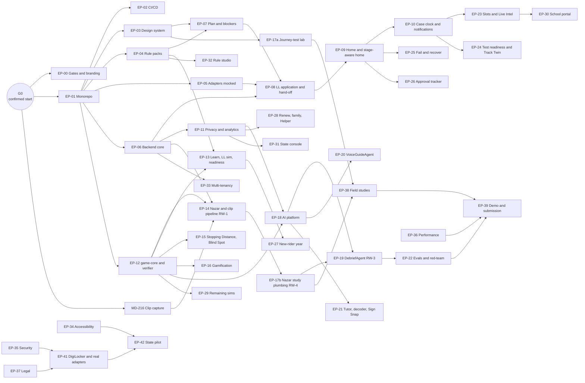
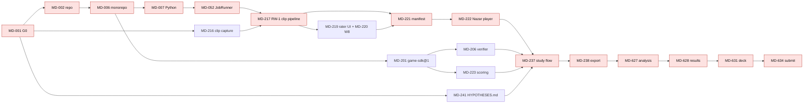

# Implementation Plan
> Project: Margdarshak · Team: Chanakya (@Nestiq Private Limited) · Owner: Product/design lead · Status: Draft v0.1 · Last updated: 2026-10-23
> Related: [PROJECT_BRIEF](../00-overview/PROJECT_BRIEF.md) · [BACKLOG](BACKLOG.md) · [TEAM](TEAM.md) · [FIELD_STUDY](FIELD_STUDY.md) · [GLOSSARY](GLOSSARY.md) · [PRD](../01-product/PRD.md) · [Architecture](../03-engineering/ARCHITECTURE.md) · [CI/CD](../05-ops/CICD.md) · [AI evals](../04-ai/AI_EVALS.md) · [Risk register](../06-security-compliance/RISK_REGISTER.md) · [Hackathon plan](../08-project/IMPLEMENTATION_PLAN.md)
> Inputs read: PROJECT_BRIEF v1.0; `war-room/margdarshak-verification.md` (D-01..D-25); `research/ps1-deep/07-govt-plug-and-play.md`; `research/ps1-deep/08-game-ai-n8n.md`; `field-kit/NAZAR-FIELD-KIT.md`; `field-kit/nazar_stats.py`.

---

## 0. How to read this plan

1. **Phases, not hours.** The team builds a complete product and manages its own calendar. This plan fixes the *order* of work (dependencies), the *definition of done* of each phase, and *what is demonstrable* at each point. It never says "by hour 14".
2. **One ID space.** Every task is a backlog ticket (MD-xxx). The task tables in §5 are generated from [BACKLOG](BACKLOG.md) by `python scripts/gh_import_backlog.py --plan-tables`; if they disagree, BACKLOG wins and the tables are regenerated.
3. **Estimates** are ideal person-days for one focused person (XS ≤ 0.5 · S 1 · M 2–3 · L 4–5 · XL 6–10). They size work and expose the bottleneck lane; they are not a schedule. Velocity measured on P0 converts them into calendar time, which is the team's decision.
4. **Phases overlap.** A phase is a set of tickets with shared entry criteria, not a calendar block. The Nazar track (P2) starts at gate G0, in parallel with P0, because the council ruled "build order: clip pipeline and field study first" (D-03).
5. **Two scopes, kept apart everywhere:**
   - **Hackathon build** = the *showcase ladder* (§3): the subset of tickets that makes the three deep slices of D-04 work end to end on mock adapters, deployed on Render (Singapore), with synthetic data. This is what PROJECT_BRIEF and the bible brief call "Hackathon build (Phase 1–2)".
   - **Production** = every phase P0–P7 at its full definition of done, ending in a state pilot on Indian infrastructure. This is "Production (Phase 3+)" in the bible brief's wording. The mapping between the two naming schemes is in §2.3.

---

## 1. Planning principles (from the council directives)

| # | Principle | Source | How the plan enforces it |
|---|---|---|---|
| 1 | **No commit, no participant data before the confirmed start** | R-14, field kit §0 | Gate **G0** (MD-001) blocks MD-002 and everything after it. HYPOTHESES.md is committed after G0 and before any data (MD-241) |
| 2 | **Journey is the body, Nazar + debrief is the heart** | D-03, PROJECT_BRIEF §1 | The Nazar chain (MD-216 → MD-217 → MD-222 → MD-237 → MD-627) is the critical path (§7) and rung 1 of the ladder (§3) |
| 3 | **Three deep slices, everything else thin on mocks, no dead buttons** | D-04, R-01 | Ladder rungs 1–3 are the deep slices; rung 5 is "thin breadth"; DoD item 3 bans dead controls; MD-120 link-checks every service entry |
| 4 | **Rules are data with sources; no rupee/day/age literal anywhere** | D-05, D-06, D-10, R-09 | EP-04 lands before any screen that shows a number; MD-004 lint fails CI on literals |
| 5 | **Code computes; Gemini narrates** | D-09, D-10 | Template debrief (MD-242) ships in P2 *before* any AI (P3); the AI layer can only replace wording, never facts |
| 6 | **Adapters are mocks with the same contract as the real thing; no scraping, no bots** | D-07, D-08, F-56 | EP-05 contract suite (MD-036) in P0; real adapters only in P7 after onboarding (MD-701..708) |
| 7 | **Under 18 = rules only** | D-13, P-07 | Age-band service (MD-049) in P0; every gated feature has a `minor_gated` contract test |
| 8 | **Every module has an owner who can explain it** | D-24 | Owners per epic (TEAM §3); the architecture slide labels each module with its owner (MD-631) |
| 9 | **Evidence is pre-registered and reported either way** | D-22 | FIELD_STUDY; MD-241, MD-627, MD-628 |
| 10 | **Render Workflows are load-bearing, n8n is staff operations only** | D-15, D-16, ADR-0006 | RW-1..RW-4 each solve "outlives a request / retries / fan-out / later"; n8n workflows hold no business logic and send nothing to citizens (review checklist in MD-127) |

---

## 2. Phase overview

### 2.1 Summary table

| Phase | Name | Goal (one line) | Epics | Tickets | Effort (ideal person-days) | Entry criteria | Exit = phase DoD (§5.x) |
|---|---|---|---|---|---|---|---|
| **P0** | Foundations | Monorepo, CI/CD, design tokens, rule packs, adapters mocked, backend core | EP-00..EP-06 | 56 | ~84 | G0 confirmed | §5.1 DoD |
| **P1** | Journey core | Plan, blockers, guided LL application, hand-off, stage-aware home, case clock, privacy | EP-07..EP-11, EP-17a, part of EP-43 | 55 | ~98 | Rules engine + UI kit + backend core merged | §5.2 DoD |
| **P2** | Learning and games core | game-core SDK, score verifier, LL simulator, Nazar + clip pipeline, Stopping Distance, Blind Spot, gamification, readiness, study plumbing | EP-12..EP-16, EP-17b | 45 | ~102 | Monorepo + JobRunner (Nazar track starts at G0) | §5.3 DoD |
| **P3** | AI layer | DebriefAgent with validator, VoiceGuideAgent live, tutor, decoder, evals | EP-18..EP-22 | 31 | ~66 | `game-sdk@1` frozen, template debrief shipped, consent + age gate live | §5.4 DoD |
| **P4** | DL test and after | Slots, Live Intel, track explainer, co-pilot, fail and recover, approval tracker, new-rider year, renew/family surface, remaining sims | EP-23..EP-29 | 46 | ~82 | Journey state machine + case clock + game host | §5.5 DoD |
| **P5** | Ecosystem | School portal, state console, rule studio, multi-tenancy | EP-30..EP-33 | 19 | ~50 | Consent artefacts, analytics aggregates, rule packs v1 | §5.6 DoD |
| **P6** | Hardening | Accessibility, security, performance, load, legal review, field studies, demo and submission | EP-34..EP-39 | 35 | ~62 | Feature-complete slices to be hardened (per rung, not all at once) | §5.7 DoD |
| **P7** | Adoption | DigiLocker onboarding, real adapters, India hosting, state pilot | EP-41, EP-42 | 20 | ~64 | VAPT pack + legal memos + a willing state office | §5.8 DoD |
| | **Total** | | 44 epics | 307 | ~609 | | |

Effort split by accountable role per phase is in each task table header (§5). **BE is the bottleneck lane in P0, P1 and P3**; the levers are in §8.3.

### 2.2 Phase dependency graph (epic level)



### 2.3 Mapping to the bible brief's "Phase 1–2 / Phase 3+" wording

| Bible-brief label | Meaning here | Phases and tickets |
|---|---|---|
| "Hackathon build (Phase 1–2)" | The showcase ladder, rungs 1–6 (§3), on mocks, Render Singapore, synthetic data, live during judging | Selected tickets from P0, P1, P2, P3, P4 (thin), P6 (demo, a11y smoke, perf, legal re-verify) |
| "Production (Phase 3+)" | Every ticket at full DoD, then adoption | All of P0–P7, including real adapters, India hosting, audit and pilot |

The two are never mixed in one sentence on stage: "this runs today on mocks" vs "this is what a state switches on".

### 2.4 Gantt (relative effort, not a calendar)

The axis counts **effort units from G0** (1 unit ≈ 1 ideal day of one lane, with AI agents assisting). Bars show order and overlap; the team stretches or compresses the calendar itself. Mermaid needs a date format, so the chart uses Unix time 0 as G0 and prints the day-of-year as the unit number.

```mermaid
gantt
  title Margdarshak build order (units from G0; not a calendar)
  dateFormat X
  axisFormat %j
  section Gates
  G0 confirmed start (MD-001)              :milestone, g0, 0, 0d
  Pre-registration committed (MD-241)      :milestone, hyp, after g0, 1d
  section P0 Foundations
  EP-00 gates and branding (PD)            :p00, after g0, 2d
  EP-01 monorepo and tooling (FE, BE)      :p01, after g0, 5d
  EP-02 CI/CD (BE, FE)                     :p02, after p01, 6d
  EP-03 design system, shell, i18n (PD, FE):p03, after p01, 12d
  EP-04 rule packs and engine (BE, PD)     :p04, after p01, 14d
  EP-05 adapters mocked (BE+AG)            :p05, after p01, 12d
  EP-06 backend core (BE)                  :p06, after p01, 16d
  section P1 Journey core
  EP-07 plan and blockers                  :p07, after p04, 12d
  EP-08 LL application and hand-off        :p08, after p06, 16d
  EP-09 home and stage-aware home          :p09, after p07, 10d
  EP-10 case clock (RW-2, W1, W2)          :p10, after p09, 12d
  EP-11 privacy and analytics              :p11, after p06, 10d
  EP-17a journey-test lab                  :p17a, after p03, 8d
  section P2 Learning and games (Nazar track from G0)
  MD-216 clip capture (PD)                 :clip, after g0, 4d
  EP-12 game-core and verifier             :p12, after p01, 14d
  EP-14 Nazar + RW-1 clip pipeline         :crit, p14, after clip, 20d
  EP-13 learn, LL sim, readiness           :p13, after p12, 18d
  EP-15 Stopping Distance, Blind Spot      :p15, after p12, 14d
  EP-16 gamification                       :p16, after p13, 10d
  EP-17b Nazar study plumbing (RW-4)       :crit, p17b, after p14, 8d
  section P3 AI layer
  EP-18 AI platform and guardrails         :p18, after p12, 10d
  EP-19 DebriefAgent, commentary (RW-3)    :p19, after p18, 12d
  EP-20 VoiceGuideAgent, Dogri             :p20, after p18, 14d
  EP-21 tutor, decoder, Sign Snap          :p21, after p19, 10d
  EP-22 evals and red-team                 :p22, after p19, 12d
  section P4 DL test and after
  EP-23 slots and Live Intel               :p23, after p10, 12d
  EP-24 test readiness and Track Twin      :p24, after p10, 16d
  EP-25 fail and recover                   :p25, after p10, 8d
  EP-26 approval tracker and letters       :p26, after p25, 6d
  EP-27 new-rider year                     :p27, after p16, 16d
  EP-28 renew, family, Helper              :p28, after p11, 10d
  EP-29 remaining sims                     :p29, after p15, 18d
  section P5 Ecosystem
  EP-30 school portal                      :p30, after p23, 16d
  EP-31 state console                      :p31, after p28, 14d
  EP-32 rule studio                        :p32, after p31, 10d
  EP-33 multi-tenancy                      :p33, after p32, 10d
  section P6 Hardening
  EP-38 field studies (hackathon run)      :crit, p38, after p17b, 6d
  EP-39 demo, video, deck, submission      :crit, p39, after p38, 5d
  EP-34 accessibility audit                :p34, after p09, 14d
  EP-35 security and privacy               :p35, after p33, 16d
  EP-36 performance and load               :p36, after p24, 12d
  EP-37 legal review                       :p37, after g0, 20d
  section P7 Adoption
  EP-41 DigiLocker and real adapters       :p41, after p35, 30d
  EP-42 state pilot                        :p42, after p41, 45d
```



---

## 3. The showcase ladder (what the hackathon build is)

The ladder orders the build so the team can stop at **any rung** and still have a coherent, honest demo. Each rung is cumulative. Rungs 1–3 are the three deep slices of D-04; rung 4 is the Responsible-AI proof; rung 5 removes dead buttons across the journey; rung 6 makes it survive judging.

| Rung | Slice | Tickets (minimum set) | What a judge can do | Phase origin |
|---|---|---|---|---|
| **1 · Nazar heart** (slice B) | Real clips → blurred → two raters → Kerala-format mock → server-verified score → template debrief → field-study counters | MD-001, 002, 005, 006, 007, 016, 052, 201, 205, 206, 216, 217, 218, 219, 220, 221, 222, 223, 226, 237, 238, 239, 241, 242 | Scan the QR, take the 3-minute test on their phone, see "1.4 s late ≈ 16 m at 40 km/h", see the live N and % below 60 | P0, P2 |
| **2 · Plan to application** (slice A) | 3-tap plan card → blockers → one-question LL application → photo fixer → check answers → fee → Sarathi hand-off (simulated eKYC) | MD-018..024, 027..034, 036, 037, 041, 045, 046, 047, 048, 101, 102, 103, 106, 107, 109, 110, 111, 112, 113, 114, 115 | Plan Kabir's bike + car in 3 taps; see Tanvi's address and relation-line blockers; reach check-answers in ~6 screens | P0, P1 |
| **3 · Stage-aware home + journey sweeper** (slice C) | Home with 4 verbs → persona switcher → stage card → case clock on RW-2 triggered by n8n W1 → WhatsApp test-number message from the backend notifier | MD-054, 119, 121, 122, 123, 125, 126, 127, 128, 129, 130, 132 | Switch Kabir from "LL day 12" to "LL day 31"; watch the Render Runs page retry; receive the WhatsApp nudge | P1 |
| **4 · AI that admits limits** | DebriefAgent with validator; template fallback; `adk eval` in CI; guardrail-fires demo | MD-301, 302, 303, 304, 305, 306, 308, 309, 321, 328 | See the validator reject "₹0 fee" and the template take over; see 150-case eval results | P3 |
| **5 · Thin breadth, no dead buttons** | LL simulator + readiness; Stopping Distance; Blind Spot; slot finder (mock); Live Intel (seeded, k ≥ 5); track explainer; fail and recover; approval tracker; renew surface; privacy centre; voice guide (off the critical path) | MD-209 (subset), 211, 212, 213, 214, 227, 228, 401, 402, 403, 404, 408, 413, 417, 430, 133, 134, 313, 314, 316 | Walk S0 → S9 on mocks without hitting a dead control | P2, P3, P4, P1 |
| **6 · Survive judging** | Lite mode measured, warm-up, axe clean on main routes, D-25 re-verification, field studies run, demo script, video, deck, submission | MD-612, 615, 601 (main routes), 622, 625, 626, 627, 628, 629, 630, 631, 632, 633, 634, 635 | Everything above, on a phone, on 4G, days later from the video link | P6 |

**Stop rules.** If rung 1 is not complete, nothing from rungs 4–5 is started (D-03). If fewer than 12 usable blurred clips exist at the field-kit backup trigger, Nazar runs the 6-clip mode scaled to /100 and the journey test carries the evidence (FIELD_STUDY §9).

---

## 4. Global definition of done and quality gates

### 4.1 Ticket DoD
As in [BACKLOG §0.3](BACKLOG.md): CI green (lint, types, unit, contract, e2e smoke, axe, bundle budget, wording lint, secret scan); tests including golden/contract/EC tests; all five screen states in en + hi at 360 px; SourceChip and SimulatedChip where relevant; no PII; docs updated; human review of all agent-written code.

### 4.2 Phase gates (a phase is "done" when)
1. Every ticket in the phase is Done, or explicitly moved to a later phase with a reason in the decision log (TEAM §7).
2. The phase demo checkpoint (§5.x) has been run end to end by someone who did not build it, on a low-end Android phone and on desktop, and recorded.
3. No open bug of severity S1/S2 in the phase's scope.
4. Docs listed under the phase are updated (ARCHITECTURE, API_SPEC/OpenAPI, DATA_MODEL, CHANGELOG, rule CHANGELOG).
5. The risk list for the phase (§5.x) is reviewed and the register updated.

### 4.3 Freeze points (contracts other lanes build against)
| Freeze | Ticket | Who depends on it | Rule after the freeze |
|---|---|---|---|
| Rule-pack schema v1 | MD-027 | Rules engine, plan card, simulator, studio | Additive changes only; breaking change = schema v2 + migration |
| OpenAPI v1 (citizen API) | MD-055 | Web client, n8n, console | Additive only; breaking = `/v2` |
| Adapter spec v1 | MD-044 | Mock adapters, government-side implementers | Versioned; published with a changelog |
| `game-sdk@1` (GameEvent, SessionResult) | MD-201 | All games, verifier, debrief, evals | Additive only; scoring versions pinned per game version |
| Finding-ID registry | MD-242 | Templates, DebriefAgent enums, evals | New IDs need en + hi templates before use |

---

## 5. Phases in detail

### 5.1 P0 · Foundations

**Goals**
1. One monorepo that builds and tests on every OS, with pinned versions and agent rules (EP-01).
2. CI/CD that blocks on lint, types, unit, adapter contracts, e2e, accessibility, bundle budget, wording bans and secrets; Render Blueprint with PR previews in Singapore (EP-02).
3. A calm, accessible design system with UX4G-swappable tokens, Hindi typography and the 4-tab shell, plus the non-affiliation footer (EP-00, EP-03).
4. Rule packs as sourced data (CMVR base + J&K + partial states), a fee calculator from `fees.json`, an authoritative Python rules engine with a conformance-tested TS mirror (EP-04).
5. Seven government ports with mock implementations passing one contract suite, and the adapter OpenAPI that a state implements (EP-05).
6. Backend core: FastAPI, Postgres 16 with tenant IDs, sessions, the age-band gate, audit log, observability with redaction, the JobRunner interface, the n8n HMAC channel (EP-06).

**Workstreams:** WS-PLAT, WS-DES, WS-RULE, WS-GOV, WS-PRIV (gates and branding). WS-EVID starts in parallel (clip capture MD-216, recruitment, see P2).

**Entry criteria:** G0 confirmed in writing (MD-001).

**P0 task table (56 tickets, ~84 ideal person-days; BE 50, FE 22, PD 12; agent-assisted 26)**

| ID | Task | Epic | Owner | Est | Depends on |
|---|---|---|---|---|---|
| MD-001 | Confirm the hackathon start time and record gate G0 | EP-00 | PD | XS | — |
| MD-002 | Create the public repository with licences and branding rules | EP-00 | PD | XS | MD-001 |
| MD-003 | Pick the domain and run a name pre-check | EP-00 | PD | XS | MD-001 |
| MD-004 | Wording-ban and fee-literal lint in CI | EP-00 | FE+AG | S | MD-012 |
| MD-005 | Non-affiliation footer, launch disclaimer and grievance contact | EP-00 | FE | S | MD-021 |
| MD-006 | Monorepo skeleton (pnpm workspaces + Turborepo) | EP-01 | FE | S | MD-002 |
| MD-007 | Python service layout with uv | EP-01 | BE | S | MD-006 |
| MD-008 | Re-pin every dependency at G0 and record it | EP-01 | FE+AG | XS | MD-006, MD-007 |
| MD-009 | Local stack with Docker Compose | EP-01 | FE | S | MD-007 |
| MD-010 | Code standards, hooks and commit convention | EP-01 | FE | XS | MD-006 |
| MD-011 | AI coding-agent operating rules | EP-01 | PD | S | MD-006 |
| MD-012 | GitHub Actions: lint, typecheck, unit (TS + Python) | EP-02 | FE | S | MD-006, MD-007 |
| MD-013 | Adapter contract-test job | EP-02 | BE | S | MD-036 |
| MD-014 | Playwright e2e and axe accessibility job | EP-02 | FE | S | MD-021 |
| MD-015 | Security scanning and SBOM | EP-02 | BE+AG | S | MD-012 |
| MD-016 | Render Blueprint and preview environments (Singapore) | EP-02 | BE | M | MD-009 |
| MD-017 | Bundle and performance budgets in CI | EP-02 | FE | S | MD-021 |
| MD-018 | Design tokens (light/dark, UX4G-aligned) | EP-03 | PD | M | MD-006 |
| MD-019 | Typography with Indic script support | EP-03 | FE | S | MD-018 |
| MD-020 | Component kit on HeroUI v3 | EP-03 | FE+AG | L | MD-018 |
| MD-021 | App shell, routes and PWA (Next.js 16 + Serwist) | EP-03 | FE | M | MD-020 |
| MD-022 | Internationalisation (next-intl): English and Hindi in full | EP-03 | FE | M | MD-021 |
| MD-023 | Motion and accessibility primitives | EP-03 | FE | S | MD-020 |
| MD-024 | Calm trust line computed from fees.json | EP-03 | FE | XS | MD-029, MD-021 |
| MD-025 | Analytics-free, cookie-light baseline and security headers | EP-03 | FE | XS | MD-021 |
| MD-026 | Component workshop with accessibility checks | EP-03 | FE+AG | S | MD-020 |
| MD-027 | Rule-pack JSON Schema | EP-04 | BE | M | MD-007 |
| MD-028 | Base pack (central rules) and state overlays with versioning | EP-04 | BE | M | MD-027 |
| MD-029 | fees.json and the fee calculator (CMVR r.32) | EP-04 | BE+AG | S | MD-027 |
| MD-030 | J&K state pack v1 | EP-04 | PD | M | MD-027 |
| MD-031 | Partial packs for Delhi, Kerala, Maharashtra, Tamil Nadu, Punjab | EP-04 | PD+AG | M | MD-030 |
| MD-032 | Class catalogue for every licence class | EP-04 | PD | S | MD-027 |
| MD-033 | Rules engine core (authoritative Python) and TS mirror | EP-04 | BE | L | MD-028, MD-029, MD-032 |
| MD-034 | Golden-case suite for rules | EP-04 | BE+AG | M | MD-033 |
| MD-035 | Public rule changelog | EP-04 | PD | XS | MD-028 |
| MD-036 | Port interfaces and the contract-test harness | EP-05 | BE | M | MD-007 |
| MD-037 | SarathiAdapter: mock and deeplink modes | EP-05 | BE | M | MD-036 |
| MD-038 | DigiLockerAdapter mock (OAuth 2.0 + PKCE simulation) | EP-05 | BE | M | MD-036 |
| MD-039 | AadhaarOfflineAdapter mock (result only) | EP-05 | BE+AG | S | MD-036 |
| MD-040 | BhashiniAdapter mock and local fallback interface | EP-05 | BE+AG | S | MD-036 |
| MD-041 | PaymentAdapter mock (fake payment page, signed callback) | EP-05 | BE+AG | S | MD-036 |
| MD-042 | NotificationAdapter: console and email | EP-05 | BE+AG | S | MD-036 |
| MD-043 | SlotAdapter mock (synthetic offices and slots) | EP-05 | BE+AG | S | MD-036 |
| MD-044 | Adapter OpenAPI 3.1 for government-side implementations | EP-05 | BE+AG | M | MD-036 |
| MD-045 | Simulated-data chips wired to adapter mode | EP-05 | FE | S | MD-020, MD-036 |
| MD-046 | FastAPI skeleton, error model, health | EP-06 | BE+AG | S | MD-007 |
| MD-047 | Database baseline (PostgreSQL 16, SQLAlchemy 2, Alembic) | EP-06 | BE | M | MD-046 |
| MD-048 | Sessions and accounts | EP-06 | BE | M | MD-047 |
| MD-049 | Age band and minor gating service | EP-06 | BE | S | MD-047 |
| MD-050 | Append-only audit log | EP-06 | BE+AG | S | MD-047 |
| MD-051 | Observability with PII redaction | EP-06 | BE | M | MD-046 |
| MD-052 | JobRunner interface (Render Workflows + local) | EP-06 | BE | M | MD-007 |
| MD-053 | Internal HMAC channel for n8n | EP-06 | BE | S | MD-046 |
| MD-054 | Synthetic personas and seed data | EP-06 | PD+AG | S | MD-047, MD-030 |
| MD-055 | Contract-first OpenAPI and typed client | EP-06 | BE | S | MD-046 |
| MD-056 | Tenant model stub (single tenant JK, multi-tenant ready) | EP-06 | BE+AG | S | MD-047 |

**Owners:** PD accountable for EP-00 and EP-03 content and the rule-pack data; FE for EP-01 front-end tooling, EP-03 build and front-end CI; BE for EP-02 (deploy, contracts), EP-04 engine, EP-05, EP-06.

**Definition of done (phase)**
- [ ] `pnpm dev:all` brings up web, API, verifier stub, workflows worker, Postgres, Key Value and MinIO with seeded personas on a fresh Windows 11 clone.
- [ ] `main` deploys to Render (Singapore) through the Blueprint; a PR gets a preview URL; rollback tested once.
- [ ] CI required checks: lint, types, unit (TS + Py), adapter contracts, Playwright smoke, axe, size-limit, Lighthouse, wording/fee-literal lint, gitleaks, CodeQL, SBOM.
- [ ] Rule-pack schema v1 frozen; CMVR base + J&K pack signed by PD and BE; ≥ 80 golden cases pass in Python and TS with identical output.
- [ ] All seven adapters (Sarathi mock/deeplink, DigiLocker, AadhaarOffline, Bhashini, Payment, Notification, Slot) pass the contract suite; `api/adapters.openapi.yaml` lints clean.
- [ ] `u18` gating, audit log, PII redaction and the JobRunner (Render + local) each have tests.
- [ ] Every route shows the non-affiliation footer; the trust line renders from `fees.json` with a source chip.

**Demo checkpoint (P0):** on a phone, open the preview URL → language picker → home shell with 4 tabs, footer and trust line → tap the trust line's source chip → see "CMVR r.32, checked {date}". On a laptop, show the CI run with every job green and one deliberately broken adapter mock failing the contract job.

**Hackathon showing:** see §9 row P0. Mostly invisible; it is what lets every later number carry a source.

**Risks:** IR-02 (BE overload: agents take mocks and golden cases), IR-07 (wrong fee: golden cases signed by PD, not by the agent), IR-10 (G0), R-05 (multi-service fragility: one Python backend, one Postgres; n8n optional locally).

### 5.2 P1 · Journey core

**Goals**
1. The 3-tap licence plan with class planner and the 20 blockers, no login (EP-07).
2. The guided LL application: one question per screen, autosave/resume, photo fixer on device, check answers, fee and payment-pending guidance, Sarathi hand-off Mode A (and Mode B skeleton) (EP-08).
3. Home with four verbs and the stage-aware home driven by an authoritative journey state machine, with a tracker and My Licence (EP-09).
4. The case clock: timeline computation on server time, RW-2 sweep triggered by n8n W1, the backend notifier (WhatsApp/email/web push), nudge limits and STOP (EP-10).
5. Privacy centre, consent artefacts, export/delete, privacy-preserving analytics (EP-11).
6. The journey-test lab replica and its logging (EP-17a).
7. Edge cases owned by these features: EC-01..06, 09..11, 15, 21, 22, 26, 30 (EP-43).

**Workstreams:** WS-JRNY, WS-AUTO, WS-PRIV, WS-EVID.

**Entry criteria:** MD-020 component kit, MD-033 rules engine, MD-047/048 DB and sessions, MD-036/037/041 adapters merged.

**P1 task table (55 tickets, ~98 ideal person-days; BE 50, FE 42, PD 7; agent-assisted 14)**

| ID | Task | Epic | Owner | Est | Depends on |
|---|---|---|---|---|---|
| MD-101 | Plan wizard: age/DOB, vehicle pictures, state | EP-07 | FE | M | MD-020, MD-022, MD-032 |
| MD-102 | Plan and rules endpoints | EP-07 | BE | M | MD-033, MD-055 |
| MD-103 | Plan card | EP-07 | FE+PD | M | MD-101, MD-102 |
| MD-104 | Send plan to WhatsApp | EP-07 | BE | S | MD-102, MD-129 |
| MD-105 | Smart class planner (several classes on one LL) | EP-07 | BE+FE | M | MD-033, MD-103 |
| MD-106 | Blocker engine: 20 rule rows | EP-07 | BE+PD | L | MD-033 |
| MD-107 | Blocker UI states | EP-07 | FE | M | MD-106 |
| MD-108 | Offline plan card via the TS mirror | EP-07 | FE | S | MD-033, MD-101 |
| MD-109 | Case creation, autosave and resume | EP-08 | BE | M | MD-047, MD-048 |
| MD-110 | One-question-per-screen form engine | EP-08 | FE | L | MD-109, MD-020 |
| MD-111 | Check-your-answers screen | EP-08 | FE | S | MD-110 |
| MD-112 | Fee breakdown and payment-pending guidance | EP-08 | FE+PD | S | MD-029, MD-041 |
| MD-113 | Photo and signature fixer (on device) | EP-08 | FE | L | MD-021 |
| MD-114 | Sarathi hand-off Mode A (copy-pack + deep link) | EP-08 | BE+FE | M | MD-037, MD-111 |
| MD-115 | Simulated eKYC/OTP screen for the demo tenant | EP-08 | FE | XS | MD-114 |
| MD-116 | Mode B (government-hosted) adapter flow skeleton | EP-08 | BE | M | MD-044, MD-114 |
| MD-117 | Application status mirror and events | EP-08 | BE | S | MD-109 |
| MD-118 | Sarathi screen and error catalogue (data) | EP-08 | PD | M | — |
| MD-119 | Home (S0) | EP-09 | FE | M | MD-021, MD-024 |
| MD-120 | "All services" grouped by who you are | EP-09 | PD+FE | S | MD-119 |
| MD-121 | Journey state machine (authoritative) | EP-09 | BE | L | MD-109, MD-117 |
| MD-122 | Stage-aware home and persona switcher | EP-09 | FE | M | MD-121, MD-054 |
| MD-123 | Parcel-style tracker component | EP-09 | FE | S | MD-121 |
| MD-124 | My Licence tab | EP-09 | FE+BE | M | MD-117 |
| MD-125 | Timeline computation | EP-10 | BE | M | MD-033, MD-121 |
| MD-126 | RW-2 Case-clock sweep (Render Workflow) | EP-10 | BE | M | MD-052, MD-125 |
| MD-127 | n8n W1 daily case-clock trigger and watchdog | EP-10 | BE+AG | S | MD-126, MD-053 |
| MD-128 | Milestone event notifications (backend notifier) | EP-10 | BE+AG | S | MD-129 |
| MD-129 | WhatsApp, email and web push delivery | EP-10 | BE | M | MD-042 |
| MD-130 | Nudge limits, quiet hours and STOP | EP-10 | BE | S | MD-129 |
| MD-131 | WhatsApp template drafting and approval | EP-10 | PD | S | — |
| MD-132 | Case clock UI | EP-10 | FE | S | MD-125 |
| MD-141 | n8n W13 analytics digest | EP-10 | BE+AG | S | MD-136 |
| MD-133 | Consent artefacts (DEPA-style) | EP-11 | BE | M | MD-047 |
| MD-134 | Privacy centre UI: consents, export, delete | EP-11 | FE | M | MD-133 |
| MD-135 | Privacy notice and consent copy (en/hi) | EP-11 | PD | M | — |
| MD-136 | Privacy-preserving analytics | EP-11 | BE+AG | M | MD-047 |
| MD-137 | Data retention jobs | EP-11 | BE+AG | S | MD-133 |
| MD-138 | Client-side PII redaction utility | EP-11 | FE | S | MD-020 |
| MD-139 | Lab replica `/lab/sarathi-sequence` | EP-17a | FE | L | MD-021 |
| MD-140 | Lab logging and export | EP-17a | FE | M | MD-139, MD-110 |
| MD-801 | EC-01 Aadhaar shows only the year of birth | EP-43 | BE+AG | S | MD-106 |
| MD-802 | EC-02 Aadhaar address differs from residence | EP-43 | BE+AG | S | MD-106 |
| MD-803 | EC-03 Relation line blank on Aadhaar | EP-43 | BE+AG | XS | MD-106 |
| MD-804 | EC-04 Turning 40 mid-journey | EP-43 | BE+AG | S | MD-125 |
| MD-805 | EC-05 Age 16–17: ≤ 50 cc only | EP-43 | BE+FE | S | MD-049, MD-105 |
| MD-806 | EC-06 Transport classes under 20 | EP-43 | BE+AG | XS | MD-105 |
| MD-809 | EC-09 Payment debited but pending | EP-43 | FE | XS | MD-112 |
| MD-810 | EC-10 No online LL test in the state | EP-43 | BE+AG | XS | MD-031 |
| MD-811 | EC-11 Sarathi outage | EP-43 | FE+BE | S | MD-037 |
| MD-815 | EC-15 Device clock tampering | EP-43 | BE+AG | XS | MD-125 |
| MD-821 | EC-21 Two classes with different eligibility ages | EP-43 | BE+AG | XS | MD-105 |
| MD-822 | EC-22 LL already held (mid-journey onboarding) | EP-43 | BE+AG | S | MD-121 |
| MD-826 | EC-26 Account deleted mid-case | EP-43 | BE+AG | XS | MD-134 |
| MD-830 | EC-30 WhatsApp opt-out ("STOP") | EP-43 | BE+AG | XS | MD-130 |

**Owners:** FE accountable for screens (EP-08, EP-09, lab); BE for plan/case APIs, state machine, case clock, privacy (EP-07 engine, EP-10, EP-11); PD for blocker fix text, WhatsApp templates, privacy notice and the lab comparison sheet.

**Definition of done (phase)**
- [ ] Kabir: plan in 3 taps, application in ≤ 6 decision screens, check answers, hand-off; Tanvi: both blockers caught before hand-off; Mohan-ji: Form 1A shown; Rahul: rules-only, no gated feature reachable (all as Playwright tests on a 360 px profile).
- [ ] Offline plan card equals online for golden personas.
- [ ] RW-2 sweep idempotent; W1 triggers it; a WhatsApp test-number message and an email arrive; ≤ 1 nudge/day; STOP honoured.
- [ ] Consent artefacts written for every purpose; export and delete work; delete cancels timeline events.
- [ ] Lab replica matches the observed Sarathi sequence (signed sheet), is token-gated and `noindex`.
- [ ] EC tests for the P1-owned cases pass.

**Demo checkpoint (P1):** persona Kabir from home → plan (3 taps) → "Start my application" → 6 screens → check answers → fee → hand-off with "Simulated: runs on Sarathi" → back with an application number → home shows "LL day 0" → switch persona to "LL day 31" → home says "Book your driving test" → trigger W1 → WhatsApp arrives. Then Tanvi's plan with her two blockers.

**Hackathon showing:** §9 row P1 (ladder rungs 2 and 3).

**Risks:** IR-06 (template approval: test number, email, push), IR-07, R-03 (overclaim: SimulatedChip on every adapter surface), R-09.

### 5.3 P2 · Learning and games core

**Goals**
1. `@margdarshak/game-core`: schemas, sim-core, event queue, integrity, host runtime, staircase; the Node score verifier that overwrites client scores (EP-12).
2. Learn hub with variants, FSRS, Brier calibration, the explainable Readiness Score and the LL Test Simulator in the state's format (EP-13).
3. **Nazar**: clip capture, the RW-1 pipeline (transcode → blur → propose → two raters → agreement → publish) with a visible retry, blur audit, rater UI, W8, manifest with unseen-clip tracking, the player, scoring, learn mode, the screen-reader alternative and the share card (EP-14).
4. Stopping Distance and Blind Spot built deep, after the Phaser spike (EP-15).
5. The gamification engine: XP with diminishing returns, mastery-gated ranks, repairable streaks, co-op squads, 9 badges, the CCPA dark-pattern lint, under-18 gating (EP-16).
6. Study plumbing: the Nazar study flow, cohort export matching `nazar_stats.py`, RW-4 stats with live counters, W14, HYPOTHESES.md, and the template debrief (EP-17b).

**Workstreams:** WS-GAME, WS-AUTO (RW-1, RW-4, W8, W14), WS-EVID.

**Entry criteria:** monorepo + Python layout + JobRunner (MD-006, 007, 052). **The Nazar track starts at G0** with MD-216 and recruitment, in parallel with P0.

**P2 task table (45 tickets, ~102 ideal person-days; BE 33, FE 52, PD 18; agent-assisted 13)**

| ID | Task | Epic | Owner | Est | Depends on |
|---|---|---|---|---|---|
| MD-201 | Game SDK schemas (Zod) and Pydantic mirror | EP-12 | FE+BE | M | MD-006, MD-007 |
| MD-202 | sim-core: fixed step, seeded PRNG, kinematic model | EP-12 | FE | M | MD-201 |
| MD-203 | Event bus, IndexedDB queue and idempotent sync | EP-12 | FE | S | MD-201 |
| MD-204 | Integrity checks | EP-12 | FE | S | MD-201 |
| MD-205 | Game host runtime | EP-12 | FE | M | MD-201, MD-023 |
| MD-206 | Score verifier service (Node) | EP-12 | BE+FE | L | MD-201, MD-202 |
| MD-207 | Golden replay suite | EP-12 | FE+AG | M | MD-206 |
| MD-208 | Difficulty staircase | EP-12 | FE | S | MD-201 |
| MD-209 | Content model and question bank with variants | EP-13 | PD+AG | XL | MD-027 |
| MD-210 | Learn hub UI | EP-13 | FE | M | MD-209, MD-020 |
| MD-211 | FSRS scheduling (ts-fsrs) and answer capture | EP-13 | FE+BE | M | MD-209, MD-201 |
| MD-212 | Confidence capture and Brier calibration | EP-13 | FE+BE | S | MD-211 |
| MD-213 | Test Readiness Score | EP-13 | BE+FE | M | MD-211, MD-212 |
| MD-214 | LL Test Simulator (G10) | EP-13 | FE | L | MD-209, MD-030, MD-205 |
| MD-215 | Lite-mode learning and offline mock tests | EP-13 | FE | S | MD-214 |
| MD-216 | Clip capture (starts at G0) | EP-14 | PD | M | MD-001 |
| MD-217 | RW-1 Clip ingest pipeline (Render Workflow, headline) | EP-14 | BE | XL | MD-052, MD-216 |
| MD-218 | Blur audit and raw-footage deletion | EP-14 | PD+BE | S | MD-217 |
| MD-219 | Curator and rater UI (hazard windows) | EP-14 | FE | M | MD-217 |
| MD-220 | n8n W8 hazard-clip review queue | EP-14 | BE | S | MD-217, MD-053 |
| MD-221 | Clip manifest, storage and unseen-clip tracking | EP-14 | BE | M | MD-217 |
| MD-222 | Nazar player (G1) | EP-14 | FE | L | MD-205, MD-221 |
| MD-223 | Nazar scoring (game-core) | EP-14 | FE | M | MD-201 |
| MD-224 | Nazar learn mode (occlusion and prediction) | EP-14 | FE | M | MD-222 |
| MD-225 | Screen-reader alternative for hazard clips | EP-14 | FE | S | MD-222 |
| MD-226 | Nazar Score share card | EP-14 | BE+FE | S | MD-223, MD-206 |
| MD-227 | Stopping Distance (G3) | EP-15 | FE | L | MD-205 |
| MD-228 | Blind Spot (G4) | EP-15 | FE | L | MD-202, MD-229 |
| MD-229 | Phaser 4 low-end phone spike | EP-15 | FE | S | MD-202 |
| MD-230 | XP engine with diminishing returns | EP-16 | BE | S | MD-206 |
| MD-231 | Ranks gated by mastery and skill-tree states | EP-16 | BE+FE | M | MD-211, MD-230 |
| MD-232 | Weekly repairable streaks | EP-16 | BE | S | MD-230 |
| MD-233 | Squads (co-op, adults) | EP-16 | BE+FE | M | MD-226 |
| MD-234 | Badges (9) | EP-16 | BE+FE | S | MD-230 |
| MD-235 | Dark-pattern lint (13 CCPA patterns) | EP-16 | PD+AG | M | MD-020 |
| MD-236 | Under-18 gating across learning and games | EP-16 | BE | S | MD-049 |
| MD-237 | Nazar study flow | EP-17b | FE | M | MD-222, MD-223, MD-214 |
| MD-238 | Study cohort, pseudonymous IDs and CSV export | EP-17b | BE | S | MD-237 |
| MD-239 | RW-4 Field-study stats job and public counters | EP-17b | BE | M | MD-238, MD-052 |
| MD-240 | n8n W14 field-test capture and export | EP-17b | BE | S | MD-238 |
| MD-241 | Commit HYPOTHESES.md after G0 and before any data | EP-17b | PD | XS | MD-001 |
| MD-242 | Template debrief (no AI) for every finding | EP-17b | PD+FE | M | MD-201 |
| MD-818 | EC-18 Game edge cases | EP-43 | FE | S | MD-222, MD-204 |
| MD-819 | EC-19 Low-end phone on 2G | EP-43 | FE | S | MD-215 |
| MD-828 | EC-28 Kerala HPT stayed or postponed | EP-43 | PD | XS | MD-031 |

**Owners:** FE accountable for game-core, all game UIs and learn hub; BE for the verifier service, RW-1, manifest/storage, study export, RW-4 and the gamification engine; PD for clip capture, rating, blur audit, question bank review, finding templates and HYPOTHESES.md.

**Definition of done (phase)**
- [ ] `game-sdk@1` frozen; golden replays pass on client and verifier; a tampered client score is overwritten in e2e.
- [ ] ≥ 12 (target 20) clips published through RW-1 with two ratings, agreement computed and a 100% blur audit; raw footage deleted.
- [ ] Nazar mock in Kerala's announced format (10 clips × 10 marks, pass 60, 5-band scoring, pattern clicks = 0) works on a low-end phone with timing error ≤ 1 frame; the screen-reader alternative works with TalkBack.
- [ ] Readiness shows "N = knowledge K − calibration C" from API-33; "book anyway" always visible.
- [ ] LL simulator: J&K = 10 questions, 6 to pass, from the pack; Kerala shows "test at the RTO".
- [ ] Stopping Distance golden distances match; Blind Spot critical fault ranks first in findings.
- [ ] Gamification: no XP for opening/sharing; streak silent on break; squads refuse `u18`; dark-pattern checks in CI.
- [ ] Study flow → export → `python analysis/nazar_stats.py sessions.csv raters.csv` runs unmodified; counters match it; HYPOTHESES.md committed before the first `field_test` session.
- [ ] Every finding ID has en + hi templates; the template debrief passes the validator.

**Demo checkpoint (P2):** a person who has never seen it scans a QR, consents (18+), takes the 15-question LL mock and 10 Nazar clips, sees the replay with the hazard band and "1.4 s late ≈ 16 m at 40 km/h", gets the template debrief and the share card. Meanwhile the Render Runs page shows RW-1 processing a new clip with one injected retry, and API-71 counters tick up.

**Hackathon showing:** §9 row P2 (ladder rung 1, the hook, the evidence number and the Workflows headline).

**Risks:** IR-03, IR-04, IR-05, IR-11, IR-12, R-12 (bystander privacy: blur audit before anything publishes).

### 5.4 P3 · AI layer

**Goals**
1. ADK runtime with env-pinned models on the paid tier; the adult + consent + flag gate; PII plugin; number-provenance validator; explicit safety settings and tone lint; circuit breaker and template fallback; LLM cost and latency observability; W12 alerts (EP-18).
2. DebriefAgent as an ADK graph (code → one LLM node → validator → render), the debrief card, commentary record-then-score, RW-3 fan-out, CoachAgent weekly plan (EP-19).
3. VoiceGuideAgent live with a closed action enum, the voice orb with captions, the Dogri cascade and a text fallback (EP-20).
4. TutorAgent, ScreenDecoderAgent with the verified catalogue, Road Sign Snap (EP-21).
5. Eval sets of ≥ 30 cases per agent (150 for the debrief) in CI, a red-team set, a human review loop and the "guardrail fires" demo (EP-22).

**Workstreams:** WS-AI, WS-AUTO (RW-3, W12).

**Entry criteria:** `game-sdk@1` frozen (MD-201), verifier live (MD-206), template debrief shipped (MD-242), age gate (MD-049) and consent (MD-133) live, PII utility (MD-138).

**P3 task table (31 tickets, ~66 ideal person-days; BE 56, FE 10, PD 1; agent-assisted 6)**

| ID | Task | Epic | Owner | Est | Depends on |
|---|---|---|---|---|---|
| MD-301 | ADK runtime in FastAPI with env-pinned models | EP-18 | BE | M | MD-046, MD-008 |
| MD-302 | AI gate: verified adult, consent, tenant flag | EP-18 | BE | S | MD-049, MD-133, MD-301 |
| MD-303 | PII plugin and pre-send redaction | EP-18 | BE | S | MD-138, MD-301 |
| MD-304 | Number-provenance validator library | EP-18 | BE | M | MD-201 |
| MD-305 | Safety settings and tone lint | EP-18 | BE+PD | S | MD-301 |
| MD-306 | Circuit breaker and template fallback | EP-18 | BE | S | MD-242, MD-304 |
| MD-307 | LLM observability and cost | EP-18 | BE | S | MD-051, MD-301 |
| MD-329 | n8n W12 incident and guardrail alerts | EP-18 | BE | S | MD-307, MD-053 |
| MD-308 | DebriefAgent graph (M-02) | EP-19 | BE | L | MD-302, MD-304, MD-206, MD-242 |
| MD-309 | Debrief card UI | EP-19 | FE | M | MD-242, MD-308 |
| MD-310 | Commentary mode: record, then score (D-12) | EP-19 | BE+FE | L | MD-222, MD-302, MD-315 |
| MD-311 | RW-3 Session-debrief fan-out (Render Workflow) | EP-19 | BE | M | MD-308, MD-052 |
| MD-312 | CoachAgent (M-03) and weekly plan | EP-19 | BE | M | MD-308, MD-211 |
| MD-313 | VoiceGuideAgent live (M-01) over WebSocket | EP-20 | BE | XL | MD-301, MD-302, MD-303 |
| MD-314 | Voice orb UI and transcript | EP-20 | FE | M | MD-313 |
| MD-315 | Dogri cascade (M-08) | EP-20 | BE | M | MD-040, MD-313 |
| MD-316 | Voice fallback for demos and outages | EP-20 | FE | S | MD-314 |
| MD-317 | TutorAgent (M-04) | EP-21 | BE | M | MD-209, MD-302, MD-304 |
| MD-318 | ScreenDecoderAgent (M-05) | EP-21 | BE | M | MD-118, MD-302 |
| MD-319 | Decoder UI with on-device redaction prompt | EP-21 | FE | S | MD-318 |
| MD-320 | Road Sign Snap (M-07) | EP-21 | FE+BE | M | MD-209, MD-302 |
| MD-321 | Debrief eval set (150 cases) and CI gates | EP-22 | BE+AG | L | MD-207, MD-308 |
| MD-322 | VoiceGuideAgent evals (≥ 30) | EP-22 | BE | M | MD-313 |
| MD-323 | TutorAgent evals (≥ 30) | EP-22 | BE | S | MD-317 |
| MD-324 | ScreenDecoderAgent evals (≥ 30) | EP-22 | BE | S | MD-318 |
| MD-325 | CoachAgent, SignSnap and ClipWindowProposer evals | EP-22 | BE | M | MD-312, MD-320, MD-217 |
| MD-326 | Red-team set | EP-22 | BE+PD | M | MD-321 |
| MD-327 | Human review loop | EP-22 | PD | S | MD-321 |
| MD-328 | Demo: watch the guardrail fire | EP-22 | BE | XS | MD-321 |
| MD-820 | EC-20 Aadhaar number or OTP typed into the AI | EP-43 | BE+AG | XS | MD-303 |
| MD-829 | EC-29 AI unavailable | EP-43 | BE+AG | XS | MD-306 |

**Owners:** BE accountable for every agent, guardrail and eval; FE for the debrief card, voice orb, decoder and Sign Snap UI; PD for the tone list, Hindi rating and the review loop.

**Definition of done (phase)**
- [ ] Every AI route refuses `u18`, missing consent and a disabled flag (contract tests).
- [ ] Debrief eval gates met: schema-valid 100%, rule-ID precision ≥ 95%, top-finding coverage 100%, hallucination 0, safety 0, Hindi fluency ≥ 4.0/5, fallback < 5%; latency p50/p90 measured and recorded (targets p50 < 2.0 s, p90 < 4.0 s are design targets, not facts).
- [ ] ≥ 30 eval cases each for VoiceGuide, Tutor, Decoder, Coach and Sign Snap; ClipWindowProposer agreement reported; red-team set passes.
- [ ] Model endpoint switched off → every AI surface still works through templates or text.
- [ ] Voice: the "papa 52 saal" flow lands on LMV-NT + Form 1A; pay/submit/book refused 100%.
- [ ] Cost per debrief and per user-month visible in the digest.

**Demo checkpoint (P3):** after a Nazar session, the card appears instantly as "Auto notes" and swaps to "Coach notes"; open "why these numbers?" to see the facts; then in `adk web` replay a draft containing "₹0 fee" being rejected, retried and replaced by the template; show `adk eval` passing in CI.

**Hackathon showing:** §9 row P3 (ladder rung 4). Voice is shown only if it is stable on venue Wi-Fi; otherwise the recorded clip.

**Risks:** IR-09, IR-12, R-04, R-13 (Gemini terms: 18+, paid tier, "likely accessed by" logged as an open legal question).

### 5.5 P4 · DL test and after

**Goals**
1. Slot finder (reminder-only) and RTO Live Intel (structured, k ≥ 5, flagged reports moderated through W9, slot alerts from the backend notifier, corruption reports deep-linked out) (EP-23).
2. Driving-test readiness: animated track explainer, test-eve checklist (notifier), test-day co-pilot, vehicle-for-test checklist and listing, Track Test Twin (G5) (EP-24).
3. Fail and recover: private debrief → drill → retest, retest-gap rules, RTI template, fail follow-up timers (EP-25).
4. Approval tracker, escalation letters with in-app approval (EP-26).
5. New-rider year: pledge + riding lock, refresher, missions, first-vehicle checklist, scam checker (rules decide), challan link, Golden Hour (G9, static card), Helmet Fit (G8), Practice Record, practice log (EP-27).
6. Renew/fix surface, family mode, Helper mode, the s.199A card (EP-28).
7. Remaining simulations: Junction Scan (G2), Night & Glare (G6), Hill Road (G7) (EP-29).
8. Edge cases EC-07, 08, 12, 13, 14, 16, 17, 23, 24, 25 (EP-43).

**Workstreams:** WS-JRNY, WS-GAME, WS-AUTO (W9), WS-PRIV (intermediary duties).

**Entry criteria:** journey state machine (MD-121), timeline (MD-125), notifications (MD-129/130), game host and sim-core (MD-205, MD-202), consent (MD-133). The intermediary/grievance page (MD-620) is pulled forward into P4 before Live Intel is public.

**P4 task table (46 tickets, ~82 ideal person-days; BE 32, FE 42, PD 9; agent-assisted 4)**

| ID | Task | Epic | Owner | Est | Depends on |
|---|---|---|---|---|---|
| MD-401 | Offices data and map | EP-23 | BE+FE | M | MD-043, MD-030 |
| MD-402 | Slot finder and "notify me" (reminder-only) | EP-23 | BE+FE | M | MD-401, MD-125 |
| MD-403 | Live Intel structured report form | EP-23 | FE | S | MD-401 |
| MD-404 | Intel aggregation with k-threshold | EP-23 | BE | M | MD-403 |
| MD-405 | Live Intel moderation (inline precheck + n8n W9 for flagged reports) | EP-23 | BE | S | MD-404, MD-053 |
| MD-406 | Slot-watch alerts (backend notifier) | EP-23 | BE | S | MD-405, MD-402 |
| MD-407 | Corruption reports, grievance and takedown | EP-23 | PD | S | MD-404 |
| MD-408 | Animated track explainer | EP-24 | FE | L | MD-021 |
| MD-409 | Test-eve "what to bring" reminder | EP-24 | BE | S | MD-125, MD-129 |
| MD-410 | Test-day co-pilot | EP-24 | FE | M | MD-409 |
| MD-411 | Vehicle-for-test checklist and listing | EP-24 | PD+FE | S | MD-401 |
| MD-412 | Track Test Twin (G5) | EP-24 | FE | XL | MD-202, MD-229, MD-408 |
| MD-413 | Result entry, private debrief and retest path | EP-25 | FE+BE | M | MD-121, MD-242 |
| MD-414 | Retest gap, multiple fails and remedial training | EP-25 | BE | S | MD-033 |
| MD-415 | RTI s.6 test-record request template | EP-25 | PD+BE | S | MD-418 |
| MD-416 | Fail follow-up timers (backend) | EP-25 | BE | S | MD-413 |
| MD-417 | Approval tracker | EP-26 | FE | S | MD-123 |
| MD-418 | Escalation letter drafting (facts only) | EP-26 | BE | M | MD-125 |
| MD-419 | Letter approval flow (backend) | EP-26 | BE | S | MD-418 |
| MD-420 | Novice pledge and riding lock | EP-27 | FE | S | MD-124 |
| MD-421 | Monthly hazard refresher (opt-in) | EP-27 | BE+FE | S | MD-223 |
| MD-422 | First night and highway missions | EP-27 | FE | S | MD-210 |
| MD-423 | First-vehicle checklist content | EP-27 | PD | S | — |
| MD-424 | Scam checker (F-33) | EP-27 | BE | M | MD-302 |
| MD-425 | Challan check link and scam-shield UI | EP-27 | FE | S | MD-424 |
| MD-426 | Golden Hour (G9) and the static golden-hour card | EP-27 | PD+FE | M | MD-205 |
| MD-427 | Helmet Fit (G8) on device | EP-27 | FE | M | MD-205 |
| MD-428 | Practice Record (F-28) | EP-27 | BE+FE | M | MD-206, MD-429 |
| MD-429 | Supervised practice log | EP-27 | BE+FE | S | MD-109 |
| MD-430 | Renew/fix surface (F-16) | EP-28 | FE+BE | M | MD-124, MD-033 |
| MD-431 | Family mode (manage a parent's case) | EP-28 | BE+FE | M | MD-133, MD-109 |
| MD-432 | Helper mode (cyber café/CSC) | EP-28 | BE+FE | M | MD-431 |
| MD-433 | Minor-riding awareness card (s.199A) | EP-28 | PD | XS | — |
| MD-434 | Junction Scan (G2) | EP-29 | FE | L | MD-202, MD-229 |
| MD-435 | Night & Glare (G6) | EP-29 | FE | L | MD-202, MD-023 |
| MD-436 | Hill Road, J&K (G7) | EP-29 | FE | L | MD-202 |
| MD-807 | EC-07 LL expires while waiting for a slot | EP-43 | BE+AG | S | MD-402 |
| MD-808 | EC-08 Three or more fails, the 7-day gap, remedial training | EP-43 | BE+AG | XS | MD-414 |
| MD-812 | EC-12 Moving state, foreign licence, NRI, IDP | EP-43 | BE+AG | S | MD-430 |
| MD-813 | EC-13 Disability, adapted vehicles, deaf applicants, colour vision | EP-43 | PD+BE | S | MD-032 |
| MD-814 | EC-14 Shared phone or cyber café | EP-43 | FE | XS | MD-432 |
| MD-816 | EC-16 Expired DL, no grace period | EP-43 | BE+AG | XS | MD-430 |
| MD-817 | EC-17 A minor riding the family scooter | EP-43 | PD | XS | MD-433 |
| MD-823 | EC-23 Passed test, no SMS within 3 days | EP-43 | BE+AG | XS | MD-417 |
| MD-824 | EC-24 Fake slot or "setting" offer reported in Live Intel | EP-43 | PD | XS | MD-407 |
| MD-825 | EC-25 Helper misuse, consent revoked | EP-43 | BE+AG | XS | MD-432 |

**Owners:** FE accountable for EP-24, EP-28 and EP-29 and all game UIs here; BE for EP-23 and EP-26 and the scam checker, Practice Record and helper/family back end; PD for EP-25 and EP-27 content (first-vehicle, golden hour with medical reviewer, RTI template, s.199A card) and corruption deep-links.

**Definition of done (phase)**
- [ ] S5 → S9 walkable on mocks with no dead control; every "sample data" surface labelled.
- [ ] No code path can book, pay or submit on a government system (static check + tests).
- [ ] Live Intel: no free text, k ≥ 5 threshold enforced, moderation decisions audited, grievance page live.
- [ ] Track Twin server replay matches client; assist mode and explainer quiz exist.
- [ ] Golden Hour shows "draft, not medical advice" until the medical sign-off is recorded; 112 and s.134A card work offline.
- [ ] Scam verdict computed without the model; no "safe" verdict string anywhere.
- [ ] Practice Record verifies by QR; tampered export fails; wording lint passes.
- [ ] Helper "clear this device" wipes caches, IndexedDB and cookies; consent revocation cuts access immediately.

**Demo checkpoint (P4):** persona "LL day 31" → slot finder (sample) with LL-expiry warning on a late slot → test eve message → co-pilot with the "show at counter" QR → record a fail → private debrief → retest date 7 days later per the pack → record a pass → tracker → "no SMS in 3 days" guidance → letter drafted and approved by the user → DL mirror → renew surface appears. Then Golden Hour offline in airplane mode.

**Hackathon showing:** §9 row P4 (ladder rung 5, thin and honest).

**Risks:** R-03 (intel defamation: no names, no free text), R-09 (retest and renewal rules: golden cases), IR-01 (breadth: these stay thin for the hackathon).

### 5.6 P5 · Ecosystem

**Goals**
1. Driving-school portal: listing with "Sponsored" labels, bookings, the Pro dashboard with consented learner progress and hazard-training logs, W7 lead routing, weekly parent cards, onboarding (EP-30).
2. State/RTO console with RBAC, aggregation pipelines (k ≥ 5), decision views and the ontology mapping (EP-31).
3. Rule-pack studio with maker-checker, signed publishing with mid-case re-evaluation (EC-27), W15 source freshness, the CC-BY clip bank publication (EP-32).
4. Multi-tenancy: tenant config, UX4G white-label theming, Postgres RLS and per-tenant keys, tenant onboarding runbook (EP-33).

**Workstreams:** WS-ECO, WS-RULE, WS-PLAT.

**Entry criteria:** consent artefacts (MD-133), analytics aggregates (MD-136), journey state machine (MD-121), rule packs v1 (MD-028), offices (MD-401).

**P5 task table (19 tickets, ~50 ideal person-days; BE 23, FE 22, PD 4; agent-assisted 0)**

| ID | Task | Epic | Owner | Est | Depends on |
|---|---|---|---|---|---|
| MD-501 | School listing | EP-30 | BE+FE | M | MD-401 |
| MD-502 | Lesson and vehicle bookings | EP-30 | BE | M | MD-501 |
| MD-503 | School Pro dashboard | EP-30 | FE+BE | XL | MD-502, MD-133, MD-429 |
| MD-504 | n8n W7 lead routing | EP-30 | BE | S | MD-502 |
| MD-505 | Weekly parent card (backend notifier) | EP-30 | BE | S | MD-431 |
| MD-506 | School onboarding and verification | EP-30 | PD | M | MD-501 |
| MD-507 | Console scaffolding with RBAC | EP-31 | FE | M | MD-048, MD-020 |
| MD-508 | Aggregation pipelines | EP-31 | BE | L | MD-136, MD-121 |
| MD-509 | Decision views | EP-31 | FE | L | MD-508 |
| MD-510 | Ontology and action mapping | EP-31 | BE | M | MD-508 |
| MD-519 | n8n W16 RTO morning brief | EP-31 | BE | S | MD-508, MD-053 |
| MD-520 | n8n W17 stall and SLA alerts with acknowledgement | EP-31 | BE | S | MD-508, MD-053 |
| MD-521 | n8n W18 staff task reminders | EP-31 | BE | XS | MD-053 |
| MD-511 | Rule studio with maker-checker | EP-32 | FE+BE | L | MD-507, MD-028 |
| MD-512 | Publish pipeline and mid-case re-evaluation | EP-32 | BE | M | MD-511, MD-125 |
| MD-513 | n8n W15 source freshness check | EP-32 | BE | S | MD-511 |
| MD-514 | Clip bank publication (CC-BY 4.0) | EP-32 | PD | S | MD-218 |
| MD-515 | Tenant configuration | EP-33 | BE | M | MD-056 |
| MD-516 | White-label theming (UX4G skin) | EP-33 | FE | M | MD-018, MD-515 |
| MD-517 | Row-level security and per-tenant keys | EP-33 | BE | M | MD-515 |
| MD-518 | Tenant onboarding runbook | EP-33 | PD | S | MD-515 |
| MD-827 | EC-27 Rule pack changes mid-case | EP-43 | BE+AG | XS | MD-512 |

**Owners:** PD accountable for EP-30 (school product, pricing, onboarding); BE for EP-31, EP-32, EP-33 back ends; FE for the console UI, studio UI and theming.

**Definition of done (phase)**
- [ ] A school sees only learners who consented to that school; revocation removes them at once; hazard-training logs export.
- [ ] Console views render on a 10,000-case synthetic dataset in ≤ 2 s with k ≥ 5 suppression and no examiner names.
- [ ] Rule studio: maker ≠ checker enforced; publish re-evaluates affected open cases and sends one calm notice each.
- [ ] Two tenants (J&K, Kerala partial) run side by side; cross-tenant reads fail at the DB layer; theme switch passes contrast.

**Demo checkpoint (P5):** an RTO officer logs into the console (synthetic data) and sees "cases stuck at document verification, top 3 reasons"; a rule maker changes the retest gap in the Kerala tenant; a checker approves; an affected test case gets one notice explaining the change with its source.

**Hackathon showing:** §9 row P5; only if built, otherwise a labelled mock-up slide.

**Risks:** R-09 (rule edits: maker-checker), privacy re-identification in small offices (k ≥ 5), R-02 (keep the ecosystem story behind the Nazar story on stage).

### 5.7 P6 · Hardening

**Goals**
1. Accessibility and localisation: WCAG 2.1 AA / GIGW 3.0 matrix, screen-reader and keyboard tests, native Hindi and Dogri review, photosensitivity audit (EP-34).
2. Security and privacy: ASVS L2, OWASP LLM Top 10, threat-model review, DAST, VAPT pre-audit pack, CERT-In drill, DPDP data map and DPIA (EP-35).
3. Performance: Lite < 300 KB on 3G measured, device matrix, 10,000-users load test, cold-start mitigation, clip delivery (EP-36).
4. Legal: Aadhaar, Gemini terms and online-gaming memos, intermediary and impersonation pages, D-25 re-verification, TRAI DLT, counsel review (EP-37).
5. Field studies run and reported (EP-38).
6. Demo script, video, deck, repository readiness, rehearsals, submission, emergency plan (EP-39).

**Workstreams:** WS-DES, WS-PRIV, WS-PLAT, WS-EVID, WS-PITCH.

**Entry criteria:** hardening runs **per rung**: rung 1–3 surfaces are hardened before rung 5 surfaces. EP-38 starts when MD-237/238 and MD-139/140 are live and MD-241 is committed.

**P6 task table (35 tickets, ~62 ideal person-days; BE 20, FE 7, PD 34; agent-assisted 0)**

| ID | Task | Epic | Owner | Est | Depends on |
|---|---|---|---|---|---|
| MD-601 | WCAG 2.1 AA / GIGW 3.0 audit matrix | EP-34 | PD+FE | L | MD-122, MD-237 |
| MD-602 | Screen-reader and keyboard testing | EP-34 | PD | M | MD-601 |
| MD-603 | Hindi and Dogri language review | EP-34 | PD | M | MD-022 |
| MD-604 | Photosensitivity and reduced-motion audit for games | EP-34 | FE | S | MD-435, MD-222 |
| MD-605 | OWASP ASVS L2 checklist | EP-35 | BE | L | MD-048, MD-053 |
| MD-606 | OWASP LLM Top 10 review | EP-35 | BE | M | MD-326 |
| MD-607 | Threat model review | EP-35 | BE | M | MD-605 |
| MD-608 | DAST in CI | EP-35 | BE | S | MD-016 |
| MD-609 | VAPT pre-audit pack | EP-35 | BE+PD | M | MD-605, MD-607 |
| MD-610 | CERT-In readiness drill | EP-35 | BE | S | MD-051 |
| MD-611 | DPDP data map and DPIA review | EP-35 | PD | M | MD-133, MD-137 |
| MD-612 | Lite mode under 300 KB on 3G | EP-36 | FE | M | MD-017 |
| MD-613 | Low-end device matrix for games | EP-36 | FE | M | MD-412, MD-228 |
| MD-614 | Load test: 10,000 users at 9 am | EP-36 | BE | M | MD-102, MD-206 |
| MD-615 | Cold-start mitigation and warm-up | EP-36 | BE | S | MD-016 |
| MD-616 | Clip delivery tuning | EP-36 | FE | S | MD-221 |
| MD-617 | Aadhaar position memo (gap G1) | EP-37 | PD | S | — |
| MD-618 | Gemini terms memo (gap G8) | EP-37 | PD | XS | — |
| MD-619 | Online gaming memo (gap G9) | EP-37 | PD | XS | — |
| MD-620 | Intermediary and grievance-officer page (gap G12) | EP-37 | PD | S | — |
| MD-621 | Impersonation and app-store policy page (gap G10) | EP-37 | PD | XS | MD-005 |
| MD-622 | Re-verify the D-25 list before any stage | EP-37 | PD | S | — |
| MD-623 | TRAI DLT registration (production SMS) | EP-37 | PD | M | — |
| MD-624 | Counsel review of claims and pitch | EP-37 | PD | S | MD-629 |
| MD-625 | Run the journey test (5–8 people) | EP-38 | PD | M | MD-139, MD-140, MD-241 |
| MD-626 | Run the Nazar study (40+) | EP-38 | PD | M | MD-237, MD-241 |
| MD-627 | Analysis and data freeze | EP-38 | BE | M | MD-238, MD-140 |
| MD-628 | Results reporting | EP-38 | PD | S | MD-627 |
| MD-629 | Demo script with exact clicks and fallbacks | EP-39 | PD | S | MD-122, MD-222, MD-309 |
| MD-630 | ≤ 5-minute video | EP-39 | PD+FE | M | MD-629 |
| MD-631 | Deck with an owner on every module | EP-39 | PD | M | MD-628 |
| MD-632 | Repository readiness | EP-39 | PD+BE | S | MD-016 |
| MD-633 | Rehearsals and judge Q&A drill | EP-39 | PD | S | MD-629 |
| MD-634 | Submission checklist | EP-39 | PD | XS | MD-630, MD-631, MD-632 |
| MD-635 | Demo-day emergency plan | EP-39 | BE | XS | MD-615 |

**Owners:** PD accountable for EP-34, EP-37, EP-38, EP-39; BE for EP-35 and the load/cold-start work; FE for EP-36 front-end performance and the photosensitivity audit.

**Definition of done (phase)**
- [ ] axe zero serious/critical on every route; WCAG/GIGW matrix committed with evidence; TalkBack and NVDA logs.
- [ ] ASVS L2 checklist complete; no open high finding without owner and date; VAPT pack versioned ("audit-ready").
- [ ] Lite first load measured < 300 KB on 3G; p95 for the main APIs recorded under the 10,000-user scenario; warm-up < 1 s.
- [ ] Every D-25 item re-verified with a date or kept `verified:false` everywhere it appears.
- [ ] Journey test (≥ 5) and Nazar study (target 40+) run as pre-registered; results reported with CIs and honesty footnotes; deviations logged.
- [ ] Repo public, live URL, ≤ 5-minute video, deck, Render Workflows qualification met; submitted before the confirmed deadline.

**Demo checkpoint (P6):** the full 5-minute demo run by someone who did not build it, from the video script, on a low-end phone on 4G, with one live dependency switched off to prove the fallbacks.

**Hackathon showing:** §9 row P6 (ladder rung 6).

**Risks:** IR-05, IR-08, R-03 (counsel review of claims), R-07.

### 5.8 P7 · Adoption

**Goals**
1. DigiLocker requester onboarding through @Nestiq Private Limited and the real DigiLocker adapter (OAuth 2.0 + PKCE, `partners.DRVLC`), tested with consenting staff accounts (no sandbox) (EP-41).
2. Real adapters where a state grants access (Sarathi through NIC, payment redirect, slots), AadhaarOffline only after a legal go/no-go, Bhashini through a state/MeitY partnership (EP-41).
3. Deploy anywhere: a non-Render JobRunner, Helm/Terraform/compose for NIC or a MeitY-empanelled cloud, all data, logs, backups and inference in India, an Indian object store (EP-41).
4. A state pilot: proposal and MoU, forward deployment at one J&K RTO/ARTO, baseline metrics, safe-to-host audit, UMANG/mParivahan entry-card proposal, staff training, evaluation, exit plan, procurement route (EP-42).

**Workstreams:** WS-ADOPT, WS-GOV, WS-PLAT.

**Entry criteria:** VAPT pack (MD-609), legal memos (MD-617..619), DPDP data map (MD-611), a state office willing to meet.

**P7 task table (20 tickets, ~64 ideal person-days; BE 30, PD 34; agent-assisted 0)**

| ID | Task | Epic | Owner | Est | Depends on |
|---|---|---|---|---|---|
| MD-701 | DigiLocker requester onboarding through Nestiq | EP-41 | PD | L | MD-611 |
| MD-702 | DigiLockerAdapter real (OAuth 2.0 + PKCE) | EP-41 | BE | L | MD-701, MD-038 |
| MD-703 | Production test with consenting staff accounts | EP-41 | BE | S | MD-702 |
| MD-704 | AadhaarOfflineAdapter real (legal gate) | EP-41 | BE | L | MD-617 |
| MD-705 | BhashiniAdapter real | EP-41 | BE | M | MD-040 |
| MD-706 | SarathiAdapter real: specification handover to NIC | EP-41 | BE | M | MD-044, MD-712 |
| MD-707 | PaymentAdapter real (redirect + reconciliation) | EP-41 | BE | M | MD-706 |
| MD-708 | SlotAdapter real | EP-41 | BE | M | MD-706 |
| MD-709 | JobRunner for NIC / MeitY-empanelled clouds | EP-41 | BE | L | MD-052 |
| MD-710 | Deploy anywhere: Helm, Terraform, India region | EP-41 | BE | L | MD-709 |
| MD-711 | Move object storage to an Indian store | EP-41 | BE | S | MD-710 |
| MD-712 | Pilot proposal and MoU (one J&K RTO/ARTO) | EP-42 | PD | L | MD-609 |
| MD-713 | Forward deployment at the RTO (3–5 days) | EP-42 | PD | L | MD-712 |
| MD-714 | Baseline metrics | EP-42 | PD | M | MD-713 |
| MD-715 | Security audit and safe-to-host | EP-42 | PD+BE | XL | MD-609, MD-710 |
| MD-716 | UMANG / mParivahan entry-card proposal | EP-42 | PD | S | MD-712 |
| MD-717 | RTO staff training and helpdesk SOP | EP-42 | PD | M | MD-713 |
| MD-718 | Pilot evaluation report | EP-42 | PD | M | MD-714 |
| MD-719 | Exit and portability plan | EP-42 | PD | S | MD-712 |
| MD-720 | Procurement path | EP-42 | PD | M | MD-712 |

**Owners:** PD accountable for onboarding, MoU, forward deployment, training and the evaluation; BE for real adapters, the second JobRunner and India infrastructure.

**Definition of done (phase)**
- [ ] DigiLocker adapter passes the same contract suite as the mock against production with consenting staff accounts.
- [ ] RW-1..RW-4 run unchanged on the non-Render runner in an Indian region.
- [ ] Safe-to-host clearance obtained (or findings tracked) before any government hosting.
- [ ] Pilot baseline agreed with the office; evaluation report delivered with honest limits.

**Demo checkpoint (P7):** at the pilot office, an applicant pulls their DL from DigiLocker into Margdarshak with consent, and an officer sees the pilot office's stall view on real (aggregated) data.

**Hackathon showing:** §9 row P7 (slides only: the onboarding checklist and the pilot route).

**Risks:** external waits (NeGD, auditors, state approvals) dominate; R-02 (adoption story must stay concrete: one office, one MoU); DPDP processor terms; data residency (Render has no India region, so production leaves Render).


---

## 6. Workstreams across phases

| Workstream | Epics | Accountable | Runs through |
|---|---|---|---|
| WS-PLAT Platform, CI/CD, infra | EP-01, EP-02, EP-06, EP-33, EP-36, EP-41 (infra part) | BE (FE for front-end tooling) | P0 → P7 |
| WS-DES Design system, accessibility, localisation | EP-03, EP-34 | PD (FE builds) | P0 → P6 |
| WS-RULE Rules, packs, studio | EP-04, EP-32 | BE engine, PD content | P0 → P5 |
| WS-GOV Government adapters | EP-05, EP-41 | BE | P0, P7 |
| WS-JRNY Journey | EP-07..EP-10, EP-23..EP-28 | FE screens, BE state and clock | P1, P4 |
| WS-GAME Games and learning | EP-12..EP-16, EP-24 (Track Twin), EP-27 (G8, G9), EP-29 | FE | P2, P4 |
| WS-AI AI layer and evals | EP-18..EP-22 | BE | P3 → P6 |
| WS-AUTO Durable jobs, notifier and n8n | RW-1..RW-4, W1, W7–W9, W12–W18 | BE | P1 → P5 |
| WS-EVID Field evidence | EP-17a, EP-17b, EP-38 | PD (BE for analysis) | G0 → P6, P7 pilot |
| WS-PRIV Privacy, security, legal | EP-11, EP-35, EP-37 | PD for legal text, BE for controls | P0 → P7 |
| WS-ECO Ecosystem | EP-30, EP-31 | PD product, FE/BE build | P5 |
| WS-ADOPT Adoption | EP-41, EP-42 | PD | P7 |
| WS-PITCH Demo and submission | EP-39 | PD | P6 (rehearsed from rung 1) |

---

## 7. Critical path

### 7.1 To the hackathon showing (computed from BACKLOG dependencies, longest chain by estimate)
```
MD-001 G0 → MD-002 repo → MD-006 monorepo → MD-007 Python layout → MD-052 JobRunner
 → MD-217 RW-1 clip pipeline (XL) → MD-221 clip manifest → MD-222 Nazar player
 → MD-237 study flow → MD-238 CSV export → MD-627 analysis/data freeze
 → MD-628 results → MD-631 deck → MD-634 submission
```
≈ 30 ideal days of effort on one chain. **Parallel feeders that must not slip:** MD-216 clip capture (starts at G0, feeds MD-217), MD-219 rater UI and MD-220 W8 (two raters must finish before publish), MD-223 scoring and MD-206 verifier (feed MD-237), MD-241 pre-registration (before the first participant).

**How to shorten it without breaking a directive:**
1. Build MD-222 (player) and MD-223 (scoring) against a local fixture clip while MD-217 is in progress; only *publishing* needs the pipeline.
2. Split MD-217 by task: `transcode` + `blur` first (needed for the audit), `proposeWindows` last (AI proposals are optional; two humans set the windows anyway).
3. Recruit (FIELD_STUDY §5) before the build is ready; sessions start as soon as ≥ 12 clips pass audit.
4. Write `analysis/journey_stats.py` early, against synthetic CSVs (part of MD-627), so analysis is a command, not a task, at freeze.

### 7.2 To production adoption
```
MD-001 → MD-002 → MD-006 → MD-007 → MD-046 → MD-047 → MD-048 auth
 → MD-605 ASVS L2 → MD-607 threat model → MD-609 VAPT pack
 → MD-712 pilot MoU → MD-713 forward deployment → MD-714 baseline → MD-718 pilot evaluation
```
The external waits (NeGD verification for DigiLocker, auditor slots, state approvals, TRAI DLT, WhatsApp template approval) are **not** in the estimates and dominate the calendar; start them as early as their prerequisites allow (MD-131 templates in P1; MD-623 DLT and MD-701 DigiLocker as soon as the company documents are ready).

### 7.3 Critical-path graph


---

## 8. Parallelisation: 3 people + AI coding agents

### 8.1 Lanes
| Lane | Role | Primary epics | Never blocked by |
|---|---|---|---|
| **Lane PD** | Product/design lead | EP-00, EP-03 (tokens, copy), rule-pack content (MD-030..032), clip capture and rating (MD-216, 218), content bank (MD-209), templates (MD-242), field studies (EP-17, EP-38), legal (EP-37), demo (EP-39) | Code: PD's P0 work is content and evidence that starts at G0 |
| **Lane FE** | Frontend + game engineer | EP-03 build, EP-07..EP-09 screens, EP-12, EP-13, EP-14 player, EP-15, EP-16 UI, EP-24, EP-27/29 games, EP-34/36 | Backend: builds against OpenAPI mocks and fixtures |
| **Lane BE** | Backend + AI engineer | EP-04 engine, EP-05, EP-06, EP-10, EP-11, RW-1..RW-4, EP-18..EP-22, EP-23, EP-31..EP-33, EP-35, EP-41 | Frontend: owns contracts and ships them first |
| **Agent lanes** | AI coding agents, 1–3 concurrent, each paired to a human lane | Tickets with `+AG`: golden cases, adapter mocks, contract tests, eval cases, n8n exports, Storybook stories, variant drafts | Nothing merges without the accountable human's review |

### 8.2 Per-phase swimlanes (who does what at the same time)
| Phase | PD | FE | BE | Agents |
|---|---|---|---|---|
| P0 | G0, repo, branding, domain; tokens and copy; J&K and partial rule packs; class catalogue; **clip capture starts**; recruitment opens | Monorepo, hooks, compose; component kit; shell + PWA; i18n; footer; CI e2e/axe/budgets | Python layout, rules schema + engine, adapters + contract harness, FastAPI + DB + auth, JobRunner, observability, Render blueprint | Golden rule cases (MD-034), mock adapters (MD-039..043), Storybook stories (MD-026), re-pin script (MD-008) |
| P1 | Plan card copy, blockers' fix text, WhatsApp templates, privacy notice, lab replica check | Plan wizard and card, form engine, photo fixer, check answers, home, tracker, lab replica | Plan/case APIs, blocker engine, state machine, timeline, RW-2 + W1, notifier, consent, analytics | EC tests (MD-801..), n8n exports, analytics taxonomy checks |
| P2 | Clip rating (2 raters), blur audit, question bank review, finding templates, HYPOTHESES.md | game-core, sim-core, host, Nazar player, LL sim, Stopping Distance, Blind Spot, gamification UI | Verifier service, RW-1 clip pipeline, manifest/R2, study export, RW-4, gamification engine | Golden replays (MD-207), variant drafts (MD-209, human-approved), dark-pattern checks (MD-235) |
| P3 | Tone list, Hindi rater for evals, human review loop | Debrief card UI, voice orb, decoder UI, Sign Snap UI | ADK runtime, gate, PII plugin, validator, DebriefAgent, RW-3, voice live, Dogri cascade, tutor, decoder | Eval sets (MD-321..325), red-team drafts (MD-326) |
| P4 | Content: first-vehicle, golden hour (medical reviewer), RTI template, s.199A card, corruption deep-links | Slot UI, Live Intel form, track explainer, co-pilot, Track Twin, Helmet Fit, Golden Hour, remaining sims | Offices/slots, intel aggregation + W9, test-eve, fail follow-up and letters (notifier), scam checker, Practice Record, helper/family | EC tests for P4 cases |
| P5 | School onboarding, pricing, tenant runbook | Console scaffolding, decision views, rule studio UI, theming | Bookings, Pro APIs, aggregation, publish pipeline, RLS, W7/W15/W16–W18 | — |
| P6 | a11y matrix, screen-reader tests, language review, legal memos, field studies, demo, video, deck | Lite and device matrix, photosensitivity audit, clip delivery | ASVS, LLM Top 10, threat model, DAST, VAPT pack, CERT-In drill, load test, warm-up | — |
| P7 | DigiLocker onboarding, MoU, forward deployment, baseline, training | (console changes from the pilot) | Real adapters, JobRunner for NIC/MeitY clouds, Helm/Terraform, India storage | — |

### 8.3 Levers when a lane is the bottleneck (BE in P0, P1, P3)
1. **Contracts first, then hand over:** BE ships MD-027, MD-036, MD-055 and MD-201 (with FE) early; FE then builds against generated types and mocks without waiting.
2. **Move tickets across lanes where skills allow:** MD-009 (compose), MD-012 (CI), MD-140 (lab logging) are already FE; FE can also take MD-016 (Render blueprint) and MD-129 web-push.
3. **Agent-assisted tickets:** mocks, golden cases, eval cases and n8n exports are `+AG`; budget ~30% of the ticket's estimate for the human review.
4. **WIP limit:** each human holds at most 2 tickets in progress plus 2 agent PRs in review.
5. **Cut breadth, never depth:** if BE slips in P3, VoiceGuideAgent (MD-313..316) moves to after rung 6; DebriefAgent and evals (rung 4) stay.

### 8.4 Rules for AI coding agents (summary; full rules in TEAM §5 and CLAUDE.md)
- Agents work only on tickets labelled `agent-ready`, on a branch, with a PR that cites the ticket.
- Agents never: add or change a rule row without `source_url` and `verified_on`; type a rupee amount, day count or age literal; edit scoring constants, `banned-terms.json`, consent copy, legal text or prompts' guardrail sections; create fixtures that look like real Aadhaar numbers, phone numbers or OTPs; call government domains from tests.
- Every agent PR runs the full CI plus `--check` on the backlog when it touches BACKLOG.md.
- The accountable human can explain every merged line (D-24).

---

## 9. What to show at the hackathon from each phase

| Phase | Show (live, on a phone) | Show (on a slide or recording) | Say (honest line) |
|---|---|---|---|
| P0 | Non-affiliation footer; source chips on every number; the trust line computed from `fees.json` | CI green with contract, axe, budget and wording-lint jobs; adapter list "mock today, real when a state plugs in" | "Every number you see has a source and a date. Mock adapters pass the same tests the government-side ones will." |
| P1 | 3-tap plan card for Kabir; Tanvi's blockers; LL application in ~6 screens; check answers; hand-off with "simulated eKYC"; persona switch; WhatsApp nudge from the case clock | Render Runs page for RW-2 with a retry; n8n W1 canvas | "Aadhaar, OTP and payment happen on Sarathi. Since 1 Oct 2026 MoRTH stopped private data sharing (NIC RTI); our design runs inside NIC, so it never needed it." |
| P2 | **Nazar mock (the hook and the closing QR)**; replay with the hazard band; server-verified score card; readiness "78 = knowledge 84 − calibration 6"; Stopping Distance; Blind Spot | **RW-1 clip pipeline Runs page with an injected retry** (headline Workflow); inter-rater Δ; live field counters (API-71) | "Practice and familiarisation, not certification. Kerala's announced format; not affiliated with any MVD." |
| P3 | Debrief card "how you did · where you lacked · what you could have done · next drill"; voice guide for "papa 52 saal" (only if stable) | `adk web` trace with the validator rejecting "₹0 fee"; `adk eval` summary; the "never sent to AI" list | "Code computes every number; Gemini only narrates, choosing IDs from allowlists. Under 18 gets no AI." |
| P4 | Slot finder (sample data) with "notify me"; Live Intel with k ≥ 5 and sample chips; track explainer; fail → private debrief → retest; approval tracker | Golden-hour card (static, 112, s.134A) | "No scraping, no booking bots. Crowd intel is structured, moderated and has no names." |
| P5 | One console view on synthetic data ("which cases are stuck and why") and the maker-checker rule studio, if built | School Pro mock-up; tenant switch J&K ↔ Kerala | "A state edits its rules as data, with two signatures." |
| P6 | Lite mode on 3G; p95 numbers; the evidence slide (journey test + Nazar study) | axe/Lighthouse reports; load-test chart; legal memos list; HYPOTHESES.md commit hash | "Convenience sample of N, pre-registered at <hash>. We report it whichever way it came out." |
| P7 | — | DigiLocker onboarding checklist; pilot route (one J&K RTO/ARTO → state MoU); adapter OpenAPI | "We ship the socket and the spec; the government plugs it in." |

---

## 10. Plan-level risks (implementation view; full register in RISK_REGISTER)

| ID | Risk | Phase | Linked R-xx | Trigger | Response |
|---|---|---|---|---|---|
| IR-01 | Breadth eats depth | All | R-01, R-02 | Rung 1 not done while rung 5 tickets are open | Stop rule §3; WIP limits §8.3 |
| IR-02 | BE lane overload | P0, P1, P3 | R-05 | BE has > 2 tickets waiting on review for > 1 day | Levers §8.3; move voice after rung 6 |
| IR-03 | Too few usable clips | P2 | R-06, R-12 | < 12 audited clips at the backup trigger | 6-clip mode; journey test carries the evidence |
| IR-04 | Raters disagree | P2 | R-06 | median |Δonset| > 0.5 s | Third rater on flagged clips; drop clips with > 1 s disagreement; report H4 as is |
| IR-05 | Recruitment shortfall | P2, P6 | R-07 | < 20 Nazar sessions by mid-study | Second wave (FIELD_STUDY §5.3); report actual N, never pad |
| IR-06 | WhatsApp templates not approved | P1 | R-08 | Template rejected or pending | Test number + email + web push; say "test number" on stage |
| IR-07 | Wrong rule or fee shown | P0, P1 | R-09 | Golden case or user report contradicts a source | Pack row flagged `verified:false`; source re-check (W15); calm notice (MD-512) |
| IR-08 | Render cold start or outage in judging | P6 | R-11 | First request > 5 s | Warm-up (MD-615); recorded fallbacks (MD-635) |
| IR-09 | ADK/Live API change or model rename | P3 | R-13 | Model ID 404 or deprecation notice | Env-pinned IDs; fallback model; template path |
| IR-10 | Commit or data before the confirmed start | P0 | R-14 | Any timestamp before G0 | MD-001 gate; history check |
| IR-11 | Phaser 4 too heavy on low-end phones | P2 | R-05 | < 30 fps on the reference phone | MD-229 spike decides Phaser 3.x; Lite SVG versions |
| IR-12 | Minor reaches AI or telemetry | P2, P3 | R-04 | `minor_gated` contract test fails | Block release; server-side gate is the only source of truth |
| IR-13 | Agent-written code nobody can explain | All | D-24 | Reviewer cannot explain a merged change | Revert; ticket reopened with the human as implementer |
| IR-14 | Kerala HPT stayed | P2, P6 | R-10 | News or court order | EC-28 status flip (MD-828); framing stays "practice" |

---

## 11. Open items (owner, date)

| Item | Owner | By |
|---|---|---|
| Confirm the start time and the submission deadline in writing (MD-001) | PD | G0, 2026-10-23 |
| Re-pin every version at G0 and record in TECH_STACK (MD-008) | FE | G0 + first working session |
| Decide Phaser 4 vs 3.x with numbers (MD-229) | FE | Before MD-228 starts |
| Confirm Gemini paid-tier billing before any participant session (MD-301) | BE | Before MD-626 |
| Medical reviewer for Golden Hour (MD-426) | PD | Before G9 leaves "draft" [unverified: no reviewer named yet] |
| Native Dogri reviewer for voice prompts (MD-603) | PD | Before claiming Dogri voice-in on stage |
| NIC/NPL NTP hostnames (MD-610) | BE | Before the CERT-In drill [unverified] |
| Vertex AI Indian region availability for the models used (MD-710) | BE | Before P7 [unverified] |
