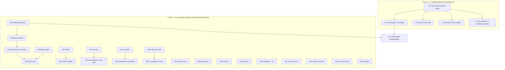
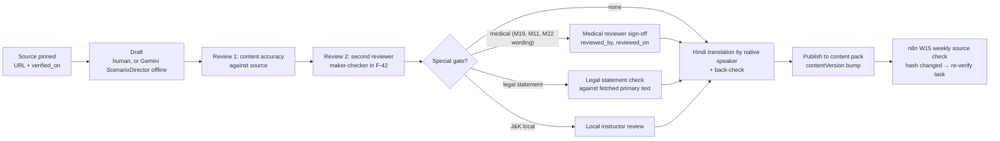

# Curriculum: the LL syllabus and 22 road-safety modules
> Project: Margdarshak · Owner: Content lead (with Learning & Games lead) · Status: Draft v0.1 · Last updated: 2026-10-23
> Related: [PROJECT_BRIEF](../00-overview/PROJECT_BRIEF.md) · [GAME_DESIGN](GAME_DESIGN.md) · [GAMIFICATION_ENGINE](GAMIFICATION_ENGINE.md) · [DEBRIEF_SPEC](DEBRIEF_SPEC.md) · [NAZAR](NAZAR.md) · [GAME_SDK](GAME_SDK.md) · [PRD](../01-product/PRD.md) · [Localization](../02-design/LOCALIZATION.md) · [Responsible AI](../04-ai/RESPONSIBLE_AI.md)
> Features: F-20 Learn hub, F-21 Readiness, F-22 LL Simulator, F-23 Nazar, F-24 mini-games, F-25 debrief, F-31 tutor, F-15 new-rider year, F-50 languages · Entities: E-08 Rule, E-18 TopicMastery · APIs: API-30, API-31, API-32, API-33 · Directives: D-05, D-09, D-11, D-12, D-13 revised, D-14, D-19, D-21, D-25
> Primary evidence: `research/ps1-deep/02-accident-curriculum.md` (MoRTH *Road Accidents in India* 2023 = **RAI23**, 2024 = **RAI24**), `05-psychology.md`, `01-abroad.md`, `08-game-ai-n8n.md`; `research/ps1-current-state/02-rules-process.md`.

---

## 0. What this curriculum is for, and what it never claims

**Job.** Turn the 30-day LL wait (stage S4) into calibrated skill. Two tracks run side by side:

1. **Track A, the LL syllabus (LL0–LL4).** What the state's LL test asks: signs, rules of the road, signals, documents and duties. It feeds the **Test Readiness Score** (F-21) and the **LL Test Simulator** (F-22, G10).
2. **Track B, 22 road-safety modules (M1–M22).** What actually kills young Indian road users, from MoRTH data, and which India's LL and DL tests never assess (`02` §2 gap table). It feeds **Road Readiness** (shown separately, never mixed into the LL score) and the **Practice Record** (F-28).

Plus **DL1, driving-test familiarisation** (track layouts, fault types), trained by Track Test Twin (G5).

**Never claimed (D-11, D-19, D-22):**
- Not "certification", not "safe driver", not "you would crash", not "lives saved". Every learning surface carries the label **"Practice and familiarisation, not certification"** / "अभ्यास और परिचय के लिए, प्रमाणन नहीं".
- Not the government's question bank. Questions are authored by us from cited sources; the LL format comes from the state rule pack with `source` and `verified_on`.
- Not "Kerala's test". Nazar mock is "Kerala's announced format (as reported)".
- The claim we make is narrow: these modules train skills linked in the literature to crash risk (hazard anticipation: Horswill et al. 2015, doi:10.1016/j.aap.2015.05.019 [K]) and calibration (`05` insight 2), and we measure them.

**Evidence that shapes the design (from `05` and `01`):**
- Fear appeals raise fear but not safer behaviour (r = .03, Carey et al. 2013), and death imagery backfires on young men with high driving self-esteem (`05` insight 3). **So: no gore, no death-count splash screens.** Data appears as a calm, cited "why this matters" card, never as a scare.
- Skid and emergency-handling training raised crashes (+12% for car drivers, Elvik meta-analysis; `01` §0.1). **So: no speed, stunt, skid or "reflex hero" content.** Vehicle-control content is limited to walking-pace layout familiarisation (DL1).
- Retrieval practice, spacing, error feedback and calibration are the mechanisms that work (`05` insight 10). **So: every module is short lessons + spaced retrieval (FSRS) + a game that gives error feedback + confidence ratings.**

---

## 1. Structure

### 1.1 Units of content

| Unit | ID pattern | What it is | Example |
|---|---|---|---|
| Module | `LL0`–`LL4`, `DL1`, `M1`–`M22` | A topic with objectives, lessons, concepts, a game and an assessment | `M4` The no-zone |
| Learning objective | `LO-<module>-<n>` | One observable capability | `LO-M4-2` "Place a two-wheeler outside all four truck no-zones" |
| Lesson | `LS-<module>-<n>` | A 2–3 minute screen sequence (picture + one sentence per screen, voice read-out optional) | `LS-M4-1` "Where a truck driver cannot see" |
| Concept (FSRS card) | `C-<module>-<nnn>` | The unit of memory. **One card per concept, not per question** (`08` §4.4) | `C-LL1-042` "No-entry sign" |
| Item variant | `Q-<concept>:v<n>` / `clip:<id>@<ver>` / scene seed | A surface form that tests one concept | `Q-C-LL1-042:v4` (sign photographed at a Jammu market) |
| Rule | `RR-<DOMAIN>-<nnn>` | A cited rule or practice statement in the rule catalogue (DEBRIEF_SPEC §3), with `kind: law | practice`, `source_url`, `verified_on`, `verified` | `RR-HVY-001` |
| Sign | `SIGN-<category>-<nnn>` | A road sign in the sign catalogue (vector SVG per IRC:67 categories; `06-design-language` §B) | `SIGN-MAN-012` |
| Skill node | `SK-<module>` | Node in the skill tree (GAMIFICATION_ENGINE §3) | `SK-M4` |

### 1.2 Depth contract (D-05)

- **Deep learning content only for MCWOG, MCWG and LMV-NT** (two-wheeler with/without gear, light motor vehicle non-transport). Modules are tagged `2W`, `Car` or `Both`.
- Other classes (MC50CC, LMV-TR, e-rickshaw/e-cart, HGMV/HPMV, adapted vehicles) show the LL syllabus where it applies plus the honest state: **"Learning content for this class is coming. Check the format at your RTO."**
- Transport-class content (heavy-vehicle driver's own blind spots, load securing) is roadmap.

---

## 2. Track A: the LL syllabus

### 2.0 What we know about the LL test (sources and gaps)

| Fact | Value | Status / source |
|---|---|---|
| Format | MCQ on signs, rules of the road and MV Act provisions | `02` §2; [Aditya Birla Capital](https://www.adityabirlacapital.com/abc-of-money/learning-licence-test-questions-and-answers) (secondary) |
| Pass mark | 60% | Delhi, TN flow [P-state]; Maharashtra [S] (`02-rules-process` l.57) |
| Count, J&K | 10 questions, 6 to pass | [S] Kashmir Life, Dec 2025, quoting the Srinagar ARTO (`02-rules-process` l.58) |
| Count, "Sarathi default" | 15 questions, 9 to pass | **[unverified]**, memory-sourced in research; never shown as fact (D §1.1: do not copy a claimed "15Q/9-pass" format) |
| Per-question timer | about 30 s | **[unverified]**, from user reports (`04` §3.5 / Q35) |
| Pre-test tutorial | Watch the MoRTH road-safety tutorial in full, OTP-unlocked, within 7 days of applying (2022 amendment to r.11) | [P-state TN flow], [S TeamLease] (`02-rules-process` l.55) |
| Retest fee | ₹50 | from `fees.json` (CMVR r.32); never a literal in UI copy (D-06) |
| Topic mix of the real bank | **unknown** (`02` §4 gap 4) | So Test Readiness uses **equal weights** across LL1–LL4, labelled "equal weights: the real test's topic mix isn't published" (GAMIFICATION_ENGINE §5) |
| States with no online LL test | Kerala scrapped online LL in 2022 (verification §3.2 item 10) | EC-10: the plan card switches to "test at RTO"; the simulator still works |

**Primary legal sources to author from** (cite in every concept's `source_url`): Motor Vehicles Act 1988 as amended 2019 ([India Code](https://www.indiacode.nic.in)); Central Motor Vehicles Rules 1989 (r.3 learner conditions, r.11 LL test, r.32 fees); Motor Vehicles (Driving) Regulations 2017 (rules of the road, signals) **[primary text not fetched in research: owner Content lead, fetch and pin the gazette PDF by 2026-10-24]**; IRC:67 Code of Practice for Road Signs (an Indian Roads Congress publication; we draw our own vectors and cite the standard, we do not reproduce its pages).

### 2.1 LL modules

| ID | Module | Learning objectives | Content outline | Concepts (target) | Question variants approach | Game | Assessment | Rules / sources | Review needs | Languages |
|---|---|---|---|---|---|---|---|---|---|---|
| **LL0** | Test format & device check | LO-LL0-1 Know your state's format (count, pass mark, timer) from the rule pack. LO-LL0-2 Complete the device check the night before (camera, network, battery). LO-LL0-3 Know what happens on a fail (retest, fee from `fees.json`) | 3 lessons: "What the test looks like in <state>" (rendered from rule pack with source + date); "Night-before device check"; "If you fail: retest steps" (links to F-13) | 8 | n/a (procedural); a guided first run of G10 explains each screen of the real flow (no face-match step: D-07) | **G10** guided first run | Completion only (not in Readiness) | Rule pack rows `LLT-<state>` with `source`, `verified_on`, `confidence` | Rule-pack maker-checker (F-42) per state | EN, HI |
| **LL1** | Road signs & markings | LO-LL1-1 Name the three sign families by shape and colour (mandatory = circular, cautionary = triangular, informatory = rectangular; plus stop octagon and give-way inverted triangle) [K, IRC:67]. LO-LL1-2 Identify each sign in the sign catalogue in a real-world photo. LO-LL1-3 Read lane and edge markings (stop line, zebra, no-overtaking centre line) | 6 lessons by family: mandatory (prohibitions, speed limits, compulsory directions), cautionary (curves, school, cattle, hairpin, narrow bridge, falling rocks), informatory (facilities, directions), markings, signals at junctions (traffic lights), signs you meet in J&K hills | ~90 signs + 10 markings | **4–6 surface forms per sign:** (a) clean vector; (b) real photo at different angles/lighting (team-shot in Jammu, consented, faces/plates blurred); (c) reverse question ("which sign means X?"); (d) scenario ("you see this before a bend, what do you do?"); (e) distractors drawn from the same family (same shape, different symbol) so shape-guessing fails. Variant chosen by FSRS to avoid the last 2 seen surface forms | **G10** + F-27 Road Sign Snap (Could) | FSRS mastery `M_LL1` (≥ 0.8 mastered); mock sections | `SIGN-*` catalogue, each with IRC:67 category and `verified_on` | Two-person content review per sign (meaning matches the cited standard) | EN, HI |
| **LL2** | Rules of the road | LO-LL2-1 Keep left; overtake on the right only (`RR-HVY-002`, `RR-WRG-001`). LO-LL2-2 Apply right-of-way at junctions and pedestrian crossings (`RR-JCT-002`). LO-LL2-3 Know where not to stop/park/overtake (bends, bridges, crossings). LO-LL2-4 Give way to emergency vehicles. LO-LL2-5 Know when the horn is prohibited | 7 lessons: lane discipline, overtaking, junction priority, roundabouts, pedestrians, parking/stopping, emergency vehicles & horn | ~45 | Reworded stems (3–4 per concept), scenario pictures (top-down junction diagrams generated from the G4 scene engine with seeded layouts), true/false flips, "spot the wrong rider" picture questions. **Never verbatim copies** of any third-party bank | **G10**; cross-trained by G3, G4 | FSRS `M_LL2`; mock | MVDR 2017 regulations (numbers pinned after fetch; until then `verified: false`) | Legal review of each rule statement against the fetched MVDR text | EN, HI |
| **LL3** | Driving & hand signals | LO-LL3-1 Give and read the standard hand signals (slowing, stopping, turning right/left, allowing overtake). LO-LL3-2 Use indicators and horn correctly | 3 lessons with looped illustrations (no audio needed) | ~12 | Picture of a signal from front/side/rear; "what does this rider intend?"; mirrored images so position memorising fails. Research flagged that hand-signal questions are missing in many apps (Q35, `04` §3.5) | **G10** | FSRS `M_LL3` | MVDR 2017 signal schedule **[unverified until fetched]** | Legal review; illustration review for left-hand-traffic correctness | EN, HI |
| **LL4** | Documents, LL conditions & duties | LO-LL4-1 State LL conditions: "L" plates front and rear and a licensed driver beside you (CMVR r.3) and that insurance cover can depend on following LL conditions (Karnataka HC ruling cited in `01` row 10). LO-LL4-2 Know the documents to carry/produce (DL, RC, insurance, PUC) and DigiLocker presentation [unverified acceptance rules per state]. LO-LL4-3 Know the duty to help and report after a crash (links M19) | 4 lessons: LL conditions, documents, duties after a crash, penalties as concepts (no rupee literals: amounts render from the rule pack only when verified) | ~20 | Scenario framing ("your friend lends you his bike on your LL, alone: what's wrong?"), document-picture questions, true/false flips | **G10** | FSRS `M_LL4` | `RR-LLC-001`, `RR-DOC-001`, `RR-ACC-001` (all `verified: false` until primary text fetched) | Legal review | EN, HI |

### 2.2 LL Test Simulator coupling

- **Practice mode:** one concept at a time, FSRS-due first, confidence (50/75/100%) asked **before** feedback, explanation after every answer (reviewed static text; F-31 TutorAgent may only re-phrase reviewed text for the user's wrong answer, never author new rules: `04` §3.5).
- **Mock mode:** exact state format from the rule pack (count, pass mark, timer), unseen variant mix, confidence asked once **after** the exam (to stay true to format), "Format for J&K, source: Kashmir Life Dec 2025 quoting Srinagar ARTO, checked on DATE" on the start screen, or "Format not confirmed for your state; practising with 15 questions / 60%" (the 15/9 default labelled as a practice assumption).
- **Mid-prep format change (EC-27):** the rule pack bumps; the next session shows a one-line notice; old mocks keep their old format in history.

---

## 3. Track B: the 22 road-safety modules

**Priority key** (from `02` §3): **P0** = must ship in the hackathon (Phase 1–2), **P1** = strong add, **P2** = later. **Phase 1–2 cut** (from `02`, adjusted to the game build in `08` §3.11): M1, M3, M4, M5, M6, M8 (via Nazar night clips), M14 (storyboard), M19, plus M18/M5 through Nazar clip tags.

**How each block reads:** *Data rationale* (numbers with source codes) → *Objectives* → *Content outline* → *Concepts* → *Question variants* → *Game* → *Assessment* → *Rules cited* → *Review needs* → *Languages* → *Phase 1–2 depth*.

All modules: languages **EN + HI in full** (F-50); **Dogri voice-in** for navigation and questions (M-08 Saaras), not Dogri text (D-21: Dogri text is "rule-pack-ready translation", not claimed). Hindi is written by a native Hindi speaker on the team from the reviewed English, then back-checked; machine drafts (IndicTrans2) are allowed only as a first draft.

---

### M1 · Speed is physics: stopping distance · P0 · Both
- **Data rationale.** Over-speeding is the attributed violation in **1,17,682 deaths (68.1%) in 2023** and **1,24,522 (70.3%) in 2024** (RAI23 T3.1; CSV24-V). **66% of deaths (1,14,447) are on straight roads** (RAI23 T3.5). Caveat shown in the "why" card: these are police attributions and work partly as a default label (`02` §1.2).
- **Objectives.** LO-M1-1 State total stopping distance at 40/60/80 km/h, dry and wet, to within ±20%. LO-M1-2 Explain that braking distance grows with the square of speed (double the speed ≈ four times the braking distance). LO-M1-3 Choose a speed at which you can stop within the distance you can see to be clear.
- **Content outline.** LS-M1-1 "Two distances: thinking + braking" (`d = v·t_r + v²/(2μg)`, shown with the numbers). LS-M1-2 "Dry vs wet" (μ 0.7 vs 0.4). LS-M1-3 "Speed for what you can see" (bends, parked buses, driveways). Worked values (computed, `08` G3): 40 km/h dry ≈ 25.7 m; 60 km/h dry ≈ 45.2 m; 60 km/h wet ≈ 60.4 m; 80 km/h dry ≈ 69.3 m (t_r = 1.5 s).
- **Concepts.** 8 (C-M1-001 thinking distance … C-M1-008 sight-limited speed).
- **Question variants.** Speed × surface × scenario grid generated from the formula (so every numeric answer is computed, not typed). Predict-then-reveal sliders; multiple-choice bands ("about 25 / 45 / 70 m"); scenario pictures with a sight distance.
- **Game.** **G2 Stopping Distance** (predict, brake, choose a speed). Also used by G8 (headlight range) and G9 (brake fade).
- **Assessment.** G2 ≥ 80 on 2 sessions ≥ 1 day apart + FSRS mastery ≥ 0.8.
- **Rules cited.** `RR-SPD-001` (practice: stop within the distance you can see), `RR-SPD-002` (law: obey posted limits; `verified: false` until MV Act text pinned).
- **Review needs.** Physics review by an engineering faculty member or team member with the parameters (μ, t_r) labelled "teaching values, real roads vary".
- **Phase 1–2.** Deep.

### M2 · Impact speed and who dies · P0 · Both
- **Data rationale.** Pedestrian death risk is **under 20% below 50 km/h and about 60% at 80 km/h** (WHO road traffic injuries fact sheet, https://www.who.int/news-room/fact-sheets/detail/road-traffic-injuries; **not re-fetched**, `02` §1.5). Pedestrians are **35,221 deaths (20.4%)** in 2023 (RAI23 T4.4).
- **Objectives.** LO-M2-1 Link speed choice to survivability for the other person. LO-M2-2 Use only the two published reference points; no invented curve.
- **Content outline.** One lesson: two calm cards ("at 50 or below…", "at 80…"), illustrated without injury imagery; a "who's around you" framing (pillion, pedestrian, child) following Mill's harm principle (`05` §5).
- **Concepts.** 3.
- **Question variants.** Scenario cards (school gate, market) with a speed choice; "which speed band" MCQs.
- **Game.** **G2** round 2 (impact speed converted to the WHO band in the debrief only from the two points).
- **Assessment.** 5-item scenario choice ≥ 4/5; FSRS mastery ≥ 0.8.
- **Rules cited.** `RR-SPD-003` (evidence statement; `verified: false` until the WHO page is re-fetched).
- **Review needs.** Re-fetch WHO source (owner: Content lead, 2026-10-24); tone review (no gore).
- **Phase 1–2.** Inside G2 only.

### M3 · Helmet: wear it, fit it, strap it · P0 · 2W
- **Data rationale.** **54,568 riders killed not wearing a helmet in 2023** (drivers 39,160; pillions 15,408) and 54,122 in 2024 (RAI23 T3.3; RAI24). About 70% of two-wheeler deaths were unhelmeted (computed, `02` §1.5). A hospital study found **only 45% had the helmet properly fastened** (PMC6182975, https://pmc.ncbi.nlm.nih.gov/articles/PMC6182975). WHO: correct helmet use cuts death risk by about 42% (not re-fetched).
- **Objectives.** LO-M3-1 Choose an ISI-marked helmet (IS 4151) and tell a genuine mark from a fake. LO-M3-2 Achieve correct fit (snug, no rocking) and fasten the strap with the two-finger rule. LO-M3-3 Insist on pillion and child helmets.
- **Content outline.** LS-M3-1 "Fit and strap" (3 picture steps). LS-M3-2 "Real vs fake ISI label". LS-M3-3 "Full-face vs open-face". LS-M3-4 "Pillion and child".
- **Concepts.** 7.
- **Question variants.** Label photos (genuine vs counterfeit, multiple brands, blurred brand names), helmet-type photos, "is this strap right?" photos at different angles.
- **Game.** **G6 Helmet Fit** (on-device MediaPipe framing + self-check steps + quiz). Strap Streak badge.
- **Assessment.** G6 ≥ 80 (camera or no-camera path, same cap) + FSRS mastery ≥ 0.8.
- **Rules cited.** `RR-HLM-001` (law: helmet compulsory, MV Act s.129, **not re-fetched → `verified: false`**), `RR-HLM-002` (IS 4151 marking; `verified: false` until the BIS reference is pinned), `RR-HLM-003` (practice: two-finger strap check).
- **Review needs.** Legal (s.129 text and exemptions), BIS standard citation; photo consent for team-shot label images.
- **Phase 1–2.** Thin (framing + checklist + quiz).

### M4 · The no-zone: trucks and buses · P0 · 2W
- **Data rationale.** Trucks and buses killed **18,556 two-wheeler riders in 2023** (truck 14,229; bus 4,327) (RAI23 T4.5).
- **Objectives.** LO-M4-1 Name the four no-zones around a truck (front, rear, both sides, the left side being the largest for a right-hand-drive cab). LO-M4-2 Place a two-wheeler outside all four. LO-M4-3 Apply "if you can't see the driver in his mirror, he can't see you". LO-M4-4 Don't linger beside a truck; hold back when it indicates left.
- **Content outline.** LS-M4-1 "Where a truck driver can't see" (top-down, hatched zones + eye-off icon, never red/green alone). LS-M4-2 "The mirror rule". LS-M4-3 "Left turns and buses at stops".
- **Concepts.** 6.
- **Question variants.** Seeded truck/bus positions and orientations (mirrored, rotated), vehicle types (truck, bus, tanker), "where is it safe?" tap-on-diagram items; Nazar clips tagged `truck_left_turn`.
- **Game.** **G3 Blind Spot** (Part A place, Part B ride). Also Nazar clips.
- **Assessment.** G3 ≥ 85 twice ≥ 2 days apart (also the No-Zone Navigator badge); FSRS ≥ 0.8.
- **Rules cited.** `RR-HVY-001` (practice: no-zones, mirror rule), `RR-HVY-003` (practice: hold back at left turns), `RR-HVY-002` (law: overtake on the right; `verified: false` until MVDR fetched).
- **Review needs.** Geometry review (zone shapes are illustrative, labelled "zones vary by vehicle and mirrors"); a truck driver interview if possible (Production).
- **Phase 1–2.** Deep.

### M5 · Left-overtake and lane splitting · P0 · 2W
- **Data rationale.** Hit-from-side **20,623** and hit-from-back **36,804** deaths in 2023 (RAI23 T1.5).
- **Objectives.** LO-M5-1 Overtake only on the right, with a clear gap. LO-M5-2 Recognise when lane-splitting beside a turning or stopping vehicle is dangerous. LO-M5-3 Predict where a vehicle will move next.
- **Content outline.** LS-M5-1 "Why the left is the trap". LS-M5-2 "Reading intent: indicators, wheels, head turns".
- **Concepts.** 5.
- **Question variants.** Nazar prediction items (freeze 0.5 s before onset, "what happens next?"), seeded traffic pictures.
- **Game.** **G1 Nazar** (clips tagged `auto_cut_in`, `vehicle_pulling_out`), **G3** Part B critical fault (left overtake while the truck indicates left).
- **Assessment.** Nazar hazard-type mastery for tagged types ≥ 0.8; no `BS_LEFT_OVERTAKE` in the last 2 G3 sessions.
- **Rules cited.** `RR-HVY-002` (law, `verified: false`), `RR-HVY-003`.
- **Review needs.** Clip window two-rater agreement (NAZAR §5).
- **Phase 1–2.** Through Nazar + G3.

### M6 · Uncontrolled and T-junctions · P0 · Both
- **Data rationale.** **Uncontrolled crossings: 25,471 deaths (14.7%)**, far more than signalised junctions (2,131) (RAI23 T3.7). **T-junctions: 12,311 deaths (7.1%)**, the largest junction category (RAI23 T3.6). Together 37,782 (PROJECT_BRIEF §2).
- **Objectives.** LO-M6-1 Apply slow → scan (right, left, right again) → creep → go. LO-M6-2 Yield correctly when right-of-way is unclear (pedestrian on the crossing, vehicle already in the junction). LO-M6-3 Spot vehicles hidden behind a stopped bus or A-pillar. LO-M6-4 Accept only gaps you can complete.
- **Content outline.** LS-M6-1 "Why uncontrolled is the killer". LS-M6-2 "Right, left, right again" (left-hand traffic: the near lane comes from the right). LS-M6-3 "Creep and peek". LS-M6-4 "Gap judgement in seconds".
- **Concepts.** 7.
- **Question variants.** Seeded junction layouts (T, Y, 4-arm, staggered) with occluders; Nazar clips tagged `junction_emerging`, `parked_vehicle_hidden`.
- **Game.** **G4 Junction Scan** + **G1 Nazar**.
- **Assessment.** G4 ≥ 80 with no critical fault in 2 sessions; Nazar junction types ≥ 0.8.
- **Rules cited.** `RR-JCT-001` (practice), `RR-JCT-002` (law: give way; `verified: false`).
- **Review needs.** Instructor review of the scan sequence wording.
- **Phase 1–2.** Thin (1 level) + Nazar.

### M7 · Following distance and overtaking judgement · P0 · Both
- **Data rationale.** Rear-end crashes killed **36,804** and head-on **28,898** in 2023 (RAI23 T1.5).
- **Objectives.** LO-M7-1 Keep a 3-second gap (4 s or more in wet or at night). LO-M7-2 Judge whether an overtaking gap is enough; abort when it isn't.
- **Content outline.** LS-M7-1 "Count the seconds" (pick a fixed object). LS-M7-2 "Overtake: see, gap, commit or abort".
- **Concepts.** 4.
- **Question variants.** Dash-cam stills with a marker ("say when the car ahead passes the pole"), seeded gap animations.
- **Game.** Nazar clips tagged `overtaking_oncoming`; a "count the seconds" micro-round inside G2 [Phase 3+ as its own level].
- **Assessment.** Gap-judgement items ≥ 80%; FSRS ≥ 0.8.
- **Rules cited.** `RR-FOL-001` (practice).
- **Review needs.** Instructor review.
- **Phase 1–2.** Lessons + quiz only.

### M8 · Night riding and glare · P0 · Both
- **Data rationale.** Night (18:00–06:00) is **42.1% of accidents in 2023, 42.5% in 2024**; 18:00–21:00 is the single peak (20.8%) (RAI23 T7.3; RAI24 T7.3). Punjab's night share is 43.1% (RAI23 Annex 42). J&K's is lower (28.5%) because hill traffic runs in daylight.
- **Objectives.** LO-M8-1 Dip the beam for oncoming traffic and when following. LO-M8-2 When dazzled, look to the left edge and slow down. LO-M8-3 Keep within the stopping distance of your lights. LO-M8-4 Be visible (reflective gear) and spot unlit tractors, dark-clad pedestrians and animals.
- **Content outline.** LS-M8-1 "Your lights are your sight distance" (links M1). LS-M8-2 "Glare: left edge, slow". LS-M8-3 "Things you won't see until late".
- **Concepts.** 6.
- **Question variants.** Night-photo items with brightness variants, Nazar night clips.
- **Game.** **G8 Night & Glare** (Phase 3+ build; storyboard in Phase 1–2) + Nazar night clips.
- **Assessment.** G8 mastered (Night Ready badge) or, in Phase 1–2, night-tagged Nazar types ≥ 0.8.
- **Rules cited.** `RR-NGT-001` (law: dipping; `verified: false`), `RR-NGT-002`, `RR-NGT-003` (practice).
- **Review needs.** Photosensitivity review of glare effects (WCAG 2.3.1, ≤ 3 flashes/s).
- **Phase 1–2.** Lessons + Nazar night clips; G8 storyboard.

### M9 · Wrong-side and shortcut deaths · P1 · Both
- **Data rationale.** Wrong side / lane indiscipline: **9,432 deaths (5.5%)** in 2023 (RAI23 T3.1); Punjab **522** wrong-side deaths (RAI23 Annex 35).
- **Objectives.** LO-M9-1 Never ride the wrong way; take the legal U-turn. LO-M9-2 Anticipate wrong-side riders as a hazard.
- **Content outline.** One lesson: "the shortcut maths" (time saved vs exposure), framed as choice, not lecture (`05` principle 15).
- **Concepts.** 3.
- **Question variants.** Route-choice cards; Nazar clips tagged `wrong_side_2w`.
- **Game.** G1 Nazar (hazard), choice items.
- **Assessment.** Scenario choice ≥ 80%.
- **Rules cited.** `RR-WRG-001` (law: keep left; `verified: false`).
- **Review needs.** Tone review (no shaming).
- **Phase 1–2.** Nazar clips only.

### M10 · Phones and earphones · P1 · Both
- **Data rationale.** **2,884 recorded deaths** with mobile phone use in 2023 (RAI23 T3.1), under-counted because phone forensics are rare (`02` §1.2); Srinagar issued 5,462 phone challans in 2024 (Greater Kashmir).
- **Objectives.** LO-M10-1 Hands-free still distracts. LO-M10-2 Set navigation before riding; mount it. LO-M10-3 No earphones under the helmet.
- **Content outline.** One lesson + the riding lock explanation (the app itself shows "Pull over to use Margdarshak" above ~10 km/h: verification row 11).
- **Concepts.** 3.
- **Question variants.** Scenario cards.
- **Game.** Phase 3+: "reaction under distraction" round in Nazar learn mode (taps while a chat bubble appears) comparing the user's own latency with and without distraction.
- **Assessment.** Quiz ≥ 80%.
- **Rules cited.** `RR-PHN-001` (law: MV Act s.184 cited in verification row 11; `verified: false` until text pinned).
- **Review needs.** Legal.
- **Phase 1–2.** Lesson only.

### M11 · Alcohol, drugs and the ride home · P1 · Both
- **Data rationale.** **3,674 recorded deaths** (2023), true burden unknown; J&K records 0, a recording artefact (RAI23 Annex 35; `02` §1.8). Legal limit 30 mg per 100 ml under MV Act s.185 (**not re-fetched**).
- **Objectives.** LO-M11-1 No safe dose for riding. LO-M11-2 Plan the ride home (designated rider, stay over).
- **Content outline.** One lesson + myth/fact cards (coffee, "just one").
- **Concepts.** 4.
- **Question variants.** Myth/fact flips, scenario framing.
- **Game.** None (quiz).
- **Assessment.** Myth/fact ≥ 80%.
- **Rules cited.** `RR-ALC-001` (law; `verified: false`; the number renders only from the rule catalogue once verified).
- **Review needs.** Legal + medical wording.
- **Phase 1–2.** Not built.

### M12 · Seatbelts, rear seat and kids · P1 · Car
- **Data rationale.** **16,025 killed not wearing a seatbelt** in 2023, **47.3% of them passengers** (RAI23 T3.3); WHO: rear-seat belts cut deaths by up to 25% (not re-fetched).
- **Objectives.** LO-M12-1 Belts in every seat, every trip. LO-M12-2 Child seats; airbag + belt.
- **Content outline.** One lesson.
- **Concepts.** 3.
- **Question variants.** Picture items.
- **Game.** None (quiz); LMV class only.
- **Assessment.** Quiz ≥ 80%.
- **Rules cited.** `RR-BLT-001` (law; `verified: false`; CMVR rule number to be pinned).
- **Review needs.** Legal.
- **Phase 1–2.** Not built.

### M13 · Pillion, triple riding and loads · P1 · 2W
- **Data rationale.** **15,408 unhelmeted pillion deaths** in 2023 (RAI23 T3.3); Srinagar issued **11,140 triple-riding challans** in 2024 (Greater Kashmir); overloaded vehicles: 7.0% of deaths (RAI23 §3.20). Child pillions: harness, helmet, ≤ 40 km/h under a 2022 CMVR amendment (**not re-fetched**).
- **Objectives.** LO-M13-1 How load changes braking and stability. LO-M13-2 Legal pillion count. LO-M13-3 Child pillion safety.
- **Content outline.** One lesson + the Pillion Pledge (GAMIFICATION_ENGINE §7).
- **Concepts.** 4.
- **Question variants.** G2 with a pillion load toggle (Phase 3+).
- **Game.** G2 load toggle (stretch), G6 pillion helmet step.
- **Assessment.** Quiz ≥ 80%.
- **Rules cited.** `RR-PIL-001` (law; `verified: false`).
- **Review needs.** Legal.
- **Phase 1–2.** Lesson only.

### M14 · Hill and mountain roads (J&K) · P0 for J&K tenant · Both
- **Data rationale.** NH44 gorge plunge at Battery Chashma, Ramban, 29 Mar 2024, 10 dead (All India Radio News: https://newsonair.gov.in/jk-road-accident-at-least-ten-killed-after-a-passenger-vehicle-plunged-into-deep-gorge). Curves: **22,263 deaths nationally** (+8.2%) (RAI23 T3.5). Hill risk is nearly invisible in MoRTH coding: J&K "steep grade" = 13 accidents, 6 deaths (RAI23 Annex 22), so the module is justified by pattern, not by a national count.
- **Objectives.** LO-M14-1 Downhill in a low gear; no coasting; don't ride the brakes. LO-M14-2 Downhill gives way to uphill on narrow sections. LO-M14-3 Horn at blind bends; no overtaking on bends. LO-M14-4 Park safely on a slope.
- **Content outline.** LS-M14-1 "Engine braking". LS-M14-2 "Who gives way". LS-M14-3 "Blind bends". LS-M14-4 "One-way and convoy advisories".
- **Concepts.** 6.
- **Question variants.** "Who gives way?" puzzles on seeded single-lane layouts; hairpin pictures from Patnitop/Batote (team-shot, blurred).
- **Game.** **G9 Hill Road** (Phase 3+; J&K storyboard for the J&K judges in Phase 1–2).
- **Assessment.** G9 mastered (Ghat Ready badge); in Phase 1–2, quiz ≥ 80%.
- **Rules cited.** `RR-HIL-001` (law: uphill priority, MVDR 2017, **not re-fetched → `verified: false`**; the AI may not cite it until verified, `08` §7 item 11), `RR-HIL-002`, `RR-HIL-003` (practice).
- **Review needs.** J&K-specific review by a local instructor or J&K Traffic Police public material [unverified availability]; legal fetch of MVDR.
- **Phase 1–2.** Lessons + storyboard.

### M15 · Landslides, shooting stones, snow and black ice · P0 for J&K tenant · Both
- **Data rationale.** J&K hill hazard pattern (`02` §1.9): shooting stones and landslides (Ramban–Banihal), fog in the Banihal and Jawahar tunnel approaches, black ice and snow (Jawahar Tunnel, Mughal Road, Sinthan), hairpins (Patnitop, Batote). **Counts per hazard are unknown.**
- **Objectives.** LO-M15-1 Read hill warning signs. LO-M15-2 Don't stop under loose slopes. LO-M15-3 Recognise black-ice conditions (shaded bends, early morning). LO-M15-4 Check the J&K Traffic Police road status before a trip.
- **Content outline.** One lesson + the "plan a Jammu → Srinagar trip" sequence with a **clearly labelled sample advisory** ("Sample advisory: check J&K Traffic Police for today's"). Never a fake live status (D-14 spirit; `08` G7).
- **Concepts.** 5.
- **Question variants.** Trip-plan rubric with seeded advisories.
- **Game.** G9 trip-plan pre-game.
- **Assessment.** Trip-plan rubric ≥ 80%.
- **Rules cited.** `RR-LSD-001` (practice).
- **Review needs.** Local review; route-risk features stay roadmap (verification row 7).
- **Phase 1–2.** Storyboard only.

### M16 · Fog and rain · P1 · Both
- **Data rationale.** **Fog or mist: 14,617 deaths (~8.5%)**; **rain: 13,734** (RAI23 T3.8). December is the second-deadliest month (15,383 deaths), fog season (RAI23 T7.2).
- **Objectives.** LO-M16-1 Slow down and lengthen the gap. LO-M16-2 Low beam (and fog lamps), never high beam in fog; avoid hazard lights while moving. LO-M16-3 Recognise aquaplaning and slippery painted lines.
- **Content outline.** One lesson; wet-road toggle reused from M1.
- **Concepts.** 4.
- **Question variants.** G2 wet rounds; fog-density pictures.
- **Game.** G2 (wet), G8 fog level (Phase 3+), Nazar fog clips (if filmed in season).
- **Assessment.** G2 wet rounds ≥ 80%; quiz.
- **Rules cited.** `RR-FOG-001` (practice).
- **Review needs.** Instructor review.
- **Phase 1–2.** Via G2 wet only.

### M17 · Reading the road surface · P1 · Both
- **Data rationale.** Potholes **2,161 deaths** (+16.4%), culverts **4,271** (+23%), bridges **6,552**, road works **3,904** (RAI23 T3.5).
- **Objectives.** LO-M17-1 Scan 10–12 s ahead. LO-M17-2 Brake before the pothole, not in it. LO-M17-3 Ride bridges and culverts narrow-aware; unmarked speed breakers.
- **Content outline.** One lesson + a "spot the surface" photo set.
- **Concepts.** 4.
- **Question variants.** Timed photo items (gravel, oil, potholes, unmarked breakers) from team-shot Jammu photos.
- **Game.** Photo quiz; G2 "unmarked speed breaker" level (Phase 3+).
- **Assessment.** Timed photo quiz ≥ 80%.
- **Rules cited.** `RR-SRF-001` (practice).
- **Review needs.** Photo consent/blur.
- **Phase 1–2.** Not built.

### M18 · Pedestrians, animals and rural roads · P1 · Both
- **Data rationale.** Pedestrians: **35,221 deaths (20.4%)** (RAI23 T4.4); **68.5% of deaths are rural (1,18,411)** (RAI23 §7.1); animal collisions: **no national breakout (unknown)**.
- **Objectives.** LO-M18-1 Anticipate pedestrians at bus stops, markets and school gates. LO-M18-2 Read cattle and dog behaviour. LO-M18-3 Slow through villages.
- **Content outline.** One lesson; most training happens in Nazar.
- **Concepts.** 5 (one per hazard type).
- **Question variants.** Nazar clips tagged `bus_stop_pedestrian`, `child_school`, `pedestrian_median`, `cattle_animal`.
- **Game.** **G1 Nazar**.
- **Assessment.** Hazard-type mastery ≥ 0.8.
- **Rules cited.** `RR-PED-001` (practice).
- **Review needs.** Clip two-rater agreement.
- **Phase 1–2.** Via Nazar (the core clip set is filmed at a bus stop, market road and school gate: field kit §0).

### M19 · Golden hour and Good Samaritan · P0 (differentiator) · Both
- **Data rationale.** **Hit-and-run: 31,209 deaths (18.1%) in 2023; 34,030 (19.2%) in 2024** (RAI23 T1.5; RAI24). SaveLIFE Foundation: **74% of bystanders unlikely to help; 88% of them fear police and legal hassles** (https://savelifefoundation.org/wp-content/uploads/2024/06/Impediments-to-Bystander-Care-in-India-National-Study-on-Impact-of-Good-Samaritan-Law.pdf). Good Samaritan protection is statutory under MV Act s.134A (2019 amendment); s.2(12A) defines the golden hour (**not re-fetched**, `02` §1.10).
- **Objectives.** LO-M19-1 Get the order right: make the scene safe → call 112 (or 108) → do not remove a helmet if a neck injury is possible → control bleeding → keep the person warm and talk to them → hand over. LO-M19-2 Know you are protected when you help (s.134A), so fear doesn't stop you.
- **Content outline.** LS-M19-1 "Four steps" (static, offline, cited medical source on screen). LS-M19-2 "What the police may and may not ask you" (myth-busters from rule IDs only). LS-M19-3 "One-tap 112" (the F-15 golden-hour card is the same content). Rah-Veer reward and cashless-treatment amounts are **excluded until re-verified** (D-12, D-25; the cashless amount in `02` is from memory).
- **Concepts.** 7.
- **Question variants.** Branching scene variants (night, highway, pillion child), card-sequencing items, myth/fact flips.
- **Game.** **G7 Golden Hour** (template-only debrief, no generative AI anywhere: D-09, D-14).
- **Assessment.** G7 ≥ 80 with no critical error (Golden Hour Ready badge, only after medical sign-off).
- **Rules cited.** `RR-GHR-001` (law: s.134A; `verified: false` until re-fetched), `RR-GHR-002` (practice: call 112), `RR-GHR-003` (medical: helmet/neck), `RR-GHR-004` (law: s.2(12A) definition; `verified: false`).
- **Review needs.** **Medical review is mandatory.** A qualified reviewer (MBBS doctor or certified EMS trainer; name and registration recorded in the rule pack as `reviewed_by`, date as `reviewed_on`) signs off the protocol, each step's wording in EN and HI, and the "not medical training" disclaimer. **Until sign-off, G7 and the M19 lessons show "Draft, not medical advice"** and the badge cannot be earned. Legal review of the s.134A wording. Owner: Content lead; target reviewer identified by 2026-10-24 [unverified who].
- **Phase 1–2.** Thin (one scenario, "draft" label).

### M20 · Under-18 and the law · P2 · 2W
- **Data rationale.** **Under-18 deaths: 9,489 (5.5%) in 2023, 10,117 in 2024** (+6.6%) (RAI23 T4.2; RAI24 T4.2); **33,827 accidents with no licence** (RAI23 T3.2). MV Act s.199A makes the guardian/owner liable for a juvenile's offence (**not re-fetched**; penalty details are rendered only after verification).
- **Objectives.** LO-M20-1 (for adults and parents) Know that letting a minor ride makes the guardian/owner liable. LO-M20-2 (for 16–17s, P-07) Know the ≤ 50 cc gearless path with guardian consent and that most scooters exceed 50 cc (EC-05).
- **Content outline.** Shareable "protect your younger brother" card for adults; plain-language card for minors. Never shaming (`03` §0.4 via verification EC-17).
- **Concepts.** 3.
- **Question variants.** Scenario cards.
- **Game.** None.
- **Assessment.** Quiz for everyone; parents and 16–17s (family mode, D-13 revised) get their own scenario cards.
- **Rules cited.** `RR-U18-001` (law; `verified: false`).
- **Review needs.** Legal.
- **Phase 1–2.** Static card (F-17 minor-riding awareness).

### M21 · Pre-ride check (T-CLOCS) · P2 · Both
- **Data rationale.** Vehicle-defect burden is **unknown** (MoRTH has no defect coding; RAI23 §3.18–3.19), but the check is cheap to teach. The UK "show me, tell me" questions are a precedent (`01` row 7).
- **Objectives.** LO-M21-1 Check tyres, controls, lights, oil, chassis and stand in 60 seconds.
- **Content outline.** One checklist lesson; tyre-tread photo prompt (on device).
- **Concepts.** 6.
- **Question variants.** Photo items.
- **Game.** Checklist streak (no XP inflation).
- **Assessment.** Checklist completion.
- **Rules cited.** `RR-PRE-001` (practice).
- **Review needs.** Instructor review.
- **Phase 1–2.** Not built.

### M22 · Fatigue and long highway runs · P2 · Both
- **Data rationale.** Fatigue is **not coded by MoRTH (unknown)**; NH and SH carry **59% of deaths** on about 5% of the network (RAI23 T1.3, T2.1).
- **Objectives.** LO-M22-1 Take a break every 2 hours. LO-M22-2 Spot micro-sleep signs. LO-M22-3 Avoid riding 00:00–06:00.
- **Content outline.** One lesson + a pre-trip reaction self-test (private, never scored for status).
- **Concepts.** 3.
- **Question variants.** Scenario cards.
- **Game.** Self-test.
- **Assessment.** Self-test completion.
- **Rules cited.** `RR-FTG-001` (practice).
- **Review needs.** Medical wording review.
- **Phase 1–2.** Not built.

### 3.23 DL1 · Driving-test familiarisation · P0 · class-specific
- **Data rationale.** Delhi's automated tracks fail about 50%; Gujarat's fail 94% of car applicants on 4 AI tracks (PROJECT_BRIEF §2); Kerala's pass rate fell from 95–100% to 40–45% after the 2024 reform (`02-rules-process` l.82). Track criteria are not published, which is what agents sell (`05` insight 1). The formal DL syllabus is **unknown** (`02` §2).
- **Objectives.** LO-DL1-1 Know the shape and fault types of the track for your class (2W figure-8; car H-track / reverse park / gradient). LO-DL1-2 Rehearse at walking pace.
- **Content outline.** Animated track explainer (F-12, Rive canvas-lite), "what's checked" from the track spec, "top fail reasons" from RTO Live Intel (F-11, k ≥ 5).
- **Game.** **G5 Track Test Twin** labelled **"Practice layout, not your RTO's track"** until a published spec exists. It never claims to train balance or clutch control (verification §1.1).
- **Assessment.** G5 demerits ≤ threshold with no immediate-fail fault, twice.
- **Review needs.** Per-RTO track spec maker-checker (F-42).

---

## 4. Module catalogue summary

| ID | Module | Class | Priority | Game | Concepts | Key number (source) | Legal rules verified? | Medical review | Phase 1–2 depth |
|---|---|---|---|---|---|---|---|---|---|
| LL0 | Test format & device check | All | P0 | G10 | 8 | rule pack | rule pack | no | Deep |
| LL1 | Road signs & markings | All | P0 | G10 | ~100 | — | IRC:67 cited | no | Deep |
| LL2 | Rules of the road | All | P0 | G10 | ~45 | — | MVDR pending | no | Deep |
| LL3 | Driving & hand signals | All | P0 | G10 | ~12 | — | MVDR pending | no | Deep |
| LL4 | Documents & duties | All | P0 | G10 | ~20 | — | CMVR r.3 pending | no | Deep |
| DL1 | Driving-test familiarisation | per class | P0 | G5 | 10 | ~50% Delhi fail (brief §2) | track spec | no | Thin |
| M1 | Stopping distance | Both | P0 | G2 | 8 | 68.1% over-speeding (RAI23 T3.1) | pending | no | Deep |
| M2 | Impact speed | Both | P0 | G2 | 3 | <20% / ~60% (WHO) | n/a | no | In G2 |
| M3 | Helmet | 2W | P0 | G6 | 7 | 54,568 (RAI23 T3.3) | s.129 pending | no | Thin |
| M4 | No-zone | 2W | P0 | G3 | 6 | 18,556 (RAI23 T4.5) | pending | no | Deep |
| M5 | Left-overtake | 2W | P0 | G1, G3 | 5 | 20,623 side (RAI23 T1.5) | pending | no | Via G1/G3 |
| M6 | Junctions | Both | P0 | G4, G1 | 7 | 25,471 + 12,311 (RAI23 T3.6–3.7) | pending | no | Thin |
| M7 | Following & overtaking | Both | P0 | G1 | 4 | 36,804 rear (RAI23 T1.5) | n/a | no | Lessons |
| M8 | Night & glare | Both | P0 | G8, G1 | 6 | 42.1% (RAI23 T7.3) | pending | no | Lessons + clips |
| M9 | Wrong side | Both | P1 | G1 | 3 | 9,432 (RAI23 T3.1) | pending | no | Clips |
| M10 | Phones | Both | P1 | (G1 learn) | 3 | 2,884 (RAI23 T3.1) | pending | no | Lesson |
| M11 | Alcohol | Both | P1 | quiz | 4 | 3,674 (RAI23 T3.1) | s.185 pending | wording | — |
| M12 | Seatbelts | Car | P1 | quiz | 3 | 16,025 (RAI23 T3.3) | pending | no | — |
| M13 | Pillion & loads | 2W | P1 | G2, G6 | 4 | 15,408 pillions (RAI23 T3.3) | pending | no | Lesson |
| M14 | Hill roads (J&K) | Both | P0 J&K | G9 | 6 | 22,263 curves (RAI23 T3.5) | uphill rule pending | no | Storyboard |
| M15 | Landslides & snow | Both | P0 J&K | G9 | 5 | unknown | n/a | no | Storyboard |
| M16 | Fog & rain | Both | P1 | G2, G8 | 4 | 14,617 fog (RAI23 T3.8) | n/a | no | Via G2 |
| M17 | Road surface | Both | P1 | photo quiz | 4 | 2,161 potholes (RAI23 T3.5) | n/a | no | — |
| M18 | Pedestrians & animals | Both | P1 | G1 | 5 | 35,221 (RAI23 T4.4) | n/a | no | Via G1 |
| M19 | Golden hour | Both | P0 | G7 | 7 | 31,209 hit-and-run (RAI23 T1.5) | s.134A pending | **yes, mandatory** | Thin, draft |
| M20 | Under-18 & law | 2W | P2 | none | 3 | 9,489 (RAI23 T4.2) | s.199A pending | no | Static card |
| M21 | Pre-ride check | Both | P2 | checklist | 6 | unknown | n/a | no | — |
| M22 | Fatigue | Both | P2 | self-test | 3 | 59% NH+SH (RAI23 T1.3) | n/a | wording | — |

---

## 5. Content pipeline and review gates

| Gate | Who | Applies to | Blocks |
|---|---|---|---|
| Source pinned | Content lead | every concept and rule | drafting |
| Two-person content review | any two team members, logged in F-42 | every concept, variant, explanation | publishing |
| Legal check | team member assigned to legal docs, against fetched primary text | `kind: law` rules | `verified: true` (AI citation) |
| Medical sign-off | qualified external reviewer | M19 (all), M11/M22 wording | leaving "draft"; Golden Hour Ready badge |
| Native-language review | native Hindi speaker | all HI strings | HI publish |
| Photo/clip consent and blur audit | Nazar owner | all real-world media | publish (NAZAR §4) |
| Weekly source freshness | n8n W15 (`08` §6) | all `source_url`s | flags `verified: false` on change |

**AI in the content pipeline (D-09, `04` §3.5):** Gemini may draft question variants and explanations **offline** into the review queue (ScenarioDirector). Nothing it drafts ships without two human reviews. At runtime no model authors a rule or a question.

## 6. Assessment model (shared)

- **Mastery per topic** `M_t = coverage_t × mean R_c` (GAMIFICATION_ENGINE §4). States: locked → learning (any evidence) → **mastered (M_t ≥ 0.8)** → **fading (M_t < 0.7 after mastered)**, with hysteresis so a node doesn't flicker.
- **Module pass** (from `02` §3: "≥ 80% plus a hazard-clip latency threshold") is implemented as: mastered + the module's game criterion (above).
- **Test Readiness (LL)** uses LL1–LL4 only. **Road Readiness** uses M1, M3, M4, M6, M8, M19 (+ M14 for the J&K tenant) and the Nazar Score; it is a Practice Record line, never a gate.
- **Calibration** on every practice answer (50/75/100%), Brier and overconfidence tracked (GAMIFICATION_ENGINE §6).

## 7. Edge cases

| EC | Curriculum behaviour |
|---|---|
| EC-05 / P-07 aged 16–17 | Family mode (D-13 revised): every module, game, AI tutor and debrief, streak and Nazar mode as for any user, inside the parent's account; squads and share cards need the parent's consent; M20 plain-language card for minors |
| EC-10 no online LL test | LL0 explains "test at RTO"; simulator unchanged |
| EC-13 disability, deaf, colour vision | Every lesson is no-audio by default with captions; colour-vision-safe sign rendering (shape + symbol carry meaning); a screen-reader path for every module; rights card linked |
| EC-18 screen-reader users | Audio-described hazard lessons as an honest alternative to Nazar ("not the same skill") |
| EC-19 2G / low-end | Lessons are text + SVG; offline pack; clips optional and size-labelled |
| EC-22 already holds an LL | Placement quiz (10 items across LL1–LL4) seeds FSRS cards as "seen" with the right rating |
| EC-27 rule pack changes | Content pack and LL format re-evaluated; notice shown once |
| EC-28 Kerala HPT stayed | Nazar keeps training; the Kerala label switches to "announced format (status: on hold as of DATE)" |
| EC-29 AI unavailable | Nothing in the curriculum depends on live AI |

## 8. Hackathon build (Phase 1–2) vs production (Phase 3+)

| Area | Hackathon build (Phase 1–2) | Production (Phase 3+) |
|---|---|---|
| LL syllabus | LL0–LL4 with ~60 concepts × 3 variants (≈ 180 items) authored and two-person reviewed; J&K format from rule pack | full ~180 concepts × 4–6 variants per tenant; question-bank psychometrics (item difficulty, discrimination) |
| Modules | M1, M3, M4, M6, M19 lessons + games; M5, M8, M18 via Nazar; M14/M15 storyboard | all 22 modules, class-specific depth (2W, LMV), transport classes roadmap |
| Legal statements | all `kind: law` rules `verified: false` except those fetched in Phase 1 | all fetched, pinned to gazette PDFs, re-checked weekly (W15) |
| Medical review | reviewer identified; "draft" label if not signed | signed protocol, annual re-review |
| Languages | EN + HI full; Dogri voice-in | other languages as rule-pack translations with native review (D-21: claim only what ships) |
| Photos/clips | Jammu team-shot, consented, blurred | partner driving schools contribute under CC-BY with consent |

## 9. Open items

| Item | Owner | Due |
|---|---|---|
| Fetch and pin MVDR 2017, MV Act ss.129, 134A, 184, 185, 199A, CMVR r.3 primary text; flip `verified` per rule | Content lead | 2026-10-24 12:00 |
| Re-fetch WHO fact sheet (M2, M3, M12 effect sizes) | Content lead | 2026-10-24 |
| Identify and book the medical reviewer for M19 | Content lead | 2026-10-24 [unverified who] |
| Confirm the J&K LL format at the ARTO counter (field kit §11.8) | Field-study lead | 2026-10-23/24 |
| Hindi review of all P0 strings | Hindi reviewer | before demo |
