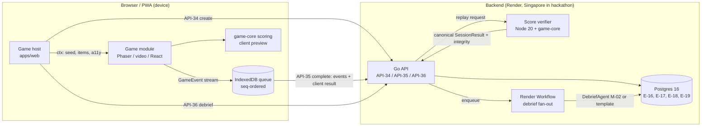
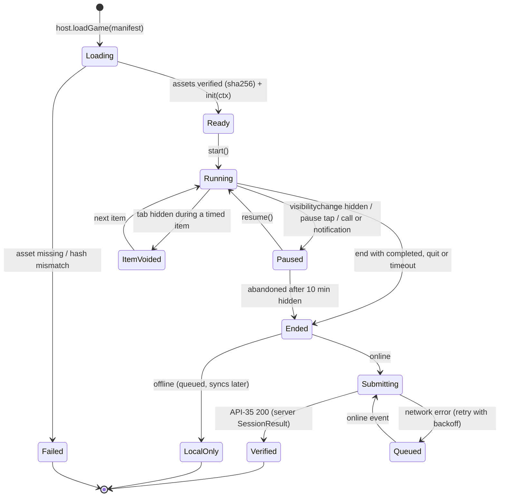
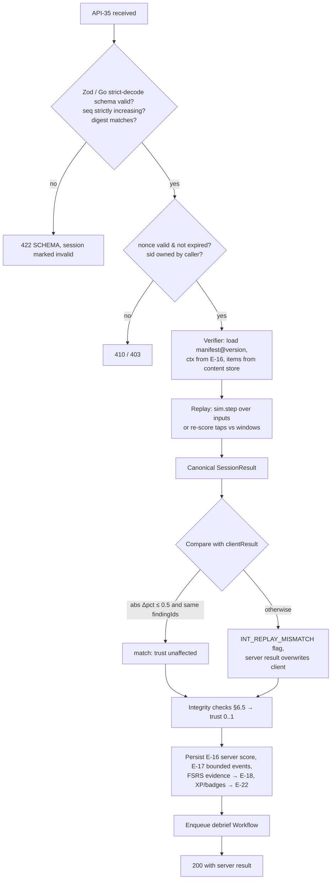

# Game SDK: the common contract every game plugs into
> Project: Margdarshak · Owner: Learning & Games lead (game-core owner) · Status: Draft v0.1 · Last updated: 2026-10-23
> Related: [PROJECT_BRIEF](../00-overview/PROJECT_BRIEF.md) · [GAME_DESIGN](GAME_DESIGN.md) · [DEBRIEF_SPEC](DEBRIEF_SPEC.md) · [GAMIFICATION_ENGINE](GAMIFICATION_ENGINE.md) · [NAZAR](NAZAR.md) · [CURRICULUM](CURRICULUM.md) · [game-core README](../../packages/game-core/README.md) · [Architecture](../03-engineering/ARCHITECTURE.md) · [API spec](../03-engineering/API_SPEC.md) · [Data model](../03-engineering/DATA_MODEL.md)
> Features: F-22, F-23, F-24, F-25, F-26, F-51, F-52 · Entities: E-16 GameSession, E-17 GameEvent, E-18 TopicMastery, E-19 Debrief, E-20 Clip · APIs: API-34, API-35, API-36, API-37 · Directives: D-09, D-10, D-11, D-13 revised, D-21

---

## 0. Why one contract

Ten games ship on three rendering technologies (Phaser 4 canvas, HTML `<video>` + SVG, plain React DOM) and one on-device vision model (MediaPipe). Without a single contract we would get ten scoring styles, ten telemetry shapes and ten ways to cheat. The SDK fixes five things for every game:

1. **One manifest** that says what the game is, which curriculum it trains, which rules it may cite, which accessibility modes it supports and who may play it.
2. **One event envelope** for telemetry, versioned and bounded, with no personal data by construction.
3. **One session lifecycle**: create (server issues seed + items) → play → complete (server replays and overwrites the score) → debrief.
4. **One scoring package** (`@margdarshak/game-core`), pure TypeScript, that runs byte-for-byte the same logic in the browser and in the Node score verifier.
5. **One result shape** (`SessionResult`) that the debrief, FSRS, XP, badges, share cards and the Practice Record all read. Nothing downstream reads raw events.

**The rule that makes the AI boundary hold (D-09):** every number a user ever sees about a game session is produced by `game-core` scoring functions and travels as `findings[].facts`. Gemini (M-02) receives facts and chooses IDs; it never computes, estimates or rounds anything.



---

## 1. Package layout (hackathon reconciliation)

Research file `08-game-ai-n8n.md` §1.3 sketched four packages (`game-sdk`, `scoring`, `sim-core`, and per-game folders). PROJECT_BRIEF §8 names a single package, `@margdarshak/game-core`. **This document follows PROJECT_BRIEF**: one package with subpath exports, so the verifier imports exactly one versioned artefact.

| Subpath export | Contents | Runs in |
|---|---|---|
| `@margdarshak/game-core/schema` | Zod schemas: `GameManifest`, `SessionContext`, `GameEvent` (discriminated union), `SessionResult`, `Finding`, `Evidence`, `IntegrityReport`, `ReplayPackage`; JSON Schema export | browser, Node, codegen |
| `@margdarshak/game-core/sdk` | `GameModule` and `GameHost` interfaces, `EventRecorder` (seq, timestamps, quantisation, bounds), lifecycle state machine | browser (no DOM types in the interface) |
| `@margdarshak/game-core/sdk/browser` | `IndexedDbQueue`, visibility/pause hooks, `rVFC` media clock adapter | browser only |
| `@margdarshak/game-core/sim` | fixed 60 Hz stepper, seeded PRNG (`mulberry32`), deterministic math (`dsin`, `dcos`, `datan2`, `dsqrt` polyfills), kinematic bicycle model, traffic agents, geometry (zones, cones, sight-lines) | browser, Node |
| `@margdarshak/game-core/scoring` | one pure function per game: `scoreNazar`, `scoreJunctionScan`, `scoreStoppingDistance`, `scoreBlindSpot`, `scoreTrackTwin`, `scoreNightGlare`, `scoreHillRoad`, `scoreHelmetFit`, `scoreGoldenHour`, `scoreLlSim` | browser, Node |
| `@margdarshak/game-core/integrity` | common integrity checks, trust computation, replay comparison | Node (and browser for preview) |
| `@margdarshak/game-core/learning` | evidence → FSRS rating mapping, mastery, Readiness, Brier, overconfidence (wraps `ts-fsrs`) | browser, Node |
| `@margdarshak/game-core/gamification` | XP, diminishing returns, rank gates, streak state machine, badge evaluators | browser, Node |
| `@margdarshak/game-core/debrief` | findings ranking, facts formatting per locale, template renderer, shared validator rule spec (JSON) | browser, Node; the Go validator reads the same JSON spec |
| `@margdarshak/game-core/fixtures` | golden replay vectors per game (inputs + seed → expected `SessionResult`) | tests in TS **and** Go (via the verifier) |

Package API in prose: [`packages/game-core/README.md`](../../packages/game-core/README.md).

---

## 2. The manifest (`GameManifest`)

Every game ships a `manifest.json` validated at build time (CI fails on an invalid manifest) and again by the host at load time.

### 2.1 Schema

```ts
// @margdarshak/game-core/schema/manifest.ts   (illustrative; the README lists the API, code lands at build time)
import { z } from "zod";

export const GameId = z.enum([
  "nazar", "stopping_distance", "blind_spot", "junction_scan", "track_twin",
  "helmet_fit", "golden_hour", "night_glare", "hill_road", "ll_sim",
]);

export const A11yMode = z.enum([
  "no_audio", "colour_safe", "one_hand", "reduced_motion",
  "tap_only", "screen_reader_alt", "large_text", "safe_luminance",
]);

export const GameManifest = z.object({
  gameId: GameId,
  code: z.enum(["G1","G2","G3","G4","G5","G6","G7","G8","G9","G10"]),
  version: z.string().regex(/^\d+\.\d+\.\d+$/),          // semver of the game module
  scoringVersion: z.string().regex(/^\d+\.\d+$/),        // major.minor of the scoring fn; see §9
  telemetryVersion: z.literal(1),
  engine: z.enum(["phaser4", "video_svg", "react_dom", "react_mediapipe"]),
  modules: z.array(z.string().regex(/^(M([1-9]|1\d|2[0-2])|LL[0-4]|DL1)$/)).min(1),   // CURRICULUM IDs
  skills: z.array(z.string().regex(/^SK-(M\d{1,2}|LL\d|DL1)$/)).min(1),               // skill-tree nodes
  ruleIds: z.array(z.string().regex(/^RR-[A-Z]{2,4}-\d{3}$/)),                     // rule catalogue (DEBRIEF_SPEC §3)
  findingIds: z.array(z.string().regex(/^[A-Z]{2,3}_[A-Z0-9_]+$/)),               // finding taxonomy (DEBRIEF_SPEC §2)
  drillIds: z.array(z.string().regex(/^DR-[A-Z]{2,3}-[A-Z0-9-]+$/)),              // drill catalogue (DEBRIEF_SPEC §4)
  modes: z.array(z.enum(["learn", "practice", "mock", "pair"])).min(1),
  debriefMode: z.enum(["ai_or_template", "template_only"]),  // G9 Golden Hour = template_only (D-09)
  minUserBand: z.literal("u18"),                            // D-13 revised: every game is open to every user
  u18Behaviour: z.literal("full"),                          // D-13 revised: family mode gets the full game; see §8
  offline: z.boolean(),
  liteMode: z.enum(["full", "decision_variant", "none"]),    // 2G / Lite (F-51, EC-19)
  a11yModes: z.array(A11yMode).min(3),                       // every game supports ≥ no_audio, colour_safe, tap_only
  assets: z.array(z.object({
    url: z.string().url(), bytes: z.number().int().positive(),
    sha256: z.string().regex(/^[a-f0-9]{64}$/), kind: z.enum(["chunk","atlas","clip","model","audio","image"]),
  })),
  budgets: z.object({
    chunkKbGzip: z.number().max(350),                        // code only, engine excluded (08 §1.3)
    maxEvents: z.number().int().max(5000),
    maxSessionSeconds: z.number().int().max(1200),
  }),
  label: z.object({                                          // D-11 label, shown on the start screen
    en: z.literal("Practice and familiarisation, not certification"),
    hi: z.literal("अभ्यास और परिचय के लिए, प्रमाणन नहीं"),
  }),
  contentGate: z.object({                                    // review gates (CURRICULUM §5)
    medicalReview: z.boolean(),                              // true for G9
    reviewedBy: z.string().nullable(),                       // filled by Rule-pack studio (F-42) sign-off
    reviewedOn: z.string().date().nullable(),
    draftLabelUntilReviewed: z.boolean(),
  }),
}).strict();
```

### 2.2 Manifest values per game (hackathon)

| Code | gameId | engine | modules | modes | debriefMode | minUserBand / u18Behaviour | liteMode | Depth (Phase 1–2) |
|---|---|---|---|---|---|---|---|---|
| G1 | `nazar` | video_svg | M5, M6, M8, M18 (+M4, M16 by clip tag) | learn, practice, mock, pair | ai_or_template | u18 / full (pair mode on a minor's profile needs the parent's squad consent) | decision_variant (still frames) | **Deep** |
| G2 | `stopping_distance` | video_svg (SVG + Motion) | M1, M2, M16 | learn, practice | ai_or_template | u18 / full | full (SVG is light) | **Deep** |
| G3 | `blind_spot` | phaser4 | M4, M5 | learn, practice | ai_or_template | u18 / full | decision_variant | **Deep** (Part A + short Part B) |
| G4 | `junction_scan` | phaser4 | M6, M18 | practice | ai_or_template | u18 / full | decision_variant | Thin (1 level) |
| G5 | `track_twin` | phaser4 | DL1 (driving-test familiarisation), M1 | practice | ai_or_template | u18 / full | decision_variant (explainer quiz) | Thin (figure-8 only) |
| G6 | `helmet_fit` | react_mediapipe | M3, M13 | learn, practice | ai_or_template | u18 / full (camera frames never leave the device, see §8) | full (no-camera path) | Thin |
| G7 | `golden_hour` | react_dom | M19 | learn, practice | **template_only** | u18 / full | full | Thin (1 scenario, "draft" label until medical sign-off) |
| G8 | `night_glare` | phaser4 | M8, M16 | practice | ai_or_template | u18 / full | decision_variant | Slide / storyboard |
| G9 | `hill_road` | phaser4 | M14, M15 | practice | ai_or_template | u18 / full | decision_variant | Slide / J&K storyboard |
| G10 | `ll_sim` | react_dom | LL0–LL4 | learn, practice, mock | ai_or_template | u18 / full | full | **Deep** |

> **Code numbering note.** Research `08` numbered games G1 Nazar, G2 Junction, G3 Stopping, G4 Blind Spot, G5 Track, G6 Night, G7 Hill, G8 Helmet, G9 Golden Hour, G10 LL. The task brief for this folder orders them Nazar, Stopping Distance, Blind Spot, Junction Scan, Track Test Twin, Helmet Fit, Golden Hour, Night & Glare, Hill Road, LL Test Simulator. **This folder uses the brief's order for the G-codes** (table above), and every cross-reference uses the `gameId` string, which never changes. Finding prefixes (`NAZ_`, `SD_`, `BS_`, `JS_`, `TT_`, `HF_`, `GH_`, `NG_`, `HR_`, `LL_`) are keyed to the game, not the number. Reported as an inconsistency to the PM.

---

## 3. Session context (`SessionContext`): what a game is allowed to know

```ts
export const SessionContext = z.object({
  sid: z.string().uuid(),
  gameId: GameId,
  mode: z.enum(["learn", "practice", "mock", "pair"]),
  userBand: z.enum(["u18", "adult"]),         // derived server-side from DOB; never the DOB itself. u18 = family mode; games behave the same (D-13 revised)
  locale: z.enum(["en", "hi"]),               // F-50: EN + HI in full; Dogri is voice-in only (D-21)
  a11y: z.object({
    modes: z.array(A11yMode),
    textScale: z.number().min(1).max(2),
    haptics: z.boolean(),
  }),
  difficulty: z.number().int().min(1).max(5), // from the staircase (§7)
  seed: z.number().int().nonnegative().max(2 ** 32 - 1),
  seedOrigin: z.enum(["server", "client_offline"]),
  items: z.array(z.object({                   // clips, questions, scenarios, track spec
    ref: z.string(),                          // e.g. "clip:JMU-0012@3" or "q:C-LL1-042:v4" or "track:generic-8@1"
    contentVersion: z.string(),
    sha256: z.string().optional(),
  })).max(40),
  deviceClass: z.enum(["low", "mid", "high"]),// from a 2-second benchmark, not from UA sniffing
  offline: z.boolean(),
  serverStartIso: z.string().datetime().nullable(),   // null when created offline
  tenant: z.string(),                         // E-31, e.g. "JK", "KL", "DEFAULT"
  rulePackVersion: z.string(),                // E-08 version used for LL formats / track specs / Kerala mode
}).strict();
```

**Never in context (enforced by `.strict()` and a CI test that greps the schema):** name, DOB, phone, email, Aadhaar anything, LL/DL number, case ID, RTO, GPS location, contacts, camera frames, microphone audio. A game cannot leak what it never receives.

---

## 4. Lifecycle

### 4.1 State machine (inside `game-core/sdk`)



### 4.2 Interfaces (names and responsibilities; no implementation here)

| Interface | Methods | Notes |
|---|---|---|
| `GameModule` (implemented by each game) | `init(ctx, recorder)`, `start()`, `pause()`, `resume()`, `end(reason)`, `getPreview(): SessionResultPreview`, `destroy()` | `pause()` is mandatory on `visibilitychange` (08 §2.1). Games may not call `fetch` or storage APIs; they talk only to the recorder |
| `GameHost` (implemented by `apps/web`) | `loadGame(manifest)`, `createSession(gameId, mode)`, `submit(sid)`, `getDebrief(sid)`, `onA11yChange()` | The host owns networking, consent and family-mode consent checks (squads, pair, share) |
| `EventRecorder` | `emit(type, payload, {mt?})`, `sample(stream, value)` (10 Hz quantised), `flush()` | Assigns `seq`, `t`; enforces bounds (§5.4); writes to the IndexedDB queue |
| `MediaClock` (video games) | `onFrame(cb)` using `requestVideoFrameCallback`, fallback to `currentTime` | Sets `timingMode` = `rvfc` or `fallback` (08 §1.3) |

### 4.3 Sequence: an adult Nazar mock, online

```mermaid
sequenceDiagram
  autonumber
  participant U as Kabir (P-01)
  participant W as Web host
  participant API as Go API
  participant V as Verifier (Node, game-core)
  participant DB as Postgres
  participant WF as Render Workflow (debrief)
  participant AI as DebriefAgent (M-02)
  U->>W: Start Nazar mock (Kerala format)
  W->>API: API-34 POST /v1/games/nazar/sessions {mode:"mock"}
  API->>DB: pick 10 unseen clips (E-20), seed, difficulty
  API-->>W: {sid, seed, items[10], difficulty, scoringVersion, nonce, expiresAt}
  W->>W: preload all 10 MP4s fully (EC-18 buffering rule)
  loop 10 clips
    U->>W: taps over video
    W->>W: recorder.emit("tap", {x,y}, {mt})
  end
  W->>W: end("completed"); client preview score
  W->>API: API-35 POST /v1/games/sessions/{sid}/complete {events.gz.b64, clientResult, digest, nonce}
  API->>V: replay(manifest, ctx, events)
  V-->>API: canonical SessionResult + IntegrityReport
  API->>DB: upsert E-16 (server score wins), insert E-17 (bounded), update E-18 evidence
  API->>WF: enqueue debrief(sid)
  API-->>W: 200 {result (server), integrity.trust, debrief:"pending"}
  W->>U: score reveal from server result + template card immediately
  WF->>AI: facts + allowed IDs (AI consent on)
  AI-->>WF: DebriefDraft (IDs + digit-free text)
  WF->>WF: validate → render, or template fallback
  WF->>DB: E-19 Debrief
  W->>API: API-36 GET /v1/games/sessions/{sid}/debrief
  API-->>W: rendered card ("Coach notes" or "Auto notes")
```

### 4.4 API contract summary (full OpenAPI lives in `api/openapi.yaml`, owned by the API spec author)

| API | Request (key fields) | Response (key fields) | Errors | Rate limit (hackathon) |
|---|---|---|---|---|
| API-34 `POST /v1/games/{gameId}/sessions` | `mode`, `a11yModes[]`, `offlineSeed?` | `sid`, `seed`, `items[]`, `difficulty`, `scoringVersion`, `nonce`, `expiresAt` (server time + 60 min), `label` | 403 `PARENT_CONSENT_REQUIRED` (pair mode on a minor's profile before the parent consents to squads, D-13 revised), 409 `NO_UNSEEN_CLIPS` (Nazar mock bank exhausted), 422 bad mode | 30 / user / hour |
| API-35 `POST /v1/games/sessions/{id}/complete` | `events` (gzip+base64 delta-encoded), `clientResult`, `clientDigest` (SHA-256 of canonical events), `nonce` | `result` (server `SessionResult`), `integrity`, `xpAwarded`, `badgesAwarded[]`, `debrief: "pending"|"ready"` | 409 `ALREADY_COMPLETED` (idempotent: returns the stored result), 410 `SESSION_EXPIRED`, 413 `TOO_MANY_EVENTS`, 422 `SCHEMA` | 30 / user / hour |
| API-36 `GET /v1/games/sessions/{id}/debrief` | none | `DebriefCard` (see DEBRIEF_SPEC §7) | 404 until ready (client keeps the template card) | 120 / user / hour |
| API-37 `GET /v1/nazar/clips` | `purpose=pack|learn` | signed URLs, sizes, sha256 (never hazard windows for mock clips) | — | 10 / user / hour |

Idempotency: API-35 is idempotent on `sid`; repeating it returns the stored server result. Event sync is idempotent on `(sid, seq)`.

---

## 5. Events (`GameEvent`)

### 5.1 Envelope

```ts
export const EventBase = z.object({
  sid: z.string().uuid(),
  seq: z.number().int().nonnegative(),     // strictly increasing per session; dedupe key (sid, seq)
  t: z.number().nonnegative(),             // ms since session start, from performance.now() deltas
  mt: z.number().nonnegative().optional(), // media time in ms (video games), from rVFC mediaTime
  item: z.number().int().nonnegative().optional(), // index into ctx.items
}).strict();
```

`t` is relative, so device clock tampering (EC-15) cannot move it. Wall-clock time exists only on the server (`serverStartIso`, receipt time).

### 5.2 Event types (discriminated union on `type`)

| `type` | Payload `p` (all fields bounded and quantised) | Used by |
|---|---|---|
| `session_start` | `{ deviceClass, timingMode, a11yModes[], orientation: "portrait"\|"landscape" }` | all |
| `item_start` / `item_end` | `{ ref }` / `{ ref, reason: "done"\|"voided"\|"timeout" }` | all |
| `tap` | `{ x: 0..1 (2 dp), y: 0..1 (2 dp) }` (normalised to the video rect) | G1 |
| `hazard_response` | `{ hazardId, band: 0..5, firstValidMt }` (derived on device for preview; recomputed on server) | G1 |
| `prediction` | `{ choice: HazardType, correct?: never }` (correctness is computed by scoring, never sent from the client) | G1 learn, G2 |
| `estimate` | `{ speedKmh, surface: "dry"\|"wet", predictedM }` | G2 |
| `brake` | `{ rtMs? , heldMs? }` | G2, G9 |
| `speed_choice` | `{ chosenKmh, context: "sight"\|"night"\|"bend" }` | G2, G8 |
| `place` | `{ zoneProbe: {x,y} (dm grid) }` | G3 Part A |
| `lane_pos` (sampled 10 Hz) | `{ lat: cm int, lon: dm int }` | G3, G5, G8, G9 |
| `mirror_check` | `{ target: "truck"\|"bus"\|"self" }` | G3 |
| `scan_look` | `{ dir: "right"\|"left"\|"ahead"\|"left_edge", durMs }` | G4, G8 |
| `creep` | `{ distDm }` | G4 |
| `decision` | `{ node: string(≤24), choice: string(≤24) }` | G4 GO, G7, G9 yield/stop |
| `indicator` | `{ side: "left"\|"right"\|"off" }` | G3, G4 |
| `input` (sampled 60 Hz but delta-encoded) | `{ steer: −127..127, throttle: 0..255, brake: 0..255 }` | G5, G9 (sim replay input) |
| `gear_choice` | `{ gear: 1..4 }` | G9 |
| `horn` | `{}` | G9 |
| `beam_toggle` | `{ state: "high"\|"low" }` | G8 |
| `camera_check` | `{ faceCentred: bool, chinVisible: bool, classifierBand?: "low"\|"mid"\|"high" }` (booleans only; no frames) | G6 |
| `step_confirm` | `{ stepId }` (self-report steps) | G6, G7 |
| `card_order` | `{ cardId, position }` | G7 |
| `answer` | `{ qref, optionId, latencyMs }` | G10, quiz parts of G6, G7 |
| `confidence` | `{ qref?, p: 50\|75\|100 }` or `{ predictedPassClips: 0..10 }` (Nazar pre-mock) | G10, G1, all quizzes |
| `commentary_marker` | `{ startMt, endMt }` (audio itself is not an event) | G1 commentary |
| `pause` / `resume` | `{ cause: "user"\|"hidden"\|"system" }` | all |
| `visibility_hidden` | `{}` | all |
| `a11y_toggle` | `{ mode, on }` | all |
| `session_end` | `{ reason }` | all |

**Not events:** collisions, faults, near-misses and scores. Those are *derived* by `game-core` from inputs plus seed during replay. Clients may display their own preview of them, but the server never trusts a client-reported fault or score.

### 5.3 Encoding

- On device: newline-delimited JSON in IndexedDB, keyed `(sid, seq)`.
- On submit: delta-encode `t` and `mt`, run-length-encode repeated `input` samples, gzip, base64 (`replay.inputs`). A 10-clip Nazar mock is typically under 4 KB; a 3-minute Phaser sim under 60 KB [D, measure in Phase 1].
- `clientDigest` = SHA-256 over the canonical (sorted-key, no-whitespace) event array, so the server can detect truncation in transit.

### 5.4 Bounds (anti-abuse and DPDP data minimisation)

| Bound | Value [D] | On breach |
|---|---|---|
| Events per session | ≤ 5,000 (manifest `maxEvents`) | recorder drops sampled streams first, then ends the session with `INT_EVENT_CAP` |
| Taps per second | recorded up to 20/s; above that, dropped and counted | pattern rule handles scoring |
| Session length | ≤ 20 min | auto-end `timeout` |
| Payload strings | ≤ 24 chars, enum-only where possible | schema reject |
| Retention of raw E-17 | 90 days, then aggregated per session and deleted [D: proposed to DATA_MODEL owner] | nightly Workflow |

---

## 6. Seeds, determinism and replay

### 6.1 Seed

- Issued by the server in API-34 (`seedOrigin: "server"`): a uniformly random 32-bit integer from `secrets.randbits(32)`.
- The seed drives every random choice: traffic spawns, item order, question variant choice when the server did not pre-pick, distractor order, glare timings.
- PRNG: `mulberry32(seed)` in `game-core/sim`. Sub-streams are derived per concern (`traffic`, `items`, `layout`) as `mulberry32(hash32(seed, "traffic"))`, so adding a new random concern never shifts existing streams.
- Offline sessions use `seedOrigin: "client_offline"` with `crypto.getRandomValues`. They replay normally, but are **ineligible** for the Nazar Score, percentiles and share cards (§6.4).

### 6.2 Determinism rules for `game-core/sim`

1. **Fixed timestep:** logic advances at exactly 60 Hz (`dt = 1/60 s`) with an accumulator; rendering interpolates. A phone that renders at 30 fps runs two logic steps per frame. Scores are identical.
2. **No `Math.random`, no `Date.now`, no `performance.now` inside logic.** A lint rule (`no-nondeterminism` in `eslint-plugin-margdarshak`) fails CI if logic files import them.
3. **No engine-provided transcendental functions inside logic.** ECMAScript does not require `Math.sin`, `Math.cos`, `Math.atan2`, `Math.exp` or `Math.pow` to be bit-identical across engines (V8 in Chrome and Node vs JavaScriptCore in iOS Safari). `game-core/sim/math` provides polynomial/table implementations built only from `+ − × ÷` and `Math.sqrt` (which IEEE-754 requires to be correctly rounded). [K]
4. **Inputs are quantised integers** (`steer −127..127` etc.), so the replay consumes exactly what the client consumed.
5. **Physics is Phaser-independent.** Phaser 4 renders the state produced by `sim`; Arcade physics is **not** used for anything that affects scoring (it may animate decorative sprites only).
6. **Video games** (G1) have no simulation; replay re-scores taps against hazard windows using `mt`. Tolerance is about one frame (±33 ms at 30 fps), well inside the band widths (08 §1.3).

### 6.3 Server replay verification flow



- **The server result always wins.** The client score is a preview that makes the reveal instant; when the server answer arrives (usually under a second), the UI reconciles silently if they differ. The user never sees "cheating detected".
- **Verifier service:** a Node 20 service (`services/score-verifier`) that imports the exact `@margdarshak/game-core` version named in the session's `scoringVersion`. It keeps the last two minor versions loaded so sessions started before a deploy still verify (§9).
- **The Go backend never re-implements scoring.** The Go API (ADR-0011) calls the verifier over an internal HTTP endpoint (`POST /verify`, HMAC-signed, private network on Render). Golden vectors in `fixtures/` are also run from the Go contract tests (`go test ./internal/adapters/scoring/... -run Contract`) against the verifier to catch contract drift. (Research `08` §1.3 allowed a backend re-implementation; PROJECT_BRIEF §8 chose the Node verifier, and this doc follows the brief.)
- **Verifier down** (R-05, R-11): API-35 still returns 202 with the client preview marked `provisional: true`; a retry Workflow verifies within 15 minutes. Provisional sessions do not count toward the Nazar Score, badges or share cards until verified.

### 6.4 What counts where (eligibility)

| Use | Requires |
|---|---|
| FSRS evidence (E-18), XP | any verified session (family mode included) |
| Readiness Score (F-21) | verified sessions; offline sessions count after sync and replay |
| Nazar Score (share card, Practice Record) | mode `mock`, `seedOrigin: server`, clips unseen by this user, `trust ≥ 0.6`, `timingMode: rvfc` (08 §1.3: fallback timing keeps its score but is not eligible for percentiles), verified |
| Percentiles | as Nazar Score, plus a baseline of ≥ 200 verified mocks (GAMIFICATION_ENGINE §9) |
| Badges | per badge criterion; always verified sessions |
| Field study (F-57) | cohort `field_test`, consented, 18+, verified, exclusions per `HYPOTHESES.md` |

### 6.5 Integrity checks and trust

`trust` starts at 1.0 and is multiplied by the factors below (floored at 0). **We never accuse.** Below 0.6 the session counts for practice only, and the UI says "This session wasn't counted for your card" (08 §2.3 rule 4).

| Flag | Detection | Factor | Item effect |
|---|---|---|---|
| `INT_TAB_HIDDEN` | `visibility_hidden` during a timed item | ×0.9 per item | that item voided (scores 0, excluded from max in practice; counted as 0 in mock to mirror a real test) |
| `INT_CLOCK_DRIFT` | `t` delta vs `mt` delta differ by > 250 ms over a clip (speed hack or stalled video) | ×0.5 | clip voided |
| `INT_TIMING_FALLBACK` | no `rVFC` | ×1.0 (no penalty) | ineligible for percentiles only |
| `INT_RATE_IMPOSSIBLE` | > 20 taps/s, steering rate beyond the quantised max for > 0.5 s, input samples with impossible spacing | ×0.5 | none (pattern rule scores it) |
| `INT_REPLAY_MISMATCH` | §6.3 | ×0.7 | server result used |
| `INT_SEEN_CLIP` | a mock clip this user has seen before (should not happen; defence in depth) | ×1.0 | session not Nazar-Score eligible |
| `INT_RT_ANTICIPATORY` | G2 brake RT < 100 ms | ×1.0 | round re-dealt (08 G3) |
| `INT_EVENT_CAP` | §5.4 | ×0.8 | session ended |
| `INT_SESSION_EXPIRED` | complete after `expiresAt` | ×0.8 | allowed for practice |
| `INT_OFFLINE_SEED` | `seedOrigin: client_offline` | ×0.8 | ineligible for Nazar Score / share |

---

## 7. Difficulty staircase (shared)

- Per `(user, gameId, skill)`. State: `level ∈ 1..5`, `streakPass`.
- **2 consecutive item passes → level + 1; 1 fail → level − 1** (floored at 1, capped at 5). A 2-down/1-up transformed rule converges near **70.7%** success (Levitt 1971) [K], which sits in the "desirable difficulty" zone.
- "Pass" per item is defined by each game (GAME_DESIGN §x.7). Mock mode **does not** adapt: it draws a fixed difficulty mix from the rule pack (Kerala mode: clips spread across curator difficulty 2–4 [D]).
- FSRS (`game-core/learning`) picks **which** concept or hazard type is due; the staircase picks **how hard** the scene is. They never fight: the item selector first filters to due concepts, then picks the variant or scene nearest the current level.
- Staircase state is stored in E-18 for every user, family mode included.

---

## 8. Family mode, consent and offline (D-13 revised, P-07, EC-05, EC-14, EC-19)

| Capability | Account holder (adult) | Minor's profile in family mode (P-07 Rahul, inside the parent's account) |
|---|---|---|
| Play games | yes, every game and mode | yes, every game and mode (D-13 revised) |
| Server session (API-34/35) | yes | yes (`u18Behaviour: full`) |
| Telemetry leaves the device | yes (bounded, no PII) | yes, same bounded allowlist; never used for behavioural tracking, profiling or ads (DPDP s.9(3)) |
| Scoring | server replay, server wins | same |
| Debrief | AI (M-02) if "AI coach" consent is on, else template | same; the parent gives the "AI coach" consent |
| FSRS / readiness | server (E-18) + device cache | same |
| XP, ranks, streaks, squads, badges, share cards | yes | XP, ranks, streaks and badges yes; squads, pair mode and share cards only after the parent consents |
| Nazar mock / commentary | yes | yes |
| Helmet Fit camera | on-device only | on-device only; the parent's consent covers the camera prompt; checklist path offered |

- **Consent:** a separate "AI coach" consent (DEPA-style artefact, E-15, API-60) controls whether facts go to Gemini. Turning it off switches to templates without losing anything.
- **Shared phone / cyber café (EC-14):** Helper mode never opens games under the applicant's profile; "Clear this device" deletes the IndexedDB queue, local FSRS state and cached clips.
- **Offline (F-51):** games with `offline: true` play from the precached pack. Events queue in IndexedDB and sync idempotently by `(sid, seq)` when online. Lite mode (2G, EC-19) loads no Phaser: it offers the LL Simulator plus the SVG `decision_variant` of each sim.
- **Account deleted mid-case (EC-26):** API-62 deletes E-16, E-17, E-18, E-19, E-22 for the user and tombstones the device queue on next sync. Aggregated, non-identifying clip difficulty statistics remain (they hold no user ID).

---

## 9. Versioning

| Version | Where | Rule |
|---|---|---|
| `game-core` package | npm semver | **major:** a schema or scoring change that alters any golden vector; **minor:** a new game, finding, event type or optional field; **patch:** no output change. Renovate PRs are blocked from auto-merging `game-core` majors |
| `GameManifest.version` | per game | bumps with any game code change |
| `scoringVersion` (`major.minor`) | per game | equals the `game-core` scoring function version; stored on every E-16 row |
| `telemetryVersion` | envelope | `1` for Phase 1–2. A new value requires a server adapter that upcasts old events |
| `contentVersion` | per item (clip `JMU-0012@3`, question `C-LL1-042:v4`, track `generic-8@1`) | a clip's hazard window edit bumps its `@n`; old sessions keep pointing at the version they played |
| `rulePackVersion` | E-08 | LL format, Kerala mode, track specs; mid-prep changes trigger EC-27 notice ("Your state's LL format changed on DATE; your practice now uses the new format") |

**Compatibility promises:**
1. Any stored session can be re-scored with its original `scoringVersion` (the verifier keeps old majors in a cold container image; E-17 raw events are kept 90 days).
2. The Nazar Score only averages sessions with the same scoring **major**. When a major changes, the score is recomputed from stored events where available; otherwise the card shows "Score updated to new scoring on DATE: play 1 mock to refresh".
3. Golden vectors are append-only. A PR that changes an expected output must bump the scoring major and include a CHANGELOG line.

---

## 10. `SessionResult` (the one shape everything reads)

```ts
export const Finding = z.object({
  findingId: z.string(),                     // from DEBRIEF_SPEC §2 taxonomy
  severity: z.number().min(0).max(1),        // deterministic, per taxonomy formula
  critical: z.boolean(),                     // critical faults always rank first
  ruleIds: z.array(z.string()),              // catalogue IDs; verified:false allowed here, filtered before AI
  skillId: z.string(),
  drillIds: z.array(z.string()).max(3),
  facts: z.record(z.string().regex(/^[a-z][a-z0-9_]{0,23}$/),
                  z.union([z.number(), z.string().max(32), z.boolean()])),   // e.g. { late_s: 1.4, speed_kmh: 40, metres: 16 }
  itemRef: z.string().optional(),
}).strict();

export const SessionResult = z.object({
  sid: z.string().uuid(),
  gameId: GameId, gameVersion: z.string(), scoringVersion: z.string(),
  seed: z.number().int(), seedOrigin: z.enum(["server","client_offline"]),
  difficulty: z.number().int().min(1).max(5),
  mode: z.enum(["learn","practice","mock","pair"]),
  score: z.object({
    raw: z.number(), max: z.number(), pct: z.number().min(0).max(100),
    passed: z.boolean().nullable(),            // null when the mode has no pass rule
    passRule: z.object({ source: z.enum(["rule_pack","design"]), ref: z.string() }).nullable(),
    components: z.array(z.object({
      id: z.string(), value: z.number(), max: z.number(), weight: z.number(),
      explainKey: z.string(),                  // i18n key; numbers filled only from facts
    })),
    capApplied: z.string().nullable(),         // e.g. "critical_fault_cap_20"
  }),
  findings: z.array(Finding).max(12),
  evidence: z.array(z.object({                 // feeds FSRS (GAMIFICATION_ENGINE §4)
    cardId: z.string(), correct: z.boolean(), latencyMs: z.number().optional(),
    confidence: z.enum(["50","75","100"]).optional(),
    rating: z.number().int().min(1).max(4), overconfident: z.boolean(),
  })),
  calibration: z.object({ n: z.number().int(), brier: z.number().nullable(),
                          overconfidence: z.number().nullable() }).nullable(),
  integrity: z.object({ flags: z.array(z.string()), trust: z.number().min(0).max(1),
                        timingMode: z.enum(["rvfc","fallback","sim","none"]),
                        provisional: z.boolean() }),
  replay: z.object({ seed: z.number(), inputs: z.string() }),
}).strict();
```

**Rules:**
1. `score.raw = Σ components.value` (after caps), always. The UI can show the breakdown for any score.
2. Every sentence about a session (UI, debrief, share card, Practice Record) is built from `findings[].facts`, `components` and catalogue text. Never free text.
3. `findings` are ranked by `(critical desc, severity desc, findingId asc)` so ordering is deterministic.
4. `facts` keys are snake_case, ≤ 24 chars, values bounded. Numbers are stored at full precision and **formatted** at render time per locale ("≈ 16 m" / "लगभग 16 मीटर").

---

## 11. Testing the contract

| Test | Tool | Gate |
|---|---|---|
| Schema round-trip Zod → JSON Schema → OpenAPI → Go | `z.toJSONSchema()` (Zod 4); the schemas are referenced from `api/openapi.yaml` and oapi-codegen generates the Go types | CI fails on any diff between generated code and committed code (`go generate ./... && git diff --exit-code`) |
| Golden replay vectors (≥ 5 per game: strong, medium, weak, critical-fault, edge) | Vitest (TS) + `go test` contract tests calling the verifier | 100% exact match |
| Cross-engine determinism | Playwright runs the same vectors in Chromium, WebKit and Firefox and compares with Node | 100% match for sim games |
| Property tests (taps never increase a pattern-voided clip score; score ∈ [0, max]; adding a false alarm never raises a score) | `fast-check` | pass |
| Bounds and PII | a test that feeds every event type with extra keys (must reject) and scans schemas for banned field names (`name`, `dob`, `phone`, `aadhaar`, `lat`, `lng`, `email`) | pass |
| Offline sync idempotency | duplicate `(sid, seq)` batches | exactly-once persistence |
| Accessibility | axe on every game's DOM shell and `screen_reader_alt` variant; manual TalkBack pass | 0 serious axe issues |

---

## 12. Hackathon build (Phase 1–2) vs production (Phase 3+)

| Area | Hackathon build (Phase 1–2) | Production (Phase 3+) |
|---|---|---|
| Package | `@margdarshak/game-core` in the monorepo, workspace-linked | published to a private registry with provenance (npm `--provenance`), SBOM |
| Verifier | one Node 20 service on Render (Singapore), warm instance before judging | containerised, autoscaled, behind the `JobRunner`/internal network on a MeitY-empanelled cloud or NIC (D-17) |
| Games verified | G1, G2, G3, G10 fully; G4, G5, G6, G7 verified on their thin level | all 10, all levels |
| Telemetry retention | 90 days raw (proposed), synthetic + field-study data only | per DATA_MODEL retention schedule; CERT-In log rules apply to logs, not to game events |
| Determinism tests | Chromium + Node | + WebKit, Firefox, low-end Android WebView farm |
| Pair mode | same seed, shown privately to both players | same |
| Offline | precache pack for LL sim + 10 Nazar learn clips | full packs per tenant, delta updates |

## 13. Open items

| Item | Owner | Due |
|---|---|---|
| Pin exact versions: `zod` 4.x, `ts-fsrs` 5.x, `phaser` 4.2.x, `@mediapipe/tasks-vision` [unverified exact versions] | game-core owner | H0 (confirmed start) |
| Measure per-game chunk sizes on the slowest team phone | game-core owner | Phase 1, hour 2 |
| Confirm `requestVideoFrameCallback` on the team's low-end Android Chrome and iOS Safari | Nazar owner | Phase 1 |
| Agree E-17 retention (90 days proposed) with the DATA_MODEL owner | Learning & Games lead | 2026-10-24 |
