# Nazar: hazard perception on Indian road scenes
> Project: Margdarshak · Owner: Nazar owner (clip pipeline + field study) · Status: Draft v0.1 · Last updated: 2026-10-24 (§16 appended)
> **2026-10-24:** the hackathon build's clip bank is **AI-generated** (ADR-0013, §16). Until this date the title read "on real Indian roads". Filming (§4) and the blur audit (§5) are superseded for the hackathon build and still apply to Phase 3+ filmed clips.
> **2026-10-24 (later):** the hackathon build no longer generates video. Scenes are **simulated 3D scenes drawn in the browser** (ADR-0014, section 17). Section 16 (generation, SynthID, synthetic review) is superseded for this build and kept for Phase 3+.
> Related: [PROJECT_BRIEF](../00-overview/PROJECT_BRIEF.md) · [GAME_DESIGN §2](GAME_DESIGN.md) · [GAME_SDK](GAME_SDK.md) · [DEBRIEF_SPEC](DEBRIEF_SPEC.md) · [GAMIFICATION_ENGINE](GAMIFICATION_ENGINE.md) · [CURRICULUM](CURRICULUM.md) · [Field kit](../../../field-kit/NAZAR-FIELD-KIT.md) · [AI models](../04-ai/MODELS.md) · [Data pipeline](../04-ai/DATA_PIPELINE.md) · [Privacy](../06-security-compliance/PRIVACY.md)
> Features: F-23 (hero), F-57 field study, F-25 debrief, F-26 share card · Models: M-06 ClipWindowProposer, M-08 Saaras, M-09 on-device/offline blur detectors · Entities: E-20 Clip, E-21 ClipRating, E-16, E-17 · APIs: API-34..API-37, API-55 clip admin, API-70/71 field study · Directives: D-03, D-11, D-12, D-15, D-19, D-22 · Risks: R-06 too few clips, R-10 Kerala HPT stayed, R-12 bystander privacy · Edge cases: EC-18, EC-28

---

## 0. What Nazar is (and is not)

**The council ruling (D-03):** the journey is the body; **Nazar plus the game debrief is the heart**. Nazar leads the demo hook, the one evidence-slide number and the closing QR ("take the 3-minute test"), and its clip-ingest pipeline is the headline Render Workflow (D-15).

**What it is.** A hazard-perception trainer and mock on ~~**real, blurred Indian road clips** (Jammu first)~~ **AI-generated Indian road scenes, labelled "AI-generated scene" everywhere** (hackathon build, ADR-0013, §16; filmed clips are Phase 3+), scored by code against windows set by two independent human raters, in **Kerala's announced format** (10 clips × 10 marks, pass 60/100, from 1 Dec 2026) with UK-style 5-band timing and a pattern-clicking rule that scores zero.

**Why it matters.** India tests knowledge (LL MCQ) and vehicle control (track), never **anticipation** (`02` §2). Hazard-perception training has on-road RCT evidence (Horswill; `05` insight 9); commentary training brought novices to experienced-driver detection (Isler et al. 2009); HPT scores predict crashes (Horswill et al. 2015, doi:10.1016/j.aap.2015.05.019 [K]). 70.9% of 2023 accidents involved a valid DL holder (RAI23 T3.2): the licence certifies little.

**What it is not (D-11, D-19):** not Kerala's test or Kerala's clips; not real footage (the hackathon bank is AI-generated, §16); not a certification; not a crash-risk prediction for an individual; not "the first" of anything; not "official". Copy says **"Kerala's announced format (as reported)"**, **"practice score"**, ~~**"our clips"**~~ **"our AI-generated scenes"** (§16). Claim on stage: "trains and measures a skill linked to crash risk", never "reduces crashes" or "lives saved".

```mermaid
flowchart LR
  F[Filming<br/>passenger or fixed mount] --> I[Upload raw<br/>private bucket]
  I --> T
  subgraph W1 ["Render Workflow: clip-ingest (headline, D-15)"]
    T[transcode<br/>ffmpeg → 360p/480p H.264] --> B["blur faces + plates<br/>YuNet + plate detector (M-09)"]
    B --> A[blur audit queue<br/>100% human frame check]
    A --> P["proposeWindows<br/>Gemini video (M-06), offline, ±1 s"]
    P --> R[awaitTwoRaters<br/>independent, blind to each other]
    R --> G[computeAgreement<br/>Δonset, Δend, κ]
    G --> D{accept?}
    D -- no --> X[third-rater adjudication]
    X --> G
    D -- yes --> PUB[publish<br/>manifest + CDN warm]
  end
  PUB --> BANK[(Clip bank E-20<br/>CC-BY 4.0, blurred)]
  BANK --> GAME[Nazar game<br/>mock / practice / learn]
  GAME --> STATS[Nightly stats Workflow<br/>difficulty, field-study numbers]
  STATS --> BANK
```



> **Hackathon build (2026-10-24, §16):** clips come from `clip_generate`: scene catalogue → Gemini Omni Flash → normalise → flash check → register as `ai_generated` → transcode → render without blur → open review. The filming, blur and blur-audit boxes above apply only to filmed clips (Phase 3+). Proposals, the two raters, agreement and publish are unchanged.

---

## 1. Modes

| Mode | Who | Clips | Feedback | Scoring | Counts toward |
|---|---|---|---|---|---|
| **Mock (Kerala format)** | every user (family mode included, D-13 revised), online | 10 unseen clips, rule-pack mix of difficulty 2–4 [D] | after all 10 | Kerala marks /100 (§2) | Nazar Score, badges, share card, Practice Record, field study |
| **Practice** | every user | 1–5 clips by staircase, may include quiet clips | after each clip: replay with window band and tap flags | UK-style 0–5 per hazard + false alarms | FSRS, XP |
| **Learn (occlusion + prediction)** | every user | clip freezes 0.5 s before onset [D]: "what happens next?" (4 picture options from `hazard_type`) + "tap where" | immediate | prediction correct / location correct | FSRS |
| **Commentary (*bolke chalao*)** | every user, online, per-use consent (the parent's for a minor's profile) | 1 clip (Phase 1–2) | after transcription | `commentary_pct` (separate) | FSRS, debrief |
| **Pair** | two squad members (a minor's profile only after the parent consents to squads) | same seed, same 10 clips | each sees own result + "you both spotted X of Y" | Kerala marks | nothing extra (no winner) |
| **Screen-reader alternative** | anyone | still frames with audio description | immediate | correct / not | FSRS; labelled **"not the same skill as the timed test"** |

---

## 2. Scoring

### 2.1 Product scoring (shown to users) — `scoreNazarKerala5Band` in `game-core/scoring`
For each hazard *h* with final window [*a*, *b*] (§6.4):
1. Band width `w = (b − a)/5`. The first tap τ in [*a*, *b*] scores `p = 6 − min(5, ⌊(τ − a)/w⌋ + 1)` → 5, 4, 3, 2, 1. No tap in the window → 0. (UK structure: up to 5 points per hazard by how early you respond [P: gov.uk HPT page, `01` row 1].)
2. One tap credits at most one hazard (earliest-onset unscored hazard if windows overlap).
3. Taps before *a* earn nothing (as in the UK); taps within 1.0 s before *a* are logged as `early_taps` for learn feedback.
4. **Kerala marks per clip:** one hazard → `2p`; two hazards → `p₁ + p₂`; max 10. Session total /100. `passed = total ≥ 60` (rule-pack row `HPT-KL`).
5. **Late facts:** `late_s = max(0, τ − (a + w))`, `metres = late_s × speed_kmh_est / 3.6`.

### 2.2 The anti-pattern-click rule
A clip scores **0** if **either**:
- any 1.0 s sliding window contains **more than 3 taps**, or
- the clip has **more than `2 × hazards + 4` taps** in total.

This is modelled on the UK rule that pattern-clicking scores 0 [P via `01` row 1]; the numeric thresholds are ours [D, `08` G1]. It makes false alarms cost something and kills the "spam-tap" cheat (`05` cheat table). The user sees a calm line: "Lots of taps on this clip, so it scored 0. Tap once when you see a hazard start to develop."

> **Inconsistency resolved here:** `06-design-language` §B11 says "more than 5 per second voids the clip"; the field kit's exclusion rule is "> 3 taps per second" at the session level; `08` §3 G1 uses the two-part rule above. **This spec adopts `08`'s rule for the product** (it's the strictest per-clip rule that still allows two quick taps on a two-hazard clip). The field study keeps its pre-registered session exclusion (§10). Reported to the design owner.

### 2.3 Study scoring (field kit) — `scoreNazarFieldKitLinear`
The field kit's draft `HYPOTHESES.md` (§3) pre-registers a different rule: **full 10 marks if the tap falls in [onset, onset + 2 s], linear decay to 0 at onset + 5 s, 0 before onset**, one hazard window per clip, final onset = mean of the two raters' onsets.

> **Inconsistency and how we handle it.** The product (F-23 in PROJECT_BRIEF) uses UK-style 5-band scoring; the field kit pre-registers the linear rule. `game-core` therefore exports **both** scorers. **Whichever rule the committed `HYPOTHESES.md` names is the study's primary analysis; the other is reported as secondary.** Recommendation to the field-study owner: if `HYPOTHESES.md` is not yet committed, pre-register the 5-band rule so the slide number and the product match; if it is committed, keep it and say so on the slide footnote. Never switch rules after data exists.

### 2.4 Signal-detection view (practice and research)
- **Hit rate** = hazards with ≥ 1 scored tap / hazards.
- **False alarms** = taps outside all windows, excluding the 1.0 s pre-onset band; reported per minute on quiet clips and quiet segments.
- d′ is computed only for research summaries with enough trials (≥ 20 hazards and ≥ 5 quiet minutes per person [D]); never shown to users as a number.

### 2.5 Nazar Score
Mean of the last 3 **eligible** mocks (GAME_SDK §6.4: server seed, unseen clips, trust ≥ 0.6, `rvfc` timing, verified). Shown with "verified sessions: n". Practice never counts.

---

## 3. Clip bank specification (E-20)

### 3.1 Media
> For AI-generated clips (§16), generation replaces the "Capture" column: 720p, 16:9, an opening shot plus extensions of 3–10 s each, at most 40 s in total. Delivery is unchanged, and the generated audio is stripped like any other audio.

| Property | Capture | Delivery |
|---|---|---|
| Orientation | landscape | landscape (portrait players letterbox) |
| Resolution / fps | 1080p, 30 fps, no zoom, lens at handlebar/windscreen height (field kit §4) | **360p** (Lite and default on 3G) and **480p** H.264 (High profile, yuv420p), 30 fps |
| Length | raw 60 min per session | Kerala mock clips 45–60 s (Kerala's clips are about 1 min); practice/learn clips 20–60 s |
| Audio | not needed | **stripped** (no audio track: privacy and no-audio design) |
| Size target | — | measure: ≤ 2 MB for a 30 s 360p clip, ≤ 4 MB for 60 s [D]; `08` estimated 3–5 MB per 1-min clip at 360/480p |
| Encoding | — | `ffmpeg -c:v libx264 -preset slow -crf 28 -profile:v high -pix_fmt yuv420p -movflags +faststart -an` [K]; keyframe every 1 s so seeks in replay are snappy |
| Integrity | — | SHA-256 per file in the manifest; the host verifies before play |
| Serving | — | R2 (hackathon) / Indian object store (production) via signed URLs; service worker caches with HTTP Range support (Workbox range-requests plugin) for offline packs |

### 3.2 Metadata (`clip.json`, versioned `JMU-0012@3`)
```json
{
  "clipId": "JMU-0012", "version": 3,
  "status": "published",                       // raw | transcoded | blurred | audited | proposed | rated | adjudication | published | retired
  "tenantTags": ["JK"], "city": "Jammu", "roadType": "urban_arterial",   // never a precise location
  "timeOfDay": "day", "weather": "clear", "pov": "2W", "capturedMonth": "2026-10",
  "speedKmhEst": 40, "speedSource": "rider_log",   // needed to convert seconds to metres
  "durationMs": 38000,
  "hazards": [
    { "hazardId": "h1", "hazardType": "bus_stop_pedestrian",
      "window": { "aMs": 12400, "bMs": 16900 },     // final, after agreement
      "raterCount": 2, "deltaOnsetMs": 300, "deltaEndMs": 600, "adjudicated": false,
      "occlusion": true, "cueText": { "en": "Feet visible at the bus's front edge", "hi": "बस के आगे वाले किनारे पर पैर दिख रहे हैं" } }
  ],
  "quietSegments": [ { "fromMs": 0, "toMs": 9000 } ],
  "difficulty": { "curator": 3, "empirical": null, "irt": null, "nTakers": 0 },
  "modules": ["M18", "M5"],
  "licence": "CC-BY-4.0", "attribution": "Margdarshak clip bank, team Chanakya (Nestiq Private Limited), 2026",
  "blurAudit": { "auditor": "rater-07", "framesChecked": 1140, "misses": 0, "auditedAt": "2026-10-23T09:12:00Z" },
  "media": [ { "res": "360p", "bytes": 1840000, "sha256": "…" }, { "res": "480p", "bytes": 2900000, "sha256": "…" } ]
}
```
Hazard windows of mock-eligible clips are **never** shipped to the client before the session completes (API-37 omits them; the replay endpoint returns them after API-35).

### 3.3 Hazard types (enum, shared with DEBRIEF_SPEC)
| `hazardType` | Definition (the developing event) | Module |
|---|---|---|
| `bus_stop_pedestrian` | a person steps out from behind or in front of a stopped bus | M18 |
| `door_opening` | a parked car door opens into the lane | M5/M17 |
| `auto_cut_in` | an auto-rickshaw changes lane or stops abruptly in front | M5 |
| `wrong_side_2w` | a two-wheeler approaches against traffic | M9 |
| `cattle_animal` | cattle, dogs or other animals move into the path | M18 |
| `child_school` | a child near a school gate moves toward the road | M18 |
| `pedestrian_median` | a pedestrian steps off a median or crosses mid-block | M18 |
| `vehicle_pulling_out` | a vehicle pulls out from a side road, parking or a driveway | M6 |
| `truck_left_turn` | a truck or bus indicates or turns left across the rider's path | M4 |
| `junction_emerging` | a vehicle emerges at an uncontrolled junction | M6 |
| `overtaking_oncoming` | an oncoming vehicle overtakes into the rider's lane | M7 |
| `parked_vehicle_hidden` | a road user hidden by a parked vehicle appears | M6/M18 |
| `cyclist` | a cyclist wobbles, turns or swerves | M18 |
| `surface_hazard` | pothole, unmarked speed breaker, gravel or water that forces an action | M17 |
| `other` | a curator-described hazard (not for mocks until typed) | — |

### 3.4 Bank composition targets
| Pack | Phase 1–2 target | Phase 3+ target | Mix rules |
|---|---|---|---|
| Kerala mock pool | ≥ 12 usable clips (backup trigger: fewer than 12 by Fri 12:00 → 6-clip mock scaled to /100, field kit §9) | ≥ 100 | per form: ≥ 6 hazard types, ≥ 2 two-hazard clips, difficulty 2–4, ≤ 30% from any one location |
| Practice/learn | 10 | 200+ | include 2–3 quiet/ambiguous clips per 20 (field kit §4) to measure over-tapping |
| Night/fog | 0 (roadmap) | 30+ | seasonal filming (December fog) |
| Car POV | 0 | 50+ | LMV learners |

---

## 4. Filming protocol (safety first)

> **Superseded for the hackathon build (2026-10-24, §16, ADR-0013):** no footage is filmed; the bank is AI-generated from `content/nazar/scenes.json`. This protocol stays binding for any filmed clip (Phase 3+, `origin: "filmed"`).

**Hard rules (never waived):**
1. **The rider never touches the phone.** A passenger films, or the phone is on a fixed handlebar/dashboard mount started before departure (field kit §4; verification §3.3).
2. Helmets on (rider and passenger), all traffic rules obeyed, normal speeds only. **No staged hazards, no provoking traffic, no chasing.**
3. Filming stops in heavy rain, at night (Phase 1–2), or if anyone feels unsafe.
4. No filming of schools' interiors, hospitals, police/military sites, religious gatherings or people in distress; no lingering on individuals.

**Kit:** a phone with ≥ 32 GB free, a clip-on handlebar mount or chest mount for the passenger, a power bank, a notebook (or the field-log form).

**Routes (Jammu, Phase 1–2):** a junction near a bus stop, a market road, a school gate (outside school hours or at a public road distance), a known wrong-side two-wheeler stretch (field kit §0). Hill footage (NH44 Ramban) is Phase 3+ and only by a passenger in a hired vehicle.

**Per-clip field log (needed for scoring):** route, start time, approximate speed at the hazard (from the rider or speedometer, logged by the passenger) → `speedKmhEst`, weather, light, any notable events. Without a logged speed, the debrief can't convert seconds to metres, and the clip says "speed not logged" instead.

**After filming (same day):** upload raw to the private bucket (encrypted, access to the Nazar owner and raters only); the Workflow starts; **raw footage is deleted after the blur audit passes** (field kit §4), and in all cases within 7 days [D].

**Legal position (as researched):** filming public roads from a vehicle is normal dash-cam practice; publication happens only after faces and plates are blurred (field kit §8). We do not record audio. We are not aware of a specific Indian statute barring dash-cam recording on public roads [unverified: owner Nazar owner, check with the compliance doc author by 2026-10-24].

---

## 5. Blur (R-12 bystander privacy)

> **For AI-generated clips (2026-10-24, §16):** nothing real is filmed, so there is no blur pass and no blur audit. Instead, a curator **synthetic review** must pass before the clip can publish. It checks five things: no real-person likeness, no readable plates, no real brands, no collision or injury, and the hazard is visible. Filmed clips still need everything below.

| Step | Tool | Rule |
|---|---|---|
| Face detection | **YuNet** (OpenCV `FaceDetectorYN`, ONNX) [K] per frame at 1080p, then tracked across frames | Gaussian blur (kernel ≥ 1/3 of box width) on box padded 30%; boxes interpolated across missed frames (max gap 5 frames) |
| Plate detection | an open licence-plate detector (e.g. a YOLO-family plate model with a permissive licence) [unverified model choice: owner Nazar owner, Phase 1] | box blur, padded 20% |
| Other PII | shop-front phone numbers, name boards on houses, vehicle-side names | curator masks in the audit UI |
| **Audit** | a human checks **100% of frames** at 4× playback with a frame stepper on flagged segments | a single visible face or legible plate → back to blur with manual masks; the clip cannot publish until `misses = 0` (M-09 rule: "blur audited 100% before publish") |
| Takedown | anyone can request removal via the grievance contact; the clip is retired within 72 h [D] and the CC-BY manifest marks it `retired` | |

Blur runs **before** any model sees footage. M-06 (Gemini video) receives only blurred 360p media.

---

## 6. Two-rater hazard windows

### 6.1 Definitions (given to raters)
- **Hazard:** a road user or condition that would make a careful rider **change speed or direction** to avoid a conflict.
- **Onset (*a*):** the first frame at which a careful rider could reasonably see that this hazard **is developing** (e.g. the bus has stopped and feet appear at its front edge), not the first frame the object is visible.
- **End (*b*):** the last frame at which an action (braking, moving over) would still comfortably avoid the conflict. After *b*, a response is too late.
- **Quiet segment:** a stretch with no hazard by the definition above (used for false alarms).

### 6.2 Rater workflow (curator UI, API-55)
1. Rater opens a blurred clip; scrubs frame by frame; marks hazards with type, *a*, *b*, and a one-line cue ("feet at bus front").
2. **Blind:** raters don't see each other's marks or the Gemini proposal until they've submitted (avoids anchoring).
3. After both submit, the M-06 proposal is shown as a cross-check only: if Gemini proposed a hazard neither rater marked, the clip goes to adjudication to decide whether it's real; the model's window is never used as a final window (D-09: "two humans set the final windows").
4. The Workflow step `awaitTwoRaters` waits (hours to days) for both; n8n W8 notifies raters and handles the approval links (`08` §6 W8).

### 6.3 Agreement metrics (`computeAgreement`)
| Metric | Formula | Target / threshold |
|---|---|---|
| Hazard presence agreement | Cohen's κ over (clip, candidate hazard) pairs incl. quiet clips | κ ≥ 0.6 per batch [D] |
| Onset agreement | `Δonset = |a₁ − a₂|` per matched hazard | **median ≤ 0.5 s** (pre-registered H4, field kit §3) |
| End agreement | `Δend = |b₁ − b₂|` | median ≤ 1.0 s [D] |
| Per-hazard acceptance | `Δonset ≤ 1.0 s` and `Δend ≤ 1.5 s` [D] | otherwise → third-rater adjudication |
| Type agreement | same `hazardType` | otherwise → adjudication |

### 6.4 Final window
`a = mean(a₁, a₂)`, `b = mean(b₁, b₂)` (field kit: final onset = mean of the two raters' onsets). After adjudication, the median of the three marks. Each rating is stored in E-21 (`rater_pseudonym`, marks, submitted_at) so agreement is reproducible and reportable (inter-rater Δ is a D-22 evidence item). Window edits bump the clip version (`@n`); old sessions keep their version.

### 6.5 Raters
Phase 1–2: two team members or friends (field kit §0), pseudonymous IDs, 30-minute calibration on 3 training clips with a reference answer. Phase 3+: driving-school instructors (P-05) paid per clip, quarterly re-calibration, rater drift tracked (each rater's mean signed Δonset vs consensus).

---

## 7. Difficulty

### 7.1 Curator difficulty (1–5) rubric
| Level | Rubric |
|---|---|
| 1 | single hazard, unoccluded, slow development, daylight |
| 2 | single hazard, mild occlusion or busier scene |
| 3 | occlusion **or** distractor movement **or** two hazards far apart |
| 4 | two hazards close together, or subtle cues (wheel/head turn, door gap) |
| 5 | subtle cues + poor light/rain + busy scene |

### 7.2 Empirical difficulty (nightly stats Workflow)
`difficulty.empirical = mean points per hazard (0–5)` across verified, trust ≥ 0.6 takers, shown once `nTakers ≥ 30` [D]. Clips whose empirical difficulty disagrees with the curator level by ≥ 2 are flagged for review (window may be wrong).

### 7.3 IRT later (Phase 3+)
- **Model:** graded response model (Samejima) on per-hazard ordinal scores 0–5, or a Rasch partial-credit model if data are thin [K]. Fitted with R `mirt` or Python `girth` [K], in a batch Workflow.
- **When:** ≥ 200 takers per clip on a common linking set.
- **Use:** equal-difficulty mock forms (form A/B for studies; fair Kerala-format forms), item drift detection, retiring clips with near-zero discrimination, and **DIF (fairness) checks** across 2W vs car licence holders, gender and UI language so no group is disadvantaged by a clip's cues.
- The Nazar Score stays the transparent mark total; IRT ability estimates are internal until validated.

---

## 8. Kerala format mode

| Item | Value | Source / status |
|---|---|---|
| Clips | 10, about 1 min each | as reported: Onmanorama 14 Sep 2026; The South First |
| Marks | 10 per clip, up to 2 hazards per clip; timely click = full marks, later click = fewer | as reported |
| Pass mark | 60/100 | as reported |
| Start | 1 Dec 2026; sequence LL → 30 days → computer HPT → ground test → road test | `02-rules-process` §Kerala HPT |
| Circular | Transport Commissioner circular of 12 Sep 2026; **text not found** | `08` §7 item 2 |
| Opposition | driving-school owners' association plans a legal challenge; Kerala HC refused stays on earlier reforms | verification G13 |
| Driving-school mandate | 3-month HPT training mandate reported | `02-rules-process` #37 |

- The format lives in the rule pack as `HPT-KL` with `source_url`, `verified_on`, `confidence`, and **`status ∈ {announced, in_force, on_hold, withdrawn}`**.
- **EC-28 / R-10 (stay or postponement):** status flips to `on_hold`; the label becomes "Kerala's announced format (status: on hold as of DATE)"; Nazar keeps working as training; the evidence slide's Kerala comparison uses "announced pass mark". Re-check status on demo morning (verification G13, D-25).
- Our clips are shorter than Kerala's in Phase 1–2 if needed; the mock screen then says "our clips are 20–60 s; Kerala's are reported as about 1 minute".

---

## 9. Commentary mode (record-then-score, D-12)

Full flow in DEBRIEF_SPEC §10. Summary: per-use consent → the user narrates over 1 clip → audio uploaded (online) → transcribed with word timings (Gemini audio; Saaras v3 for Dogri, M-08) → **audio deleted immediately**, transcript PII-redacted (EC-20) → deterministic lexicon matcher maps mentions to `hazardType` with timestamps → a mention in `[a − 1 s, b]` is a hit → `commentary_pct` and `NAZ_COMM_*` findings. The DebriefAgent sees findings, never the transcript. Evidence: Isler et al. 2009 (`05` insight 9). Live coaching with Gemini Live is roadmap.

---

## 10. Field study protocol (F-57, D-22)

Source of truth: [`field-kit/NAZAR-FIELD-KIT.md`](../../../field-kit/NAZAR-FIELD-KIT.md) §2–§8, and `HYPOTHESES.md` (committed after the confirmed hackathon start, before any taker data; commit hash on the slide footnote).

| Element | Spec |
|---|---|
| Population | licence or LL holders, **18+**, convenience sample (Jammu/Punjab colleges), target n = 40–80 |
| Consent | in-app screen (field kit §2): anonymous ID, age band, licence type, years riding, quiz and clip scores, tap times; no name, phone, licence number, face or location; delete on request; "not affiliated with any Motor Vehicles Department" |
| Flow (~4 min) | consent → age band / licence type / years → **15-question LL mock** → **10 Kerala-format clips** → feedback replay on 2 clips ("hazard began 0:04.2, you tapped 0:05.6 → 1.4 s late ≈ 16 m at 40 km/h") → **5 fresh clips** (learning effect) → score card + share → optional one-line near-miss story |
| Forms | A/B clip orders, counterbalanced |
| Hypotheses | H1 ≥ 30% of licence holders score < 60/100; H2 |r(LL mock, Nazar)| < 0.3; H3 per-clip score improves on 5 fresh clips after feedback (paired, one-sided); H4 inter-rater median |Δonset| ≤ 0.5 s |
| Exclusions | sessions < 60 s total; > 3 taps per second (spam); declared under 18 |
| Analysis | `analysis/nazar_stats.mjs` (field kit §7): N, % < 60 with Wilson 95% CI; r with Fisher-z 95% CI; median seconds late → metres; pre/post with one-sided Wilcoxon; inter-rater median Δ; test-retest r if ≥ 8 retakes |
| Live numbers | nightly field-stats Render Workflow recomputes; API-71 `GET /v1/stats/public` shows live counters to judges; n8n W14 mirrors consented, pseudonymous rows to the team sheet |
| Honesty footnote | "Convenience sample of N, 18+, Jammu/Punjab colleges; our clips and windows, pre-registered at <hash>; not Kerala's clips; no crash outcomes measured. HPT–crash link: Horswill et al. 2015, doi:10.1016/j.aap.2015.05.019." |
| Reporting | the result is reported whichever way it comes out |

**Wording fixes needed in the field kit (reported):** the recruitment text says "We built **India's first** practice version" (banned by D-19: use "a practice version"), and the share text says "**Kerala would fail me**" (overclaim: use "below Kerala's announced 60/100 pass mark, on practice clips").

---

## 11. Licence: CC-BY 4.0

- **Licensed under CC-BY 4.0:** the **blurred** clips (for the hackathon build, the AI-generated clips, which carry `origin: "ai_generated"` and their generation record in the bank manifest; CC-BY on model outputs is [unverified: owner Nazar owner, check the Gemini API terms], §16), their metadata (`clip.json` without rater pseudonyms), the final hazard windows, and per-clip aggregate difficulty. Attribution string: "Margdarshak clip bank, team Chanakya (Nestiq Private Limited), 2026, CC-BY 4.0" (PROJECT_BRIEF §8: CC-BY 4.0 for the clip bank and rule packs; code is Apache-2.0).
- **Never published:** raw footage (deleted after audit), individual rater marks with identities, any user tap data.
- **Why CC-BY:** a digital-public-good posture that a state (Kerala's driving-school mandate) or NIC could adopt and audit (verification G14).
- **Contributions (Phase 3+):** driving schools and volunteers contribute footage under a contributor agreement granting CC-BY 4.0 on the blurred output, after the same blur audit; filming-safety rules (§4) are part of the agreement.
- **Third-party footage:** not used unless its licence is compatible (e.g. CC-BY) and blurred to our standard.
- **Takedown:** §5.
- **Moat note:** the licence is open; the moat is the calibrated difficulty per clip fitted on thousands of takers and the process that produces it (PROJECT_BRIEF §3).

---

## 12. Accessibility and edge cases

| Case | Behaviour |
|---|---|
| Deaf users | fully served (visual-only; clips have no audio) |
| Blind / screen-reader users (EC-18) | still-frame audio-described alternative, honestly labelled; never a hard block |
| Photosensitivity | clips checked for > 3 flashes/s before publish (a luminance-change scan in the Workflow); flagged clips excluded |
| Colour vision | windows shown as hatched bands with labels |
| Buffering (EC-18) | whole MP4 preloaded before the clip starts; scoring on rVFC media time |
| Spam taps (EC-18) | pattern rule §2.2 |
| Low-end / 2G (EC-19) | 360p, size shown before download, offline pack; Lite mode offers the still-frame lessons |
| Under 18 (EC-05) | family mode (D-13 revised): every mode as for any user; the share card and pair mode need the parent's consent. The field study (§10) stays 18+ |
| Kerala stay (EC-28) | §8 |
| AI down (EC-29) | Nazar scoring and templates need no AI; only window *proposals* (offline) and commentary transcription pause |

## 13. Data and privacy

E-20 Clip (no PII: blurred media, coarse place, month); E-21 ClipRating (rater pseudonyms only); E-16/E-17 sessions (pseudonymous user ID, bounded events, no coordinates beyond normalised tap positions); field-study rows keyed by an anonymous participant code. Users can delete their sessions (API-62). Clip-level aggregates contain no user IDs and survive deletion.

## 14. Hackathon build (Phase 1–2) vs production (Phase 3+)

| Area | Phase 1–2 | Phase 3+ |
|---|---|---|
| Clips | ~~≥ 12 Jammu 2W clips (backup: 6)~~ AI-generated from 29 catalogue scenes (25 hazard, 4 quiet; 2W and 4W; J&K, Kerala, metro, small town), §16 | 100+ across tenants, car POV, night/fog, hill (filmed, or AI-generated with the same labels) |
| Pipeline | Render Workflow end to end with a visible injected retry on the Runs page (D-15) | same behind `JobRunner` on a MeitY-empanelled cloud / NIC (D-17) |
| Blur | ~~YuNet + plate model + 100% audit~~ none for AI clips; curator synthetic review instead (§16) | filmed clips: YuNet + plate model + 100% audit, + periodic external privacy audit |
| Raters | 2 team members/friends | paid instructors, drift tracking |
| Difficulty | curator + empirical | IRT (GRM), DIF checks, equated forms |
| Modes | mock, practice, learn, 1-clip commentary, pair | all, plus Dogri commentary |
| Study | n = 40–80, pre-registered | test-retest and a longitudinal "refresh" cohort (anti-decay, `05` insight 9) |

## 15. Open items

| Item | Owner | Due |
|---|---|---|
| Choose and licence-check the plate detector | Nazar owner | Phase 1 |
| Confirm `HYPOTHESES.md` scoring rule (5-band vs linear) before any data | Field-study lead | before first taker |
| Fix "India's first" and "Kerala would fail me" in field-kit copy | Field-study lead | before recruitment link goes out |
| Check the dash-cam legal position note with the compliance author | Nazar owner | 2026-10-24 |
| Re-check Kerala HPT status on demo morning | Nazar owner | demo day |
| Measure clip sizes at 360p/480p and update §3.1 | Nazar owner | after first transcode |
| Confirm that SynthID survives our transcode; rerun `gemini-smoke.manual.ts` if the model changes (§16) | Nazar owner | before generating the bank |
| Confirm CC-BY 4.0 can apply to Gemini outputs under the API terms (§16) | Nazar owner | before the bank manifest is public |
| State "AI-generated clips" in `HYPOTHESES.md` (MD-241) before any data (§16) | Field-study lead | before first taker |

---

## 16. Decision: AI-generated clip bank (2026-10-24)

**Decision (product owner, ADR-0013):** for the hackathon build, Nazar's clip bank is **AI-generated** with Gemini video generation (`gemini-omni-1.1-flash`, configurable as `GEMINI_MODEL_VIDEO_GEN`) instead of filmed footage (option C). **Why:** time. There is not enough time before the demo to film, blur and audit 20+ clips frame by frame safely.

**What changes**

| Area | Before (§3–§5, §14) | Now (hackathon build) |
|---|---|---|
| Source | filmed under §4 (Jammu, 2W) | 29 scenes in `content/nazar/scenes.json`:<br>• 25 hazard scenes covering all 15 types in §3.3, plus 4 quiet scenes<br>• 2W and 4W<br>• day, dusk, dawn, rain and overcast<br>• J&K hills and towns; Kerala town, rural and highway; metro; small-town market |
| Generation | none | `clip_generate`: an opening shot plus extension turns (3–10 s each, ≤ 40 s), 720p 16:9, prompt PRM-CLIPGEN 1.0.0, with the guardrails in every prompt |
| `clip.json` | no origin | `origin: "ai_generated"`, `generation {model, sceneId, promptVersion, seedOrBatchId, generatedAt, durationMs, extensions, synthId: true, disclosure: "ai_generated"}`, `speedSource: "scene_spec"` |
| Status path | raw → transcoded → blurred → (audited) → proposed | raw → transcoded → **proposed** (never blurred or audited) |
| Privacy gate before publish | blur audit, 100% of frames, 0 misses | **synthetic review** by a curator (5 checks, all true) |
| Filming protocol (§4) | binding | **superseded** for the hackathon build; binding again for filmed clips |
| Raters, agreement, adjudication, final windows, scoring, verifier | as specified | **unchanged**. Two human raters set every window. The generator's onset is only an approximate hint (± 3 s). It is never authoritative, never stored in clip.json and never sent to learners. |
| Labels | "our clips" | An "AI-generated scene" chip on every AI clip: player, between clips, replay, results, screen-reader page and share card. The brief says "Practice on AI-generated road scenes in Kerala's announced format". Never "real Indian roads", "Kerala's clips" or "official". |

**Validity.** Results describe performance **on our AI-generated scenes**, and any study or slide claim must say so. FIELD_STUDY carries a dated note, and `HYPOTHESES.md` must say it before any data. Calibrated difficulty applies to these scenes only.

**Disclosure.** Every output carries Google's invisible SynthID watermark. Our delivery transcode strips container metadata (privacy rule), so the disclosure travels in `clip.json`, in both manifests and in the UI label. Whether SynthID survives our encode is unverified.

**Guardrails** (`ai/prompts/clip_generator.md`):
- no collision, injury, blood or crash;
- no real brands or logos;
- no readable plates;
- no recognisable real people;
- no text overlays;
- no speeding or stunts;
- ambient traffic audio only, with no speech;
- the hazard develops (cue first) and then resolves safely.

The curator review checks each output against the same list. A clip that fails is regenerated or retired, never published with a caveat.

**Smoke run (2026-10-24, real API, quiet scene SCN-101, two turns):**
- Turn 1 returned an 8 s video in 59 s. Turn 2 returned the whole 16 s video in 115 s, so each extension output is the whole video so far, which the task assumes and checks.
- The raw output was 1280×720 H.264 at 24 fps with an AAC track and an `encoder=Google` tag. After normalising, the audio and the tag were gone.
- The 360p and 480p renditions conformed to §3.1 and passed the flash check.
- The 360p file came to about 2.4 MB per 30 s, slightly over the §3.1 target. Measure again on the full bank.

**Code:**
- `packages/clip-pipeline`: schema, status machine, `generation.ts`, steps `CLIP_GENERATE_STEPS`;
- `packages/content`: scene schema and checks;
- `services/workflows/src/tasks/clip-generate.ts`;
- `apps/web/src/features/nazar`: labels.

The Go side is being built by its owner: `clip.register_generated`, the start op, accepting `syntheticReview` at publish, and the `clip.schema.json` copy. The curator UI owner is building the "Generate clip" form.


---

## 17. Decision: simulated 3D scenes (2026-10-24)

**Decision (product owner, ADR-0014):** the hackathon build drops video generation. Every Nazar scene is a **simulated 3D scene** rendered in the browser from `content/nazar/scenes.json` (25 hazard scenes covering all 15 hazard types in §3.3, plus 4 quiet scenes). Format, modes (§1), scoring (§2), the anti-spam rule, the Nazar Score and the debrief are unchanged.

**Where it lives:** `apps/web/src/features/nazar/scene3d/`

| File | What |
|---|---|
| `catalogue.data.ts` | Generated by `scripts/gen-scene3d-catalogue.mjs` from `scenes.json`. A test fails if they drift: re-run the script after editing the scenes |
| `choreo.ts` | Pure: where every road user is at media time t; the learner's careful response (eases off at onset, never closes on anyone in its path); 15 hazard builders |
| `resolve.ts` | Picks the scene for a clip. A clip named `SCN-xxx` is that scene; any other clip (the sample bank) borrows a scene with the same first hazard type. Windows come from the device clip, the learn/practice reveal, the sample bank, or the scene's nominal window |
| `models.ts`, `world.ts`, `Scene3D.tsx` | three.js: procedural vehicles, people and animals (no assets, no text, no plates), road, roadside, weather, day/dusk/dawn, 2W handlebar or 4W dashboard view |

**How it plugs in.** `NazarPlayer` keeps its clock, taps, recorder, freeze points and reveal. Where it drew the placeholder timeline it now draws the scene from the same media time. Nothing is sent to the server that was not sent before.

**Windows.** A scripted scene knows its onset exactly. The catalogue's nominal window is: onset = start of the `hazardBegins` shot + `cueAtS`; end = onset + 4.5 s. Before a scene enters a mock pool, **two people play it and confirm or move the window** (this replaces "scrub and mark"). Agreement (§6.3), adjudication (§6.4) and versioning are unchanged. The renderer never reads a window to score.

**Labels.** "Simulated 3D practice scene" on every scene, mocks included (it says nothing about where a hazard is). The AI-generated chip does not apply to this bank. Copy says "practice score" and "simulated scenes". Never "real roads", "Kerala's clips" or "official".

**Fallback and switch.** No WebGL, a lost context, or `?scene3d=0` shows the placeholder timeline. Lite devices (reduced data, or 2 cores or fewer) draw at pixel ratio 1.

**Validity.** Results describe performance on simulated scenes. Any study or slide claim must say so.

**Phase 3+.** Filmed clips (§4–§6) and generated clips (§16) can return behind the same `origin` field; the scene renderer is used only when no clip media is published.

**Showcase scenes (demo).** Two scenes get a richer renderer, `scene3d/rich/`: **SCN-009** (J&K hill road, pines, rock face, cows) and **SCN-010** (Kerala rural road at dawn, palms, paddy and canal, dog and goat). It uses a slowroads.io-style recipe: a heightfield with a bending road, instanced alpha-cut grass, shrub and flower cards, real 3D trees (pines, palms, broadleaf) built from a trunk and a few hundred textured quads with darkened crown interiors, all drawn from procedural canvas textures (no image assets), one real sun shadow (vehicles and animals only), exponential distance haze, a gradient sky with clouds, and rounded glossy vehicles. It is built for weak GPUs: Lambert materials, no MSAA, vegetation in 64 m chunks that are frustum- and distance-culled, and an adaptive render resolution (`adaptive.ts`, also used by the plain renderer); measured on an AMD Radeon 610M it holds 60 fps. The road bends only on screen: the staged hazard still runs on the straight logical road, so hazard timing, distances and scoring are identical to every other scene. Any other scene uses the plain renderer. Open `/learn/practise/nazar/play?mode=practice&scene=SCN-009` (or `SCN-010`) to play a given scene for every clip in the session (demo and QA only).
