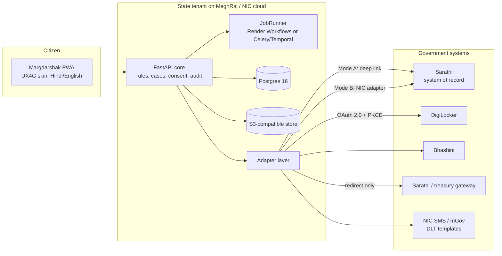
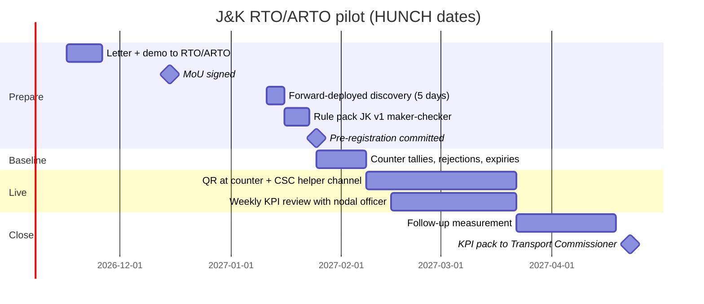

# Government Adoption Kit (plug-and-play)
> Project: Margdarshak · Team: Chanakya (@Nestiq Private Limited) · Owner: Founder (government lead) with Engineering lead · Status: Draft v0.1 · Last updated: 2026-10-23
> Related: [PALANTIR_METHOD](PALANTIR_METHOD.md) · [PROJECT_BRIEF](../00-overview/PROJECT_BRIEF.md) · [BUSINESS_MODEL §3.4](../07-business/BUSINESS_MODEL.md) · [IMPACT](../07-business/IMPACT.md) · `docs/03-engineering/ARCHITECTURE.md` · `docs/03-engineering/INTEGRATIONS.md` · `docs/06-security-compliance/COMPLIANCE.md` · `docs/06-security-compliance/PRIVACY.md` · `api/openapi.yaml`
> Inputs: `research/ps1-deep/07-govt-plug-and-play.md` (integration surface, adoption checklist, Palantir method), `war-room/margdarshak-verification.md` §3.1 G1–G14 and directives D-01, D-02, D-07, D-08, D-15–D-18, D-25.
> **Status words:** VERIFIED (primary source read), SECONDARY (law-firm, vendor or news summary), **[unverified]** (owner and date given), HUNCH (our inference).

---

## 0. The promise to a State Transport Department, in five lines
1. **You host it.** Containers, Postgres and S3-compatible storage, on NIC or a MeitY-empanelled cloud (MeghRaj) in India. No dependency on our servers.
2. **You own the data.** For your tenant, your department is the Data Fiduciary; Nestiq is a contracted Data Processor (or has no access at all, if you self-operate).
3. **You audit it.** Apache-2.0 source, SBOM, threat model, OWASP ASVS L2 checklist, GIGW 3.0 / WCAG 2.1 AA matrix and a VAPT scope, ready for an STQC- or CERT-In-empanelled auditor.
4. **Sarathi stays the system of record.** Margdarshak is the citizen front end and decision layer. Aadhaar eKYC, OTP, payment and submission happen on Sarathi or your gateway (D-07). We never ask for Vahan/Sarathi data, which MoRTH stopped sharing with private entities on 1 Oct 2026 (NIC RTI reply reported by [IFF, 20 Oct 2026](https://internetfreedom.in/who-reads-your-vehicle-record-nic-gave-us-numbers-morth-gave-us-a-generic-webpage/), VERIFIED single advocacy source).
5. **You can leave.** Data export, source escrow and a handover plan to NIC or your system integrator are in the MoU.

**Positioning line (D-02):** "A reference citizen front end plus an open adapter specification that MoRTH, NIC or a State Transport Department can host." It could ship as an entry card inside mParivahan or UMANG, the way BWMI's winner RaktKhoj sat inside UMANG over e-RaktKosh (`G-inspiration-library.md` §1.4). It is **not affiliated** with MoRTH, NIC or any State Transport Department today, and every page says so (D-01).

---

## 1. What a state gets (bill of materials)

| # | Deliverable | Contents | Format | Licence |
|---|---|---|---|---|
| 1 | **Citizen PWA** | Stages S0–S9: home, 3-tap plan, guided LL application, learn hub, LL simulator, Nazar and mini-games, slot finder, test-day co-pilot, fail and recover, tracker, new-rider year, renew/fix/family (F-01–F-33) | Next.js 16 container; Lite mode < 300 KB (F-51) | Apache-2.0 |
| 2 | **API + core domain** | Hexagonal core: case state machine, rule engine, consent ledger, append-only audit log (E-30), APIs API-01–API-71 | FastAPI container, OpenAPI 3.1 (`api/openapi.yaml`) | Apache-2.0 |
| 3 | **Government adapter layer** (F-56) | `SarathiAdapter`, `DigiLockerAdapter`, `AadhaarOfflineAdapter`, `BhashiniAdapter`, `PaymentAdapter`, `NotificationAdapter`, `SlotAdapter`, each with mock and real implementations passing one contract suite (§3) | Python package + contract tests | Apache-2.0 |
| 4 | **State rule pack** (F-42, E-08) | Classes, ages, fees, test formats, timelines, documents, offices, languages, each row with `source`, `verified_on`, `confidence`, approver | Versioned YAML/JSON, signed by the department | CC-BY 4.0 |
| 5 | **Rule-pack studio** | Maker-checker editing, diff view, effective dates, mid-case re-evaluation notices (EC-27) | Admin UI (API-54) | Apache-2.0 |
| 6 | **State / RTO console** (F-41) | Decision views: where applications stall, fail reasons per RTO, demand forecast, slot use, query deflection; anonymised and aggregated with k ≥ 5 | Admin UI (API-53) | Apache-2.0 |
| 7 | **Hazard-clip bank + pipeline** | Blurred clips (faces and plates), two-rater hazard windows, difficulty; ingest pipeline transcode → blur → propose → two raters → agreement → publish | Media + JSON; JobRunner tasks | Clips CC-BY 4.0; code Apache-2.0 |
| 8 | **Tenant theme** | UX4G-based tokens, the department's name and languages (§4) | Tenant config | — |
| 9 | **Deployment pack** | Helm chart, docker-compose for a single-VM pilot, Terraform module outline for an empanelled CSP, runbooks | IaC | Apache-2.0 |
| 10 | **Audit pack** | Threat model (STRIDE), ASVS L2 self-assessment, GIGW 3.0 matrix, WCAG 2.1 AA report (axe + manual), SBOM (CycloneDX), VAPT scope, DPDP data map, CERT-In incident runbook | Documents | — |
| 11 | **Training kit** | RTO staff guide (console + counter QR), CSC helper guide (consent script), driving-school guide | PDF + video | CC-BY 4.0 |
| 12 | **Forward-deployed team** | 2 engineers + 1 field researcher for discovery and configuration ([PALANTIR_METHOD](PALANTIR_METHOD.md)) | Service | Contract |

---

## 2. Deployment modes

| Mode | Who runs it | Sarathi path | Aadhaar | Payment | When |
|---|---|---|---|---|---|
| **Independent (today)** | Nestiq, on Render (Singapore) for the hackathon | **Mode A hand-off:** prefilled deep link to `sarathi.parivahan.gov.in` plus a copy-pack (API-16). The citizen submits on Sarathi | Hand-off to Sarathi's own Aadhaar flow. Demo shows a mock screen labelled "simulated: in production this step runs on Sarathi" | Redirect to Sarathi | Hackathon; public beta |
| **Government-hosted, Mode A** | The department / NIC, on MeghRaj | Same deep-link hand-off, no NIC change needed | Sarathi's existing eKYC | Sarathi's gateway | Pilot (§8) |
| **Government-hosted, Mode B** | The department / NIC | **Adapter:** NIC implements `SarathiAdapter.real` against Sarathi's internal APIs (status, slots, application prefill). Flip per tenant, no code change | `SarathiAdapter.real` calls Sarathi's existing eKYC; the department is already the authenticating party via NIC | `PaymentAdapter.real` → Sarathi/state treasury, reconciled by receipt number | After an MoU with NIC |



---

## 3. Adapter specification (F-56)

### 3.1 Rules that every adapter obeys
1. **Ports and adapters:** the core sees only ontology objects (E-01..E-31). Nothing outside an adapter sees Sarathi or DigiLocker formats such as `DRVLC` XML (anti-corruption layer, `07` §B1).
2. **Same contract, two implementations:** `mock` and `real` pass the same contract-test suite in CI (`tests/contract/<port>/`). A state goes live with `SarathiAdapter=deeplink` and flips to `real` later by config.
3. **Idempotency:** every write carries an `Idempotency-Key`; timeline events use idempotent keys (E-12).
4. **Timeouts and fallbacks:** default 5 s timeout, 3 retries with exponential backoff, circuit breaker; on failure the core shows the outage state (EC-11) and keeps drafts.
5. **No forbidden data:** no Aadhaar number, OTP, biometrics or face for matching ever crosses an adapter into the core (D-07). LL/DL numbers are stored only as salted hashes plus the last 4 characters (E-04, E-05).
6. **Audit:** every adapter call writes an `AuditLog` row (E-30) with actor, purpose, ConsentArtefact ID (E-15) and outcome.
7. **No scraping, no booking bots** (D-08; IT Act s.43 risk). `SlotAdapter.mock` and reminders only until a state provides a real slot API.

### 3.2 Port catalogue
| Port | Methods (input → output ontology object) | `mock` | `real` / other modes | Contract tests (examples) |
|---|---|---|---|---|
| **SarathiAdapter** | `get_handoff(case) → HandoffPack` · `get_application_status(app_ref) → CaseStatus` · `prefill_application(case) → PrefillResult` (Mode B) · `get_ll_facts(consent) → LearnerLicenceMirror` · `get_dl_facts(consent) → DrivingLicenceMirror` · `record_test_result(app_ref) → TestAttempt` (Mode B) | Fixture applications and the observed Sarathi status vocabulary | `deeplink`: URL + copy-pack, works today with no permission · `real`: NIC-built, read/status first, write only if NIC allows | Status mapping covers every observed status; unknown status → `unknown` with decoder hint (F-32); handoff never contains an Aadhaar number |
| **DigiLockerAdapter** | `start_consent(purpose, doctypes) → AuthRedirect` · `exchange_code(code, verifier) → TokenSet` · `list_issued() → [DocumentRef]` · `pull_dl(consent) → DrivingLicenceMirror` · `revoke(consent)` | Mock OAuth server with the real consent pattern (purpose, documents, validity) and sample signed XML | Requester spec v1.12: OAuth 2.0 authorization code with **PKCE S256 required**; scope `partners.DRVLC`; issued URI `in.gov.transport-DRVLC-<DL no.>`; token expiry 3600 s ([spec PDF](https://cf-media.api-setu.in/resources/Requester-APISpecification-V1_12.pdf), VERIFIED in `07` §A2). No sandbox reported (testing hits production) | PKCE enforced; consent text displayed; revocation removes the mirror within 24 h |
| **AadhaarOfflineAdapter** | `verify_secure_qr(image) → OfflineVerification{valid, age_band, state}` · `verify_xml(zip, share_code) → OfflineVerification` | UIDAI sample data | Real signature check against UIDAI's public certificate; store only the result and a salted hash, never the number (`07` §A3). **Disabled by default.** Enabled only in government-hosted mode, or after Nestiq completes the OVSE / Reg. 13A requirements **[unverified]**, SECONDARY ([Vinod Kothari, Dec 2025](https://vinodkothari.com/2025/12/a-new-way-to-verify-aadhaar-offline-introduction-of-face-matching/)) | Fails closed on bad signature; output schema has no field that can hold an Aadhaar number |
| **BhashiniAdapter** | `asr(audio, lang) → Transcript` · `translate(text, src, tgt) → Text` · `tts(text, lang) → Audio` | Local stand-in | ULCA pipeline-config → inference (endpoints from community code, **[unverified]**, `07` §A4). Hackathon voice uses Gemini Live and Sarvam Saaras (Dogri); Bhashini is the government-preferred path for states (G4) | Language codes validated; PII redaction before send (EC-20) |
| **PaymentAdapter** | `start_payment(fee_quote) → Redirect` · `reconcile(receipt_no) → PaymentStatus` | Fake payment page + signed callback | Redirect to Sarathi's payment page or the state treasury gateway (PayGov India / SBI ePay / GRAS-IFMS; current per-state gateway **unknown**, `07` §A5). **Margdarshak never collects government fees** | Amount always comes from `FeeQuote` (E-07); EC-09 payment-pending path |
| **NotificationAdapter** | `send(template_id, contact_ref, vars) → Notification` · `handle_reply(payload)` · `opt_out(contact_ref)` | Console + email | Hackathon: n8n → WhatsApp Cloud (templates) and email. State: NIC SMS / mGov with **TRAI DLT** registered templates (D-16; DLT specifics **[unverified]**) | STOP honoured within one message (EC-30); ≤ 1 nudge a day; no marketing to under-18s |
| **SlotAdapter** | `list_offices(state) → [Office]` · `list_slots(office, range) → [Slot]` · `watch(office, criteria) → SlotWatch` | Seeded calendar labelled "sample data" | State-provided slot feed only. No scraping | Watch triggers reminder only; never books |
| **JobRunner** (platform port) | `start(task, args) → RunRef` · `status(run) → RunStatus` | In-process | Hackathon: **Render Workflows (Python SDK)**. Government cloud: Celery or Temporal-style implementation (G4, D-17) | Same task definitions run on both; retries and fan-out preserved |
| **LLMPort** (platform port) | `narrate(findings, allowlist) → Narration` · `decode(screenshot) → Decoded` · `live(session)` | Templates | Hackathon: Gemini API, paid tier (D-13). Production: Vertex AI in an Indian region (`HUNCH:` asia-south1, not verified) or Bhashini/local models per state | Provenance guard: no number in output that did not come from a tool (D-10); ≥ 30 eval cases per agent |

### 3.3 Adapter OpenAPI fragment (the government-side contract, Mode B)
This is the interface NIC would implement so the core can call Sarathi read/status functions. It is a **proposed** contract; nothing here claims Sarathi exposes these today.

```yaml
openapi: 3.1.0
info:
  title: Margdarshak Sarathi Adapter (government side, proposed)
  version: 0.1.0
  description: >
    Proposed contract for a NIC-hosted adapter. Implemented by the State/NIC, not by Nestiq.
    Margdarshak is not affiliated with MoRTH or NIC.
servers:
  - url: https://adapter.{tenant}.example.invalid/v1
    variables: { tenant: { default: in-jk } }
security:
  - mtls: []
paths:
  /applications/{appRef}/status:
    get:
      operationId: getApplicationStatus
      parameters:
        - { name: appRef, in: path, required: true, schema: { type: string, maxLength: 32 } }
        - { name: X-Consent-Id, in: header, required: true, schema: { type: string, format: uuid } }
      responses:
        '200':
          description: Current status mapped to the Margdarshak stage vocabulary
          content:
            application/json:
              schema:
                type: object
                required: [appRef, stage, statusCode, asOf]
                properties:
                  appRef: { type: string }
                  stage: { type: string, enum: [S2, S3, S4, S5, S6, S6F, S7, unknown] }
                  statusCode: { type: string, description: "Sarathi's own status text, unmodified" }
                  asOf: { type: string, format: date-time }
        '404': { description: Not found or consent does not cover this application }
  /offices/{officeCode}/slots:
    get:
      operationId: listSlots
      parameters:
        - { name: officeCode, in: path, required: true, schema: { type: string } }
        - { name: from, in: query, required: true, schema: { type: string, format: date } }
        - { name: to, in: query, required: true, schema: { type: string, format: date } }
      responses:
        '200':
          description: Slot availability (read-only; booking stays on Sarathi)
          content:
            application/json:
              schema:
                type: array
                items:
                  type: object
                  properties:
                    date: { type: string, format: date }
                    kind: { type: string, enum: [ll_test, dl_test_2w, dl_test_4w] }
                    capacity: { type: integer, minimum: 0 }
                    available: { type: integer, minimum: 0 }
components:
  securitySchemes:
    mtls: { type: mutualTLS }
```

---

## 4. Tenancy and white-label (F-58, E-31)

### 4.1 Tenant model
- **Tenant = State/UT.** Row-level `tenant_id` on every table plus per-tenant encryption keys; schema-per-tenant for states that ask for it; separate deployment for states that insist on their own infrastructure (`07` §B3).
- **State rules as data:** CMVR base pack + state overlay (`rules/base.json` + `rules/JK.json`), versioned and signed; the engine evaluates, the department edits through maker-checker (F-42).
- **Feature flags per tenant:** `ai_coach`, `voice_guide`, `school_portal`, `rto_intel`, `sarathi_mode`, `digilocker`, `aadhaar_offline`, `hpt_mode`.

### 4.2 Example tenant configuration
```yaml
# tenants/in-jk.yaml  (example; values are illustrative)
tenant_id: in-jk
display_name: { en: "Jammu & Kashmir", hi: "जम्मू और कश्मीर" }
publisher_mode: independent        # independent | government
branding:
  design_system: ux4g-3.0
  primary_token: "--ux4g-primary"  # tokens only; no state emblem unless publisher_mode = government
  emblem: null                     # allowed only when the department itself publishes the service
  footer_disclaimer: >
    Independent prototype by team Chanakya. Not affiliated with MoRTH, NIC or any State
    Transport Department. Uses simulated government data.
languages:
  full: [en, hi]
  voice_in: [doi]                  # Dogri speech in via Sarvam Saaras (M-08)
rule_pack: { id: JK, version: 2026.10.22-1, approver: null, status: draft }
adapters:
  sarathi: deeplink                # mock | deeplink | real
  digilocker: mock
  aadhaar_offline: disabled
  bhashini: mock
  payment: sarathi_redirect
  notification: n8n_whatsapp_email # government: nic_sms_dlt
  slot: mock
job_runner: render_workflows       # government cloud: celery | temporal
llm: gemini_api_paid               # government: vertex_india | bhashini_local
features:
  hpt_mode: kerala_format_practice # practice only; never "official"
  rto_intel: { enabled: true, k_threshold: 5, free_text: false }
  ai: { min_age: 18 }
data_residency: { region: ap-southeast-1, note: "hackathon only; India region required for adoption" }
```

### 4.3 White-label rules (UX4G skin)
| Rule | Independent mode | Government mode |
|---|---|---|
| Design system | UX4G 3.0 tokens and components (MeitY design system, GIGW-aligned, WCAG 2.1 AA cited in its docs; [ux4g.gov.in](https://ux4g.gov.in/), [docs](https://doc.ux4g.gov.in/)) with Margdarshak's own accent | UX4G 3.0 with the department's colours |
| Name | "Margdarshak" | The department may co-brand ("<Department> · powered by Margdarshak") or rename; the trademark licence covers this |
| Emblem / logos | **None.** No State Emblem, no Parivahan logo, no tricolour "Government of India" header (D-01, G10) | Only the department's own marks, placed by the department as publisher |
| Domain | Never contains "parivahan", "sarathi" or "gov" | The department's own gov.in / nic.in domain |
| Disclaimer | Persistent non-affiliation footer + first-launch screen | Replaced by the department's own terms and Web Information Manager contact |

---

## 5. Hosting on MeghRaj / MeitY-empanelled cloud
| Item | Specification |
|---|---|
| Where | NIC cloud, or a MeitY-empanelled CSP (MeghRaj / GI Cloud; empanelment follows an STQC audit and requires India-hosted data; `07` §A6, SECONDARY). Goa, for example, picked from 26 empanelled CSPs ([The Goan, Feb 2026](https://www.thegoan.net/goa-news/130-govt-websites-to-be-migrated-to-new-platform/143701.html), SECONDARY) |
| Residency | All PII, logs, backups, DR and AI inference in India (design assumption from `07` §A6; vendor claim that backups must also be in India is unconfirmed against MeitY text) |
| Containers | `web` (Next.js), `api` (FastAPI + ADK), `verifier` (Node, game-core replay), `worker` (JobRunner), `otel-collector`; images signed (cosign) with an SBOM |
| Data stores | PostgreSQL 16 (primary + streaming replica), Redis-compatible cache, S3-compatible object store (MinIO or the CSP's) |
| Packaging | Helm chart for Kubernetes; docker-compose for a single-VM pilot at one RTO; Terraform module outline per CSP |
| Sizing (pilot, HUNCH) | 1 VM 8 vCPU / 32 GB (all services) + managed Postgres 2 vCPU / 8 GB + 200 GB object storage |
| Sizing (state, HUNCH) | 3-node cluster 8 vCPU / 32 GB each; Postgres 4 vCPU / 16 GB with replica; CDN for clips at 360p (1–2 MB each, EC-19) |
| Observability | OpenTelemetry → the department's stack; PII-redacted structured logs; Sentry self-hosted or disabled |
| CERT-In Directions (28 Apr 2022) | Report specified incidents within **6 hours**; keep ICT logs for a rolling **180 days in India**; sync clocks to NIC/NPL NTP (`HUNCH:` hostnames such as `samay1.nic.in` to confirm) (G6, SECONDARY) |
| Hackathon contrast | Render has **no India region** (Oregon, Ohio, Virginia, Frankfurt, Singapore; [Render regions](https://render.com/docs/regions), VERIFIED). The hackathon runs in Singapore on synthetic data only, stated in the README |

---

## 6. Data ownership and protection
| Topic | Position |
|---|---|
| Roles under DPDP Act 2023 + Rules 2025 | In a government tenant, **the department is the Data Fiduciary**. Nestiq is a **Data Processor** under a written contract, or has no access if the department self-operates. In independent mode, Nestiq is the Data Fiduciary for its own users |
| What we hold | Pseudonymous applicant (E-01), case facts (E-02–E-07), consents (E-15), game sessions (E-16, E-17), encrypted contacts kept apart from cases (E-14). **Never:** Aadhaar number, OTP, biometrics, face for matching, document images (E-06 stores check results only) |
| Children | Under 18 = child. Rules-only, account-less features for 16–17-year-olds; no AI, telemetry, streaks or squads (D-13, G7). Verifiable parental consent flows are roadmap |
| Secondary use | None by Nestiq without the department's written approval. Cross-tenant use is limited to **clip difficulty statistics**, aggregated, with no user-level data, and only with the department's opt-in |
| Analytics | Privacy-preserving, aggregated (F-55); k ≥ 5 for any public cell |
| Rights | Export (API-61), delete (API-62), consent view and revoke (API-60), grievance officer named per tenant |
| Exit | Full export (Postgres dump + object store + rule packs + audit log) in open formats within 30 days; Nestiq deletes its copies and certifies deletion; source escrow is unnecessary because the code is public, but a tagged release per tenant is archived |
| Wording | "Built to DPDP Rules", never the banned compliance phrase (D-19) |

---

## 7. Open-source licence and governance
| Asset | Licence | Why |
|---|---|---|
| Code (all services, adapters, game-core) | **Apache-2.0** | Policy on Adoption of OSS for GoI (2015) prefers OSS for new e-Gov applications; Apache-2.0 gives a patent grant and lets NIC and SIs extend freely (`07` §A9, §B5) |
| Rule packs, clip bank, training kit | **CC-BY 4.0** | Reuse with attribution; matches Kerala's "open-source computer-based tools" wording |
| Name "Margdarshak" | Trademark retained by Nestiq (IP India search pending, D-25) | Quality control; co-branding licence for departments |
| Contributions | DCO sign-off; public issue tracker; security reports via `SECURITY.md` | — |
| Repo | Public GitHub; mirror to the government code repository (OpenForge) if the department asks (**[unverified]** current OpenForge status; owner: Engineering lead, by 2026-12-31) | — |
| Digital public good | Positioned as one; DPGA application considered after the first state tenant (HUNCH) | — |

---

## 8. MoU and pilot plan with one RTO/ARTO (J&K)

### 8.1 MoU outline (non-financial pilot)
1. **Parties:** the Transport Department, Government of J&K (or the RTO/ARTO with the department's approval) and Nestiq Private Limited (team Chanakya).
2. **Purpose:** a 6-week pilot of a citizen guidance front end for LL and DL journeys at one office, measuring the KPIs in §10.
3. **Scope:** Mode A only (deep-link hand-off to Sarathi). No access to Sarathi, Vahan or Aadhaar systems. No collection of Aadhaar numbers or OTPs.
4. **Data:** the department receives aggregated KPI data. Nestiq processes only what citizens give with consent. Personal data stays in India once hosting moves to the department; during the pilot, hosting location is stated in the MoU (HUNCH: an India-region VM provided by the department or a MeitY-empanelled CSP).
5. **Roles:** RTO nominates a nodal officer; Nestiq provides 2 forward-deployed engineers + 1 field researcher on site 2 days a week.
6. **Publicity:** no use of the department's name or emblem without written approval; the non-affiliation line stays until the department chooses to publish.
7. **IP:** code Apache-2.0; pilot reports co-owned; the department may publish results.
8. **Grievance:** Nestiq's grievance officer named; corruption complaints deep-link to the department's vigilance channel and CPGRAMS, never hosted by us (D-14).
9. **Term and exit:** 6 weeks + 4 weeks follow-up; either party may end with 7 days' notice; data export and deletion as §6.
10. **Cost:** ₹0 to the department (funded by grants/CSR, [FINANCIALS §5](../07-business/FINANCIALS.md)).

### 8.2 Pilot timeline


### 8.3 Pilot roles (RACI)
| Activity | RTO nodal officer | Transport Commissioner office | Nestiq FDE team | CSC operators | Citizens |
|---|---|---|---|---|---|
| Approve rule pack JK v1 | A | I | R | — | — |
| Counter QR placement | A/R | I | C | — | — |
| Baseline tallies | R | I | C (forms, training) | — | — |
| Helper sessions with consent | I | — | C | R | A (consent) |
| Weekly KPI review | A | I | R | C | — |
| Publish results | C | A | R | — | I |

### 8.4 Success criteria (decided before baseline)
- Counter queries about documents and fees fall by ≥ 20% (HUNCH).
- LL expiries before a DL test fall by ≥ 30% for Margdarshak users vs baseline (HUNCH).
- No data incident; no complaint upheld about misleading information.
- The nodal officer would recommend continuation (yes/no, with reasons).

---

## 9. GeM listing path
| Step | Action | Status |
|---|---|---|
| 1 | DPIIT recognition for Nestiq Private Limited | **[unverified]** (owner: Founder, by 2026-11-07) |
| 2 | GeM seller registration using the DPIIT number | Not started |
| 3 | Choose listing route: an existing SaaS/service category if one fits, otherwise the **GeM Startup Runway** for innovative products that match no existing category (trial orders with buyers on a voluntary basis) | SECONDARY ([Startup India note](https://www.startupindia.gov.in/content/sih/en/reources/startup_india_notes/regulations_and_policies/MakeTheGovernmentYourPrimeCustomer.html)) |
| 4 | Claim startup relaxations (prior experience, prior turnover, EMD) **only where the tender document allows them**; scope for software services is **[unverified]**, sources conflict | Owner: Business lead, by 2026-11-30 |
| 5 | Trial order with the pilot department → buyer ratings → full listing (a commercial guide says ratings from 3 buyers; **[unverified]**) | After the pilot |
| 6 | For larger rollouts: tender or a state SI sub-contract | Year 2 |

---

## 10. KPIs for the Transport Commissioner (console F-41)
| KPI | Definition | Baseline source | Target (HUNCH) | Frequency | Console view |
|---|---|---|---|---|---|
| Median days LL issued → DL test taken | From case events (E-12) for Margdarshak users; RTO aggregate for all | RTO aggregate (2 weeks) | −15% | Weekly | Funnel by stage |
| LL expiries before a DL test | % of LLs that expire with no test (EC-07) | RTO aggregate | −30% | Weekly | "At risk: LL expiring in 30 days" |
| First-attempt DL pass rate | Passes at attempt 1 / attempts | RTO aggregate | +10 points (confounded; reported with caveats) | Monthly | Pass rate by track type |
| Fail reasons (top 5) | Fail reason codes (E-11) entered by users or the adapter | — | Visibility, not a target | Monthly | Reasons per RTO, k ≥ 5 |
| Document / photo rejections | Rejections per 100 applications | RTO tally | −50% | Weekly | Rejection hotspots |
| Counter queries | Daily tally of "what do I need?" queries | Counter sheet | −20% | Daily | Query deflection |
| Payment-pending cases resolved within 7 days | EC-09 cases | Complaints register | +50% | Weekly | Pending list (aggregate) |
| Slot no-show rate | No-shows / booked | RTO aggregate | −20% | Weekly | Slot use |
| Approval stall | Days from test passed → approved (EC-23) | RTO aggregate | −25% | Weekly | Stall list by stage |
| Agent dependence (self-reported) | "Did you pay anyone to help?" at S7 | Exit question | Falling trend | Monthly | Trend line |
| Hazard readiness | % of learners with Nazar ≥ 60/100 before the DL test (practice score, not a test result) | — | Rising trend | Monthly | Readiness distribution |
| Accessibility use | Hindi share, Dogri voice-in share, Lite mode share, helper-assisted share | — | Reported | Monthly | Inclusion panel |
| Service health | p95 latency, error rate, uptime | — | p95 < 300 ms for API-01; 99.5% uptime | Real time | Ops panel |

All views are anonymised and aggregated; examiner identity is never shown (only pseudonymous IDs with variance flags for audit, never named; `07` §C3).

---

## 11. Forward-deployed engagement plan (Palantir-style)
Summary here; detail and ontology in [PALANTIR_METHOD](PALANTIR_METHOD.md).

| Phase | Duration | Who | Output |
|---|---|---|---|
| **0. Discover** | 5 days on site | 2 FDEs + 1 field researcher at the RTO front desk, document counter, LL test hall, driving test track; 10 applicants end-to-end; 2 driving schools; the people who act as agents | Observed process map, top 10 failure modes with counts, decision inventory |
| **1. Configure** | 2–3 weeks | FDEs + department nodal officer | Rule pack v1 (maker-checker), tenant config, adapter modes, console views for the decisions found in phase 0 |
| **2. Deploy** | 6 weeks | FDEs on site 2 days/week | Live pilot, weekly KPI reviews, feedback loops (fail reasons → curriculum; rejections → pre-checks) |
| **3. Hand over** | 2 weeks | FDEs + NIC/SI | Runbooks, training, export, support SLA |

**Principle:** configure, don't rebuild. The deliverable to a department is a rule pack and adapter configuration for *its* reality, on the same open core.

---

## 12. Checklists (from `07` adoption checklist, extended)

### 12.1 Legal and policy
- [ ] MoU signed (§8.1); Data Processor terms under DPDP; purpose and retention defined
- [ ] Margdarshak confirmed as front end/decision layer; Sarathi remains the system of record
- [ ] Rule pack v1 approved (maker-checker sign-off by the Transport Commissioner's office)
- [ ] Licence (Apache-2.0 / CC-BY 4.0) and code hosting agreed
- [ ] Aadhaar position memo accepted: no Aadhaar numbers, OTPs, biometrics or face matching by Nestiq; eKYC stays with Sarathi (G1; Aadhaar Good Governance Amendment Rules, 31 Jan 2025, SECONDARY: [Scroll](https://scroll.in/latest/1078654/it-ministry-notifies-rules-allowing-private-entities-to-carry-out-aadhaar-authentication), [Khaitan](https://www.khaitanco.com/thought-leadership/Aadhaar-authentication-for-private-entities))
- [ ] Intermediary duties for RTO Live Intel: grievance officer, takedown SLA, no free text (G12)
- [ ] Online Gaming Act 2025 memo: stake-free educational game, no redeemable prizes (G9)

### 12.2 DigiLocker requester onboarding (D-18)
- [ ] Eligible entity: private organisations registered in India (Companies Act, MSME, Startup India, trusts and others) ([NeGD Partner SOP](https://cf-media.api-setu.in/resources/Partners-SOP.pdf), VERIFIED via search excerpts)
- [ ] Demonstrable experience of online services to citizens
- [ ] Senior authorised representative named
- [ ] Registration from the organisation's own email domain
- [ ] NeGD verification → integration per Requester spec v1.12 (PKCE S256, `partners.DRVLC`) → test/audit → go-live ([Requester ToU, Jun 2025](https://cf-media.api-setu.in/resources/DigiLocker-Terms-of-User-Requester-june-2025.pdf))
- [ ] Callback URLs registered; consent text displayed exactly as prescribed; no sandbox, so test with consenting staff accounts
- [ ] In government mode, use the department's existing client ID if it has one

### 12.3 Infrastructure and security
- [ ] Hosting on NIC cloud or a MeitY-empanelled CSP, India region; backups and DR in India
- [ ] VAPT by an STQC- or CERT-In-empanelled auditor; remediation; re-test; safe-to-host certificate before production (GIGW 3.0 guideline 5.3.1, SECONDARY: [TCSA](https://www.tcsa.in/learn/who-can-issue-safe-to-host-certificates)). We say "audit-ready", never that we are certified (D-19)
- [ ] OWASP ASVS L2 and OWASP LLM Top 10 checklists closed
- [ ] CERT-In: 6-hour reporting runbook, 180-day India logs, NTP to NIC/NPL
- [ ] Role-based access for RTO staff via state SSO / Parichay (Parichay integration **[unverified]**)
- [ ] SBOM published per release; image signing; dependency scanning in CI

### 12.4 UX and accessibility
- [ ] GIGW 3.0 self-assessment matrix; named Web Information Manager
- [ ] UX4G components; WCAG 2.1 AA (axe + manual screen-reader pass); 48 px targets; ≤ 3 flashes per second
- [ ] English + Hindi in full; Dogri voice-in; other state languages as rule-pack-ready translations (D-21). Claim only what ships
- [ ] Tested with low-literacy users and through a CSC helper
- [ ] Listing on UMANG / the state app store / Play Store under the department's account (government mode only)

### 12.5 Operations
- [ ] Forward-deployed pilot at 1 RTO/ARTO for 6 weeks with baseline metrics
- [ ] Grievance channel (CPGRAMS / state) wired; helpdesk SOP
- [ ] RTO staff training; console KPIs agreed (§10)
- [ ] Exit and portability plan tested once (export → restore on a clean VM)

---

## 13. Hackathon build (Phase 1–2) vs Production (Phase 3+)
| Area | Hackathon build | Production |
|---|---|---|
| Hosting | Render Singapore, synthetic data, README states it | NIC / MeitY-empanelled CSP in India |
| Sarathi | `SarathiAdapter.mock` + Mode A deep-link demo | Mode A at pilot; Mode B with NIC |
| DigiLocker | Mock consent screen with the real consent pattern | Requester onboarding through NeGD |
| Aadhaar | Mock screen labelled "simulated: in production this step runs on Sarathi" | Sarathi's eKYC; offline adapter only if allowed |
| Jobs | Render Workflows (clip pipeline headline, field stats, debrief fan-out, journey sweeper via n8n Schedule) | JobRunner with Celery/Temporal-style implementation on the government cloud |
| Messaging | n8n → WhatsApp test number + email | NIC SMS with DLT templates; WhatsApp only with approved templates |
| Audit | Self-assessed checklists, CI scans | Empanelled auditor; safe-to-host certificate |
| Claims | "Adapter spec and mock adapters; a department can host it" | Pilot results with CIs |

## 14. Unknowns (do not fake in the demo)
| Unknown | Owner | By |
|---|---|---|
| Whether any Sarathi read/status API is open beyond NIC/DigiLocker | Founder (ask NIC through the department) | Pilot MoU |
| Current per-state fee gateway (J&K) | Engineering lead | 2026-12-15 |
| Bhashini onboarding terms for a department-hosted service | Engineering lead | 2026-12-31 |
| OVSE / Reg. 13A obligations for offline Aadhaar verification | Founder + counsel | 2027-01-31 |
| GIGW 3.0 guideline 5.3.1 primary text | Engineering lead | 2026-11-15 (D-25) |
| J&K PSGA timelines for DL services | Field lead (ask at counter) | 2026-11-30 |
