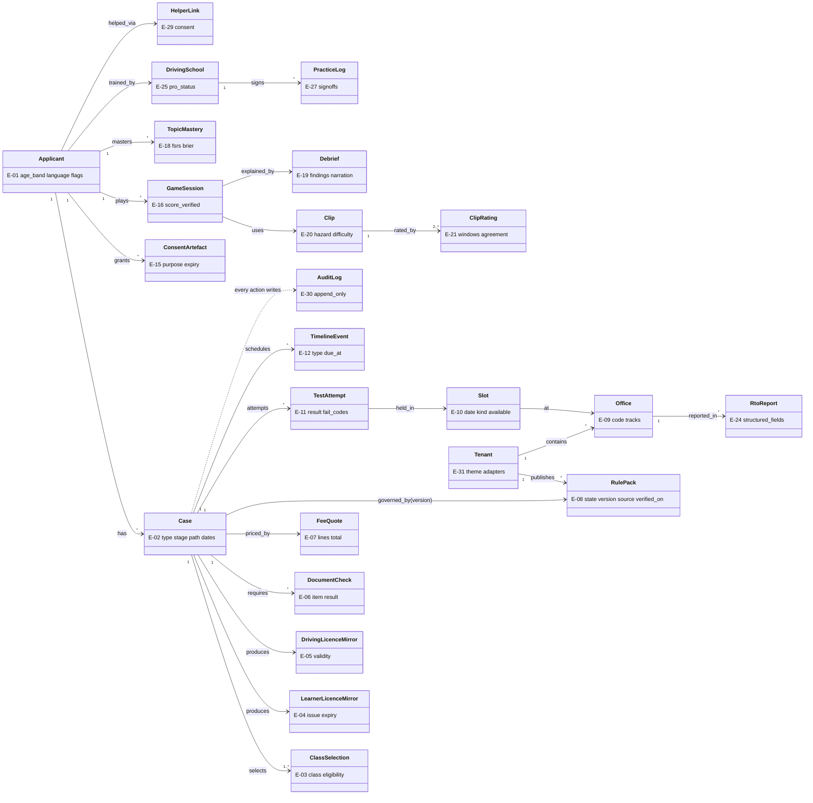
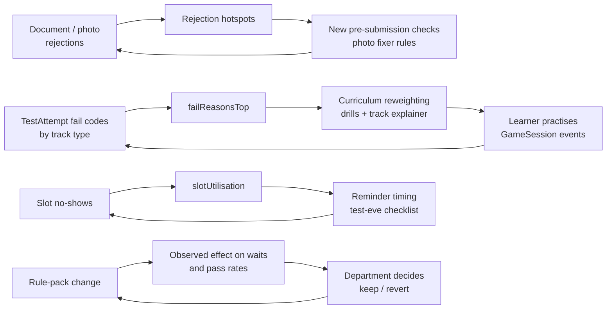
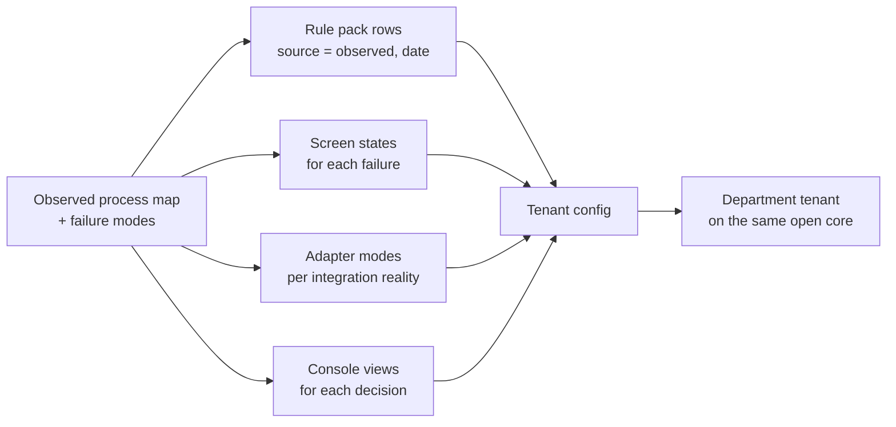

# The Palantir Method, applied to the driving licence
> Project: Margdarshak · Team: Chanakya (@Nestiq Private Limited) · Owner: Product lead (ontology) with Field lead (forward deployment) · Status: Draft v0.1 · Last updated: 2026-10-23
> Related: [GOVERNMENT_ADOPTION](GOVERNMENT_ADOPTION.md) · [PROJECT_BRIEF §6 ontology](../00-overview/PROJECT_BRIEF.md) · `docs/03-engineering/DATA_MODEL.md` · `api/openapi.yaml` · [IMPACT](../07-business/IMPACT.md) · `field-kit/NAZAR-FIELD-KIT.md`
> Inputs: `research/ps1-deep/07-govt-plug-and-play.md` §C (primary Palantir sources), `research/ps1-current-state/00-JOURNEY-MAP.md` (observed failures), `war-room/margdarshak-verification.md` (D-09, D-14, D-22).
> **Disclaimer:** this is our application of three ideas Palantir describes publicly. Margdarshak is not affiliated with Palantir and uses none of its software. The phrase "decision-centric" was **not** found on Palantir's Ontology page; it is our own framing (`07` §C1).

---

## 0. The three ideas, and what they mean here
| Palantir idea (source) | In Palantir's words | What we do with it |
|---|---|---|
| **Ontology** ([Ontology overview](https://www.palantir.com/docs/foundry/ontology/overview/)) | "an operational layer for the organization" that "serves as a digital twin of the organization", with **semantic** elements (objects, properties, links) and **kinetic** elements (action types, functions, dynamic security) | Model the licence journey as objects (Applicant, Case, Slot, Test…), links and **actions that write events**. Every screen reads from and writes to this model. PROJECT_BRIEF §6 is the canonical list (E-01..E-31) |
| **Forward-deployed engineering** ([A day in the life of an FDSE](https://blog.palantir.com/a-day-in-the-life-of-a-forward-deployed-software-engineer-45ef2de257b1)) | An engineer who "embeds directly with our customers to configure Palantir's existing software platforms to solve their toughest problems"; one FDSE enables many capabilities for one customer | Our engineers sit at the RTO counter, the test track, the CSC and the driving school before writing configuration. Research is shadowing, not surveys |
| **Decision-centric apps** (our framing) | — | One screen answers one actor's one decision ("what do I do next?", "which cases are stuck and why?"), and the action taken on that screen writes an event that improves the next decision |

**Why this fits a government buyer:** a department does not want a new system of record. It wants a layer that makes the existing one (Sarathi) usable and observable. "Configure, don't replace Sarathi" (`07` §C6).

---

## 1. The ontology

### 1.1 Object types (semantic layer)
| ID | Object | Key properties | PII class | Primary key / identity |
|---|---|---|---|---|
| E-01 | Applicant | age_band, language, flags (helper), district; a case may belong to a family member (family mode) | Pseudonymous | `applicant_id` (UUID), no name required |
| E-02 | Case | type (LL, DL, add_class, renewal, duplicate, address, IDP), tenant, stage S0–S9, path (Aadhaar / non-Aadhaar), key dates | Pseudonymous | `case_id` |
| E-03 | ClassSelection | class code (MC50CC, MCWOG, MCWG, LMV-NT, transport classes), eligibility result, source rule IDs | None | (`case_id`, class) |
| E-04 | LearnerLicenceMirror | issue/expiry dates, classes, source (user-entered / adapter) | Sensitive: LL number hashed + last 4 | `ll_mirror_id` |
| E-05 | DrivingLicenceMirror | validity, classes, renewal window | Same | `dl_mirror_id` |
| E-06 | DocumentCheck | checklist item, on-device check result; **no images** | None | — |
| E-07 | FeeQuote | line items from `fees.json` (CMVR r.32), state charges, total | None | — |
| E-08 | Rule / RulePack | rule_id, state, version, clause, source, verified_on, confidence, approver | None | (`state`, `version`, `rule_id`) |
| E-09 | Office | RTO / ARTO / accredited centre / CSC, code, district, track types | None | `office_code` |
| E-10 | Slot | office, date, kind, capacity, available (adapter) | None | — |
| E-11 | TestAttempt | kind (LL / DL), attempt_no, result, fail reason codes | Pseudonymous | — |
| E-12 | TimelineEvent | type, due_at (server time, EC-15), idempotency key | None | `idempotency_key` |
| E-13 | Notification | channel, template, delivery state | None | — |
| E-14 | Contact | phone/email, encrypted, separate store | **PII** | `contact_ref` |
| E-15 | ConsentArtefact | purpose, fields, recipient, expiry, revoked, signature (DEPA-style) | Pseudonymous | `consent_id` |
| E-16 | GameSession | game, seed, inputs digest, server-verified score | Pseudonymous | `session_id` |
| E-17 | GameEvent | bounded telemetry, no PII | None | — |
| E-18 | TopicMastery | FSRS state, Brier calibration | Pseudonymous | (`applicant_id`, topic) |
| E-19 | Debrief | deterministic findings, narration (IDs only), validator verdict | Pseudonymous | `debrief_id` |
| E-20 | Clip | blurred media, hazard type, difficulty, licence | Bystanders blurred | `clip_id` |
| E-21 | ClipRating | two-rater windows, agreement | None | — |
| E-22 | Achievement | XP, rank, badges, streak | Pseudonymous | — |
| E-23 | Squad | co-op group | Pseudonymous | — |
| E-24 | RtoReport | structured fields only, k ≥ 5 display | Pseudonymous | — |
| E-25 | DrivingSchool | listing, accreditation, Pro status | Business | `school_id` |
| E-26 | Booking | lesson / vehicle booking status | Pseudonymous | — |
| E-27 | PracticeLog | supervised entries, sign-offs | Pseudonymous | — |
| E-28 | Letter | escalation / RTI drafts (user-sent) | Pseudonymous | — |
| E-29 | HelperLink | helper ↔ applicant, consent | Pseudonymous | — |
| E-30 | AuditLog | append-only actor, action, purpose, consent_id | Pseudonymous | — |
| E-31 | Tenant | theme, rule pack, adapters, languages | None | `tenant_id` |

**Deliberately not objects:** Aadhaar number, OTP, biometrics, face templates (D-07). **Examiner** exists only as a pseudonymous ID in aggregated government views, never named publicly and never shown to citizens (`07` §C3, D-14).

### 1.2 Ontology diagram

### 1.3 Action types (kinetic layer): each is validated by rules, permissioned, and writes an event
| Action | Actor | Validation (deterministic) | Writes | API |
|---|---|---|---|---|
| `CreatePlan` | Anyone (no login) | Age/class/state rules from the rule pack | Plan (ephemeral) | API-01 |
| `StartCase` | Applicant (adult account holder; a 16–17-year-old's case in family mode) | Eligibility; parental consent for a minor's case (D-13 revised) | Case, TimelineEvent | API-10 |
| `RunBlockerCheck` | System | EC-01..EC-20 rule rows | DocumentCheck, warnings | API-13 |
| `RecordStatus` (ll_issued, slot_booked, test_failed, test_passed, approved, card_received) | Applicant or adapter | State machine transition allowed? Server time (EC-15) | TimelineEvent, TestAttempt | API-15 |
| `HandOffToSarathi` | Applicant | Check-answers complete; no Aadhaar data in the pack | Handoff record | API-16 |
| `PullDocumentFromDigiLocker` | Applicant via consent | Valid ConsentArtefact | LearnerLicenceMirror / DrivingLicenceMirror | adapter |
| `WatchSlot` | Applicant | Reminder only, never books (D-08) | SlotWatch | API-27 |
| `CompleteGameSession` | Applicant (any user) | Server replay overwrites client score | GameSession, Debrief | API-35, API-36 |
| `SubmitRtoReport` | Applicant | Structured fields only, no names, moderation | RtoReport | API-28 |
| `SignPracticeLog` | Driving-school instructor | Linked school + student consent | PracticeLog | API-52 |
| `GrantConsent` / `RevokeConsent` | Applicant | Purpose-bound | ConsentArtefact | API-60 |
| `PublishRulePack` | Department maker → checker | Two different users; source + date on every row | RulePack version, CHANGELOG | API-54 |
| `PublishClip` | Clip admin | Blur audit 100%; two-rater agreement within threshold | Clip | API-55 |
| `DraftLetter` | Applicant | Facts from case events only; user sends it | Letter | API-45 |

### 1.4 Functions (computed, never by an LLM)
| Function | Returns | Used by |
|---|---|---|
| `nextBestStep(case)` | The single primary action for the stage (F-08) | Applicant home |
| `planBackwards(case)` | Dates from LL day 0 to day 180: day-30 unlock, LL-expiry T-30/T-7, test-eve (F-09) | Case clock |
| `feeQuote(classes, state)` | Line items; e.g., one class ₹700 + ₹200 card, two classes ₹1,150 + ₹200 card | Plan card |
| `readiness(applicant)` | 100 × weighted topic mastery − calibration penalty, shown as "78 = knowledge 84 − calibration 6" (F-21) | Learn hub |
| `hazardScore(session)` | Signal-detection score vs two-rater windows, false-alarm penalty, Kerala 10 × 10 mode (F-23) | Nazar |
| `latenessInMetres(delta_s, speed_kmh)` | e.g., 1.4 s × 40 km/h ÷ 3.6 ≈ 15.6 m → "≈ 16 m" | Debrief |
| `stallPoints(office, period)` | Median days per stage transition, k ≥ 5 | Department console |
| `failReasonsTop(office)` | Top fail codes per track type, k ≥ 5 | Console, curriculum |
| `slotUtilisation(office)` | Booked / capacity, no-shows | Console |
| `predictedWait(office, kind)` | Forecast from slot feed + reports (HUNCH model; labelled as estimate) | Slot finder |

The AI agents (M-01..M-05) may **narrate** these outputs using IDs from allowlists; they never compute them (D-09, D-10).

---

## 2. Decision-centric apps (one decision per screen)
| Actor | The decision | Screen | Inputs (ontology) | Action it ends in | Event written |
|---|---|---|---|---|---|
| Applicant (P-01) | "What is my next step, by when, and what will make me fail?" | Stage-aware home (F-08) | Case, TimelineEvent, TopicMastery, Debrief | One primary button (e.g., "Book driving test") | `stage_entered`, `action_taken` |
| Applicant before applying | "Which class, what fee, what documents, what blocks me?" | 3-tap plan card (F-02, F-04) | RulePack, FeeQuote, blockers | "Start my licence" / "Send to WhatsApp" | `plan_created`, `plan_shared` |
| Learner in the 30-day bridge | "What should I practise today?" | Learn hub + Nazar (F-20–F-25) | TopicMastery, GameSession, Debrief | "Next drill" | `game_session_completed` |
| Applicant after a fail | "What do I fix, and when can I retest?" | Fail and recover (F-13) | TestAttempt fail codes, rules (7-day gap, remedial training), LL expiry | "Book retest" / "Find remedial course" | `retest_planned` |
| Helper (P-04) | "Am I allowed to act for this person, and what do I do?" | Helper mode (F-17) | HelperLink, ConsentArtefact | "Continue with consent" / "Clear this device" | `helper_consent_recorded` |
| Driving-school owner (P-05) | "Which students are ready to book, and what will the inspector see?" | School Pro board (F-40) | PracticeLog, GameSession (linked, consented), Case dates | "Suggest test window" / "Export HPT log" | `school_export_created` |
| RTO officer (P-06) | "Which cases are stuck and why, today?" | Console stall view (F-41) | Aggregated TimelineEvent, RtoReport | "Raise with section head" (outside the app) | `console_view` (audit) |
| Transport Commissioner | "Where should I add capacity or change a rule?" | Console: per-RTO waits, pass rates by track type, anonymised variance flags, agent-dependence trend, grievance categories | Aggregates only, k ≥ 5 | "Propose rule-pack change" (maker) | `rulepack_draft_created` |
| Clip admin | "Is this clip ready to publish?" | Clip review (API-55) | Clip, ClipRating, blur audit | "Publish" / "Send back" | `clip_published` |

---

## 3. Operational feedback loops

| Loop | Signal | Decision | Owner | Guardrail |
|---|---|---|---|---|
| 1. Fail reasons → curriculum | Fail codes per track type (E-11) | Reweight drills and the track explainer | Content lead | k ≥ 5; never names an examiner |
| 2. Rejections → pre-checks | Rejection reasons reported by users or the adapter | Add a check to the photo fixer or blocker list | Product lead | Rule rows carry a source |
| 3. No-shows → reminders | Slot no-shows | Change test-eve reminder timing | Product lead | ≤ 1 nudge per day; STOP honoured |
| 4. Rule change → effect | Pass rates, waits before/after | The department keeps or reverts | Department | Department decides, we only show data |
| 5. Clip difficulty → test form | Taker responses per clip | Re-fit difficulty; rotate forms | Research lead | Pre-registered scoring rule |

---

## 4. Field plan (forward deployment)

### 4.1 Hackathon (23–24 Oct 2026): a 48-hour forward deployment
The field kit is our first forward deployment in miniature.
| What | Where | Who | Output | Ontology change it informs |
|---|---|---|---|---|
| ARTO Jammu counter questions (10 min, Friday) | ARTO Jammu | Field lead | Track type for 2W/4W; whether an Aadhaar address in another district blocks applying; PSGA day-limit | `rules/JK.json` rows with source "asked at counter, <date>" (E-08) |
| Journey test (5–8 people) | GCET campus | Field lead + observer | Time, errors, blockers found, SUS, agent intent | Which blockers (EC-02, EC-03, Form 1A) must move earlier in the flow |
| Nazar study (40–80 people) | Online, college groups | Research lead | % < 60/100, r with LL quiz, pre/post gain | Clip difficulty (E-20), debrief wording (E-19) |
| Filming (2 routes, passengers only) | Jammu junction near a bus stop, market road, school gate, wrong-side 2W hotspot | 2 passengers | ~20 clips of 20–60 s | Clip objects with hazard types |
| Mom-Test interviews (3) | Campus | Product lead | Exact quotes | Persona pains (P-01, P-02) |

### 4.2 Pilot forward deployment (5 days on site, then 2 days/week)
| Day | Station | Method | Artefact |
|---|---|---|---|
| 1 | Front desk + enquiry window | Shadow, count queries by type every 30 min | Query tally sheet (type × hour) |
| 2 | Document verification / scrutiny counter | Shadow; log each rejection and its reason | Failure-mode log |
| 3 | LL test hall / CSC | Observe test sessions; device and network failures | Device failure log |
| 4 | Driving test track | Observe tests; record the announced layout and what is checked (no examiner names, no video of people) | Track layout + check list per vehicle class |
| 5 | Driving schools (2) + the people who act as agents | Interview; what they sell and why people pay | "What agents sell" inventory |
| Weeks 1–6 | Counter + console | Weekly review with the nodal officer | KPI deltas ([GOVERNMENT_ADOPTION §10](GOVERNMENT_ADOPTION.md)) |

**Applicants to sit with end-to-end (10):** a first-time rural applicant, a woman applicant, a migrant whose Aadhaar address differs (EC-02), someone over 40 (Form 1A, EC-04), a failed-retest case (EC-08), an applicant with a disability (EC-13), a helper-assisted applicant (EC-14), a 16–17-year-old's parent (EC-05, EC-17), a transport-class applicant (EC-06), an applicant whose payment is pending (EC-09) (`07` §C2, extended).

### 4.3 Templates
**Decision inventory (one row per decision observed):**
| Actor | Decision | How often | Information used today | Where it comes from | Time to decide | What goes wrong | Ontology objects needed |
|---|---|---|---|---|---|---|---|

**Failure-mode log (one row per incident):**
| Time | Stage (S0–S9) | Failure | Cause as stated | Workaround used (agent, paper, WhatsApp) | Cost to applicant (visits, ₹, days) | Fix type (rule row / screen state / adapter / not ours) |
|---|---|---|---|---|---|---|

**Hypotheses as ontology changes (`07` §C6):** each research hypothesis is written as a change to the model, e.g. "We think `DocumentCheck.result = rejected` is driven by name mismatch between Aadhaar and school certificate → add rule row `EC-03b` and a pre-check on screen S2.4."

### 4.4 Ethics in the field
- Observe processes, not people: no faces, no names of officers, examiners or agents in notes, ever.
- Written permission from the RTO before any observation inside the office.
- Applicants consent before we sit with them; 18+; they can stop at any time.
- Anything that looks like corruption is not investigated by us; we point people to the department's vigilance channel and CPGRAMS (D-14).

---

## 5. From research to configuration (the deliverable)

**Configure, don't rebuild:** each department gets the same core and adapters. What changes is the rule pack, the tenant configuration, the adapter modes and the console views. That is what the implementation fee pays for ([BUSINESS_MODEL §3.4](../07-business/BUSINESS_MODEL.md)).

---

## 6. Hackathon build (Phase 1–2) vs Production (Phase 3+)
| | Hackathon | Production |
|---|---|---|
| Ontology | E-01..E-31 in Postgres via SQLAlchemy 2 + Alembic; all actions write `AuditLog` | Same, per tenant, with department-specific extensions through rule packs |
| Decision apps | Applicant home, plan card, Nazar debrief deep; school board and console thin on seeded data labelled "sample data" | All views on real, aggregated data |
| Forward deployment | 48-hour field kit | 5-day discovery + 6-week pilot |
| Feedback loops | Loop 5 (clip difficulty) live; others demonstrated on seeded data | All five loops |
